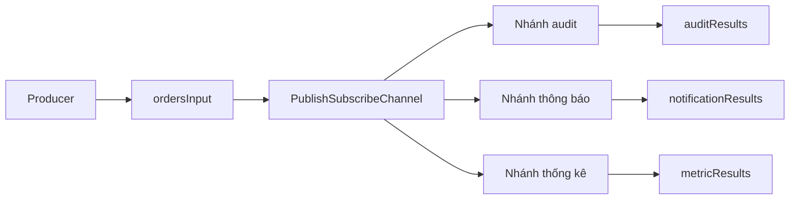
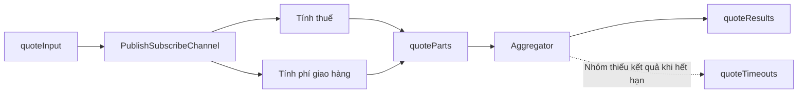

# publishSubscribe trong DSL

## 1. Mục tiêu và bối cảnh

Trong chương **DSL nâng cao** của module **SPRING_INTEGRATION_CORE**, `publishSubscribeChannel()` giúp biểu diễn một điểm phát thông điệp tới nhiều luồng xử lý. Đây là cách kết hợp `Message`, `MessageChannel`, endpoint và Java DSL để triển khai mẫu Publish–Subscribe ngay trong ứng dụng Spring Integration.

Giả sử hệ thống nhận sự kiện tạo đơn hàng. Bộ phận audit cần ghi nhận sự kiện, bộ phận thông báo cần tạo nội dung gửi khách hàng và bộ phận thống kê cần tăng bộ đếm. Mỗi bộ phận cần nhận sự kiện gốc và thực hiện công việc riêng. Ta có thể thể hiện ba trách nhiệm đó bằng ba subscriber.

Sau bài này, bạn có thể:

- Khai báo các subflow bằng `subscribe()` và giải thích thông điệp đi vào từng nhánh.
- Phân biệt broadcast với phân phối công việc cho một consumer.
- Chọn cách thực thi đồng bộ hoặc dùng executor dựa trên yêu cầu về độ trễ và lỗi.
- Nối các kết quả nhánh vào aggregator khi nghiệp vụ cần một kết quả tổng hợp.
- Kiểm thử hành vi phát thông điệp và xác định những điểm dễ gây thiếu kết quả.

Các ví dụ dùng Java 17 và cú pháp Java DSL của Spring Integration 6.x, với `IntegrationFlow.from(...)`. Dự án cần có `spring-integration-core` cùng các dependency Spring tương thích; dự án Spring Boot có thể dùng `spring-boot-starter-integration` và để BOM của Boot quản lý phiên bản. Các bài kiểm thử minh họa dùng JUnit Jupiter. Mỗi lớp cấu hình đầy đủ bên dưới là một ví dụ độc lập.

## 2. Publish–Subscribe tạo hình dạng luồng như thế nào?



Trong sơ đồ, mỗi cạnh đi ra khỏi channel biểu diễn một subscription. Khi không có lỗi làm gián đoạn việc phân phối, thông điệp được gửi tới tất cả subscriber đang đăng ký. Mỗi nhánh nhận đầu vào từ điểm broadcast; kết quả của nhánh audit không tự trở thành đầu vào của nhánh thông báo.

`PublishSubscribeChannel` gọi các `MessageHandler` đã đăng ký; bản thân channel không có thao tác `receive()` như `QueueChannel`. Vì vậy, để quan sát kết quả trong ví dụ, ta đặt một `QueueChannel` ở cuối từng nhánh. Xem [các loại MessageChannel trong Spring Integration](https://docs.spring.io/spring-integration/reference/channel/implementations.html#channel-implementations-publishsubscribechannel).

Ba khái niệm có vai trò khác nhau:

| Thành phần | Vai trò trong cấu hình |
| --- | --- |
| `publishSubscribeChannel(...)` | Đưa một channel broadcast vào vị trí hiện tại của flow |
| `subscribe(subflow)` | Đăng ký một luồng con nhận thông điệp từ channel đó |
| Endpoint trong subflow | Biến đổi, lọc hoặc xử lý thông điệp của nhánh |

Lambda cấu hình trong `subscribe()` được dùng khi Spring xây dựng flow. Nó không phải callback nghiệp vụ được gọi trực tiếp mỗi lần producer phát sự kiện. Logic xử lý từng thông điệp nằm trong các endpoint như `transform()`, `filter()` hoặc `handle()`. Java DSL tạo và đăng ký channel, handler, endpoint vào application context. Xem [cơ chế cấu hình Java DSL](https://docs.spring.io/spring-integration/reference/dsl.html).

## 3. Cú pháp khai báo subflow

Hai dạng thường dùng là:

```java
.publishSubscribeChannel(subscribers -> subscribers
    .subscribe(branchA -> branchA /* các endpoint nhánh A */)
    .subscribe(branchB -> branchB /* các endpoint nhánh B */))
```

```java
.publishSubscribeChannel(executor, subscribers -> subscribers
    .subscribe(branchA -> branchA /* các endpoint nhánh A */)
    .subscribe(branchB -> branchB /* các endpoint nhánh B */))
```

Đây là khung cú pháp; mỗi nhánh thực tế phải được cấu hình với endpoint hoặc channel đích thích hợp. Dạng thứ nhất không truyền executor. Dạng thứ hai chuyển việc gọi subscriber cho executor được cung cấp. API còn cho phép sử dụng một `BroadcastCapableChannel` có sẵn. Xem [API của `publishSubscribeChannel`](https://docs.spring.io/spring-integration/api/org/springframework/integration/dsl/BaseIntegrationFlowDefinition.html#publishSubscribeChannel(java.util.function.Consumer)).

Một subflow nên thể hiện một trách nhiệm có tên rõ ràng. Nếu nhánh có nhiều bước xử lý hoặc cần tái sử dụng, nên tách thành một `IntegrationFlow` riêng rồi kết nối qua channel dùng chung. Việc đặt tất cả logic vào các lambda lồng nhau sẽ làm quan hệ giữa các nhánh khó đọc.

## 4. Ví dụ đầy đủ: một sự kiện, ba nhánh độc lập

Ví dụ này chạy đồng bộ và dùng ba queue làm nơi nhận kết quả. Các chuỗi `AUDIT` và `MAIL` mô phỏng kết quả xử lý; chúng chưa thực hiện ghi cơ sở dữ liệu hay gửi email ra ngoài.

```java
import java.math.BigDecimal;

import org.springframework.beans.factory.annotation.Qualifier;
import org.springframework.context.annotation.Bean;
import org.springframework.context.annotation.Configuration;
import org.springframework.integration.channel.DirectChannel;
import org.springframework.integration.channel.QueueChannel;
import org.springframework.integration.config.EnableIntegration;
import org.springframework.integration.dsl.IntegrationFlow;

@Configuration(proxyBeanMethods = false)
@EnableIntegration
public class OrderBroadcastConfig {

    public record OrderCreated(
            String orderId,
            String customerId,
            BigDecimal amount) {
    }

    @Bean
    public DirectChannel ordersInput() {
        return new DirectChannel();
    }

    @Bean
    public QueueChannel auditResults() {
        return new QueueChannel(100);
    }

    @Bean
    public QueueChannel notificationResults() {
        return new QueueChannel(100);
    }

    @Bean
    public QueueChannel metricResults() {
        return new QueueChannel(100);
    }

    @Bean
    public IntegrationFlow orderBroadcastFlow(
            @Qualifier("ordersInput") DirectChannel input,
            @Qualifier("auditResults") QueueChannel audit,
            @Qualifier("notificationResults") QueueChannel notifications,
            @Qualifier("metricResults") QueueChannel metrics) {

        return IntegrationFlow.from(input)
                .publishSubscribeChannel(subscribers -> subscribers
                        .id("orderEvents")
                        .subscribe(branch -> branch
                                .<OrderCreated, String>transform(order ->
                                        "AUDIT:" + order.orderId())
                                .channel(audit))
                        .subscribe(branch -> branch
                                .<OrderCreated, String>transform(order ->
                                        "MAIL:" + order.customerId()
                                                + ":" + order.orderId())
                                .channel(notifications))
                        .subscribe(branch -> branch
                                .<OrderCreated, Long>transform(order -> 1L)
                                .channel(metrics)))
                .get();
    }
}
```

`ordersInput` là channel đầu vào. DSL đưa channel `orderEvents` vào sau nó và đăng ký ba subflow. Các `transform()` trả về payload mới của từng nhánh, sau đó channel cuối nhánh nhận message kết quả.

Với đầu vào:

```java
new OrderBroadcastConfig.OrderCreated(
        "OD-001", "CUS-01", new BigDecimal("1200000"));
```

Ta mong đợi:

| Queue | Payload nhận được |
| --- | --- |
| `auditResults` | `AUDIT:OD-001` |
| `notificationResults` | `MAIL:CUS-01:OD-001` |
| `metricResults` | `1L` |

Số `1L` biểu diễn một sự kiện cần cộng vào thống kê. Nếu cần lưu tổng số đơn, hãy đặt logic cập nhật bộ đếm ở một endpoint chuyên trách, thay vì để các subscriber cùng sửa một biến dùng chung trong payload.

Các queue có dung lượng 100 để ví dụ không tăng bộ nhớ vô hạn. Khi đưa vào ứng dụng thực, chúng cần consumer tương ứng và cấu hình gửi phù hợp nếu có thể đầy. Việc kết thúc flow bằng queue chỉ thể hiện thông điệp đã được đưa vào queue; consumer ở bước sau còn có thể chưa xử lý.

### 4.1. Subscriber dùng `handle()` và không tạo reply

Một nhánh thực hiện side effect có thể dùng service activator kết thúc bằng `null`:

```java
.subscribe(branch -> branch
        .handle(OrderCreated.class, (order, headers) -> {
            auditService.record(order.orderId());
            return null;
        }))
```

Đoạn này giả sử `OrderCreated` và `auditService` đã có trong phạm vi cấu hình. Nhánh dừng tại handler vì không tạo reply. Nếu phía sau handler cần xử lý tiếp chính payload đó, handler phải trả lại payload hoặc tạo một reply thích hợp.

Quyết định kết thúc nhánh cần thể hiện ngay trong cấu hình. Một handler trả kết quả nhưng không có output channel vẫn có thể sử dụng header `replyChannel` của message. Trong luồng gọi qua gateway, để nhiều nhánh cùng trả reply vào kênh phản hồi của một request sẽ không tự tạo được một kết quả tổng hợp.

## 5. Bước viết sau `publishSubscribeChannel()` nhận dữ liệu nào?

Xét biến thể sau của flow ở mục 4; các biến `input`, `audit`, `notifications`, `metrics` là những channel đã được inject:

```java
return IntegrationFlow.from(input)
        .publishSubscribeChannel(subscribers -> subscribers
                .subscribe(branch -> branch
                        .<OrderCreated, String>transform(order ->
                                "AUDIT:" + order.orderId())
                        .channel(audit))
                .subscribe(branch -> branch
                        .<OrderCreated, String>transform(order ->
                                "MAIL:" + order.customerId()
                                        + ":" + order.orderId())
                        .channel(notifications)))
        .<OrderCreated, Long>transform(order -> 1L)
        .channel(metrics)
        .get();
```

Ở đây, nhánh thống kê viết tiếp sau `publishSubscribeChannel()` trở thành một subscriber bổ sung của channel broadcast. Transformer thống kê nhận `OrderCreated` từ điểm phát. Nó không nhận chuỗi do nhánh audit tạo ra, cũng không nhận danh sách kết quả của hai nhánh đã khai báo bằng `subscribe()`.

Cách nối subflow này được minh họa trong [tài liệu hỗ trợ subflow của Java DSL](https://docs.spring.io/spring-integration/reference/dsl/java-subflows.html).

Vì vậy, đoạn sau không biểu diễn việc gom kết quả hai nhánh:

```java
.publishSubscribeChannel(subscribers -> subscribers
        .subscribe(/* nhánh A */)
        .subscribe(/* nhánh B */))
.aggregate()
```

Đây chỉ là phác thảo để chỉ ra một lỗi thiết kế. Aggregator đứng ngay sau channel trở thành một consumer khác của thông điệp phát ra. Muốn gom kết quả A và B, phải đưa output của cả hai nhánh vào channel đầu vào của aggregator. Mục 9 sẽ xây dựng cấu hình đó.

## 6. Đồng bộ, executor và giới hạn của việc gửi thành công

### 6.1. Không truyền executor

Channel gọi subscriber trong thread của sender. Nếu toàn bộ đường đi của một nhánh vẫn đồng bộ, sender đi qua các endpoint của nhánh trước khi lời gọi đó kết thúc. Một nhánh chậm có thể làm tăng thời gian gửi.

Nếu một nhánh chèn `QueueChannel`, `ExecutorChannel` hoặc một ranh giới bất đồng bộ khác, phần xử lý sau ranh giới ấy có vòng đời riêng. Không thể suy ra mọi công việc nghiệp vụ đã hoàn tất chỉ từ việc channel broadcast ban đầu không có executor.

### 6.2. Truyền executor

Các bean sau có thể được thêm vào `OrderBroadcastConfig` để minh họa một đầu vào bất đồng bộ riêng. Cần bổ sung hai import:

```java
import java.util.concurrent.ThreadPoolExecutor;
import org.springframework.scheduling.concurrent.ThreadPoolTaskExecutor;
```

```java
@Bean
public ThreadPoolTaskExecutor orderFanoutExecutor() {
    ThreadPoolTaskExecutor executor = new ThreadPoolTaskExecutor();
    executor.setCorePoolSize(4);
    executor.setMaxPoolSize(8);
    executor.setQueueCapacity(200);
    executor.setThreadNamePrefix("order-fanout-");
    executor.setRejectedExecutionHandler(
            new ThreadPoolExecutor.AbortPolicy());
    return executor;
}

@Bean
public IntegrationFlow asyncOrderBroadcastFlow(
        @Qualifier("orderFanoutExecutor") ThreadPoolTaskExecutor executor,
        @Qualifier("auditResults") QueueChannel audit,
        @Qualifier("notificationResults") QueueChannel notifications) {

    return IntegrationFlow.from("asyncOrdersInput")
            .publishSubscribeChannel(executor, subscribers -> subscribers
                    .id("asyncOrderEvents")
                    .subscribe(branch -> branch
                            .<OrderCreated, String>transform(order ->
                                    "ASYNC-AUDIT:" + order.orderId())
                            .channel(audit))
                    .subscribe(branch -> branch
                            .<OrderCreated, String>transform(order ->
                                    "ASYNC-MAIL:" + order.orderId())
                            .channel(notifications)))
            .get();
}
```

Executor được khai báo thành bean để Spring quản lý việc khởi tạo và đóng pool. Channel đầu vào `asyncOrdersInput` được DSL tạo khi chưa có bean cùng tên.

Với pool nhiều worker, các nhánh có thể chạy đồng thời. Thứ tự hoàn tất không được suy ra từ vị trí của `subscribe()`. Lời gọi gửi thành công cũng chưa xác nhận các tác vụ đã thành công về nghiệp vụ. Các hành vi thread và error handler của channel được mô tả trong [API `PublishSubscribeChannel`](https://docs.spring.io/spring-integration/docs/current/api/org/springframework/integration/channel/PublishSubscribeChannel.html).

| Câu hỏi thiết kế | Flow đồng bộ xuyên suốt | Flow dùng executor có nhiều worker |
| --- | --- | --- |
| Ai chạy endpoint của nhánh? | Thread đang gửi message | Worker nhận task từ executor |
| Nhánh chậm ảnh hưởng ra sao? | Có thể giữ sender lâu hơn | Chiếm worker và có thể làm tăng hàng đợi |
| Có thể dựa vào thứ tự hoàn tất? | Cần xét thứ tự handler và mọi ranh giới trong flow | Phải thiết kế độc lập với thứ tự hoàn tất |
| Transaction hiện có của sender? | Có thể tham gia nếu tài nguyên và cấu hình cho phép | Không tự truyền transaction gắn với thread sang worker |
| `send()` trả về có nghĩa gì? | Lời gọi phân phối đã kết thúc theo cấu hình channel | Chưa phải xác nhận toàn bộ xử lý nghiệp vụ |

Với ví dụ hai subscriber, mỗi sự kiện tạo công việc cho hai nhánh. Khi đánh giá tải, cần tính cả số sự kiện mỗi giây, số subscriber và thời gian xử lý mỗi nhánh. Các con số pool ở ví dụ chỉ phục vụ minh họa.

Khi pool và queue đầy, `AbortPolicy` từ chối tác vụ mới. Lỗi gửi task có thể xuất hiện tại sender; một số nhánh khác có thể đã được submit hoặc đã chạy. Đây là tình huống phân phối một phần cần được tính đến khi quyết định retry cả sự kiện.

## 7. Xử lý lỗi theo ranh giới thực thi

### 7.1. Lỗi trong flow đồng bộ

Mặc định `ignoreFailures` là `false`. Nếu một subscriber đồng bộ ném exception, lỗi có thể truyền về sender và dừng quá trình phân phối trước khi một số subscriber còn lại được gọi. Side effect ở những nhánh đã chạy không tự được bù trừ.

Ví dụ về một nhánh thất bại:

```java
.subscribe(branch -> branch
        .handle(OrderCreated.class, (order, headers) -> {
            throw new IllegalStateException(
                    "Không thể ghi audit cho " + order.orderId());
        }))
```

`ignoreFailures(true)` cho phép dispatcher bỏ qua lỗi handler theo chính sách của channel. Chỉ nên dùng khi việc bỏ qua đã là quyết định nghiệp vụ rõ ràng và có cách quan sát lỗi. Cấu hình này không tự retry hay tạo bản ghi xử lý thất bại. Xem [các tùy chọn của `PublishSubscribeChannelSpec`](https://docs.spring.io/spring-integration/api/org/springframework/integration/dsl/PublishSubscribeChannelSpec.html).

### 7.2. Lỗi trong subscriber chạy trên worker

Khi dùng executor, lỗi nghiệp vụ phát sinh sau đó không quay lại call stack của sender theo cách ném exception thông thường. Error handler mặc định của channel phát `ErrorMessage` tới channel trong header `errorChannel`, hoặc channel toàn cục `errorChannel` nếu header không có. Xem [cơ chế xử lý lỗi của Spring Integration](https://docs.spring.io/spring-integration/reference/error-handling.html).

Để quan sát điều này, bổ sung bean queue và flow sau vào cấu hình đã có executor ở mục 6. Cần import `org.springframework.messaging.MessageHeaders`:

```java
@Bean
public QueueChannel orderErrors() {
    return new QueueChannel(100);
}

@Bean
public IntegrationFlow asyncFailureDemoFlow(
        @Qualifier("orderFanoutExecutor") ThreadPoolTaskExecutor executor,
        @Qualifier("orderErrors") QueueChannel errors,
        @Qualifier("auditResults") QueueChannel audit) {

    return IntegrationFlow.from("failingAsyncOrdersInput")
            .enrichHeaders(headers ->
                    headers.header(MessageHeaders.ERROR_CHANNEL, errors))
            .publishSubscribeChannel(executor, subscribers -> subscribers
                    .subscribe(branch -> branch
                            .handle(OrderCreated.class, (order, headers) -> {
                                throw new IllegalStateException(
                                        "Lỗi mô phỏng: " + order.orderId());
                            }))
                    .subscribe(branch -> branch
                            .<OrderCreated, String>transform(order ->
                                    "SURVIVING-AUDIT:" + order.orderId())
                            .channel(audit)))
            .get();
}
```

Nếu executor nhận đủ hai task, một nhánh tạo lỗi còn nhánh audit vẫn có thể hoàn tất. Queue `orderErrors` cho phép kiểm tra `ErrorMessage` trong bài thực hành; ứng dụng thật cần consumer để xử lý lỗi, ghi log hoặc chuyển sang cơ chế khôi phục.

Payload của `ErrorMessage` là `Throwable`; khi đó là `MessagingException`, có thể kiểm tra thêm `failedMessage`. Để truy vết, nên giữ mã sự kiện hoặc mã yêu cầu trong header hay payload, đồng thời gắn tên endpoint rõ ràng cho các bước quan trọng.

`errorHandler(...)` của `PublishSubscribeChannel` chỉ được dùng khi channel được cấu hình executor. Với cấu hình đồng bộ, exception vẫn đi theo call stack. Một flow lỗi cũng cần hoạt động ổn định; nếu consumer của error channel tiếp tục thất bại, lỗi không thể được coi là đã khôi phục chỉ vì đã có `ErrorMessage`.

### 7.3. Retry ở vị trí nào?

Với ví dụ audit, gửi thông báo và thống kê, retry toàn bộ đầu vào có thể thực hiện lại những nhánh đã thành công. Vì vậy, thiết kế thường phù hợp là:

- Đặt retry tại endpoint gọi thao tác có thể thất bại, với số lần thử và điều kiện thử lại rõ ràng.
- Làm side effect idempotent bằng khóa nghiệp vụ như `eventId` kết hợp tên tác vụ.
- Ghi nhận kết quả từng tác vụ khi cần khôi phục sau một lần xử lý dở dang.

Đây là lựa chọn thiết kế cho ví dụ, không phải bảo đảm được channel cung cấp tự động. Nếu yêu cầu phải khôi phục sau khi tiến trình dừng, cần có nơi lưu sự kiện hoặc công việc bền vững thích hợp.

## 8. Payload dùng chung và bộ lọc trong từng nhánh

### 8.1. Đừng dùng payload như vùng nhớ để phối hợp subscriber

Mặc định, `applySequence` là `false`. Channel có thể đưa cùng một đối tượng `Message` tới các subscriber. Khi bật `applySequence(true)`, channel tạo message với các header sequence tương ứng, nhưng vẫn giữ cùng tham chiếu payload. Vì vậy, việc tạo message riêng cho nhánh không có nghĩa payload được deep copy. Xem [cấu hình `PublishSubscribeChannel`](https://docs.spring.io/spring-integration/reference/channel/configuration.html#channel-configuration-publishsubscribechannel).

Thiết kế sau tạo quan hệ phụ thuộc ngầm giữa các nhánh:

```java
// Payload là một Map có thể thay đổi.
payload.put("auditCompleted", true);
```

Nếu nhánh khác đọc khóa đó để quyết định xử lý, kết quả phụ thuộc vào thời điểm chạy và việc truy cập đồng thời. Cách này còn làm hỏng ý nghĩa mỗi subscriber xử lý một sự kiện độc lập.

Nên dùng payload bất biến hoặc tạo payload kết quả mới cho mỗi nhánh. `record OrderCreated` ở ví dụ chứa `String` và `BigDecimal`, đều phù hợp với cách sử dụng bất biến. Nếu record có thành phần là `List` hoặc `Map` có thể thay đổi, cần sao chép phòng vệ hoặc thiết kế kiểu dữ liệu tương ứng; chỉ dùng từ khóa `record` chưa giải quyết được mọi vấn đề chia sẻ dữ liệu.

### 8.2. Một nhánh có thể lọc sau khi nhận broadcast

Giả sử chỉ gửi thông báo cho đơn có giá trị từ một triệu đồng. Có thể thay subflow thông báo bằng:

```java
.subscribe(branch -> branch
        .<OrderCreated>filter(order ->
                order.amount().compareTo(new BigDecimal("1000000")) >= 0)
        .<OrderCreated, String>transform(order ->
                "HIGH-VALUE-MAIL:" + order.orderId())
        .channel(notifications))
```

Với đơn nhỏ hơn ngưỡng, nhánh thông báo dừng tại filter theo cấu hình mặc định; các nhánh audit và thống kê vẫn có thể xử lý sự kiện. Điều này thể hiện hai bước khác nhau: channel chọn tất cả subscriber, sau đó filter quyết định message có được đi tiếp trong một nhánh hay không.

Khi các nhánh phải trả đủ kết quả cho aggregator, một filter loại message sẽ làm mất một phần kết quả dự kiến. Lúc đó cần điều chỉnh hợp đồng phản hồi, chẳng hạn luôn trả về `SKIPPED` cho nhánh không áp dụng, hoặc sử dụng chính sách hoàn thành khác.

## 9. Gom kết quả bằng `applySequence(true)` và aggregator

### 9.1. Xác định đầu ra cần gom

Một yêu cầu tính chi phí cần lấy kết quả tính thuế và phí giao hàng, rồi trả về một bản tổng hợp. Hai nhánh phải gửi output vào cùng một channel `quoteParts`:



Khi bật `applySequence(true)` tại điểm broadcast, các message nhánh có thông tin tương quan và sequence phục vụ việc gom:

| Header | Ý nghĩa trong ví dụ hai subscriber |
| --- | --- |
| `correlationId` | Liên kết các message sinh ra từ cùng một lần broadcast |
| `sequenceNumber` | Vị trí của subscriber trong sequence, thường là 1 hoặc 2 |
| `sequenceSize` | Số subscriber của lần broadcast, ở đây là 2 |

Số sequence biểu diễn vị trí trong nhóm; nó không bảo đảm nhánh có số 1 sẽ hoàn tất trước nhánh số 2.

### 9.2. Cấu hình đầy đủ

```java
import java.math.BigDecimal;
import java.util.List;

import org.springframework.beans.factory.annotation.Qualifier;
import org.springframework.context.annotation.Bean;
import org.springframework.context.annotation.Configuration;
import org.springframework.integration.channel.DirectChannel;
import org.springframework.integration.channel.QueueChannel;
import org.springframework.integration.config.EnableIntegration;
import org.springframework.integration.dsl.IntegrationFlow;

@Configuration(proxyBeanMethods = false)
@EnableIntegration
public class PricingFanoutConfig {

    public record QuoteRequest(String orderId, BigDecimal baseAmount) {
    }

    public record QuotePart(String source, BigDecimal amount) {
    }

    public record QuoteSummary(List<QuotePart> parts) {
        public QuoteSummary {
            parts = List.copyOf(parts);
        }
    }

    @Bean
    public DirectChannel quoteInput() {
        return new DirectChannel();
    }

    @Bean
    public DirectChannel quoteParts() {
        return new DirectChannel();
    }

    @Bean
    public QueueChannel quoteResults() {
        return new QueueChannel(100);
    }

    @Bean
    public QueueChannel quoteTimeouts() {
        return new QueueChannel(100);
    }

    @Bean
    public IntegrationFlow quoteFanoutFlow(
            @Qualifier("quoteInput") DirectChannel input,
            @Qualifier("quoteParts") DirectChannel parts) {

        return IntegrationFlow.from(input)
                .publishSubscribeChannel(subscribers -> subscribers
                        .applySequence(true)
                        .subscribe(branch -> branch
                                .<QuoteRequest, QuotePart>transform(request ->
                                        new QuotePart("tax",
                                                request.baseAmount().multiply(
                                                        new BigDecimal("0.10"))))
                                .channel(parts))
                        .subscribe(branch -> branch
                                .<QuoteRequest, QuotePart>transform(request ->
                                        new QuotePart("shipping",
                                                new BigDecimal("30000")))
                                .channel(parts)))
                .get();
    }

    @Bean
    public IntegrationFlow quoteAggregationFlow(
            @Qualifier("quoteParts") DirectChannel parts,
            @Qualifier("quoteResults") QueueChannel results,
            @Qualifier("quoteTimeouts") QueueChannel timeouts) {

        return IntegrationFlow.from(parts)
                .aggregate(aggregator -> aggregator
                        .outputProcessor(group -> new QuoteSummary(
                                group.getMessages().stream()
                                        .map(message ->
                                                (QuotePart) message.getPayload())
                                        .toList()))
                        .groupTimeout(5000)
                        .sendPartialResultOnExpiry(false)
                        .discardChannel(timeouts))
                .channel(results)
                .get();
    }
}
```

Với `baseAmount = 1000000`, bản tổng hợp có một phần `tax = 100000.00` và một phần `shipping = 30000`. Logic thuế và phí giao hàng chỉ là quy tắc minh họa, không đại diện cho chính sách thương mại hay pháp lý thực tế.

Aggregator mặc định dùng header tương quan để phân nhóm và thông tin sequence để xác định khi nào đủ message. Hai transformer DSL tạo payload mới và giữ các header cần thiết cho việc gom. Nếu thay bằng code tự xây `Message` mới, phải bảo toàn các header tương quan và sequence cần dùng. Xem [correlation strategy và release strategy của aggregator](https://docs.spring.io/spring-integration/reference/aggregator.html).

Trong ví dụ, `QuoteSummary` chứa danh sách kết quả mới. Thuộc tính `source` cho biết từng giá trị thuộc nhánh nào; consumer không cần phụ thuộc thứ tự phần tử trong danh sách.

### 9.3. Hợp đồng của mỗi nhánh

Để cách gom mặc định hoạt động đúng, mỗi subscriber tham gia sequence cần tạo đúng một kết quả cho aggregator đó. Từ hợp đồng này, cần xử lý các tình huống sau:

- **Một nhánh không tạo reply:** nhóm có thể thiếu kết quả đến khi hết hạn.
- **Một nhánh phát nhiều message:** số phần đến aggregator có thể khác số subscriber ban đầu.
- **Thêm một subscriber quan sát:** `sequenceSize` tăng dù subscriber mới không gửi output tới `quoteParts`.
- **Gắn một bước xử lý tiếp sau pubsub:** bước đó có thể trở thành subscriber bổ sung và làm thay đổi kích thước sequence.

Vì vậy, một nhánh audit chỉ quan sát sự kiện nên được đặt ngoài tập nhánh dùng để tạo kết quả tổng hợp, hoặc toàn bộ quy tắc correlation/release phải được thiết kế lại cho cấu trúc mới.

### 9.4. Timeout, lỗi và vòng đời nhóm

Trong ví dụ, `groupTimeout(5000)` đặt thời gian chờ của nhóm sau khi nhận message, với lịch được cập nhật theo hoạt động của nhóm. `sendPartialResultOnExpiry(false)` khiến nhóm thiếu dữ liệu không tạo `QuoteSummary` như một kết quả đầy đủ; các message bị loại khi hết hạn được đưa tới `quoteTimeouts` theo cấu hình.

Timeout này không hủy tác vụ đang chạy trong nhánh. Nó cũng chỉ áp dụng khi nhóm đã được hình thành bởi ít nhất một kết quả. Nếu mọi nhánh đều thất bại trước khi gửi kết quả, cần cơ chế theo dõi thời hạn của request ở mức gọi hoặc orchestration.

Ứng dụng có tải liên tục cần chọn `MessageGroupStore`, chính sách dọn metadata của nhóm đã hoàn thành, cách xử lý kết quả đến muộn và bản ghi idempotency. Không nên tự động xóa nhóm ngay khi hoàn tất mà chưa cân nhắc việc message trùng hoặc đến muộn có thể tạo nhóm mới.

Đặc biệt, không thay correlation key bằng mỗi `orderId` nếu nhiều lần tính giá cho cùng đơn có thể chạy đồng thời. Khi đó nên có mã yêu cầu riêng cho mỗi lần tính, để các kết quả của hai yêu cầu không bị trộn vào cùng nhóm.

## 10. Kiểm thử broadcast bằng kết quả quan sát được

### 10.1. Kiểm tra một sự kiện tạo đủ kết quả

Bài kiểm thử sau dùng lớp `OrderBroadcastConfig` nguyên bản ở mục 4. Nó khởi tạo application context thật, gửi message qua channel rồi kiểm tra cả ba đầu ra.

```java
import java.math.BigDecimal;

import org.junit.jupiter.api.Test;
import org.springframework.context.annotation.AnnotationConfigApplicationContext;
import org.springframework.integration.channel.QueueChannel;
import org.springframework.messaging.Message;
import org.springframework.messaging.MessageChannel;
import org.springframework.messaging.support.GenericMessage;

import static org.junit.jupiter.api.Assertions.*;

class OrderBroadcastTest {

    @Test
    void broadcastsOneOrderToThreeSubscribers() {
        try (var context = new AnnotationConfigApplicationContext(
                OrderBroadcastConfig.class)) {

            MessageChannel input =
                    context.getBean("ordersInput", MessageChannel.class);
            QueueChannel audit =
                    context.getBean("auditResults", QueueChannel.class);
            QueueChannel notifications =
                    context.getBean("notificationResults", QueueChannel.class);
            QueueChannel metrics =
                    context.getBean("metricResults", QueueChannel.class);

            var order = new OrderBroadcastConfig.OrderCreated(
                    "OD-001", "CUS-01", new BigDecimal("1200000"));

            assertTrue(input.send(new GenericMessage<>(order)));
            assertPayload("AUDIT:OD-001", audit.receive(1000));
            assertPayload("MAIL:CUS-01:OD-001", notifications.receive(1000));
            assertPayload(1L, metrics.receive(1000));

            assertNull(audit.receive(0));
            assertNull(notifications.receive(0));
            assertNull(metrics.receive(0));
        }
    }

    private static void assertPayload(Object expected, Message<?> actual) {
        assertNotNull(actual);
        assertEquals(expected, actual.getPayload());
    }
}
```

`receive(1000)` đặt thời gian chờ hữu hạn, còn `receive(0)` kiểm tra ngay queue đã hết message. Trong flow đồng bộ này, khi `send()` hoàn tất thành công, các kết quả đã tới queue, nên kiểm tra không có phần dư giúp phát hiện nhánh vô tình tạo thêm message.

### 10.2. Kiểm tra fan-out và gom kết quả

Với `PricingFanoutConfig`, có thể thêm bài kiểm thử độc lập sau. Các import ngoài những import kiểm thử ở mục 10.1 là `java.util.Map` và `java.util.stream.Collectors`:

```java
@Test
void collectsTaxAndShippingForOneRequest() {
    try (var context = new AnnotationConfigApplicationContext(
            PricingFanoutConfig.class)) {

        MessageChannel input =
                context.getBean("quoteInput", MessageChannel.class);
        QueueChannel results =
                context.getBean("quoteResults", QueueChannel.class);

        var request = new PricingFanoutConfig.QuoteRequest(
                "OD-002", new BigDecimal("1000000"));
        assertTrue(input.send(new GenericMessage<>(request)));

        Message<?> reply = results.receive(1000);
        assertNotNull(reply);
        var summary = assertInstanceOf(
                PricingFanoutConfig.QuoteSummary.class, reply.getPayload());

        assertEquals(2, summary.parts().size());
        Map<String, BigDecimal> amounts = summary.parts().stream()
                .collect(Collectors.toMap(
                        PricingFanoutConfig.QuotePart::source,
                        PricingFanoutConfig.QuotePart::amount));

        assertEquals(0,
                new BigDecimal("100000.00").compareTo(amounts.get("tax")));
        assertEquals(0,
                new BigDecimal("30000").compareTo(amounts.get("shipping")));
        assertNull(results.receive(0));
    }
}
```

Bài kiểm thử so sánh theo tên nhánh để không lệ thuộc thứ tự kết quả, đồng thời dùng `compareTo()` để so sánh giá trị tiền mà không phụ thuộc scale của `BigDecimal`.

### 10.3. Các tình huống nên bổ sung khi thay đổi flow

| Tình huống | Điều cần quan sát |
| --- | --- |
| Nhánh thông báo có filter | Đơn dưới ngưỡng vẫn có audit và metric, không có thông báo |
| Subscriber đồng bộ thất bại | Sender nhận lỗi phù hợp và xác định được nhánh nào đã thực hiện side effect |
| Subscriber bất đồng bộ thất bại | Có `ErrorMessage`; nhánh còn lại vẫn có kết quả nếu task được nhận |
| Hai request đồng thời | Mỗi bản tổng hợp chỉ chứa kết quả của đúng request |
| Một nhánh không trả kết quả | Không phát bản tổng hợp đầy đủ; nhóm thiếu đi theo chính sách timeout |
| Phát lại cùng sự kiện | Side effect không bị lặp ngoài quy tắc idempotency đã chọn |
| Executor từ chối task | Ghi nhận được lỗi gửi và khả năng đã phân phối một phần |

Với kiểm thử bất đồng bộ, hãy chờ thông điệp tại queue đích hoặc dùng latch có timeout. Không dùng `Thread.sleep()` như bằng chứng rằng mọi subscriber đã hoàn tất. Kiểm tra ngay queue rỗng sau một lần nhận cũng chưa chứng minh không có message đến muộn; cần điểm kết thúc hoặc thời gian quan sát phù hợp với hành vi đang kiểm tra.

## 11. Chọn cấu trúc phù hợp với yêu cầu

| Yêu cầu | Cấu trúc nên cân nhắc |
| --- | --- |
| Mọi tác vụ độc lập đều cần nhận sự kiện | `publishSubscribeChannel()` với các subscriber rõ trách nhiệm |
| Chia tải một loại công việc cho nhiều worker | Channel point-to-point như `DirectChannel`, `ExecutorChannel` hoặc queue phù hợp |
| Chọn nhánh theo dữ liệu nghiệp vụ | Router hoặc recipient list theo điều kiện |
| Theo dõi một luồng xử lý hiện có | `wireTap()` với chính sách thực thi và lỗi được cấu hình rõ |
| Trả một kết quả sau nhiều phép tính | Các nhánh phát kết quả vào aggregator hoặc cấu trúc scatter–gather phù hợp |
| Phát sự kiện qua nhiều tiến trình và lưu bền vững | Channel/adapter kết nối broker cùng cấu hình lưu trữ và xác nhận phù hợp |

Channel `PublishSubscribeChannel` thông thường trong bài hoạt động trong tiến trình. Tên gọi publish–subscribe không tự bổ sung lưu trữ bền vững, phát lại cho subscriber đăng ký muộn hoặc xác nhận phân tán. Việc dùng channel dựa trên broker là một lựa chọn kiến trúc riêng; Java DSL có overload nhận `BroadcastCapableChannel` để hỗ trợ cấu hình subflow trên một số loại channel đó.

Nếu nghiệp vụ yêu cầu audit phải thành công trước khi gửi thông báo, nên biểu diễn thứ tự phụ thuộc bằng các endpoint nối tiếp. Nếu nghiệp vụ chỉ cho phép trả một reply cho caller, hãy thiết kế đầu ra tổng hợp riêng và để gateway nhận reply đó. Hình dạng flow cần thể hiện quan hệ nghiệp vụ mà hệ thống thực sự phải bảo đảm.

## 12. Bài thực hành mở rộng

Thực hiện lần lượt trên các ví dụ trong bài:

1. Thêm filter cho nhánh thông báo và gửi một đơn dưới ngưỡng, một đơn trên ngưỡng. Quan sát đầu ra của cả ba nhánh.
2. Thêm executor và ghi tên thread tại mỗi handler để quan sát việc xử lý trên worker. Dùng queue kết quả để xác nhận hoàn tất.
3. Cho nhánh audit ném lỗi ở flow bất đồng bộ, nhận `ErrorMessage` qua `orderErrors` và đối chiếu mã đơn trong lỗi với sự kiện gửi vào.
4. Trong ví dụ tính giá, cho một nhánh không phát kết quả. Quan sát aggregator chờ và hết hạn; sau đó sửa nhánh để trả một kết quả có trạng thái rõ ràng khi không áp dụng.
5. Gửi hai yêu cầu tính giá cho cùng `orderId` và xác nhận mỗi lần broadcast vẫn tạo một nhóm kết quả riêng.

Ở mỗi thay đổi, hãy xác định trước số subscriber tại điểm broadcast, số kết quả mà mỗi nhánh tạo và channel tiếp nhận từng kết quả. Ba thông tin này giúp giải thích được hành vi của flow khi thêm filter, executor hoặc aggregator.
