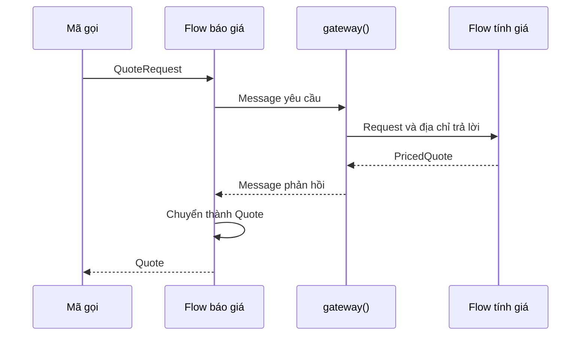

# Gateway trong DSL

## 1. Mục tiêu và phạm vi

Trong chương **DSL nâng cao** của module **SPRING_INTEGRATION_CORE**, bài này trình bày cách dùng `.gateway(...)` để một luồng thông điệp gọi luồng khác, nhận phản hồi và tiếp tục xử lý. Đây là kỹ thuật hữu ích khi muốn tái sử dụng một nghiệp vụ như tính giá, chuẩn hóa dữ liệu hoặc kiểm tra điều kiện mà vẫn giữ cách tổ chức bằng `Message`, `MessageChannel` và endpoint.

Sau bài học, bạn có thể:

- Chọn đúng giữa gọi flow con bằng gateway, chuyển message sang channel và gọi trực tiếp một service.
- Định nghĩa hợp đồng request–reply cho flow được gọi.
- Cấu hình timeout và xử lý tình huống không có reply.
- Kết hợp gateway với transformer, filter, router và aggregator.
- Viết kiểm thử cho kết quả, header, nhánh bị từ chối và timeout.

**Quy ước ví dụ:** Java 17 trở lên, Spring Integration **6.5.x**, Java DSL tích hợp trong `spring-integration-core`. Mã kiểm thử dùng JUnit Jupiter. Khi dùng Spring Boot, chọn phiên bản dependency theo BOM của ứng dụng để các thư viện Spring tương thích với nhau. Các timeout trong bài được cấu hình tường minh để người đọc không phải dựa vào giá trị mặc định của từng phiên bản.

## 2. Gateway ở giữa flow giải quyết vấn đề gì?

Giả sử hệ thống có hai luồng cần tính giá:

```text
Tạo báo giá ───────┐
                  ├──> Tính giá ───> Kết quả tính giá
Kiểm tra giỏ hàng ┘
```

Mỗi luồng gọi cần sử dụng kết quả tính giá theo cách riêng. Nếu nối cố định đầu ra của luồng tính giá vào một channel của luồng báo giá, luồng kiểm tra giỏ hàng khó tái sử dụng nghiệp vụ đó.

`.gateway(...)` tạo một điểm gọi request–reply: gửi message tới đầu vào của flow đích, nhận reply rồi chuyển reply cho endpoint tiếp theo trong flow gọi. Spring Integration triển khai toán tử này bằng `GatewayMessageHandler`. Xem [Operator gateway()](https://docs.spring.io/spring-integration/reference/6.5/dsl/java-gateway.html).



Điểm cần nhớ là **endpoint sau gateway nhận kết quả của flow con**. Nó không tự động nhận lại payload ban đầu và cũng không tự động nhận một cặp gồm request và reply.

Nếu bước sau cần cả yêu cầu lẫn kết quả, hãy thiết kế kiểu phản hồi chứa đủ dữ liệu. Ví dụ `PricedQuote(QuoteRequest request, BigDecimal total)` lưu rõ yêu cầu nào đã được tính giá.

## 3. Ba cách viết có chữ “gateway” nhưng vai trò khác nhau

| Cách khai báo | Nơi sử dụng | Vai trò |
|---|---|---|
| `.gateway("pricingRequests")` | Ở giữa `IntegrationFlow` | Flow hiện tại gọi một flow khác và nhận reply |
| `IntegrationFlow.from(QuoteApi.class, ...)` | Đầu một flow | Tạo proxy để mã Java gọi interface rồi đi vào flow |
| `@MessagingGateway` và `@Gateway` | Interface dịch vụ | Khai báo gateway bằng annotation |

Một ứng dụng có thể dùng gateway ở cả hai biên:

```text
QuoteApi.quote(...)
    → gateway proxy ở đầu vào
    → filter
    → gateway("pricingRequests") ở giữa flow
    → transformer
    → trả về Quote
```

Với `IntegrationFlow.from(Interface.class)`, DSL thiết lập đầu vào của proxy để đi vào chính flow đang định nghĩa. Interface không bắt buộc có `@MessagingGateway`. Khi đã chọn cách này, tránh đăng ký thêm một proxy khác cho cùng interface qua cơ chế quét annotation. Tham khảo [IntegrationFlow as a Gateway](https://docs.spring.io/spring-integration/reference/6.5/dsl/integration-flow-as-gateway.html).

Hai callback cấu hình cũng khác kiểu:

```java
// GatewayProxySpec: cấu hình proxy mà mã Java gọi.
IntegrationFlow.from(QuoteApi.class, proxy -> proxy
        .beanName("quoteApi")
        .requestTimeout(200)
        .replyTimeout(1500));

// GatewayEndpointSpec: cấu hình gateway nằm giữa flow.
// Đây là một đoạn của chuỗi DSL.
.gateway("pricingRequests", gateway -> gateway
        .id("pricingGateway")
        .requestTimeout(200L)
        .replyTimeout(1000L));
```

`beanName(...)` đặt tên bean proxy; `id(...)` đặt định danh endpoint. Không nên mặc định mọi phương thức cấu hình đều có mặt trên cả hai spec. API tương ứng là [GatewayProxySpec](https://docs.spring.io/spring-integration/docs/6.5.0/api/org/springframework/integration/dsl/GatewayProxySpec.html) và [GatewayEndpointSpec](https://docs.spring.io/spring-integration/docs/6.5.0/api/org/springframework/integration/dsl/GatewayEndpointSpec.html).

## 4. Hợp đồng request–reply của flow con

Trước khi viết gateway, hãy mô tả flow đích như một hợp đồng dịch vụ.

| Thành phần | Ví dụ tính giá |
|---|---|
| Đầu vào | `QuoteRequest` |
| Đầu ra | Một `PricedQuote` |
| Dữ liệu liên hệ nghiệp vụ | `orderId` |
| Nhánh thành công | Trả tổng tiền |
| Dữ liệu không hợp lệ | Báo lỗi rõ ràng |
| Lỗi xử lý | Truyền lỗi hoặc tạo phản hồi dự phòng có hợp đồng riêng |
| Không nhận phản hồi đúng hạn | Áp dụng chính sách timeout |

### 4.1. Reply đi về đâu?

Gateway cung cấp địa chỉ trả lời cho lời gọi. Ở cuối flow con, một endpoint sinh kết quả nhưng không khai báo output channel có thể gửi phản hồi theo header `replyChannel`. Đây là ứng dụng của mẫu **Return Address**.

Với service activator, output channel được cấu hình tường minh có độ ưu tiên trước địa chỉ trả lời trong header. Vì vậy, flow phục vụ gateway thường để endpoint cuối trả kết quả tự nhiên. Xem [Service Activator](https://docs.spring.io/spring-integration/reference/6.5/service-activator.html).

```java
@Bean
IntegrationFlow pricingFlow() {
    return IntegrationFlow.from("pricingRequests")
            .<QuoteRequest>handle((request, headers) ->
                    calculate(request))
            .get();
}
```

Đoạn trên minh họa cấu trúc; `calculate(...)` là hàm nghiệp vụ do ứng dụng cung cấp.

Nếu thêm `.channel("someResults")` ở cuối, phản hồi sẽ đi tới channel đó. Khi không có đường đưa kết quả trở lại gateway, flow gọi sẽ không nhận được reply.

### 4.2. Header nào cần được giữ?

Header nghiệp vụ như `requestId`, `tenantId` và khóa truy vết nên có quy ước rõ ràng. Header hạ tầng như `replyChannel` và `errorChannel` phục vụ đường phản hồi và đường lỗi.

Đừng lọc bỏ hàng loạt header ngay trong flow con mà không xét đường trả lời. Khi tự dựng một `Message` hoặc tích hợp qua adapter có header mapper, cần xác định những header nào được chuyển tiếp.

Không sử dụng `MessageHeaders.ID` như mã định danh nghiệp vụ bền vững. Một thao tác tạo message mới có thể tạo ID mới. Trong ví dụ báo giá, `orderId` xác định đối tượng nghiệp vụ; `requestId` giúp quan sát một lần gọi.

Địa chỉ reply tạm trong bộ nhớ cũng không phải địa chỉ dùng trực tiếp giữa hai tiến trình. Nếu flow con đi qua broker hoặc giao thức mạng, cần thiết kế correlation và cơ chế phản hồi của giao thức đó.

## 5. Các dạng gọi gateway trong Java DSL

### 5.1. Gọi bằng tên channel

```java
.gateway("pricingRequests", g -> g
        .requestTimeout(200L)
        .replyTimeout(1000L))
```

Cách này phù hợp khi một channel có tên là điểm vào ổn định của nghiệp vụ tính giá. Flow đích phải tồn tại và có consumer phù hợp.

### 5.2. Gọi bằng đối tượng MessageChannel

```java
.gateway(pricingRequests, g -> g
        .requestTimeout(200L)
        .replyTimeout(1000L))
```

`pricingRequests` là bean `MessageChannel` đã được inject. Khi có nhiều channel cùng kiểu, dùng `@Qualifier` để thể hiện channel mong muốn.

### 5.3. Gọi một IntegrationFlow hoặc subflow

```java
@Bean
IntegrationFlow normalizeCaller() {
    return IntegrationFlow.from("normalizeRequests")
            .gateway(normalizeSubflow(), g -> g
                    .replyTimeout(500L))
            .<String, String>transform(value -> "[" + value + "]")
            .get();
}

private IntegrationFlow normalizeSubflow() {
    return flow -> flow
            .<String, String>transform(String::trim)
            .<String, String>transform(
                    value -> value.toUpperCase(java.util.Locale.ROOT));
}
```

Subflow trên thuộc cấu hình của nơi gọi. Muốn nhiều nơi cùng gọi một flow dùng chung, định nghĩa bean riêng rồi inject bean đó, hoặc công bố một request channel dùng chung. Đặc biệt, với `@Configuration(proxyBeanMethods = false)`, gọi trực tiếp một phương thức `@Bean` là gọi phương thức Java thông thường; dùng injection để tránh vô tình dựng thêm flow.

Có thể viết cùng subflow ngay tại điểm gọi:

```java
.gateway(subflow -> subflow
        .<String, String>transform(String::trim)
        .<String, String>transform(
                value -> value.toUpperCase(java.util.Locale.ROOT)))
```

Các overload theo tên channel, đối tượng channel và `IntegrationFlow` được liệt kê trong [tài liệu toán tử gateway](https://docs.spring.io/spring-integration/reference/6.5/dsl/java-gateway.html).

## 6. Ví dụ hoàn chỉnh: flow báo giá gọi flow tính giá

Ví dụ dưới đây có hai quyết định thiết kế:

1. Filter từ chối dữ liệu không hợp lệ bằng exception để bên gọi nhận được kết quả kết thúc rõ ràng.
2. Flow tính giá trả `PricedQuote` chứa cả request và tổng tiền, giúp flow cha tạo phản hồi mà không phụ thuộc vào biến dùng chung.

Dependency chức năng là `org.springframework.integration:spring-integration-core`. Java DSL nằm trong core; ví dụ không cần module DSL tách riêng.

Đặt các kiểu sau trong cùng file `QuoteFlowConfiguration.java`:

```java
import java.math.BigDecimal;
import java.util.Objects;

import org.springframework.context.annotation.Bean;
import org.springframework.context.annotation.Configuration;
import org.springframework.integration.channel.DirectChannel;
import org.springframework.integration.config.EnableIntegration;
import org.springframework.integration.dsl.IntegrationFlow;
import org.springframework.messaging.MessageChannel;

@Configuration(proxyBeanMethods = false)
@EnableIntegration
public class QuoteFlowConfiguration {

    public record QuoteRequest(
            String orderId,
            int quantity,
            BigDecimal unitPrice) {

        public QuoteRequest {
            Objects.requireNonNull(orderId, "orderId");
            Objects.requireNonNull(unitPrice, "unitPrice");
        }
    }

    public record PricedQuote(
            QuoteRequest request,
            BigDecimal total) {
    }

    public record Quote(
            String orderId,
            BigDecimal total,
            String status) {
    }

    public interface QuoteApi {
        Quote quote(QuoteRequest request);
    }

    @Bean
    public MessageChannel quoteRequests() {
        return new DirectChannel();
    }

    @Bean
    public MessageChannel pricingRequests() {
        return new DirectChannel();
    }

    @Bean
    public IntegrationFlow quoteFlow() {
        return IntegrationFlow.from(
                        QuoteApi.class,
                        proxy -> proxy
                                .beanName("quoteApi")
                                .requestTimeout(200)
                                .replyTimeout(1500))
                .channel("quoteRequests")
                .<QuoteRequest>filter(
                        request -> request.quantity() > 0
                                && request.unitPrice().signum() >= 0,
                        endpoint -> endpoint
                                .throwExceptionOnRejection(true))
                .gateway("pricingRequests", gateway -> gateway
                        .id("pricingGateway")
                        .requestTimeout(200L)
                        .replyTimeout(1000L)
                        .errorOnTimeout(true))
                .<PricedQuote, Quote>transform(priced ->
                        new Quote(
                                priced.request().orderId(),
                                priced.total(),
                                "CALCULATED"))
                .get();
    }

    @Bean
    public IntegrationFlow pricingFlow() {
        return IntegrationFlow.from("pricingRequests")
                .<QuoteRequest>handle(
                        (request, headers) -> {
                            BigDecimal total = request.unitPrice()
                                    .multiply(BigDecimal.valueOf(
                                            request.quantity()));
                            return new PricedQuote(request, total);
                        },
                        endpoint -> endpoint.requiresReply(true))
                .get();
    }
}
```

Cách gọi từ mã Java:

```java
import java.math.BigDecimal;

import org.springframework.context.annotation.AnnotationConfigApplicationContext;

public class QuoteExample {

    public static void main(String[] args) {
        try (var context = new AnnotationConfigApplicationContext(
                QuoteFlowConfiguration.class)) {

            var api = context.getBean(
                    QuoteFlowConfiguration.QuoteApi.class);

            var quote = api.quote(
                    new QuoteFlowConfiguration.QuoteRequest(
                            "ORDER-101",
                            3,
                            new BigDecimal("125000")));

            System.out.println(quote);
        }
    }
}
```

Kết quả mong đợi:

```text
Quote[orderId=ORDER-101, total=375000, status=CALCULATED]
```

Diễn biến payload:

| Vị trí | Kiểu payload | Giá trị tiêu biểu |
|---|---|---|
| Qua proxy `QuoteApi` | `QuoteRequest` | `ORDER-101, 3, 125000` |
| Sau filter | `QuoteRequest` | Request hợp lệ |
| Đến `pricingRequests` | `QuoteRequest` | Đầu vào tính giá |
| Flow tính giá trả về | `PricedQuote` | Request và `375000` |
| Sau gateway | `PricedQuote` | Reply của flow con |
| Sau transformer | `Quote` | `ORDER-101, 375000, CALCULATED` |

`DirectChannel` được chọn để ví dụ chạy trên luồng gọi. Hai giá trị timeout của proxy và gateway thuộc hai điểm gọi khác nhau; chúng không phải hai lớp tự động cưỡng chế thời hạn xử lý tổng thể.

## 7. So sánh gateway với channel, handle và wireTap

| Nhu cầu | Lựa chọn phù hợp | Lý do |
|---|---|---|
| Gọi flow khác rồi xử lý kết quả ngay trong flow hiện tại | `.gateway(...)` | Thể hiện điểm gọi request–reply |
| Chuyển tiếp message sang một channel | `.channel(...)` | Tiếp tục đường đi của message |
| Gọi một hàm nghiệp vụ cục bộ | `.handle(...)` | Không cần tạo thêm ranh giới messaging |
| Gửi bản sao để theo dõi hoặc kiểm toán | `.wireTap(...)` | Nhánh quan sát không thay payload bằng reply |
| Chọn nơi nhận dựa trên nội dung | `.route(...)` | Quyết định đường đi |
| Gọi API HTTP và dùng phản hồi HTTP | HTTP outbound gateway | Kết nối giao thức bên ngoài |

Việc gửi vào `DirectChannel` có thể gọi consumer ngay trên cùng thread. Điều đó không biến channel thành một phép gọi flow có điểm quay lại được khai báo như `.gateway(...)`. Channel mô tả đường truyền; gateway mô tả tương tác có phản hồi.

Tương tự, một flow con có thể chứa HTTP outbound gateway, nhưng `.gateway("pricingRequests")` tự nó chỉ gọi qua channel của Spring Integration; nó không tự tạo HTTP request.

Đừng tách một phép nhân đơn giản thành nhiều gateway chỉ để chuỗi DSL dài hơn. Trong ví dụ, flow tính giá được tách để minh họa một hợp đồng có thể dùng chung; trong ứng dụng thực tế, cân nhắc mức độ tái sử dụng và nhu cầu quan sát.

## 8. Timeout: phân biệt gửi yêu cầu và chờ phản hồi

### 8.1. Ý nghĩa của từng cấu hình

| Cấu hình | Điều khiển | Không bảo đảm |
|---|---|---|
| `requestTimeout(200L)` | Thời gian chờ gửi khi channel hỗ trợ gửi có chặn | Dừng handler sau 200 ms |
| `replyTimeout(1000L)` | Thời gian chờ reply sau khi thao tác gửi trả về | Tổng thời gian xử lý tối đa 1000 ms |
| `errorOnTimeout(true)` | Biến việc hết hạn chờ reply thành lỗi | Hủy công việc đã gửi |
| `requiresReply(true)` trên handler đích | Phát hiện handler trả `null` | Phát hiện mọi nhánh làm mất message |

Các giá trị timeout được tính bằng mili giây. `GatewayEndpointSpec.errorOnTimeout(...)` có từ Spring Integration 6.2; API này tạo lỗi thay cho kết quả rỗng khi hết hạn nhận reply. Xem [GatewayEndpointSpec](https://docs.spring.io/spring-integration/docs/6.5.0/api/org/springframework/integration/dsl/GatewayEndpointSpec.html).

**Không dùng `requestTimeout(0L)` để giải quyết việc flow con không trả lời.** Giá trị đó yêu cầu thao tác gửi không chờ khi channel hỗ trợ timeout; thời gian chờ nhận phản hồi thuộc `replyTimeout`.

### 8.2. Qua DirectChannel: handler vẫn chạy trên thread gọi

```text
Thread gọi
  ├─ gửi request
  ├─ chạy handler tính giá trong 5 giây
  ├─ handler sinh reply
  ├─ thao tác gửi trả về
  └─ gateway nhận reply đã sẵn có
```

Nếu handler mất 5 giây, cấu hình `replyTimeout(1000L)` không ngắt handler tại giây thứ nhất. Đồng hồ chờ reply bắt đầu sau khi thao tác gửi trả về. Đây là giới hạn quan trọng của timeout ở gateway đồng bộ, được giải thích trong [Gateway Timeouts](https://docs.spring.io/spring-integration/reference/6.5/gateway.html#gateway-timeouts).

Nếu handler gọi HTTP, JDBC hoặc tài nguyên khác, cần timeout ở chính thao tác I/O tương ứng.

### 8.3. Qua QueueChannel hoặc ExecutorChannel

Với `QueueChannel`, message có thể được giữ trong hàng đợi và cần consumer có poller để xử lý. Với `ExecutorChannel`, executor thường giao việc sang thread khác. Khi thao tác gửi đã trả về, gateway đồng bộ có thể chờ reply trong giới hạn cấu hình.

```text
Thread gọi: gửi request → bắt đầu chờ reply → hết hạn hoặc nhận kết quả
Thread xử lý:            lấy request → tính giá → gửi reply
```

Đổi sang channel có executor không tự làm mã gọi gateway trở thành không chặn. Nếu gateway vẫn thực hiện request–reply đồng bộ, thread gọi vẫn đợi kết quả.

`DirectChannel`, `QueueChannel` và `ExecutorChannel` có cơ chế giao message khác nhau; việc đổi thread còn ảnh hưởng ngữ cảnh transaction. Tham khảo [Message Channel Implementations](https://docs.spring.io/spring-integration/reference/6.5/channel/implementations.html).

### 8.4. Timeout không đồng nghĩa với hủy nghiệp vụ

Giả sử flow con đã gửi yêu cầu thanh toán rồi gateway hết thời gian chờ. Giao dịch phía hệ thống thanh toán vẫn có thể hoàn tất.

Vì vậy, trước khi retry một lời gọi có tác dụng phụ:

- Xác định khóa idempotency, chẳng hạn mã yêu cầu thanh toán.
- Quy định cách truy vấn trạng thái của yêu cầu cũ.
- Ghi nhận request đã được chấp nhận hay mới chỉ đang chờ gửi.
- Thiết kế cách xử lý phản hồi đến muộn.

Trong nghiệp vụ báo giá chỉ đọc dữ liệu, tính lại thường đơn giản hơn. Trong nghiệp vụ thu tiền hoặc giữ hàng, retry thiếu kiểm soát có thể tạo thao tác lặp.

Nếu các flow được lồng nhiều tầng, đặt ngân sách thời gian dựa trên thời hạn của yêu cầu ngoài cùng. Không cộng các cấu hình `replyTimeout` rồi mặc định đó là giới hạn thời gian thực thi.

## 9. Điều gì xảy ra khi flow con không trả reply?

Một flow chạy tới cuối không nhất thiết đã sinh phản hồi.

| Nguyên nhân | Hệ quả với lời gọi request–reply | Hướng xử lý |
|---|---|---|
| Filter loại message im lặng | Gateway không nhận reply từ nhánh đó | Bật exception khi từ chối hoặc trả kết quả nghiệp vụ |
| Handler trả `null` | Không có reply từ handler | Bật `requiresReply(true)` nếu hợp đồng bắt buộc có kết quả |
| Handler có kiểu trả về `void` | Hoạt động một chiều | Chọn cách gửi một chiều hoặc đổi hợp đồng |
| Router đi vào nhánh chỉ ghi log | Nhánh không sinh kết quả | Cho mọi nhánh hợp lệ trả kết quả hoặc lỗi |
| Output channel cuối bị nối sang nơi khác | Reply không về gateway | Kiểm tra đích đầu ra và đường phản hồi |
| Aggregator chưa release group | Chưa có kết quả tổng hợp | Kiểm tra correlation, release và group timeout |
| Request nằm trong queue không có consumer | Không có xử lý | Cấu hình consumer và poller phù hợp |

`requiresReply(true)` trên handler cuối chỉ kiểm tra kết quả của handler đó. Nó không giúp nếu filter phía trước đã loại message và handler không bao giờ được gọi.

Cũng không nên đặt `.requiresReply(true)` trên gateway rồi kỳ vọng nó kiểm tra mọi endpoint trong flow con. Tùy chọn đó áp dụng cho kết quả của chính handler gateway; nó không thay thế thiết kế hợp đồng cho từng nhánh.

Nếu “không có kết quả” là một kết quả nghiệp vụ bình thường, có thể trả DTO như `LookupResult(found, value)`. Như vậy caller phân biệt được “không tìm thấy” với “không nhận được phản hồi”.

## 10. Xử lý lỗi tại ranh giới gateway

### 10.1. Truyền lỗi về nơi gọi

Khi chưa cấu hình error channel riêng, lỗi có thể truyền về nơi gọi gateway. Ngoại lệ nghiệp vụ có thể nằm trong chuỗi cause của `MessagingException`, kèm message thất bại.

Không nên viết kiểm thử chỉ dựa trên chuỗi thông báo lỗi. Hãy kiểm tra loại lỗi và cause phù hợp. Gateway giữa flow sử dụng interface trao đổi message nội bộ; cách bọc lỗi có thể khác proxy interface nghiệp vụ.

Đối với flow chuyển sang executor hoặc poller, framework có cơ chế gửi `ErrorMessage`; header `errorChannel` ảnh hưởng đích nhận lỗi. Không thể giả định một khối `try/catch` bao quanh thao tác gửi một chiều sẽ bắt được lỗi xảy ra sau đó trên thread khác. Xem [Error Handling](https://docs.spring.io/spring-integration/reference/6.5/error-handling.html).

### 10.2. Chuyển lỗi thành phản hồi dự phòng

Đoạn cấu hình độc lập dưới đây minh họa một hợp đồng chuỗi: flow con trả chuỗi viết hoa; khi lỗi xử lý xảy ra, error flow trả `"UNAVAILABLE"`.

Các phương thức có thể đặt trong một lớp cấu hình có `@EnableIntegration`. Những channel có tên trong ví dụ dùng cơ chế tạo channel của DSL. Import thêm `java.util.Locale`, `Bean` và `IntegrationFlow`.

```java
@Bean
IntegrationFlow textCallerFlow() {
    return IntegrationFlow.from("textRequests")
            .gateway("uppercaseRequests", g -> g
                    .requestTimeout(100L)
                    .replyTimeout(500L)
                    .errorChannel("uppercaseErrors"))
            .<String, String>transform(
                    value -> "result=" + value)
            .get();
}

@Bean
IntegrationFlow uppercaseFlow() {
    return IntegrationFlow.from("uppercaseRequests")
            .<String>handle(
                    (value, headers) -> {
                        if (value.isBlank()) {
                            throw new IllegalArgumentException(
                                    "Text must not be blank");
                        }
                        return value.toUpperCase(Locale.ROOT);
                    },
                    endpoint -> endpoint.requiresReply(true))
            .get();
}

@Bean
IntegrationFlow uppercaseErrorFlow() {
    return IntegrationFlow.from("uppercaseErrors")
            .<Throwable, String>transform(
                    failure -> "UNAVAILABLE")
            .get();
}
```

Khi gọi bằng cơ chế request–reply, kết quả mong đợi là:

| Request | Kết quả flow cha |
|---|---|
| `"spring"` | `"result=SPRING"` |
| `"   "` | `"result=UNAVAILABLE"` |

Error flow nhận message có payload là `Throwable` và sinh phản hồi đúng kiểu mà bước sau gateway hiểu được. Một error flow chỉ ghi log rồi kết thúc không tạo ra cùng hành vi dự phòng. Cơ chế chuyển exception thành reply được mô tả trong [Messaging Gateways — Error Handling](https://docs.spring.io/spring-integration/reference/6.5/gateway.html#gateway-error-handling).

Ví dụ cố ý dùng một fallback chung để minh họa đường đi. Với nghiệp vụ thật, hãy phân loại lỗi: dữ liệu sai có thể cần trả lỗi cho caller; dịch vụ phụ thuộc tạm gián đoạn có thể đủ điều kiện dự phòng; lỗi lập trình thường cần được phát hiện và sửa.

Ở bài toán tính giá, không nên thay lỗi bằng tổng tiền `0` rồi tiếp tục gắn trạng thái thành công. Nếu cần fallback, hãy thiết kế phản hồi có trạng thái nghiệp vụ rõ ràng và cập nhật hợp đồng của flow cha tương ứng.

### 10.3. Tránh vòng lặp lỗi

Không cho error flow quay lại cùng gateway một cách vô điều kiện. Nếu flow lỗi cũng thất bại, việc gửi trở lại cùng đường xử lý có thể tạo vòng lặp.

Khi retry, xác định rõ phạm vi được thử lại: một handler gọi tài nguyên bên ngoài hay toàn bộ flow con. Thử lại cả flow có thể thực hiện lại các bước đã tạo tác dụng phụ.

## 11. Kết hợp gateway với router, filter và aggregator

### 11.1. Nhánh router gọi flow dùng chung

Giả sử flow báo giá nhận yêu cầu từ nhiều nhóm khách hàng. Bạn có thể dùng router để chọn cách tính, rồi gateway để gọi flow tính giá dùng chung từ một nhánh:

```java
.<QuoteRequest, Boolean>route(
        request -> request.quantity() >= 10,
        router -> router
                .subFlowMapping(true, branch -> branch
                        .gateway("bulkPricingRequests"))
                .subFlowMapping(false, branch -> branch
                        .gateway("pricingRequests")))
.<PricedQuote, Quote>transform(priced ->
        new Quote(
                priced.request().orderId(),
                priced.total(),
                "CALCULATED"))
```

Đây là đoạn ghép vào flow; `QuoteRequest`, `PricedQuote`, `Quote` là các kiểu ở ví dụ báo giá, còn `bulkPricingRequests` cần có flow phục vụ riêng. Hai nhánh phải cùng trả `PricedQuote` nếu transformer phía sau nhận kiểu đó.

DSL hỗ trợ nối lại nhánh router khai báo inline với flow chính. Khi tham chiếu một `IntegrationFlow` bean có sẵn và muốn lấy reply để tiếp tục, bọc lời gọi bằng gateway là điểm cần chú ý. Không cần thêm gateway chỉ vì một nhánh inline có vài transformer. Xem [Sub-flows support](https://docs.spring.io/spring-integration/reference/6.5/dsl/java-subflows.html).

### 11.2. Filter phải phù hợp hợp đồng của nơi gọi

Trong pipeline xử lý sự kiện, bỏ qua một event không liên quan có thể hợp lý. Trong flow phục vụ request–reply, việc bỏ qua im lặng khiến caller chỉ thấy timeout hoặc không có kết quả.

Ở ví dụ báo giá, quantity bằng `0` là yêu cầu không hợp lệ nên filter chủ động báo lỗi. Nếu ứng dụng muốn xem đó là một trạng thái bình thường, hãy chuyển nó thành phản hồi rõ ràng thay vì loại message.

### 11.3. Aggregator cần chính sách kết thúc group

Nếu flow con thực hiện `split → xử lý từng phần → aggregate`, gateway chỉ có thể nhận phản hồi khi nhóm được tổng hợp và phát kết quả.

Ví dụ một yêu cầu có năm dòng hàng; một dòng bị filter loại khỏi đường tổng hợp có thể khiến group không đủ điều kiện release. Khi thiết kế, cần trả lời:

- Correlation key nào gom các dòng của cùng yêu cầu?
- Điều kiện release là đủ số lượng, đủ trạng thái hay một quy tắc khác?
- Một phần tử thất bại được biểu diễn bằng kết quả lỗi hay bị loại?
- Group quá hạn được trả kết quả từng phần, phát lỗi hay chuyển sang đường xử lý khác?

Timeout tại gateway giúp nơi gọi kết thúc chờ; chính sách group timeout giải quyết vòng đời nhóm dữ liệu. Đây là hai trách nhiệm khác nhau.

## 12. Bất đồng bộ và giới hạn của ranh giới gateway

Từ Spring Integration 6.5, toán tử gateway hỗ trợ đầy đủ `async(true)` với cơ chế trao đổi nội bộ dựa trên `CompletableFuture<Message<?>>`. Có thể chỉ định executor cho phần trao đổi bất đồng bộ. Tham khảo [Operator gateway()](https://docs.spring.io/spring-integration/reference/6.5/dsl/java-gateway.html) và [GatewayMessageHandler 6.5.0](https://raw.githubusercontent.com/spring-projects/spring-integration/v6.5.0/spring-integration-core/src/main/java/org/springframework/integration/gateway/GatewayMessageHandler.java).

Một đoạn cấu hình minh họa:

```java
.gateway("pricingRequests", g -> g
        .async(true)
        .asyncExecutor(pricingExecutor)
        .replyTimeout(1000L))
```

`pricingExecutor` là executor do ứng dụng quản lý. Không tạo executor mới cho mỗi message.

Cần phân biệt ba quyết định:

| Quyết định | Câu hỏi cần trả lời |
|---|---|
| Channel có đổi thread không? | Endpoint đích chạy trên thread nào? |
| Gateway giữa flow có xử lý bất đồng bộ không? | Endpoint gateway có trả quyền điều khiển trong lúc chờ không? |
| API ngoài cùng trả kiểu gì? | Mã Java gọi nhận kết quả trực tiếp hay một future? |

Một interface ngoài cùng trả `Quote` vẫn thể hiện hợp đồng chờ `Quote`. Chỉ thêm `.async(true)` ở bên trong không tự đổi kiểu trả về của interface thành `CompletableFuture<Quote>`.

Khi đổi thread, cần xét ngữ cảnh transaction, dữ liệu theo thread, tracing, dung lượng executor và hàng đợi. Không dựa vào việc flow được gọi bằng gateway để mặc định toàn bộ luồng có chung transaction.

## 13. Kiểm thử kết quả và đường phản hồi

Các ví dụ kiểm thử là tài liệu thực hành; cần chạy chúng trong project đã có dependency tương thích. Lớp dưới đây dùng cấu hình báo giá ở mục 6, không cần Spring Boot hoặc tài nguyên mạng.

Mục tiêu là kiểm tra hành vi quan sát được: lời gọi trả đúng kết quả, dữ liệu sai không bị bỏ qua im lặng, và header nghiệp vụ còn trên phản hồi.

```java
import static org.junit.jupiter.api.Assertions.*;

import java.math.BigDecimal;

import org.junit.jupiter.api.Test;
import org.springframework.context.annotation.AnnotationConfigApplicationContext;
import org.springframework.integration.MessageRejectedException;
import org.springframework.integration.core.MessagingTemplate;
import org.springframework.messaging.Message;
import org.springframework.messaging.MessageChannel;
import org.springframework.messaging.support.MessageBuilder;

class QuoteFlowTest {

    @Test
    void returnsQuoteAfterCallingPricingFlow() {
        try (var context = new AnnotationConfigApplicationContext(
                QuoteFlowConfiguration.class)) {

            var api = context.getBean(
                    QuoteFlowConfiguration.QuoteApi.class);

            var actual = api.quote(
                    new QuoteFlowConfiguration.QuoteRequest(
                            "ORDER-101",
                            3,
                            new BigDecimal("125000")));

            assertEquals("ORDER-101", actual.orderId());
            assertEquals(
                    0,
                    new BigDecimal("375000")
                            .compareTo(actual.total()));
            assertEquals("CALCULATED", actual.status());
        }
    }

    @Test
    void rejectsInvalidQuantity() {
        try (var context = new AnnotationConfigApplicationContext(
                QuoteFlowConfiguration.class)) {

            var api = context.getBean(
                    QuoteFlowConfiguration.QuoteApi.class);

            var request = new QuoteFlowConfiguration.QuoteRequest(
                    "ORDER-INVALID",
                    0,
                    new BigDecimal("125000"));

            RuntimeException failure = assertThrows(
                    RuntimeException.class,
                    () -> api.quote(request));

            assertTrue(hasCause(
                    failure, MessageRejectedException.class));
        }
    }

    @Test
    void preservesBusinessHeaderAcrossNestedGateway() {
        try (var context = new AnnotationConfigApplicationContext(
                QuoteFlowConfiguration.class)) {

            MessageChannel input = context.getBean(
                    "quoteRequests", MessageChannel.class);

            var template = new MessagingTemplate();
            template.setSendTimeout(200);
            template.setReceiveTimeout(1500);

            Message<?> request = MessageBuilder.withPayload(
                            new QuoteFlowConfiguration.QuoteRequest(
                                    "ORDER-HEADER",
                                    2,
                                    new BigDecimal("100000")))
                    .setHeader("requestId", "REQ-77")
                    .build();

            Message<?> reply = template.sendAndReceive(
                    input, request);

            assertNotNull(reply);
            assertInstanceOf(
                    QuoteFlowConfiguration.Quote.class,
                    reply.getPayload());
            assertEquals(
                    "REQ-77",
                    reply.getHeaders().get("requestId"));
        }
    }

    private static boolean hasCause(
            Throwable failure,
            Class<? extends Throwable> expectedType) {

        for (Throwable current = failure;
                current != null;
                current = current.getCause()) {

            if (expectedType.isInstance(current)) {
                return true;
            }
        }
        return false;
    }
}
```

Test header dùng `MessagingTemplate.sendAndReceive` để quan sát cả payload và header, thay vì chỉ nhận payload qua `QuoteApi`. API của template được mô tả tại [MessagingTemplate](https://docs.spring.io/spring-integration/docs/6.5.0/api/org/springframework/integration/core/MessagingTemplate.html).

So sánh tiền bằng `BigDecimal.compareTo` giúp kiểm tra giá trị số, không ràng buộc scale khi scale không thuộc yêu cầu của ví dụ.

### 13.1. Kiểm thử thiếu reply mà không dùng Thread.sleep

Một cách có kiểm soát là cho gateway gửi vào `QueueChannel` có dung lượng, cố ý không đăng ký consumer. Lệnh gửi thành công nhưng không có bên trả lời.

Lớp kiểm thử độc lập dưới đây không mô phỏng handler chạy chậm qua `DirectChannel`; nó kiểm tra đúng việc hết hạn chờ reply.

```java
import static org.junit.jupiter.api.Assertions.*;

import org.junit.jupiter.api.Test;
import org.junit.jupiter.api.Timeout;
import org.springframework.context.annotation.Bean;
import org.springframework.context.annotation.Configuration;
import org.springframework.context.annotation.AnnotationConfigApplicationContext;
import org.springframework.integration.MessageTimeoutException;
import org.springframework.integration.channel.QueueChannel;
import org.springframework.integration.config.EnableIntegration;
import org.springframework.integration.dsl.IntegrationFlow;

class GatewayTimeoutTest {

    public interface TimeoutApi {
        String invoke(String value);
    }

    @Configuration(proxyBeanMethods = false)
    @EnableIntegration
    static class TimeoutConfiguration {

        @Bean
        QueueChannel neverAnsweredRequests() {
            return new QueueChannel(10);
        }

        @Bean
        IntegrationFlow timeoutFlow() {
            return IntegrationFlow.from(
                            TimeoutApi.class,
                            proxy -> proxy
                                    .beanName("timeoutApi")
                                    .replyTimeout(1000))
                    .gateway("neverAnsweredRequests", g -> g
                            .requestTimeout(50L)
                            .replyTimeout(80L)
                            .errorOnTimeout(true))
                    .get();
        }
    }

    @Test
    @Timeout(10)
    void failsWhenNoReplyArrives() {
        try (var context = new AnnotationConfigApplicationContext(
                TimeoutConfiguration.class)) {

            var api = context.getBean(TimeoutApi.class);

            RuntimeException failure = assertThrows(
                    RuntimeException.class,
                    () -> api.invoke("request"));

            assertTrue(hasTimeoutCause(failure));
        }
    }

    private static boolean hasTimeoutCause(Throwable failure) {
        for (Throwable current = failure;
                current != null;
                current = current.getCause()) {

            if (current instanceof MessageTimeoutException) {
                return true;
            }
        }
        return false;
    }
}
```

Test không khẳng định thời lượng đo được phải bằng đúng 80 ms vì lịch chạy thread và tải máy có thể làm sai lệch phép đo. Nó kiểm tra kết quả nghiệp vụ của cấu hình: thiếu reply trở thành lỗi timeout. `@Timeout` là giới hạn cho việc chạy test, không phải kiểm chứng độ chính xác của đồng hồ gateway.

### 13.2. Các trường hợp nên bổ sung khi mở rộng

| Trường hợp | Điều cần xác nhận |
|---|---|
| Error flow trả fallback | Endpoint sau gateway nhận đúng kiểu và trạng thái dự phòng |
| Mọi nhánh router | Nhánh nào cũng kết thúc bằng reply hoặc lỗi được quy định |
| Queue đầy | Phân biệt không gửi được với đã gửi nhưng không có reply |
| Nhiều request đồng thời | Kết quả và mã yêu cầu không bị trộn |
| Reply đến sau timeout | Có cách ghi nhận và xử lý theo chính sách ứng dụng |
| Retry tác vụ có ghi dữ liệu | Không tạo tác dụng phụ lặp |

Với flow lớn, có thể dùng `spring-integration-test` để thay thế hoặc mock một phần endpoint. Chỉ cần tới công cụ đó khi giúp cô lập đúng thành phần đang kiểm thử; xem [Testing support](https://docs.spring.io/spring-integration/reference/6.5/testing.html).

## 14. Chẩn đoán sự cố thường gặp

| Triệu chứng | Kiểm tra trước | Cách xử lý |
|---|---|---|
| Gateway chờ rồi không có kết quả | Nhánh filter, handler `void` hoặc `null` | Bổ sung phản hồi hoặc lỗi phù hợp |
| Không có subscriber | Tên channel, bean flow và trạng thái endpoint | Sửa wiring hoặc khởi động endpoint |
| Queue có message nhưng không xử lý | Consumer và poller | Cấu hình phía nhận |
| Bước sau gateway lỗi kiểu dữ liệu | Payload reply thật của flow con và error flow | Đồng nhất hợp đồng phản hồi |
| Reply đi sang flow khác | Output channel cuối của flow đích | Sửa đường trả lời |
| Đã đặt timeout nhưng handler vẫn chạy lâu | Handler còn chạy trên thread gọi hay không | Đặt timeout ở thao tác tài nguyên; xét lại mô hình thread |
| Bật error flow rồi mất phản hồi | Error flow chỉ ghi log hoặc trả `null` | Trả fallback đúng kiểu hoặc truyền lỗi |
| Aggregator giữ group | Correlation, release, phần tử bị loại | Sửa chính sách kết thúc group |
| Kết quả có mã yêu cầu sai | Trạng thái mutable dùng chung | Dùng dữ liệu riêng cho từng message và đối chiếu correlation |

Khi theo dõi ví dụ báo giá, ghi lại `requestId`, `orderId`, định danh endpoint `pricingGateway`, kết quả thành công/thất bại và thời gian xử lý. Không cần ghi toàn bộ payload nếu dữ liệu nghiệp vụ không cần cho việc chẩn đoán.

## 15. Bài thực hành

Mở rộng ví dụ báo giá theo thứ tự:

1. Thêm flow tính giá cho đơn có quantity từ 10 trở lên; hai flow đều trả `PricedQuote`.
2. Thêm router chọn flow tính giá, giữ transformer tạo `Quote` ở sau điểm hội tụ.
3. Viết test cho cả hai nhánh và một request bị filter từ chối.
4. Chuyển đầu vào một flow tính giá sang `QueueChannel`, bổ sung poller, quan sát thread gọi và thread xử lý.
5. Mô phỏng không có reply bằng cấu hình riêng, xác nhận chính sách timeout.
6. Thiết kế kiểu phản hồi mới nếu cần biểu diễn “chưa tính được giá”, rồi kiểm thử để trạng thái đó không bị coi là thành công.

Sản phẩm thực hành cần thể hiện rõ hợp đồng của từng flow, đường reply, điều kiện kết thúc của mỗi nhánh và khác biệt giữa lỗi gửi với lỗi chờ phản hồi.

