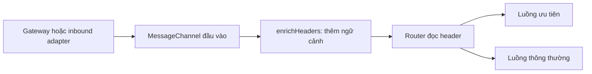

# enrichHeaders trong DSL

## 1. Mục tiêu và bối cảnh

Bài này thuộc chương **DSL nâng cao** của module **SPRING_INTEGRATION_CORE**. Trong phạm vi thiết kế luồng thông điệp bằng Message, MessageChannel, endpoint, gateway và Java DSL, `enrichHeaders` là công cụ bổ sung ngữ cảnh để transformer, router, filter và các endpoint phía sau xử lý message nhất quán.

Sau bài học, bạn có thể:

- Phân biệt giá trị cố định, biểu thức SpEL và hàm Java khi khai báo header.
- Chọn chính sách giữ lại hoặc ghi đè giá trị đã có.
- Tách các bước enrichment khi một header phụ thuộc header khác.
- Thiết kế metadata cho định tuyến, truy vết và xử lý lỗi.
- Kiểm thử payload, header, nhánh định tuyến và message đầu vào.

Các ví dụ dùng Java 17 trở lên và cú pháp Java DSL của Spring Integration 6.x, với API đối chiếu ở phiên bản 6.5.0. Đây là mốc minh họa, không phải yêu cầu nâng phiên bản ứng dụng. Nếu dự án dùng Spring Boot, để BOM của Boot quản lý các phiên bản thư viện liên quan.

## 2. Header enrichment nằm ở đâu trong luồng?

Một `Message<T>` mang payload và tập header. Payload mô tả nội dung nghiệp vụ; header mang thông tin giúp vận chuyển, điều phối hoặc xử lý nội dung đó.

Ví dụ, payload là đơn hàng; header có thể ghi hệ thống gửi, mã yêu cầu hoặc kết quả phân loại ưu tiên. Nhờ đó router có thể đọc một kết quả đã được chuẩn hóa thay vì lặp lại phép tính nghiệp vụ.



Trong DSL, `enrichHeaders` cấu hình một endpoint sử dụng `HeaderEnricher`, thuộc nhóm transformer. Cách viết cơ bản là:

```java
.enrichHeaders(h -> h
    .header("order_source", "order-api")
    .headerExpression("order_id", "payload.orderId()"))
```

Lambda `h -> ...` khai báo cấu hình khi dựng flow. Các giá trị động được tính khi message đi qua endpoint. Tài liệu chính thức minh họa cùng cách kết hợp `header` và `headerExpression` trong [Header Enricher với Java DSL](https://docs.spring.io/spring-integration/reference/content-enrichment.html#header-enricher).

### 2.1. Phân biệt các thao tác gần nhau

| Nhu cầu | Cách tiếp cận |
| --- | --- |
| Thêm mã nguồn hoặc mã yêu cầu vào metadata | `enrichHeaders(...)` |
| Đổi đơn hàng thành yêu cầu thanh toán | `transform(...)` |
| Lấy thêm dữ liệu rồi bổ sung nội dung nghiệp vụ | Payload/content enrichment hoặc một subflow chuyên biệt |
| Loại bỏ metadata không được phép đi tiếp | `headerFilter(...)` |
| Chọn nhánh dựa trên metadata | `route(...)` |

Nếu bạn chỉ cần thêm một header, một transformer tự xây `MessageBuilder` thường khiến ý định khó đọc hơn. Ngược lại, không nên đẩy toàn bộ phép biến đổi đơn hàng vào một hàm tính header.

### 2.2. Không sửa trực tiếp map header

Không viết:

```java
message.getHeaders().put("order_source", "order-api");
```

`MessageHeaders` là cấu trúc chỉ đọc; các lệnh `put`, `remove` và `clear` không phải cách cập nhật message. Enricher xây kết quả từ message đầu vào và thay đổi phần metadata được cấu hình.

Tính bất biến này không tự biến một `List`, `Map` hoặc đối tượng nghiệp vụ nằm trong header thành bất biến. Khi nhiều consumer cùng nhận message, các đối tượng có thể sửa vẫn cần được quản lý cẩn thận. Xem [Message và Message Headers](https://docs.spring.io/spring-integration/reference/message.html).

## 3. Chọn cách cung cấp giá trị header

### 3.1. Giá trị cố định bằng header

```java
.enrichHeaders(h -> h
    .header("order_source", "order-api")
    .header("order_schema_version", 2)
    .header("order_audit_required", true))
```

Ở đây, `2` là `Integer` và `true` là `Boolean`. Hãy giữ kiểu dữ liệu rõ ràng ngay từ lúc tạo header; điều đó giúp consumer tránh phải tự đoán kiểu hoặc chuyển đổi chuỗi.

Một chuỗi nhìn giống biểu thức vẫn là chuỗi nếu được truyền dưới dạng giá trị:

```java
.header("order_id", "payload.orderId()")
```

Cấu hình trên đặt nguyên văn `payload.orderId()` vào header.

Một lỗi khác là tạo dữ liệu động ngay lúc dựng flow:

```java
// UUID được tạo khi cấu hình flow được thực thi.
.header("order_trace_id", java.util.UUID.randomUUID().toString())
```

Nếu cần giá trị mới theo từng message đủ điều kiện được enrich, đặt phép tính trong `headerFunction`. Việc phân biệt giá trị cố định với xử lý message cũng được thể hiện qua [StaticHeaderValueMessageProcessor](https://www.springframework.org/spring-integration/docs/6.5.0/api/org/springframework/integration/transformer/support/StaticHeaderValueMessageProcessor.html).

### 3.2. Biểu thức bằng headerExpression

```java
.enrichHeaders(h -> h
    .headerExpression("order_id", "payload.orderId()")
    .headerExpression(
        "order_request_id",
        "headers['incoming_request_id'] ?: 'missing'"))
```

Trong ví dụ:

- `payload.orderId()` gọi accessor của record đơn hàng.
- `headers['incoming_request_id']` đọc header đầu vào.
- Toán tử Elvis `?:` cung cấp giá trị dự phòng.

Một literal trong SpEL cần dấu nháy của SpEL:

```java
.headerExpression("order_region", "'VN'")
```

Trong trường hợp này, `.header("order_region", "VN")` dễ đọc hơn. SpEL phù hợp với phép truy cập ngắn; biểu thức dài chứa nhiều nhánh nên được chuyển sang Java để dễ đặt tên và kiểm thử. Phần [SpEL Support của Header Enricher](https://docs.spring.io/spring-integration/reference/content-enrichment.html#header-enricher) mô tả việc truy cập `payload` và `headers`.

Giá trị dự phòng `missing` chỉ minh họa cú pháp. Với mã định danh bắt buộc, ứng dụng nên từ chối dữ liệu thiếu hoặc tạo mã mới theo hợp đồng thay vì để mọi message dùng chung một mã.

### 3.3. Hàm Java bằng headerFunction

Giả sử payload có kiểu:

```java
public record Order(String orderId, java.math.BigDecimal total) {
}
```

Có thể tính header bằng hàm nhận toàn bộ message:

```java
.enrichHeaders(h -> h
    .<Order>headerFunction(
        "order_high_value",
        message -> message.getPayload().total()
            .compareTo(new java.math.BigDecimal("10000000")) >= 0)
    .<Order>headerFunction(
        "order_trace_id",
        message -> java.util.UUID.randomUUID().toString()))
```

`<Order>` là tham số kiểu tường minh để compiler biết kiểu payload trong `Message<Order>`. Hàm nhận message, vì vậy đọc được cả payload lẫn header; giá trị trả về trở thành giá trị header.

Khi phép tính dài hơn, gọi một phương thức có tên:

```java
private static boolean isHighValue(Order order) {
    return order.total()
        .compareTo(new java.math.BigDecimal("10000000")) >= 0;
}

// Đoạn cấu hình bên trong flow:
.enrichHeaders(h -> h
    .<Order>headerFunction(
        "order_high_value",
        message -> isHighValue(message.getPayload())))
```

Hàm Java thuận tiện khi cần refactor hoặc kiểm thử logic bằng JUnit. Về cơ chế, Spring Integration có [FunctionExpression](https://www.springframework.org/spring-integration/docs/6.5.0/api/org/springframework/integration/expression/FunctionExpression.html) để đánh giá giá trị bằng `Function` thay cho biểu thức SpEL dạng chuỗi.

### 3.4. Nhiều header với map

Hai cấu hình sau phục vụ hai ý định khác nhau:

```java
// Các chuỗi trong map này là giá trị.
.enrichHeaders(h -> h.headers(java.util.Map.<String, Object>of(
    "order_source", "order-api",
    "order_region", "VN"
)))

// Các chuỗi trong map này là biểu thức SpEL.
.enrichHeaders(h -> h.headerExpressions(java.util.Map.of(
    "order_id", "payload.orderId()",
    "order_region", "'VN'"
)))
```

`headers(Map)` còn hỗ trợ giá trị là đối tượng `Expression`; một `String` thông thường không tự trở thành biểu thức. Chi tiết các overload nằm trong [HeaderEnricherSpec](https://www.springframework.org/spring-integration/docs/6.5.0/api/org/springframework/integration/dsl/HeaderEnricherSpec.html).

## 4. Quy tắc ghi đè: xác định ai sở hữu header

Không nên xem enrichment như thao tác luôn thay thế giá trị. Với từng header, bạn cần quyết định giá trị đầu vào hay phép tính hiện tại có quyền ưu tiên.

### 4.1. Giữ lại giá trị đã có

```java
.enrichHeaders(h -> h
    .defaultOverwrite(false)
    .header("order_source", "order-api"))
```

Nếu message đã có `order_source=batch-import`, giá trị đó được giữ. Nếu chưa có, enricher thêm `order-api`.

`false` là mặc định; viết tường minh giúp người đọc thấy ý định. Đây là hành vi được mô tả trong [HeaderEnricher](https://www.springframework.org/spring-integration/docs/6.5.0/api/org/springframework/integration/transformer/HeaderEnricher.html).

### 4.2. Ghi đè có chọn lọc

```java
.enrichHeaders(h -> h
    .defaultOverwrite(false)
    .header("order_source", "order-api")
    .headerExpression("order_id", "payload.orderId()", true)
    .<Order>headerFunction(
        "order_high_value",
        message -> isHighValue(message.getPayload()),
        true))
```

Ở đây, `order_id` và `order_high_value` thuộc quyền tính toán của flow hiện tại. Các giá trị cũ cùng tên sẽ được thay bằng kết quả tương ứng.

| Header đã có? | Mặc định | Cờ riêng của header | Hành động khi giá trị mới khác null |
| --- | --- | --- | --- |
| Chưa | `false` | Không chỉ định | Thêm |
| Có | `false` | Không chỉ định | Giữ cũ |
| Có | `false` | `true` | Thay bằng giá trị mới |
| Có | `true` | Không chỉ định | Thay bằng giá trị mới |
| Có | `true` | `false` | Giữ cũ |

Cờ riêng ưu tiên hơn `defaultOverwrite`. Tránh bật ghi đè toàn bộ chỉ để sửa một header; hãy thể hiện quyền sở hữu ngay tại từng khai báo.

Ví dụ về chính sách trong một hệ thống:

| Nhóm | Chính sách đề xuất cho ví dụ |
| --- | --- |
| Mã truy vết nội bộ đã được kiểm tra | Giữ nếu có; tạo khi thiếu |
| Kết quả phân loại theo tổng tiền hiện tại | Tính lại và ghi đè |
| Thông tin tenant đã xác thực | Lấy từ ngữ cảnh xác thực đáng tin cậy |
| Metadata do khách hàng tùy ý gửi | Kiểm tra, đổi tên hoặc loại bỏ tại đầu vào |

`defaultOverwrite(false)` không xác nhận dữ liệu đáng tin cậy. Nó chỉ giữ lại một giá trị. Nếu người gửi có thể tự điền `tenant_id` hoặc `order_high_value`, việc giữ giá trị đó có thể phá vỡ hợp đồng của flow.

### 4.3. Hàm có thể không được gọi

Khi header đã có và không được phép ghi đè, enricher không cần tính giá trị mới. Vì vậy, đừng đặt tác dụng phụ trong hàm tính header:

```java
// Không dùng phép tính header để thực hiện nghiệp vụ bắt buộc.
.<Order>headerFunction("order_trace_id", message -> {
    // Việc ghi audit tại đây có thể không diễn ra nếu header đã tồn tại.
    return java.util.UUID.randomUUID().toString();
})
```

Một bước ghi audit cần endpoint riêng với hợp đồng gọi, retry và lỗi rõ ràng. Chi tiết chỉ đánh giá khi cần có thể xem trong [mã nguồn HeaderEnricher 6.5.0](https://raw.githubusercontent.com/spring-projects/spring-integration/v6.5.0/spring-integration-core/src/main/java/org/springframework/integration/transformer/HeaderEnricher.java).

## 5. Các header trong cùng một bước không tạo thành chuỗi phụ thuộc

Cấu hình sau dễ gây hiểu nhầm:

```java
.enrichHeaders(h -> h
    .headerExpression("order_id", "payload.orderId()")
    .headerExpression(
        "order_partition_key",
        "'order:' + headers['order_id']"))
```

Không được dựa vào thứ tự các lời gọi để cho rằng biểu thức thứ hai đọc được `order_id` vừa thêm. Các processor tính từ message đầu vào của endpoint; thay đổi đang xây dựng không trở thành đầu vào mới cho biểu thức kế tiếp.

Nếu message chưa có `order_id`, phép đọc này không thấy kết quả mới. Nếu đã có một `order_id` cũ, biểu thức có thể đọc giá trị cũ. Đây là điểm cần chú ý hơn việc chỉ sắp xếp lại các dòng khai báo.

Có hai cách diễn đạt ý định:

```java
// Hai header độc lập: cùng lấy dữ liệu trực tiếp từ payload.
.enrichHeaders(h -> h
    .headerExpression("order_id", "payload.orderId()", true)
    .headerExpression(
        "order_partition_key",
        "'order:' + payload.orderId()",
        true))
```

Hoặc:

```java
// Có phụ thuộc thật sự: dùng kết quả message của bước trước.
.enrichHeaders(h -> h
    .headerExpression("order_id", "payload.orderId()", true))
.enrichHeaders(h -> h
    .headerExpression(
        "order_partition_key",
        "'order:' + headers['order_id']",
        true))
```

Có thể hình dung cách thứ hai như sau:

```text
M0 -> enrichHeaders A -> M1 -> enrichHeaders B -> M2

A đọc M0.
B đọc M1, trong đó đã có order_id do A tạo.
```

Kết luận này dựa trên cách `transform(Message)` truyền message đầu vào cho các processor trong [mã nguồn HeaderEnricher](https://raw.githubusercontent.com/spring-projects/spring-integration/v6.5.0/spring-integration-core/src/main/java/org/springframework/integration/transformer/HeaderEnricher.java). Tách bước cũng giúp người bảo trì nhìn thấy quan hệ dữ liệu.

## 6. Giá trị null, header tùy chọn và thao tác xóa

Mặc định, `shouldSkipNulls(true)` bỏ qua kết quả `null`. Nếu muốn kết quả `null` xóa header tương ứng, dùng `shouldSkipNulls(false)`; với header đã tồn tại, cần cho phép ghi đè. Xem [setShouldSkipNulls](https://www.springframework.org/spring-integration/docs/6.5.0/api/org/springframework/integration/transformer/HeaderEnricher.html#setShouldSkipNulls(boolean)).

Ví dụ sau giả sử message đầu vào có thể mang `incoming_optional_tag`:

```java
.enrichHeaders(h -> h
    .shouldSkipNulls(true)
    .headerExpression(
        "order_optional_tag",
        "headers['incoming_optional_tag']",
        true))
```

Nếu nguồn không có tag, kết quả `null` không xóa `order_optional_tag` cũ. Nếu hợp đồng yêu cầu xóa giá trị cũ khi nguồn vắng mặt:

```java
.enrichHeaders(h -> h
    .shouldSkipNulls(false)
    .headerExpression(
        "order_optional_tag",
        "headers['incoming_optional_tag']",
        true))
```

Bảng sau giúp phân biệt những trường hợp thường gặp:

| Trạng thái trước | Kết quả | Ghi đè | Skip nulls | Trạng thái sau |
| --- | --- | --- | --- | --- |
| Không có header | `null` | Bất kỳ | `true` | Vẫn không có |
| Có giá trị cũ | `null` | `true` | `true` | Giữ cũ |
| Có giá trị cũ | `null` | `true` | `false` | Bị xóa |
| Có giá trị cũ | Không được tính | `false` | Bất kỳ | Giữ cũ |

Nếu mục đích chỉ là loại bỏ một header đã biết tên, `headerFilter("order_optional_tag")` thường diễn đạt ý định trực tiếp hơn.

Đừng dùng `null` làm thông báo lỗi cho dữ liệu bắt buộc. Nếu đơn hàng thiếu mã cần thiết, hãy từ chối qua validation/filter hoặc phát sinh lỗi có chủ đích trước bước tạo metadata.

## 7. Ví dụ đầy đủ: phân luồng đơn hàng theo header

### 7.1. Hợp đồng của ví dụ

Giả sử tất cả tổng tiền đã dùng cùng đơn vị VND và payload đã qua validation. Một đơn hàng từ 10.000.000 VND trở lên đi vào nhánh ưu tiên.

Flow cần tạo metadata theo hợp đồng:

| Header | Kiểu | Quy tắc |
| --- | --- | --- |
| `order_source` | `String` | Mặc định `order-api`, giữ giá trị có sẵn từ nội bộ |
| `order_id` | `String` | Lấy lại từ payload, ghi đè |
| `order_high_value` | `Boolean` | Tính lại theo ngưỡng |
| `order_trace_id` | `String` | Tạo UUID khi thiếu |
| `order_received_at` | `String` ISO-8601 | Ghi thời điểm enrichment nếu chưa có |
| `order_route` | `String` | `PRIORITY` hoặc `STANDARD`, tính ở bước sau |

`order_trace_id` là mã tương quan của ví dụ. Việc thêm header này không tự tích hợp Micrometer Tracing hoặc OpenTelemetry.

### 7.2. Điều kiện để dùng mã

Các thành phần cần có trong project học tập:

- JDK 17 trở lên.
- `org.springframework.integration:spring-integration-core`.
- Spring Context theo bộ phiên bản tương thích.
- JUnit Jupiter để chạy lớp test ở phần sau.

Ví dụ dùng `AnnotationConfigApplicationContext`, không cần khởi động Spring Boot và không kết nối broker. Các đoạn rời ở những phần trước là phương án minh họa độc lập; không cần ghép tất cả vào lớp dưới đây.

### 7.3. Cấu hình flow

```java
package example.enrichment;

import java.math.BigDecimal;
import java.time.Clock;
import java.time.Instant;
import java.util.UUID;

import org.springframework.context.annotation.Bean;
import org.springframework.context.annotation.Configuration;
import org.springframework.integration.channel.DirectChannel;
import org.springframework.integration.channel.QueueChannel;
import org.springframework.integration.config.EnableIntegration;
import org.springframework.integration.dsl.IntegrationFlow;

@Configuration
@EnableIntegration
public class OrderHeaderFlowConfig {

    private static final BigDecimal PRIORITY_THRESHOLD =
        new BigDecimal("10000000");

    public record Order(String orderId, BigDecimal total) {
    }

    @Bean
    public Clock orderClock() {
        return Clock.systemUTC();
    }

    @Bean
    public DirectChannel ordersInput() {
        return new DirectChannel();
    }

    @Bean
    public QueueChannel priorityOrders() {
        return new QueueChannel(10);
    }

    @Bean
    public QueueChannel standardOrders() {
        return new QueueChannel(10);
    }

    @Bean
    public IntegrationFlow orderHeaderFlow(Clock orderClock) {
        return IntegrationFlow.from("ordersInput")
            .enrichHeaders(h -> h
                .defaultOverwrite(false)
                .header("order_source", "order-api")
                .headerExpression(
                    "order_id",
                    "payload.orderId()",
                    true)
                .<Order>headerFunction(
                    "order_high_value",
                    message -> message.getPayload().total()
                        .compareTo(PRIORITY_THRESHOLD) >= 0,
                    true)
                .<Order>headerFunction(
                    "order_trace_id",
                    message -> UUID.randomUUID().toString())
                .<Order>headerFunction(
                    "order_received_at",
                    message -> Instant.now(orderClock).toString()))
            .enrichHeaders(h -> h
                .headerExpression(
                    "order_route",
                    "headers['order_high_value']"
                        + " ? 'PRIORITY' : 'STANDARD'",
                    true))
            .route("headers['order_route']", r -> r
                .channelMapping("PRIORITY", "priorityOrders")
                .channelMapping("STANDARD", "standardOrders"))
            .get();
    }
}
```

Bước enrichment thứ hai cần đọc `order_high_value` đã chuẩn hóa. Cả `order_high_value` và `order_route` đều ghi đè để dữ liệu cùng tên từ upstream không thay đổi kết quả phân loại.

`Clock` được truyền vào flow giúp ví dụ có thể thay bằng đồng hồ cố định khi kiểm thử thời gian. `BigDecimal.compareTo` biểu diễn phép so sánh ngưỡng mà không phụ thuộc số chữ số sau dấu thập phân.

`DirectChannel` ở đầu vào khiến phần xử lý đến router chạy trong thread gửi. Hai `QueueChannel` cuối dùng làm điểm thu kết quả. Không cần poller chỉ để test gọi `receive`; nếu nối một consumer endpoint lấy message từ queue, phải cấu hình cơ chế polling phù hợp.

Các queue có dung lượng 10 chỉ phục vụ ví dụ nhỏ. Một ứng dụng vận hành liên tục cần consumer, chính sách giới hạn hàng đợi và timeout phù hợp với tải.

### 7.4. Theo dõi một message

Với đầu vào:

```text
payload = Order("O-1001", 12500000)
headers = {
  order_source: "batch-import",
  order_trace_id: "trace-existing",
  order_high_value: false,
  order_route: "STANDARD"
}
```

Kết quả kỳ vọng:

```text
payload = cùng đối tượng Order đầu vào
headers nghiệp vụ liên quan = {
  order_source: "batch-import",
  order_trace_id: "trace-existing",
  order_id: "O-1001",
  order_high_value: true,
  order_received_at: "<thời điểm được tạo>",
  order_route: "PRIORITY"
}
đích = priorityOrders
```

Các header framework khác không được liệt kê trong bản minh họa này. Không dùng ví dụ trên để suy ra rằng message chỉ có sáu header.

## 8. Kiểm thử hành vi của flow

Kiểm thử cần xác nhận điều consumer thực sự quan sát được: kiểu header, giá trị, payload và đích đến. Với chính sách giữ hoặc ghi đè, luôn có ít nhất một trường hợp message đã mang giá trị cũ.

Lớp sau dùng cùng package và lớp cấu hình ở phần 7:

```java
package example.enrichment;

import java.math.BigDecimal;
import java.util.UUID;

import org.junit.jupiter.api.Test;
import org.springframework.context.annotation.AnnotationConfigApplicationContext;
import org.springframework.integration.channel.DirectChannel;
import org.springframework.integration.channel.QueueChannel;
import org.springframework.messaging.Message;
import org.springframework.messaging.MessagingException;
import org.springframework.messaging.support.MessageBuilder;

import example.enrichment.OrderHeaderFlowConfig.Order;

import static org.junit.jupiter.api.Assertions.*;

class OrderHeaderFlowTest {

    @Test
    void highValueOrderOverwritesDecisionAndPreservesContext() {
        try (var context = new AnnotationConfigApplicationContext(
                OrderHeaderFlowConfig.class)) {

            DirectChannel input =
                context.getBean("ordersInput", DirectChannel.class);
            QueueChannel priority =
                context.getBean("priorityOrders", QueueChannel.class);
            QueueChannel standard =
                context.getBean("standardOrders", QueueChannel.class);

            Order order =
                new Order("O-1001", new BigDecimal("12500000"));
            Message<Order> original = MessageBuilder.withPayload(order)
                .setHeader("order_source", "batch-import")
                .setHeader("order_trace_id", "trace-existing")
                .setHeader("order_id", "stale-order-id")
                .setHeader("order_high_value", false)
                .setHeader("order_route", "STANDARD")
                .build();

            assertTrue(input.send(original));
            Message<?> result = priority.receive(1000);

            assertNotNull(result);
            assertSame(order, result.getPayload());
            assertEquals("batch-import",
                result.getHeaders().get("order_source"));
            assertEquals("trace-existing",
                result.getHeaders().get("order_trace_id"));
            assertEquals("O-1001",
                result.getHeaders().get("order_id"));
            assertEquals(Boolean.TRUE,
                result.getHeaders().get(
                    "order_high_value", Boolean.class));
            assertEquals("PRIORITY",
                result.getHeaders().get("order_route"));
            assertNotNull(result.getHeaders().get(
                "order_received_at", String.class));
            assertNull(standard.receive(0));

            // Message đầu vào vẫn mang các giá trị ban đầu.
            assertEquals(Boolean.FALSE,
                original.getHeaders().get("order_high_value"));
            assertEquals("STANDARD",
                original.getHeaders().get("order_route"));
            assertEquals("stale-order-id",
                original.getHeaders().get("order_id"));
            assertFalse(original.getHeaders()
                .containsKey("order_received_at"));
        }
    }

    @Test
    void standardOrderReceivesMissingHeaders() {
        try (var context = new AnnotationConfigApplicationContext(
                OrderHeaderFlowConfig.class)) {

            DirectChannel input =
                context.getBean("ordersInput", DirectChannel.class);
            QueueChannel standard =
                context.getBean("standardOrders", QueueChannel.class);
            QueueChannel priority =
                context.getBean("priorityOrders", QueueChannel.class);

            Order order =
                new Order("O-1002", new BigDecimal("500000"));

            assertTrue(input.send(
                MessageBuilder.withPayload(order).build()));
            Message<?> result = standard.receive(1000);

            assertNotNull(result);
            assertEquals("order-api",
                result.getHeaders().get("order_source"));
            assertEquals(Boolean.FALSE,
                result.getHeaders().get(
                    "order_high_value", Boolean.class));
            assertEquals("STANDARD",
                result.getHeaders().get("order_route"));

            String traceId = result.getHeaders()
                .get("order_trace_id", String.class);
            assertNotNull(traceId);
            assertDoesNotThrow(() -> UUID.fromString(traceId));
            assertNull(priority.receive(0));
        }
    }

    @Test
    void amountExactlyAtThresholdIsPriority() {
        try (var context = new AnnotationConfigApplicationContext(
                OrderHeaderFlowConfig.class)) {

            DirectChannel input =
                context.getBean("ordersInput", DirectChannel.class);
            QueueChannel priority =
                context.getBean("priorityOrders", QueueChannel.class);

            Order order =
                new Order("O-1003", new BigDecimal("10000000.00"));

            assertTrue(input.send(
                MessageBuilder.withPayload(order).build()));

            Message<?> result = priority.receive(1000);
            assertNotNull(result);
            assertEquals("PRIORITY",
                result.getHeaders().get("order_route"));
        }
    }

    @Test
    void invalidPayloadFailsOnCallerThread() {
        try (var context = new AnnotationConfigApplicationContext(
                OrderHeaderFlowConfig.class)) {

            DirectChannel input =
                context.getBean("ordersInput", DirectChannel.class);
            QueueChannel priority =
                context.getBean("priorityOrders", QueueChannel.class);
            QueueChannel standard =
                context.getBean("standardOrders", QueueChannel.class);

            // Cố tình vi phạm tiền điều kiện validation của ví dụ.
            Order invalid = new Order("O-invalid", null);

            assertThrows(MessagingException.class, () ->
                input.send(
                    MessageBuilder.withPayload(invalid).build()));

            assertNull(priority.receive(0));
            assertNull(standard.receive(0));
        }
    }
}
```

Test cuối minh họa lỗi tại phép tính header khi payload không hợp lệ. Trong ứng dụng, nên kiểm tra `total != null` trước endpoint này thay vì dùng lỗi `NullPointerException` làm quy tắc validation.

`receive(1000)` giới hạn thời gian chờ; `receive(0)` kiểm tra ngay queue còn lại. Tạo context riêng cho từng test giúp tránh message thừa từ một test làm test khác vượt qua sai.

Một vài trường hợp cần bổ sung khi mở rộng ví dụ:

| Thay đổi trong hợp đồng | Quan sát cần kiểm tra |
| --- | --- |
| Thêm header tùy chọn | Vắng nguồn, có nguồn và giá trị cũ |
| Đổi cờ ghi đè | Giá trị đầu vào xung đột với kết quả tính |
| Thêm thời hạn xử lý | Đồng hồ cố định và biên thời gian |
| Thêm bước bất đồng bộ | Đích nhận lỗi và message gây lỗi |
| Đưa qua broker | Header thực sự được map và kiểu sau chuyển đổi |

Các đoạn test là mã thực hành để chạy trong project có dependency phù hợp; chúng không có nghĩa mọi trường hợp lỗi vận hành đã được kiểm chứng.

## 9. Header chuẩn và ảnh hưởng đến endpoint

### 9.1. replyChannel và errorChannel

Có thể khai báo bằng phương thức chuyên dụng:

```java
.enrichHeaders(h -> h
    .replyChannel("orderReplies")
    .errorChannel("orderErrors"))
```

Hai tên trên phải trỏ tới channel được đăng ký trong ứng dụng. Header channel có thể chứa tên bean hoặc đối tượng channel; các phương thức tương ứng thuộc [HeaderEnricherSpec](https://www.springframework.org/spring-integration/docs/6.5.0/api/org/springframework/integration/dsl/HeaderEnricherSpec.html).

Với gateway, hãy xem xét kỹ trước khi thay `replyChannel`: request-reply thường đã có thông tin để trả kết quả cho người gọi. Ghi đè tùy tiện có thể làm phản hồi đi sang nơi khác.

Một `replyChannel` không tự thay thế output channel đã khai báo tường minh của endpoint. Xem mô tả header này trong [Message Headers](https://docs.spring.io/spring-integration/reference/message.html).

Việc gán `errorChannel` cũng không biến mọi ngoại lệ đồng bộ thành `ErrorMessage`. Với `DirectChannel`, lỗi từ xử lý trong thread người gửi thường đi ngược về lời gọi `send`. Cơ chế xuất lỗi của task bất đồng bộ, poller hoặc gateway cần được xem theo cấu hình thành phần đó. Xem [Error Handling](https://docs.spring.io/spring-integration/reference/error-handling.html).

### 9.2. Metadata phải có trước nơi có thể lỗi

Nếu phép tính header thất bại, endpoint chưa hoàn tất message kết quả. Không nên trông chờ một `errorChannel` đang được thêm trong chính bước lỗi đã trở thành ngữ cảnh của message đầu vào.

Khi bước enrichment nghiệp vụ có thể thất bại, hãy đặt ngữ cảnh lỗi và truy vết cần thiết ở đầu vào hoặc ở bước trước:

```text
inbound
  -> tạo/kiểm tra metadata truy vết và xử lý lỗi
  -> ranh giới bất đồng bộ nếu có
  -> enrichment có thể thất bại
  -> xử lý nghiệp vụ
```

Khi dùng `ExecutorChannel` hoặc poller, kiểm thử đường đi của lỗi theo cấu hình thực tế. Khi dùng gateway, kiểm thử cả kết quả mà phía gọi nhận được.

### 9.3. correlationId phục vụ gom nhóm

Nếu muốn các message cùng đơn hàng có liên hệ, có thể cấu hình:

```java
.enrichHeaders(h -> h
    .correlationIdExpression("payload.orderId()"))
```

Hãy quyết định có giữ correlation từ upstream hay thay bằng mã đơn hàng. Không ghi đè correlation của một splitter hoặc một quy trình lồng nhau chỉ vì tên header có vẻ phù hợp.

Đối với aggregator, correlation key chỉ xác định nhóm. Bạn còn cần chiến lược release, timeout và dọn nhóm. Nếu các đơn hàng của nhiều tenant có thể trùng mã, hãy thiết kế khóa gồm tenant và order ID dựa trên dữ liệu tenant đã xác thực.

Ví dụ chính ở phần 7 dùng `order_id` như metadata nghiệp vụ; nó không tự cấu hình aggregator.

### 9.4. id và timestamp là header do framework quản lý

Không dùng `enrichHeaders` để đặt `MessageHeaders.ID` hoặc `MessageHeaders.TIMESTAMP`. Với cấu hình builder mặc định, khai báo các header chỉ đọc này trong enricher bị từ chối khi khởi tạo.

Hãy tạo tên riêng cho dữ liệu nghiệp vụ:

- `order_id`: định danh đơn hàng.
- `order_trace_id`: mã tương quan xuyên các bước theo hợp đồng ứng dụng.
- `order_received_at`: thời điểm nhận hoặc enrich do ứng dụng định nghĩa.

Không đồng nhất ID của một message instance với khóa nghiệp vụ cần ổn định qua nhiều bước. Quy tắc bảo vệ hai header hệ thống có trong [mã nguồn HeaderEnricher](https://raw.githubusercontent.com/spring-projects/spring-integration/v6.5.0/spring-integration-core/src/main/java/org/springframework/integration/transformer/HeaderEnricher.java).

## 10. Thiết kế enrichment khi đưa vào hệ thống thực tế

### 10.1. Giữ phép tính nhỏ, rõ và có thể lặp lại

Một phép lấy mã từ payload hoặc phân loại theo ngưỡng phù hợp với `headerFunction`. Một lời gọi HTTP chậm để tìm hồ sơ khách hàng thường cần một bước riêng để thể hiện timeout, retry và cách xử lý lỗi.

Nếu vẫn gọi service trong hàm tính header, cần hiểu rằng:

- Với flow đồng bộ, thời gian gọi nằm trong thời gian xử lý của người gửi.
- Hàm có thể không chạy khi header cũ được giữ lại.
- Hàm có thể chạy lại khi message đi lại qua endpoint do retry hoặc redelivery.
- Đối tượng service và trạng thái được lambda capture phải dùng được khi có nhiều message đồng thời.

Ví dụ, tạo UUID mới mỗi lần endpoint chạy lại sẽ làm thay đổi mã truy vết nếu luôn ghi đè. Giữ mã đã được kiểm tra từ upstream thường phù hợp hơn cho việc theo dõi một yêu cầu xuyên retry.

Tương tự, hãy phân biệt thời điểm nhận lần đầu với thời điểm thử xử lý gần nhất. Một header `order_received_at` được giữ nguyên không nên đồng thời được giải thích là thời điểm của mọi lần retry.

### 10.2. Header nội bộ và header qua transport có hợp đồng khác nhau

Trong cùng JVM, header có thể là một đối tượng Java. Khi message đi qua JMS, AMQP, HTTP hoặc kho lưu bền, cần kiểm tra mapper và khả năng biểu diễn dữ liệu.

Các lựa chọn thường dễ trao đổi hơn là chuỗi, số, boolean và thời gian dạng chuẩn được hai bên thống nhất. Chẳng hạn, ví dụ dùng chuỗi ISO-8601 cho thời gian để hợp đồng hiển thị rõ.

Không đặt đối tượng connection, entity đang gắn persistence context, hoặc dữ liệu nhạy cảm không cần thiết vào metadata chỉ vì header nhận kiểu `Object`. Với từng adapter, hãy đọc và kiểm thử cấu hình header mapping tương ứng.

`headerChannelsToString()` hỗ trợ đưa tham chiếu channel vào registry và dùng chuỗi biểu diễn. Nó không tạo một địa chỉ phản hồi phân tán dùng chung giữa các JVM. Nếu cần request-reply qua broker, hãy thiết kế địa chỉ phản hồi và correlation của transport.

### 10.3. Không dùng metadata chưa xác thực để quyết định quyền

Một header có tên `tenant_id` không chứng minh người gửi thuộc tenant đó. Tại biên nhận message, cần xác định header nào được phép giữ, header nào phải tính lại và header nào lấy từ ngữ cảnh xác thực.

Trong ví dụ đơn hàng, `order_high_value` và `order_route` thuộc quyền quyết định của flow nên đều được ghi đè. Nếu thêm `tenant_id`, nguồn xác thực phải được mô tả trong hợp đồng riêng; không lấy tùy ý từ payload rồi coi đó là kết quả xác thực.

### 10.4. Quy ước tên và quan sát luồng

Đặt tên header theo một quy ước thống nhất và tránh va chạm với hằng framework hoặc adapter. Với header được nhiều flow dùng chung, có thể khai báo hằng trong Java thay vì lặp chuỗi.

Khi quan sát, chỉ ghi những trường cần thiết như mã đơn hàng, mã tương quan và kết quả phân loại. Không log toàn bộ headers nếu trong đó có token, thông tin cá nhân hoặc đối tượng lớn.

Nếu payload được biến đổi sau enrichment, xem lại header nào còn đúng. Chẳng hạn, `order_high_value` được tính trước một bước điều chỉnh tổng tiền có thể trở thành dữ liệu cũ. Hãy đặt enrichment sau bước thay đổi dữ liệu hoặc tính lại header thuộc quyền sở hữu của bước hiện tại.

## 11. Những lỗi dễ gặp và cách nhận diện

| Hiện tượng | Nguyên nhân có thể | Hướng sửa |
| --- | --- | --- |
| Header chứa chữ `payload.orderId()` | Dùng giá trị cố định | Chuyển sang `headerExpression` hoặc hàm |
| Nhiều message có cùng UUID tự tạo | Tạo UUID khi dựng flow | Đưa phép tạo vào hàm xử lý message |
| Hàm không được gọi | Header đã có, không ghi đè | Kiểm tra chính sách overwrite |
| Header vẫn giữ kết quả phân loại cũ | Flow không sở hữu lại giá trị | Ghi đè riêng header tính toán |
| Header B không thấy kết quả mới của A | Cùng nằm trong một bước | Tách hai bước hoặc đọc nguồn gốc chung |
| `null` không làm mất giá trị cũ | Đang bỏ qua null | Kiểm tra skip nulls và overwrite |
| Router chọn nhánh sai | Giá trị hoặc kiểu header không đúng | Kiểm tra hợp đồng header ngay trước router |
| Người gọi nhận ngoại lệ dù có errorChannel | Lỗi ở đường đồng bộ | Xem thread xử lý và cấu hình gateway/advice |
| Qua broker bị mất header | Mapper hoặc kiểu không phù hợp | Kiểm thử qua transport thực tế |
| Khởi tạo flow thất bại khi đặt id | Đụng header chỉ đọc | Dùng tên nghiệp vụ riêng |

Để khoanh vùng, bắt đầu từ một message cụ thể: payload lúc vào, header cũ, chính sách ghi đè, kết quả trước router và thread đang xử lý. Cách này giúp phân biệt lỗi dữ liệu với lỗi cấu hình luồng.

## 12. Thực hành mở rộng

Từ cấu hình ở phần 7, hãy thực hiện tuần tự:

1. Thêm `order_partition_key` có dạng `order:<order_id>` ở bước sau khi đã chuẩn hóa `order_id`.
2. Thay `Clock.systemUTC()` trong cấu hình kiểm thử bằng `Clock.fixed(...)`, rồi xác nhận chính xác `order_received_at`.
3. Bổ sung header tùy chọn và kiểm tra ba tình huống: có nguồn mới, thiếu nguồn mới nhưng có giá trị cũ, không có cả hai.
4. Thêm validation cho `orderId` và `total` trước enrichment; xác định rõ dữ liệu không hợp lệ bị từ chối hay chuyển sang channel riêng.
5. Nếu thêm ranh giới bất đồng bộ, kiểm thử lỗi bằng channel thu lỗi thay vì chỉ chờ ngoại lệ tại `send`.

Kết quả cần quan sát là hợp đồng của flow: metadata có kiểu đúng, quyết định định tuyến xuất phát từ dữ liệu đã chuẩn hóa, payload được giữ khi chỉ enrich header, và lỗi xuất hiện ở nơi ứng dụng đã thiết kế.

## 13. Tài liệu đối chiếu

- [Spring Integration Reference: Content Enricher](https://docs.spring.io/spring-integration/reference/content-enrichment.html) — phân biệt header enrichment và payload enrichment.
- [HeaderEnricherSpec 6.5.0](https://www.springframework.org/spring-integration/docs/6.5.0/api/org/springframework/integration/dsl/HeaderEnricherSpec.html) — API Java DSL và các overload.
- [HeaderEnricher 6.5.0](https://www.springframework.org/spring-integration/docs/6.5.0/api/org/springframework/integration/transformer/HeaderEnricher.html) — transformer, overwrite và xử lý null.
- [Mã nguồn HeaderEnricher 6.5.0](https://raw.githubusercontent.com/spring-projects/spring-integration/v6.5.0/spring-integration-core/src/main/java/org/springframework/integration/transformer/HeaderEnricher.java) — message dùng khi đánh giá từng header.
- [Spring Integration Reference: Message](https://docs.spring.io/spring-integration/reference/message.html) — cấu trúc message và các header chuẩn.
- [Spring Integration Reference: Error Handling](https://docs.spring.io/spring-integration/reference/error-handling.html) — phân biệt xử lý lỗi đồng bộ và bất đồng bộ.
