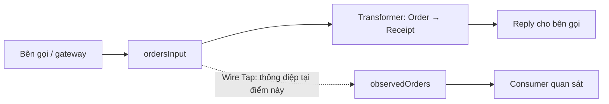

# wireTap trong DSL

## 1. Mục tiêu và phạm vi

Trong module **SPRING_INTEGRATION_CORE**, bài học này thuộc chương **DSL nâng cao**. Nội dung tập trung vào cách dùng `wireTap` để quan sát thông điệp tại một điểm trong `IntegrationFlow`, đồng thời giữ luồng xử lý nghiệp vụ tiếp tục đi tới endpoint kế tiếp.

Sau bài học, bạn có thể:

- Chọn vị trí tap phù hợp với dữ liệu cần quan sát.
- Viết tap tới channel và tap bằng subflow trong Java DSL.
- Dùng selector để chỉ quan sát một nhóm thông điệp.
- Giải thích ảnh hưởng của `DirectChannel`, `QueueChannel` và `ExecutorChannel` tới độ trễ, lỗi và thứ tự xử lý.
- Kiểm thử riêng kết quả nghiệp vụ và dữ liệu trên nhánh quan sát.

Ví dụ sử dụng Java 17 và API Spring Integration 6.5.0 làm mốc minh họa. Khi áp dụng trong ứng dụng có Spring Boot hoặc BOM, dùng bộ phiên bản tương thích do dự án quản lý. Java DSL được xây dựng trên các thành phần Spring Integration và đăng ký flow dưới dạng Spring bean; đây vẫn là các channel, interceptor và endpoint trong application context. [Tài liệu Java DSL](https://docs.spring.io/spring-integration/reference/6.5/dsl.html).

## 2. Wire Tap giải quyết vấn đề gì?

Giả sử hệ thống nhận đơn hàng, tạo kết quả tiếp nhận và trả lời cho bên gọi. Bạn muốn lưu một dấu vết phục vụ chẩn đoán mà không đưa thao tác quan sát thành một bước biến đổi kết quả nghiệp vụ.

`wireTap` tạo một nhánh gửi thông điệp tới đích phụ tại điểm quan sát:



Trong sơ đồ:

- Nhánh chính nhận `Order` và tạo `Receipt`.
- Nhánh quan sát nhận dữ liệu tại `ordersInput`.
- Kết quả của nhánh quan sát không được dùng để tạo `Receipt`.

Các tình huống phù hợp gồm ghi dấu vết kỹ thuật, lấy mẫu thông điệp để chẩn đoán và thu thập dữ liệu phục vụ thống kê. Nếu việc ghi sổ hoặc phát sự kiện là điều kiện bắt buộc để nghiệp vụ thành công, hãy mô hình hóa điều kiện đó trực tiếp trong thiết kế xử lý.

### 2.1. Cơ chế nằm ở channel

`WireTap` là một `ChannelInterceptor`. Java DSL gắn interceptor vào channel hiện tại; khi cần, DSL có thể tạo channel ngầm định để nối các endpoint. Các overload nhận tên channel, đối tượng `MessageChannel` hoặc một `IntegrationFlow` làm subflow. [Javadoc của DSL](https://docs.spring.io/spring-integration/docs/6.5.0/api/org/springframework/integration/dsl/BaseIntegrationFlowDefinition.html#wireTap(java.lang.String)).

Ở phiên bản minh họa, tap thực hiện gửi nhánh phụ trong `preSend`, trước khi channel chính thực hiện việc chuyển giao thông điệp. Vì vậy, dữ liệu xuất hiện ở tap cho biết thông điệp đã tới điểm quan sát; nó chưa chứng minh rằng các bước phía sau đã thành công. [Mã nguồn WireTap 6.5.0](https://github.com/spring-projects/spring-integration/blob/v6.5.0/spring-integration-core/src/main/java/org/springframework/integration/channel/interceptor/WireTap.java).

Một hệ quả thiết kế: nếu cần quan sát kết quả tiếp nhận, đặt tap sau transformer tạo kết quả. Nếu cần ghi nhận trạng thái đã commit, cần thiết kế cơ chế gắn với commit hoặc phát sự kiện bền vững; chỉ thay vị trí một dòng DSL chưa tạo ra bảo đảm đó.

### 2.2. Thông điệp quan sát không phải bản sao sâu

`Message` chứa payload và headers. Cấu trúc headers không cho sửa trực tiếp, nhưng payload và từng giá trị header vẫn có thể là đối tượng mutable. Đừng suy luận rằng hai nhánh có hai đồ thị đối tượng độc lập. [Tài liệu về Message và tính mutable](https://docs.spring.io/spring-integration/reference/6.5/message.html#message-headers).

Ví dụ, nếu payload là `ArrayList` và consumer quan sát gọi `clear()`, nhánh chính có thể nhìn thấy danh sách đã bị thay đổi. Việc chuyển sang thread khác còn làm xuất hiện tranh chấp dữ liệu.

Quy tắc thực hành:

1. Ưu tiên payload immutable.
2. Khi biến đổi, tạo đối tượng kết quả mới.
3. Nếu cần snapshot, tạo snapshot rõ ràng; với dữ liệu lồng nhau, phải xử lý cả các đối tượng mutable bên trong.
4. Không sửa payload dùng chung chỉ để che dữ liệu trước khi ghi log.

## 3. Phân biệt với các thành phần lân cận

| Thành phần | Câu hỏi mà thiết kế cần trả lời | Quan hệ với nhánh chính |
| --- | --- | --- |
| `wireTap` | Cần quan sát thông điệp ở đâu? | Tạo nhánh phụ tại channel |
| `transform` | Cần đổi biểu diễn dữ liệu thế nào? | Kết quả trở thành dữ liệu cho bước kế tiếp |
| `filter` | Thông điệp có được tiếp tục không? | Có thể loại thông điệp khỏi luồng |
| `route` | Thông điệp phải tới đích nào? | Chọn đích theo điều kiện định tuyến |
| `publishSubscribeChannel` | Những subscriber nào cùng cần nhận thông điệp? | Mô hình phát tới các subscriber |
| `gateway` | Bên gọi gửi yêu cầu và nhận phản hồi ra sao? | Tạo hợp đồng gọi và phản hồi |
| `aggregate` | Khi nào đủ dữ liệu của một nhóm để tạo kết quả? | Thu gom thông điệp theo correlation và điều kiện release |

Bảng này là hướng chọn mô hình. Chẳng hạn, hệ thống cần cả kết quả tính thuế và kết quả tính phí vận chuyển để trả lời khách hàng thì phải thiết kế việc phối hợp hai kết quả. Một nhánh `wireTap` tự nó không cung cấp cơ chế đợi và ghép các kết quả đó.

## 4. Các cách viết trong Java DSL

Các đoạn rút gọn dưới đây minh họa vị trí của `wireTap` trong chuỗi DSL. Những channel được đặt tên phải được cấu hình với kiểu và consumer phù hợp trong ứng dụng.

### 4.1. Tap tới channel có tên

```java
IntegrationFlow.from("input")
        .wireTap("observationChannel")
        .transform(String.class, String::trim)
        .channel("output")
        .get();
```

Thông điệp tại điểm tap chứa chuỗi trước thao tác `trim`. Tham số `"observationChannel"` là đích phụ; nó không phải tên channel đang bị quan sát.

Khai báo channel phụ thành bean giúp người đọc xác định rõ kiểu channel và cách tiêu thụ, thay vì phải dựa vào các channel do DSL tạo ngầm định.

### 4.2. Tap tới đối tượng channel

```java
IntegrationFlow.from(inputChannel)
        .wireTap(observationChannel)
        .transform(String.class, String::trim)
        .channel(outputChannel)
        .get();
```

Cách này phù hợp khi inject channel qua tham số của phương thức `@Bean`. Dùng `@Qualifier` khi application context có nhiều bean cùng kiểu.

### 4.3. Tap bằng subflow

```java
IntegrationFlow.from("textInput")
        .wireTap(tap -> tap
                .transform(String.class, text -> "Độ dài: " + text.length())
                .handle((org.springframework.messaging.MessageHandler) message ->
                        System.out.println(message.getPayload())))
        .transform(String.class, String::trim)
        .channel("textOutput")
        .get();
```

Transformer trong subflow tạo dữ liệu để consumer quan sát sử dụng. Nhánh chính vẫn tiếp tục với payload tại điểm tap, sau đó mới thực hiện `trim`.

Ở đây `MessageHandler` có phương thức trả về `void`, thể hiện rõ điểm kết thúc nhánh quan sát. Subflow chưa có channel dùng executor nên không tạo ra xử lý bất đồng bộ chỉ bằng việc viết lambda.

### 4.4. Thêm selector và timeout

```java
.wireTap("observationChannel", tap -> tap
        .selector(message ->
                Boolean.TRUE.equals(message.getHeaders().get("observe")))
        .timeout(0))
```

Selector nhận cả `Message<?>`, nên có thể kiểm tra payload hoặc headers. `WireTapSpec` hỗ trợ selector bằng `MessageSelector`, chuỗi SpEL hoặc `Expression`, cùng cấu hình timeout gửi. [Javadoc WireTapSpec](https://docs.spring.io/spring-integration/docs/6.5.0/api/org/springframework/integration/dsl/WireTapSpec.html).

Với điều kiện trên:

| Header `observe` | Nhánh quan sát | Luồng chính |
| --- | --- | --- |
| `Boolean.TRUE` | Được chọn để gửi | Tiếp tục nếu việc gửi không ném lỗi |
| `Boolean.FALSE` | Không gửi | Tiếp tục |
| Không có header | Không gửi | Tiếp tục |
| Chuỗi `"true"` | Không gửi | Tiếp tục |

Việc so sánh bằng `Boolean.TRUE.equals(...)` cố ý yêu cầu giá trị boolean đúng kiểu.

Selector không hoạt động như một filter trên nhánh chính. Tuy nhiên, selector vẫn là mã chạy trong lúc gửi: giữ điều kiện ngắn, không gọi mạng và không thay đổi dữ liệu dùng chung.

Có thể viết điều kiện tương đương bằng SpEL:

```java
.wireTap("observationChannel",
        tap -> tap.selector("headers['observe'] == true"))
```

## 5. Ví dụ đầy đủ: quan sát đơn hàng và trả kết quả nghiệp vụ

Ví dụ dùng một `QueueChannel` dung lượng 16 làm đích quan sát. Chương trình tự đọc queue sau khi gọi luồng chính, vì vậy chưa cần poller.

Trong dự án Maven chưa quản lý phiên bản bằng BOM, dependency cốt lõi cho ví dụ là:

```xml
<dependency>
    <groupId>org.springframework.integration</groupId>
    <artifactId>spring-integration-core</artifactId>
    <version>6.5.0</version>
</dependency>
```

Đặt mức biên dịch Java là 17 hoặc cao hơn. Nếu dự án đã dùng BOM, sử dụng phiên bản đã được quản lý và tránh ghi đè riêng dependency này.

Tệp minh họa `WireTapDemo.java`:

```java
package example.integration;

import org.springframework.beans.factory.annotation.Qualifier;
import org.springframework.context.annotation.AnnotationConfigApplicationContext;
import org.springframework.context.annotation.Bean;
import org.springframework.context.annotation.Configuration;
import org.springframework.integration.channel.DirectChannel;
import org.springframework.integration.channel.QueueChannel;
import org.springframework.integration.config.EnableIntegration;
import org.springframework.integration.core.MessagingTemplate;
import org.springframework.integration.dsl.IntegrationFlow;
import org.springframework.messaging.Message;
import org.springframework.messaging.MessageChannel;
import org.springframework.messaging.support.MessageBuilder;

@Configuration
@EnableIntegration
public class WireTapDemo {

    public record Order(String id, long amountVnd) {
    }

    public record Receipt(String orderId, String status) {
    }

    @Bean
    public DirectChannel ordersInput() {
        return new DirectChannel();
    }

    @Bean
    public QueueChannel observedOrders() {
        return new QueueChannel(16);
    }

    @Bean
    public IntegrationFlow ordersFlow(
            @Qualifier("ordersInput") DirectChannel input,
            @Qualifier("observedOrders") QueueChannel observed) {

        return IntegrationFlow.from(input)
                .wireTap(observed, tap -> tap
                        .selector(message -> Boolean.TRUE.equals(
                                message.getHeaders().get("observe")))
                        .timeout(0))
                .<Order, Receipt>transform(order ->
                        new Receipt(order.id(), "ACCEPTED"))
                .get();
    }

    public static void main(String[] args) {
        try (var context =
                     new AnnotationConfigApplicationContext(WireTapDemo.class)) {

            MessagingTemplate template = new MessagingTemplate();
            template.setSendTimeout(1_000);
            template.setReceiveTimeout(1_000);

            Message<Order> request = MessageBuilder
                    .withPayload(new Order("ORD-001", 250_000))
                    .setHeader("observe", true)
                    .setHeader("correlationId", "REQ-001")
                    .build();

            MessageChannel input =
                    context.getBean("ordersInput", MessageChannel.class);

            Message<?> reply = template.sendAndReceive(input, request);
            Message<?> observed = context
                    .getBean("observedOrders", QueueChannel.class)
                    .receive(1_000);

            if (reply == null || observed == null) {
                throw new IllegalStateException("Thiếu reply hoặc dữ liệu quan sát");
            }

            System.out.println("Reply: " + reply.getPayload());
            System.out.println("Observed: " + observed.getPayload());
            System.out.println("Correlation: "
                    + observed.getHeaders().get("correlationId"));
        }
    }
}
```

Kết quả nghiệp vụ dự kiến:

```text
Reply: Receipt[orderId=ORD-001, status=ACCEPTED]
Observed: Order[id=ORD-001, amountVnd=250000]
Correlation: REQ-001
```

Diễn giải:

1. `MessagingTemplate` gửi request và thiết lập đường nhận reply cho lời gọi.
2. Selector chấp nhận thông điệp vì `observe` là `true`.
3. Tap thử đưa `Order` vào queue quan sát.
4. Transformer của luồng chính tạo `Receipt`.
5. Reply đi theo cơ chế phản hồi của lời gọi.
6. Chương trình đọc queue để xem dữ liệu tại điểm tap.

Record `Order` chỉ chứa `String` và `long`, phù hợp làm payload immutable cho ví dụ. Record có thành phần kiểu `List` mutable sẽ cần xử lý thêm; bản thân từ khóa `record` không làm mọi dữ liệu lồng nhau trở thành immutable.

### 5.1. Vì sao chưa có consumer tự động?

`QueueChannel` giữ thông điệp cho tới khi có bên nhận. Nó không tự tạo tác vụ xử lý nghiệp vụ. Trong chương trình trên, `receive(1_000)` là thao tác nhận trực tiếp.

Nếu thêm consumer chạy bằng poller, không đồng thời dùng đoạn `receive(...)` để mong nhận cùng một thông điệp: hai bên sẽ cạnh tranh lấy dữ liệu từ queue.

## 6. Đồng bộ hay bất đồng bộ do channel quyết định

Wire tap không mặc định chạy bất đồng bộ. Việc chuyển thread phụ thuộc vào channel và cách tiêu thụ phía sau. [Giải thích chính thức về Wire Tap](https://docs.spring.io/spring-integration/reference/6.5/channel/configuration.html#channel-wiretap).

| Đích nhánh quan sát | Việc xảy ra khi tap gửi | Ảnh hưởng cần tính |
| --- | --- | --- |
| `DirectChannel` | Gọi subscriber trên thread gửi | Thời gian xử lý nhánh phụ nằm trong đường gọi |
| `QueueChannel` | Đưa thông điệp vào queue | Chờ chỗ trống theo timeout; cần bên nhận |
| `ExecutorChannel` | Giao tác vụ cho executor | Phụ thuộc hàng đợi, số thread và chính sách từ chối |

`ExecutorChannel` cũng không có nghĩa là bên gửi luôn thoát ngay: chính sách như `CallerRunsPolicy` có thể chạy tác vụ ngay trên thread gửi khi executor quá tải. Transaction của bên gửi không tự trải qua ranh giới executor. [Tài liệu ExecutorChannel](https://docs.spring.io/spring-integration/reference/6.5/channel/implementations.html#executorchannel).

### 6.1. Tính độ trễ theo đường gọi

Giả sử một nhánh quan sát gọi dịch vụ ngoài mất 300 ms. Nếu đích tap là `DirectChannel`, trước khi channel chính chuyển giao thông điệp, lời gọi có thể phải chờ cả 300 ms đó.

Nếu chuyển công việc sang executor:

- Bên gửi chủ yếu chịu thời gian xử lý trước ranh giới executor và thời gian giao tác vụ.
- Công việc quan sát có thể hoàn thành sau khi bên gọi đã nhận reply.
- Khi lưu lượng vượt năng lực xử lý, hàng đợi hoặc cơ chế từ chối trở thành yếu tố quyết định.

Đây là phân tích đường thực thi của cấu hình, không phải cam kết độ trễ cố định của framework.

### 6.2. Thứ tự hoàn thành

Với nhánh đồng bộ, công việc ở nhánh tap chạy trong đường gửi trước khi main channel dispatch. Với executor hoặc consumer queue riêng, không dùng thứ tự hoàn thành giữa hai nhánh làm điều kiện nghiệp vụ.

Nếu xử lý bằng nhiều worker, thứ tự hoàn thành các bản ghi quan sát cũng có thể khác thứ tự nhận. Gắn mã nghiệp vụ, correlation và thời điểm sự kiện khi cần đối chiếu.

## 7. Timeout giới hạn việc gì?

Trong ví dụ, `timeout(0)` yêu cầu thử gửi mà không chờ chỗ trống ở queue. Với `QueueChannel`:

| Timeout gửi | Ý nghĩa khi queue đầy |
| --- | --- |
| `0` | Trả kết quả ngay |
| Số dương | Chờ tối đa số mili giây được cấu hình |
| Số âm theo cơ chế gửi của channel | Có thể chờ cho tới khi gửi được hoặc bị ngắt |

Các quy tắc dung lượng và chờ gửi được mô tả trong [Javadoc QueueChannel](https://docs.spring.io/spring-integration/docs/6.5.0/api/org/springframework/integration/channel/QueueChannel.html).

Timeout của tap không phải thời gian tối đa cho toàn bộ consumer quan sát. Cụ thể:

- Nó không ngắt một handler chậm đang chạy qua `DirectChannel`.
- Nó không thay cho timeout HTTP hoặc JDBC bên trong handler.
- Nó không đặt hạn thực thi cho một tác vụ đã được executor chấp nhận.

Để giới hạn thời gian gọi dịch vụ ngoài, cấu hình timeout ở client tương ứng. Để kiểm soát tồn đọng, đặt dung lượng queue, năng lực consumer và chính sách xử lý khi quá tải.

### 7.1. Gửi thất bại khác với ném exception

Trong `WireTap` 6.5.0, nếu `send(...)` trả về `false`, interceptor ghi cảnh báo rồi trả thông điệp cho luồng chính. Nếu lời gọi gửi hoặc selector ném exception, phương thức này không tự nuốt exception đó. [Phần triển khai preSend](https://github.com/spring-projects/spring-integration/blob/v6.5.0/spring-integration-core/src/main/java/org/springframework/integration/channel/interceptor/WireTap.java#L149).

Vì vậy, với ví dụ queue dung lượng 16:

- Queue đầy và timeout bằng 0 có thể làm mất bản quan sát mới, trong khi `Receipt` vẫn được tạo.
- Không được khái quát kết quả đó thành “mọi lỗi ở tap đều không ảnh hưởng nghiệp vụ”.
- Nếu thiết kế yêu cầu quan sát đầy đủ, cần một cơ chế giao nhận phù hợp hơn việc bỏ qua khi hết chỗ.

## 8. Thêm consumer bằng poller cho nhánh queue

Trong ứng dụng chạy lâu dài, có thể thêm bean dưới đây vào `WireTapDemo`. Consumer sẽ đọc `observedOrders` định kỳ:

```java
@Bean
public IntegrationFlow observationConsumer(
        @Qualifier("observedOrders") QueueChannel observed) {

    return IntegrationFlow.from(observed)
            .handle(
                    (org.springframework.messaging.MessageHandler) message -> {
                        Order order = (Order) message.getPayload();
                        System.out.println("Quan sát đơn: " + order.id());
                    },
                    endpoint -> endpoint.poller(
                            org.springframework.integration.dsl.Pollers
                                    .fixedDelay(200)
                                    .maxMessagesPerPoll(10)))
            .get();
}
```

Đây là biến thể của cấu hình ban đầu. Khi dùng biến thể này, bỏ đoạn nhận trực tiếp từ queue trong `main` và điều chỉnh kiểm thử cho consumer bất đồng bộ.

`fixedDelay(200)` cấu hình khoảng chờ giữa các lần poll hoàn tất. `maxMessagesPerPoll(10)` giới hạn số thông điệp được xử lý trong một lượt poll.

Queue trong ví dụ là bộ nhớ của tiến trình. Chấp nhận được thông điệp vào queue chưa đồng nghĩa dữ liệu đã được lưu bền vững hay consumer đã xử lý xong.

## 9. Subflow qua executor và kênh lỗi riêng

Biến thể dưới đây minh họa một flow đầu vào khác, `asyncOrdersInput`. Có thể thêm các bean vào lớp cấu hình ví dụ; chúng dùng lại `Order` và `Receipt`.

Nhánh phụ thực hiện ba bước rõ ràng trước khi quan sát:

1. Bỏ headers phản hồi và lỗi được kế thừa từ request.
2. Đặt channel lỗi dành riêng cho nhánh quan sát.
3. Giao công việc quan sát cho executor.

Các import bổ sung:

```java
import java.util.concurrent.ThreadPoolExecutor;

import org.springframework.messaging.MessageHandler;
import org.springframework.messaging.MessageHeaders;
import org.springframework.scheduling.concurrent.ThreadPoolTaskExecutor;
```

Các bean:

```java
@Bean
public ThreadPoolTaskExecutor observationExecutor() {
    ThreadPoolTaskExecutor executor = new ThreadPoolTaskExecutor();
    executor.setCorePoolSize(2);
    executor.setMaxPoolSize(4);
    executor.setQueueCapacity(128);
    executor.setThreadNamePrefix("observation-");
    executor.setRejectedExecutionHandler(new ThreadPoolExecutor.AbortPolicy());
    return executor;
}

@Bean
public DirectChannel observationErrors() {
    return new DirectChannel();
}

@Bean
public IntegrationFlow asyncOrdersFlow(
        @Qualifier("observationExecutor") ThreadPoolTaskExecutor executor) {

    return IntegrationFlow.from("asyncOrdersInput")
            .wireTap(
                    tap -> tap
                            .headerFilter(
                                    MessageHeaders.REPLY_CHANNEL,
                                    MessageHeaders.ERROR_CHANNEL)
                            .enrichHeaders(headers -> headers.header(
                                    MessageHeaders.ERROR_CHANNEL,
                                    "observationErrors"))
                            .channel(channels -> channels.executor(executor))
                            .handle((MessageHandler) message -> {
                                Order order = (Order) message.getPayload();
                                System.out.println(
                                        "Quan sát bất đồng bộ: " + order.id());
                            }),
                    spec -> spec
                            .selector(message -> Boolean.TRUE.equals(
                                    message.getHeaders().get("observe")))
                            .timeout(0))
            .<Order, Receipt>transform(order ->
                    new Receipt(order.id(), "ACCEPTED"))
            .get();
}

@Bean
public IntegrationFlow observationErrorFlow() {
    return IntegrationFlow.from("observationErrors")
            .handle((MessageHandler) errorMessage -> {
                Throwable failure = (Throwable) errorMessage.getPayload();
                System.err.println(
                        "Nhánh quan sát lỗi: "
                                + failure.getClass().getSimpleName());
            })
            .get();
}
```

Spring quản lý vòng đời của `ThreadPoolTaskExecutor` vì executor được khai báo bằng `@Bean`. Các giá trị 2, 4 và 128 chỉ là tham số minh họa; phải chọn lại theo tải và chi phí của consumer.

### 9.1. Ranh giới lỗi trong ví dụ

| Lỗi xảy ra ở đâu? | Cách quan sát ảnh hưởng |
| --- | --- |
| Selector hoặc bước xử lý trước executor | Có thể truyền lỗi về đường gửi hiện tại |
| Executor từ chối tác vụ với `AbortPolicy` | Lỗi giao tác vụ có thể truyền về bên gửi |
| Handler trên worker executor | Cơ chế lỗi bất đồng bộ của Spring Integration phát `ErrorMessage` |
| Handler của `observationErrors` | Cần được giữ đơn giản và ổn định để xử lý lỗi quan sát |

Spring Integration dùng header `errorChannel` của thông điệp lỗi khi có, rồi mới tới channel lỗi chung. Cơ chế phát `ErrorMessage` cho tác vụ bất đồng bộ khác với việc ném exception trên cùng thread. Chỉ thêm header lỗi không tự chuyển mọi exception đồng bộ thành thông điệp lỗi. [Tài liệu Error Handling](https://docs.spring.io/spring-integration/reference/6.5/error-handling.html).

Trong cấu hình này, việc lọc và bổ sung headers vẫn diễn ra trước khi giao tác vụ cho executor. Phần xử lý trên worker mới hưởng ranh giới bất đồng bộ.

### 9.2. Vì sao cần kiểm soát headers?

Request dùng để gọi qua gateway hoặc template có thể mang `replyChannel`. Nhánh quan sát không nên tạo một phản hồi cạnh tranh với kết quả nghiệp vụ. Do đó, ví dụ vừa loại đường phản hồi kế thừa, vừa kết thúc bằng `MessageHandler` trả về `void`.

Tương tự, đường lỗi phục vụ request nghiệp vụ có thể không phù hợp cho một công việc quan sát hoàn thành muộn. Đặt channel lỗi riêng làm rõ ai xử lý lỗi và tránh phụ thuộc vào vòng đời lời gọi ban đầu.

Correlation nghiệp vụ vẫn nên được giữ để đối chiếu. Chỉ sao chép các header cần thiết nếu sau này đưa sự kiện qua broker hoặc lưu trữ ngoài tiến trình.

## 10. Vị trí tap quyết định ý nghĩa dữ liệu

### 10.1. Quan sát đầu vào hay dữ liệu chuẩn hóa?

```java
// Nhánh quan sát thấy chuỗi đầu vào.
IntegrationFlow.from("rawInput")
        .wireTap("rawObservations")
        .transform(String.class, String::trim)
        .channel("normalizedOutput")
        .get();

// Nhánh quan sát thấy chuỗi sau khi trim.
IntegrationFlow.from("anotherRawInput")
        .transform(String.class, String::trim)
        .wireTap("normalizedObservations")
        .channel("anotherNormalizedOutput")
        .get();
```

Chọn vị trí dựa trên câu hỏi cần trả lời:

- Muốn biết khách gửi gì: quan sát gần đầu vào.
- Muốn biết dữ liệu chuẩn hóa ra sao: quan sát sau bước chuẩn hóa.
- Muốn biết endpoint tạo kết quả gì: quan sát sau endpoint tạo kết quả.
- Muốn biết một thay đổi đã commit hay chưa: dùng cơ chế phản ánh trạng thái commit.

### 10.2. Tap trước filter sẽ thấy cả thông điệp bị loại

Nếu đặt tap trước filter kiểm tra `amountVnd > 0`, dấu vết có thể chứa cả đơn không hợp lệ. Nếu đặt sau filter, nhánh đó chỉ thấy thông điệp đã qua điều kiện.

Đây là lựa chọn có chủ đích. Với thống kê đầu vào, bạn có thể cần cả dữ liệu bị loại; với thống kê đơn hợp lệ, đặt điểm quan sát sau điều kiện kiểm tra.

### 10.3. Channel dùng chung làm phạm vi tap rộng hơn dự kiến

Tap được gắn lên channel, không thuộc riêng một câu lệnh gọi nghiệp vụ. Nếu nhiều producer gửi tới cùng channel được gắn tap, phạm vi quan sát có thể bao gồm thông điệp từ tất cả producer đó.

Khi cần một điểm quan sát riêng cho một flow, dùng channel riêng tại vị trí đó. Tránh suy luận phạm vi chỉ từ việc dòng `wireTap` nằm trong một phương thức `@Bean` cụ thể.

Ngoài ra, tránh nối đầu ra nhánh quan sát quay lại channel đang bị tap. Một chu trình qua nhiều channel vẫn có thể tạo lượng thông điệp lặp lớn, dù framework có cơ chế từ chối việc interceptor tap trực tiếp chính đích của nó.

## 11. Kiểm thử luồng chính và nhánh quan sát

Với cấu hình cơ sở ở mục 5, chưa thêm poller, kiểm thử có thể dùng `QueueChannel` để nhận kết quả quan sát một cách xác định. Các kiểm thử dưới đây dùng JUnit Jupiter, đặt trong cùng package `example.integration`.

```java
package example.integration;

import org.junit.jupiter.api.AfterEach;
import org.junit.jupiter.api.BeforeEach;
import org.junit.jupiter.api.Test;
import org.springframework.context.annotation.AnnotationConfigApplicationContext;
import org.springframework.integration.channel.QueueChannel;
import org.springframework.integration.core.MessagingTemplate;
import org.springframework.messaging.Message;
import org.springframework.messaging.MessageChannel;
import org.springframework.messaging.support.GenericMessage;
import org.springframework.messaging.support.MessageBuilder;

import static org.junit.jupiter.api.Assertions.assertEquals;
import static org.junit.jupiter.api.Assertions.assertNotNull;
import static org.junit.jupiter.api.Assertions.assertNull;
import static org.junit.jupiter.api.Assertions.assertTrue;

class WireTapDemoTest {

    private AnnotationConfigApplicationContext context;
    private MessagingTemplate template;
    private MessageChannel input;
    private QueueChannel observed;

    @BeforeEach
    void setUp() {
        context = new AnnotationConfigApplicationContext(WireTapDemo.class);
        template = new MessagingTemplate();
        template.setSendTimeout(1_000);
        template.setReceiveTimeout(1_000);
        input = context.getBean("ordersInput", MessageChannel.class);
        observed = context.getBean("observedOrders", QueueChannel.class);
    }

    @AfterEach
    void tearDown() {
        context.close();
    }

    @Test
    void selectedMessageProducesBusinessReplyAndObservation() {
        WireTapDemo.Order order =
                new WireTapDemo.Order("ORD-001", 250_000);

        Message<?> reply = template.sendAndReceive(
                input, request(order, true));
        Message<?> tapped = observed.receive(1_000);

        assertNotNull(reply);
        assertEquals(
                new WireTapDemo.Receipt("ORD-001", "ACCEPTED"),
                reply.getPayload());

        assertNotNull(tapped);
        assertEquals(order, tapped.getPayload());
        assertEquals("REQ-001",
                tapped.getHeaders().get("correlationId"));
    }

    @Test
    void selectorRejectsObservationWhileBusinessFlowContinues() {
        WireTapDemo.Order order =
                new WireTapDemo.Order("ORD-002", 100_000);

        Message<?> reply = template.sendAndReceive(
                input, request(order, false));

        assertNotNull(reply);
        assertEquals(
                new WireTapDemo.Receipt("ORD-002", "ACCEPTED"),
                reply.getPayload());
        assertNull(observed.receive(0));
    }

    @Test
    void fullObservationQueueStillAllowsBusinessReply() {
        for (int i = 0; i < 16; i++) {
            assertTrue(observed.send(
                    new GenericMessage<>("occupied-" + i), 0));
        }

        Message<?> reply = template.sendAndReceive(
                input,
                request(new WireTapDemo.Order("ORD-003", 75_000), true));

        assertNotNull(reply);
        assertEquals(
                new WireTapDemo.Receipt("ORD-003", "ACCEPTED"),
                reply.getPayload());
        assertEquals(16, observed.getQueueSize());
    }

    private Message<WireTapDemo.Order> request(
            WireTapDemo.Order order, boolean observe) {

        return MessageBuilder.withPayload(order)
                .setHeader("observe", observe)
                .setHeader("correlationId", "REQ-001")
                .build();
    }
}
```

Ba kiểm thử kiểm tra ba hợp đồng khác nhau:

1. Thông điệp được chọn tạo đúng reply và đúng dữ liệu quan sát.
2. Selector từ chối không loại request khỏi luồng chính.
3. Queue phụ đầy với timeout bằng 0 không làm thất bại kết quả nghiệp vụ trong cấu hình cụ thể này.

Kiểm thử thứ ba cố ý không có consumer quan sát và có thể tạo log cảnh báo. Nếu thêm poller, queue có thể được rút bớt trong lúc kiểm thử, khiến tiền điều kiện “queue đầy” không còn được bảo đảm.

### 11.1. Mở rộng kiểm thử cho nhánh executor

Khi kiểm thử biến thể bất đồng bộ, tránh `Thread.sleep(...)` để đoán tác vụ đã xong. Có thể dùng queue kết quả hoặc `CountDownLatch` với thời hạn chờ:

- Giữ worker quan sát ở một latch, xác minh luồng chính đã trả reply, rồi giải phóng worker.
- Làm handler quan sát ném lỗi và nhận `ErrorMessage` qua channel lỗi dành riêng cho bài kiểm thử.
- Làm đầy executor theo cách có kiểm soát để kiểm tra chính sách từ chối.
- Gửi nhiều request với correlation khác nhau để phát hiện việc trộn dữ liệu.

Tách các tình huống này khỏi kiểm thử queue cơ sở. Mỗi loại channel có ranh giới thực thi khác nhau nên cần tiền điều kiện kiểm thử tương ứng.

## 12. Chọn chính sách quan sát theo yêu cầu vận hành

### 12.1. Quan sát có thể bỏ qua khi quá tải

Nếu bản ghi chỉ phục vụ chẩn đoán, có thể chọn queue hữu hạn và thời gian chờ gửi ngắn. Đổi lại, cần chấp nhận và theo dõi việc mất bản ghi.

Ví dụ hoạch định dung lượng: lưu lượng được chọn quan sát là 80 thông điệp/giây, consumer xử lý được 50 thông điệp/giây. Trong giai đoạn tải này, tồn đọng tăng khoảng 30 thông điệp/giây. Queue dung lượng 600, ban đầu rỗng, chỉ hấp thụ khoảng 20 giây chênh lệch tải.

Đây là ước lượng khi tốc độ ổn định, chưa tính dao động và kích thước payload. Tăng queue chỉ kéo dài thời gian chịu tải lệch; cần tăng năng lực consumer hoặc giảm tỷ lệ quan sát để giải quyết chênh lệch kéo dài.

Các số liệu hữu ích gồm độ sâu queue, tuổi thông điệp, lỗi consumer và số lần bị từ chối hoặc không gửi được.

### 12.2. Quan sát bắt buộc phải được lưu

Nếu yêu cầu là “nghiệp vụ thành công thì sự kiện phải được lưu”, cần xác định nơi lưu bền vững và mối quan hệ transaction. Một hướng thiết kế là ghi dữ liệu nghiệp vụ và bản ghi outbox trong cùng transaction, sau đó phát sự kiện bằng tiến trình riêng.

Khi có retry hoặc khả năng phát lại, consumer cần nhận diện trùng bằng khóa nghiệp vụ hoặc `eventId` được thiết kế ổn định. Việc tạo một flow đẹp trong DSL không tự cung cấp giao nhận đúng một lần.

Đây là lựa chọn kiến trúc xuất phát từ hợp đồng nghiệp vụ; `wireTap` vẫn có thể được dùng cho quan sát bổ sung quanh luồng đó.

### 12.3. Tạo dữ liệu quan sát tối thiểu

Thay vì ghi toàn bộ `Message`, hãy tạo DTO nhỏ chứa các trường có ích, chẳng hạn:

```java
public record OrderObservation(
        String orderId,
        String correlationId,
        String observedStage) {
}
```

Nhánh quan sát có thể tạo DTO này từ payload và headers, rồi gửi tới nơi lưu. Chọn `observedStage` chính xác như `"RECEIVED"` hoặc `"VALIDATED"` theo vị trí tap; chỉ dùng `"COMMITTED"` khi thiết kế thật sự phản ánh commit.

Cách này cũng giúp tránh đưa nhầm token, thông tin cá nhân hoặc đối tượng channel nội bộ vào log và sự kiện bên ngoài.

## 13. Chẩn đoán các lỗi thường gặp

| Triệu chứng | Điểm cần kiểm tra | Hướng xử lý |
| --- | --- | --- |
| Thêm tap làm request chậm rõ rệt | Nhánh phụ có dùng `DirectChannel` và I/O chậm không? | Đánh giá chuyển công việc sang executor hoặc queue |
| Queue quan sát cứ tăng | Có consumer không, tốc độ xử lý có đủ không? | Bổ sung consumer, kiểm tra tải và tỷ lệ chọn |
| Bên gọi nhận lỗi khi bật tap | Selector, consumer đồng bộ hoặc giao tác vụ có ném exception không? | Xác định lỗi xảy ra trước hay sau ranh giới bất đồng bộ |
| Có reply nghiệp vụ nhưng thiếu bản quan sát | Selector, queue đầy, cảnh báo gửi hoặc lỗi consumer | Kiểm tra từng giai đoạn nhận, xử lý và lưu |
| Dữ liệu quan sát khác dự kiến | Tap nằm trước hay sau transformer/filter? | Đặt lại điểm quan sát theo câu hỏi cần trả lời |
| Bản ghi có nhưng nghiệp vụ thất bại | Tap chỉ phản ánh lúc gửi tới điểm quan sát | Quan sát thêm kết quả hoặc dùng sự kiện gắn với trạng thái nghiệp vụ |
| Kiểm thử có lúc mất dữ liệu | Poller và mã kiểm thử cùng đọc queue? | Giữ một bên nhận trong mỗi kịch bản |
| Thông điệp lặp liên tục | Có đường quay từ nhánh quan sát về luồng bị tap? | Loại vòng lặp, giới hạn rõ các channel tham gia |
| Chỉ sai khi chạy nhiều thread | Payload hoặc header value có mutable không? | Dùng immutable hoặc snapshot độc lập |
| Reply nhận về không đúng kiểu | Nhánh phụ có tạo reply theo header kế thừa không? | Kiểm soát headers và kết thúc consumer quan sát rõ ràng |

## 14. Thực hành thay đổi thiết kế

Dùng cấu hình `WireTapDemo` làm điểm bắt đầu và thực hiện lần lượt:

1. Thêm filter chỉ chấp nhận đơn có `amountVnd > 0`. Đặt tap trước filter rồi chuyển xuống sau filter; ghi lại khác biệt với một đơn có số tiền âm.
2. Chuyển tap xuống sau transformer tạo `Receipt`. Cập nhật kỳ vọng kiểu payload trong kiểm thử quan sát.
3. Thay điều kiện header bằng điều kiện chỉ chọn đơn từ 1.000.000 đồng, rồi kiểm tra một đơn dưới ngưỡng vẫn có reply.
4. Chuyển sang biến thể executor. Kiểm tra trường hợp worker chậm và trường hợp executor từ chối tác vụ riêng biệt.
5. Tạo `OrderObservation` chứa mã đơn và correlation, thay cho việc đưa toàn bộ request tới nơi lưu.

Kết quả cần chứng minh là: reply nghiệp vụ đúng hợp đồng, dữ liệu quan sát đúng điểm đặt tap, và chính sách khi nhánh quan sát chậm hoặc lỗi được thể hiện bằng hành vi có thể kiểm tra.
