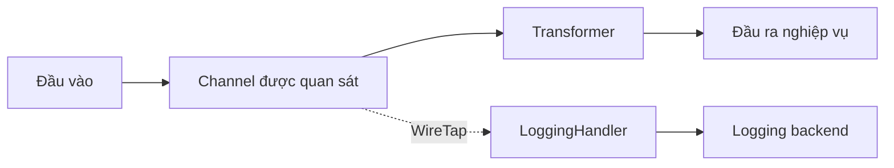

# log trong DSL

## 1. Mục tiêu và bối cảnh

Trong chương **DSL nâng cao** của module **SPRING_INTEGRATION_CORE**, toán tử `log()` giúp quan sát thông điệp tại những vị trí cụ thể trong một `IntegrationFlow`. Khi flow gồm transformer, filter, router, gateway hoặc aggregator, log có ngữ cảnh giúp xác định message đã tới đâu và mang trạng thái gì ở thời điểm đó.

Giả sử một sự kiện đơn hàng đi qua bước kiểm tra dữ liệu rồi chuẩn hóa mã đơn. Khi không thấy kết quả, ta cần phân biệt các khả năng: đầu vào chưa tới, filter đã loại message, transformer thất bại, hoặc kết quả đã được gửi nhưng consumer chưa xử lý. Đặt log ở đúng channel và chọn thông tin phù hợp sẽ giúp trả lời từng câu hỏi.

Sau bài học, bạn có thể:

- Giải thích quan hệ giữa `log()`, `WireTap` và `LoggingHandler`.
- Chọn level, logger category, lambda hoặc biểu thức SpEL để ghi đúng nội dung cần quan sát.
- Đặt log trước và sau endpoint mà không nhầm lẫn thời điểm quan sát với thời điểm hoàn tất nghiệp vụ.
- Kết thúc flow một chiều hoặc giữ đường trả lời cho gateway đúng với hành vi của Spring Integration 6.x.
- Kiểm thử nội dung log đồng thời kiểm tra đầu ra thực của flow.

Các ví dụ dùng Java 17 và Spring Integration 6.x, lấy API 6.5 làm mốc cụ thể. Dự án cần `spring-integration-core` cùng các dependency Spring tương thích. Với Spring Boot, có thể dùng `spring-boot-starter-integration` và để BOM của Boot quản lý phiên bản. Phần kiểm thử dùng JUnit Jupiter; bài kiểm thử thu thập sự kiện log giả định backend là Logback.

## 2. `log()` quan sát message bằng cơ chế nào?

Trong Java DSL, `log()` được triển khai bằng một `WireTap` dạng `ChannelInterceptor`, nối tới `LoggingHandler`. Nó quan sát thông điệp tại channel hiện tại hoặc channel mà DSL tạo để nối các endpoint. Luồng chính vẫn tiếp tục theo cấu hình. Xem [toán tử `log()` trong tài liệu Spring Integration](https://docs.spring.io/spring-integration/reference/dsl/java-log.html).



Đường nét đứt biểu diễn nhánh quan sát. Hàm dùng để tạo nội dung log không thay thế transformer trong đường nghiệp vụ.

```java
.<String>log(message -> "length=" + message.getPayload().length())
```

Với payload `"hello"`, đoạn trên tạo nội dung log `length=5`; payload ở đường chính vẫn là `"hello"`. Nếu cần chuyển payload thành số 5, hãy dùng một transformer riêng.

Có hai hệ quả khi đọc flow:

1. **Log mô tả điều quan sát được tại một điểm.** Nó không tự xác nhận transaction đã commit, message đã được consumer cuối xử lý hoặc dữ liệu đã được lưu bền vững.
2. **Nhánh log vẫn thực hiện công việc.** Đánh giá biểu thức, dựng chuỗi và ghi tới appender đều có chi phí. Biểu thức sai hoặc code định dạng ném lỗi cũng có thể gây lỗi khi gửi qua channel.

Vì vậy, hàm tạo nội dung log nên ngắn, không thay đổi dữ liệu và không thực hiện thao tác nghiệp vụ.

## 3. Các dạng `log()` thường dùng

### 3.1. Level, category và nội dung

| Dạng gọi | Ý nghĩa |
| --- | --- |
| `.log()` | Ghi toàn bộ `Message` ở mức `INFO`, dùng category mặc định |
| `.log(LoggingHandler.Level.DEBUG)` | Ghi toàn bộ message ở mức `DEBUG` |
| `.log("demo.integration.orders")` | Dùng category được chỉ định, mức `INFO` |
| `.log(level, category)` | Chọn level và category, ghi toàn bộ message |
| `.<OrderSubmitted>log(level, category, function)` | Tạo nội dung từ `Message<OrderSubmitted>` |
| `.log(level, category, spelString)` | Dùng biểu thức SpEL để tạo nội dung |

Category mặc định của các overload thông thường là `org.springframework.integration.handler.LoggingHandler`. Khi không cung cấp hàm hoặc biểu thức tùy chỉnh, DSL cấu hình log toàn bộ message. Các chi tiết này được nêu trong [API Java DSL của Spring Integration 6.5](https://docs.spring.io/spring-integration/docs/6.5.0/api/org/springframework/integration/dsl/BaseIntegrationFlowDefinition.html#log()).

Đừng suy từ mặc định của một `LoggingHandler` tạo thủ công sang mặc định của `.log()`: handler tạo thủ công mặc định ghi payload, còn DSL chủ động cấu hình ghi toàn bộ message khi không có biểu thức riêng.

### 3.2. Lambda nhận `Message<P>`

Với `log()`, tham số lambda là `Message<P>`, vì vậy có thể đọc cả payload lẫn header:

```java
.<OrderSubmitted>log(
        LoggingHandler.Level.INFO,
        "demo.integration.orders",
        message -> "stage=received"
                + " requestId=" + message.getHeaders().get("requestId")
                + " orderId=" + message.getPayload().orderId())
```

`OrderSubmitted` được định nghĩa trong ví dụ đầy đủ ở mục 4. Chỉ định `<OrderSubmitted>` giúp compiler xác định kiểu payload trong lambda. DSL không tạo một hệ thống kiểm tra kiểu xuyên suốt mọi endpoint, nên kiểu khai báo tại log phải khớp với payload thực sự tới vị trí đó.

Giá trị lambda trả về chỉ dùng để ghi log. Việc trả một chuỗi có nghĩa rõ ràng thường dễ kiểm tra hơn trả nguyên một đối tượng lớn rồi phụ thuộc hoàn toàn vào `toString()`.

### 3.3. SpEL lấy `Message` làm đối tượng gốc

Có thể viết cùng một ý tưởng bằng SpEL:

```java
.log(LoggingHandler.Level.INFO,
        "demo.integration.orders",
        "'stage=received requestId=' + headers['requestId']"
                + " + ' orderId=' + payload.orderId()")
```

Trong biểu thức này, `headers` và `payload` được đọc từ message. Một header không tồn tại có thể cho giá trị `null`; nếu cần giá trị thay thế, hãy thể hiện chính sách đó trong biểu thức hoặc hàm Java.

Chuỗi ở tham số thứ ba là **biểu thức SpEL**, không phải mẫu SLF4J có placeholder `{}`. Ví dụ:

```java
.log(LoggingHandler.Level.INFO,
        "demo.integration.orders",
        "'stage=received'")
```

Dấu nháy đơn bên trong chuỗi Java biểu diễn literal của SpEL. Ngược lại:

```java
.log("stage=received")
```

Lời gọi chỉ có một `String` chọn overload category; nó tạo logger tên `stage=received`, không có nghĩa là ghi literal đó làm nội dung. Khi nội dung có xử lý dữ liệu hoặc cần tái sử dụng, hàm Java thường thể hiện ý định rõ hơn một biểu thức dài.

## 4. Ví dụ đầy đủ: quan sát kiểm tra và chuẩn hóa đơn hàng

Flow sau ghi nhận đầu vào, đưa đơn không hợp lệ vào queue bị loại, chuẩn hóa mã đơn hợp lệ và gửi kết quả tới queue đầu ra. Nội dung log chỉ chọn `stage`, `requestId` và `orderId`.

```java
import java.math.BigDecimal;
import java.util.Locale;
import java.util.Objects;

import org.springframework.beans.factory.annotation.Qualifier;
import org.springframework.context.annotation.Bean;
import org.springframework.context.annotation.Configuration;
import org.springframework.integration.channel.DirectChannel;
import org.springframework.integration.channel.QueueChannel;
import org.springframework.integration.config.EnableIntegration;
import org.springframework.integration.dsl.IntegrationFlow;
import org.springframework.integration.handler.LoggingHandler;
import org.springframework.messaging.Message;

@Configuration(proxyBeanMethods = false)
@EnableIntegration
public class OrderLogConfig {

    public static final String ORDER_LOG = "demo.integration.orders";

    public record OrderSubmitted(String orderId, BigDecimal amount) {
    }

    @Bean
    public DirectChannel orderInput() {
        return new DirectChannel();
    }

    @Bean
    public QueueChannel orderResults() {
        return new QueueChannel(100);
    }

    @Bean
    public QueueChannel rejectedOrders() {
        return new QueueChannel(100);
    }

    @Bean
    public IntegrationFlow orderFlow(
            @Qualifier("orderInput") DirectChannel input,
            @Qualifier("orderResults") QueueChannel results,
            @Qualifier("rejectedOrders") QueueChannel rejected) {

        return IntegrationFlow.from(input)
                .<OrderSubmitted>log(
                        LoggingHandler.Level.DEBUG,
                        ORDER_LOG,
                        message -> describe("received", message))
                .filter(OrderSubmitted.class,
                        OrderLogConfig::isValid,
                        endpoint -> endpoint.discardFlow(discard -> discard
                                .<OrderSubmitted>log(
                                        LoggingHandler.Level.WARN,
                                        ORDER_LOG,
                                        message -> describe("rejected", message))
                                .channel(rejected)))
                .<OrderSubmitted, OrderSubmitted>transform(order ->
                        new OrderSubmitted(
                                order.orderId().strip().toUpperCase(Locale.ROOT),
                                order.amount()))
                .<OrderSubmitted>log(
                        LoggingHandler.Level.INFO,
                        ORDER_LOG,
                        message -> describe("normalized", message))
                .channel(results)
                .get();
    }

    private static boolean isValid(OrderSubmitted order) {
        return order.orderId() != null
                && !order.orderId().isBlank()
                && order.amount() != null
                && order.amount().signum() > 0;
    }

    private static String describe(
            String stage, Message<OrderSubmitted> message) {

        return "stage=" + stage
                + " requestId=" + oneLine(
                        message.getHeaders().get("requestId"))
                + " orderId=" + oneLine(message.getPayload().orderId());
    }

    private static String oneLine(Object value) {
        String text = Objects.toString(value, "missing")
                .replace('\r', '_')
                .replace('\n', '_')
                .replace('\t', '_')
                .strip();
        return text.length() <= 64 ? text : text.substring(0, 64);
    }
}
```

`oneLine()` giới hạn độ dài và xử lý một số ký tự xuống dòng để nội dung minh họa dễ quan sát. Nếu hệ thống cần log JSON hoặc quy tắc escape chặt chẽ, nên dùng encoder và cấu hình logging phù hợp; phép ghép chuỗi trên chỉ tạo văn bản có các cặp khóa–giá trị.

Với request có `requestId=req-007`, mã đơn `" od-007 "` và số tiền dương, phần nội dung log ở mức DEBUG có thể gồm:

```text
stage=received requestId=req-007 orderId=od-007
stage=normalized requestId=req-007 orderId=OD-007
```

Queue `orderResults` nhận một `OrderSubmitted` có mã `OD-007`. Hai chuỗi log không trở thành payload kết quả. Khi số tiền không hợp lệ, flow đi vào discard subflow và tạo log `stage=rejected`; transformer chuẩn hóa không được gọi cho message đó.

Các queue có dung lượng 100 và được dùng để quan sát kết quả trong bài học. Khi áp dụng vào ứng dụng, cần consumer cho từng queue và chính sách gửi phù hợp nếu queue có thể đầy.

## 5. Vị trí log quyết định điều có thể kết luận

### 5.1. Trước và sau endpoint

| Vị trí | Điều log có thể cho biết | Điều chưa được chứng minh |
| --- | --- | --- |
| Trước filter | Message đã tới điểm kiểm tra | Message sẽ vượt qua điều kiện |
| Sau filter | Message đã vượt qua filter trên đường này | Tất cả bước phía sau đều thành công |
| Trong discard subflow | Message đã được chuyển vào nhánh loại | Việc loại đã được khôi phục hoặc thông báo cho caller |
| Sau transformer | Đã có message mang kết quả biến đổi | Consumer cuối đã lưu kết quả |
| Trước router | Message sắp tới bước định tuyến | Nhánh đích nào đã hoàn tất |
| Sau aggregator | Đã có output được aggregator phát ra | Nhóm là đầy đủ nếu cấu hình cho phép phát kết quả một phần |

Ví dụ chỉ đặt `.log()` sau filter rồi không thấy dòng log chưa đủ để kết luận producer không gửi dữ liệu. Message có thể đã tới filter và bị loại. Để kiểm tra trường hợp đó, cần một điểm quan sát trước filter hoặc trong nhánh discard.

Tương tự, log ở mức `ERROR` chỉ thể hiện mức nghiêm trọng của sự kiện log. Nó không ném exception hay chuyển message vào error channel.

### 5.2. Log trên channel dùng chung có phạm vi dùng chung

Nếu một flow đặt log trên channel có tên `sharedInput`, interceptor thuộc channel đó. Message do một producer khác gửi vào chính channel ấy cũng có thể được quan sát, dù producer không đi qua những bước đứng trước trong flow đang đọc.

Vì vậy, khi thấy log xuất hiện nhiều hơn dự kiến, hãy xác định channel thực sự được gắn interceptor và tất cả nơi gửi tới channel. Chỉ đọc tên bean `IntegrationFlow` chứa lời gọi `.log()` chưa đủ để xác định phạm vi quan sát ở runtime.

### 5.3. `preSend` không phải xác nhận xử lý xong

`WireTap` thực hiện việc gửi sang nhánh quan sát trong `preSend`. Với một queue, log tại điểm đó có thể xuất hiện trước khi message được xếp vào queue thành công. Với channel dùng executor, nó có thể xuất hiện trước khi task được submit thành công. Cơ chế này thể hiện trong [mã nguồn `WireTap` của Spring Integration 6.5](https://github.com/spring-projects/spring-integration/blob/v6.5.0/spring-integration-core/src/main/java/org/springframework/integration/channel/interceptor/WireTap.java).

Do đó, tên sự kiện như `stage=before-dispatch` chính xác hơn `stage=delivered` khi ta chỉ quan sát trước thao tác gửi. Muốn đo kết quả gửi hoặc hoàn tất endpoint, cần cơ chế quan sát tương ứng với mốc đó, thay vì đổi tên một dòng log trước gửi.

## 6. `log()` ở cuối flow từ Spring Integration 6.0

Từ phiên bản 6.0, `log()` ở cuối flow giữ tính chất quan sát giống khi đặt ở giữa. Nó không mặc nhiên đóng vai trò consumer kết thúc mọi flow. Tài liệu chính thức khuyến nghị dùng `nullChannel()` sau log cuối nếu không cần tạo reply. Khi đọc ví dụ cũ, cần đối chiếu thay đổi này. Xem [hành vi của toán tử `log()`](https://docs.spring.io/spring-integration/reference/dsl/java-log.html).

### 6.1. Flow một chiều: ghi log rồi kết thúc

Bean độc lập sau nhận chuỗi, ghi độ dài và kết thúc rõ ràng:

```java
@Bean
public IntegrationFlow oneWayLogFlow() {
    return IntegrationFlow.from("oneWayLogInput")
            .<String>log(
                    LoggingHandler.Level.INFO,
                    "demo.integration.events",
                    message -> "stage=observed length="
                            + message.getPayload().length())
            .nullChannel();
}
```

`nullChannel()` là toán tử kết thúc trả về `IntegrationFlow`, nên không nối thêm `.get()` vào ví dụ này. Message được tiêu thụ tại điểm kết thúc; flow không tạo phản hồi nghiệp vụ.

Nếu một gateway đang chờ reply từ flow này, caller có thể phải chờ đến timeout vì cấu hình chủ động không trả kết quả. Kiểu phương thức gateway và hình dạng flow cần thống nhất với nhau.

### 6.2. Flow có reply: log rồi trả kết quả theo `replyChannel`

Có thể thêm bean sau vào `OrderLogConfig`; lớp đã có import cho `Locale`:

```java
@Bean
public IntegrationFlow normalizeReplyFlow() {
    return IntegrationFlow.from("normalizeReplyInput")
            .<String, String>transform(value ->
                    value.strip().toUpperCase(Locale.ROOT))
            .<String>log(
                    LoggingHandler.Level.INFO,
                    "demo.integration.reply",
                    message -> "stage=reply-ready length="
                            + message.getPayload().length())
            .get();
}
```

Với message có `replyChannel`, kết quả chuẩn hóa có đường quay về channel phản hồi. Chuỗi `stage=reply-ready ...` chỉ là nội dung quan sát. Gateway request–reply là một cách cung cấp đường phản hồi đó; cũng có thể tạo header này thủ công trong bài kiểm thử.

Nếu gửi trực tiếp một message không có đường phản hồi vào flow đang kết thúc theo kiểu reply-producing, việc đã nhìn thấy log không bảo đảm lời gọi gửi sẽ thành công. Lỗi tìm output hoặc reply channel vẫn có thể xảy ra sau điểm quan sát.

### 6.3. Dùng `LoggingHandler` làm consumer cuối

Một lựa chọn khác cho logging sink là khai báo handler rồi dùng trực tiếp qua `.handle(...)`:

```java
@Bean
public LoggingHandler terminalEventLogger() {
    LoggingHandler handler = new LoggingHandler(LoggingHandler.Level.INFO);
    handler.setLoggerName("demo.integration.event-sink");
    handler.setLogExpressionString(
            "'requestId=' + headers['requestId']");
    return handler;
}

@Bean
public IntegrationFlow terminalLoggingFlow(
        LoggingHandler terminalEventLogger) {

    return IntegrationFlow.from("terminalLogInput")
            .handle(terminalEventLogger)
            .get();
}
```

Ở cấu hình này, `LoggingHandler` là consumer cuối của đường chính và không tạo reply. Có thể dùng cách đó khi chính mục đích của flow là đưa message tới logging sink. Các thuộc tính `logExpression`, logger name và chế độ ghi toàn message được mô tả trong [Logging Channel Adapter](https://docs.spring.io/spring-integration/reference/logging-adapter.html).

## 7. Level trong DSL và cấu hình backend

Mức log trong flow và ngưỡng cho phép của logging backend là hai phần cấu hình khác nhau:

```java
.log(LoggingHandler.Level.DEBUG, "demo.integration.orders")
```

Lời gọi này yêu cầu phát sự kiện ở mức `DEBUG`. Nếu logger hiệu lực đang ở `INFO`, nội dung DEBUG không được xuất ra theo cấu hình thông thường. Điều đó không có nghĩa flow chưa chạy.

Với Spring Boot, cấu hình mức log theo category có thể đặt trong `application.yml` của ứng dụng:

```yaml
logging:
  level:
    root: INFO
    demo.integration.orders: DEBUG
    demo.integration.events: INFO
    demo.integration.reply: INFO
```

Đây là ví dụ cấu hình cho ứng dụng học tập, không phải nội dung cần thêm vào YAML metadata của bài học. Với ứng dụng Spring thuần, hãy cấu hình backend đang dùng; `logging.level.*` là quy ước cấu hình của Boot. Xem [cấu hình logging của Spring Boot](https://docs.spring.io/spring-boot/reference/features/logging.html#features.logging.log-levels).

Một cách phân bổ mức log cho ví dụ đơn hàng:

| Level | Ví dụ nội dung |
| --- | --- |
| `TRACE` | Chi tiết kỹ thuật phục vụ điều tra ngắn hạn với lưu lượng được kiểm soát |
| `DEBUG` | Sự kiện tới một bước, dữ liệu đã chọn để chẩn đoán |
| `INFO` | Một mốc xử lý có ý nghĩa và tần suất phù hợp |
| `WARN` | Tình huống bị loại hoặc suy giảm cần theo dõi theo chính sách ứng dụng |
| `ERROR` | Lỗi xử lý cần hành động khắc phục |

Không phải mọi message bị filter loại đều cần WARN. Nếu điều kiện loại là hành vi thường xuyên, hợp lệ của nghiệp vụ, có thể chọn DEBUG hoặc dùng số liệu đếm. Mức nghiêm trọng cần phản ánh ý nghĩa vận hành, không chỉ vị trí endpoint.

Đặt category ổn định theo chức năng, như `demo.integration.orders`. Mã đơn hoặc mã request nên nằm trong nội dung, vì category chứa từng mã động sẽ khó quản lý mức log và phạm vi cấu hình.

## 8. Tương quan thông điệp và ranh giới thread

### 8.1. Chọn mã tương quan phù hợp

`MessageHeaders.ID` hữu ích để xác định một message cụ thể. Qua transformer, splitter hoặc bước tạo message mới, message ID có thể thay đổi. Một `requestId` hay `eventId` do ứng dụng quy định giúp liên kết các bước của cùng một thao tác nghiệp vụ, nếu các bước bảo toàn header đó.

Ví dụ gửi đầu vào:

```java
Message<OrderLogConfig.OrderSubmitted> request =
        MessageBuilder.withPayload(
                        new OrderLogConfig.OrderSubmitted(
                                " od-007 ", new BigDecimal("125000")))
                .setHeader("requestId", "req-007")
                .build();

input.send(request);
```

Đoạn này dùng `org.springframework.messaging.support.MessageBuilder`; `input` là bean `orderInput`. Với các bước xử lý lỗi, retry hoặc chia nhánh, có thể bổ sung tên nhánh và số lần thử vào nội dung log khi những giá trị đó có sẵn.

Không nên tùy tiện ghi đè `correlationId` do splitter hoặc aggregator dùng chỉ để có một giá trị dễ tìm trong log. Header phục vụ quan sát có thể có tên riêng để không thay đổi hợp đồng tương quan của mẫu tích hợp.

### 8.2. Log quanh channel có executor

Xét khung flow sau; `executor` là executor bean đã được ứng dụng quản lý:

```java
.channel(channels -> channels.executor(executor))
.<String>log(
        LoggingHandler.Level.DEBUG,
        "demo.integration.threads",
        message -> "stage=before-dispatch thread="
                + Thread.currentThread().getName())
.<String, String>transform(String::strip)
.<String>log(
        LoggingHandler.Level.DEBUG,
        "demo.integration.threads",
        message -> "stage=after-transform thread="
                + Thread.currentThread().getName())
```

Log đầu gắn vào channel executor và được thực hiện trong đường `preSend`, nên có thể vẫn chạy trên thread của sender. Transformer chạy khi task được thực thi; log ở đầu ra transformer quan sát message trong đường xử lý sau đó.

Vì vậy, vị trí dòng `.log()` sau dòng `.channel(...)` trong mã nguồn không đủ để khẳng định log chạy trên worker. Cần xét channel nào bị intercept và endpoint nào đã thực sự được thực thi.

### 8.3. Header không tự trở thành MDC

MDC thường gắn với ngữ cảnh thread của logging backend. Việc message có header `requestId` không tự đưa giá trị đó vào MDC, cũng không tự truyền mọi giá trị MDC từ sender sang worker.

Cách đơn giản trong bài là đọc `requestId` trực tiếp từ message. Nếu hệ thống dùng MDC hoặc tracing, cần cơ chế truyền và dọn ngữ cảnh phù hợp với executor và công cụ quan sát đang dùng. Không đặt thao tác khởi tạo MDC, xóa MDC hay cập nhật trạng thái nghiệp vụ vào lambda của `.log()` vì việc tạo nội dung log có thể không chạy khi level bị tắt.

## 9. Ghi log lỗi và xử lý lỗi là hai công việc khác nhau

Một `.log()` đứng trước endpoint không tự bắt exception của endpoint đó. Một `.log()` đứng sau endpoint cũng không chạy nếu endpoint ném lỗi trước khi phát output. Muốn quan sát lỗi, cần đường lỗi hoặc advice thích hợp với ranh giới thực thi.

Với flow đồng bộ, exception thường truyền về caller. Với các tác vụ bất đồng bộ do Spring Integration quản lý, lỗi có thể được đưa thành `ErrorMessage` và gửi tới `errorChannel` theo cơ chế của thành phần liên quan. Xem [xử lý lỗi trong Spring Integration](https://docs.spring.io/spring-integration/reference/error-handling.html).

Ví dụ logging sink cho các lỗi đã được chuyển tới channel riêng:

```java
@Bean
public IntegrationFlow errorLoggingFlow() {
    return IntegrationFlow.from("orderErrorLogInput")
            .log(
                    LoggingHandler.Level.ERROR,
                    "demo.integration.orders.errors",
                    message -> message.getPayload())
            .nullChannel();
}
```

Flow này chỉ xử lý message được gửi tới `orderErrorLogInput`. Để nó nhận lỗi từ một tác vụ thực, thành phần phát lỗi hoặc header `errorChannel` cần được cấu hình trỏ tới channel đó. Việc đặt tên bean `errorLoggingFlow` không tự kết nối mọi exception trong ứng dụng tới nó.

Với `ErrorMessage`, payload là `Throwable`. `LoggingHandler` có xử lý ghi stack trace khi kết quả biểu thức là `Throwable`; trả lại payload giúp giữ thông tin lỗi tốt hơn việc chỉ lấy `getMessage()`. Xem [API `LoggingHandler`](https://docs.spring.io/spring-integration/docs/current/api/org/springframework/integration/handler/LoggingHandler.html).

Tuy nhiên, stack trace và `failedMessage` có thể mang dữ liệu đầu vào. Cần chọn nội dung phù hợp với dữ liệu của hệ thống. Nếu nghiệp vụ cần retry, chuyển công việc sang hàng chờ khôi phục hoặc phát trạng thái thất bại cho caller, hãy cấu hình các hành vi đó riêng. Logging sink kết thúc tại `nullChannel()` chỉ ghi nhận rồi tiêu thụ message lỗi.

## 10. Chi phí và nội dung log

### 10.1. Chọn trường cần thiết thay vì ghi toàn message

`.log()` không tham số thuận tiện khi thử nghiệm với dữ liệu giả lập, nhưng có thể ghi cả payload và header. Trong một flow xử lý HTTP, các header có thể chứa token; payload có thể chứa dữ liệu khách hàng hoặc tài liệu lớn.

Ví dụ ở mục 4 chủ động chọn một danh sách trường nhỏ. Có thể áp dụng cùng cách đó cho hệ thống thực:

| Thông tin | Mục đích |
| --- | --- |
| `stage` | Xác định mốc quan sát |
| `requestId` hoặc `eventId` | Tìm các sự kiện liên quan |
| Mã nghiệp vụ được phép ghi | Liên kết với đối tượng đang xử lý |
| Tên nhánh, lần thử, trạng thái | Giải thích đường đi và việc xử lý lại |
| Kích thước hoặc số phần tử | Quan sát dữ liệu lớn mà không xuất toàn bộ nội dung |

Không nên đọc toàn bộ stream, mở file hoặc serialize một cấu trúc lớn chỉ để ghi log. Với `InputStream`, việc đọc còn có thể làm thay đổi dữ liệu mà endpoint kế tiếp nhận được.

### 10.2. Lambda tạo log nên không có side effect

Trong triển khai Spring Integration 6.5, `LoggingHandler` dùng `Supplier` để tạo nội dung theo nhu cầu của mức log. Khi level bị vô hiệu hóa, không nên kỳ vọng hàm định dạng vẫn được gọi. Xem [mã nguồn `LoggingHandler` 6.5](https://github.com/spring-projects/spring-integration/blob/v6.5.0/spring-integration-core/src/main/java/org/springframework/integration/handler/LoggingHandler.java).

Vì vậy, các thao tác như tăng bộ đếm nghiệp vụ, lưu audit bắt buộc hay sửa payload phải được đặt trong endpoint thích hợp. Nếu đặt chúng trong lambda `.log()`, đổi mức logging có thể làm thay đổi hành vi nghiệp vụ.

Khi level được bật, biểu thức vẫn có chi phí và phải tương thích với kiểu payload. Một phép cast sai, truy cập giá trị `null` không được xử lý hoặc lời gọi từ xa trong formatter có thể ảnh hưởng đường gửi. Việc quan sát bằng wire tap không mặc nhiên có nghĩa không thể gây lỗi hoặc không có độ trễ.

### 10.3. Log không thay thế mọi dữ liệu quan sát

Log chi tiết phù hợp để giải thích một sự kiện cụ thể. Các câu hỏi như tỷ lệ bị loại, số lỗi mỗi phút hay phân vị độ trễ cần số liệu đo phù hợp. Đếm dòng log có thể sai lệch khi level bị tắt, có sampling, appender lọc sự kiện hoặc message được retry.

Audit bắt buộc lưu bền vững cũng cần cơ chế lưu và xác nhận riêng. Một dòng `stage=normalized` chỉ có ý nghĩa mà điểm quan sát đó thực sự chứng minh.

## 11. Kiểm thử nội dung log và đầu ra flow

### 11.1. Thu thập sự kiện Logback

Bài kiểm thử sau dùng lớp `OrderLogConfig` ở mục 4. Runtime kiểm thử phải có Logback làm backend SLF4J và logging của Spring được nối tới backend đó. Nếu dự án dùng Log4j2 hoặc backend khác, cần sử dụng cơ chế thu thập tương ứng.

`ListAppender` giữ các sự kiện logging để kiểm tra trong bộ nhớ. Xem [API `ListAppender` của Logback](https://logback.qos.ch/apidocs/ch.qos.logback.core/ch/qos/logback/core/read/ListAppender.html).

```java
import java.math.BigDecimal;

import ch.qos.logback.classic.Level;
import ch.qos.logback.classic.Logger;
import ch.qos.logback.classic.spi.ILoggingEvent;
import ch.qos.logback.core.read.ListAppender;
import org.junit.jupiter.api.Test;
import org.slf4j.LoggerFactory;
import org.springframework.context.annotation.AnnotationConfigApplicationContext;
import org.springframework.integration.channel.QueueChannel;
import org.springframework.messaging.Message;
import org.springframework.messaging.MessageChannel;
import org.springframework.messaging.support.MessageBuilder;

import static org.junit.jupiter.api.Assertions.*;

class OrderLogTest {

    @Test
    void logsSelectedFieldsAndKeepsBusinessOutput() {
        Logger logger = (Logger) LoggerFactory.getLogger(OrderLogConfig.ORDER_LOG);
        Level previousLevel = logger.getLevel();
        boolean previousAdditive = logger.isAdditive();

        ListAppender<ILoggingEvent> appender = new ListAppender<>();
        appender.setContext(logger.getLoggerContext());
        appender.start();
        logger.addAppender(appender);
        logger.setLevel(Level.DEBUG);
        logger.setAdditive(false);

        try (var context = new AnnotationConfigApplicationContext(
                OrderLogConfig.class)) {

            MessageChannel input =
                    context.getBean("orderInput", MessageChannel.class);
            QueueChannel results =
                    context.getBean("orderResults", QueueChannel.class);
            QueueChannel rejected =
                    context.getBean("rejectedOrders", QueueChannel.class);

            var order = new OrderLogConfig.OrderSubmitted(
                    " od-007 ", new BigDecimal("125000"));
            Message<?> request = MessageBuilder.withPayload(order)
                    .setHeader("requestId", "req-007")
                    .setHeader("authorization", "secret-token-for-test")
                    .build();

            assertTrue(input.send(request));

            Message<?> reply = results.receive(1000);
            assertNotNull(reply);
            assertEquals(
                    new OrderLogConfig.OrderSubmitted(
                            "OD-007", new BigDecimal("125000")),
                    reply.getPayload());
            assertEquals("req-007", reply.getHeaders().get("requestId"));
            assertNull(rejected.receive(0));

            assertEquals(2, appender.list.size());
            assertEquals(Level.DEBUG, appender.list.get(0).getLevel());
            assertEquals(Level.INFO, appender.list.get(1).getLevel());
            assertEquals(
                    "stage=received requestId=req-007 orderId=od-007",
                    appender.list.get(0).getFormattedMessage());
            assertEquals(
                    "stage=normalized requestId=req-007 orderId=OD-007",
                    appender.list.get(1).getFormattedMessage());
            assertTrue(appender.list.stream().noneMatch(event ->
                    event.getFormattedMessage().contains("secret-token-for-test")));
        }
        finally {
            logger.detachAppender(appender);
            appender.stop();
            logger.setLevel(previousLevel);
            logger.setAdditive(previousAdditive);
        }
    }
}
```

Bài kiểm thử xác nhận cả dữ liệu nghiệp vụ lẫn nội dung quan sát. Header `authorization` vẫn là một phần message đầu vào, nhưng formatter không đưa nó vào nội dung log. Kiểm tra này chỉ chứng minh các log do category được thu thập tạo ra; nó không khẳng định mọi logger khác trong toàn ứng dụng đều có cùng chính sách.

Thứ tự hai sự kiện được kiểm tra vì flow ở đây chạy đồng bộ và xử lý một message. Không áp dụng mặc định thứ tự ấy cho nhiều request đồng thời hoặc cho flow có executor. Logger là tài nguyên dùng chung trong JVM, nên tránh chạy đồng thời các bài kiểm thử cùng thay đổi category này, hoặc dùng cơ chế khóa tài nguyên của bộ kiểm thử.

### 11.2. Kiểm tra log cuối flow vẫn giữ reply

Sau khi thêm `normalizeReplyFlow()` ở mục 6 vào cấu hình, có thể thêm method kiểm thử sau vào `OrderLogTest`:

```java
@Test
void keepsReplyWhenLogIsAtTheEndOfFlow() {
    try (var context = new AnnotationConfigApplicationContext(
            OrderLogConfig.class)) {

        MessageChannel input =
                context.getBean("normalizeReplyInput", MessageChannel.class);
        QueueChannel replies = new QueueChannel(1);

        Message<?> request = MessageBuilder.withPayload("  ready  ")
                .setReplyChannel(replies)
                .build();

        assertTrue(input.send(request));
        Message<?> reply = replies.receive(1000);
        assertNotNull(reply);
        assertEquals("READY", reply.getPayload());
    }
}
```

Header `replyChannel` được đặt thủ công để kiểm tra đường phản hồi. Kết quả `READY` chứng minh log cuối không thay payload bằng chuỗi định dạng và không tiêu thụ mất reply.

### 11.3. Các kiểm tra cần bổ sung theo thay đổi cấu hình

| Thay đổi hoặc tình huống | Kết quả cần kiểm tra |
| --- | --- |
| Đơn không hợp lệ | Có `stage=rejected`, không có `stage=normalized`, message tới queue bị loại |
| Logger chỉ bật INFO | DEBUG đầu vào không xuất hiện, đầu ra nghiệp vụ vẫn đúng |
| Thiếu `requestId` | Formatter dùng giá trị thay thế, flow không lỗi vì header thiếu |
| Mã có ký tự xuống dòng | Formatter xử lý theo quy tắc đã chọn |
| Thêm executor | Nội dung tương quan đúng dù sự kiện xen kẽ hoặc khác thread |
| Flow một chiều kết thúc bằng `nullChannel()` | Message được tiêu thụ theo hợp đồng một chiều |
| Formatter nhận sai kiểu payload | Phát hiện lỗi cấu hình và sửa kiểu tại đúng vị trí |

Với flow bất đồng bộ, chờ kết quả qua queue hoặc đồng bộ hóa bằng công cụ có timeout. `ListAppender` minh họa ở trên không được dùng như một cơ chế đồng bộ giữa các thread, và `Thread.sleep()` không chứng minh chắc chắn endpoint đã hoàn tất.

## 12. Chẩn đoán những nhầm lẫn thường gặp

| Hiện tượng | Hướng kiểm tra |
| --- | --- |
| Không thấy dòng DEBUG | Kiểm tra level hiệu lực của đúng category và cấu hình appender |
| Thấy log đầu vào, không thấy log sau filter | Kiểm tra điều kiện filter và discard subflow |
| Log đã xuất hiện nhưng gửi vẫn lỗi | Kiểm tra endpoint sau điểm log, output channel, reply channel và thời điểm `preSend` |
| Log chứa toàn bộ payload và header | Kiểm tra overload không có formatter; chọn các trường cần thiết |
| Thay level làm thay đổi nghiệp vụ | Tìm side effect bị đặt nhầm trong lambda tạo log |
| Log lặp với cùng mã request | Phân biệt retry, nhiều điểm quan sát, nhiều producer và appender có additivity |
| Log trên executor vẫn mang tên thread sender | Xác định log đang gắn vào channel hay ở đầu ra endpoint đã chạy trên worker |
| Có lỗi nghiệp vụ nhưng `.log(ERROR)` không ghi | Xác định message có tới điểm log không và đường phát `ErrorMessage` đã được nối chưa |
| Flow chờ phản hồi mãi | Đối chiếu hợp đồng gateway với consumer cuối, `nullChannel()` và đường reply |

Khi điều tra, bắt đầu từ channel được quan sát, level/category và đường đi của một request cụ thể. Sau đó đối chiếu đầu ra thực, lỗi và trạng thái endpoint; một dòng log riêng lẻ thường chỉ giải thích được một phần hành trình.

## 13. Bài thực hành mở rộng

1. Chạy flow đơn hàng với logger ở DEBUG, rồi đổi sang INFO. Xác nhận đầu ra chuẩn hóa giống nhau và chỉ số dòng log thay đổi theo cấu hình.
2. Gửi đơn có số tiền bằng 0. Kiểm tra queue bị loại và quan sát việc không có sự kiện `normalized` cho request đó.
3. Thêm một trường ghi chú dài vào kiểu dữ liệu thử nghiệm nhưng giữ formatter chỉ chọn mã request và mã đơn. Kiểm tra nội dung ghi chú không xuất hiện trong log của flow.
4. Thêm executor, ghi tên thread ở hai điểm như mục 8 và gửi nhiều request có mã khác nhau. Dùng mã tương quan để nhóm sự kiện thay vì dựa vào thứ tự dòng log.
5. So sánh flow có reply kết thúc bằng `.log(...).get()` với flow một chiều kết thúc bằng `.log(...).nullChannel()`. Kiểm tra hành vi bằng channel phản hồi có thời gian chờ hữu hạn.

Với mỗi điểm log mới, ghi rõ mốc mà nó quan sát, các trường được phép xuất và kết quả nào vẫn cần kiểm chứng ở bước tiếp theo. Điều đó giúp nội dung log giữ đúng ý nghĩa khi flow được thêm filter, chia nhánh hoặc chuyển sang xử lý bất đồng bộ.
