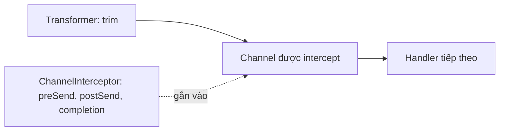

# Intercept trong DSL

## 1. Mục tiêu và phạm vi

Trong chương **DSL nâng cao** của module **SPRING_INTEGRATION_CORE**, `intercept()` giúp đặt hành vi dùng chung tại ranh giới truyền thông điệp. Bạn có thể bổ sung metadata, ghi nhận kết quả gửi hoặc kiểm tra điều kiện tiếp nhận mà không đưa cùng một đoạn mã vào mọi transformer và service activator.

Bài học hướng tới các khả năng sau:

- Xác định channel thực sự nhận interceptor tại một vị trí trong Java DSL.
- Chọn callback phù hợp cho thao tác gửi, nhận hoặc xử lý trên executor.
- Phân biệt việc giữ nguyên, thay thế, chặn và từ chối message bằng exception.
- Sắp xếp nhiều interceptor và hiểu điều kiện gọi callback hoàn tất.
- Kiểm thử hành vi của flow, header và đường từ chối.

Ví dụ sử dụng **Java 17 trở lên, Spring Integration 6.5.x** và JUnit Jupiter. Java DSL nằm trong `spring-integration-core`. Khi dùng Spring Boot, chọn dependency theo BOM tương thích của ứng dụng. Những đoạn ghi là “đoạn ghép” minh họa một phần chuỗi DSL, không phải một file Java độc lập.

## 2. Intercept gắn vào channel

`intercept(ChannelInterceptor...)` đăng ký một hoặc nhiều interceptor tại channel hiện hành của flow. Toán tử có từ Spring Integration 5.3. Đây là cách viết gọn khi cần gắn interceptor ngay trong chuỗi DSL. Tham khảo [Operator intercept()](https://docs.spring.io/spring-integration/reference/6.5/dsl/java-intercept.html).

```java
// Đoạn ghép: hai biến interceptor là các instance đã được cung cấp.
.transform(String.class, String::trim)
.intercept(requestIdInterceptor, sendOutcomeInterceptor)
.handle((payload, headers) -> payload)
```

Cấu trúc khái niệm:



Ở đây, interceptor quan sát message **sau transformer** khi message đi qua channel tương ứng. Nó không tự động bọc mọi lệnh gọi phương thức bên trong handler.

Một flow thường có nhiều channel, gồm cả channel được DSL tạo ngầm. Vì vậy, câu “đã thêm interceptor vào flow” chưa đủ chính xác. Cần chỉ rõ **channel nào, ở ranh giới nào**.

### 2.1. Channel tường minh và channel ngầm

Khi channel hiện hành là `InterceptableChannel`, DSL gắn interceptor vào channel đó. Nếu không có channel phù hợp, DSL tạo một `DirectChannel` ngầm để thực hiện việc intercept. API mô tả hành vi này tại [BaseIntegrationFlowDefinition](https://docs.spring.io/spring-integration/docs/6.5.0/api/org/springframework/integration/dsl/BaseIntegrationFlowDefinition.html).

Để gắn chắc chắn vào một channel bean cụ thể, có thể truyền trực tiếp instance được inject:

```java
@Bean
IntegrationFlow incomingFlow(
        @Qualifier("incoming") DirectChannel incoming,
        ChannelInterceptor boundaryInterceptor) {

    return IntegrationFlow.from(incoming)
            .intercept(boundaryInterceptor)
            .<String, String>transform(String::trim)
            .channel("results")
            .get();
}
```

Ví dụ giả định đã có bean `incoming`, bean `results` và một interceptor tương ứng.

Cần thận trọng với cách viết:

```java
.channel("sharedInput")
.intercept(boundaryInterceptor)
```

Trong quá trình dựng DSL, tên channel có thể được biểu diễn bằng một đối tượng tham chiếu, thay vì instance channel bean đã được giải quyết. Ở phiên bản dùng trong bài, DSL có thể chèn channel ngầm tại vị trí đó. Không nên dựa vào đoạn mã trên để khẳng định interceptor đã được thêm trực tiếp vào bean `sharedInput`. Nếu việc gắn vào đúng bean là yêu cầu, truyền instance hoặc cấu hình interceptor tại nơi tạo channel. Có thể đối chiếu [mã nguồn BaseIntegrationFlowDefinition 6.5.0](https://raw.githubusercontent.com/spring-projects/spring-integration/v6.5.0/spring-integration-core/src/main/java/org/springframework/integration/dsl/BaseIntegrationFlowDefinition.java).

### 2.2. Channel dùng chung có phạm vi dùng chung

Nếu hai flow gửi vào cùng một channel đã được gắn interceptor, cả hai đường gửi đều chịu tác động của interceptor đó. Vị trí của lời gọi `.intercept(...)` trong một phương thức cấu hình không biến interceptor thành hành vi riêng của một caller.

Hệ quả thực tế: một interceptor kiểm tra kiểu payload phải phù hợp với hợp đồng của channel. Nếu channel nhận nhiều loại thông điệp, interceptor chỉ chấp nhận một DTO sẽ ảnh hưởng cả những flow khác đang dùng channel.

## 3. Các callback của ChannelInterceptor

`ChannelInterceptor` thuộc package `org.springframework.messaging.support`. Interface có các phương thức mặc định nên bạn chỉ cần override callback cần thiết.

| Callback | Thời điểm | Giá trị hoặc tác dụng chính |
|---|---|---|
| `preSend(message, channel)` | Trước khi thực hiện gửi | Trả message giữ nguyên, message mới hoặc `null` để chặn gửi |
| `postSend(message, channel, sent)` | Sau khi thao tác gửi trả kết quả bình thường | Quan sát giá trị `sent` |
| `afterSendCompletion(message, channel, sent, ex)` | Khi kết thúc lượt gửi đối với interceptor đã qua bước chuẩn bị | Thu dọn và quan sát lỗi |
| `preReceive(channel)` | Trước khi lấy message từ pollable channel | `false` để không thực hiện lấy |
| `postReceive(message, channel)` | Sau khi lấy được message, trước khi trả cho caller | Có thể thay message hoặc trả `null` |
| `afterReceiveCompletion(message, channel, ex)` | Khi kết thúc lượt nhận đối với interceptor đủ điều kiện | Thu dọn; message có thể `null` |

Chi tiết hợp đồng callback nằm trong [ChannelInterceptor của Spring Framework 6.2](https://docs.spring.io/spring-framework/docs/6.2.x/javadoc-api/org/springframework/messaging/support/ChannelInterceptor.html).

Có ba điểm dễ nhầm:

1. `postSend` không phải callback luôn chạy khi gửi lỗi. Phần thu dọn khi lỗi thuộc callback completion.
2. `afterSendCompletion` chỉ được gọi cho interceptor mà `preSend` đã hoàn tất và trả về một message khác `null`.
3. Các callback receive dùng cho `PollableChannel`; chúng không phải callback “trước khi handler xử lý” trên `DirectChannel`.

Không coi `ex == null` là bằng chứng message đã được gửi. Một lượt bị chặn bằng `null` có thể kết thúc với `sent == false` mà không có exception.

## 4. Thay đổi message đúng cách

### 4.1. Thêm header bằng MessageBuilder

Với message thông thường, headers không phải một map để sửa trực tiếp:

```java
// Không dùng cách này với MessageHeaders thông thường.
message.getHeaders().put("requestId", "REQ-101");
```

Dùng builder để tạo message chứa phần cập nhật:

```java
@Override
public Message<?> preSend(
        Message<?> message,
        MessageChannel channel) {

    return MessageBuilder.fromMessage(message)
            .setHeader("sourceSystem", "order-api")
            .build();
}
```

`fromMessage(...)` giữ payload và các header được phép sao chép, giúp tránh vô tình bỏ mất `replyChannel`, `errorChannel` hoặc metadata nghiệp vụ. Cấu trúc message không làm cho mọi đối tượng payload và mọi giá trị header trở thành bất biến sâu; tránh sửa DTO mutable dùng chung trong interceptor. Xem [Message và Message Headers](https://docs.spring.io/spring-integration/reference/6.5/message.html).

Khi tạo message mới, không dùng message ID làm mã nghiệp vụ cố định. Dùng header như `requestId` hoặc trường `orderId` khi cần liên hệ giữa nhiều bước.

### 4.2. Giữ nguyên, chặn hoặc ném lỗi

| Cách kết thúc `preSend` | Ý nghĩa |
|---|---|
| `return message;` | Cho gửi message hiện tại |
| `return rebuiltMessage;` | Cho gửi phiên bản mới |
| `return null;` | Không thực hiện gửi qua channel này |
| `throw new ...;` | Kết thúc lượt gửi bằng lỗi |

Trong channel Spring Integration dùng ở bài này, `preSend` trả `null` làm `send(...)` trả `false`. Các abstraction cấp trên như template hoặc gateway có thể diễn giải việc không gửi được thành lỗi; không mặc định rằng chặn bằng `null` luôn bị bỏ qua im lặng ở toàn bộ ứng dụng.

Với lời gọi request–reply, message bị chặn ở một channel trung gian cũng có thể làm bên gọi không nhận được reply. Chọn chính sách từ chối theo hợp đồng của nơi gọi.

## 5. Ví dụ hoàn chỉnh: tiếp nhận đơn hàng

Yêu cầu của ví dụ:

- Bổ sung `requestId` khi thiếu hoặc không phải chuỗi có nội dung.
- Giữ `requestId` hợp lệ đã có.
- Ghi nhận số lượt gửi thành công và không thành công ở channel đầu vào.
- Chỉ nhận `OrderRequest` có mã đơn và quantity dương.
- Chuyển yêu cầu hợp lệ thành `OrderAccepted` để đưa vào channel kết quả.

Đây là ví dụ trong bộ nhớ. Trạng thái `ACCEPTED` thể hiện kết quả biến đổi của bài thực hành; ví dụ chưa có bước lưu cơ sở dữ liệu hoặc bảo đảm tiếp nhận bền vững.

Lưu cấu hình dưới tên `InterceptFlowConfiguration.java` trong project thực hành:

```java
import java.util.Objects;
import java.util.UUID;
import java.util.concurrent.atomic.LongAdder;

import org.springframework.beans.factory.annotation.Qualifier;
import org.springframework.context.annotation.Bean;
import org.springframework.context.annotation.Configuration;
import org.springframework.integration.channel.DirectChannel;
import org.springframework.integration.channel.QueueChannel;
import org.springframework.integration.channel.interceptor.MessageSelectingInterceptor;
import org.springframework.integration.config.EnableIntegration;
import org.springframework.integration.dsl.IntegrationFlow;
import org.springframework.messaging.Message;
import org.springframework.messaging.MessageChannel;
import org.springframework.messaging.support.ChannelInterceptor;
import org.springframework.messaging.support.MessageBuilder;

@Configuration(proxyBeanMethods = false)
@EnableIntegration
public class InterceptFlowConfiguration {

    public static final String REQUEST_ID = "requestId";

    public record OrderRequest(String orderId, int quantity) {
        public OrderRequest {
            Objects.requireNonNull(orderId, "orderId");
        }
    }

    public record OrderAccepted(
            String orderId,
            int quantity,
            String status) {
    }

    public static final class RequestIdInterceptor
            implements ChannelInterceptor {

        @Override
        public Message<?> preSend(
                Message<?> message,
                MessageChannel channel) {

            Object current = message.getHeaders().get(REQUEST_ID);
            if (current instanceof String id && !id.isBlank()) {
                return message;
            }

            return MessageBuilder.fromMessage(message)
                    .setHeader(REQUEST_ID, UUID.randomUUID().toString())
                    .build();
        }
    }

    public static final class SendOutcomeInterceptor
            implements ChannelInterceptor {

        private final LongAdder successful = new LongAdder();
        private final LongAdder unsuccessful = new LongAdder();

        @Override
        public void afterSendCompletion(
                Message<?> message,
                MessageChannel channel,
                boolean sent,
                Exception ex) {

            if (sent && ex == null) {
                successful.increment();
            }
            else {
                unsuccessful.increment();
            }
        }

        public long successfulSends() {
            return successful.sum();
        }

        public long unsuccessfulSends() {
            return unsuccessful.sum();
        }
    }

    @Bean
    public DirectChannel orderInput() {
        return new DirectChannel();
    }

    @Bean
    public QueueChannel orderResults() {
        return new QueueChannel(10);
    }

    @Bean
    public RequestIdInterceptor requestIds() {
        return new RequestIdInterceptor();
    }

    @Bean
    public SendOutcomeInterceptor sendOutcomes() {
        return new SendOutcomeInterceptor();
    }

    @Bean
    public IntegrationFlow orderFlow(
            @Qualifier("orderInput") DirectChannel input,
            RequestIdInterceptor requestIds,
            SendOutcomeInterceptor sendOutcomes) {

        var validOrder = new MessageSelectingInterceptor(
                message -> message.getPayload()
                        instanceof OrderRequest order
                        && !order.orderId().isBlank()
                        && order.quantity() > 0);

        return IntegrationFlow.from(input)
                .intercept(requestIds, sendOutcomes, validOrder)
                .<OrderRequest, OrderAccepted>transform(
                        order -> new OrderAccepted(
                                order.orderId(),
                                order.quantity(),
                                "ACCEPTED"))
                .channel("orderResults")
                .get();
    }
}
```

`MessageSelectingInterceptor` có sẵn trong Spring Integration. Khi selector không chấp nhận message, triển khai 6.5.0 ném `org.springframework.messaging.MessageDeliveryException`; hành vi này khác việc tự viết `preSend` trả `null`. Xem [API MessageSelectingInterceptor](https://docs.spring.io/spring-integration/docs/6.5.0/api/org/springframework/integration/channel/interceptor/MessageSelectingInterceptor.html) và [mã nguồn 6.5.0](https://raw.githubusercontent.com/spring-projects/spring-integration/v6.5.0/spring-integration-core/src/main/java/org/springframework/integration/channel/interceptor/MessageSelectingInterceptor.java).

### 5.1. Gửi thử và lấy kết quả

```java
import org.springframework.context.annotation.AnnotationConfigApplicationContext;
import org.springframework.integration.channel.QueueChannel;
import org.springframework.messaging.MessageChannel;
import org.springframework.messaging.support.MessageBuilder;

public class InterceptExample {

    public static void main(String[] args) {
        try (var context = new AnnotationConfigApplicationContext(
                InterceptFlowConfiguration.class)) {

            MessageChannel input = context.getBean(
                    "orderInput", MessageChannel.class);
            QueueChannel results = context.getBean(
                    "orderResults", QueueChannel.class);

            var request = MessageBuilder.withPayload(
                            new InterceptFlowConfiguration.OrderRequest(
                                    "ORDER-101", 3))
                    .build();

            boolean sent = input.send(request, 1000);
            var result = results.receive(1000);

            System.out.println("sent=" + sent);
            if (result != null) {
                System.out.println(result.getPayload());
                System.out.println(result.getHeaders().get("requestId"));
            }
        }
    }
}
```

Kết quả mong đợi:

```text
sent=true
OrderAccepted[orderId=ORDER-101, quantity=3, status=ACCEPTED]
<một UUID được sinh cho requestId>
```

Channel `orderInput` là `DirectChannel` được truyền bằng instance nên ba interceptor được gắn vào chính channel này. `orderResults` là queue để chương trình đọc kết quả; vì ví dụ đọc trực tiếp bằng `receive`, không cần poller cho channel kết quả.

Ví dụ chỉ gửi một số ít message. Nếu chạy thành dịch vụ liên tục, cần consumer rút kết quả khỏi queue và chính sách khi queue đầy. Timeout của `input.send(...)` không tự giới hạn tổng thời gian chạy toàn bộ handler đồng bộ phía sau.

### 5.2. Vì sao thứ tự đăng ký có ý nghĩa?

Thứ tự trong ví dụ là:

```text
requestIds → sendOutcomes → validOrder → gửi vào channel
```

- Selector được thấy header mà interceptor trước đã bổ sung.
- Interceptor thống kê đã qua `preSend` mặc định trước khi selector có thể ném lỗi.
- Khi selector từ chối, bộ đếm không thành công vẫn được cập nhật qua callback completion.
- Nếu đặt interceptor thống kê sau selector, nó chưa được gọi khi selector từ chối nên không ghi nhận được lượt đó.

Các bộ đếm ở đây đo **lượt gửi qua orderInput**. Chúng không phải số đơn duy nhất, số giao dịch đã commit hoặc số thông báo đã giao đến hệ thống bên ngoài.

## 6. Thứ tự callback và điều kiện hoàn tất

Giả sử channel có hai interceptor `A`, `B`, theo thứ tự đăng ký, không có interceptor nào khác và handler xử lý bình thường:

```text
A.preSend
B.preSend
thao tác gửi / giao message cho subscriber
A.postSend
B.postSend
B.afterSendCompletion
A.afterSendCompletion
```

Các callback trước gửi đi theo thứ tự đăng ký; completion quay ngược lại các interceptor đã hoàn tất bước chuẩn bị. `postSend` là callback sau gửi bình thường, không thay thế cho completion.

Trong Spring Integration 6.5.0, thứ tự `postSend` cũng đi theo danh sách đăng ký; có thể kiểm tra trong [AbstractMessageChannel](https://raw.githubusercontent.com/spring-projects/spring-integration/v6.5.0/spring-integration-core/src/main/java/org/springframework/integration/channel/AbstractMessageChannel.java).

### 6.1. Interceptor B trả null

```text
A.preSend → trả message
B.preSend → trả null
A.afterSendCompletion(sent=false, ex=null)
send(...) → false
```

Không có thao tác gửi thực tế, không có `postSend` và không có completion của chính `B`. `B` chưa đáp ứng điều kiện hoàn tất bước chuẩn bị.

Nếu `B` đã cấp phát tài nguyên rồi quyết định trả `null`, nó phải tự xử lý phần thu dọn của mình trước khi trả về. Không dựa vào completion của `B` cho trường hợp này.

### 6.2. Interceptor B ném exception

```text
A.preSend → trả message
B.preSend → ném exception
A.afterSendCompletion(sent=false, ex=exception)
caller nhận lỗi gửi
```

Nếu handler ném exception sau khi cả `A` và `B` đã cho phép gửi, callback completion của cả hai có thể chạy theo thứ tự ngược, với lỗi tương ứng. Riêng interceptor ném lỗi ngay từ `preSend` không có completion của chính nó.

Do đó, câu “completion luôn chạy” cần được hiểu kèm điều kiện của API: chỉ áp dụng cho interceptor đã qua `preSend` thành công và trả message. Tương tự, completion phía nhận cần `preReceive` đã trả `true`.

### 6.3. Một lượt gửi có thể gọi nhiều lượt gửi lồng nhau

Với `DirectChannel`, subscriber có thể gửi tiếp sang channel khác ngay trên cùng thread. Log callback vì vậy có thể xen kẽ giữa nhiều channel:

```text
input.preSend
  handler gửi sang results
    results.preSend
    results.postSend
    results.afterSendCompletion
input.postSend
input.afterSendCompletion
```

Khi đọc log, ghi tên channel và mã yêu cầu. Không suy ra thứ tự callback của một channel từ những dòng log thuộc channel khác.

## 7. Receive callback không phải callback của handler

`preReceive`, `postReceive` và `afterReceiveCompletion` áp dụng cho thao tác lấy message từ `PollableChannel`, chẳng hạn `QueueChannel`.

| Tình huống | Callback cần quan tâm |
|---|---|
| Gửi vào queue | Nhóm send |
| Consumer gọi `receive` và lấy được message | Nhóm receive |
| Queue rỗng, receive hết hạn | Completion phía nhận có thể nhận `message == null` |
| `preReceive` trả `false` | Không lấy message khỏi channel |
| `postReceive` trả `null` | Caller không nhận được message đó qua lượt receive |

Trong các phiên bản sử dụng ở bài này, `postReceive` không được gọi khi không lấy được message. Dùng `afterReceiveCompletion` nếu cần quan sát cả lượt nhận rỗng. Tên phương thức đúng trong Java là **`afterReceiveCompletion`**. Tham khảo [Channel Interceptors](https://docs.spring.io/spring-integration/reference/6.5/channel/interceptors.html).

Với queue, message đã được lấy ra trước khi `postReceive` chạy. Trả `null` tại đây không tự động đưa message trở lại queue. Nếu cần xử lý dữ liệu bị từ chối, thiết kế đường discard, lỗi hoặc transaction phù hợp.

Không dùng nhóm receive callback để giả lập việc handler xử lý xong. Một poller có thể đã lấy message thành công rồi handler mới thất bại sau đó.

## 8. DirectChannel, QueueChannel và ExecutorChannel

| Channel | Nhóm send thường quan sát điều gì? | Điều chưa thể kết luận |
|---|---|---|
| `DirectChannel` | Gửi và gọi subscriber đồng bộ trên thread gửi | Mọi hệ thống bên ngoài đã hoàn tất hoặc transaction đã commit |
| `QueueChannel` | Message đã được đưa vào queue | Consumer đã lấy hoặc xử lý message |
| `ExecutorChannel` | Việc giao message qua executor | Handler trên worker đã xử lý xong |
| `PublishSubscribeChannel` | Gửi tới các subscriber theo cấu hình | Một lần send tương ứng một handler duy nhất |

Cách triển khai channel được mô tả trong [Message Channel Implementations](https://docs.spring.io/spring-integration/reference/6.5/channel/implementations.html).

### 8.1. Không đặt tên metric vượt quá điều nó đo

Đo từ `preSend` tới `afterSendCompletion` có thể cho thời gian của lượt gửi qua channel đó:

- Với đường đi đồng bộ, thời gian này có thể bao gồm xử lý của nhiều endpoint phía sau.
- Với queue, nó chủ yếu phản ánh thời gian đưa message vào queue và các callback liên quan.
- Với executor, việc handler hoàn tất không có quan hệ thứ tự cố định với log `postSend` của thread gửi.

Vì vậy, metric nên mang nghĩa như `channel.send.duration`, không mặc định là thời gian hoàn thành đơn hàng.

Tương tự, `sent=true` trên queue chỉ nói thao tác gửi được chấp nhận. Nó không chứng minh tồn kho đã được giữ, tiền đã thu hoặc email đã giao.

### 8.2. Dùng ExecutorChannelInterceptor khi cần quanh handler trên executor

`ExecutorChannelInterceptor` mở rộng `ChannelInterceptor` với:

- `beforeHandle(message, channel, handler)`: chạy trước subscriber trong tác vụ được executor thực hiện.
- `afterMessageHandled(message, channel, handler, ex)`: quan sát hoàn tất và thu dọn sau subscriber.

Đây là callback ở phía tác vụ xử lý, khác callback send trên thread gọi. API và điều kiện completion nằm trong [ExecutorChannelInterceptor](https://docs.spring.io/spring-framework/docs/6.2.x/javadoc-api/org/springframework/messaging/support/ExecutorChannelInterceptor.html).

```java
// Ví dụ kiểu interceptor; phần ghi log được lược bỏ.
public final class WorkerBoundaryInterceptor
        implements ExecutorChannelInterceptor {

    @Override
    public Message<?> beforeHandle(
            Message<?> message,
            MessageChannel channel,
            MessageHandler handler) {

        // Đọc requestId từ message để thiết lập ngữ cảnh worker.
        return message;
    }

    @Override
    public void afterMessageHandled(
            Message<?> message,
            MessageChannel channel,
            MessageHandler handler,
            Exception ex) {

        // Khôi phục ngữ cảnh cũ của worker, nếu đã thay đổi.
    }
}
```

Đoạn trên cần import `Message`, `MessageChannel`, `MessageHandler` từ `org.springframework.messaging` và `ExecutorChannelInterceptor` từ `org.springframework.messaging.support`.

Không dùng `preReceive` để thay cho `beforeHandle` trên `ExecutorChannel`. Executor channel không cung cấp cơ chế poll message như queue.

Nếu triển khai truyền MDC hoặc `ThreadLocal`, việc khôi phục phải diễn ra đúng thread đã thay ngữ cảnh. Dọn MDC trên thread gửi không dọn được MDC trên worker. Khi xử lý lồng nhau, khôi phục giá trị trước đó thay vì luôn xóa toàn bộ.

## 9. Đăng ký interceptor cục bộ và toàn cục

### 9.1. Đăng ký ngay trong DSL

```java
.intercept(requestIds, sendOutcomes)
```

Cách này biểu diễn rõ hành vi tại một ranh giới của flow. Các instance được thêm sau những interceptor đã có trên channel hiện hành, theo thứ tự đối số.

Nếu cần dependency injection, hãy tạo interceptor thành bean rồi inject vào phương thức cấu hình như ví dụ đơn hàng. Một interceptor được tạo trực tiếp bằng `new` vẫn dùng được nếu không phụ thuộc các tính năng quản lý bean.

### 9.2. Đăng ký tại bean channel

Có thể cấu hình channel trực tiếp:

```java
@Bean
DirectChannel orderInput(RequestIdInterceptor requestIds) {
    var channel = new DirectChannel();
    channel.addInterceptor(requestIds);
    return channel;
}
```

Đây là cách thay thế cho phần đăng ký tương ứng trong ví dụ chính. Nếu dùng nó, bỏ việc thêm lại cùng interceptor trên `orderInput` bằng `.intercept(...)`. Đăng ký hai lần có thể làm callback, log và số đo bị lặp.

`RequestIdInterceptor` trong đoạn trên là kiểu đã khai báo ở ví dụ; khi dùng từ lớp khác, import hoặc tham chiếu bằng tên lớp bao ngoài.

### 9.3. Dùng GlobalChannelInterceptor theo tên channel

Khi nhiều channel cần cùng một chính sách, có thể đánh dấu bean interceptor bằng annotation toàn cục:

```java
@Bean
@GlobalChannelInterceptor(
        patterns = {"orders.*"},
        order = -100)
ChannelInterceptor globalOrderRequestIds() {
    return new InterceptFlowConfiguration.RequestIdInterceptor();
}
```

Import `GlobalChannelInterceptor` từ `org.springframework.integration.config`. Ví dụ này áp dụng cho các channel có tên như `orders.input`, `orders.accepted`; nó không khớp tên `orderInput` trong cấu hình chính.

`patterns` chọn channel theo tên bean, không chọn payload hay tên phương thức handler. `order` âm đặt global interceptor trước các interceptor khai báo cục bộ; `order` dương đặt phía sau. API còn hỗ trợ pattern phủ định có tiền tố `!`. Xem [GlobalChannelInterceptor](https://docs.spring.io/spring-integration/docs/6.5.0/api/org/springframework/integration/config/GlobalChannelInterceptor.html).

Nên quy định tên channel để phạm vi global dễ kiểm tra. Với các chính sách sửa message, áp dụng mẫu `*` mà chưa xem xét reply channel và error channel có thể làm tác động lan sang cả các đường điều khiển.

Việc đánh dấu global chỉ có tác dụng khi bean và hạ tầng Spring Integration được đăng ký trong context. Annotation trên một instance tự tạo ngoài cơ chế quản lý bean không tự đi tìm các channel để gắn vào. Tham khảo [Configuring Message Channels](https://docs.spring.io/spring-integration/reference/6.5/channel/configuration.html).

## 10. Chọn intercept, advice hay một endpoint riêng

| Nhu cầu | Công cụ nên cân nhắc |
|---|---|
| Thêm mã theo dõi tại ranh giới channel | `ChannelInterceptor` |
| Quan sát lượt gửi hoặc lượt nhận queue | `ChannelInterceptor` |
| Bao quanh subscriber trên executor | `ExecutorChannelInterceptor` |
| Retry một handler gọi tài nguyên bên ngoài | Advice của endpoint |
| Chuyển đổi DTO hoặc định dạng nghiệp vụ | Transformer |
| Bổ sung header như một bước rõ ràng trong flow | Header enricher |
| Quyết định giữ hoặc loại theo luật nghiệp vụ | Filter với chính sách discard hoặc lỗi |
| Chọn nhánh xử lý | Router |
| Gửi message sang nhánh quan sát | Wire tap |

### 10.1. Interceptor khác endpoint advice

Interceptor đặt hành vi tại channel; advice đặt hành vi quanh phần thực thi endpoint theo phạm vi advice được chọn. Retry một lời gọi HTTP nên được đặt ở ranh giới thực hiện lời gọi đó, thay vì tự gọi lại `channel.send(...)` từ callback `postSend`.

Nếu gọi lại toàn bộ đoạn flow, những bước đã có tác dụng phụ có thể bị thực hiện lại. Cần xác định phạm vi retry trước khi chọn công cụ. Xem [Adding Behavior to Endpoints](https://docs.spring.io/spring-integration/reference/6.5/handler-advice.html).

### 10.2. Interceptor khác transformer và filter

Về kỹ thuật, `preSend` có thể thay payload hoặc chặn message. Tuy nhiên, nếu nghiệp vụ chính là tính giá, đổi mô hình dữ liệu hoặc loại đơn theo điều kiện bán hàng, thể hiện bằng transformer/filter giúp người đọc nhìn thấy bước nghiệp vụ trong flow.

Ví dụ đơn hàng sử dụng selector để minh họa điều kiện tiếp nhận của channel. Nếu yêu cầu là “đơn quantity bằng 0 được chuyển sang nhánh giải thích cho người dùng”, filter hoặc router với phản hồi rõ ràng sẽ phù hợp hơn một lần chặn ở hạ tầng.

### 10.3. Wire tap là một trường hợp quan sát qua channel

Wire tap gửi thông điệp sang một channel quan sát. Nó không lấy phản hồi của nhánh quan sát làm payload mới cho flow chính.

Tuy vậy, nhánh tap không tự động trở thành bất đồng bộ. Nếu channel quan sát xử lý đồng bộ và chậm, nó có thể ảnh hưởng độ trễ của đường gửi. Message cũng không được sao chép sâu thành một payload độc lập để bạn tùy ý sửa DTO dùng chung. Tham khảo [MessageChannelSpec.wireTap()](https://docs.spring.io/spring-integration/reference/6.5/dsl/java-wiretap.html).

## 11. Lỗi trong interceptor và giới hạn của quan sát

### 11.1. Ném lỗi trước khi gửi và lỗi sau khi đã gửi khác nhau

`preSend` ném lỗi trước khi message được giao qua channel tại lượt đó. Ngược lại, `postSend` chạy sau khi thao tác gửi đã trả kết quả; nếu callback này thất bại, message có thể đã nằm trong queue hoặc subscriber đã được gọi.

Do đó, một lỗi caller nhìn thấy không tự chứng minh message chưa từng được tiếp nhận. Tự động retry chỉ dựa trên “send ném exception” có thể tạo tác dụng phụ lặp.

Các callback quan sát nên làm ít việc, có chính sách rõ ràng khi hệ thống log hoặc metric gặp lỗi. Không biến callback quan sát thành nơi gọi nhiều dịch vụ mạng đồng bộ.

### 11.2. Không mặc định errorChannel bắt mọi exception

Khi gọi trực tiếp một `DirectChannel`, lỗi thường truyền trên call stack về nơi gửi. Chỉ thêm header `errorChannel` không khiến mọi exception đồng bộ tự được publish vào channel đó.

Với xử lý qua executor hoặc poller, Spring Integration có cơ chế phát `ErrorMessage` theo cấu hình. Nếu lỗi phát sinh ngay trên thread gửi trước khi tác vụ được giao đi, cần xét đường bắt lỗi ở nơi gọi. Tham khảo [Error Handling](https://docs.spring.io/spring-integration/reference/6.5/error-handling.html).

Interceptor dùng chung không nên coi mọi payload là DTO nghiệp vụ. Nếu interceptor còn được áp dụng cho error channel, nó có thể nhận payload `Throwable`; xử lý không đúng kiểu có thể tạo thêm lỗi trong chính đường xử lý lỗi.

### 11.3. Interceptor không phải transaction completion

`afterSendCompletion` báo lượt gửi đã kết thúc theo cơ chế channel. Nó không phải callback “sau khi transaction commit”. Transaction ngoài cùng có thể vẫn chưa kết thúc khi callback chạy.

Nếu yêu cầu là phát một sự kiện chắc chắn tương ứng với dữ liệu đã commit, thiết kế theo ranh giới transaction và cơ chế giao nhận bền vững của ứng dụng. Một lời gọi log trong completion không cung cấp bảo đảm đó.

## 12. Thiết kế interceptor dùng được khi có nhiều message

Interceptor thường là bean singleton. Nhiều lượt gửi có thể gọi cùng một instance đồng thời.

Tránh trạng thái như sau:

```java
// Không dùng các field này để giữ trạng thái của từng lượt gửi.
private String currentRequestId;
private long startedAtNanos;
```

Thread khác có thể ghi đè dữ liệu trước khi callback của lượt trước chạy. Ví dụ chính dùng `LongAdder` cho bộ đếm dùng chung; `requestId` được lưu trên từng message.

Các quyết định nên nêu rõ khi triển khai:

| Vấn đề | Quyết định thiết kế |
|---|---|
| Metric đếm gì? | Lượt thử gửi, message duy nhất hay kết quả nghiệp vụ |
| Retry có bị đếm lại không? | Bộ đếm lượt gửi thường tăng ở mỗi lần thử |
| Message qua nhiều channel | Mỗi lần qua channel có thể tạo một số đo riêng |
| Tracing | Giữ mã theo dõi theo hợp đồng, không sinh mới ở mọi channel |
| Log | Ghi tên channel, mã yêu cầu và kết quả; tránh in toàn bộ payload khi không cần |
| Nhãn metric | Dùng tập giá trị hữu hạn; không dùng requestId làm nhãn cho từng chuỗi số đo |
| Cleanup | Khôi phục đúng ngữ cảnh, đúng thread và đúng lượt xử lý |

Nếu interceptor chỉ được thiết kế cho một loại payload, hãy giới hạn phạm vi channel của nó. Nếu thiết kế để dùng toàn cục, xử lý theo interface hoặc metadata chung thay vì ép kiểu vô điều kiện.

### 12.1. Kết hợp với các mẫu tích hợp khác

- **Transformer:** vị trí trước hoặc sau transformer quyết định interceptor thấy dạng dữ liệu nào.
- **Router:** interceptor ở channel đầu vào router quan sát trước khi chọn nhánh; interceptor trên channel một nhánh chỉ quan sát message đi vào nhánh đó.
- **Gateway:** nếu interceptor làm mất header phản hồi hoặc chặn đường reply, nơi gọi có thể không nhận được kết quả.
- **Splitter và aggregator:** số lượt gửi sau splitter là số phần tử được phát ra. Nếu chặn một phần tử mà aggregator vẫn đợi đủ nhóm, nhóm có thể không release.

Ví dụ một đơn có bốn dòng hàng: bộ đếm trước splitter thấy một lượt gửi, còn bộ đếm trên channel của các dòng có thể thấy bốn lượt. Không cộng hai bộ đếm rồi kết luận hệ thống nhận năm đơn hàng.

## 13. Kiểm thử interceptor và flow

Các lớp sau là mã thực hành để chạy trong project có dependency tương thích; chúng không cần broker hoặc cơ sở dữ liệu. Cấu hình flow dùng lại lớp ở mục 5.

### 13.1. Header và đường từ chối

```java
import static org.junit.jupiter.api.Assertions.*;

import java.util.UUID;

import org.junit.jupiter.api.Test;
import org.springframework.context.annotation.AnnotationConfigApplicationContext;
import org.springframework.integration.channel.QueueChannel;
import org.springframework.messaging.Message;
import org.springframework.messaging.MessageChannel;
import org.springframework.messaging.MessageDeliveryException;
import org.springframework.messaging.support.MessageBuilder;

class InterceptFlowTest {

    @Test
    void addsRequestIdAndProducesAcceptedOrder() {
        try (var context = new AnnotationConfigApplicationContext(
                InterceptFlowConfiguration.class)) {

            MessageChannel input = context.getBean(
                    "orderInput", MessageChannel.class);
            QueueChannel results = context.getBean(
                    "orderResults", QueueChannel.class);
            var outcomes = context.getBean(
                    InterceptFlowConfiguration.SendOutcomeInterceptor.class);

            var request = MessageBuilder.withPayload(
                            new InterceptFlowConfiguration.OrderRequest(
                                    "ORDER-101", 3))
                    .build();

            assertTrue(input.send(request, 1000));
            Message<?> result = results.receive(1000);

            assertNotNull(result);
            assertEquals(
                    new InterceptFlowConfiguration.OrderAccepted(
                            "ORDER-101", 3, "ACCEPTED"),
                    result.getPayload());

            String requestId = result.getHeaders().get(
                    InterceptFlowConfiguration.REQUEST_ID,
                    String.class);

            assertNotNull(requestId);
            assertDoesNotThrow(() -> UUID.fromString(requestId));
            assertEquals(1, outcomes.successfulSends());
            assertEquals(0, outcomes.unsuccessfulSends());
        }
    }

    @Test
    void keepsAnExistingRequestId() {
        try (var context = new AnnotationConfigApplicationContext(
                InterceptFlowConfiguration.class)) {

            MessageChannel input = context.getBean(
                    "orderInput", MessageChannel.class);
            QueueChannel results = context.getBean(
                    "orderResults", QueueChannel.class);

            var request = MessageBuilder.withPayload(
                            new InterceptFlowConfiguration.OrderRequest(
                                    "ORDER-102", 2))
                    .setHeader(
                            InterceptFlowConfiguration.REQUEST_ID,
                            "REQ-EXISTING")
                    .build();

            assertTrue(input.send(request, 1000));
            Message<?> result = results.receive(1000);

            assertNotNull(result);
            assertEquals(
                    "REQ-EXISTING",
                    result.getHeaders().get(
                            InterceptFlowConfiguration.REQUEST_ID));
        }
    }

    @Test
    void rejectsInvalidQuantityBeforeProducingAResult() {
        try (var context = new AnnotationConfigApplicationContext(
                InterceptFlowConfiguration.class)) {

            MessageChannel input = context.getBean(
                    "orderInput", MessageChannel.class);
            QueueChannel results = context.getBean(
                    "orderResults", QueueChannel.class);
            var outcomes = context.getBean(
                    InterceptFlowConfiguration.SendOutcomeInterceptor.class);

            var request = MessageBuilder.withPayload(
                            new InterceptFlowConfiguration.OrderRequest(
                                    "ORDER-INVALID", 0))
                    .build();

            assertThrows(
                    MessageDeliveryException.class,
                    () -> input.send(request, 1000));

            assertNull(results.receive(0));
            assertEquals(0, outcomes.successfulSends());
            assertEquals(1, outcomes.unsuccessfulSends());
        }
    }
}
```

Test cuối kiểm tra đồng thời ba điều: caller nhận lỗi, không có kết quả đơn hàng và interceptor thống kê vẫn quan sát lượt thất bại. Nó kiểm chứng tác động của thứ tự đăng ký, thay vì chỉ kiểm tra interceptor có xuất hiện trong một danh sách.

### 13.2. Kiểm thử thứ tự và việc trả null

Dùng channel độc lập giúp quan sát callback mà không lẫn các callback từ nhiều channel của một flow.

```java
import static org.junit.jupiter.api.Assertions.*;

import java.util.ArrayList;
import java.util.List;

import org.junit.jupiter.api.Test;
import org.springframework.integration.channel.DirectChannel;
import org.springframework.messaging.Message;
import org.springframework.messaging.MessageChannel;
import org.springframework.messaging.support.ChannelInterceptor;
import org.springframework.messaging.support.GenericMessage;

class CallbackOrderTest {

    private static final class RecordingInterceptor
            implements ChannelInterceptor {

        private final String name;
        private final List<String> events;
        private final boolean block;

        private RecordingInterceptor(
                String name,
                List<String> events,
                boolean block) {

            this.name = name;
            this.events = events;
            this.block = block;
        }

        @Override
        public Message<?> preSend(
                Message<?> message,
                MessageChannel channel) {

            events.add(name + ".pre");
            return block ? null : message;
        }

        @Override
        public void postSend(
                Message<?> message,
                MessageChannel channel,
                boolean sent) {

            events.add(name + ".post:" + sent);
        }

        @Override
        public void afterSendCompletion(
                Message<?> message,
                MessageChannel channel,
                boolean sent,
                Exception ex) {

            events.add(name + ".after");
        }
    }

    @Test
    void completesInReverseOrderAfterASuccessfulSend() {
        List<String> events = new ArrayList<>();
        var channel = new DirectChannel();

        channel.addInterceptor(
                new RecordingInterceptor("A", events, false));
        channel.addInterceptor(
                new RecordingInterceptor("B", events, false));
        channel.subscribe(message -> events.add("handler"));

        assertTrue(channel.send(new GenericMessage<>("payload")));

        assertEquals(
                List.of(
                        "A.pre",
                        "B.pre",
                        "handler",
                        "A.post:true",
                        "B.post:true",
                        "B.after",
                        "A.after"),
                events);
    }

    @Test
    void doesNotCompleteTheInterceptorThatReturnedNull() {
        List<String> events = new ArrayList<>();
        var channel = new DirectChannel();

        channel.addInterceptor(
                new RecordingInterceptor("A", events, false));
        channel.addInterceptor(
                new RecordingInterceptor("B", events, true));
        channel.subscribe(message -> events.add("handler"));

        assertFalse(channel.send(new GenericMessage<>("payload")));

        assertEquals(
                List.of("A.pre", "B.pre", "A.after"),
                events);
    }
}
```

`ArrayList` phù hợp ở hai test này vì channel chạy đồng bộ và mọi thao tác ghi thuộc cùng thread. Khi đổi test sang executor, sử dụng cấu trúc an toàn cho truy cập đồng thời và cơ chế chờ có giới hạn.

### 13.3. Kiểm thử khi mở rộng sang bất đồng bộ

Nếu thêm `ExecutorChannel`, đừng dùng `Thread.sleep` rồi đoán tác vụ đã chạy xong. Có thể dùng `CountDownLatch` được giảm trong `afterMessageHandled`, kết hợp `await` có timeout, rồi kiểm tra kết quả.

Các trường hợp nên bổ sung theo thay đổi của ứng dụng:

| Trường hợp | Kỳ vọng cần xác minh |
|---|---|
| Handler trên worker ném lỗi | Callback worker ghi nhận lỗi; đường error message đúng cấu hình |
| `beforeHandle` trả `null` | Subscriber tương ứng không được gọi; xét điều kiện cleanup của interceptor |
| Queue rỗng | Không có `postReceive`; completion phía nhận xử lý được message `null` |
| Selector đứng trước bộ đếm | Lượt bị selector từ chối không đi qua bộ đếm phía sau |
| Interceptor toàn cục | Chỉ các channel đúng pattern bị tác động |
| Cùng interceptor được thêm hai lần | Test phát hiện callback hoặc metric bị lặp |
| Nhiều request song song | Header của từng request không bị trộn |
| Request–reply | Reply và header hạ tầng vẫn đi đúng đường |

Với flow phức tạp cần thay một endpoint bằng mock, Spring Integration cung cấp công cụ trong `spring-integration-test`. Xem [Testing support](https://docs.spring.io/spring-integration/reference/6.5/testing.html).

## 14. Chẩn đoán sự cố

| Triệu chứng | Nguyên nhân nên kiểm tra | Hướng xử lý |
|---|---|---|
| Interceptor thấy payload trước biến đổi | Đang gắn ở channel trước transformer | Xác định lại ranh giới cần quan sát |
| Thêm intercept nhưng bean channel không có interceptor đó | DSL dùng channel ngầm tại vị trí hiện hành | Truyền instance hoặc cấu hình tại bean channel |
| Một callback chạy hai lần | Đăng ký cả local và global, hoặc thêm lặp | Kiểm tra danh sách interceptor và cách đăng ký |
| Completion của interceptor không chạy | `preSend` của nó trả `null` hoặc ném lỗi | Tự thu dọn phần đã chuẩn bị trong nhánh đó |
| Không có receive callback trên direct channel | Channel không có thao tác poll | Chọn callback send hoặc advice phù hợp |
| Counter báo gửi thành công nhưng đơn chưa xử lý | Đang đo việc vào queue hoặc giao tác vụ | Bổ sung số đo kết quả xử lý ở ranh giới nghiệp vụ |
| Trace mất sau executor | Ngữ cảnh chỉ nằm trên thread gửi | Truyền metadata và thiết lập scope trên worker |
| Lỗi khi intercept error channel | Ép payload `Throwable` thành DTO | Giới hạn pattern hoặc xử lý đúng hợp đồng channel |
| Gateway không nhận được reply | Header phản hồi bị mất hoặc message bị chặn | Giữ header cần thiết và thiết kế cách từ chối rõ ràng |
| Aggregator giữ group | Một phần tử bị interceptor chặn | Xem lại correlation, release và đường lỗi |

Khi gỡ lỗi, bắt đầu từ channel có tên rõ ràng, một request cụ thể và kết quả mong đợi. Ghi cả tên channel lẫn `requestId` giúp phân biệt một message đi qua nhiều ranh giới với một callback bị đăng ký lặp.

## 15. Bài thực hành

Mở rộng ví dụ tiếp nhận đơn theo từng bước:

1. Thêm interceptor chuẩn hóa header `sourceSystem` tại channel đầu vào; kiểm thử giá trị hiện có và giá trị được bổ sung.
2. Đổi thứ tự selector và bộ đếm, quan sát sự thay đổi của số lượt thất bại được ghi nhận.
3. Thay selector bằng filter có discard channel, so sánh hợp đồng mà nơi gửi nhìn thấy.
4. Thêm router chia đơn thành hai nhánh theo quantity; gắn interceptor riêng ở từng nhánh.
5. Chuyển một ranh giới sang executor, dùng callback worker và kiểm thử có cơ chế chờ rõ ràng.
6. Nếu thêm splitter/aggregator, phân biệt số yêu cầu gốc với số phần tử và quy định cách xử lý một phần tử bị từ chối.

Kết quả thực hành cần cho thấy rõ interceptor thuộc channel nào, thay đổi message ra sao, được gọi trên thread nào và số đo của nó phản ánh điều gì.

