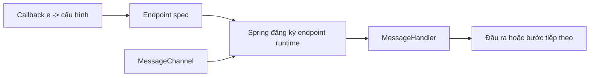
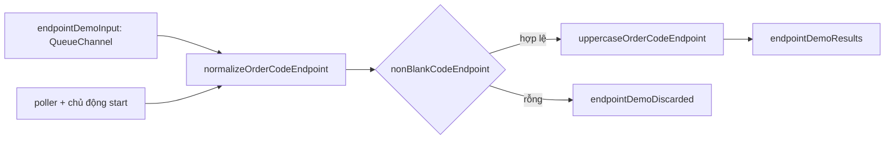

# EndpointSpec

## 1. Mục tiêu của bài học

Bài này thuộc chương **DSL nâng cao** của module **SPRING_INTEGRATION_CORE**. Khi thiết kế luồng bằng Message, MessageChannel, endpoint, gateway và Java DSL, việc chọn transformer, router hay filter mới chỉ mô tả một phần hành vi. Bạn còn cần quyết định endpoint có tự chạy không, nhận message theo cách nào và chịu tác động của advice ở đâu.

`EndpointSpec` là một lớp nền trong hệ thống cấu hình Java DSL, giúp biểu diễn các lựa chọn chung cho endpoint. Trong mã ứng dụng, bạn thường làm việc với các lớp con của nó qua callback cấu hình.

Sau bài học, bạn có thể:

- Phân biệt channel, handler, endpoint runtime và đối tượng spec.
- Nhận diện phương thức thuộc `EndpointSpec` và phương thức do lớp con cung cấp.
- Dùng ID, vòng đời, phase, role và poller đúng mục đích.
- Cấu hình những thuộc tính phổ biến của consumer endpoint.
- Kiểm thử việc giữ message trong queue trước khi chủ động khởi chạy endpoint.

Ví dụ sử dụng Java 17 trở lên và API Spring Integration 6.x, đối chiếu cụ thể với 6.5.0. Đây là mốc giải thích cú pháp; hãy giữ các dependency tương thích theo BOM đang được dự án sử dụng.

## 2. Từ handler nghiệp vụ đến endpoint vận hành

Xét một bước xử lý:

```java
.handle(
    String.class,
    (payload, headers) -> payload.toUpperCase(java.util.Locale.ROOT),
    e -> e.id("uppercaseEndpoint"))
```

Đoạn mã có hai callback mang vai trò khác nhau:

- `(payload, headers) -> ...` thực hiện xử lý message.
- `e -> ...` cấu hình endpoint khi xây dựng flow.

Callback thứ hai không chạy lại cho mỗi message. Nó không nhận payload; nó nhận một spec để đặt thuộc tính của thành phần được Spring tạo ra.

### 2.1. Bốn khái niệm cần phân biệt

| Thành phần | Câu hỏi nó trả lời | Ví dụ |
| --- | --- | --- |
| MessageChannel | Message được chuyển hoặc lưu ở đâu? | `DirectChannel`, `QueueChannel` |
| Handler | Khi nhận message, cần xử lý gì? | Chuẩn hóa chuỗi, gọi service |
| Endpoint runtime | Thành phần nào gắn handler với cơ chế nhận và vòng đời? | `EventDrivenConsumer`, `PollingConsumer` |
| Endpoint spec | Khai báo cấu hình cho endpoint và các thành phần liên quan thế nào? | `GenericEndpointSpec`, `FilterEndpointSpec` |

Java DSL thu thập các thành phần trong `IntegrationFlow`; Spring xử lý cấu hình đó để đăng ký các bean thực tế. Xem [Java DSL](https://docs.spring.io/spring-integration/reference/dsl.html).



Không lấy một spec rồi gọi nó như một handler. Khi cần bật/tắt xử lý lúc ứng dụng đang chạy, hãy thao tác với endpoint runtime đã được đăng ký.

### 2.2. Cùng handler, cách nhận message khác nhau

Một hàm chuẩn hóa chuỗi có thể chạy theo hai cách:

```text
DirectChannel
    -> EventDrivenConsumer
    -> handler

QueueChannel
    -> PollingConsumer lấy message theo lịch
    -> handler
```

Trong đường xử lý thông thường, factory chọn consumer dựa trên loại channel đầu vào. Reactive consumer còn có quy tắc riêng khi cấu hình reactive được sử dụng. Chi tiết có trong [ConsumerEndpointFactoryBean 6.5.0](https://raw.githubusercontent.com/spring-projects/spring-integration/v6.5.0/spring-integration-core/src/main/java/org/springframework/integration/config/ConsumerEndpointFactoryBean.java).

Vì vậy, thêm một callback endpoint không tự thay đổi channel từ đồng bộ thành hàng đợi. Cấu hình endpoint và lựa chọn channel phải phù hợp với nhau.

## 3. EndpointSpec trong hệ thống kiểu của DSL

Có thể đọc một phần cây kế thừa theo sơ đồ sau:

```text
IntegrationComponentSpec
└── EndpointSpec
    ├── ConsumerEndpointSpec
    │   ├── GenericEndpointSpec
    │   ├── FilterEndpointSpec
    │   ├── HeaderEnricherSpec
    │   └── các spec chuyên biệt khác
    └── SourcePollingChannelAdapterSpec
```

Sơ đồ chỉ nêu các nhánh liên quan đến bài học, không liệt kê toàn bộ lớp trong DSL.

### 3.1. Ba tham số kiểu S, F và H

Trong API 6.5.0, `EndpointSpec` có ba tham số kiểu:

| Tham số | Ý nghĩa khi đọc API |
| --- | --- |
| `S` | Kiểu spec cụ thể, phục vụ cách viết fluent |
| `F` | FactoryBean tạo endpoint |
| `H` | Thành phần xử lý hoặc nguồn message gắn với spec |

`F` không phải chính endpoint runtime. Ở nhánh consumer, factory tương ứng là `ConsumerEndpointFactoryBean`, còn `H` là một kiểu `MessageHandler`.

Bạn không cần khai báo đầy đủ các generic này để viết flow hằng ngày. Điều cần hiểu là lời gọi `e.id(...).autoStartup(...)` vẫn giữ được kiểu spec cụ thể để tiếp tục cấu hình.

`EndpointSpec` là lớp abstract với constructor được bảo vệ; ứng dụng thông thường sử dụng API DSL thay vì tự `new EndpointSpec(...)`. Xem [EndpointSpec 6.5.0](https://www.springframework.org/spring-integration/docs/6.5.0/api/org/springframework/integration/dsl/EndpointSpec.html).

### 3.2. Đừng quy mọi phương thức cho lớp nền

Các khả năng chính của lớp nền gồm:

- `id(...)`.
- Các overload `poller(...)`.
- Hợp đồng `autoStartup(...)`, `phase(...)` và `role(...)`.

Những phương thức như `advice(...)`, `requiresReply(...)`, `sendTimeout(...)` hoặc `async(...)` xuất hiện trên nhánh `ConsumerEndpointSpec`.

Một callback cụ thể có thể cung cấp thêm lựa chọn riêng. Chẳng hạn, callback của filter hỗ trợ `discardChannel(...)`; callback của router hỗ trợ cấu hình ánh xạ đích.

```java
.filter(
    String.class,
    text -> !text.isBlank(),
    f -> f
        .id("nonBlankEndpoint")
        .discardChannel("rejectedText"))
```

Ở đây, `f` là spec chuyên biệt cho filter. Tên biến `e`, `f` hay `endpoint` chỉ là lựa chọn đặt tên; loại callback được quyết định bởi overload của phương thức DSL.

## 4. Đọc callback cấu hình đúng cách

### 4.1. Callback cấu hình khác callback xử lý

```java
.handle(
    String.class,
    (payload, headers) -> {
        // Chạy khi message được xử lý.
        return payload.trim();
    },
    e -> {
        // Chạy khi khai báo thành phần của flow.
        e.id("trimEndpoint");
        e.autoStartup(false);
    })
```

Không đặt logic phụ thuộc message vào callback `e`. Ngược lại, không tạo lại toàn bộ cấu hình endpoint trong lambda nghiệp vụ.

`autoStartup(false)` không làm thay đổi kết quả `trim()`. Nó tác động đến việc endpoint tham gia nhận message khi context được khởi tạo.

### 4.2. Cấu hình theo vị trí trong flow

```java
.transform(
    String.class,
    String::trim,
    e -> e.id("trimEndpoint"))
.transform(
    String.class,
    text -> text.toUpperCase(java.util.Locale.ROOT),
    e -> e.id("uppercaseEndpoint"))
```

Mỗi callback cấu hình endpoint của chính bước đứng trước nó. ID của `trimEndpoint` không áp dụng cho bước viết hoa.

Tương tự, poller gắn vào bước đọc từ `QueueChannel` không tự áp dụng cho mọi endpoint ở phía sau. Những bước sau có thể nhận message qua các channel trung gian do DSL tạo.

### 4.3. Khi nào cần gọi tên lớp cụ thể?

Thông thường, để compiler suy luận kiểu qua lambda:

```java
.handle(
    String.class,
    (payload, headers) -> payload,
    e -> e.id("echoEndpoint"))
```

Khi viết helper dùng chung, nên chọn kiểu phù hợp với các phương thức thật sự cần gọi. Tránh dùng raw type hoặc cast chỉ để vượt lỗi compile: lỗi đó thường cho biết bạn đang dùng sai loại spec hoặc sai overload.

Xem quan hệ của lớp cấu hình phổ biến trong [GenericEndpointSpec](https://www.springframework.org/spring-integration/docs/6.5.0/api/org/springframework/integration/dsl/GenericEndpointSpec.html).

## 5. id: đặt tên để quan sát và điều khiển

```java
.handle(
    String.class,
    (payload, headers) -> payload.trim(),
    e -> e.id("normalizeOrderCodeEndpoint"))
```

ID tường minh giúp mã điều khiển vòng đời và log tham chiếu đến một endpoint ổn định.

Phân biệt các tên sau:

| Tên | Đại diện cho |
| --- | --- |
| Tên bean `IntegrationFlow` | Toàn bộ flow được khai báo |
| Tên channel đầu vào | Điểm gửi hoặc nhận message |
| ID endpoint trong callback | Endpoint của một bước |
| Header `id` của message | Định danh message instance |

Đặt `e.id("normalizeOrderCodeEndpoint")` không ghi một header lên message và không đổi tên channel đầu vào.

Trong flow được đăng ký tĩnh của ví dụ dưới đây, có thể lấy endpoint runtime:

```java
org.springframework.integration.endpoint.AbstractEndpoint endpoint =
    context.getBean(
        "normalizeOrderCodeEndpoint",
        org.springframework.integration.endpoint.AbstractEndpoint.class);
```

Không dùng cùng ID cho hai endpoint độc lập trong cùng context. Nếu đăng ký nhiều bản sao flow động có tiền tố tên bean, cần sử dụng quy tắc đặt tên của cơ chế đăng ký đó; không giả định tên ở ví dụ tĩnh luôn được giữ nguyên.

Mã nguồn [EndpointSpec.id](https://raw.githubusercontent.com/spring-projects/spring-integration/v6.5.0/spring-integration-core/src/main/java/org/springframework/integration/dsl/EndpointSpec.java) cho thấy ID được truyền vào factory của endpoint.

## 6. Điều khiển vòng đời: autoStartup, phase và role

### 6.1. autoStartup(false)

```java
e -> e
    .id("normalizeOrderCodeEndpoint")
    .autoStartup(false)
```

Endpoint được tạo và cấu hình, nhưng không tự khởi chạy cùng đợt refresh của context. Bạn có thể chủ động gọi:

```java
endpoint.start();

// Khi có nhu cầu dừng:
endpoint.stop();
```

Ảnh hưởng đến người gửi phụ thuộc channel:

| Channel đầu vào | Khi consumer chưa chạy |
| --- | --- |
| `QueueChannel` | Có thể tiếp nhận message nếu còn chỗ; message chờ consumer |
| `DirectChannel` | Không lưu message; nếu không còn subscriber phù hợp, gửi thất bại |
| Channel do adapter hoặc hệ thống ngoài quản lý | Phải xét thêm hợp đồng của thành phần đó |

Chỉ tắt endpoint không đồng nghĩa tắt mọi bước của flow. Khi cần tạm ngưng cả một tuyến, hãy xác định rõ điểm đầu vào cần dừng và những message đã được nhận.

Ngoài ra, `stop()` không nên được hiểu là hủy ngay mọi tác vụ đang chạy hoặc chờ xử lý hết mọi queue. Cần thiết kế cách dừng và xử lý message đang thực thi theo endpoint thực tế.

### 6.2. phase: thứ tự vòng đời

```java
e -> e.phase(100)
```

Theo `SmartLifecycle`, phase thấp khởi chạy trước; khi dừng, thứ tự đảo lại. Những thành phần cùng phase không có thứ tự tương đối được bảo đảm chỉ nhờ phase. Quan hệ dependency tường minh cũng cần được xét.

Ví dụ thiết kế:

| Thành phần | Phase minh họa | Ý định |
| --- | --- | --- |
| Consumer phía sau | `0` | Sẵn sàng nhận trước |
| Endpoint đưa dữ liệu vào tuyến | `100` | Khởi chạy sau consumer |

`phase(100)` không có nghĩa message ở bước này mang độ ưu tiên 100. Phase cũng không bảo đảm hệ thống bên ngoài đã khỏe mạnh; đó là vấn đề readiness riêng.

Các quy tắc khởi chạy và dừng được mô tả trong [SmartLifecycle](https://docs.spring.io/spring-framework/docs/6.2.7/javadoc-api/org/springframework/context/SmartLifecycle.html).

### 6.3. role: gom nhóm để điều khiển vòng đời

```java
e -> e.role("order-code-import")
```

Role gắn endpoint vào nhóm có thể được điều khiển qua `SmartLifecycleRoleController`. Controller hỗ trợ khởi chạy hoặc dừng các thành phần trong role theo phase.

Ví dụ, khi ứng dụng đã lấy được controller do hạ tầng integration đăng ký:

```java
roleController.startLifecyclesInRole("order-code-import");
roleController.stopLifecyclesInRole("order-code-import");
```

Biến `roleController` ở đoạn này có kiểu `org.springframework.integration.support.SmartLifecycleRoleController`.

Role phục vụ điều phối vòng đời. Nó không đặt quyền truy cập cho message và không tự tạo cơ chế bầu leader giữa các instance. Xem [SmartLifecycleRoleController](https://www.springframework.org/spring-integration/docs/6.5.0/api/org/springframework/integration/support/SmartLifecycleRoleController.html).

## 7. poller: cấu hình khi endpoint phải chủ động lấy message

### 7.1. Đặt poller tại đúng đầu vào pollable

Nếu một consumer đọc từ `QueueChannel`, nó cần cấu hình polling tường minh hoặc default poller của context.

```java
IntegrationFlow.from("pendingCodes")
    .transform(
        String.class,
        String::trim,
        e -> e
            .id("normalizeOrderCodeEndpoint")
            .poller(org.springframework.integration.dsl.Pollers
                .fixedDelay(java.time.Duration.ofMillis(100))
                .maxMessagesPerPoll(5)
                .receiveTimeout(0)))
    .channel("normalizedCodes")
    .get();
```

Giả sử `pendingCodes` là `QueueChannel`, poller này điều khiển việc lấy message cho bước trim. `normalizedCodes` phải là channel đã được đăng ký hoặc được khai báo phù hợp trong cấu hình ứng dụng.

Không gắn poller vào consumer nhận từ `DirectChannel`. Trong cách cấu hình thông thường này, factory từ chối poller trên `SubscribableChannel`. Ngược lại, thiếu cả poller riêng lẫn default poller cho consumer pollable sẽ làm khởi tạo thất bại. Xem [ConsumerEndpointFactoryBean](https://raw.githubusercontent.com/spring-projects/spring-integration/v6.5.0/spring-integration-core/src/main/java/org/springframework/integration/config/ConsumerEndpointFactoryBean.java).

### 7.2. Ba overload thường gặp

```java
// Factory tiện ích tạo PollerSpec.
e.poller(Pollers.fixedDelay(Duration.ofMillis(100)));

// Callback nhận PollerFactory.
e.poller(p -> p.fixedDelay(Duration.ofMillis(100))
    .maxMessagesPerPoll(5));

// Dùng metadata đã cấu hình sẵn.
e.poller(sharedPollerMetadata);
```

Trong đoạn trên, `Pollers` thuộc `org.springframework.integration.dsl`, `Duration` thuộc `java.time`, và `sharedPollerMetadata` có kiểu `org.springframework.integration.scheduling.PollerMetadata`.

Chọn một hình thức phù hợp với cách tổ chức cấu hình. Không cần sử dụng đồng thời cả ba cho cùng endpoint.

### 7.3. Hiểu từng thông số

| Cấu hình | Ý nghĩa trong ví dụ |
| --- | --- |
| `fixedDelay(Duration.ofMillis(100))` | Lịch polling có khoảng trễ giữa các lần chạy theo cơ chế fixed delay |
| `maxMessagesPerPoll(5)` | Tối đa năm lượt lấy/xử lý message trong một lần poll |
| `receiveTimeout(0)` | Không chờ khi queue đang rỗng |
| `taskExecutor(...)` | Chuyển việc thực thi polling task cho executor được cấu hình |

Năm message mỗi lần poll không phải giới hạn chính xác năm message mỗi giây. Tốc độ còn phụ thuộc thời gian handler, lịch chạy, executor và dữ liệu có sẵn.

Cũng không thể suy ra hệ thống xử lý song song chỉ từ `maxMessagesPerPoll(5)`. Trong ví dụ không cấp executor riêng, các message được xử lý tuần tự trong nhiệm vụ polling.

`Pollers` cung cấp cách dựng lịch, còn `PollerSpec` cấu hình metadata của polling task. Xem [Pollers](https://www.springframework.org/spring-integration/docs/6.5.0/api/org/springframework/integration/dsl/Pollers.html) và [PollerSpec](https://www.springframework.org/spring-integration/docs/6.5.0/api/org/springframework/integration/dsl/PollerSpec.html).

### 7.4. Polling consumer khác polling message source

Hai vị trí sau không mang cùng ý nghĩa:

```java
// Lấy message đang chờ trong một QueueChannel.
IntegrationFlow.from("pendingCodes")
    .handle(
        String.class,
        (payload, headers) -> payload,
        e -> e.poller(Pollers.fixedDelay(Duration.ofSeconds(1))))
    .channel("results")
    .get();
```

```java
// Gọi supplier theo lịch để tạo dữ liệu đầu vào.
IntegrationFlow.fromSupplier(
        () -> "next-code",
        source -> source.poller(
            Pollers.fixedDelay(Duration.ofSeconds(1))))
    .channel("results")
    .get();
```

Đoạn thứ nhất cấu hình consumer của một channel pollable. Đoạn thứ hai cấu hình source polling adapter. Cùng xuất hiện `poller` không có nghĩa hai callback có cùng kiểu spec hoặc cùng trách nhiệm.

## 8. Những tùy chọn từ ConsumerEndpointSpec

Khi callback cung cấp một consumer spec, bạn có thêm các phương thức cần đọc theo kiểu handler thực tế.

| Tùy chọn | Phạm vi sử dụng |
| --- | --- |
| `requiresReply(true)` | Yêu cầu handler tạo reply nếu handler hỗ trợ thuộc tính này |
| `sendTimeout(...)` | Timeout khi handler gửi message đầu ra |
| `advice(...)` | Gắn advice vào xử lý của handler |
| `transactional(...)` | Gắn transaction advice theo cấu hình |
| `order(...)` | Thứ tự handler được dùng trong cơ chế dispatch có xét order |
| `async(true)` | Cho phép xử lý reply bất đồng bộ dạng được hỗ trợ |
| `notPropagatedHeaders(...)` | Hạn chế header đầu vào được sao chép sang đầu ra |

Những phương thức này không phải thuộc tính toàn cục của flow. Khả năng áp dụng phụ thuộc lớp handler; một số cấu hình không phù hợp có thể chỉ phát cảnh báo. Xem [ConsumerEndpointSpec 6.5.0](https://www.springframework.org/spring-integration/docs/6.5.0/api/org/springframework/integration/dsl/ConsumerEndpointSpec.html).

### 8.1. requiresReply không phải thời hạn chờ

```java
.handle(
    String.class,
    (payload, headers) -> payload.isBlank() ? null : payload,
    e -> e
        .id("requiredCodeEndpoint")
        .requiresReply(true))
```

Nếu handler này trả `null`, endpoint có hợp đồng bắt buộc reply sẽ phát sinh lỗi. Cấu hình đó không có nghĩa nó phải trả lời trong một số mili giây nhất định.

Nếu dữ liệu rỗng là trường hợp được phép loại bỏ, filter với discard channel diễn đạt quy tắc rõ hơn việc biến nó thành lỗi thiếu reply.

### 8.2. sendTimeout khác timeout nghiệp vụ

```java
e -> e.sendTimeout(500)
```

Giá trị này liên quan đến thao tác gửi đầu ra, chẳng hạn khi channel đích bị đầy. Nó không đặt timeout 500 ms cho lời gọi HTTP nằm bên trong handler.

Nếu cần giới hạn thời gian gọi một hệ thống ngoài, cấu hình timeout ở client hoặc adapter phù hợp, rồi xác định cách endpoint xử lý lỗi đó.

### 8.3. order khác phase và thứ tự message

`phase` điều khiển vòng đời; `order` của consumer spec gắn với handler và cơ chế dispatch. Nó không thay thế thứ tự các bước trong DSL và không tự sắp xếp message theo mã đơn hàng.

Khi channel có nhiều subscriber, hành vi còn phụ thuộc loại channel, load balancing và failover. Tránh dùng `order(1)` như một cách bảo đảm mọi message hoàn tất theo đúng thứ tự đầu vào.

### 8.4. async(true) không chuyển mọi handler sang thread khác

Ở mốc API 6.5.0 được dùng trong bài, `async(true)` hỗ trợ gửi kết quả khi reply `CompletableFuture` hoàn tất. Một hàm đang gọi I/O đồng bộ không tự trở thành bất đồng bộ chỉ nhờ cờ này.

Cần phân biệt ba lựa chọn: kiểu reply bất đồng bộ, channel có executor và consumer reactive. Mỗi lựa chọn có mô hình luồng thực thi và đường đi lỗi riêng.

## 9. Advice và transaction phải gắn đúng phạm vi

### 9.1. Gắn retry vào một handler

Đoạn sau giả sử ứng dụng đã có bean `catalogService` với phương thức `lookup` và bean `catalogRetryAdvice` được cấu hình:

```java
.handle(
    catalogService,
    "lookup",
    e -> e
        .id("catalogLookupEndpoint")
        .advice(catalogRetryAdvice))
```

Trong Spring Integration 6.5, `RequestHandlerRetryAdvice` sử dụng Spring Retry. Ví dụ cấu hình tối thiểu cho bài thực hành:

```java
@Bean
public org.springframework.integration.handler.advice.RequestHandlerRetryAdvice
        catalogRetryAdvice() {

    var policy = new org.springframework.retry.policy.SimpleRetryPolicy(3);
    var backOff = new org.springframework.retry.backoff.FixedBackOffPolicy();
    backOff.setBackOffPeriod(100);

    var template = new org.springframework.retry.support.RetryTemplate();
    template.setRetryPolicy(policy);
    template.setBackOffPolicy(backOff);

    var advice =
        new org.springframework.integration.handler.advice.RequestHandlerRetryAdvice();
    advice.setRetryTemplate(template);
    return advice;
}
```

Cần dependency `org.springframework.retry:spring-retry` tương thích để dùng đoạn cấu hình này. `SimpleRetryPolicy(3)` đặt tổng cộng tối đa ba lần thử, gồm lần gọi đầu tiên; đây là chính sách rộng dùng để minh họa.

Trong nghiệp vụ, nên chọn loại lỗi có thể thử lại và thiết kế tính idempotent cho thao tác có tác dụng phụ. Lỗi dữ liệu không hợp lệ thường không được giải quyết bằng việc gọi lại cùng thao tác.

Xem [Retry Advice cho nhánh 6.5](https://docs.spring.io/spring-integration/reference/6.5/handler-advice/classes.html) và [RequestHandlerRetryAdvice 6.5.0](https://raw.githubusercontent.com/spring-projects/spring-integration/v6.5.0/spring-integration-core/src/main/java/org/springframework/integration/handler/advice/RequestHandlerRetryAdvice.java).

### 9.2. Không mặc định retry bao trùm downstream

Đối với handler tạo reply, request handler advice thường bao quanh việc xử lý yêu cầu của handler hiện tại. Nó không mặc nhiên thử lại toàn bộ phần flow phía sau.

`handleMessageAdvice(...)` có phạm vi khác: nó bao quanh `handleMessage`, có thể bao trùm downstream còn chạy trong cùng chuỗi gọi đồng bộ. Một ranh giới thread hoặc xử lý bất đồng bộ làm thay đổi điều có thể nằm trong phạm vi đó.

Trước khi đặt retry, hãy xác định thao tác nào có thể được lặp lại. Nếu handler A đã thành công nhưng handler B phía sau lỗi, việc thử lại cả A có thể tạo tác dụng phụ lặp. Xem [Handling Message Advice](https://docs.spring.io/spring-integration/reference/handler-advice/handle-message.html).

### 9.3. Transaction của handler khác transaction của polling task

Ví dụ khi đã có transaction manager phù hợp:

```java
.handle(
    orderRepository,
    "save",
    e -> e
        .id("saveOrderEndpoint")
        .transactional(transactionManager))
```

Cấu hình này đặt transaction advice tại handler. Trong khi đó, `poller(...transactional(...))` gắn transaction cho polling task.

Một local transaction không tự bao phủ database, HTTP service và mọi broker trong flow. Việc vượt qua ranh giới queue hoặc executor cũng cần xét lại ngữ cảnh transaction theo thread và tài nguyên thật sự tham gia.

Khi ghép retry và transaction, xác định rõ mỗi lần thử có mở transaction mới hay nằm trong transaction hiện tại. Thứ tự advice và propagation quyết định hành vi. Xem [Transaction Support](https://docs.spring.io/spring-integration/reference/transactions.html).

## 10. Ví dụ đầy đủ: endpoint chuẩn hóa mã đơn hàng được khởi chạy chủ động

### 10.1. Yêu cầu

Một tuyến nhập mã đơn hàng cần:

1. Nhận chuỗi vào queue có giới hạn.
2. Chưa tiêu thụ dữ liệu ngay khi context khởi tạo.
3. Khi được khởi chạy, lấy message theo poller và trim chuỗi.
4. Chuyển chuỗi rỗng sang discard channel.
5. Viết hoa mã hợp lệ và đưa vào queue kết quả.

Trong ví dụ này, mã đơn hàng được coi là chuỗi cần chuẩn hóa. Quy tắc nghiệp vụ thực tế có thể chặt chẽ hơn.



Chỉ endpoint đầu tiên bị đặt `autoStartup(false)`. Các bước phía sau sẵn sàng để nhận dữ liệu sau khi endpoint đầu bắt đầu polling.

### 10.2. Cấu hình Java

Project cần JDK 17 trở lên, `spring-integration-core`, Spring Context tương thích và JUnit Jupiter để dùng test ở phần sau. Ví dụ không cần broker, HTTP server hoặc cơ sở dữ liệu.

```java
package example.endpoints;

import java.time.Duration;
import java.util.Locale;

import org.springframework.context.annotation.Bean;
import org.springframework.context.annotation.Configuration;
import org.springframework.integration.channel.QueueChannel;
import org.springframework.integration.config.EnableIntegration;
import org.springframework.integration.dsl.IntegrationFlow;
import org.springframework.integration.dsl.Pollers;

@Configuration
@EnableIntegration
public class ManagedEndpointFlowConfig {

    @Bean
    public QueueChannel endpointDemoInput() {
        return new QueueChannel(100);
    }

    @Bean
    public QueueChannel endpointDemoResults() {
        return new QueueChannel(100);
    }

    @Bean
    public QueueChannel endpointDemoDiscarded() {
        return new QueueChannel(100);
    }

    @Bean
    public IntegrationFlow managedOrderCodeFlow() {
        return IntegrationFlow.from("endpointDemoInput")
            .transform(
                String.class,
                String::trim,
                e -> e
                    .id("normalizeOrderCodeEndpoint")
                    .autoStartup(false)
                    .phase(100)
                    .role("order-code-import")
                    .poller(Pollers
                        .fixedDelay(Duration.ofMillis(100))
                        .maxMessagesPerPoll(5)
                        .receiveTimeout(0)))
            .filter(
                String.class,
                code -> !code.isBlank(),
                f -> f
                    .id("nonBlankCodeEndpoint")
                    .discardChannel("endpointDemoDiscarded"))
            .transform(
                String.class,
                code -> code.toUpperCase(Locale.ROOT),
                e -> e.id("uppercaseOrderCodeEndpoint"))
            .channel("endpointDemoResults")
            .get();
    }
}
```

Những điểm đáng chú ý:

- Poller nằm trên endpoint đọc trực tiếp từ `endpointDemoInput`.
- Hai endpoint tiếp theo dùng channel trung gian của flow, không cần khai báo poller riêng.
- Discard channel lưu message sau bước trim, nên một chuỗi chỉ có khoảng trắng sẽ thành payload rỗng.
- Queue ở đầu ra dùng để quan sát kết quả bằng `receive`, không có consumer tự đọc trong ví dụ.

Ba queue có dung lượng hữu hạn để tránh giả định mọi hàng đợi đều có thể chứa vô hạn dữ liệu. Khi đưa vào một ứng dụng chạy liên tục, cần consumer cho các queue đầu ra và chính sách xử lý khi đầy.

### 10.3. Điều khiển endpoint runtime

Đoạn sau minh họa cách dùng cấu hình trong một chương trình nhỏ:

```java
package example.endpoints;

import org.springframework.context.annotation.AnnotationConfigApplicationContext;
import org.springframework.integration.channel.QueueChannel;
import org.springframework.integration.endpoint.AbstractEndpoint;
import org.springframework.messaging.Message;
import org.springframework.messaging.support.MessageBuilder;

public class ManagedEndpointDemo {

    public static void main(String[] args) {
        try (var context = new AnnotationConfigApplicationContext(
                ManagedEndpointFlowConfig.class)) {

            QueueChannel input =
                context.getBean("endpointDemoInput", QueueChannel.class);
            QueueChannel results =
                context.getBean("endpointDemoResults", QueueChannel.class);
            AbstractEndpoint endpoint = context.getBean(
                "normalizeOrderCodeEndpoint",
                AbstractEndpoint.class);

            boolean accepted = input.send(
                MessageBuilder.withPayload("  order-001  ")
                    .setHeader("request_id", "R-001")
                    .build(),
                1000);

            if (!accepted) {
                throw new IllegalStateException("Input queue is full");
            }

            // Message đã được nhận vào queue, endpoint chưa chạy.
            System.out.println(endpoint.isRunning()); // false
            System.out.println(input.getQueueSize()); // 1

            endpoint.start();

            Message<?> result = results.receive(5000);
            if (result == null) {
                throw new IllegalStateException("No result within timeout");
            }

            System.out.println(result.getPayload()); // ORDER-001
            System.out.println(
                result.getHeaders().get("request_id")); // R-001
        }
    }
}
```

`input.send(...)` thành công chỉ xác nhận message đã được channel tiếp nhận trong thời hạn cho phép. Nó không xác nhận toàn bộ nghiệp vụ đã hoàn tất.

Khi đóng context, Spring thực hiện quy trình dừng và giải phóng các thành phần. Ví dụ không cần thêm `Thread.sleep` để chờ kết quả vì `receive(5000)` đã chờ có giới hạn.

## 11. Kiểm thử hành vi thay vì chỉ đọc cấu hình

Đặt test trong cùng package với cấu hình:

```java
package example.endpoints;

import org.junit.jupiter.api.Test;
import org.springframework.context.annotation.AnnotationConfigApplicationContext;
import org.springframework.integration.channel.QueueChannel;
import org.springframework.integration.endpoint.AbstractEndpoint;
import org.springframework.messaging.Message;
import org.springframework.messaging.support.MessageBuilder;

import static org.junit.jupiter.api.Assertions.*;

class ManagedEndpointFlowTest {

    @Test
    void messageWaitsInQueueUntilEndpointStarts() {
        try (var context = new AnnotationConfigApplicationContext(
                ManagedEndpointFlowConfig.class)) {

            QueueChannel input =
                context.getBean("endpointDemoInput", QueueChannel.class);
            QueueChannel results =
                context.getBean("endpointDemoResults", QueueChannel.class);
            AbstractEndpoint endpoint = context.getBean(
                "normalizeOrderCodeEndpoint",
                AbstractEndpoint.class);

            Message<String> original =
                MessageBuilder.withPayload("  order-001  ")
                    .setHeader("request_id", "R-001")
                    .build();

            assertFalse(endpoint.isRunning());
            assertTrue(input.send(original, 1000));

            // Chưa có consumer khác đọc queue đầu vào.
            assertEquals(1, input.getQueueSize());
            assertNull(results.receive(0));

            endpoint.start();

            Message<?> result = results.receive(5000);
            assertNotNull(result);
            assertEquals("ORDER-001", result.getPayload());
            assertEquals("R-001",
                result.getHeaders().get("request_id"));

            // Transformer không sửa lại message gốc.
            assertEquals("  order-001  ", original.getPayload());
        }
    }

    @Test
    void blankCodeIsDiscardedAndNextValidMessageStillPasses() {
        try (var context = new AnnotationConfigApplicationContext(
                ManagedEndpointFlowConfig.class)) {

            QueueChannel input =
                context.getBean("endpointDemoInput", QueueChannel.class);
            QueueChannel results =
                context.getBean("endpointDemoResults", QueueChannel.class);
            QueueChannel discarded =
                context.getBean("endpointDemoDiscarded", QueueChannel.class);
            AbstractEndpoint endpoint = context.getBean(
                "normalizeOrderCodeEndpoint",
                AbstractEndpoint.class);

            assertTrue(input.send(
                MessageBuilder.withPayload("   ")
                    .setHeader("request_id", "R-empty")
                    .build(),
                1000));

            assertTrue(input.send(
                MessageBuilder.withPayload("  order-002 ")
                    .setHeader("request_id", "R-valid")
                    .build(),
                1000));

            endpoint.start();

            Message<?> rejected = discarded.receive(5000);
            Message<?> accepted = results.receive(5000);

            assertNotNull(rejected);
            assertEquals("", rejected.getPayload());
            assertEquals("R-empty",
                rejected.getHeaders().get("request_id"));

            assertNotNull(accepted);
            assertEquals("ORDER-002", accepted.getPayload());
            assertEquals("R-valid",
                accepted.getHeaders().get("request_id"));
        }
    }
}
```

Test thứ nhất chứng minh sự khác nhau giữa channel đã nhận message và endpoint đã bắt đầu xử lý. Test thứ hai chứng minh discard là một đường đi có chủ đích và không làm message hợp lệ tiếp theo bị mất.

Không dùng sleep cố định để kiểm tra “poller chắc đã chạy”. Chờ message ở điểm quan sát có timeout cho phép test phản ánh đúng hành vi cần xác nhận.

Các đoạn test là mã thực hành để chạy trong project có dependency tương thích. Chúng không bao phủ mọi cấu hình advice, transaction hoặc shutdown.

## 12. Xử lý lỗi theo thread và theo loại endpoint

Với consumer nhận từ `DirectChannel`, handler thường chạy trong thread người gửi. Lỗi đồng bộ có thể đi ngược về lời gọi gửi hoặc gateway.

Trong ví dụ polling, người gửi chỉ đưa message vào queue. Nếu handler thất bại về sau, người gửi không còn nằm trong chuỗi gọi đó. Cần quan sát cơ chế error handling của polling task.

Có thể cấu hình poller gửi lỗi vào một channel riêng:

```java
e -> e.poller(Pollers
    .fixedDelay(Duration.ofMillis(100))
    .receiveTimeout(0)
    .maxMessagesPerPoll(5)
    .errorChannel("endpointDemoErrors"))
```

Tên `endpointDemoErrors` phải trỏ tới channel đã đăng ký. Ví dụ một queue để thu lỗi trong bài thực hành:

```java
@Bean
public QueueChannel endpointDemoErrors() {
    return new QueueChannel(100);
}
```

Đây là phương án mở rộng, chưa được gắn vào lớp cấu hình hoàn chỉnh ở phần 10.

Khi kiểm thử lỗi polling, hãy làm handler phát sinh lỗi có chủ đích và nhận `ErrorMessage` tại error channel. Không chỉ bọc `input.send(...)` trong `assertThrows` rồi chờ bắt lỗi của một task chạy sau đó.

Retry cũng không tự đưa message trở lại một `QueueChannel` thuần trong bộ nhớ khi hết lần thử. Cần thiết kế recovery, lưu lỗi hoặc redelivery dựa trên tài nguyên và cơ chế được sử dụng. Xem [Error Handling của nhánh 6.5](https://docs.spring.io/spring-integration/reference/6.5/error-handling.html).

## 13. Tái sử dụng cấu hình mà vẫn giữ rõ ý định

Một helper có thể áp dụng lựa chọn chung cho consumer:

```java
private static void configureImportConsumer(
        org.springframework.integration.dsl.ConsumerEndpointSpec<?, ?> spec) {

    spec.phase(100);
    spec.role("order-code-import");
}
```

Sau đó dùng callback để bổ sung các thuộc tính riêng:

```java
.transform(
    String.class,
    String::trim,
    e -> {
        configureImportConsumer(e);
        e.id("normalizeOrderCodeEndpoint");
        e.poller(Pollers.fixedDelay(Duration.ofMillis(100)));
    })
```

Trong ví dụ rời này, đầu vào của bước transform phải là channel pollable. Không đưa poller vào helper chung áp dụng cho cả endpoint nhận từ `DirectChannel`.

Một số nguyên tắc giúp cấu hình dễ bảo trì:

- Mỗi endpoint có ID riêng thể hiện bước nghiệp vụ.
- Helper chỉ chứa những thuộc tính thật sự chung.
- Cờ ảnh hưởng việc tự khởi chạy được đặt ở vị trí dễ nhìn.
- Không tái sử dụng cùng một spec đang có trạng thái cho nhiều endpoint.
- Advice hoặc service dùng chung phải phù hợp khi được gọi đồng thời.

Các phương thức đăng ký thành phần phụ của spec phục vụ hạ tầng DSL. Ứng dụng thông thường không cần tự thao tác map bên trong hoặc tự lấy cặp factory/handler để đăng ký thay Spring.

## 14. Các lỗi cấu hình thường gặp

| Hiện tượng | Điều cần kiểm tra | Cách xử lý |
| --- | --- | --- |
| Khởi tạo lỗi vì không có poller | Đầu vào là `QueueChannel` | Thêm poller tại consumer hoặc default poller |
| Khởi tạo lỗi vì poller không phù hợp | Đầu vào là `SubscribableChannel` | Bỏ poller hoặc thiết kế lại đầu vào |
| Queue có dữ liệu nhưng không có kết quả | Endpoint đang dừng, scheduler hoặc downstream có vấn đề | Kiểm tra trạng thái endpoint và log theo ID |
| `DirectChannel` không có subscriber | Consumer chưa chạy hoặc đã dừng | Khởi chạy consumer phù hợp trước khi gửi |
| Không tìm thấy bean bằng ID | Đang nhầm tên flow, channel hoặc tên có tiền tố | Kiểm tra quy tắc đăng ký của flow |
| `phase` không đổi thứ tự hoàn tất message | Nhầm vòng đời với xử lý message | Xem channel, executor và chiến lược sắp thứ tự |
| Handler vẫn chậm dù đặt sendTimeout | Timeout đang nằm ở thao tác gửi đầu ra | Cấu hình timeout ở lời gọi nghiệp vụ |
| Retry không lặp lại bước phía sau | Advice chỉ bao quanh handler hiện tại | Chọn lại phạm vi và kiểm tra tác dụng phụ |
| Polling lỗi nhưng send không ném ngoại lệ | Lỗi xảy ra ở task về sau | Thu lỗi qua error channel |
| Dừng endpoint nhưng vẫn thấy một tác vụ hoàn tất | Có xử lý đang thực thi | Thiết kế cơ chế dừng và chờ hoàn tất phù hợp |
| `async(true)` không làm I/O chạy song song | Handler vẫn trả kết quả đồng bộ | Xem kiểu reply và mô hình thực thi |

Khi điều tra, hãy đi theo chuỗi: **channel đầu vào → endpoint đang chạy hay chưa → handler → điểm gửi đầu ra → cơ chế lỗi**. ID tường minh giúp nối thông tin cấu hình với log và kiểm thử.

## 15. Thực hành mở rộng

Từ ví dụ ở phần 10, hãy làm lần lượt:

1. Bỏ `autoStartup(false)`, rồi thay đổi test để xác nhận message được xử lý sau khi gửi mà không gọi `start()`.
2. Tạo một cấu hình độc lập dùng `DirectChannel`, bỏ poller và quan sát tác động của việc dừng consumer khi channel không còn subscriber.
3. Thêm error channel riêng cho poller và kiểm thử một handler cố tình ném ngoại lệ.
4. Gắn retry vào một bước tra cứu giả lập, đếm số lần gọi khi thành công ở lần thử tiếp theo và khi thất bại hoàn toàn.
5. Dùng role controller để điều khiển một nhóm endpoint, đồng thời xác định rõ queue nào giữ message trong thời gian nhóm dừng.

Với mỗi thay đổi, ghi rõ điều cần quan sát: message đã được tiếp nhận chưa, endpoint nào đang chạy, kết quả nằm ở channel nào và lỗi được gửi về đâu. Đó là những câu hỏi giúp biến cấu hình endpoint thành hành vi có thể kiểm chứng.

## 16. Tài liệu đối chiếu

- [EndpointSpec 6.5.0](https://www.springframework.org/spring-integration/docs/6.5.0/api/org/springframework/integration/dsl/EndpointSpec.html) — lớp nền và các phương thức cấu hình chung.
- [ConsumerEndpointSpec 6.5.0](https://www.springframework.org/spring-integration/docs/6.5.0/api/org/springframework/integration/dsl/ConsumerEndpointSpec.html) — tùy chọn bổ sung cho consumer.
- [GenericEndpointSpec 6.5.0](https://www.springframework.org/spring-integration/docs/6.5.0/api/org/springframework/integration/dsl/GenericEndpointSpec.html) — spec thường gặp trong callback.
- [PollerSpec 6.5.0](https://www.springframework.org/spring-integration/docs/6.5.0/api/org/springframework/integration/dsl/PollerSpec.html) — cấu hình polling task.
- [Spring Integration: Message Endpoints](https://docs.spring.io/spring-integration/reference/endpoint.html) — event-driven consumer, polling consumer và default poller.
- [Spring Framework: SmartLifecycle](https://docs.spring.io/spring-framework/docs/6.2.7/javadoc-api/org/springframework/context/SmartLifecycle.html) — vòng đời, auto startup và phase.
- [Spring Integration 6.5: Error Handling](https://docs.spring.io/spring-integration/reference/6.5/error-handling.html) — đường đi lỗi đồng bộ và bất đồng bộ.
