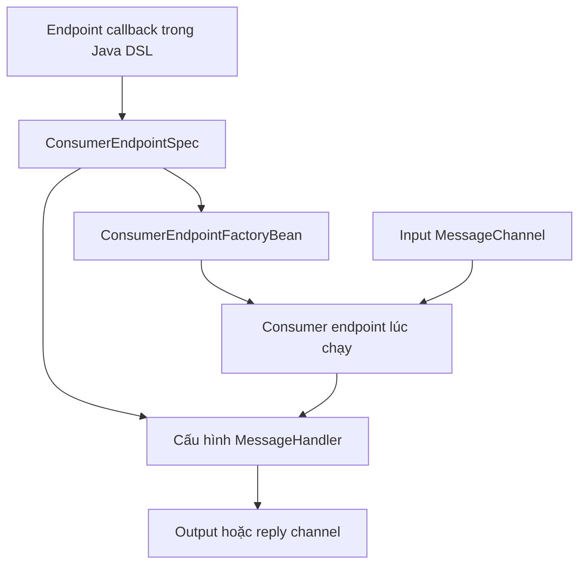

# ConsumerEndpointSpec

## 1. Mục tiêu và bối cảnh

Trong module **SPRING_INTEGRATION_CORE**, bài học này thuộc chương **DSL nâng cao**. Sau khi đã biểu diễn luồng bằng `Message`, `MessageChannel` và các thao tác như `handle`, `transform` hoặc `filter`, bạn cần cấu hình cách từng endpoint được khởi động, nhận thông điệp, gửi kết quả và áp dụng các hành vi bổ sung.

`ConsumerEndpointSpec` là phần DSL phục vụ công việc đó. Bài học tập trung vào việc đọc đúng endpoint callback và dự đoán hành vi chạy của cấu hình.

Sau bài học, bạn có thể:

- Phân biệt channel, handler, endpoint và đối tượng spec dùng lúc xây dựng flow.
- Dùng `id`, `autoStartup`, `phase`, `role` và `poller` đúng mục đích.
- Đặt hợp đồng trả kết quả bằng `requiresReply`, giới hạn chờ gửi bằng `sendTimeout` và kiểm soát việc truyền headers.
- Phân biệt advice của handler, advice bao quanh `handleMessage` và advice của poller.
- Nhận biết phạm vi của transaction, `async(true)` và `reactive()`.
- Kiểm thử vòng đời và lỗi của endpoint bằng dữ liệu đi qua channel.

Ví dụ lấy **Java 17 và Spring Integration 6.5.0** làm mốc API. Khi dùng Spring Boot hoặc BOM, giữ bộ phiên bản Spring tương thích do dự án quản lý. Các đoạn mã là nội dung thực hành; phần thay đổi cấu hình phải được áp dụng vào đúng ví dụ tương ứng.

## 2. ConsumerEndpointSpec nằm ở đâu trong một flow?

Xem cấu hình rút gọn:

```java
IntegrationFlow.from("ordersInput")
        .handle(
                Order.class,
                (order, headers) -> new Receipt(order.id(), "ACCEPTED"),
                endpoint -> endpoint
                        .id("acceptOrderEndpoint")
                        .requiresReply(true))
        .channel("acceptedOrders")
        .get();
```

Trong đó:

- `ordersInput` là channel đưa thông điệp tới bước xử lý.
- Lambda `(order, headers) -> ...` là phần xử lý dữ liệu.
- Lambda `endpoint -> ...` cấu hình endpoint và những thuộc tính handler được DSL cung cấp.
- `acceptedOrders` là channel nhận kết quả.

`ConsumerEndpointSpec` là lớp abstract dành cho cấu hình consumer endpoint. Nhiều spec cụ thể kế thừa lớp này; với các overload `handle(...)` thông dụng, callback thường nhận `GenericEndpointSpec`. [Javadoc ConsumerEndpointSpec](https://docs.spring.io/spring-integration/docs/6.5.0/api/org/springframework/integration/dsl/ConsumerEndpointSpec.html), [Javadoc GenericEndpointSpec](https://docs.spring.io/spring-integration/docs/6.5.0/api/org/springframework/integration/dsl/GenericEndpointSpec.html).

### 2.1. Bốn khái niệm cần tách rõ

| Thành phần | Trách nhiệm | Ví dụ |
| --- | --- | --- |
| Channel | Chuyển giao hoặc lưu tạm thông điệp | `DirectChannel`, `QueueChannel` |
| Handler | Thực hiện hành vi xử lý | `ServiceActivatingHandler`, transformer, filter |
| Consumer endpoint | Nối handler với đầu vào và quản lý hoạt động nhận | `EventDrivenConsumer`, `PollingConsumer` |
| Endpoint spec | Thu thập cấu hình khi xây dựng DSL | `GenericEndpointSpec` và các spec chuyên biệt |

Một handler tính kết quả đơn hàng không tự quyết định rằng nó phải được gọi mỗi 100 ms. Với queue đầu vào, poller của endpoint quyết định khi nào thử lấy thông điệp và gọi handler.

Ngược lại, chỉ thay `phase` của endpoint không làm thay đổi công thức tính kết quả trong handler.

### 2.2. Từ spec tới thành phần chạy



Factory tạo loại consumer phù hợp với channel và cấu hình. Trong mô hình thông thường, `PollableChannel` dẫn tới `PollingConsumer`, `SubscribableChannel` dẫn tới `EventDrivenConsumer`; chế độ reactive sử dụng `ReactiveStreamsConsumer`. [Javadoc ConsumerEndpointFactoryBean](https://docs.spring.io/spring-integration/docs/6.5.0/api/org/springframework/integration/config/ConsumerEndpointFactoryBean.html).

Spec phục vụ quá trình khai báo. Khi điều khiển endpoint đã đăng ký, hãy lấy bean endpoint theo `id` và sử dụng API lifecycle phù hợp.

### 2.3. Ý nghĩa của hai tham số generic

Chữ ký lớp được rút gọn như sau:

```java
ConsumerEndpointSpec<
        S extends ConsumerEndpointSpec<S, H>,
        H extends MessageHandler>
```

- `S` biểu diễn kiểu spec cụ thể, giúp chuỗi fluent trả về đúng kiểu.
- `H` là kiểu handler được cấu hình.

Nếu dùng `handle` để gọi một POJO service, `H` thường là handler của Spring Integration bao quanh lời gọi service. Nó không phải kiểu payload hay kiểu POJO service đó.

Trong phần lớn ứng dụng, bạn dùng callback do DSL cung cấp. Không cần tự khởi tạo `ConsumerEndpointSpec` hoặc tạo lớp con chỉ để đặt `id` và poller.

## 3. Đọc đúng endpoint callback

### 3.1. Callback gắn với bước xử lý đang khai báo

```java
IntegrationFlow.from("incoming")
        .transform(
                String.class,
                String::trim,
                endpoint -> endpoint.id("trimEndpoint"))
        .handle(
                String.class,
                (text, headers) -> text.toUpperCase(java.util.Locale.ROOT),
                endpoint -> endpoint.id("uppercaseEndpoint"))
        .channel("results")
        .get();
```

`trimEndpoint` là endpoint của transformer. `uppercaseEndpoint` là endpoint của bước `handle`. Cấu hình trong callback thứ hai không tự áp dụng ngược lại cho bước thứ nhất.

Trong các đoạn rút gọn, channel đầu ra được đặt tên cần có cấu hình và consumer phù hợp. Ví dụ đầy đủ ở mục 6 dùng queue để có thể nhận kết quả trực tiếp.

### 3.2. Spec chung và spec chuyên biệt

Transformer, filter, router, splitter và aggregator có các tùy chọn đặc thù. Những tùy chọn chung như lifecycle có thể xuất hiện qua kế thừa, nhưng các overload DSL không nhất thiết có cùng chữ ký callback.

Ví dụ:

```java
.filter(
        String.class,
        text -> !text.isBlank(),
        endpoint -> endpoint
                .id("nonBlankFilter")
                .throwExceptionOnRejection(true))
```

Ở đây `throwExceptionOnRejection` thuộc cấu hình filter chuyên biệt. Nó không phải phương thức chung để dùng với mọi `ConsumerEndpointSpec`.

Khi đọc một overload, xác định cả kiểu callback và kiểu handler. Đây là cách tránh suy luận rằng mọi phương thức nhìn thấy trong IDE đều có ý nghĩa với mọi loại endpoint.

## 4. Các nhóm cấu hình chính

| Nhóm | Phương thức tiêu biểu | Nơi chịu tác động |
| --- | --- | --- |
| Định danh | `id(...)` | Tên đăng ký endpoint |
| Vòng đời | `autoStartup(...)`, `phase(...)`, `role(...)` | Hoạt động của consumer endpoint |
| Nhận từ queue | `poller(...)` | Cách endpoint poll đầu vào |
| Lập lịch | `taskScheduler(...)` | Scheduler được endpoint sử dụng |
| Hợp đồng kết quả | `requiresReply(...)` | Handler có khả năng tạo reply |
| Gửi kết quả | `sendTimeout(...)` | Handler gửi output/reply |
| Truyền headers | `notPropagatedHeaders(...)` | Sao chép request headers sang output |
| Thứ tự handler | `order(...)` | Handler trong cơ chế dispatch tương ứng |
| Hành vi bao quanh | `advice(...)`, `handleMessageAdvice(...)` | Phạm vi lời gọi handler |
| Transaction | `transactional(...)` | Advice transaction của handler |
| Phản hồi bất đồng bộ | `async(...)` | Xử lý kết quả bất đồng bộ được hỗ trợ |
| Consumer reactive | `reactive(...)` | Cách consumer tiếp nhận thông điệp |

Một số tùy chọn phụ thuộc loại handler. Chẳng hạn, `requiresReply` cần handler có khả năng tạo reply; trong triển khai 6.5.0, các tùy chọn handler không phù hợp có thể chỉ tạo cảnh báo thay vì đạt hành vi mong muốn. [Mã nguồn ConsumerEndpointSpec](https://github.com/spring-projects/spring-integration/blob/v6.5.0/spring-integration-core/src/main/java/org/springframework/integration/dsl/ConsumerEndpointSpec.java).

Vì vậy, kiểm tra hành vi qua thông điệp và log cấu hình, thay vì chỉ dựa vào việc chuỗi DSL biên dịch được.

## 5. Định danh và vòng đời endpoint

### 5.1. id giúp vận hành và kiểm thử đúng thành phần

```java
endpoint -> endpoint.id("acceptOrderEndpoint")
```

Tên này cho phép tham chiếu endpoint đã đăng ký trong application context. `id` được dùng làm tên bean của thành phần tương ứng. [Javadoc EndpointSpec.id](https://docs.spring.io/spring-integration/docs/6.5.0/api/org/springframework/integration/dsl/EndpointSpec.html#id(java.lang.String)).

Cần phân biệt ba tên:

| Tên | Vai trò trong ví dụ |
| --- | --- |
| `ordersFlow` | Bean `IntegrationFlow` khai báo cả flow |
| `ordersInput` | Channel đầu vào |
| `acceptOrderEndpoint` | Consumer endpoint của một bước xử lý |

Đặt tên ổn định cho các endpoint cần start/stop hoặc theo dõi. Mỗi endpoint phải có định danh riêng trong application context.

### 5.2. autoStartup(false) trì hoãn hoạt động nhận

```java
endpoint -> endpoint
        .id("acceptOrderEndpoint")
        .autoStartup(false)
```

Endpoint vẫn được tạo và cấu hình, nhưng không tự khởi động cùng quá trình refresh context.

Ảnh hưởng còn phụ thuộc channel:

- Với queue, bên gửi có thể đưa thông điệp vào khi còn dung lượng; thông điệp đợi consumer hoạt động.
- Với `DirectChannel` chỉ có consumer đang dừng, lời gọi gửi có thể gặp lỗi không có subscriber.
- Với nhiều consumer trên cùng channel, dừng một consumer không đồng nghĩa dừng toàn bộ việc xử lý thông điệp.

`autoStartup(false)` cũng không bỏ qua bước kiểm tra cấu hình. Một polling endpoint chưa có poller hợp lệ vẫn cần được cấu hình đầy đủ.

### 5.3. phase điều khiển thứ tự vòng đời

```java
endpoint -> endpoint.phase(100)
```

Theo `SmartLifecycle`, component có phase thấp hơn được khởi động trước, còn shutdown đi theo chiều ngược lại. Các component cùng phase không có thứ tự bảo đảm; quan hệ `depends-on` tường minh có thể được ưu tiên hơn phase. [Javadoc SmartLifecycle](https://docs.spring.io/spring-framework/docs/6.2.7/javadoc-api/org/springframework/context/SmartLifecycle.html).

Một cách hoạch định:

| Thành phần | Phase minh họa | Mục đích |
| --- | --- | --- |
| Consumer xử lý phía sau | `100` | Sẵn sàng trước khi nguồn phát hoạt động |
| Nguồn bắt đầu đưa dữ liệu | `200` | Khởi động sau consumer |

Các con số chỉ là quy ước của ứng dụng. Kiểm tra toàn bộ các thành phần lifecycle liên quan trước khi chọn chúng.

Phase không quy định thứ tự từng thông điệp. Gọi `start()` trực tiếp trên một endpoint cũng không tự thực hiện một quy trình sắp xếp vòng đời cho tất cả thành phần khác.

### 5.4. role gom nhóm quản lý lifecycle

```java
endpoint -> endpoint.role("order-processing")
```

Role cho phép gom các endpoint vào nhóm để quản lý qua cơ chế lifecycle tương ứng, chẳng hạn `SmartLifecycleRoleController`. Đây là lựa chọn hữu ích khi cần bật/tắt một nhóm consumer phục vụ cùng quy trình.

Việc dừng consumer cần đi cùng chính sách cho dữ liệu đang xử lý và dữ liệu còn chờ trong channel. Không mặc định hiểu thao tác stop là đã xử lý hết mọi thông điệp.

## 6. Ví dụ đầy đủ: queue, poller và khởi động thủ công

Ví dụ nhận `Order` từ queue, tạo `Receipt` và gửi vào queue kết quả. Endpoint không tự start. Lỗi xử lý được thu vào queue lỗi riêng.

Dependency cốt lõi khi chưa dùng BOM:

```xml
<dependency>
    <groupId>org.springframework.integration</groupId>
    <artifactId>spring-integration-core</artifactId>
    <version>6.5.0</version>
</dependency>
```

Đặt mức biên dịch Java là 17 hoặc cao hơn. Nếu dự án đã quản lý dependency bằng BOM, sử dụng phiên bản tương thích của dự án.

Tệp minh họa `EndpointSpecDemo.java`:

```java
package example.integration;

import org.springframework.beans.factory.annotation.Qualifier;
import org.springframework.context.Lifecycle;
import org.springframework.context.annotation.AnnotationConfigApplicationContext;
import org.springframework.context.annotation.Bean;
import org.springframework.context.annotation.Configuration;
import org.springframework.integration.channel.QueueChannel;
import org.springframework.integration.config.EnableIntegration;
import org.springframework.integration.dsl.IntegrationFlow;
import org.springframework.messaging.Message;
import org.springframework.messaging.support.MessageBuilder;

@Configuration
@EnableIntegration
public class EndpointSpecDemo {

    public record Order(String id, long amountVnd) {
    }

    public record Receipt(String orderId, String status) {
    }

    @Bean
    public QueueChannel ordersInput() {
        return new QueueChannel(32);
    }

    @Bean
    public QueueChannel acceptedOrders() {
        return new QueueChannel(32);
    }

    @Bean
    public QueueChannel orderErrors() {
        return new QueueChannel(16);
    }

    @Bean
    public IntegrationFlow ordersFlow(
            @Qualifier("ordersInput") QueueChannel input,
            @Qualifier("acceptedOrders") QueueChannel output,
            @Qualifier("orderErrors") QueueChannel errors) {

        return IntegrationFlow.from(input)
                .handle(
                        Order.class,
                        (order, headers) -> {
                            if (order.amountVnd() <= 0) {
                                throw new IllegalArgumentException(
                                        "amountVnd phải lớn hơn 0");
                            }
                            return new Receipt(order.id(), "ACCEPTED");
                        },
                        endpoint -> endpoint
                                .id("acceptOrderEndpoint")
                                .autoStartup(false)
                                .phase(100)
                                .requiresReply(true)
                                .sendTimeout(250)
                                .notPropagatedHeaders("internal*")
                                .poller(poller -> poller
                                        .fixedDelay(100)
                                        .receiveTimeout(0)
                                        .maxMessagesPerPoll(5)
                                        .errorChannel(errors)))
                .channel(output)
                .get();
    }

    public static void main(String[] args) {
        try (var context = new AnnotationConfigApplicationContext(
                EndpointSpecDemo.class)) {

            QueueChannel input =
                    context.getBean("ordersInput", QueueChannel.class);
            QueueChannel output =
                    context.getBean("acceptedOrders", QueueChannel.class);
            Lifecycle endpoint =
                    context.getBean("acceptOrderEndpoint", Lifecycle.class);

            Message<Order> request = MessageBuilder
                    .withPayload(new Order("ORD-010", 300_000))
                    .setHeader("correlationId", "REQ-010")
                    .setHeader("internalToken", "demo-only")
                    .build();

            if (!input.send(request, 1_000)) {
                throw new IllegalStateException("Không đưa được đơn vào queue");
            }

            System.out.println("Running before start: " + endpoint.isRunning());
            System.out.println("Pending: " + input.getQueueSize());

            endpoint.start();

            Message<?> result = output.receive(3_000);
            if (result == null) {
                throw new IllegalStateException("Không nhận được kết quả");
            }

            System.out.println("Result: " + result.getPayload());
            System.out.println("Correlation: "
                    + result.getHeaders().get("correlationId"));
            System.out.println("Has internalToken: "
                    + result.getHeaders().containsKey("internalToken"));

            endpoint.stop();
        }
    }
}
```

Kết quả dự kiến:

```text
Running before start: false
Pending: 1
Result: Receipt[orderId=ORD-010, status=ACCEPTED]
Correlation: REQ-010
Has internalToken: false
```

Đường thực thi:

1. Context tạo flow và các channel; consumer chưa chạy vì `autoStartup(false)`.
2. Request được đưa vào queue đầu vào.
3. `start()` kích hoạt polling endpoint.
4. Poller lấy thông điệp và gọi handler.
5. Handler tạo `Receipt`, kiểm tra hợp đồng reply và gửi kết quả.
6. Header `internalToken` không được sao chép từ request sang kết quả; `correlationId` vẫn đi theo.
7. Chương trình nhận kết quả trực tiếp từ queue đầu ra.

Queue đầu ra chưa có consumer tự động. Nếu thêm consumer đọc queue này, không đồng thời dùng `receive(...)` để kỳ vọng nhận lại cùng thông điệp.

## 7. Cấu hình poller theo channel đầu vào

### 7.1. Poller thuộc endpoint tiêu thụ queue

Endpoint đọc `QueueChannel` cần poller riêng hoặc một poller mặc định được cấu hình hợp lệ. Endpoint nối với `DirectChannel` hoạt động theo cơ chế subscribe trong mô hình thông thường. [Tài liệu Polling Consumer](https://docs.spring.io/spring-integration/reference/6.5/polling-consumer.html).

Điểm dễ nhầm là channel nằm ở đâu:

```java
IntegrationFlow.from("directInput")
        .transform(String.class, String::trim)
        .channel(workQueue)
        .handle(
                String.class,
                (payload, headers) -> payload.length(),
                endpoint -> endpoint.poller(poller -> poller
                        .fixedDelay(200)
                        .receiveTimeout(0)
                        .maxMessagesPerPoll(10)))
        .channel(resultQueue)
        .get();
```

Ở đây `workQueue` và `resultQueue` là các `QueueChannel` đã được khai báo. Poller thuộc endpoint `handle`, vì endpoint đó nhận đầu vào từ `workQueue`.

Việc `resultQueue` là queue không làm cho handler phía trước cần thêm một poller để gửi kết quả. Consumer phía sau queue đó, nếu có, sẽ cấu hình cách nhận riêng.

### 7.2. Ý nghĩa các tham số trong ví dụ

| Cấu hình | Ý nghĩa |
| --- | --- |
| `fixedDelay(100)` | Chờ 100 ms sau khi lượt tác vụ hoàn tất trước lịch kế tiếp trong cấu hình thông thường |
| `receiveTimeout(0)` | Mỗi lần nhận không chờ khi queue rỗng |
| `maxMessagesPerPoll(5)` | Tối đa 5 thông điệp trong một lượt poll |
| `errorChannel(errors)` | Đích nhận lỗi phát sinh trong polling |
| `taskExecutor(executor)` trong poller | Chuyển việc thực hiện polling task qua executor được chọn |

`maxMessagesPerPoll(5)` không tạo 5 worker và không biến payload thành danh sách gồm 5 phần tử. Nó giới hạn số thông điệp được xử lý trong một lượt.

Không suy ra giới hạn tốc độ chính xác chỉ từ khoảng poll. Thời gian handler, thời gian chờ queue và executor cũng ảnh hưởng tới thông lượng.

Các tùy chọn poller thuộc `PollerSpec`, dù được khai báo bên trong callback endpoint. [Javadoc PollerSpec](https://docs.spring.io/spring-integration/docs/6.5.0/api/org/springframework/integration/dsl/PollerSpec.html).

### 7.3. taskScheduler và taskExecutor có mục đích khác nhau

`taskScheduler(...)` trên endpoint chọn scheduler phục vụ các tác vụ lập lịch, chẳng hạn polling. `taskExecutor(...)` bên trong poller chọn executor thực hiện polling task.

Việc tăng số thread không tự tạo yêu cầu giữ thứ tự, transaction xuyên thread hoặc giới hạn tải phù hợp. Chọn từng cơ chế theo công việc cần chạy và khả năng xử lý downstream.

Ngoài ra, poller của consumer đọc channel khác với poller của inbound source như `fromSupplier(...)`. Cấu hình source thuộc spec của source polling adapter; không áp dụng máy móc mọi tùy chọn consumer endpoint cho nguồn phát.

## 8. Hợp đồng kết quả và gửi output

### 8.1. requiresReply(true) phát hiện kết quả null

Với handler có khả năng tạo reply:

```java
.handle(
        String.class,
        (payload, headers) -> {
            if (payload.isBlank()) {
                return null;
            }
            return payload.trim();
        },
        endpoint -> endpoint.requiresReply(true))
```

Khi handler trả `null`, cấu hình yêu cầu reply làm phát sinh `ReplyRequiredException` trong cách xử lý thông thường. Nếu không yêu cầu reply, `null` có thể kết thúc luồng tại bước đó. [Hợp đồng của AbstractReplyProducingMessageHandler](https://docs.spring.io/spring-integration/docs/6.5.0/api/org/springframework/integration/handler/AbstractReplyProducingMessageHandler.html#setRequiresReply(boolean)).

Dùng tùy chọn này khi bước xử lý có hợp đồng luôn tạo kết quả. Nếu nhiệm vụ là loại thông điệp không hợp lệ, filter thường thể hiện quyết định đó rõ hơn.

`requiresReply(true)` không:

- Tự tạo `replyChannel` cho request.
- Bảo đảm gateway đã nhận kết quả.
- Tạo thời hạn hoàn tất cho handler.
- Buộc một `MessageHandler` chỉ trả `void` trở thành handler sinh kết quả.

Một kết quả được tạo vẫn cần đường gửi output/reply hợp lệ. Lỗi không có đích trả kết quả là vấn đề khác với lỗi handler trả `null`.

### 8.2. sendTimeout giới hạn chờ gửi reply

```java
endpoint -> endpoint.sendTimeout(250)
```

Thuộc tính này cấu hình timeout cho thao tác gửi reply/output của handler. Nó có ích khi channel đầu ra có thể phải chờ, chẳng hạn queue hữu hạn đã đầy. [Javadoc setSendTimeout](https://docs.spring.io/spring-integration/docs/6.5.0/api/org/springframework/integration/handler/AbstractMessageProducingHandler.html#setSendTimeout(long)).

Trong ví dụ mục 6, nếu queue kết quả không còn chỗ, handler chỉ chờ gửi theo timeout đã đặt. Việc gửi không thành công có thể trở thành lỗi xử lý của poller.

Phân biệt các thời hạn:

| Thời hạn | Công việc được giới hạn |
| --- | --- |
| `input.send(message, 1_000)` | Chờ đưa request vào channel đầu vào |
| `poller.receiveTimeout(0)` | Chờ lấy một thông điệp từ channel đầu vào |
| `endpoint.sendTimeout(250)` | Chờ gửi kết quả từ handler |
| `output.receive(3_000)` | Bên kiểm tra chờ nhận kết quả |
| Timeout HTTP/JDBC | Thao tác I/O do client tương ứng thực hiện |

`sendTimeout` không ngắt một phương thức nghiệp vụ chạy lâu. Nếu output là `DirectChannel` và downstream xử lý đồng bộ, nó cũng không tạo deadline để hủy toàn bộ phần xử lý downstream.

### 8.3. notPropagatedHeaders kiểm soát sao chép headers

```java
endpoint -> endpoint.notPropagatedHeaders(
        "internal*",
        "temporaryContext")
```

Tùy chọn này ngăn các request headers khớp pattern được sao chép sang output khi handler thực hiện cơ chế sao chép headers.

Đây là chính sách tại handler đang cấu hình. Nó không sửa request ban đầu, không che dữ liệu nằm trong payload và không tự xóa một header mà mã xử lý chủ động đặt trong output.

Nếu cần loại headers trên một thông điệp tại một vị trí cụ thể, dùng một bước `headerFilter(...)` rõ ràng. Khi xây dựng luồng có gateway, giữ những headers điều khiển phản hồi hoặc lỗi mà thiết kế còn cần.

## 9. order khác với phase và thứ tự trong DSL

```java
endpoint -> endpoint.order(10)
```

`order` được chuyển tới handler có hỗ trợ thứ tự. Nó có ý nghĩa trong các cơ chế dispatcher/subscriber tương ứng, khi nhiều handler cùng nhận đăng ký trên một channel.

Ba câu hỏi phải được tách riêng:

| Câu hỏi | Cấu hình liên quan |
| --- | --- |
| Endpoint nào được khởi động trước? | `phase` |
| Những bước nào nối tiếp nhau xử lý một thông điệp? | Cấu trúc channel và flow |
| Dispatcher xem xét các subscriber theo thứ tự nào? | `order` và chính sách channel |

Ví dụ, hai flow cùng nhận từ một `DirectChannel` tạo các consumer cạnh tranh. Đặt `order(1)` và `order(2)` không biến chúng thành chuỗi “bước 1 rồi bước 2”. Channel còn có chính sách load balancing và failover.

Với publish-subscribe chạy qua executor, thứ tự giao công việc cũng không bảo đảm thứ tự hoàn thành. Các semantics channel cần được đọc cùng cấu hình endpoint. [Tài liệu các loại MessageChannel](https://docs.spring.io/spring-integration/reference/6.5/channel/implementations.html).

Nếu cần bước kiểm tra luôn chạy trước bước lưu, biểu diễn hai bước nối tiếp trong một flow hoặc thiết kế các channel nối chúng rõ ràng.

## 10. Advice: chọn đúng phạm vi bao quanh

### 10.1. advice cho hành vi của handler

```java
endpoint -> endpoint.advice(timingAdvice, retryAdvice)
```

`timingAdvice` và `retryAdvice` ở đây là các đối tượng advice đã được tạo và cấu hình. Ví dụ một `MethodInterceptor` ghi thời gian lời gọi:

```java
org.aopalliance.intercept.MethodInterceptor timingAdvice = invocation -> {
    long startedAt = System.nanoTime();
    try {
        return invocation.proceed();
    }
    finally {
        long elapsedMicros =
                (System.nanoTime() - startedAt) / 1_000;
        System.out.println("Handler duration, microseconds: " + elapsedMicros);
    }
};
```

Với handler sinh reply, advice thông thường được áp dụng vào phần xử lý request của handler. Nó không mặc định bao quanh việc gửi kết quả và toàn bộ downstream.

Spring Integration cung cấp các advice cho retry, circuit breaker và những hành vi khác. Retry advice sử dụng Spring Retry; nếu dùng, cần dependency và chính sách retry tương thích. [Tài liệu Provided Advice Classes](https://docs.spring.io/spring-integration/reference/6.5/handler-advice/classes.html).

Đặt retry quanh thao tác có thể thực hiện lại một cách an toàn. Nếu handler tạo tác động bên ngoài rồi mới lỗi, một lần thử tiếp theo có thể lặp tác động; cần khóa nghiệp vụ hoặc cơ chế idempotency phù hợp.

### 10.2. handleMessageAdvice có phạm vi rộng hơn

```java
endpoint -> endpoint.handleMessageAdvice(tracingInterceptor)
```

Đối tượng ở đây là `MethodInterceptor`. Cấu hình áp dụng vào `handleMessage(...)`, nên có thể bao quanh cả downstream được gọi đồng bộ trong cùng đường thực thi. [Tài liệu Handling Message Advice](https://docs.spring.io/spring-integration/reference/6.5/handler-advice/handle-message.html).

Một cách hình dung:

```text
advice thông thường, với handler sinh reply:
    [ xử lý request ]
    tạo/gửi output -> downstream

handleMessageAdvice:
    [ handleMessage
        xử lý request
        tạo/gửi output -> downstream đồng bộ
    ]
```

Nếu downstream đặt thông điệp vào queue rồi worker khác xử lý, lời gọi hiện tại chỉ bao quanh phần gửi vào queue. Nó không tự chờ toàn bộ tác vụ ở worker.

Khi trộn các loại advice có phạm vi khác nhau, đừng suy luận rằng thứ tự khai báo luôn là một chuỗi bao quanh duy nhất. Việc advice được gắn vào phương thức nào quyết định ranh giới thực tế.

### 10.3. Advice của poller bao quanh công việc khác

```java
endpoint -> endpoint.poller(poller -> poller
        .fixedDelay(200)
        .advice(pollingAdvice))
```

Advice này thuộc polling task. Nó không tương đương với `endpoint.advice(...)`. Cần xác định bạn muốn bao quanh hoạt động nhận thông điệp, thao tác nghiệp vụ hay phần gọi downstream.

## 11. Transaction trong endpoint và trong poller

### 11.1. Transaction quanh handler

Các đoạn dưới đây giả định `transactionManager` là transaction manager đã được cấu hình cho tài nguyên thực tế.

```java
endpoint -> endpoint.transactional(transactionManager)
```

Cấu hình này thêm transaction advice cho handler. Có thể chọn biến thể advice bao quanh `handleMessage`:

```java
endpoint -> endpoint.transactional(transactionManager, true)
```

Phạm vi transaction phải được đánh giá cùng loại advice và các lời gọi đồng bộ phía sau. Boolean `true` ở overload này chọn kiểu advice cho `handleMessage`; nó không phải một công tắc tạo transaction phân tán.

### 11.2. Transaction quanh poll

```java
endpoint -> endpoint.poller(poller -> poller
        .fixedDelay(200)
        .receiveTimeout(0)
        .transactional(transactionManager))
```

Transaction của poller bắt đầu quanh công việc polling, phù hợp khi cần đưa cả việc nhận thông điệp từ tài nguyên hỗ trợ transaction vào cùng phạm vi. Transaction chỉ có hiệu lực với tài nguyên thực sự tham gia manager đó. [Tài liệu Transaction Support](https://docs.spring.io/spring-integration/reference/6.5/transactions.html).

Trong ví dụ mục 6, `QueueChannel` dùng bộ nhớ thông thường. Chỉ thêm `transactional(...)` không làm cho thông điệp đã lấy khỏi queue tự được khôi phục khi thao tác cơ sở dữ liệu rollback.

Trước khi chọn cấu hình, xác định:

1. Tài nguyên nào cần commit hoặc rollback?
2. Việc nhận thông điệp có tham gia transaction không?
3. Handler và downstream còn chạy trên cùng thread không?
4. Khi lỗi, ai giữ thông điệp để có thể thử lại?

Ranh giới queue, executor và dịch vụ ngoài cần được thiết kế riêng. Một endpoint spec không tự cung cấp giao nhận đúng một lần cho cả hệ thống.

## 12. async(true), reactive() và customizeMonoReply

### 12.1. async(true) hỗ trợ kết quả bất đồng bộ

Ví dụ rút gọn sau giả định `lookupService.lookupAsync(id)` trả về `CompletableFuture<String>`:

```java
.handle(
        String.class,
        (id, headers) -> lookupService.lookupAsync(id),
        endpoint -> endpoint
                .id("lookupEndpoint")
                .async(true))
```

Với kết quả `CompletableFuture`, handler có thể gửi giá trị hoàn tất của future thay vì chuyển future làm payload output. Cờ này không tự chuyển một phương thức blocking sang thread khác. [Tài liệu Asynchronous Service Activator](https://docs.spring.io/spring-integration/reference/6.5/service-activator.html#async-service-activator).

Nếu phương thức gọi I/O đồng bộ mất 5 giây trước khi trả về future, thread hiện tại vẫn chịu 5 giây đó. Nguồn tạo future và cách thực hiện tác vụ phải được thiết kế phù hợp.

Ngoài ra, cần kiểm tra đường lỗi khi future hoàn tất thất bại và đường gửi reply khi bên gọi ban đầu đã hết thời gian chờ.

### 12.2. reactive() thay đổi cách consumer tiếp nhận

```java
endpoint -> endpoint.reactive()
```

Tùy chọn này yêu cầu consumer reactive, độc lập với kiểu channel đầu vào. Có thể cung cấp customizer cho `Flux<Message<?>>`:

```java
endpoint -> endpoint.reactive(flux -> flux.doOnNext(message ->
        System.out.println(message.getHeaders().getId())))
```

Đây là cấu hình nguồn reactive của consumer, khác với việc xử lý một future trả về từ handler. Nó cũng không tự biến mã JDBC blocking thành I/O không chặn. [Tài liệu Reactive Streams Support](https://docs.spring.io/spring-integration/reference/6.5/reactive-streams.html).

Không thêm đồng thời poller và reactive chỉ để “bật mọi chế độ”. Chọn mô hình nhận phù hợp, rồi kiểm tra scheduler, nhu cầu dữ liệu và ranh giới xử lý của mô hình đó.

### 12.3. customizeMonoReply tác động tới Mono kết quả

```java
endpoint -> endpoint.customizeMonoReply(
        (request, reply) -> reply.doOnError(error ->
                System.err.println("Mono reply failed")))
```

Tùy chọn này dành cho việc tùy biến `Mono` reply thông qua reactive request handler advice. Nó tác động tới kết quả reactive của handler; `reactive(...)` ở trên lại tùy biến dòng thông điệp đầu vào của consumer.

Đoạn mã chỉ ghi nhận lỗi trong quá trình xử lý `Mono`. Việc log không tạo kết quả thay thế và không có nghĩa lỗi đã được khôi phục.

## 13. Tái sử dụng quy ước cấu hình chung

Khi nhiều endpoint dùng cùng quy ước vận hành, có thể tách phần chung vào helper:

```java
private static void configureManagedEndpoint(
        org.springframework.integration.dsl.ConsumerEndpointSpec<?, ?> endpoint,
        String endpointId) {

    endpoint.id(endpointId)
            .autoStartup(false)
            .phase(100)
            .role("order-processing");
}
```

Dùng helper trong callback, sau đó thêm các tùy chọn riêng của bước:

```java
endpoint -> {
    configureManagedEndpoint(endpoint, "acceptOrderEndpoint");
    endpoint.requiresReply(true)
            .sendTimeout(250)
            .poller(poller -> poller
                    .fixedDelay(100)
                    .receiveTimeout(0)
                    .maxMessagesPerPoll(5));
}
```

Mỗi lần gọi phải truyền `endpointId` khác nhau. Đừng đưa poller hoặc `requiresReply(true)` vào mọi endpoint theo thói quen: một endpoint có đầu vào `DirectChannel` hoặc một consumer chỉ thực hiện tác động và không trả kết quả sẽ có nhu cầu khác.

Helper này được gọi lúc xây dựng cấu hình, trước khi flow được đăng ký. Để điều khiển thành phần đã chạy, dùng bean endpoint và API runtime.

## 14. Xử lý lỗi theo ranh giới thực thi

Trong ví dụ mục 6, việc `input.send(...)` thành công cho biết request được đưa vào queue. Nếu handler lỗi sau đó trên poller, exception không thể được ném ngược trở lại lời gọi gửi đã hoàn tất.

| Đường thực thi | Nơi nhận biết lỗi |
| --- | --- |
| Handler đồng bộ qua `DirectChannel` | Bên gửi có thể nhận exception |
| Handler chạy bởi poller | Cơ chế lỗi của polling phát thông điệp lỗi |
| Tác vụ chạy qua executor | Cần đường xử lý lỗi bất đồng bộ |
| Future hoàn tất thất bại | Cần kiểm tra đường xử lý lỗi cho async reply |

Spring Integration biểu diễn lỗi bất đồng bộ bằng `ErrorMessage` trong các cơ chế xử lý tương ứng. Chỉ đặt header `errorChannel` không tự làm mọi exception đồng bộ chuyển thành thông điệp lỗi. [Tài liệu Error Handling](https://docs.spring.io/spring-integration/reference/6.5/error-handling.html).

Queue `orderErrors` trong ví dụ là đích để chương trình kiểm thử đọc lỗi. Ứng dụng chạy lâu dài cần consumer hoặc quy trình xử lý lỗi rõ ràng, cùng dung lượng và hành vi khi channel lỗi đầy.

Bản thân việc có channel lỗi không bảo đảm message sẽ được thử lại. Retry, lưu giữ thông điệp thất bại và khả năng khôi phục là các quyết định cần cấu hình riêng.

## 15. Kiểm thử hành vi thay vì chỉ kiểm tra bean tồn tại

### 15.1. Kiểm thử lifecycle, dữ liệu và lỗi poller

Các kiểm thử dưới đây dùng JUnit Jupiter và cấu hình `EndpointSpecDemo` ở mục 6. Mỗi kiểm thử tạo context mới, giữ trạng thái queue và endpoint độc lập.

```java
package example.integration;

import org.junit.jupiter.api.AfterEach;
import org.junit.jupiter.api.BeforeEach;
import org.junit.jupiter.api.Test;
import org.springframework.context.Lifecycle;
import org.springframework.context.annotation.AnnotationConfigApplicationContext;
import org.springframework.integration.channel.QueueChannel;
import org.springframework.messaging.Message;
import org.springframework.messaging.support.ErrorMessage;
import org.springframework.messaging.support.MessageBuilder;

import static org.junit.jupiter.api.Assertions.assertEquals;
import static org.junit.jupiter.api.Assertions.assertFalse;
import static org.junit.jupiter.api.Assertions.assertInstanceOf;
import static org.junit.jupiter.api.Assertions.assertNotNull;
import static org.junit.jupiter.api.Assertions.assertNull;
import static org.junit.jupiter.api.Assertions.assertTrue;

class EndpointSpecDemoTest {

    private AnnotationConfigApplicationContext context;
    private QueueChannel input;
    private QueueChannel output;
    private QueueChannel errors;
    private Lifecycle endpoint;

    @BeforeEach
    void setUp() {
        context = new AnnotationConfigApplicationContext(
                EndpointSpecDemo.class);
        input = context.getBean("ordersInput", QueueChannel.class);
        output = context.getBean("acceptedOrders", QueueChannel.class);
        errors = context.getBean("orderErrors", QueueChannel.class);
        endpoint = context.getBean(
                "acceptOrderEndpoint", Lifecycle.class);
    }

    @AfterEach
    void tearDown() {
        context.close();
    }

    @Test
    void queuedOrderWaitsUntilEndpointIsStarted() {
        assertFalse(endpoint.isRunning());

        assertTrue(input.send(
                request("ORD-010", 300_000), 1_000));

        assertEquals(1, input.getQueueSize());
        assertNull(output.receive(0));

        endpoint.start();

        Message<?> result = output.receive(3_000);
        assertNotNull(result);
        assertEquals(
                new EndpointSpecDemo.Receipt("ORD-010", "ACCEPTED"),
                result.getPayload());
        assertEquals("REQ-010",
                result.getHeaders().get("correlationId"));
        assertFalse(result.getHeaders().containsKey("internalToken"));
        assertNull(errors.receive(0));
    }

    @Test
    void pollingFailureIsAvailableOnDedicatedErrorChannel() {
        endpoint.start();

        assertTrue(input.send(
                request("ORD-BAD", -1), 1_000));

        Message<?> error = errors.receive(3_000);
        assertInstanceOf(ErrorMessage.class, error);
        assertInstanceOf(Throwable.class, error.getPayload());
        assertNull(output.receive(0));
    }

    private Message<EndpointSpecDemo.Order> request(
            String orderId, long amountVnd) {

        return MessageBuilder.withPayload(
                        new EndpointSpecDemo.Order(orderId, amountVnd))
                .setHeader("correlationId", "REQ-010")
                .setHeader("internalToken", "demo-only")
                .build();
    }
}
```

Kiểm thử đầu không cần `sleep`: trước khi start, endpoint không hoạt động nên dữ liệu phải còn trong queue. Sau khi start, `receive(3_000)` chờ một kết quả quan sát được với giới hạn thời gian.

Kiểm thử thứ hai xác minh sự khác biệt giữa việc enqueue thành công và việc xử lý nghiệp vụ thành công. Trong bài kiểm thử sâu hơn, nên kiểm tra thêm loại lỗi gốc và thông điệp thất bại được đính kèm.

### 15.2. Kiểm thử riêng hợp đồng requiresReply

Dùng một cấu hình nhỏ với `DirectChannel` để thiếu reply được phát hiện ngay trên đường gửi:

```java
package example.integration;

import org.junit.jupiter.api.Test;
import org.springframework.context.annotation.AnnotationConfigApplicationContext;
import org.springframework.context.annotation.Bean;
import org.springframework.context.annotation.Configuration;
import org.springframework.integration.config.EnableIntegration;
import org.springframework.integration.dsl.IntegrationFlow;
import org.springframework.integration.handler.ReplyRequiredException;
import org.springframework.messaging.MessageChannel;
import org.springframework.messaging.support.GenericMessage;

import static org.junit.jupiter.api.Assertions.assertThrows;

class RequiresReplyTest {

    @Configuration
    @EnableIntegration
    static class RequiredReplyConfiguration {

        @Bean
        IntegrationFlow requiredReplyFlow() {
            return IntegrationFlow.from("requiredReplyInput")
                    .handle(
                            String.class,
                            (payload, headers) -> null,
                            endpoint -> endpoint
                                    .id("requiredReplyEndpoint")
                                    .requiresReply(true))
                    .channel("nullChannel")
                    .get();
        }
    }

    @Test
    void nullResultViolatesReplyContract() {
        try (var context = new AnnotationConfigApplicationContext(
                RequiredReplyConfiguration.class)) {

            MessageChannel input = context.getBean(
                    "requiredReplyInput", MessageChannel.class);

            assertThrows(
                    ReplyRequiredException.class,
                    () -> input.send(new GenericMessage<>("request")));
        }
    }
}
```

`nullChannel` là đích kết thúc nếu có output. Trong tình huống này, handler trả `null` và vi phạm hợp đồng trước khi có output để gửi tới đó.

Để kiểm thử `sendTimeout`, có thể làm đầy queue đầu ra, gửi một request hợp lệ, start endpoint rồi nhận lỗi qua `orderErrors`. Không nên khẳng định thời gian đo được phải đúng tuyệt đối 250 ms; scheduler và môi trường chạy có độ dao động.

## 16. Chẩn đoán cấu hình ConsumerEndpointSpec

| Triệu chứng | Điểm cần kiểm tra | Hướng xử lý |
| --- | --- | --- |
| Queue có dữ liệu nhưng không có kết quả | Endpoint đã start chưa, có poller không? | Kiểm tra lifecycle và cấu hình poller của consumer |
| Context báo thiếu poller | Endpoint đọc từ pollable channel | Thêm poller cục bộ hoặc cấu hình mặc định phù hợp |
| Gửi vào direct channel báo không có subscriber | Consumer chưa chạy hoặc đã dừng | Kiểm tra `autoStartup` và endpoint theo `id` |
| `requiresReply` không có tác dụng | Handler có hỗ trợ tạo reply không? | Xem loại handler và cảnh báo cấu hình |
| Gateway chờ mãi dù handler có kết quả | Đường output/reply và timeout có phù hợp không? | Kiểm tra nơi kết quả được gửi và cách bên gọi chờ |
| Request vẫn chậm dù có `async(true)` | Service còn blocking trước khi trả future? | Thiết kế công việc bất đồng bộ ở service hoặc channel |
| Header nội bộ còn xuất hiện | Header do output chủ động đặt hay do request truyền sang? | Kiểm soát cả bước tạo output và bước lọc headers |
| `order` không làm hai bước chạy nối tiếp | Có nhiều consumer cạnh tranh trên cùng channel? | Biểu diễn quan hệ nối tiếp bằng flow |
| Rollback không đưa message về queue | Queue có thật sự tham gia transaction không? | Chọn tài nguyên và cơ chế nhận hỗ trợ hợp đồng cần thiết |
| Retry lặp cả tác động downstream | Advice đang bao quanh phạm vi nào? | Xác định lại handler advice và `handleMessageAdvice` |
| Dùng cùng `id` cho nhiều endpoint | Tên bean bị trùng | Đặt định danh ổn định, riêng cho từng endpoint |
| Endpoint dừng nhưng vẫn còn việc đang chạy | Có tác vụ đang xử lý hoặc downstream bất đồng bộ? | Thiết kế quy trình dừng và theo dõi công việc còn lại |

## 17. Thực hành thay đổi cấu hình

Bắt đầu từ `EndpointSpecDemo` và thực hiện từng thay đổi độc lập:

1. Đổi `autoStartup(false)` thành `true`. Cập nhật kiểm thử để chờ kết quả mà không gọi `start()`.
2. Chuyển đầu vào sang `DirectChannel`, bỏ poller và quan sát nơi exception xuất hiện khi gửi một đơn không hợp lệ.
3. Giảm dung lượng queue đầu ra xuống 1, làm đầy queue rồi kiểm tra lỗi gửi kết quả theo `sendTimeout`.
4. Thêm một header khớp `internal*` và một header không khớp; chứng minh chính sách truyền headers bằng thông điệp kết quả.
5. Gắn timing advice vào handler, sau đó thử `handleMessageAdvice` khi có một bước downstream đồng bộ chậm. So sánh phạm vi được đo.
6. Tách quy ước `id`, `phase` và `role` vào helper chung, giữ poller và hợp đồng reply tại từng bước cần chúng.

Mỗi thay đổi cần được giải thích bằng đường đi của thông điệp: endpoint nào nhận, handler nào xử lý, kết quả được gửi tới đâu và bên nào quan sát lỗi. Đó là cơ sở để dùng `ConsumerEndpointSpec` nhất quán khi flow phát triển thêm transformer, router, filter, gateway hoặc aggregator.
