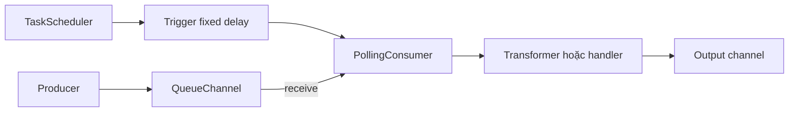

# Pollers.fixedDelay — lập lịch thăm dò sau khi lượt trước hoàn tất

## 1. Mục tiêu và vị trí trong Spring Integration

Trong module `SPRING_INTEGRATION_CORE`, thông điệp đi qua `MessageChannel` và được transformer, router, filter, service activator hoặc aggregator xử lý. Khi đầu vào của endpoint là một channel có thể thăm dò, hoặc nguồn dữ liệu chỉ hỗ trợ cơ chế kéo, hệ thống cần poller để chủ động tìm message.

Bài này thuộc chương **DSL nâng cao**, tập trung vào `Pollers.fixedDelay(...)`: cách cấu hình khoảng nghỉ giữa các lượt thăm dò bằng Java DSL, đọc đúng dòng thời gian thực thi và kiểm thử hành vi đó.

Sau bài học, bạn có thể:

- Phân biệt polling consumer với event-driven consumer.
- Giải thích fixed delay theo thời điểm hoàn tất của tác vụ.
- Gắn poller đúng vị trí cho `QueueChannel` và nguồn inbound.
- Kết hợp độ trễ, số message tối đa mỗi lượt và thời gian chờ nhận.
- Xác định tác động của executor, lỗi và ranh giới transaction.
- Kiểm thử trigger mà không phải chờ thời gian thực.

Các ví dụ dùng Java 17 trở lên và API Spring Integration 6.x, đối chiếu nhánh 6.4. Java DSL nằm trong `spring-integration-core`; trong ứng dụng Spring Boot thường dùng `spring-boot-starter-integration`. Giữ bộ phiên bản Spring theo dependency management của dự án.

## 2. Poller giải quyết vấn đề gì?

### 2.1. Hai cách endpoint nhận message

Với `DirectChannel`, handler đăng ký làm subscriber. Khi producer gửi message, channel chuyển message tới handler theo cơ chế event-driven.

Với `QueueChannel`, producer đặt message vào queue. Một endpoint khác phải gọi nhận message từ queue; poller quyết định khi nào endpoint bắt đầu nhận và nhận bao nhiêu message trong một lượt.



Đối với nguồn inbound như phương thức kiểm tra dữ liệu, adapter dùng `SourcePollingChannelAdapter` để thăm dò `MessageSource`. Cả `PollingConsumer` và `SourcePollingChannelAdapter` đều là endpoint có thể dùng poller, như giải thích trong [tài liệu Poller](https://docs.spring.io/spring-integration/reference/6.4/polling-consumer.html).

### 2.2. Poller được gắn vào endpoint

Đoạn sau đặt lịch nhận từ queue tại endpoint transformer:

```java
IntegrationFlow.from(workQueue())
    .<String, String>transform(String::strip,
        endpoint -> endpoint.poller(
            Pollers.fixedDelay(Duration.ofSeconds(1))))
    .channel(resultQueue())
    .get();
```

Các bean `workQueue()` và `resultQueue()` cần được khai báo, như trong ví dụ đầy đủ ở mục 5. Poller không làm mọi channel trong flow trở thành queue và không tạo độ trễ cho từng bước DSL.

Nếu input là `DirectChannel`, endpoint thường là event-driven và không cần poller. Cấu hình poller lên một endpoint dùng subscribable channel là sai mô hình, có thể bị từ chối khi khởi tạo.

Một lỗi dễ gặp khi dùng `IntegrationFlow.from("workQueue")` là chưa khai báo bean queue tương ứng. Một tên channel chưa tồn tại có thể được DSL tạo thành `DirectChannel`; tên có chữ “queue” không quyết định kiểu channel. Hãy khai báo `QueueChannel` tường minh khi cần polling.

## 3. Ngữ nghĩa chính xác của fixed delay

### 3.1. Khoảng nghỉ bắt đầu sau khi hoàn tất

`Pollers.fixedDelay(...)` tạo `PollerSpec` dựa trên `PeriodicTrigger` ở chế độ fixed delay. Theo hợp đồng của [PeriodicTrigger](https://docs.spring.io/spring-framework/docs/6.2.x/javadoc-api/org/springframework/scheduling/support/PeriodicTrigger.html), thời điểm chạy tiếp theo được tính từ thời điểm tác vụ trước hoàn tất, cộng khoảng delay.

Ký hiệu:

- `Sₙ`: thời điểm bắt đầu thực tế của lượt thứ `n`.
- `Cₙ`: thời điểm tác vụ của lượt đó hoàn tất.
- `D`: khoảng fixed delay.
- `Eₙ = Cₙ − Sₙ`: thời gian thực hiện tác vụ.

Trong mô hình đồng bộ, khi scheduler đủ tài nguyên:

```text
Thời điểm dự kiến tiếp theo = Cₙ + D
Sₙ₊₁ xấp xỉ Sₙ + Eₙ + D
```

Scheduler bận, CPU thiếu hoặc hệ thống tạm dừng có thể khiến lượt thực tế bắt đầu muộn hơn. Delay không phải cam kết bắt đầu chính xác tới từng mili giây.

Ví dụ `D = 1 giây`, tác vụ mất `300 ms`:

```text
0,0 s        0,3 s                       1,3 s        1,6 s
| xử lý poll 1 |------ nghỉ 1 giây --------| xử lý poll 2 |
```

Hai lần bắt đầu cách nhau khoảng `1,3 giây`, không phải đúng `1 giây`.

Nếu tác vụ tiếp theo mất `2 giây`, lượt sau nữa dự kiến bắt đầu sau thời điểm bắt đầu lượt đó khoảng `3 giây`. Tốc độ polling tự chậm theo thời gian xử lý đồng bộ.

### 3.2. Fixed delay khác fixed rate

| Cách lập lịch | Mốc tính | Nhu cầu phù hợp |
| --- | --- | --- |
| `Pollers.fixedDelay(D)` | Thời điểm hoàn tất tác vụ trước | Có khoảng nghỉ sau khi làm xong một lượt |
| `Pollers.fixedRate(P)` | Các mốc bắt đầu theo lịch | Cần nhịp lập lịch định kỳ |
| `Pollers.cron(...)` | Lịch theo biểu thức cron | Cần mốc lịch như từng giờ hoặc khung giờ làm việc |

Giả sử bắt đầu tại `0 s`, tác vụ mất `300 ms`, chu kỳ là `1 s`:

```text
Fixed delay: bắt đầu khoảng 0,0 -> 1,3 -> 2,6 -> 3,9 giây
Fixed rate:  các mốc lịch 0,0 -> 1,0 -> 2,0 -> 3,0 giây
```

Fixed rate cũng phụ thuộc tài nguyên scheduler và cơ chế thực thi. Không được suy ra rằng chọn fixed rate sẽ tự tạo nhiều tác vụ chạy song song. Khả năng chồng lấp cần được xét riêng cùng scheduler, executor và các ranh giới bất đồng bộ.

Fixed delay là khoảng thời gian, không phải lịch theo múi giờ. Nếu cần “đúng 08:00 mỗi ngày”, hãy thiết kế bằng cron và múi giờ phù hợp.

### 3.3. Fixed delay không phải delay của từng message

Với cấu hình:

```java
Pollers.fixedDelay(Duration.ofSeconds(1))
    .maxMessagesPerPoll(3)
```

một lượt có thể xử lý liên tiếp ba message. Khoảng nghỉ một giây nằm sau lượt đó, không tự nằm giữa message thứ nhất và thứ hai.

```text
Lượt 1: nhận M1 -> xử lý M1 -> nhận M2 -> xử lý M2 -> nhận M3 -> xử lý M3
        kết thúc lượt -> nghỉ 1 giây -> lượt 2
```

Muốn điều tiết tốc độ từng message, cần lựa chọn thành phần điều tiết hoặc giới hạn tương ứng với hợp đồng nghiệp vụ. Chỉ giảm `fixedDelay` hoặc tăng số message mỗi poll không tạo ra hạn mức request chính xác cho một API bên ngoài.

## 4. API Java DSL và đơn vị thời gian

Các dạng thường dùng:

```java
Pollers.fixedDelay(Duration.ofMillis(500));
Pollers.fixedDelay(Duration.ofSeconds(2));
Pollers.fixedDelay(500L); // 500 mili giây

Pollers.fixedDelay(
    Duration.ofSeconds(2),  // khoảng nghỉ sau các lượt
    Duration.ofSeconds(5)   // độ trễ trước lượt đầu
);
```

Overload nhận `long` dùng mili giây; overload nhận `Duration` thể hiện đơn vị rõ hơn. Chữ ký và cách tạo trigger có trong [Pollers 6.4.0](https://raw.githubusercontent.com/spring-projects/spring-integration/v6.4.0/spring-integration-core/src/main/java/org/springframework/integration/dsl/Pollers.java).

Với overload hai tham số:

- `initialDelay` áp dụng trước lần chạy đầu tiên của lịch.
- `period` áp dụng giữa lần hoàn tất trước và lần chạy tiếp theo.
- Hai giá trị có thể khác nhau.

Khi không đặt initial delay, trigger không chủ đích chờ cả một chu kỳ trước lượt đầu. Lượt đầu vẫn phụ thuộc lúc endpoint được start và scheduler có thể chạy tác vụ.

Initial delay không thay thế việc kiểm tra dependency đã sẵn sàng. Nếu database hoặc dịch vụ khác chưa hoạt động, cần cơ chế kết nối, retry hoặc điều phối lifecycle phù hợp; chờ một con số cố định không chứng minh hệ thống đã sẵn sàng.

## 5. Ví dụ đầy đủ: lấy công việc từ QueueChannel

Hệ thống nhận chuỗi công việc vào `workQueue`, chuẩn hóa rồi đưa sang `resultQueue`. Chuỗi chỉ có khoảng trắng bị xem là không hợp lệ và gửi lỗi sang `pollErrors`.

```java
import java.time.Duration;
import java.util.Locale;

import org.springframework.context.annotation.Bean;
import org.springframework.context.annotation.Configuration;
import org.springframework.integration.channel.QueueChannel;
import org.springframework.integration.config.EnableIntegration;
import org.springframework.integration.dsl.IntegrationFlow;
import org.springframework.integration.dsl.Pollers;

@Configuration
@EnableIntegration
public class FixedDelayFlowConfig {

    @Bean
    public QueueChannel workQueue() {
        return new QueueChannel(100);
    }

    @Bean
    public QueueChannel resultQueue() {
        return new QueueChannel(100);
    }

    @Bean
    public QueueChannel pollErrors() {
        return new QueueChannel(100);
    }

    @Bean
    public IntegrationFlow normalizeWork() {
        return IntegrationFlow.from(workQueue())
            .<String, String>transform(text -> {
                String normalized = text.strip();
                if (normalized.isEmpty()) {
                    throw new IllegalArgumentException(
                        "Nội dung công việc không được rỗng");
                }
                return normalized.toUpperCase(Locale.ROOT);
            }, endpoint -> endpoint
                .id("normalizePollingEndpoint")
                .poller(Pollers.fixedDelay(Duration.ofMillis(500))
                    .maxMessagesPerPoll(3)
                    .receiveTimeout(0L)
                    .errorChannel("pollErrors")))
            .channel(resultQueue())
            .get();
    }
}
```

Cấu hình này xác định bốn chính sách riêng:

| Cấu hình | Ý nghĩa |
| --- | --- |
| `fixedDelay(500 ms)` | Nghỉ khoảng 500 ms sau tác vụ polling trước |
| `maxMessagesPerPoll(3)` | Nhận và xử lý tối đa ba message trong một lượt |
| `receiveTimeout(0)` | Nếu queue đang rỗng tại lần nhận, trả về ngay |
| `errorChannel("pollErrors")` | Đặt channel lỗi mặc định cho tác vụ poller này |

Khi producer gửi `"  order-17  "`, kết quả là payload `"ORDER-17"`. Không có consumer nghiệp vụ cho hai queue kết quả trong ví dụ để kiểm thử có thể lấy message ra trực tiếp.

Các queue có dung lượng hữu hạn và chỉ lưu trong bộ nhớ. Khi `resultQueue` đầy, thao tác gửi đầu ra có thể chờ hoặc lỗi theo cấu hình của thành phần gửi; thời gian đó có thể làm lượt polling dài hơn. `receiveTimeout(0)` chỉ tác động tới việc nhận từ input queue, không đặt timeout gửi đầu ra.

## 6. Một lượt poll chứa những gì?

Một lượt do trigger kích hoạt có thể lặp thao tác nhận và xử lý nhiều lần. Về tư duy, mô hình đồng bộ có thể đọc như sau:

```text
Khi tới lịch:
    lặp tối đa N lần:
        nhận một message
        nếu không có message: kết thúc lượt
        xử lý và chuyển message xuống flow
    tác vụ kết thúc
    tính lần chạy tiếp theo từ thời điểm kết thúc + delay
```

Đây là giả mã giải thích hành vi bình thường, không phải mã thay thế cơ chế lifecycle, advice và xử lý lỗi của framework.

### 6.1. `maxMessagesPerPoll` là giới hạn mỗi lượt

Số dương như `1`, `3` hoặc `10` đặt giới hạn rõ ràng. Nếu nguồn trả về `null` hoặc queue không có message, lượt có thể kết thúc trước khi đủ giới hạn.

`maxMessagesPerPoll(3)` không gom ba message thành một payload danh sách. Transformer vẫn được gọi từng message. Muốn gom thành một message, cần aggregator hoặc thành phần batching phù hợp.

Các giá trị mặc định khác nhau theo loại endpoint:

| Endpoint | Đầu vào | Mặc định thường dùng trong nhánh 6.4 |
| --- | --- | --- |
| `PollingConsumer` | `PollableChannel`, như `QueueChannel` | `-1`, không giới hạn số message mỗi lượt |
| `SourcePollingChannelAdapter` | `MessageSource`, gồm nguồn tạo từ supplier | `1` message mỗi lượt |

Giá trị âm như `-1` cho phép tiếp tục khi vẫn nhận được message và endpoint còn hoạt động. Nếu queue luôn được bổ sung nhanh hoặc source không bao giờ trả `null`, một lượt có thể kéo dài và khoảng nghỉ fixed delay rất lâu mới xuất hiện.

Với inbound adapter, giá trị `0` có ý nghĩa tạm bỏ qua gọi nhận từ nguồn. Không dùng `0` với ý định “không giới hạn”; nên dùng một giới hạn dương trong các ví dụ thông thường. Khác biệt mặc định và hành vi inbound được mô tả trong [Channel Adapter](https://docs.spring.io/spring-integration/reference/6.4/channel-adapter.html).

### 6.2. `receiveTimeout` là thời gian chờ nhận

Đối với polling consumer nhận từ queue:

```java
Pollers.fixedDelay(Duration.ofSeconds(1))
    .maxMessagesPerPoll(5)
    .receiveTimeout(200L)
```

Mỗi lần gọi nhận có thể chờ tối đa `200 ms` nếu chưa có message. Khi nhận không được message, lượt dừng; nó không bắt buộc thực hiện đủ năm lần chờ rỗng.

Ví dụ lượt đã xử lý hai message rồi queue hết dữ liệu. Lần nhận tiếp theo có thể chờ thêm 200 ms trước khi lượt kết thúc, rồi mới bắt đầu khoảng fixed delay một giây.

Phân biệt các thời gian:

| Tham số hoặc thời gian | Phạm vi |
| --- | --- |
| `fixedDelay` | Khoảng nghỉ giữa các tác vụ theo trigger |
| `initialDelay` | Khoảng chờ trước lần chạy đầu |
| `receiveTimeout` | Chờ nhận message từ pollable channel |
| Timeout của HTTP/JDBC/client | Thời gian thao tác với hệ thống ngoài |
| Thời gian gửi xuống channel kế tiếp | Phụ thuộc channel và thành phần gửi |

`receiveTimeout` không ép một nguồn inbound tùy ý trả lời trong thời gian đó. Nếu supplier gọi HTTP đồng bộ, phải cấu hình timeout tại HTTP client. Javadoc [PollerSpec](https://docs.spring.io/spring-integration/api/org/springframework/integration/dsl/PollerSpec.html) mô tả `receiveTimeout(long)` theo thao tác chờ message từ channel.

### 6.3. Ước tính thông lượng với mô hình đồng bộ

Giả sử mỗi lượt luôn xử lý đủ `b` message, mỗi message mất trung bình `h` giây, delay là `D`, và bỏ qua chi phí khác:

```text
Thời gian một vòng xấp xỉ b × h + D
Thông lượng xấp xỉ b / (b × h + D) message/giây
```

Ví dụ `b = 5`, `h = 0,1 giây`, `D = 1 giây`:

```text
5 / (5 × 0,1 + 1) ≈ 3,33 message/giây
```

Đây là mô hình ước tính, không phải cam kết hiệu năng. Nếu thêm chờ nhận rỗng, retry hoặc gửi đầu ra bị chặn, thời gian vòng tăng lên. Nếu bàn giao bất đồng bộ, phải dùng mô hình riêng cho năng lực worker và queue phía sau.

## 7. Polling nguồn inbound bằng supplier

Đối với nguồn chủ động cung cấp dữ liệu khi được gọi, gắn poller ở cấu hình source:

```java
import java.time.Duration;
import java.util.List;
import java.util.Queue;
import java.util.concurrent.ConcurrentLinkedQueue;

import org.springframework.context.annotation.Bean;
import org.springframework.context.annotation.Configuration;
import org.springframework.integration.config.EnableIntegration;
import org.springframework.integration.dsl.IntegrationFlow;
import org.springframework.integration.dsl.Pollers;

@Configuration
@EnableIntegration
public class FixedDelaySourceConfig {

    @Bean
    public IntegrationFlow pendingSourceFlow() {
        Queue<String> pending = new ConcurrentLinkedQueue<>(
            List.of("JOB-A", "JOB-B", "JOB-C"));

        return IntegrationFlow.fromSupplier(pending::poll,
                endpoint -> endpoint
                    .id("pendingSourceEndpoint")
                    .poller(Pollers.fixedDelay(Duration.ofSeconds(2))
                        .maxMessagesPerPoll(2)))
            .channel(channel -> channel.queue("sourceResults"))
            .get();
    }
}
```

Cách đọc:

1. Lượt đầu gọi supplier tối đa hai lần, tạo message cho `JOB-A` và `JOB-B`.
2. Sau khi tác vụ hoàn tất, chờ khoảng hai giây.
3. Lượt sau nhận `JOB-C`; lần gọi tiếp theo trả `null`, kết thúc lượt sớm.
4. Các lượt sau vẫn được lên lịch nhưng không tạo message nếu nguồn tiếp tục rỗng.

Ở đây, queue kết quả chỉ là nơi lưu để quan sát. Nếu nối các endpoint đồng bộ ngay sau source thay cho queue, thời gian của các endpoint đó cũng có thể nằm trong thời gian tác vụ polling.

Với nguồn thật, `null` nghĩa là hiện không có message để phát. Không tự tạo payload rỗng chỉ để báo “không có dữ liệu”, vì như vậy downstream vẫn thấy một message cần xử lý.

Nếu supplier trả về `List<Order>`, mỗi lần gọi có thể tạo một message mang payload là danh sách đó. `maxMessagesPerPoll(2)` khi ấy giới hạn số message được tạo từ các lần gọi, không giới hạn tổng số phần tử trong danh sách. Cần splitter nếu hợp đồng downstream yêu cầu một đơn hàng cho mỗi message.

Nguồn mô phỏng dùng `pending.poll()` đã lấy phần tử ra khỏi bộ nhớ trước khi downstream hoàn tất. Nếu gửi đầu ra thất bại, phần tử không tự quay lại nguồn. Với database, file hoặc broker, phải xác định riêng cơ chế claim, acknowledgment, rollback hoặc phục hồi.

## 8. Poller dùng chung và cấu hình bên ngoài

### 8.1. Khai báo global default poller

Khi nhiều endpoint cần cùng chính sách mặc định, có thể khai báo:

```java
import java.time.Duration;

import org.springframework.context.annotation.Bean;
import org.springframework.integration.dsl.PollerSpec;
import org.springframework.integration.dsl.Pollers;
import org.springframework.integration.scheduling.PollerMetadata;

@Bean(name = PollerMetadata.DEFAULT_POLLER)
public PollerSpec defaultPoller() {
    return Pollers.fixedDelay(Duration.ofSeconds(1))
        .maxMessagesPerPoll(5)
        .receiveTimeout(0L);
}
```

Đặt bean trong một lớp cấu hình có bật Spring Integration. Đây là lựa chọn thay thế cho việc lặp poller cục bộ ở mọi endpoint.

`PollerSpec` là `FactoryBean` tạo `PollerMetadata`. Trong phương thức `@Bean`, trả về `PollerSpec` để Spring quản lý; không gọi `getObject()` tại đây. Hướng dẫn này được nêu trong [Pollers của Java DSL](https://docs.spring.io/spring-integration/reference/6.4/dsl/java-pollers.html).

Default poller được dùng cho endpoint cần polling mà chưa cấu hình poller riêng. Nó không khiến endpoint event-driven bắt đầu polling. Các endpoint dùng chung metadata cũng không tự trở thành một tác vụ duy nhất hoặc cùng dùng một khóa độc quyền nghiệp vụ.

### 8.2. Poller có tên và giá trị từ cấu hình

Có thể tạo một poller riêng cho nhóm công việc. Ví dụ thêm import `org.springframework.beans.factory.annotation.Value` và đặt bean sau trong lớp cấu hình:

```java
@Bean
public PollerSpec ordersPoller(
    @Value("${orders.poll.delay:PT1S}") String delayText,
    @Value("${orders.poll.max-messages:10}") int maxMessages
) {
    Duration delay = Duration.parse(delayText);
    if (delay.isZero() || delay.isNegative()) {
        throw new IllegalArgumentException("Delay phải lớn hơn 0");
    }
    if (maxMessages <= 0) {
        throw new IllegalArgumentException("Giới hạn phải lớn hơn 0");
    }
    return Pollers.fixedDelay(delay)
        .maxMessagesPerPoll(maxMessages)
        .receiveTimeout(0L);
}
```

Ví dụ giá trị cấu hình theo cú pháp properties:

```properties
orders.poll.delay=PT2S
orders.poll.max-messages=20
```

Endpoint tham chiếu poller theo tên:

```java
.handle(orderHandler,
    endpoint -> endpoint.poller("ordersPoller"))
```

Đây là đoạn gắn vào một flow đã có `orderHandler` và đầu vào là pollable channel. Trong ví dụ phương thức, `Duration.parse(...)` đọc chuỗi ISO-8601 như `PT2S`; chuỗi `2s` không có cùng hợp đồng phân tích đó.

Đọc giá trị từ cấu hình không đồng nghĩa tự thay đổi poller đang chạy khi sửa file. Việc thay đổi lúc runtime cần cơ chế quản trị và cập nhật trigger phù hợp, ngoài phạm vi cấu hình tĩnh ở đây.

## 9. Scheduler, executor và phạm vi hoàn tất

### 9.1. Trường hợp đồng bộ

Khi không cấu hình task executor bất đồng bộ cho poller, tác vụ thường bao gồm nhận message và xử lý downstream đồng bộ. Một handler chậm kéo dài lượt polling, đồng thời chiếm tài nguyên thực thi của scheduler.

Nếu nhiều poller dùng chung scheduler, một lượt nhận không giới hạn hoặc một thao tác mạng thiếu timeout có thể làm các lịch khác chạy muộn. Cần xem xét thời gian xử lý, thời gian chờ nhận và tài nguyên scheduler như một hệ thống chung.

### 9.2. `taskExecutor(...)` làm thay đổi điều được theo dõi

Có thể cấu hình:

```java
Pollers.fixedDelay(Duration.ofSeconds(1))
    .maxMessagesPerPoll(5)
    .taskExecutor(pollingExecutor)
```

`pollingExecutor` phải là một `Executor` được cấu hình và quản lý phù hợp. Trong mô hình này, callback được scheduler gọi có thể hoàn tất sau khi bàn giao việc cho executor, trước khi worker xử lý xong message.

Vì vậy, không được dùng công thức “xử lý nghiệp vụ xong rồi chờ một giây” một cách máy móc cho cấu hình đã bàn giao bất đồng bộ. Các tác vụ polling ở worker có thể chồng lấp; mức độ phụ thuộc executor, hàng đợi công việc và chính sách từ chối. Cách bàn giao được thể hiện trong [AbstractPollingEndpoint 6.4.0](https://raw.githubusercontent.com/spring-projects/spring-integration/v6.4.0/spring-integration-core/src/main/java/org/springframework/integration/endpoint/AbstractPollingEndpoint.java).

Cần xác định:

- Nguồn có an toàn khi nhiều worker gọi nhận đồng thời không?
- Queue của executor có giới hạn không?
- Khi đầy, công việc bị từ chối, chặn hay chạy ở thread gọi?
- Tốc độ phát sinh tác vụ có vượt năng lực xử lý không?

Một lựa chọn khác là giữ thao tác poll tuần tự rồi dùng `ExecutorChannel` ở phía sau để song song hóa xử lý. Khi đó, fixed delay vẫn không chờ các tác vụ nghiệp vụ đã bàn giao ở channel đó hoàn tất. Hãy đặt ranh giới bất đồng bộ dựa trên yêu cầu thứ tự, lỗi và transaction.

### 9.3. Nhiều instance có nhiều poller

Nếu chạy ba instance ứng dụng với cùng cấu hình, thường có ba endpoint polling độc lập. `fixedDelay` không tạo lịch duy nhất cho cả cụm.

Với database dùng chung, truy vấn “lấy bản ghi chưa xử lý” cần cơ chế claim hoặc khóa phù hợp để tránh nhiều instance xử lý cùng bản ghi. Với API bên ngoài, tổng tần suất gọi đến từ tất cả instance và các lượt nhận trong mỗi poll.

Không dùng fixed delay thay cho distributed lock hoặc cơ chế chống xử lý lặp.

## 10. Xử lý lỗi, retry và transaction

### 10.1. Lượt poll tiếp theo không đồng nghĩa retry message lỗi

Trong ví dụ mục 5, producer gửi thành công vào `workQueue` trước khi transformer chạy. Nếu transformer phát sinh lỗi, producer không nhận lại exception đó qua lần gọi `send(...)` đã kết thúc.

Poller có thể phát `ErrorMessage` tới channel lỗi. Theo cơ chế xử lý lỗi của Spring Integration, header `errorChannel` trên message có thể quyết định đích lỗi; cấu hình `.errorChannel("pollErrors")` đặt đích mặc định của error handler cho poller. Xem [Error Handling](https://docs.spring.io/spring-integration/reference/6.4/error-handling.html).

Khi dùng `QueueChannel` bộ nhớ, message đã được lấy khỏi queue. Lượt poll sau không tự nhận lại message lỗi đó. Nếu muốn thử lại cùng message, cần retry advice hoặc cơ chế phục hồi, redelivery hay requeue được thiết kế rõ ràng.

Sau khi error handler xử lý lỗi theo cấu hình thông thường, scheduler có thể tiếp tục các lượt sau. Error handler tùy biến cũng có thể ảnh hưởng việc lịch còn tiếp tục hay không, nên cần kiểm thử cả đường lỗi.

### 10.2. Vị trí retry ảnh hưởng thời gian và tác dụng phụ

Retry đồng bộ trong handler hoặc polling task kéo dài thời gian thực hiện lượt. Với fixed delay đồng bộ, khoảng nghỉ được tính sau khi phần thực thi đó kết thúc.

Nếu retry bao trùm đoạn downstream đã gây tác dụng phụ, gửi email hoặc gọi dịch vụ ngoài có thể bị thực hiện lại. Nên đặt retry đúng phạm vi lỗi có thể phục hồi, giới hạn số lần thử và dùng khóa nghiệp vụ để chống xử lý lặp.

Đưa lỗi vào `nullChannel` chỉ bỏ thông tin lỗi, không tạo phục hồi dữ liệu.

### 10.3. Transaction phải gắn với tài nguyên thật

Poller có các cấu hình transaction/advice, nhưng việc bật transaction không làm mọi channel và dịch vụ bên ngoài cùng rollback.

Cần xác định cụ thể:

- Nguồn nhận có tham gia transaction không?
- Database nào do transaction manager quản lý?
- Downstream còn trên cùng thread hay đã bàn giao bất đồng bộ?
- Khi rollback, message được nguồn trả lại, giữ nguyên trạng thái hay đã bị lấy mất?

Ranh giới bất đồng bộ thường làm đứt phạm vi transaction gắn với thread. `QueueChannel` bộ nhớ không tự có ngữ nghĩa nhận lại message như một tài nguyên messaging có giao dịch. Các điểm nối transaction được mô tả trong [Transaction Support](https://docs.spring.io/spring-integration/reference/6.4/transactions.html).

`maxMessagesPerPoll` cũng không tự định nghĩa một transaction duy nhất cho cả nhóm message. Phải đọc phạm vi advice và giao dịch của endpoint, không suy từ số message trong lượt polling.

## 11. Kiểm thử fixed delay mà không đo đồng hồ thực

### 11.1. Kiểm tra mốc tính lịch bằng TriggerContext

Thay vì `Thread.sleep(...)` rồi so thời gian với sai số nhỏ, có thể đặt trực tiếp các mốc của lượt trước trong `SimpleTriggerContext`.

```java
import java.time.Clock;
import java.time.Duration;
import java.time.Instant;
import java.time.ZoneOffset;

import org.junit.jupiter.api.Test;
import org.springframework.integration.dsl.Pollers;
import org.springframework.scheduling.Trigger;
import org.springframework.scheduling.support.SimpleTriggerContext;

import static org.junit.jupiter.api.Assertions.assertEquals;

class FixedDelayTriggerTest {

    @Test
    void nextExecutionIsBasedOnCompletion() {
        Trigger trigger = Pollers.fixedDelay(Duration.ofSeconds(2))
            .getObject()
            .getTrigger();

        Instant scheduled = Instant.parse("2026-01-01T00:00:00Z");
        Instant actual = scheduled.plusMillis(20);
        Instant completed = scheduled.plusMillis(320);

        SimpleTriggerContext context = new SimpleTriggerContext(
            scheduled, actual, completed);

        assertEquals(completed.plusSeconds(2),
            trigger.nextExecution(context));
    }

    @Test
    void initialDelayOnlyAffectsTheFirstExecution() {
        Trigger trigger = Pollers.fixedDelay(
                Duration.ofSeconds(2), Duration.ofSeconds(5))
            .getObject()
            .getTrigger();

        Instant now = Instant.parse("2026-01-01T00:00:00Z");
        SimpleTriggerContext context = new SimpleTriggerContext(
            Clock.fixed(now, ZoneOffset.UTC));

        assertEquals(now.plusSeconds(5), trigger.nextExecution(context));

        Instant firstStart = now.plusSeconds(5);
        Instant completed = firstStart.plusMillis(400);
        context.update(firstStart, firstStart, completed);

        assertEquals(completed.plusSeconds(2),
            trigger.nextExecution(context));
    }
}
```

Đây là test độc lập cho phép tính thời điểm, không khởi động application context. Việc gọi `getObject()` ở đây lấy metadata từ một specification cục bộ chỉ phục vụ test; không áp dụng cách gọi đó trong phương thức `@Bean` ở mục 8.

`SimpleTriggerContext` giữ các mốc scheduled, actual và completion; nó cũng có thể nhận `Clock` cố định như mô tả trong [SimpleTriggerContext Javadoc](https://docs.spring.io/spring-framework/docs/6.2.x/javadoc-api/org/springframework/scheduling/support/SimpleTriggerContext.html).

### 11.2. Kiểm tra flow xử lý thành công và phát lỗi

Đặt test cùng package với `FixedDelayFlowConfig` ở mục 5. Cần JUnit Jupiter và Spring Test; ứng dụng Boot thường dùng `spring-boot-starter-test` cùng starter Integration.

```java
import org.junit.jupiter.api.Test;
import org.springframework.beans.factory.annotation.Autowired;
import org.springframework.beans.factory.annotation.Qualifier;
import org.springframework.integration.channel.QueueChannel;
import org.springframework.messaging.Message;
import org.springframework.messaging.support.ErrorMessage;
import org.springframework.messaging.support.MessageBuilder;
import org.springframework.test.annotation.DirtiesContext;
import org.springframework.test.context.junit.jupiter.SpringJUnitConfig;

import static org.junit.jupiter.api.Assertions.*;

@SpringJUnitConfig(FixedDelayFlowConfig.class)
@DirtiesContext(classMode = DirtiesContext.ClassMode.AFTER_EACH_TEST_METHOD)
class FixedDelayFlowConfigTest {

    @Autowired
    @Qualifier("workQueue")
    QueueChannel input;

    @Autowired
    @Qualifier("resultQueue")
    QueueChannel results;

    @Autowired
    @Qualifier("pollErrors")
    QueueChannel errors;

    @Test
    void processesQueuedMessages() {
        assertTrue(input.send(MessageBuilder.withPayload("  order-17  ")
            .build()));

        Message<?> result = results.receive(3_000L);

        assertNotNull(result);
        assertEquals("ORDER-17", result.getPayload());
        assertNull(errors.receive(0L));
    }

    @Test
    void reportsFailureAndContinuesWithLaterWork() {
        assertTrue(input.send(MessageBuilder.withPayload("   ").build()));
        assertTrue(input.send(MessageBuilder.withPayload("job-ok").build()));

        Message<?> failure = errors.receive(3_000L);
        assertInstanceOf(ErrorMessage.class, failure);

        Message<?> result = results.receive(3_000L);
        assertNotNull(result);
        assertEquals("JOB-OK", result.getPayload());
    }
}
```

`receive(3_000L)` chờ tối đa ba giây và trả về sớm khi có message. Khoảng chờ này là giới hạn của test để quan sát xử lý bất đồng bộ, không chứng minh poller luôn chạy đúng vào một mốc mili giây.

Test dùng context riêng sau mỗi phương thức để tránh endpoint và message còn lại ảnh hưởng phương thức khác. Test thứ hai kiểm tra hệ thống phát lỗi rồi tiếp tục nhận công việc hợp lệ; nó không giả định message lỗi tự được retry.

Các đoạn test là mã thực hành trong bài; cần biên dịch và chạy trong dự án với bộ dependency cụ thể. Không cần đưa ngưỡng đo thời gian quá chặt vào integration test chỉ để kiểm tra công thức trigger đã được kiểm tra độc lập.

### 11.3. Các tình huống mở rộng cần quan sát

| Tình huống | Điều cần chứng minh |
| --- | --- |
| Queue rỗng, `receiveTimeout(0)` | Lượt kết thúc nhanh rồi chờ delay |
| Queue rỗng, timeout nhận dương | Thời gian chờ nhận nằm trong thời gian tác vụ |
| Nguồn có ba message, giới hạn hai mỗi lượt | Không cố lấy quá giới hạn trong cùng lượt |
| Handler đồng bộ chậm | Mốc chạy sau được tính từ completion |
| Poller bàn giao cho executor | Không suy completion nghiệp vụ từ completion callback |
| Lỗi transformer | Có error message và chính sách tiếp tục được xác nhận |
| Lượt không giới hạn với nguồn luôn có dữ liệu | Lượt có thể kéo dài, ảnh hưởng tính công bằng tài nguyên |

## 12. Liên hệ với các thành phần cốt lõi

Poller quyết định cách endpoint nhận dữ liệu. Các EIP phía sau vẫn giữ trách nhiệm riêng:

- **Transformer:** chuyển payload; đặt poller tại transformer khi nó là consumer trực tiếp của queue.
- **Filter:** loại message theo điều kiện. Message bị lọc không có nghĩa lượt polling không hề nhận dữ liệu; cần phân biệt số message nhận và số message đi ra.
- **Router:** chọn channel đích sau khi message được nhận; fixed delay không thay đổi quy tắc định tuyến.
- **Aggregator:** gom các message liên quan. Fixed delay của đầu vào không thay thế timeout nhóm hoặc release strategy.
- **Gateway:** che giấu API messaging. Nếu gateway chỉ enqueue theo hợp đồng một chiều, lời gọi hoàn tất chưa chứng minh endpoint polling đã xử lý xong. Với request-reply, ngân sách chờ cần tính cả thời gian message nằm trong queue và thời gian xử lý.

Thiết kế này giúp tách thời điểm nhận message khỏi quy tắc nghiệp vụ, đồng thời vẫn nhìn thấy nơi phát sinh độ trễ và lỗi.

## 13. Lỗi cấu hình thường gặp

| Hiện tượng | Nguyên nhân có thể có | Hướng xử lý |
| --- | --- | --- |
| Có message trong queue nhưng không được xử lý | Thiếu poller, endpoint chưa start hoặc scheduler không chạy được | Kiểm tra kiểu channel, lifecycle và cấu hình poller |
| Endpoint từ chối cấu hình poller | Input là subscribable channel | Chọn mô hình event-driven hoặc khai báo pollable channel phù hợp |
| Chu kỳ thực tế dài hơn delay | Thời gian xử lý và chờ nhận được cộng vào vòng | Đo riêng thời gian tác vụ, receive và khoảng nghỉ |
| Nhiều message đi sát nhau | Giới hạn mỗi lượt lớn hơn một | Phân biệt lượt polling với khoảng cách từng message |
| Queue không bao giờ được nghỉ dù đặt delay | Lượt không giới hạn và dữ liệu liên tục có mặt | Đặt giới hạn dương và theo dõi thời lượng lượt |
| API ngoài bị gọi quá nhiều | Một poll gọi nhiều lần hoặc nhiều instance cùng chạy | Tính tổng lượt gọi và đặt giới hạn theo yêu cầu API |
| Nguồn không an toàn khi chạy đồng thời | Dùng task executor mà chưa xét concurrency | Chọn ranh giới song song và bảo vệ nguồn phù hợp |
| Message lỗi không tự quay lại | Queue/nguồn không có redelivery như mong đợi | Thiết kế retry, lưu lỗi và phục hồi rõ ràng |
| Sửa properties nhưng lịch không đổi | Cấu hình chỉ được đọc khi tạo bean | Dùng cơ chế cập nhật runtime hoặc khởi động lại theo quy trình |
| Integration test chập chờn | Đo khoảng thời gian quá chặt bằng sleep | Kiểm tra trigger bằng thời gian giả lập và chờ kết quả có giới hạn |

Khi vận hành, nên theo dõi số lượt poll, lượt rỗng, số message nhận, thời gian xử lý, độ sâu queue và số lỗi. Delay đúng cấu hình nhưng queue vẫn tăng cho thấy cần xét năng lực tiêu thụ và tốc độ producer, thay vì chỉ kiểm tra lịch.

## 14. Bài thực hành

1. Với `maxMessagesPerPoll(3)`, delay 500 ms và thời gian xử lý mỗi message khoảng 100 ms, ước tính thông lượng khi queue luôn đủ dữ liệu. Ghi rõ các chi phí đang bỏ qua.
2. Thay `receiveTimeout(0)` bằng `receiveTimeout(200)` rồi mô tả dòng thời gian cho một lượt chỉ có một message.
3. Dùng source hữu hạn năm phần tử, giới hạn hai message mỗi lượt. Xác định số message dự kiến được phát qua từng lượt, kể cả lượt nguồn đã rỗng.
4. Thêm initial delay ba giây và kiểm tra mốc đầu bằng `Clock.fixed(...)`, không chờ ba giây thật.
5. Cho transformer lỗi với một dữ liệu đầu vào, kiểm tra error channel và thiết kế chính sách retry giới hạn. Phân biệt retry message cũ với việc poll message mới.
6. Phân tích cách hệ thống thay đổi khi chạy hai instance hoặc khi thêm executor. Chỉ rõ nguồn có thể bị gọi đồng thời ở đâu và tác dụng phụ nào cần chống lặp.

Sản phẩm thực hành cần thể hiện đúng kiểu channel, vị trí poller, mốc tính delay, số message mỗi lượt và đường xử lý lỗi. Những yếu tố này quyết định việc dùng `Pollers.fixedDelay` có đáp ứng nhịp lấy dữ liệu và hợp đồng xử lý của luồng tích hợp hay không.
