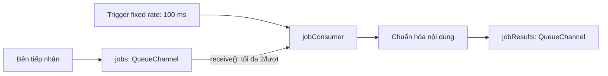

# Pollers.fixedRate

## Mục tiêu và phạm vi

Trong chương **DSL nâng cao** của module **SPRING_INTEGRATION_CORE**, `Pollers.fixedRate(...)` dùng để cấu hình nhịp polling cho endpoint trong Java DSL. Nó hữu ích khi cần chủ động lấy thông điệp từ queue hoặc gọi một nguồn dữ liệu theo khoảng thời gian.

Bài này đặt fixed rate vào đúng ngữ cảnh của luồng thông điệp: channel đầu vào, consumer endpoint, message source, xử lý downstream và đường lỗi. Sau bài học, bạn có thể:

- Giải thích mốc thời gian mà fixed rate sử dụng.
- Phân biệt `fixedRate` với `fixedDelay`.
- Dùng các overload với `Duration`, mili giây và độ trễ ban đầu.
- Gắn poller đúng endpoint trong Java DSL.
- Điều chỉnh số thông điệp mỗi lượt và thời gian chờ nhận.
- Phân tích trường hợp xử lý chậm, lịch bị trễ và tác vụ polling chạy qua executor.
- Viết kiểm thử lịch trigger mà không phụ thuộc `Thread.sleep()`.

Ví dụ chọn **Java 17+, Spring Integration 6.5.x và API Spring Framework 6.x** làm mốc. Đây là lựa chọn phục vụ bài học, không phải khẳng định phiên bản đang có trong dự án. Java DSL nằm trong `spring-integration-core`; các ví dụ cấu hình dùng Spring Context, mã kiểm thử dùng JUnit Jupiter.

## 1. Fixed rate lập lịch polling như thế nào?

### 1.1. Khoảng cách giữa các mốc bắt đầu dự kiến

`Pollers.fixedRate(Duration.ofSeconds(1))` tạo cấu hình poller có nhịp một giây, đo theo **các mốc bắt đầu đã được lập lịch**. Nó không lấy thời điểm hoàn tất công việc làm mốc cộng thêm một giây.

Có thể hình dung lịch mục tiêu sau khi lần đầu được lên lịch tại `t = 0`:

```text
Mốc polling dự kiến:   0 s      1 s      2 s      3 s
                       |        |        |        |
                       poll     poll     poll     poll
```

Đây là lịch mục tiêu. Thời điểm tác vụ thật sự bắt đầu còn phụ thuộc scheduler, thread sẵn có và thời gian xử lý. Fixed rate không tạo bảo đảm thời gian thực cho toàn tuyến. Định nghĩa API có tại [Pollers — fixedRate](https://docs.spring.io/spring-integration/docs/6.5.0/api/org/springframework/integration/dsl/Pollers.html).

### 1.2. Phân biệt ba mốc của một lần chạy

| Mốc | Ý nghĩa |
| --- | --- |
| Scheduled start | Thời điểm tác vụ được dự kiến bắt đầu |
| Actual start | Thời điểm tác vụ thật sự bắt đầu |
| Completion | Thời điểm tác vụ kết thúc |

Ví dụ một tác vụ được dự kiến bắt đầu lúc 1.000 ms, thực tế bắt đầu lúc 1.040 ms và kết thúc lúc 1.300 ms. Với chu kỳ 1.000 ms:

- Fixed rate tính mốc kế tiếp từ scheduled start: 2.000 ms.
- Fixed delay tính mốc kế tiếp từ completion: 2.300 ms.

Trong implementation `PeriodicTrigger` dùng làm mốc cho bài, fixed rate tính `lastScheduledExecution + period`; fixed delay tính `lastCompletion + period`. Có thể đối chiếu [mã nguồn PeriodicTrigger của Spring Framework](https://github.com/spring-projects/spring-framework/blob/v6.2.0/spring-context/src/main/java/org/springframework/scheduling/support/PeriodicTrigger.java).

### 1.3. Một lượt polling có thể xử lý nhiều thông điệp

Cần tách hai khái niệm:

```text
Chu kỳ trigger
    -> một lần thực thi polling task
        -> nhận và xử lý thông điệp thứ nhất
        -> nhận và xử lý thông điệp thứ hai
        -> ...
```

Một trigger mỗi giây không đồng nghĩa chỉ xử lý một thông điệp mỗi giây. Số thông điệp tối đa trong lượt được điều khiển bằng `maxMessagesPerPoll`, còn số thực tế phụ thuộc dữ liệu có sẵn và việc xử lý có hoàn tất bình thường hay không.

## 2. Cú pháp trong Java DSL

### 2.1. Khai báo period và initial delay

```java
// Chu kỳ một giây, dùng Duration để thể hiện đơn vị rõ ràng.
Pollers.fixedRate(Duration.ofSeconds(1))

// Cùng ý nghĩa về period: tham số long dùng mili giây.
Pollers.fixedRate(1_000)

// Chu kỳ một giây, trì hoãn lần đầu năm giây.
Pollers.fixedRate(
        Duration.ofSeconds(1),
        Duration.ofSeconds(5))

// Thứ tự vẫn là period trước, initialDelay sau.
Pollers.fixedRate(1_000, 5_000)
```

Các biểu thức trên là các phương án cấu hình, không phải những câu lệnh cần chạy liên tiếp.

`initialDelay` tác động đến lần thực thi đầu tiên của lịch, không được cộng lại như khoảng nghỉ sau mỗi lượt. Khi không đặt initial delay, trigger không tự chờ đủ một period trước lần đầu; thời điểm chạy thực tế vẫn do scheduler quyết định.

`Pollers` là lớp tiện ích tạo `PollerSpec`. Việc gọi phương thức này chỉ tạo cấu hình; nó chưa tự khởi chạy một công việc. Phải gắn cấu hình vào endpoint được Spring quản lý. Xem [Pollers API](https://docs.spring.io/spring-integration/docs/6.5.0/api/org/springframework/integration/dsl/Pollers.html).

### 2.2. Gắn poller vào consumer nhận từ queue

```java
IntegrationFlow.from(jobs)
        .<String>handle(
                (payload, headers) -> payload.toUpperCase(
                        java.util.Locale.ROOT),
                endpoint -> endpoint.poller(Pollers
                        .fixedRate(Duration.ofMillis(200))
                        .maxMessagesPerPoll(3)
                        .receiveTimeout(0)))
        .channel(results)
        .get();
```

Trong đoạn này, `jobs` là `QueueChannel`, `results` là channel đầu ra. Poller thuộc endpoint `handle` đang tiêu thụ queue. Nó không phải thuộc tính của queue và không tự áp dụng cho mọi bước trong flow.

Nếu một flow có nhiều queue ở giữa, mỗi consumer nhận từ queue cần một cấu hình poller phù hợp, có thể là cấu hình cục bộ hoặc poller mặc định.

### 2.3. Phân biệt hai nơi thường dùng poller

| Nơi dùng | Đối tượng được polling | Ví dụ |
| --- | --- | --- |
| `PollingConsumer` | `PollableChannel` | Nhận đơn từ `QueueChannel` rồi gọi handler |
| `SourcePollingChannelAdapter` | `MessageSource` hoặc supplier được DSL bọc | Gọi nguồn dữ liệu để tạo thông điệp đầu vào |

Với `DirectChannel`, consumer nhận thông điệp qua subscription; không gắn poller vào consumer đó để cố làm nó chạy định kỳ. Nếu cần kích hoạt một nguồn theo lịch, đặt poller tại source. Xem [Polling Consumer](https://docs.spring.io/spring-integration/reference/6.5/polling-consumer.html).

## 3. Ví dụ hoàn chỉnh: xử lý công việc từ QueueChannel

### 3.1. Bài toán

Hệ thống tiếp nhận các công việc chuẩn hóa văn bản. Một poller chạy theo chu kỳ 100 ms, mỗi lượt nhận tối đa hai công việc và tạo kết quả.



Ví dụ chủ động tắt auto-start của consumer để có thể nạp dữ liệu trước rồi bắt đầu polling. Đây cũng là cách giúp phần thực hành quan sát rõ vòng đời endpoint.

### 3.2. Cấu hình Java

```java
import java.time.Duration;
import java.util.Locale;

import org.springframework.beans.factory.annotation.Qualifier;
import org.springframework.context.annotation.Bean;
import org.springframework.context.annotation.Configuration;
import org.springframework.integration.channel.QueueChannel;
import org.springframework.integration.config.EnableIntegration;
import org.springframework.integration.dsl.IntegrationFlow;
import org.springframework.integration.dsl.Pollers;

@Configuration(proxyBeanMethods = false)
@EnableIntegration
public class FixedRateJobsConfig {

    public record Job(String id, String text) {
    }

    public record JobResult(String jobId, String normalizedText) {
    }

    @Bean
    public QueueChannel jobs() {
        return new QueueChannel(20);
    }

    @Bean
    public QueueChannel jobResults() {
        return new QueueChannel(20);
    }

    @Bean
    public IntegrationFlow jobsFlow(
            @Qualifier("jobs") QueueChannel input,
            @Qualifier("jobResults") QueueChannel output) {

        return IntegrationFlow.from(input)
                .<Job>handle(
                        (job, headers) -> new JobResult(
                                job.id(),
                                job.text().strip()
                                        .toUpperCase(Locale.ROOT)),
                        endpoint -> endpoint
                                .id("jobConsumer")
                                .autoStartup(false)
                                .poller(Pollers
                                        .fixedRate(
                                                Duration.ofMillis(100))
                                        .maxMessagesPerPoll(2)
                                        .receiveTimeout(0)))
                .channel(output)
                .get();
    }
}
```

Trong ví dụ:

- Payload đầu vào là `Job`.
- Payload đầu ra là `JobResult`.
- `jobConsumer` là ID của consumer endpoint có poller.
- `jobsFlow` là bean định nghĩa flow, không phải tên của queue.
- `receiveTimeout(0)` giúp lượt polling không chờ khi queue hết dữ liệu.

Sau khi tạo application context và nạp công việc, bắt đầu consumer bằng:

```java
org.springframework.context.Lifecycle consumer =
        context.getBean(
                "jobConsumer",
                org.springframework.context.Lifecycle.class);

consumer.start();
```

Nếu muốn endpoint tự bắt đầu cùng vòng đời ứng dụng, bỏ `autoStartup(false)` hoặc cấu hình giá trị phù hợp. Thay đổi lựa chọn này cũng cần được phản ánh trong kiểm thử.

### 3.3. Một lần nhận thành công chưa đồng nghĩa xử lý xong

Khi bên gửi gọi `jobs.send(message)`, thông điệp được đưa vào queue. Việc handler chạy sau đó xảy ra trong lượt polling. Do vậy:

```text
Đã đưa vào jobs
    khác với
Đã được jobConsumer lấy
    khác với
Đã có JobResult
```

Để kiểm tra kết quả nghiệp vụ, quan sát `jobResults` hoặc cơ chế trả kết quả được thiết kế cho tuyến. Không dùng riêng giá trị trả về của thao tác gửi queue như kết luận xử lý thành công.

## 4. Fixed rate và fixed delay qua dòng thời gian

### 4.1. Khi mỗi lượt xử lý nhanh hơn chu kỳ

Giả sử một lượt mất 300 ms, period là một giây, lần đầu bắt đầu đúng lúc 0:

| Lượt | Fixed rate: bắt đầu → kết thúc | Fixed delay: bắt đầu → kết thúc |
| --- | --- | --- |
| 1 | 0,0 → 0,3 s | 0,0 → 0,3 s |
| 2 | 1,0 → 1,3 s | 1,3 → 1,6 s |
| 3 | 2,0 → 2,3 s | 2,6 → 2,9 s |

Bảng giả định scheduler không bị tranh chấp và không thêm executor cho polling task. Với fixed delay, thời gian công việc được cộng vào khoảng cách giữa các lần bắt đầu. Với fixed rate, mốc lịch vẫn tiến theo period.

### 4.2. Khi mỗi lượt xử lý lâu hơn chu kỳ

Nếu một lượt mất 1,6 giây trong khi period là một giây:

```text
Lịch mục tiêu:       0,0       1,0       2,0       3,0 s
Lượt đầu thực tế:    [----------------]  kết thúc ở 1,6 s
Mốc tiếp theo:                 1,0 s    đã bị trễ
```

Trigger có thể tính mốc kế tiếp nằm trong quá khứ so với lúc công việc vừa hoàn tất. Scheduler có thể chạy lượt kế tiếp sớm nhất có thể để tiếp tục lịch. Không suy ra rằng framework sẽ tự tạo thêm thread cho từng mốc đã trễ, hoặc luôn bỏ qua mọi mốc cũ.

Với cách dùng scheduler thông thường và không có executor riêng cho poller, một chuỗi polling của cùng endpoint không tự chồng lấn chỉ vì chọn fixed rate. Nếu cần phân tích một cấu hình scheduler khác, phải xét cơ chế thực thi thực tế.

Cách tính mốc quá hạn có thể thấy trong [PeriodicTrigger.nextExecution](https://github.com/spring-projects/spring-framework/blob/v6.2.0/spring-context/src/main/java/org/springframework/scheduling/support/PeriodicTrigger.java). Phân biệt thread scheduler với thread thực thi polling được trình bày ở [TaskExecutor Support](https://docs.spring.io/spring-integration/reference/6.5/endpoint.html).

### 4.3. Chọn nhịp phù hợp với mục tiêu

| Mục tiêu | Lựa chọn để xem xét |
| --- | --- |
| Muốn lịch polling bám các mốc định kỳ | Fixed rate |
| Muốn có khoảng nghỉ sau khi công việc vừa kết thúc | Fixed delay |
| Muốn chạy theo giờ hoặc ngày cụ thể | Cron trigger |
| Muốn thay đổi lịch theo trạng thái tải | Trigger tùy chỉnh hoặc cơ chế điều khiển thích hợp |

Đây là cách lựa chọn theo yêu cầu. Fixed rate không làm handler nhanh hơn và không thay thế giới hạn tải cho dịch vụ bên ngoài.

## 5. maxMessagesPerPoll và receiveTimeout

### 5.1. Giới hạn công việc trong một lượt

```java
Pollers.fixedRate(Duration.ofSeconds(1))
        .maxMessagesPerPoll(10)
        .receiveTimeout(0)
```

Nếu queue có ít nhất mười thông điệp, công việc xử lý đủ nhanh và không phát sinh lỗi, một lượt có thể xử lý mười thông điệp. Nếu queue chỉ có ba, lượt đó kết thúc khi hết dữ liệu và không đợi thêm do receive timeout bằng 0.

Cần cấu hình rõ số thông điệp mỗi lượt khi ví dụ phụ thuộc vào giới hạn này. Theo tài liệu của nhánh API đang dùng, mặc định thường khác nhau: `PollingConsumer` là `-1`, còn `SourcePollingChannelAdapter` là `1`. Giá trị không giới hạn có thể khiến một lượt kéo dài khi nguồn liên tục có dữ liệu. Xem [Message Endpoints — Poller Configuration](https://docs.spring.io/spring-integration/reference/6.5/endpoint.html).

### 5.2. Thời gian chờ nhận cũng chiếm thời gian của lượt

`receiveTimeout` là thời gian chờ khi nhận từ pollable channel, tính bằng mili giây. Nó không phải:

- Chu kỳ lịch polling.
- Timeout cho mọi thao tác HTTP, JDBC hoặc I/O của nguồn.
- Thời hạn hoàn tất logic nghiệp vụ phía sau.

Ví dụ period 100 ms nhưng receive timeout 1.000 ms: nếu queue không có dữ liệu, một thao tác nhận có thể chờ lâu hơn period. Vì thế lịch 100 ms không bảo đảm cứ đúng 100 ms lại có một lượt xử lý hoàn tất.

Trong ví dụ xử lý queue của bài, `receiveTimeout(0)` được chọn để việc quan sát nhịp đơn giản hơn. Khi cần chờ dữ liệu theo cách blocking, có thể chọn giá trị khác dựa trên yêu cầu và số thread sẵn có. Xem [PollerSpec — receiveTimeout](https://docs.spring.io/spring-integration/docs/6.5.0/api/org/springframework/integration/dsl/PollerSpec.html).

### 5.3. Ước lượng thông lượng trong điều kiện thuận lợi

Giả sử period một giây, tối đa mười thông điệp mỗi lượt và mỗi thông điệp mất 20 ms trên cùng tuyến đồng bộ:

```text
Thời gian xử lý một lượt đầy: 10 × 20 ms = 200 ms
Mốc lịch cách nhau:                        1.000 ms
Thông lượng mục tiêu khi queue có dữ liệu: khoảng 10 thông điệp/giây
```

Nếu mỗi thông điệp mất 200 ms, một lượt đầy mất khoảng hai giây; lịch một giây không làm tuyến đơn luồng đạt mười thông điệp/giây. Khi đó năng lực xử lý đã trở thành giới hạn.

Các phép tính trên là mô hình để phân tích tải. Chúng chưa bao gồm chờ tài nguyên, timeout, retry hoặc dao động thời gian thực thi.

## 6. Polling một nguồn bằng fromSupplier

Fixed rate cũng được dùng khi flow bắt đầu từ một nguồn chủ động tạo thông điệp.

Ví dụ sau có thể đặt trong một lớp `@Configuration` có `@EnableIntegration`. Ngoài các import đã xuất hiện, cần thêm `java.util.concurrent.atomic.AtomicLong`.

```java
@Bean
public QueueChannel heartbeatResults() {
    return new QueueChannel(20);
}

@Bean
public IntegrationFlow heartbeatFlow(
        @Qualifier("heartbeatResults") QueueChannel output) {

    AtomicLong sequence = new AtomicLong();

    return IntegrationFlow.fromSupplier(
                    () -> "HEARTBEAT-" + sequence.incrementAndGet(),
                    source -> source
                            .id("heartbeatSource")
                            .poller(Pollers
                                    .fixedRate(
                                            Duration.ofSeconds(5),
                                            Duration.ofSeconds(1))
                                    .maxMessagesPerPoll(1)))
            .channel(output)
            .get();
}
```

Ý định của cấu hình:

- Trì hoãn lần polling đầu khoảng một giây.
- Sau đó duy trì lịch mục tiêu cách nhau năm giây.
- Một lượt gọi supplier tối đa một lần.
- Đưa kết quả vào queue đầu ra.

Các mốc mục tiêu tương đối là khoảng 1 s, 6 s, 11 s, tính từ lúc lịch bắt đầu được thiết lập. Thời điểm thực tế có thể trễ.

Supplier này luôn tạo dữ liệu. Vì vậy, việc giới hạn một thông điệp mỗi lượt làm rõ hợp đồng và tránh trường hợp một lượt cứ tiếp tục lấy dữ liệu nếu bị cấu hình không giới hạn. Với nguồn không có dữ liệu mới, cần dùng cơ chế “không có thông điệp” mà source hỗ trợ, thường là kết quả `null`, thay vì tự tạo thông điệp rỗng chỉ để lấp lịch.

Flow trên chỉ là ví dụ ngắn hạn: queue đầu ra cần được đọc hoặc nối tới consumer thích hợp; nếu cứ sinh dữ liệu nhưng không tiêu thụ, queue giới hạn dung lượng sẽ đầy.

Khác biệt giữa polling source và polling channel được giải thích trong [Inbound Channel Adapters](https://docs.spring.io/spring-integration/reference/6.5/dsl/java-inbound-adapters.html).

## 7. Scheduler và executor là hai cấu hình khác nhau

### 7.1. Scheduler xác định lúc kích hoạt

Scheduler quản lý việc chạy tác vụ theo trigger. Trong cấu hình không thêm executor riêng cho poller, handler thường được thực thi trên thread đang chạy polling task.

Một downstream chậm có thể chiếm thread scheduler lâu. Nếu nhiều endpoint dùng chung scheduler, cần xem xét ảnh hưởng đến việc các endpoint khác được lên lịch.

Spring Integration cho phép cấu hình scheduler trung tâm bằng bean tên `taskScheduler`. Khi tùy chỉnh scheduler, cần giữ cả chính sách xử lý lỗi mong muốn. Xem [Configuring the Task Scheduler](https://docs.spring.io/spring-integration/reference/6.5/configuration/namespace-taskscheduler.html).

### 7.2. taskExecutor chạy công việc polling

Khi thực sự cần các lượt polling có khả năng xử lý đồng thời, có thể gắn executor vào poller. Ví dụ bean executor:

```java
@Bean
public org.springframework.scheduling.concurrent.ThreadPoolTaskExecutor
        pollWorkers() {

    var executor =
            new org.springframework.scheduling.concurrent
                    .ThreadPoolTaskExecutor();

    executor.setCorePoolSize(2);
    executor.setMaxPoolSize(2);
    executor.setQueueCapacity(4);
    executor.setThreadNamePrefix("poll-worker-");
    return executor;
}
```

Spring quản lý vòng đời bean executor này. Sau khi tiêm nó vào phương thức khai báo flow, cấu hình poller bằng:

```java
Pollers.fixedRate(Duration.ofMillis(200))
        .maxMessagesPerPoll(2)
        .receiveTimeout(0)
        .taskExecutor(pollWorkers)
```

Ở biểu thức trên, `pollWorkers` là tham số đã được tiêm kiểu `ThreadPoolTaskExecutor`, không phải lời gọi trực tiếp tới phương thức `@Bean`.

Khi có executor, scheduler có thể tiếp tục kích hoạt và giao polling task trong khi tác vụ trước còn chạy ở worker. Các lượt polling có thể chồng lấn tùy cấu hình. Khi đó cần xem xét tính an toàn khi nhiều thread gọi handler, thứ tự kết quả và chính sách khi executor hết chỗ nhận tác vụ.

### 7.3. Có hai nơi có thể tích lũy công việc

```text
Queue thông điệp đầu vào
    + hàng đợi polling task trong executor
    + số tác vụ đang chạy
```

Giảm period không làm mọi lớp tích lũy giảm xuống. Ngay cả lúc queue thông điệp trống, receive timeout dài vẫn có thể giữ nhiều worker đang chờ, trong khi scheduler tiếp tục gửi thêm polling task.

Tài liệu có phân tích tình huống fixed rate ngắn, receive timeout dài và hàng đợi executor không giới hạn. Cần điều chỉnh đồng thời period, receive timeout, số worker và dung lượng hàng đợi tác vụ. Xem [Asynchronous Polling](https://docs.spring.io/spring-integration/reference/6.5/endpoint.html).

### 7.4. Chuyển thread ở downstream cũng ảnh hưởng cách đọc lịch

Một `ExecutorChannel` sau endpoint có thể đưa phần xử lý tiếp sang thread khác. Khi việc giao thông điệp hoàn tất, polling task có thể coi phần của nó đã xong dù nghiệp vụ phía sau vẫn đang chạy.

Do đó, phân tích “mỗi lượt mất bao lâu” cần xác định điểm hoàn tất đang đo:

| Phạm vi quan sát | Có thể bao gồm |
| --- | --- |
| Polling task | Nhận dữ liệu và toàn bộ phần downstream đồng bộ |
| Worker thực hiện nghiệp vụ | Công việc sau một ranh giới bất đồng bộ |
| Toàn bộ yêu cầu | Từ khi nhận đầu vào đến kết quả cuối theo hợp đồng |

Không dùng riêng thời gian polling ngắn để kết luận toàn bộ xử lý đã theo kịp tải.

## 8. Lỗi, retry và dữ liệu trùng

### 8.1. Đường lỗi của polling task

Trong ví dụ `FixedRateJobsConfig`, bên gửi có thể đã gửi thành công vào `jobs` trước khi handler xử lý nội dung. Nếu handler lỗi trong lượt polling, lỗi không tự được ném về lời gọi gửi đã hoàn tất.

Có thể bổ sung một queue quan sát lỗi:

```java
@Bean
public QueueChannel jobErrors() {
    return new QueueChannel(20);
}
```

Sau đó mở rộng cấu hình poller của consumer:

```java
.poller(Pollers
        .fixedRate(Duration.ofMillis(100))
        .maxMessagesPerPoll(2)
        .receiveTimeout(0)
        .errorChannel("jobErrors"))
```

Queue này cần có consumer xử lý hoặc được đọc trong kiểm thử. Nếu để lỗi tích lũy mà không tiêu thụ, việc gửi thông báo lỗi cũng có thể bị ảnh hưởng khi queue đầy.

Cơ chế chuẩn dùng `ErrorMessage` để công bố ngoại lệ; header `errorChannel` của thông điệp có thể ảnh hưởng đích nhận lỗi. Xem [Error Handling](https://docs.spring.io/spring-integration/reference/6.5/error-handling.html).

### 8.2. Lần polling tiếp theo không tự là retry của dữ liệu thất bại

Có hai việc khác nhau:

```text
Lịch đến hạn -> tiếp tục kiểm tra nguồn
Lỗi nghiệp vụ -> thử xử lý lại cùng dữ liệu theo chính sách retry
```

Sau khi một thông điệp đã được lấy khỏi `QueueChannel` thường rồi handler lỗi, fixed rate không tự đưa nó lại queue. Với nguồn dữ liệu bên ngoài, lần polling sau có thể thấy lại cùng bản ghi tùy cơ chế đọc và đánh dấu đã xử lý.

Hãy thiết kế rõ:

- Nguồn xác định dữ liệu mới bằng điều kiện nào.
- Thông điệp nào đủ điều kiện thử lại.
- Retry chạy ở đâu, giới hạn bao nhiêu và có làm kéo dài lượt polling không.
- Mã nghiệp vụ nào giúp nhận diện thông điệp trùng.
- Kết quả hoặc trạng thái đã xử lý được ghi khi nào.

### 8.3. Transaction và nhiều instance

Poller có thể có transaction, nhưng khả năng rollback phụ thuộc transaction manager cùng tài nguyên tham gia. Queue trong bộ nhớ không tự có khả năng khôi phục đầy đủ chỉ nhờ đặt transaction ở poller.

Nếu ứng dụng triển khai nhiều instance và mỗi instance có cùng source polling, mỗi instance có lịch riêng. `fixedRate` không tự bầu một instance duy nhất hay khóa bản ghi giữa các instance. Khi nguồn có thể bị đọc trùng, cần cơ chế claim, khóa, đánh dấu hoặc idempotency phù hợp với hệ thống.

## 9. Kiểm thử fixed rate không dựa vào sleep

Các đoạn kiểm thử dưới đây là mã minh họa; bài viết không kèm kết quả chạy. Phần kiểm thử trigger kiểm tra phép tính mốc thời gian, còn phần kiểm thử flow xác nhận việc tiêu thụ thông điệp qua cấu hình DSL thực tế.

### 9.1. Kiểm tra mốc kế tiếp bằng TriggerContext

`PeriodicTrigger` dùng trạng thái lịch trong `TriggerContext`. Có thể cung cấp các mốc giả lập và so sánh `Instant`, không cần đợi đồng hồ thực.

```java
import java.time.Clock;
import java.time.Duration;
import java.time.Instant;
import java.time.ZoneOffset;

import org.junit.jupiter.api.Test;

import org.springframework.scheduling.support.PeriodicTrigger;
import org.springframework.scheduling.support.SimpleTriggerContext;

import static org.junit.jupiter.api.Assertions.*;

class FixedRateTriggerTest {

    @Test
    void fixedRateUsesTheLastScheduledStart() {
        Instant scheduled =
                Instant.parse("2026-01-01T00:00:00Z");

        var context = new SimpleTriggerContext();
        context.update(
                scheduled,
                scheduled.plusMillis(40),
                scheduled.plusMillis(300));

        var fixedRate =
                new PeriodicTrigger(Duration.ofSeconds(1));
        fixedRate.setFixedRate(true);

        var fixedDelay =
                new PeriodicTrigger(Duration.ofSeconds(1));
        fixedDelay.setFixedRate(false);

        assertEquals(
                scheduled.plusSeconds(1),
                fixedRate.nextExecution(context));

        assertEquals(
                scheduled.plusMillis(1_300),
                fixedDelay.nextExecution(context));
    }

    @Test
    void slowWorkCanLeaveTheNextScheduledStartInThePast() {
        Instant scheduled =
                Instant.parse("2026-01-01T00:00:00Z");

        var context = new SimpleTriggerContext();
        context.update(
                scheduled,
                scheduled,
                scheduled.plusMillis(1_600));

        var trigger =
                new PeriodicTrigger(Duration.ofSeconds(1));
        trigger.setFixedRate(true);

        assertEquals(
                scheduled.plusSeconds(1),
                trigger.nextExecution(context));
    }

    @Test
    void initialDelayAppliesToTheFirstScheduledExecution() {
        Instant now =
                Instant.parse("2026-01-01T00:00:00Z");

        var context = new SimpleTriggerContext(
                Clock.fixed(now, ZoneOffset.UTC));

        var trigger =
                new PeriodicTrigger(Duration.ofSeconds(1));
        trigger.setFixedRate(true);
        trigger.setInitialDelay(Duration.ofSeconds(5));

        assertEquals(
                now.plusSeconds(5),
                trigger.nextExecution(context));
    }
}
```

Bài kiểm thử thứ hai xác nhận phép tính của trigger; nó không giả lập scheduler thực thi chồng lấn hay chạy bù bằng thread mới.

Các API trạng thái được dùng có trong [SimpleTriggerContext](https://github.com/spring-projects/spring-framework/blob/v6.2.0/spring-context/src/main/java/org/springframework/scheduling/support/SimpleTriggerContext.java). Việc `Pollers.fixedRate(...)` xây dựng periodic trigger ở chế độ fixed rate có thể đối chiếu trong [mã nguồn Pollers](https://github.com/spring-projects/spring-integration/blob/v6.5.0/spring-integration-core/src/main/java/org/springframework/integration/dsl/Pollers.java).

### 9.2. Kiểm tra flow thực sự lấy và xử lý dữ liệu

Lớp dưới đây dùng `FixedRateJobsConfig` nguyên bản ở phần 3, với consumer chưa tự khởi động.

```java
import java.util.HashMap;
import java.util.Map;

import org.junit.jupiter.api.Test;

import org.springframework.context.Lifecycle;
import org.springframework.context.annotation.AnnotationConfigApplicationContext;
import org.springframework.integration.channel.QueueChannel;
import org.springframework.messaging.Message;
import org.springframework.messaging.support.MessageBuilder;

import static org.junit.jupiter.api.Assertions.*;

class FixedRateJobsFlowTest {

    @Test
    void consumesQueuedJobsAfterTheEndpointStarts() {
        try (var context =
                     new AnnotationConfigApplicationContext(
                             FixedRateJobsConfig.class)) {

            var input = context.getBean(
                    "jobs", QueueChannel.class);
            var output = context.getBean(
                    "jobResults", QueueChannel.class);
            var consumer = context.getBean(
                    "jobConsumer", Lifecycle.class);

            assertFalse(consumer.isRunning());

            for (int i = 1; i <= 5; i++) {
                var job = new FixedRateJobsConfig.Job(
                        "J-" + i, " item-" + i + " ");

                assertTrue(input.send(MessageBuilder
                        .withPayload(job)
                        .setHeader("traceId", "trace-" + i)
                        .build(), 200));
            }

            assertNull(output.receive(0));

            consumer.start();

            Map<String, String> results = new HashMap<>();
            for (int i = 0; i < 5; i++) {
                Message<?> message = output.receive(2_000);
                assertNotNull(message);

                var result = assertInstanceOf(
                        FixedRateJobsConfig.JobResult.class,
                        message.getPayload());

                assertNull(results.put(
                        result.jobId(), result.normalizedText()),
                        "Unexpected duplicate job result");

                String index = result.jobId().substring(2);
                assertEquals(
                        "trace-" + index,
                        message.getHeaders().get("traceId"));
            }

            for (int i = 1; i <= 5; i++) {
                assertEquals(
                        "ITEM-" + i,
                        results.get("J-" + i));
            }

            consumer.stop();
        }
    }
}
```

Kiểm thử này xác nhận endpoint bắt đầu đúng lúc, năm công việc tạo đúng kết quả và header tương quan được giữ. Nó không dùng thứ tự hoàn tất làm hợp đồng bắt buộc, nên cách thu theo mã công việc cũng dễ mở rộng khi cấu hình có concurrency.

Không kiểm tra “chính xác ba lượt sau đúng 200 ms” bằng đồng hồ thực. Scheduler có độ trễ và lần đầu có thể chạy ngay sau start; assertion quá sát dễ thất bại dù nghiệp vụ đúng.

### 9.3. Những tình huống nên kiểm tra thêm

| Tình huống | Quan sát cần có |
| --- | --- |
| Queue rỗng, receive timeout bằng 0 | Không tạo kết quả giả |
| Initial delay khác 0 | Kiểm tra phép tính trigger bằng clock giả lập |
| Một lượt có ít dữ liệu hơn giới hạn | Xử lý đủ dữ liệu sẵn có và kết thúc nhận khi nguồn hết |
| Một công việc lỗi | Có thông báo lỗi và nhận diện được công việc liên quan |
| Thêm executor | Giới hạn tác vụ, handler an toàn khi gọi đồng thời, chính sách khi từ chối tác vụ |
| Nguồn đọc được cùng dữ liệu nhiều lần | Cơ chế nhận diện và xử lý trùng |
| Endpoint bị dừng | Không tiếp tục lấy công việc mới sau khi quá trình dừng đã hoàn tất |
| Tải kéo dài | Độ dài queue và độ trễ không tăng ngoài khả năng chấp nhận |

## 10. Chẩn đoán cấu hình Pollers.fixedRate

| Triệu chứng | Nguyên nhân cần xem xét |
| --- | --- |
| Không có công việc được polling | Endpoint chưa start, thiếu dữ liệu, sai input hoặc chưa gắn poller vào endpoint |
| Có poller nhưng lỗi khi khởi tạo consumer | Consumer đang nhận từ channel không pollable |
| Lịch một giây nhưng một lượt kéo dài vài giây | Handler chậm, receive timeout, retry hoặc chờ output |
| Tốc độ xử lý khác dự kiến | Nhầm chu kỳ trigger với số thông điệp mỗi lượt |
| Một nguồn bị gọi liên tục trong một lượt | Không giới hạn số thông điệp phù hợp và source luôn trả dữ liệu |
| Tăng số thread scheduler nhưng một endpoint vẫn tuần tự | Chưa thiết kế concurrency cho polling task hoặc downstream |
| Bộ nhớ tăng sau khi thêm executor | Tác vụ polling tích lũy nhanh hơn worker xử lý |
| Bên gửi không bắt được lỗi xử lý | Lỗi xảy ra sau khi gửi queue, trong polling task |
| Bản ghi bị xử lý nhiều lần | Nguồn chưa claim hoặc đánh dấu dữ liệu, nhiều instance hoặc retry chưa có idempotency |
| Kiểm thử thỉnh thoảng thất bại | Dựa vào sleep hoặc mốc thời gian thực quá chặt |

Khi điều tra một endpoint, ghi lại period, initial delay, max messages, receive timeout, executor và đường lỗi. Sau đó đo thời gian một lượt polling thực tế cùng thời gian nghiệp vụ, tránh chỉ nhìn vào giá trị period.

## 11. Bài thực hành

### Bài 1: So sánh hai lịch

Giả lập một lượt có scheduled start tại giây 0, actual start tại giây 0,1 và completion tại giây 0,4. Period là hai giây.

Tiêu chí hoàn thành:

- Fixed rate tính mốc kế tiếp tại giây 2,0.
- Fixed delay tính mốc kế tiếp tại giây 2,4.
- Viết kiểm thử bằng trigger context, không đợi đồng hồ thực.

### Bài 2: Đổi số thông điệp mỗi lượt

Trong `FixedRateJobsConfig`, đổi period thành 200 ms và `maxMessagesPerPoll` thành 3. Nạp bảy công việc trước khi start consumer.

Tiêu chí hoàn thành:

- Nhận đủ bảy kết quả đúng dữ liệu.
- Giải thích được vì sao một lượt không đồng nghĩa một thông điệp.
- Phân biệt kiểm thử kết quả cuối với kiểm thử chính xác số lượt polling.
- Không thêm sleep để suy đoán máy đang chạy kịp lịch.

### Bài 3: Nguồn định kỳ có initial delay

Tạo một source bằng supplier, period năm giây và initial delay hai giây.

Tiêu chí hoàn thành:

- Nêu được các mốc mục tiêu tương đối: 2 s, 7 s, 12 s.
- Giới hạn một thông điệp mỗi lượt.
- Có consumer hoặc cách đọc đầu ra để dữ liệu không tích lũy mãi.
- Giải thích được khác biệt giữa source polling và consumer đọc queue.

### Bài 4: Phân tích tải khi thêm executor

Giả sử trigger tạo năm polling task mỗi giây, mỗi task giữ worker trung bình hai giây và pool có hai worker.

Tiêu chí hoàn thành:

- Ước lượng năng lực hoàn thành khoảng một task mỗi giây theo giả định đã cho.
- Nhận ra nếu cứ nhận năm task mỗi giây thì lượng chờ tăng.
- Đề xuất điều chỉnh period, số worker, receive timeout hoặc lượng công việc.
- Đặt giới hạn hàng đợi tác vụ và xác định cách quan sát tác vụ bị từ chối.

## 12. Các nguyên tắc cần ghi nhớ

- Fixed rate đo chu kỳ theo mốc bắt đầu đã được lập lịch.
- Initial delay dành cho lần đầu; period dành cho nhịp tiếp theo.
- Poller được gắn vào endpoint, không phải cấu hình tự chạy độc lập.
- `maxMessagesPerPoll` quyết định giới hạn thông điệp trong một lượt.
- `receiveTimeout` có thể làm lượt polling kéo dài dù chu kỳ ngắn.
- Concurrency đến từ cơ chế thực thi; fixed rate không tự tạo worker cho từng mốc.
- Lịch định kỳ, retry, transaction và xử lý trùng là các trách nhiệm cần thiết kế riêng.
- Kiểm thử phép tính lịch bằng clock hoặc trigger context; kiểm thử kết quả flow bằng chờ có giới hạn.

Khi chọn `Pollers.fixedRate`, hãy mô tả rõ: **“Mỗi mốc lịch sẽ kích hoạt công việc gì, một lượt làm tối đa bao nhiêu, thời gian xử lý nằm ở đâu và điều gì xảy ra khi tuyến không theo kịp?”**
