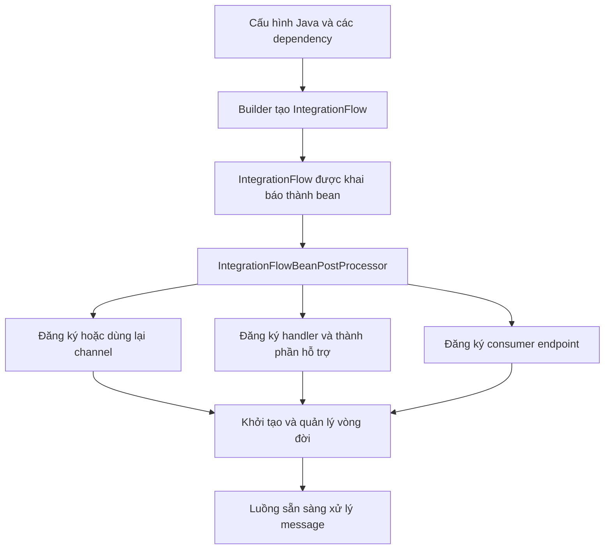

# DSL và bean registration

## 1. Mục tiêu và bối cảnh

Trong chương **DSL nâng cao** của module **SPRING_INTEGRATION_CORE**, hiểu cách đăng ký bean giúp bạn thiết kế flow có danh tính rõ ràng, chia sẻ đúng channel và sử dụng đúng các service do Spring quản lý. Kiến thức này cũng giúp giải thích những lỗi khởi động như trùng tên bean, thiếu dependency hoặc một channel tồn tại nhưng không có subscriber.

Java DSL mô tả luồng thông điệp bằng các lời gọi như `channel()`, `transform()`, `filter()`, `handle()` và `aggregate()`. Phía sau chuỗi lời gọi ấy là các đối tượng Spring Integration thực: `MessageChannel`, handler và endpoint. Chúng cần được đăng ký, khởi tạo và quản lý vòng đời trong application context để xử lý message.

Sau bài học, bạn có thể:

- Phân biệt việc xây dựng một `IntegrationFlow` với việc đưa flow vào Spring container.
- Giải thích vai trò của `IntegrationFlowBeanPostProcessor` trong đăng ký các thành phần DSL.
- Dùng tên bean, endpoint ID và alias handler đúng mục đích.
- Chia sẻ channel giữa các flow mà không tạo hai đối tượng khác nhau cùng tên.
- Khai báo `IntegrationComponentSpec` như một `FactoryBean` và inject sản phẩm của nó.
- Kiểm tra bean đã đăng ký, trạng thái endpoint và đầu ra thực của flow.

Các ví dụ dùng Java 17 và Spring Integration 6.x, lấy API 6.5 làm mốc. Dự án cần `spring-integration-core` cùng các dependency Spring tương thích. Dự án Spring Boot có thể dùng `spring-boot-starter-integration` và để BOM của Boot quản lý phiên bản. Ví dụ đầy đủ sử dụng `AnnotationConfigApplicationContext` và `@EnableIntegration`, nên không phụ thuộc việc chạy một ứng dụng Boot. Phần kiểm thử minh họa dùng JUnit Jupiter.

## 2. Xây dựng flow và đăng ký flow là hai giai đoạn

### 2.1. Builder thu thập cấu hình

Xét một đoạn cấu hình:

```java
IntegrationFlow flow = IntegrationFlow.from("textInput")
        .<String, String>transform(String::strip)
        .channel(MessageChannels.queue("textResults", 20))
        .get();
```

Đoạn này dùng `org.springframework.integration.dsl.IntegrationFlow` và `MessageChannels`. Nó xây dựng đối tượng mô tả flow cùng các thành phần liên quan. Gọi `.get()` kết thúc builder; riêng thao tác đó không tìm application context để tự đăng ký flow.

Để flow tham gia ứng dụng, thông thường bạn trả nó từ một phương thức `@Bean`. Khi cần tạo và hủy flow ở runtime, sử dụng `IntegrationFlowContext` như mục 11. Một flow chỉ nằm trong biến cục bộ chưa có đầy đủ hạ tầng khởi tạo, subscription và quản lý vòng đời của một flow được container quản lý.

### 2.2. Post-processor đưa các thành phần vào container

`IntegrationFlowBeanPostProcessor` xử lý các bean `IntegrationFlow`, nhận diện thành phần và đăng ký chúng vào bean factory khi cần. DSL sử dụng các lớp Spring Integration trực tiếp, không sinh một cấu hình XML trung gian. Xem [cơ chế Java DSL](https://docs.spring.io/spring-integration/reference/dsl.html).



Đây là mô hình khái niệm, không phải cam kết mọi bean được tạo đúng theo một thứ tự tuyến tính cố định. Dependency injection, `FactoryBean` và lifecycle có thể làm quá trình khởi tạo gồm nhiều bước phụ thuộc nhau.

### 2.3. Lời gọi DSL không phải lời gọi xử lý từng message

Lambda cấu hình như `endpoint -> endpoint.id("normalizeOrder")` được dùng để thiết lập endpoint. Logic như `String::strip` được endpoint gọi khi xử lý payload.

Tương tự, đối tượng `IntegrationFlow` không phải một phương thức nghiệp vụ nhận payload rồi duyệt chuỗi builder mỗi lần có message. Các channel và endpoint đã được kết nối sẽ thực hiện công việc ở runtime. Để gửi dữ liệu, sử dụng channel đầu vào hoặc gateway phù hợp.

## 3. Phân biệt các đối tượng được đăng ký

Một dòng DSL có thể kéo theo nhiều đối tượng có vai trò khác nhau:

| Thành phần | Trách nhiệm |
| --- | --- |
| Bean `IntegrationFlow` | Chứa cấu hình và tập thành phần của một flow; hỗ trợ điều khiển vòng đời flow |
| `MessageChannel` | Kết nối producer với consumer theo ngữ nghĩa của loại channel |
| `MessageHandler` | Thực hiện biến đổi, định tuyến hoặc logic xử lý message |
| Consumer endpoint | Gắn handler với channel, quản lý subscription hoặc polling và lifecycle |
| Service nghiệp vụ | Chứa logic miền mà handler hoặc transformer gọi tới |
| Spec DSL | Builder cấu hình một thành phần; nhiều spec có vai trò `FactoryBean` |

Ví dụ, `transform()` có thể tạo một `MessageTransformingHandler` và một `ConsumerEndpointFactoryBean`. Với đầu vào là `SubscribableChannel`, factory tạo endpoint dạng event-driven; với `PollableChannel`, endpoint thường là polling consumer và cần cấu hình poller tương ứng. Xem [API `ConsumerEndpointFactoryBean`](https://docs.spring.io/spring-integration/docs/6.5.0/api/org/springframework/integration/config/ConsumerEndpointFactoryBean.html).

Điều này giải thích vì sao các thao tác sau khác nhau:

- Gọi service để kiểm tra logic chuẩn hóa.
- Gửi message qua channel để kiểm tra toàn bộ flow.
- Dừng endpoint để ngừng nhận message tại một điểm.
- Tra cứu handler để xem thành phần xử lý đứng sau endpoint.

Không nên dùng tên của một service thay cho endpoint ID, hoặc lấy bean của flow rồi ép kiểu nó thành `MessageHandler`.

## 4. Ví dụ đầy đủ: flow dùng channel và service đã được quản lý

Ứng dụng nhận lệnh chuẩn hóa mã đơn. Service dùng một bean cấu hình `NormalizationRules`, tạo kết quả gồm mã chuẩn hóa và mã hệ thống nguồn. Queue đầu ra được khai báo qua một spec DSL để minh họa cơ chế `FactoryBean`.

```java
import java.util.Locale;
import java.util.Objects;

import org.springframework.beans.factory.annotation.Qualifier;
import org.springframework.context.annotation.Bean;
import org.springframework.context.annotation.Configuration;
import org.springframework.integration.channel.DirectChannel;
import org.springframework.integration.channel.QueueChannel;
import org.springframework.integration.config.EnableIntegration;
import org.springframework.integration.dsl.IntegrationFlow;
import org.springframework.integration.dsl.MessageChannels;
import org.springframework.integration.dsl.QueueChannelSpec;

@Configuration(proxyBeanMethods = false)
@EnableIntegration
public class BeanRegistrationConfig {

    public record OrderCommand(String orderId) {
    }

    public record NormalizedOrder(String orderId, String sourceSystem) {
    }

    public record NormalizationRules(String sourceSystem) {
    }

    public static class OrderNormalizer {

        private final NormalizationRules rules;

        public OrderNormalizer(NormalizationRules rules) {
            this.rules = Objects.requireNonNull(rules);
        }

        public NormalizedOrder normalize(OrderCommand command) {
            if (command.orderId() == null || command.orderId().isBlank()) {
                throw new IllegalArgumentException("orderId không được rỗng");
            }
            return new NormalizedOrder(
                    command.orderId().strip().toUpperCase(Locale.ROOT),
                    rules.sourceSystem());
        }
    }

    @Bean
    public NormalizationRules normalizationRules() {
        return new NormalizationRules("ORDER-SERVICE");
    }

    @Bean
    public OrderNormalizer orderNormalizer(NormalizationRules rules) {
        return new OrderNormalizer(rules);
    }

    @Bean
    public DirectChannel orderRequests() {
        return new DirectChannel();
    }

    @Bean
    public QueueChannelSpec normalizedOrders() {
        return MessageChannels.queue(100);
    }

    @Bean
    public IntegrationFlow orderFlow(
            @Qualifier("orderRequests") DirectChannel input,
            @Qualifier("normalizedOrders") QueueChannel output,
            OrderNormalizer normalizer) {

        return IntegrationFlow.from(input)
                .transform(normalizer, "normalize",
                        endpoint -> endpoint.id("normalizeOrder"))
                .channel(output)
                .get();
    }
}
```

Tại đây:

- `orderFlow` là tên bean của flow, mặc định lấy từ tên phương thức `@Bean`.
- `orderRequests` là một `DirectChannel` được khai báo tường minh.
- `normalizedOrders` là tên mà ứng dụng dùng để lấy `QueueChannel` do spec tạo ra.
- `orderNormalizer` là service được inject vào flow; service nhận rules qua constructor.
- `normalizeOrder` là ID của consumer endpoint được cấu hình trong `transform()`.

Với payload `new OrderCommand(" od-013 ")`, output mong đợi là `new NormalizedOrder("OD-013", "ORDER-SERVICE")`.

Queue có dung lượng 100 phục vụ bài học và kiểm thử. Ứng dụng thực cần consumer hoặc cơ chế nhận dữ liệu tương ứng, cùng chính sách gửi phù hợp khi queue có thể đầy.

### 4.1. Điều gì diễn ra khi tạo application context?

Spring giải quyết dependency của các phương thức `@Bean`, tạo service và channel cần thiết, rồi xử lý flow để đăng ký handler và endpoint. Khi context đã khởi động thành công với cấu hình mặc định, endpoint sẽ đăng ký vào channel đầu vào để nhận message.

Việc `orderNormalizer` đã được container tạo giúp flow sử dụng đúng dependency của service. Việc `orderRequests` được inject giúp producer và endpoint làm việc với cùng channel, thay vì hai channel có cấu hình giống nhau nhưng khác đối tượng.

## 5. Tên flow, channel, endpoint và handler

### 5.1. ID phụ thuộc vị trí cấu hình

Từ `id` có thể xuất hiện ở nhiều spec, nhưng đối tượng được đặt tên phụ thuộc loại spec:

```java
MessageChannels.direct("orderRequests")
```

Đoạn trên đặt ID của channel đang được xây dựng.

```java
.transform(normalizer, "normalize",
        endpoint -> endpoint.id("normalizeOrder"))
```

Ở đây callback cấu hình consumer endpoint. ID không đổi tên service `orderNormalizer` và không đổi tên channel đầu vào.

Trong cấu hình thông thường của ví dụ, Spring Integration cung cấp alias `normalizeOrder.handler` để tra cứu handler liên quan. Handler có thể có tên bean được sinh tự động và alias thuận tiện này cùng trỏ tới nó. Cách đăng ký endpoint và alias được thể hiện trong [mã nguồn `IntegrationFlowBeanPostProcessor` 6.5](https://github.com/spring-projects/spring-integration/blob/v6.5.0/spring-integration-core/src/main/java/org/springframework/integration/dsl/context/IntegrationFlowBeanPostProcessor.java).

### 5.2. Các tên hữu ích trong ví dụ

| Tên tra cứu | Đối tượng hoặc vai trò |
| --- | --- |
| `orderFlow` | Bean flow |
| `orderRequests` | Channel đầu vào |
| `normalizedOrders` | Queue đầu ra, tức sản phẩm của spec `FactoryBean` |
| `orderNormalizer` | Service nghiệp vụ |
| `normalizeOrder` | Consumer endpoint, sản phẩm của endpoint factory |
| `normalizeOrder.handler` | Alias tới handler của endpoint trong cấu hình này |

Một alias không tạo thêm một handler mới. Khi kiểm kê bean để điều tra lỗi, cần phân biệt nhiều tên của cùng đối tượng với nhiều đối tượng thực sự khác nhau.

### 5.3. Tên sinh tự động là chi tiết cấu trúc

DSL có thể tạo `DirectChannel` giữa các endpoint mà bạn không khai báo channel tường minh. Tên channel không đặt ID thường theo dạng:

```text
<flowBeanName>.channel#<index>
```

Thêm hoặc tách một endpoint có thể làm các chỉ số thay đổi. Tên sinh tự động hữu ích khi đọc log hay chẩn đoán context, nhưng không phù hợp làm địa chỉ ổn định cho producer hoặc bài kiểm thử lâu dài. Hãy đặt tên tường minh cho ranh giới flow cần dùng bên ngoài.

## 6. Bốn cách đưa channel vào flow

| Cách viết | Hành vi cần hiểu |
| --- | --- |
| `.channel("someChannel")` | Tham chiếu channel theo tên; nếu chưa có bean, DSL có thể tạo `DirectChannel` với tên đó |
| `.channel(existingChannel)` | Dùng đối tượng channel được cung cấp, thường là bean đã inject |
| `.channel(MessageChannels.queue("results", 20))` | Khai báo một channel inline mới qua spec |
| `@Bean` trả về `MessageChannel` hoặc channel spec | Khai báo một điểm dùng chung có dependency và danh tính rõ ràng |

`IntegrationFlow.from("someInput")` cũng có thể tạo channel đầu vào nếu tên đó chưa tồn tại. Xem [cấu hình MessageChannel bằng Java DSL](https://docs.spring.io/spring-integration/reference/dsl/java-channels.html).

### 6.1. Tham chiếu theo tên không chứng minh channel đã tồn tại từ trước

Giả sử flow viết:

```java
.channel("sharedQeue")
```

Nếu tên mong muốn thực tế là `sharedQueue`, lỗi gõ có thể dẫn đến một channel mới được tạo thay vì báo thiếu bean ngay tại chỗ tham chiếu. Việc context khởi động thành công chưa chứng minh topology đã đúng. Channel mới cũng có thể không có consumer hoặc mang ngữ nghĩa khác loại channel dự kiến.

Đối với ranh giới quan trọng, khai báo bean tường minh rồi inject qua `@Qualifier` giúp tên và kiểu dependency được kiểm tra khi Spring tạo flow.

### 6.2. Cùng chuỗi ID không làm hai builder trở thành một channel

Đây là một ví dụ cấu hình sai, dùng để chỉ ra việc tạo hai đối tượng inline trùng tên:

```java
@Bean
public IntegrationFlow badProducer() {
    return IntegrationFlow.from("rawInput")
            .<String, String>transform(String::strip)
            .channel(MessageChannels.direct("sharedOrders"))
            .get();
}

@Bean
public IntegrationFlow badConsumer() {
    return IntegrationFlow.from(MessageChannels.direct("sharedOrders"))
            .handle(message -> {
                System.out.println(message.getPayload());
            })
            .get();
}
```

Mỗi lần gọi `MessageChannels.direct("sharedOrders")` tạo một spec và channel mới. Đây không phải hai cách lấy lại một singleton theo tên. Việc đăng ký có thể thất bại vì hai đối tượng khác nhau yêu cầu cùng bean name.

Sửa bằng cách có một định nghĩa channel và inject cùng bean vào hai flow. Các bean sau thuộc một cấu hình độc lập có `@Configuration` và `@EnableIntegration`:

```java
@Bean
public DirectChannel sharedOrders() {
    return new DirectChannel();
}

@Bean
public IntegrationFlow producerFlow(
        @Qualifier("sharedOrders") DirectChannel shared) {

    return IntegrationFlow.from("rawInput")
            .<String, String>transform(String::strip)
            .channel(shared)
            .get();
}

@Bean
public IntegrationFlow consumerFlow(
        @Qualifier("sharedOrders") DirectChannel shared) {

    return IntegrationFlow.from(shared)
            .<String, String>transform(value ->
                    value.toUpperCase(Locale.ROOT))
            .channel(MessageChannels.queue("handoffResults", 20))
            .get();
}
```

Các import cần thiết đã có trong ví dụ đầy đủ. Hai flow dùng chung một channel được quản lý. Loại channel vẫn quyết định cách phân phối: thêm nhiều consumer vào `DirectChannel` không tự biến nó thành broadcast. Nếu mọi subscriber đều cần nhận mỗi message, phải chọn channel có ngữ nghĩa publish–subscribe phù hợp.

## 7. `IntegrationComponentSpec` là `FactoryBean`

### 7.1. Giữ spec trong định nghĩa bean, inject sản phẩm vào flow

Trong ví dụ đầy đủ:

```java
@Bean
public QueueChannelSpec normalizedOrders() {
    return MessageChannels.queue(100);
}
```

Spec vừa là builder, vừa tham gia cơ chế `FactoryBean`. Container quản lý spec và cung cấp sản phẩm `QueueChannel` cho nơi cần channel. Vì vậy, chữ ký flow là:

```java
@Bean
public IntegrationFlow orderFlow(
        @Qualifier("orderRequests") DirectChannel input,
        @Qualifier("normalizedOrders") QueueChannel output,
        OrderNormalizer normalizer) {
    // Kết nối các bean đã được container giải quyết.
    return IntegrationFlow.from(input)
            .transform(normalizer, "normalize",
                    endpoint -> endpoint.id("normalizeOrder"))
            .channel(output)
            .get();
}
```

Không cần ép kiểu spec thành channel hoặc tự gọi `getObject()` để lấy sản phẩm. API yêu cầu để framework quản lý lifecycle của spec khi nó được dùng làm bean definition. Xem [API `IntegrationComponentSpec`](https://docs.spring.io/spring-integration/docs/6.5.0/api/org/springframework/integration/dsl/IntegrationComponentSpec.html).

### 7.2. Tránh lấy sản phẩm bằng lời gọi thủ công trong cấu hình

Đoạn sau không phải cách khai báo bean nên dùng:

```java
@Bean
public QueueChannel manuallyUnwrappedChannel() {
    return MessageChannels.queue(100).getObject();
}
```

Nó lấy sản phẩm từ spec ngay trong cấu hình thay vì để spec tham gia quy trình quản lý dự kiến. Các spec phức tạp còn có thành phần hỗ trợ cần đăng ký và lifecycle liên quan. Cách rõ ràng là trả spec nguyên vẹn, hoặc khai báo trực tiếp `new QueueChannel(100)` nếu chỉ cần một channel thông thường.

### 7.3. Tra cứu sản phẩm và factory khi chẩn đoán

Theo quy ước `FactoryBean` của Spring, tên thông thường trả sản phẩm, còn tiền tố `&` lấy factory:

```java
QueueChannel queue = context.getBean(
        "normalizedOrders", QueueChannel.class);

QueueChannelSpec factory = context.getBean(
        "&normalizedOrders", QueueChannelSpec.class);
```

Tương tự, `normalizeOrder` cung cấp endpoint, còn `&normalizeOrder` cho phép kiểm tra `ConsumerEndpointFactoryBean` đứng sau nó. Đây là thao tác chẩn đoán, không phải yêu cầu flow nghiệp vụ phải phụ thuộc trực tiếp vào các factory. Xem [cơ chế mở rộng container và `FactoryBean`](https://docs.spring.io/spring-framework/reference/core/beans/factory-extension.html).

## 8. `@Configuration`, dependency injection và danh tính đối tượng

### 8.1. Điều thay đổi khi `proxyBeanMethods = false`

Trong cấu hình đầy đủ, các phương thức `@Bean` nhận dependency qua tham số. Cách này hoạt động rõ ràng với:

```java
@Configuration(proxyBeanMethods = false)
```

Ở chế độ này, một lời gọi Java trực tiếp tới phương thức khác trong cùng lớp không được proxy để lấy singleton từ container. Ví dụ sau tạo nguy cơ dùng một channel khác đối tượng với bean đã đăng ký:

```java
@Bean
public DirectChannel commands() {
    return new DirectChannel();
}

@Bean
public IntegrationFlow wrongFlow() {
    return IntegrationFlow.from(commands())
            .handle(message -> {
                System.out.println(message.getPayload());
            })
            .get();
}
```

Trong lớp có `proxyBeanMethods = false`, `commands()` ở đây là lời gọi phương thức thông thường và tạo thêm instance. Thay vào đó, inject `@Qualifier("commands") DirectChannel commands` vào `wrongFlow()` rồi dùng tham số.

Với full `@Configuration` có proxy, lời gọi giữa các phương thức `@Bean` thường được chuyển qua container. Dù vậy, parameter injection giúp cấu hình không phụ thuộc vào cách proxy lời gọi nội bộ. Riêng spec DSL đã khai báo như bean nên được dùng qua sản phẩm inject, theo hướng dẫn ở mục 7. Xem [full configuration và lite mode của Spring](https://docs.spring.io/spring-framework/reference/core/beans/java/basic-concepts.html).

### 8.2. Một helper trả flow không tự tạo thêm bean

Có thể tách logic xây flow vào helper để tái sử dụng, nhưng helper không có `@Bean` và không được đăng ký bằng `IntegrationFlowContext` thì chỉ trả đối tượng Java. Nơi gọi helper chịu trách nhiệm đưa kết quả vào container.

Ngược lại, nếu cùng một helper tạo thành phần có ID cố định và được gọi để đăng ký nhiều flow, các ID ấy vẫn có thể trùng trong cùng context. Đổi tên biến Java hoặc đổi tên phương thức helper không tạo namespace riêng cho mọi endpoint bên trong.

### 8.3. Không phụ thuộc ngược vào bean inline chưa được flow tạo

Các bean inline được phát hiện trong quá trình xử lý flow. Nếu chính phương thức tạo flow lại yêu cầu inject một channel nội bộ chỉ được flow đó sinh ra, dependency có thể trở thành vòng khởi tạo.

Thay vì dùng `@DependsOn` để che quan hệ không rõ ràng, hãy đưa channel cần dùng chung thành một `@Bean` tường minh. Dependency khi đó là channel tới flow, phù hợp với cách cấu hình được xây dựng.

## 9. Service, proxy và scope trong flow

### 9.1. Dùng service từ container khi cần dependency và advice

Cấu hình sau dùng service đã inject:

```java
.transform(normalizer, "normalize")
```

Hoặc có thể dùng lambda gọi service đó:

```java
.<OrderCommand, NormalizedOrder>transform(normalizer::normalize)
```

Ở cả hai trường hợp, `normalizer` phải là tham chiếu được cấp từ container như trong ví dụ đầy đủ. Nếu service được proxy bằng AOP, lời gọi qua tham chiếu proxy là cơ sở để advice áp dụng theo cấu hình AOP thực tế.

Không nên kết luận rằng mọi đối tượng được tạo bằng `new` bên trong một lambda đều tự trở thành service bean. DSL có cơ chế đăng ký các thành phần mà nó nhận diện, nhưng không thay thế việc thiết kế dependency cho mọi đối tượng nghiệp vụ tùy ý được lambda giữ tham chiếu.

Nếu cần `@Transactional`, caching hoặc advice khác trên service, hãy đăng ký và inject service đúng cách. Bean registration chỉ cung cấp điều kiện quản lý; nó không tự tạo transaction manager, không tự bật mọi annotation processing và không giải quyết các giới hạn như self-invocation của proxy AOP.

### 9.2. Tái sử dụng service khác với tái sử dụng handler

Một service chuẩn hóa không giữ trạng thái riêng cho từng message có thể được nhiều flow gọi tới. Mỗi flow có thể tạo endpoint và handler riêng, cùng dùng service đó.

Trong khi đó, handler có thể giữ cấu hình `outputChannel` hoặc thuộc tính liên quan đến vị trí trong flow. Chia sẻ cùng một handler instance cho nhiều vị trí có đường output khác nhau có thể không hợp lệ. Vì vậy, nên chia sẻ logic nghiệp vụ qua service; chỉ chia sẻ handler khi đã xác định API và cấu hình của handler hỗ trợ cách dùng đó.

### 9.3. Singleton không có nghĩa là an toàn với mọi truy cập đồng thời

Bean mặc định có scope singleton trong container. Nếu nhiều sender hoặc executor cùng gọi endpoint, service singleton có thể nhận nhiều lời gọi đồng thời. Không lưu payload hiện tại vào field của service để truyền trạng thái giữa các bước.

`OrderNormalizer` ở ví dụ chỉ giữ rules bất biến và dùng biến cục bộ khi xử lý, nên không cần field riêng cho từng đơn. Nếu cần trạng thái nhóm message, nên chọn thành phần như aggregator và message store với quy tắc tương quan rõ ràng.

### 9.4. Prototype được inject vào singleton không tự tạo mới cho từng message

Nếu một dependency prototype được inject khi flow singleton được tạo, flow giữ instance đã được cấp lúc đó. Việc khai báo prototype không mặc nhiên khiến mỗi message nhận một instance mới.

Khi thật sự cần đối tượng mới theo từng lần xử lý, phải có cơ chế lấy instance tại runtime hoặc thay đổi thiết kế trạng thái. Ngoài ra, lifecycle hủy của prototype có đặc điểm riêng, nên không dùng prototype chỉ để né lỗi trùng tên bean. Xem [bean scope và dependency prototype trong singleton](https://docs.spring.io/spring-framework/reference/core/beans/factory-scopes.html).

## 10. Đăng ký bean và khởi động endpoint

Một bean có thể đã tồn tại nhưng endpoint chưa chạy. Ví dụ:

```java
.transform(normalizer, "normalize", endpoint -> endpoint
        .id("normalizeOrder")
        .autoStartup(false))
```

Endpoint được tạo trong context nhưng không tự khởi động. Có thể lấy endpoint để điều khiển khi ứng dụng sẵn sàng:

```java
AbstractEndpoint endpoint = context.getBean(
        "normalizeOrder", AbstractEndpoint.class);

endpoint.start();
```

Đoạn này dùng `org.springframework.integration.endpoint.AbstractEndpoint`. Nó chỉ minh họa một cấu hình thay thế; cấu hình đầy đủ ở mục 4 dùng auto-startup mặc định.

Các thao tác có ý nghĩa khác nhau:

| Thao tác | Tác động cần hiểu |
| --- | --- |
| Khai báo bean | Đưa định nghĩa và đối tượng vào cơ chế quản lý container |
| `start()` endpoint | Bắt đầu subscription hoặc polling theo loại endpoint |
| `stop()` endpoint hoặc flow | Dừng hoạt động tương ứng, không đồng nghĩa xóa bean |
| Hủy registration động | Gỡ flow động cùng các thành phần phụ thuộc mà registration quản lý |
| Đóng application context | Thực hiện quy trình dừng và hủy các bean được quản lý |

Với `DirectChannel`, gửi message khi không còn subscriber hoạt động có thể gây lỗi phân phối. Với queue, message có thể được nhận vào hàng chờ nhưng chưa có consumer chạy để xử lý. Do đó, việc `containsBean(...)` trả `true` chưa chứng minh flow đã sẵn sàng theo yêu cầu nghiệp vụ.

`IntegrationFlow` được quản lý cũng có thể hỗ trợ điều khiển lifecycle của tập thành phần trong flow. Khi có channel hoặc tài nguyên dùng chung, cần xác định phạm vi điều khiển trước khi dừng một flow để tránh hiểu sai rằng mọi thành phần dùng chung đều chỉ thuộc flow đó.

## 11. Đăng ký flow động bằng `IntegrationFlowContext`

### 11.1. Khi cấu hình cần xuất hiện ở runtime

Nếu ứng dụng cần tạo một flow theo cấu hình tenant hoặc một kết nối được bổ sung sau khi khởi động, sử dụng `IntegrationFlowContext`. API này đăng ký flow cùng các thành phần liên quan và trả handle để điều khiển lifecycle. Xem [Dynamic and Runtime Integration Flows](https://docs.spring.io/spring-integration/reference/dsl/java-runtime-flows.html).

Ví dụ sau giả sử `context` là application context đã có `@EnableIntegration`. Các import bổ sung là `IntegrationFlowContext`, `Message`, `GenericMessage` và `MessageChannel` theo package trong phần kiểm thử:

```java
IntegrationFlowContext flowContext =
        context.getBean(IntegrationFlowContext.class);

QueueChannel tenantResults = new QueueChannel(20);

IntegrationFlow tenantFlow = IntegrationFlow.from(new DirectChannel())
        .<String, String>transform(
                value -> value.strip().toUpperCase(Locale.ROOT),
                endpoint -> endpoint.id("normalize"))
        .channel(tenantResults)
        .get();

var registration = flowContext.registration(tenantFlow)
        .id("tenantAFlow")
        .useFlowIdAsPrefix()
        .register();

try {
    registration.getInputChannel().send(
            new GenericMessage<>(" od-099 "));
    Message<?> result = tenantResults.receive(1000);
    if (result == null) {
        throw new IllegalStateException("Chưa nhận được kết quả của tenant A");
    }
    System.out.println(result.getPayload());
}
finally {
    registration.destroy();
}
```

Kết quả mong đợi là `OD-099`. Ví dụ đăng ký, gửi và hủy ngay trong một khối để thể hiện đầy đủ vòng đời. Trong ứng dụng có flow tồn tại lâu, thành phần quản lý cần giữ registration cho đến khi thực sự muốn dừng và gỡ flow.

`new DirectChannel()` và `tenantResults` ở đây là các thành phần được đưa trực tiếp vào flow để API đăng ký quản lý. Đây là trường hợp khác với một đối tượng nghiệp vụ tùy ý được tạo trong thân lambda xử lý message.

### 11.2. Flow ID và prefix có mục đích riêng

`id("tenantAFlow")` định danh registration và phải duy nhất trong context. `useFlowIdAsPrefix()` giúp tránh trùng ID thành phần khi đăng ký nhiều bản của cùng cấu trúc flow. Với endpoint `normalize` trong ví dụ, tên endpoint có prefix là `tenantAFlow.normalize` và alias handler tương ứng là `tenantAFlow.normalize.handler`.

Phải có flow ID khi dùng `useFlowIdAsPrefix()`. Không nên suy ra prefix sẽ tự đổi tên mọi bean đã tồn tại hoặc cô lập các channel mà flow tham chiếu theo tên. Nếu hai flow cố ý inject cùng một channel hay service bên ngoài, chúng vẫn chia sẻ tài nguyên đó.

### 11.3. Giữ rõ quyền quản lý tài nguyên

Registration có `start()`, `stop()` và `destroy()`. `stop()` giữ registration để có thể khởi động lại; `destroy()` gỡ registration và các bean phụ thuộc được quản lý cho nó. Xem [API `IntegrationFlowRegistration`](https://docs.spring.io/spring-integration/docs/6.5.0/api/org/springframework/integration/dsl/context/IntegrationFlowContext.IntegrationFlowRegistration.html).

Builder còn có `addBean(...)` để đăng ký thành phần hỗ trợ như một dependency của flow động. Chỉ đưa vào đó những đối tượng có vòng đời mà registration thực sự nên quản lý. Service hoặc connection factory singleton dùng chung với nhiều flow cần được thiết kế ownership riêng, thay vì được coi là tài nguyên riêng của một flow bất kỳ.

Ví dụ tenant ở trên tự tạo input và output cho mỗi registration. Khi dùng một hàm để tạo nhiều flow tương tự, cần tạo các thành phần riêng cho mỗi instance hoặc inject rõ những thành phần chủ đích dùng chung.

## 12. Kiểm thử bean registration và hành vi thực

### 12.1. Kiểm tra endpoint, handler và sản phẩm của factory

Bài kiểm thử sau sử dụng cấu hình đầy đủ ở mục 4:

```java
import org.junit.jupiter.api.Test;
import org.springframework.context.annotation.AnnotationConfigApplicationContext;
import org.springframework.integration.channel.QueueChannel;
import org.springframework.integration.config.ConsumerEndpointFactoryBean;
import org.springframework.integration.dsl.IntegrationFlow;
import org.springframework.integration.dsl.QueueChannelSpec;
import org.springframework.integration.endpoint.AbstractEndpoint;
import org.springframework.messaging.Message;
import org.springframework.messaging.MessageChannel;
import org.springframework.messaging.MessageHandler;
import org.springframework.messaging.support.MessageBuilder;

import static org.junit.jupiter.api.Assertions.*;

class BeanRegistrationTest {

    @Test
    void registersComponentsAndProcessesAnOrder() {
        try (var context = new AnnotationConfigApplicationContext(
                BeanRegistrationConfig.class)) {

            assertNotNull(context.getBean("orderFlow", IntegrationFlow.class));

            MessageChannel input =
                    context.getBean("orderRequests", MessageChannel.class);
            QueueChannel output =
                    context.getBean("normalizedOrders", QueueChannel.class);

            assertNotNull(context.getBean(
                    "&normalizedOrders", QueueChannelSpec.class));

            AbstractEndpoint endpoint = context.getBean(
                    "normalizeOrder", AbstractEndpoint.class);
            assertTrue(endpoint.isRunning());

            MessageHandler handler = context.getBean(
                    "normalizeOrder.handler", MessageHandler.class);
            ConsumerEndpointFactoryBean endpointFactory = context.getBean(
                    "&normalizeOrder", ConsumerEndpointFactoryBean.class);
            assertSame(handler, endpointFactory.getHandler());

            Message<?> request = MessageBuilder.withPayload(
                            new BeanRegistrationConfig.OrderCommand(" od-013 "))
                    .setHeader("requestId", "req-013")
                    .build();

            assertTrue(input.send(request));

            Message<?> result = output.receive(1000);
            assertNotNull(result);
            assertEquals(
                    new BeanRegistrationConfig.NormalizedOrder(
                            "OD-013", "ORDER-SERVICE"),
                    result.getPayload());
            assertEquals("req-013", result.getHeaders().get("requestId"));
            assertNull(output.receive(0));
        }
    }
}
```

Kiểm tra đầu ra chứng minh endpoint đã được nối vào channel và service có rules phù hợp. Chỉ kiểm tra tên bean tồn tại sẽ bỏ sót trường hợp endpoint chưa chạy hoặc topology không đưa kết quả tới đúng output.

Trong ví dụ đồng bộ này, việc gửi thành công đưa kết quả tới queue ngay trong đường gọi. `receive(1000)` vẫn có thời gian chờ hữu hạn để bài kiểm thử không treo khi cấu hình sai.

### 12.2. Kiểm tra gỡ flow động

Có thể thêm method sau vào lớp kiểm thử. Cần bổ sung import cho `Locale`, `DirectChannel`, `IntegrationFlowContext` và `GenericMessage`:

```java
@Test
void removesDynamicFlowAndKeepsTheStaticFlow() {
    try (var context = new AnnotationConfigApplicationContext(
            BeanRegistrationConfig.class)) {

        IntegrationFlowContext flowContext =
                context.getBean(IntegrationFlowContext.class);
        QueueChannel output = new QueueChannel(10);

        IntegrationFlow dynamicFlow = IntegrationFlow.from(new DirectChannel())
                .<String, String>transform(
                        value -> value.strip().toUpperCase(Locale.ROOT),
                        endpoint -> endpoint.id("normalize"))
                .channel(output)
                .get();

        var registration = flowContext.registration(dynamicFlow)
                .id("tenantAFlow")
                .useFlowIdAsPrefix()
                .register();

        try {
            assertTrue(context.containsBean("tenantAFlow.normalize"));
            assertTrue(registration.getInputChannel().send(
                    new GenericMessage<>(" od-099 ")));

            Message<?> result = output.receive(1000);
            assertNotNull(result);
            assertEquals("OD-099", result.getPayload());
        }
        finally {
            registration.destroy();
        }

        assertFalse(context.containsBean("tenantAFlow"));
        assertFalse(context.containsBean("tenantAFlow.normalize"));
        assertTrue(context.containsBean("orderFlow"));
        assertTrue(context.getBean(
                "normalizeOrder", AbstractEndpoint.class).isRunning());
    }
}
```

Bài kiểm thử xác nhận flow động hoạt động trước khi bị gỡ và việc gỡ không xóa flow tĩnh độc lập. Khi có tài nguyên dùng chung, cần thêm kiểm tra phù hợp với ownership của tài nguyên đó.

### 12.3. Những kiểm tra bổ sung có giá trị

| Tình huống | Điều cần xác nhận |
| --- | --- |
| Hai flow dùng chung channel | Chúng dùng cùng bean và message đi qua đúng ranh giới |
| Hai inline spec đặt cùng ID | Cấu hình xung đột được phát hiện khi tạo context |
| Endpoint có `autoStartup(false)` | Bean tồn tại nhưng chưa chạy; chỉ xử lý sau khi khởi động |
| Inject sản phẩm spec | Dependency có kiểu channel thực và nhận đúng cấu hình dung lượng |
| Hai registration cùng cấu trúc | ID thành phần không trùng khi dùng prefix phù hợp |
| Gỡ một registration | Thành phần riêng được gỡ, tài nguyên dùng chung vẫn đúng vòng đời |

Không nên kiểm tra chính xác mọi tên bean sinh tự động hoặc số lượng tổng bean của context. Thêm một endpoint hoặc nâng phiên bản có thể thay đổi cấu trúc nội bộ mà không làm sai hợp đồng của flow.

## 13. Chẩn đoán lỗi và quy tắc thiết kế

| Hiện tượng | Hướng kiểm tra |
| --- | --- |
| Trùng tên khi khởi động | Tìm nhiều định nghĩa hoặc nhiều instance inline cùng yêu cầu một bean name |
| Không inject được `QueueChannel` | Kiểm tra kiểu trả về, tên bean, qualifier và việc spec được khai báo đúng |
| Có channel nhưng không nhận được message | Kiểm tra producer có giữ đúng instance, endpoint có chạy và có subscription phù hợp |
| Flow không xuất hiện trong context | Kiểm tra đối tượng chỉ được build cục bộ hay đã được đăng ký thành bean |
| Thiếu poller sau khi đổi channel | Kiểm tra consumer chuyển sang đầu vào `PollableChannel` và cấu hình polling |
| AOP trên service không áp dụng | Kiểm tra flow dùng bean/proxy nào, cách gọi service và hạ tầng AOP đã được cấu hình |
| Runtime registration thứ hai thất bại | Kiểm tra flow ID, endpoint ID cố định và phạm vi tác dụng của prefix |
| Khởi tạo xuất hiện vòng dependency | Tìm dependency ngược từ phương thức tạo flow tới thành phần inline của chính flow |

Khi cần một component được nhiều nơi dùng tới, ưu tiên khai báo bean có tên và inject nó. Khi component chỉ có ý nghĩa nội bộ trong một flow, có thể khai báo inline và để DSL đăng ký. Đối với service nghiệp vụ, làm rõ dependency và scope trước khi cân nhắc cách viết lambda ngắn hơn.

Bean name là danh tính trong context; loại channel quyết định cách truyền message; endpoint lifecycle quyết định khi nào consumer hoạt động. Ba thông tin này cần được kiểm tra cùng nhau khi thiết kế hoặc điều tra một flow.

## 14. Bài thực hành mở rộng

1. Chạy cấu hình đầy đủ và kiểm tra các tên `orderFlow`, `orderRequests`, `normalizeOrder`, `normalizeOrder.handler` và `normalizedOrders` có vai trò gì. Dùng tiền tố `&` để phân biệt factory với sản phẩm khi chẩn đoán.
2. Tách producer và consumer thành hai flow dùng chung một `DirectChannel` được khai báo tường minh. Gửi message từ producer và xác nhận kết quả ở queue của consumer.
3. Trong một cấu hình thử nghiệm độc lập, tạo hai inline channel cùng ID để quan sát lỗi đăng ký. Sửa bằng một định nghĩa bean dùng chung.
4. Đổi endpoint chuẩn hóa sang `autoStartup(false)`. Xác nhận trạng thái trước và sau khi gọi `start()`, đồng thời phân biệt bean tồn tại với consumer đã hoạt động.
5. Đăng ký hai flow động có endpoint cục bộ đều tên `normalize`, đặt hai flow ID khác nhau và dùng prefix. Gỡ một registration rồi xác nhận flow còn lại vẫn xử lý được message.

Ở mỗi bài thực hành, xác định rõ đối tượng nào do container sở hữu, thành phần nào được dùng chung và tên nào được coi là ranh giới ổn định. Những quyết định đó giúp cấu hình DSL giữ đúng topology khi hệ thống có thêm transformer, router, aggregator hoặc gateway.
