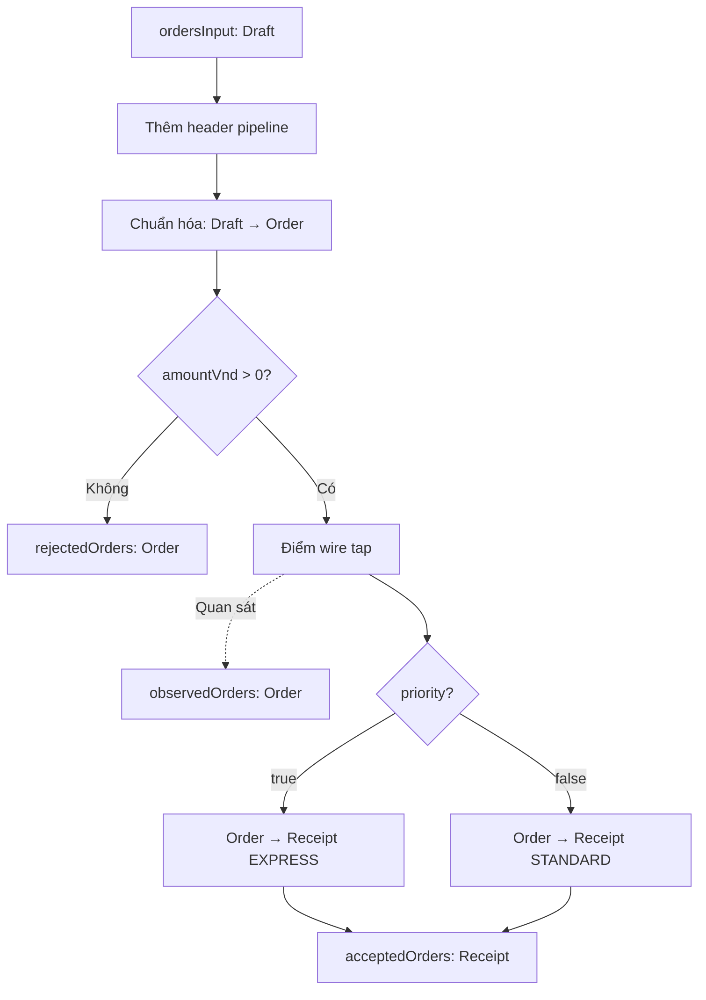

# Đọc flow DSL như một pipeline

## 1. Mục tiêu và phạm vi

Trong chương **DSL nâng cao** của module **SPRING_INTEGRATION_CORE**, việc đọc flow cần vượt qua mức nhận biết từng phương thức. Bạn cần theo dõi một thông điệp đi vào đâu, mang kiểu dữ liệu nào, qua điều kiện gì, tách sang nhánh nào và kết thúc bằng kết quả hay lỗi.

Bài học này dùng một pipeline tiếp nhận đơn hàng để kết nối các thành phần cốt lõi: `Message`, headers, channel, endpoint, transformer, filter, router và wire tap. Sau đó, bài mở rộng cách đọc sang gateway, splitter, aggregator và ranh giới bất đồng bộ.

Sau bài học, bạn có thể:

- Chuyển chuỗi DSL thành sơ đồ các bước và nhánh xử lý.
- Ghi lại kiểu payload và các headers quan trọng ở mỗi điểm.
- Phân biệt đường xử lý chính, nhánh quan sát, nhánh loại bỏ và đường lỗi.
- Phát hiện điểm đổi số lượng thông điệp hoặc lưu giữ trạng thái.
- Xác định ranh giới thread và nơi bên gọi nhận biết lỗi.
- Viết kiểm thử cho những đường đi đã suy ra từ cấu hình.

Ví dụ lấy **Java 17 và Spring Integration 6.5.0** làm mốc API. Khi áp dụng vào dự án dùng Spring Boot hoặc BOM, giữ bộ phiên bản Spring tương thích do dự án quản lý.

## 2. Đọc hai giai đoạn: khai báo cấu trúc và xử lý thông điệp

Xem đoạn DSL:

```java
IntegrationFlow.from("input")
        .transform(String.class, String::trim)
        .filter(String.class, text -> !text.isEmpty())
        .channel("output")
        .get();
```

Khi Spring chạy phương thức cấu hình, đoạn mã này mô tả các thành phần và quan hệ kết nối. Nó chưa lấy một chuỗi cụ thể rồi gọi `trim` ngay trong lúc xây dựng bean.

Khi có thông điệp được gửi tới `input`, các endpoint đã được đăng ký mới thực hiện xử lý theo cấu trúc đó. Java DSL tạo ra các bean channel, handler và endpoint trong application context. [Tài liệu Java DSL](https://docs.spring.io/spring-integration/reference/6.5/dsl.html).

Vì vậy:

- `from(...)` xác định nơi bắt đầu của cấu trúc flow.
- Các thao tác EIP mô tả những thành phần xử lý.
- `get()` hoàn tất việc xây dựng đối tượng cấu hình flow.
- `get()` ở cuối DSL không phải thao tác đợi một kết quả nghiệp vụ.

### 2.1. Vì sao gọi là pipeline?

Với đoạn thẳng, cách đọc tự nhiên là:

```text
Input → Chuẩn hóa → Kiểm tra → Xử lý → Output
```

Nhưng flow thực tế có thể rẽ nhánh, phát tới nhiều subscriber, chia một thông điệp thành nhiều phần hoặc gom nhiều phần thành một kết quả. Khi gặp những điểm đó, mở rộng hình pipeline thành đồ thị.

Mục đích của mô hình pipeline là giúp theo dõi sự chuyển giao. Nó không hàm ý mọi bước đều chạy cùng thread, mỗi đầu vào luôn có một đầu ra hoặc toàn bộ xử lý nằm trong một transaction.

### 2.2. Năm câu hỏi cho mỗi bước

| Câu hỏi | Điều cần ghi lại |
| --- | --- |
| Nhận gì? | Kiểu payload và headers cần dùng |
| Làm gì? | Biến đổi, kiểm tra, định tuyến, gọi service hay lưu trạng thái |
| Phát ra gì? | Kiểu payload mới và số lượng thông điệp |
| Đi đâu? | Bước kế tiếp, channel, nhánh loại hoặc reply |
| Chạy thế nào? | Đồng bộ, poller, executor, timeout và đường lỗi |

Không cần ghi mọi thuộc tính ngay từ đầu. Bắt đầu bằng đường dữ liệu, sau đó bổ sung điều kiện làm thay đổi đường đi và ranh giới thực thi.

## 3. Từ vựng để đọc DSL

Các endpoint thường được biểu diễn bằng động từ trong DSL. [Tài liệu DSL Basics](https://docs.spring.io/spring-integration/reference/6.5/dsl/java-basics.html).

| Thành phần DSL | Cách đọc khi theo một thông điệp |
| --- | --- |
| `from(...)` | Thông điệp bắt đầu từ đầu vào này |
| `enrichHeaders(...)` | Bổ sung hoặc cập nhật metadata theo cấu hình |
| `transform(...)` | Tạo biểu diễn dữ liệu cho bước tiếp theo |
| `filter(...)` | Cho phép tiếp tục hoặc xử lý theo đường bị loại |
| `handle(...)` | Gọi hành vi xử lý; cần xem hợp đồng trả kết quả |
| `route(...)` | Chọn một hoặc nhiều đích theo quy tắc router |
| `channel(...)` | Chuyển giao qua channel được chỉ định |
| `wireTap(...)` | Gửi thông điệp tại điểm quan sát tới nhánh phụ |
| `publishSubscribeChannel(...)` | Phát tới các subscriber |
| `split(...)` | Tạo nhiều thông điệp từ một đầu vào |
| `aggregate(...)` | Giữ các thông điệp liên quan cho tới khi có thể tạo kết quả nhóm |
| `gateway(...)` | Gửi yêu cầu tới flow khác và tiếp tục bằng phản hồi theo hợp đồng |
| `get()` | Kết thúc việc xây dựng cấu hình |

### 3.1. Lambda đang nhận payload hay toàn bộ Message?

Đừng suy luận chỉ từ tên biến `message` hoặc `m`. Với nhiều overload, lambda nhận payload.

```java
.transform(String.class, text -> text.trim())
```

Lambda này nhận `String`. Nếu cần cả payload và headers, chọn overload phù hợp. Ví dụ khi gọi handler:

```java
.handle(
        Order.class,
        (order, headers) -> new Receipt(
                order.id(),
                String.valueOf(headers.get("lane"))))
```

Có thể dùng overload nhận `Message.class` khi cần truy cập toàn bộ message trong transformer:

```java
.transform(
        org.springframework.messaging.Message.class,
        message -> message.getPayload().toString())
```

Tham số kiểu của lambda, kiểu generic và overload DSL cần được đọc cùng nhau. Một chữ `m` không chứng minh đối tượng đó có `getHeaders()`.

### 3.2. Endpoint callback mô tả cách chạy của bước hiện tại

```java
.handle(
        Order.class,
        (order, headers) -> new Receipt(order.id(), "STANDARD"),
        endpoint -> endpoint
                .id("createReceipt")
                .requiresReply(true))
```

Lambda đầu mô tả xử lý dữ liệu. Callback `endpoint -> ...` cấu hình thành phần tương ứng. Các thuộc tính như poller, lifecycle, advice hoặc timeout có thể thay đổi cách một bước hoạt động dù đường dữ liệu nhìn trên màn hình vẫn giống nhau.

## 4. Ví dụ đầy đủ: pipeline tiếp nhận đơn hàng

Pipeline minh họa có các yêu cầu:

1. Nhận một bản nháp đơn hàng.
2. Chuẩn hóa mã đơn bằng cách bỏ khoảng trắng và chuyển sang chữ hoa.
3. Loại đơn có số tiền không dương sang queue riêng.
4. Quan sát đơn hợp lệ sau chuẩn hóa.
5. Tạo kết quả theo nhánh ưu tiên hoặc thông thường.
6. Gửi kết quả tới queue để chương trình nhận trực tiếp.

Sơ đồ:



### 4.1. Dependency và cấu hình

Trong dự án Maven chưa dùng BOM, dependency cốt lõi là:

```xml
<dependency>
    <groupId>org.springframework.integration</groupId>
    <artifactId>spring-integration-core</artifactId>
    <version>6.5.0</version>
</dependency>
```

Đặt mức biên dịch Java là 17 hoặc cao hơn. Nếu dự án đã quản lý phiên bản bằng BOM, dùng phiên bản tương thích của dự án.

Tệp minh họa `PipelineReadingDemo.java`:

```java
package example.integration;

import java.util.Locale;

import org.springframework.beans.factory.annotation.Qualifier;
import org.springframework.context.annotation.AnnotationConfigApplicationContext;
import org.springframework.context.annotation.Bean;
import org.springframework.context.annotation.Configuration;
import org.springframework.integration.channel.DirectChannel;
import org.springframework.integration.channel.QueueChannel;
import org.springframework.integration.config.EnableIntegration;
import org.springframework.integration.dsl.IntegrationFlow;
import org.springframework.messaging.Message;
import org.springframework.messaging.support.MessageBuilder;

@Configuration
@EnableIntegration
public class PipelineReadingDemo {

    public record Draft(String id, long amountVnd, boolean priority) {
    }

    public record Order(String id, long amountVnd, boolean priority) {
    }

    public record Receipt(String orderId, String lane) {
    }

    @Bean
    public DirectChannel ordersInput() {
        return new DirectChannel();
    }

    @Bean
    public QueueChannel acceptedOrders() {
        return new QueueChannel(32);
    }

    @Bean
    public QueueChannel rejectedOrders() {
        return new QueueChannel(32);
    }

    @Bean
    public QueueChannel observedOrders() {
        return new QueueChannel(32);
    }

    @Bean
    public IntegrationFlow orderIntakeFlow(
            @Qualifier("ordersInput") DirectChannel input,
            @Qualifier("acceptedOrders") QueueChannel accepted,
            @Qualifier("rejectedOrders") QueueChannel rejected,
            @Qualifier("observedOrders") QueueChannel observed) {

        return IntegrationFlow.from(input)
                // 1. Metadata đi cùng thông điệp.
                .enrichHeaders(headers ->
                        headers.header("pipeline", "order-intake"))

                // 2. Payload đổi từ Draft sang Order.
                .transform(
                        Draft.class,
                        PipelineReadingDemo::normalize,
                        endpoint -> endpoint.id("normalizeOrder"))

                // 3. Đơn không hợp lệ rời đường xử lý chính.
                .filter(
                        Order.class,
                        order -> order.amountVnd() > 0,
                        endpoint -> endpoint
                                .id("positiveAmountFilter")
                                .discardChannel(rejected))

                // 4. Quan sát Order đã qua filter.
                .wireTap(observed, tap -> tap.timeout(0))

                // 5. Mỗi nhánh tạo cùng kiểu kết quả Receipt.
                .<Order, Boolean>route(
                        Order::priority,
                        router -> router
                                .subFlowMapping(
                                        true,
                                        branch -> branch.transform(
                                                Order.class,
                                                order -> new Receipt(
                                                        order.id(), "EXPRESS")))
                                .subFlowMapping(
                                        false,
                                        branch -> branch.transform(
                                                Order.class,
                                                order -> new Receipt(
                                                        order.id(), "STANDARD"))))

                // 6. Kết quả của nhánh quay về đường tiếp tục chung.
                .channel(accepted)
                .get();
    }

    private static Order normalize(Draft draft) {
        if (draft.id() == null || draft.id().isBlank()) {
            throw new IllegalArgumentException("Mã đơn không được rỗng");
        }

        return new Order(
                draft.id().trim().toUpperCase(Locale.ROOT),
                draft.amountVnd(),
                draft.priority());
    }

    public static void main(String[] args) {
        try (var context = new AnnotationConfigApplicationContext(
                PipelineReadingDemo.class)) {

            DirectChannel input =
                    context.getBean("ordersInput", DirectChannel.class);
            QueueChannel accepted =
                    context.getBean("acceptedOrders", QueueChannel.class);
            QueueChannel observed =
                    context.getBean("observedOrders", QueueChannel.class);

            Message<Draft> request = MessageBuilder
                    .withPayload(new Draft(" ord-014 ", 1_250_000, true))
                    .setHeader("requestId", "REQ-014")
                    .build();

            if (!input.send(request, 1_000)) {
                throw new IllegalStateException("Không gửi được request");
            }

            Message<?> result = accepted.receive(1_000);
            Message<?> observation = observed.receive(1_000);

            if (result == null || observation == null) {
                throw new IllegalStateException("Thiếu kết quả hoặc quan sát");
            }

            System.out.println("Result: " + result.getPayload());
            System.out.println("Observed: " + observation.getPayload());
            System.out.println("Request: "
                    + result.getHeaders().get("requestId"));
            System.out.println("Pipeline: "
                    + result.getHeaders().get("pipeline"));
        }
    }
}
```

Kết quả dự kiến:

```text
Result: Receipt[orderId=ORD-014, lane=EXPRESS]
Observed: Order[id=ORD-014, amountVnd=1250000, priority=true]
Request: REQ-014
Pipeline: order-intake
```

Các queue ở ví dụ chưa có consumer tự động. Chương trình tự gọi `receive(...)` để xem dữ liệu; vì vậy không cần poller cho những điểm kết thúc đó.

## 5. Theo dõi một thông điệp từ đầu tới cuối

### 5.1. Lập bảng kiểu dữ liệu

Với request ưu tiên trong ví dụ:

| Điểm quan sát | Payload | Headers đáng chú ý | Điều xảy ra tiếp theo |
| --- | --- | --- | --- |
| `ordersInput` | `Draft(" ord-014 ", 1250000, true)` | `requestId=REQ-014` | Đi vào flow |
| Sau enrich headers | Vẫn là `Draft` | Thêm `pipeline=order-intake` | Chuẩn hóa |
| Sau transformer | `Order("ORD-014", 1250000, true)` | Giữ metadata cần thiết | Kiểm tra số tiền |
| Sau filter | Vẫn là `Order` | Không có thay đổi do điều kiện kiểm tra | Tới điểm tap |
| Queue quan sát | `Order` tại điểm tap | Có request metadata | Đợi bên nhận |
| Router | Payload vẫn là `Order` | `priority` được đọc từ payload | Chọn nhánh `true` |
| Sau nhánh ưu tiên | `Receipt("ORD-014", "EXPRESS")` | Request metadata tiếp tục đi theo | Gửi queue kết quả |

Router dùng giá trị boolean làm khóa định tuyến. Giá trị đó không trở thành payload gửi tới nhánh. Transformer của nhánh vẫn nhận `Order`.

### 5.2. Theo dõi đơn bị loại

Gửi:

```java
new Draft(" ord-bad ", 0, true)
```

Đường đi là:

```text
Draft
  → thêm metadata
  → Order("ORD-BAD", 0, true)
  → filter từ chối
  → rejectedOrders
```

Thông điệp không đi tới tap, router hoặc queue kết quả. Nó đã được chuẩn hóa trước khi bị loại, nên payload trong `rejectedOrders` là `Order`.

Filter quyết định có tiếp tục trên output chính hay không; discard channel là đường riêng cho thông điệp bị từ chối. [Tài liệu Filter](https://docs.spring.io/spring-integration/reference/6.5/filter.html).

Đây là lý do vị trí filter và transformer có ý nghĩa. Nếu chuyển filter lên trước bước chuẩn hóa, bạn phải đọc lại kiểu đầu vào và hình dạng thông điệp bị loại.

### 5.3. Theo dõi lỗi chuẩn hóa

Gửi một `Draft` có mã chỉ gồm khoảng trắng:

```text
Draft
  → thêm metadata
  → normalize ném lỗi
  → không tới filter, tap hay router
```

Trong cấu hình đồng bộ của ví dụ, bên gọi `send(...)` có thể nhận exception của cơ chế messaging bao quanh lỗi nghiệp vụ.

Đơn bị filter từ chối và lỗi trong transformer là hai kết quả khác nhau: một đường được thiết kế để loại dữ liệu, một đường xử lý lỗi khi endpoint không hoàn thành.

## 6. Đếm thông điệp tại các điểm thay đổi cấu trúc

Ngoài kiểu dữ liệu, ghi số lượng thông điệp đi qua mỗi thao tác.

| Thao tác | Mô hình số lượng thường gặp | Điều cần xác minh |
| --- | --- | --- |
| Transformer trả kết quả bình thường | `1 → 1` | Kiểu và nội dung output |
| Filter | `1 → 0 hoặc 1` trên đường chính | Đường bị loại |
| Router trong ví dụ boolean | `1 → 1` tới một nhánh được chọn | Khóa có mapping hợp lệ |
| Wire tap | Luồng chính tiếp tục, có thêm lần gửi phụ | Chính sách gửi nhánh phụ |
| Publish-subscribe | `1 → N` lần giao tới subscriber | Subscriber nào thực sự nhận |
| Splitter | `1 → N` | Có thể `N=0` |
| Aggregator | `N → 1` khi đủ điều kiện | Correlation, release và trạng thái nhóm |
| Handler trả `null` | Có thể `1 → 0` | `requiresReply` và hợp đồng xử lý |

Bảng mô tả cách đọc thiết kế, không phải cam kết rằng mỗi lần gửi đều thành công. Exception, timeout và quá tải channel vẫn có thể làm thay đổi kết quả thực tế.

Ví dụ chính có một đơn hợp lệ tạo một `Receipt`, đồng thời thử gửi một bản quan sát. Một đơn không hợp lệ theo số tiền tạo một thông điệp ở đường discard và không có `Receipt`.

## 7. Đọc nhánh và điểm quay lại flow

### 7.1. Inline subflow của router

Trong ví dụ, hai nhánh được khai báo bằng `subFlowMapping`:

```java
.<Order, Boolean>route(
        Order::priority,
        router -> router
                .subFlowMapping(true, branch -> branch
                        .transform(Order.class, order ->
                                new Receipt(order.id(), "EXPRESS")))
                .subFlowMapping(false, branch -> branch
                        .transform(Order.class, order ->
                                new Receipt(order.id(), "STANDARD"))))
.channel(accepted)
```

Các inline subflow này tạo kết quả rồi được DSL nối với phần tiếp tục sau router. Cả hai nhánh trả cùng kiểu `Receipt` nên bước chung có hợp đồng dữ liệu rõ ràng. [Tài liệu hỗ trợ subflow](https://docs.spring.io/spring-integration/reference/6.5/dsl/java-subflows.html).

Không đọc `.channel(accepted)` là một nhánh thứ ba nhận trực tiếp `Order`. Trong cấu trúc này, đó là đích cho kết quả của nhánh được chọn.

### 7.2. channelMapping cần đọc như một đường tới đích

```java
.<Order, Boolean>route(
        Order::priority,
        router -> router
                .channelMapping(true, "expressInput")
                .channelMapping(false, "standardInput"))
.get();
```

Đoạn này định tuyến tới channel có tên. Để biết thông điệp đi tiếp ra sao, phải xem consumer gắn với các đích đó.

Không mặc định hiểu tên channel như một lời gọi hàm có giá trị trả về rồi tiếp tục tại dòng sau. Tùy cấu trúc, router còn có thể định tuyến nhiều đích hoặc dùng default output. [Tài liệu Message Routers trong DSL](https://docs.spring.io/spring-integration/reference/6.5/dsl/java-routers.html).

Đặc biệt, việc tham chiếu một flow riêng có trả lời hay chỉ xử lý một chiều phải được đọc đúng theo hợp đồng kết nối.

### 7.3. Gateway thể hiện một lời gọi có phản hồi

Khi gặp:

```java
.gateway("pricingInput")
```

Cách đọc là: gửi yêu cầu tới flow tính giá qua `pricingInput`, rồi dùng phản hồi để tiếp tục theo cấu hình gateway. Bạn cần lần theo cả đầu vào và đường phản hồi của flow được gọi. [Tài liệu toán tử gateway](https://docs.spring.io/spring-integration/reference/6.5/dsl/java-gateway.html).

Ghi lại bốn điểm:

1. Payload gửi sang flow được gọi có kiểu gì?
2. Mọi nhánh được kỳ vọng có tạo phản hồi không?
3. Payload phản hồi có kiểu gì?
4. Khi không có phản hồi hoặc có lỗi, bên gọi xử lý thế nào?

Nếu một nhánh của flow được gọi dùng filter để loại thông điệp mà không tạo phản hồi, hợp đồng gateway có thể bị thiếu kết quả. Thêm một dòng xử lý sau gateway không tự khắc phục hợp đồng đó.

## 8. Wire tap và publish-subscribe trên sơ đồ pipeline

### 8.1. Wire tap quan sát một vị trí cụ thể

Trong ví dụ, tap nằm sau filter và trước router. Vì vậy queue quan sát chứa `Order` hợp lệ theo số tiền, chưa phải `Receipt`.

Nếu chuyển tap:

| Vị trí mới | Dữ liệu được quan sát |
| --- | --- |
| Trước chuẩn hóa | `Draft` ban đầu |
| Sau chuẩn hóa, trước filter | `Order` của cả đơn được chấp nhận và đơn bị loại theo số tiền |
| Sau phần tạo kết quả | `Receipt` |

Wire tap thực hiện gửi phụ tại channel; tính đồng bộ hay bất đồng bộ phụ thuộc đích và cách tiêu thụ. [Giải thích về Wire Tap](https://docs.spring.io/spring-integration/reference/6.5/channel/configuration.html#channel-wiretap).

Ở ví dụ, đích phụ là queue hữu hạn và `timeout(0)`. Khi queue đầy, có thể thiếu bản quan sát. Đừng dùng việc có bản quan sát như chứng cứ rằng toàn bộ nghiệp vụ đã hoàn thành, hoặc suy ra rằng mọi lỗi ở tap đều được bỏ qua.

### 8.2. Publish-subscribe mở nhiều đường xử lý

Khi gặp publish-subscribe, vẽ mỗi subscriber thành một nhánh:

```text
                    → Subscriber ghi nhận
Order → phát sự kiện
                    → Subscriber cập nhật thống kê
```

Sau đó đọc độc lập từng nhánh: chúng dùng payload gì, có sửa dữ liệu dùng chung không và lỗi có ảnh hưởng thế nào.

Việc có hai subscriber không có nghĩa chúng chạy song song. Có executor hay không và chính sách channel quyết định cách thực thi. Nếu kết quả của cả hai nhánh phải được thu lại, còn cần thiết kế cơ chế phối hợp kết quả.

### 8.3. Các nhánh không mặc định có dữ liệu độc lập

Một `Message` có payload và headers; tính bất biến của cấu trúc message không làm payload mutable tự trở thành immutable. [Tài liệu Message](https://docs.spring.io/spring-integration/reference/6.5/message.html#message-headers).

Với nhiều nhánh, hãy đọc thêm:

- Handler có sửa collection dùng chung không?
- Có tạo đối tượng kết quả mới không?
- Có giữ tham chiếu tới dữ liệu còn bị thread khác sửa không?

Các record trong ví dụ chỉ chứa `String`, số và boolean. Chúng giúp việc theo dõi nhánh đơn giản hơn. Record chứa một danh sách mutable sẽ cần chính sách dữ liệu bổ sung.

## 9. Channel quyết định ranh giới thực thi

### 9.1. Channel ngầm định vẫn tồn tại

Hai dòng endpoint đứng sát nhau trong Java DSL vẫn được nối qua các channel do DSL cấu hình. Trong trường hợp thông thường, channel nối ngầm định là `DirectChannel`. Một tên channel cũng có thể tham chiếu bean đã tồn tại, vì vậy cần biết kiểu thực tế của bean đó. [Tài liệu Message Channels trong DSL](https://docs.spring.io/spring-integration/reference/6.5/dsl/java-channels.html).

Đọc toàn bộ chuỗi dấu chấm như các lời gọi Java tuần tự sẽ bỏ sót lớp kết nối quan trọng này.

### 9.2. Ghi ranh giới theo loại channel

| Channel | Khi gửi thông điệp | Cần bổ sung vào sơ đồ |
| --- | --- | --- |
| `DirectChannel` | Gọi subscriber trong đường thực thi của bên gửi | Các bước đồng bộ liên tiếp |
| `QueueChannel` | Đưa dữ liệu vào queue nếu có thể | Điểm chờ và consumer nhận dữ liệu |
| `ExecutorChannel` | Giao công việc cho executor | Ranh giới tác vụ và chính sách từ chối |
| `PublishSubscribeChannel` | Giao tới các subscriber theo cấu hình | Nhiều đường nhận |

Đặc điểm thread, buffering và transaction khác nhau giữa các channel. `ExecutorChannel` còn phụ thuộc executor; một chính sách như caller-runs có thể khiến bên gửi thực hiện công việc khi quá tải. [Tài liệu các loại MessageChannel](https://docs.spring.io/spring-integration/reference/6.5/channel/implementations.html).

### 9.3. Chèn queue làm thay đổi cách đọc pipeline

Biến thể cấu trúc sau giả định `input` là direct channel, còn `workQueue` và `resultQueue` là các queue đã khai báo:

```java
IntegrationFlow.from(input)
        .transform(Draft.class, PipelineReadingDemo::normalize)
        .channel(workQueue)
        .handle(
                Order.class,
                (order, headers) -> new Receipt(order.id(), "STANDARD"),
                endpoint -> endpoint.poller(poller -> poller
                        .fixedDelay(100)
                        .receiveTimeout(0)
                        .maxMessagesPerPoll(10)))
        .channel(resultQueue)
        .get();
```

Đường thực thi trở thành:

```text
Thread gửi:
    Draft → chuẩn hóa → enqueue Order → trả về

Tác vụ poller:
    lấy Order → tạo Receipt → enqueue kết quả
```

Poller thuộc consumer đọc `workQueue`. Nó không thuộc transformer chỉ vì transformer đứng trước queue. [Tài liệu Polling Consumer](https://docs.spring.io/spring-integration/reference/6.5/polling-consumer.html).

Từ thay đổi này có thể suy ra:

- Enqueue thành công chưa chứng minh handler phía sau đã hoàn thành.
- Lỗi handler trên poller không quay ngược bằng exception tới lời gọi gửi đã kết thúc.
- Transaction theo thread không tự trải qua ranh giới xử lý này.
- Consumer, dung lượng queue và tốc độ xử lý trở thành phần của hợp đồng vận hành.

Queue dùng bộ nhớ thông thường cũng không tự cung cấp lưu trữ bền vững.

## 10. Đọc splitter và aggregator như một đoạn có trạng thái

### 10.1. Một thông điệp có thể trở thành nhiều thông điệp

Ví dụ độc lập dưới đây có thể được thêm vào một lớp cấu hình:

```java
@Bean
public QueueChannel batchResults() {
    return new QueueChannel(16);
}

@Bean
public IntegrationFlow batchFlow(
        @Qualifier("batchResults") QueueChannel results) {

    return IntegrationFlow.from("batchInput")
            .split()
            .transform(Integer.class, number -> number * 2)
            .aggregate()
            .channel(results)
            .get();
}
```

Với payload là `List.of(2, 3, 4)`, cách đọc là:

```text
Một Message<List<Integer>>
    → split thành 3 thông điệp Integer
    → biến đổi từng phần thành 4, 6, 8
    → aggregate thành một kết quả nhóm
    → batchResults
```

Splitter bổ sung thông tin correlation và sequence để theo dõi các phần liên quan theo cấu hình. [Tài liệu Splitter](https://docs.spring.io/spring-integration/reference/6.5/splitter.html).

Đừng đọc `split()` giống một thao tác chỉ đổi kiểu payload. Từ điểm đó, mọi endpoint phía sau có thể được gọi nhiều lần cho một request ban đầu.

### 10.2. Aggregator cần đủ điều kiện release

Aggregator giữ thông điệp theo nhóm và chỉ phát kết quả khi điều kiện release thỏa mãn. Với cơ chế mặc định trong tình huống này, thông tin correlation và sequence giúp xác định nhóm và số phần cần nhận. [Tài liệu Aggregator](https://docs.spring.io/spring-integration/reference/6.5/aggregator.html).

Khi thấy `aggregate()`, bổ sung các câu hỏi:

1. Các phần được gom theo khóa nào?
2. Khi nào nhóm được xem là đủ?
3. Headers cần cho correlation và release có còn không?
4. Nhóm thiếu phần được xử lý sau bao lâu?
5. Dữ liệu trạng thái được giữ ở đâu?

Một aggregator chưa tạo output không nhất thiết là thread đang chờ trong một lời gọi blocking. Nó có thể đã lưu một phần của nhóm rồi chờ các thông điệp tới sau.

### 10.3. Filter sau split có thể làm nhóm thiếu phần

Xét biến thể:

```java
.split()
.filter(Integer.class, number -> number > 0)
.transform(Integer.class, number -> number * 2)
.aggregate()
```

Với payload `List.of(2, 0, 4)`:

| Bước | Kết quả cần theo dõi |
| --- | --- |
| Split | Tạo 3 phần với thông tin sequence của nhóm |
| Filter | Loại phần có giá trị 0 khỏi đường đi tới aggregator |
| Transform | Hai phần còn lại thành 4 và 8 |
| Aggregate | Chỉ nhận 2 phần trong nhóm vốn chờ 3 |

Nếu không thay đổi thiết kế release hoặc xử lý nhóm thiếu phần, output có thể không xuất hiện.

Các hướng thiết kế tùy nghiệp vụ gồm lọc collection trước khi split, biểu diễn mỗi phần thành kết quả chấp nhận/từ chối để vẫn gom đủ, hoặc đặt chính sách release/timeout phù hợp. Không chọn một cách chỉ để làm bài kiểm thử hết chờ mà chưa xác định ý nghĩa kết quả nhóm.

Trường hợp collection đầu vào rỗng cũng cần được xét: không có phần gửi đi thì không mặc định có một phản hồi tổng hợp rỗng.

## 11. Đọc điểm kết thúc và hợp đồng phản hồi

### 11.1. handle không luôn trả dữ liệu cho bước sau

Hai dạng sau có hợp đồng khác nhau:

```java
// Tạo kết quả để tiếp tục.
.handle(String.class, (text, headers) -> text.length())

// Kết thúc bằng một hành vi không tạo reply.
.handle((org.springframework.messaging.MessageHandler) message ->
        System.out.println(message.getPayload()))
```

Với handler sinh reply, một kết quả `null` có thể kết thúc đường đi; khi yêu cầu reply được bật, nó có thể trở thành lỗi hợp đồng. Cần xem kiểu handler và cấu hình endpoint. [Tài liệu Service Activator](https://docs.spring.io/spring-integration/reference/6.5/service-activator.html).

Không tự thêm bước tiếp theo sau một consumer kết thúc mà chưa xác định endpoint đó có output hay không.

### 11.2. Queue kết quả và reply cho gateway là hai cách kết nối

Ví dụ chính gửi `Receipt` vào `acceptedOrders`. Bên gọi dùng `receive(...)` để lấy dữ liệu từ queue đó.

Trong một thiết kế request-reply khác, handler có thể gửi kết quả theo `replyChannel` do gateway hoặc template thiết lập. Chỉ thấy flow có một giá trị trả từ service chưa đủ để kết luận bên gọi gateway đã nhận được nó.

Ở điểm kết thúc, phải chỉ ra:

- Output channel tường minh có được cấu hình không?
- Nếu không, request có đường reply phù hợp không?
- Bên nhận lấy dữ liệu từ đâu và chờ bao lâu?
- Nhánh filter, discard hoặc lỗi có đáp ứng hợp đồng phản hồi không?

### 11.3. Phân biệt các mã định danh

| Mã | Cách sử dụng khi đọc flow |
| --- | --- |
| `requestId` trong ví dụ | Mã do ứng dụng đặt để theo dõi yêu cầu |
| `MessageHeaders.ID` | Định danh một message instance |
| Correlation của nhóm | Liên hệ các phần cần gom hoặc phối hợp theo thiết kế |

Khi tạo message mới, message ID có thể thay đổi. Splitter cũng có thể thiết lập correlation phục vụ nhóm riêng. Vì vậy, dùng mã theo dõi nghiệp vụ rõ ràng khi cần lần lại một request qua nhiều biến đổi.

## 12. Đọc đường lỗi song song với đường dữ liệu

Một flow được hiểu đầy đủ khi có cả đường lỗi. Với ví dụ chính:

| Điểm thất bại hoặc dừng | Kết quả cần dự đoán |
| --- | --- |
| Mã đơn rỗng | Normalize ném lỗi; không tới filter |
| Số tiền không dương | Thông điệp đi tới discard channel |
| Queue quan sát đầy | Có thể thiếu bản quan sát |
| Mapping router không phù hợp trong thiết kế khác | Cần xem default output và chính sách lỗi |
| Queue kết quả đầy | Có thể phải chờ hoặc lỗi gửi theo timeout |
| Consumer downstream qua executor lỗi | Cần cơ chế xử lý lỗi bất đồng bộ |

Với `DirectChannel`, lỗi xử lý có thể truyền về bên gửi. Với tác vụ poller hoặc executor do Spring Integration quản lý, cơ chế xử lý lỗi có thể phát `ErrorMessage` tới channel lỗi tương ứng. Việc đặt header lỗi không tự chuyển mọi exception đồng bộ thành thông điệp lỗi. [Tài liệu Error Handling](https://docs.spring.io/spring-integration/reference/6.5/error-handling.html).

Khi đọc timeout, xác định thao tác nào đang được giới hạn: chờ enqueue, chờ receive, chờ reply hay gọi I/O. Một timeout gửi channel không phải deadline tự động hủy toàn bộ pipeline.

Tương tự, khi thấy retry hoặc transaction advice, xác định phạm vi lời gọi được bao quanh. Đường thực thi đồng bộ và ranh giới thread quyết định phần việc còn nằm trong phạm vi đó.

## 13. Kiểm thử các đường đi đã đọc được

Các kiểm thử dưới đây dùng JUnit Jupiter và cấu hình `PipelineReadingDemo` ở mục 4. Mỗi kiểm thử tạo context mới để dữ liệu queue không ảnh hưởng tình huống khác.

```java
package example.integration;

import org.junit.jupiter.api.AfterEach;
import org.junit.jupiter.api.BeforeEach;
import org.junit.jupiter.api.Test;
import org.springframework.context.annotation.AnnotationConfigApplicationContext;
import org.springframework.integration.channel.DirectChannel;
import org.springframework.integration.channel.QueueChannel;
import org.springframework.messaging.Message;
import org.springframework.messaging.MessagingException;
import org.springframework.messaging.support.MessageBuilder;

import static org.junit.jupiter.api.Assertions.assertEquals;
import static org.junit.jupiter.api.Assertions.assertNotNull;
import static org.junit.jupiter.api.Assertions.assertNull;
import static org.junit.jupiter.api.Assertions.assertThrows;
import static org.junit.jupiter.api.Assertions.assertTrue;

class PipelineReadingDemoTest {

    private AnnotationConfigApplicationContext context;
    private DirectChannel input;
    private QueueChannel accepted;
    private QueueChannel rejected;
    private QueueChannel observed;

    @BeforeEach
    void setUp() {
        context = new AnnotationConfigApplicationContext(
                PipelineReadingDemo.class);
        input = context.getBean("ordersInput", DirectChannel.class);
        accepted = context.getBean("acceptedOrders", QueueChannel.class);
        rejected = context.getBean("rejectedOrders", QueueChannel.class);
        observed = context.getBean("observedOrders", QueueChannel.class);
    }

    @AfterEach
    void tearDown() {
        context.close();
    }

    @Test
    void priorityOrderProducesExpressReceiptAndNormalizedObservation() {
        assertTrue(input.send(
                request(" ord-014 ", 1_250_000, true), 1_000));

        Message<?> result = accepted.receive(1_000);
        Message<?> observation = observed.receive(1_000);

        assertNotNull(result);
        assertEquals(
                new PipelineReadingDemo.Receipt("ORD-014", "EXPRESS"),
                result.getPayload());
        assertEquals("REQ-014",
                result.getHeaders().get("requestId"));
        assertEquals("order-intake",
                result.getHeaders().get("pipeline"));

        assertNotNull(observation);
        assertEquals(
                new PipelineReadingDemo.Order("ORD-014", 1_250_000, true),
                observation.getPayload());
        assertNull(rejected.receive(0));
    }

    @Test
    void regularOrderProducesStandardReceipt() {
        assertTrue(input.send(
                request(" ord-015 ", 200_000, false), 1_000));

        Message<?> result = accepted.receive(1_000);

        assertNotNull(result);
        assertEquals(
                new PipelineReadingDemo.Receipt("ORD-015", "STANDARD"),
                result.getPayload());
        assertNull(rejected.receive(0));
    }

    @Test
    void nonPositiveAmountStopsBeforeTapAndRouter() {
        assertTrue(input.send(
                request(" ord-bad ", 0, true), 1_000));

        Message<?> discarded = rejected.receive(1_000);

        assertNotNull(discarded);
        assertEquals(
                new PipelineReadingDemo.Order("ORD-BAD", 0, true),
                discarded.getPayload());
        assertNull(observed.receive(0));
        assertNull(accepted.receive(0));
    }

    @Test
    void normalizationFailureReachesSynchronousSender() {
        assertThrows(
                MessagingException.class,
                () -> input.send(request("   ", 100_000, false), 1_000));

        assertNull(rejected.receive(0));
        assertNull(observed.receive(0));
        assertNull(accepted.receive(0));
    }

    private Message<PipelineReadingDemo.Draft> request(
            String id, long amountVnd, boolean priority) {

        return MessageBuilder.withPayload(
                        new PipelineReadingDemo.Draft(id, amountVnd, priority))
                .setHeader("requestId", "REQ-014")
                .build();
    }
}
```

Các kiểm thử đi từ hợp đồng dữ liệu:

- Nhánh ưu tiên tạo đúng kiểu và giá trị kết quả.
- Nhánh thường tạo kết quả khác theo cùng hợp đồng `Receipt`.
- Đường discard chứa dữ liệu tại vị trí bị loại và không đi tiếp.
- Lỗi chuẩn hóa xuất hiện trước các đầu ra phía sau.

Các kiểm tra `receive(0)` ở đây phù hợp vì flow cơ sở xử lý đồng bộ và các queue chưa có consumer khác. Nếu thêm executor hoặc poller, cần điều kiện chờ hoặc điểm đồng bộ để kết luận một output chưa xuất hiện, thay vì suy ra ngay từ một lần receive không chờ.

## 14. Quy trình đọc một flow dài

### 14.1. Lượt đầu: dựng đường đi

Tạm bỏ qua chi tiết triển khai trong service, đọc:

```text
Nguồn
  → những bước nối tiếp
  → điểm rẽ nhánh
  → nơi mỗi nhánh kết thúc hoặc quay lại
  → đích output/reply
```

Đặt tên ngắn cho mỗi bước bằng trách nhiệm thực tế: chuẩn hóa, kiểm tra số tiền, chọn tuyến, tạo kết quả. Đánh dấu rõ những điểm nối sang flow khác.

### 14.2. Lượt hai: bổ sung hợp đồng dữ liệu

Với mỗi cạnh, ghi:

```text
Payload: Draft / Order / Receipt / từng phần / kết quả nhóm
Headers: requestId, replyChannel, errorChannel, correlation, sequence
Số lượng: một, nhiều, có thể không có
```

Đặc biệt chú ý nơi nhánh tạo các kiểu output khác nhau rồi đi vào cùng một bước. Bước chung phải xử lý được hợp đồng của mọi nhánh có thể tới đó.

### 14.3. Lượt ba: bổ sung điều kiện thực thi

Đánh dấu:

- Channel nào là direct, queue, executor hoặc publish-subscribe.
- Consumer có poller và có đang được start không.
- Bước nào giữ trạng thái hoặc chờ đủ nhóm.
- Thao tác nào có thể chờ do queue đầy hoặc chờ reply.
- Lỗi đi về caller hay đi tới một channel lỗi.
- Advice bao quanh phần việc nào.

Sau lượt này, bạn phải giải thích được cả một request thành công, một request bị loại và một request lỗi.

### 14.4. Một bản đọc ngắn cho ví dụ chính

Có thể diễn giải flow bằng một đoạn như sau:

> Nhận Draft qua direct channel, thêm metadata và chuẩn hóa thành Order. Đơn có số tiền không dương được đưa vào queue loại bỏ. Đơn còn lại được thử gửi sang queue quan sát, rồi router chọn một nhánh để tạo Receipt. Kết quả nhánh được đưa vào queue acceptedOrders. Các bước chính chạy đồng bộ cho tới lúc enqueue; ví dụ không dùng gateway để trả reply trực tiếp.

Đoạn diễn giải này là mô hình để đối chiếu với code. Nếu không viết được mô tả nhất quán như vậy, hãy tìm lại các điểm rẽ nhánh, kiểu payload hoặc đường kết thúc còn chưa rõ.

## 15. Các dấu hiệu dễ đọc nhầm

| Cách suy luận dễ sai | Cách kiểm tra lại |
| --- | --- |
| Mỗi dòng DSL là một lần gọi service ngay lúc khai báo bean | Tách giai đoạn xây dựng cấu hình khỏi xử lý message |
| Tên `message` trong lambda chứng minh nó là `Message<?>` | Đọc overload và kiểu tham số |
| `route` biến payload thành khóa định tuyến | Theo payload được gửi tới nhánh |
| Mọi nhánh đều tự quay lại dòng sau router | Phân biệt inline subflow, channel mapping và gateway |
| `wireTap` luôn chạy trên thread khác | Kiểm tra channel đích và consumer |
| Thông điệp đã gửi thành công nghĩa là nghiệp vụ đã xong | Xác định điểm giao nhận và ranh giới queue/executor |
| Filter chỉ là một phép kiểm tra không đổi cấu trúc | Ghi đường discard và số lượng output chính |
| `split` chỉ đổi collection thành kiểu phần tử | Đếm số message và kiểm tra sequence headers |
| Aggregator nhận được vài phần là có kết quả ngay | Kiểm tra correlation và release strategy |
| Hai consumer trên direct channel tạo hai bước nối tiếp | Kiểm tra semantics cạnh tranh và cấu trúc kết nối |
| `handle` lúc nào cũng có output | Xem kiểu handler, giá trị trả về và `requiresReply` |
| Có timeout nghĩa là pipeline bị hủy khi hết thời gian | Xác định thao tác thực sự được giới hạn |
| Message immutable nên mọi payload dùng chung đều an toàn | Kiểm tra tính mutable của payload và header values |

## 16. Thực hành đọc và thay đổi pipeline

Thực hiện từng thay đổi độc lập trên ví dụ cơ sở:

1. Chuyển wire tap lên trước filter. Dự đoán payload quan sát được khi gửi một đơn có số tiền bằng 0, rồi cập nhật kiểm thử theo vị trí mới.
2. Chuyển wire tap xuống sau router. Ghi lại kiểu payload mới và sửa hợp đồng consumer quan sát tương ứng.
3. Thêm header `source` ở đầu flow. Theo dõi nó trên cả output chính và đường discard.
4. Thay nhánh `STANDARD` bằng một flow được gọi qua gateway. Xác định đường reply trước khi nối bước chung phía sau.
5. Chèn queue và poller trước bước tạo kết quả. Vẽ lại ranh giới thread và cách kiểm tra lỗi.
6. Với đoạn split/aggregate, thử một collection có phần tử bị filter loại. Xác định yêu cầu kết quả nhóm trước khi chọn cách xử lý phần bị thiếu.

Sản phẩm thực hành nên gồm sơ đồ đường đi, bảng kiểu payload/headers và các tình huống kiểm thử. Khi ba phần đó khớp với cấu hình DSL, bạn có cơ sở rõ ràng để sửa hoặc mở rộng pipeline mà vẫn giữ được hợp đồng thông điệp.
