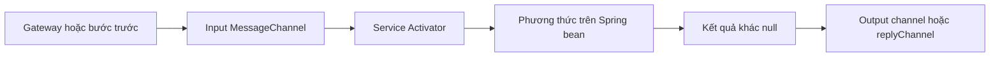

# @ServiceActivator

## 1. Mục tiêu và phạm vi

Bài này thuộc chương **Annotation và XML** của module **SPRING_INTEGRATION_CORE**. Trong luồng tích hợp, bạn thường đã có một service Java để xác nhận đơn hàng, ghi nhận sự kiện hoặc tra cứu dữ liệu. `@ServiceActivator` giúp nối một phương thức của bean đó với hệ thống Message và MessageChannel.

Sau bài học, bạn có thể:

- Đăng ký một service activator bằng annotation.
- Ánh xạ payload, một header hoặc toàn bộ message vào tham số Java.
- Phân biệt kết quả nghiệp vụ, message phản hồi và trường hợp không tạo phản hồi.
- Chọn output channel, dùng `replyChannel` và cấu hình poller khi cần.
- Kiểm thử endpoint qua channel.
- Đọc cấu hình tương ứng bằng XML và Java DSL.

Ví dụ dùng Java 17 trở lên và API Spring Integration 6.x, đối chiếu với 6.5.0. Nếu dự án dùng một BOM quản lý dependency, giữ các thư viện Spring tương thích theo BOM đó.

## 2. Service Activator giải quyết vấn đề gì?

Giả sử một dịch vụ có thao tác:

```java
public Confirmation confirm(Order order) {
    return new Confirmation(order.orderId(), "ACCEPTED");
}
```

Phương thức này biết xử lý đơn hàng nhưng không biết ai gửi message, message nằm trong queue nào hay kết quả phải đi đâu.

Service activator kết nối hai phía:



Trong mô hình này, endpoint nhận message, ánh xạ dữ liệu vào lời gọi phương thức và xử lý kết quả trả về. Đây là vai trò được mô tả trong [Service Activator](https://docs.spring.io/spring-integration/reference/6.5/service-activator.html).

### 2.1. Annotation không tự biến một đối tượng bất kỳ thành endpoint

```java
@ServiceActivator(
    inputChannel = "ordersInput",
    outputChannel = "confirmationsOutput")
public Confirmation confirm(Order order) {
    return new Confirmation(order.orderId(), "ACCEPTED");
}
```

Đoạn trên chỉ có hiệu lực khi lớp chứa phương thức được Spring quản lý và hạ tầng integration xử lý annotation đó.

Gọi trực tiếp:

```java
service.confirm(order);
```

vẫn là lời gọi Java trực tiếp. Nó không đi qua input channel, cơ chế chuyển header hay cấu hình endpoint chỉ vì phương thức có annotation.

### 2.2. Chọn đúng mẫu tích hợp

| Ý định của bước | Thành phần phù hợp |
| --- | --- |
| Gọi một thao tác nghiệp vụ trên service | Service Activator |
| Chuyển đổi hình dạng hoặc biểu diễn dữ liệu | Transformer |
| Chấp nhận hoặc loại bỏ message | Filter |
| Chọn đích cho message | Router |
| Gom nhiều message thành một kết quả | Aggregator |

Một phương thức trả về chuỗi tên channel dưới `@ServiceActivator` tạo ra payload chuỗi. Nó không tự trở thành router. Tương tự, trả về `false` là tạo payload `Boolean`, không tự mang nghĩa loại bỏ message.

## 3. Điều kiện để annotation hoạt động

Trong một ứng dụng Spring thuần, có thể bật hạ tầng:

```java
@Configuration
@EnableIntegration
public class IntegrationConfig {
}
```

`@EnableIntegration` đăng ký các thành phần hạ tầng và bộ xử lý annotation của Spring Integration. Nó không tự quét mọi lớp nghiệp vụ trong project. Xem [EnableIntegration](https://raw.githubusercontent.com/spring-projects/spring-integration/v6.5.0/spring-integration-core/src/main/java/org/springframework/integration/config/EnableIntegration.java).

Bean chứa phương thức có thể được đăng ký bằng:

- `@Bean` trong cấu hình.
- Component scanning cho lớp `@Component`, `@Service` hoặc `@MessageEndpoint`.
- Một cấu hình bean khác của Spring.

`@MessageEndpoint` là stereotype phục vụ component scanning. Với lớp đã được tạo bằng `@Bean`, không cần thêm stereotype chỉ để được nhận diện lần nữa.

Ví dụ hoàn chỉnh trong bài dùng `@Bean` để không phụ thuộc phạm vi component scan. Xem thêm [Annotation Support](https://docs.spring.io/spring-integration/reference/6.5/configuration/annotations.html).

### 3.1. Khai báo channel tường minh

```java
@Bean
public DirectChannel ordersInput() {
    return new DirectChannel();
}

@Bean
public QueueChannel confirmationsOutput() {
    return new QueueChannel(10);
}
```

Annotation tham chiếu bean theo tên. Chọn `DirectChannel` cho đường gọi đồng bộ và `QueueChannel` để lưu kết quả chờ đọc trong ví dụ.

Spring Integration có hỗ trợ tạo một số channel chưa khai báo trong quá trình xử lý annotation. Dù vậy, khai báo tường minh giúp người học thấy rõ loại channel, dung lượng và mô hình xử lý.

Đặc biệt, viết tên một input channel trong annotation không có nghĩa bạn đã tạo một queue.

## 4. Ánh xạ message vào tham số phương thức

Các annotation ánh xạ tham số sau thuộc package:

```java
org.springframework.messaging.handler.annotation.Payload
org.springframework.messaging.handler.annotation.Header
org.springframework.messaging.handler.annotation.Headers
```

Đây không phải annotation của Spring MVC.

### 4.1. Nhận payload

```java
@ServiceActivator(inputChannel = "ordersInput")
public void accept(Order order) {
    System.out.println(order.orderId());
}
```

Với tham số payload đơn giản, framework có thể suy luận ánh xạ. Khi chữ ký phức tạp hơn, dùng `@Payload` để thể hiện rõ ý định:

```java
public Confirmation confirm(@Payload Order order) {
    return new Confirmation(order.orderId(), "ACCEPTED");
}
```

Không suy ra rằng mọi chuỗi JSON tự được chuyển thành `Order`. Việc chuyển kiểu phụ thuộc converter và cấu hình trước endpoint. Nếu đầu vào là JSON, hãy thiết kế bước chuyển đổi và validation rõ ràng.

### 4.2. Nhận một header

```java
public Confirmation confirm(
        @Payload Order order,
        @Header("request_id") String requestId) {

    return new Confirmation(order.orderId(), requestId);
}
```

Trong ví dụ rời trên, constructor của `Confirmation` chỉ minh họa việc dùng giá trị được ánh xạ. Ở ví dụ đầy đủ phía sau, kiểu dữ liệu sẽ được định nghĩa cụ thể.

`@Header` mặc định yêu cầu header tồn tại. Nếu thiếu, việc ánh xạ tham số thất bại; phương thức nghiệp vụ không nhận được một giá trị hợp lệ để tiếp tục.

Với dữ liệu tùy chọn:

```java
public void audit(
        @Payload Order order,
        @Header(value = "operator_id", required = false) String operatorId) {

    String actor = operatorId == null ? "system" : operatorId;
    System.out.println(order.orderId() + ":" + actor);
}
```

Dùng kiểu tham chiếu hoặc kiểu có thể biểu diễn sự vắng mặt. Chẳng hạn, `Integer` phù hợp hơn `int` nếu header tùy chọn có thể không tồn tại. Các thuộc tính của annotation được mô tả trong [Header](https://docs.spring.io/spring-framework/docs/6.2.7/javadoc-api/org/springframework/messaging/handler/annotation/Header.html).

### 4.3. Nhận toàn bộ headers

```java
public void inspect(
        @Payload Order order,
        @Headers java.util.Map<String, Object> headers) {

    Object requestId = headers.get("request_id");
    System.out.println(order.orderId() + ":" + requestId);
}
```

Dùng `@Headers` khi thực sự cần nhiều metadata. Nếu chỉ dùng một trường, `@Header` giúp hợp đồng phương thức rõ hơn.

Không dùng map này như nơi cập nhật message. Nếu cần thêm metadata cho bước sau, trả về kết quả phù hợp hoặc dùng một bước header enrichment.

### 4.4. Nhận Message trực tiếp

```java
public String describe(org.springframework.messaging.Message<Order> message) {
    return message.getPayload().orderId()
        + ":" + message.getHeaders().get("request_id");
}
```

Cách này phù hợp khi lớp đóng vai trò adapter và cần cấu trúc message. Với service nghiệp vụ thuần, nhận payload và các giá trị cần thiết thường dễ kiểm thử và tái sử dụng hơn.

### 4.5. Tránh chữ ký mơ hồ

Hai tham số không được ánh xạ rõ ràng dễ gây nhầm:

```java
// Không rõ tham số nào là payload, tham số nào là metadata.
public String process(String orderCode, String requestId) {
    return orderCode + ":" + requestId;
}
```

Viết rõ:

```java
public String process(
        @Payload String orderCode,
        @Header("request_id") String requestId) {

    return orderCode + ":" + requestId;
}
```

Nếu payload bản thân là một `Map`, càng cần phân biệt `@Payload Map` với `@Headers Map`. Các quy tắc và trường hợp mơ hồ được mô tả trong [Message Mapping Rules and Conventions](https://docs.spring.io/spring-integration/reference/6.5/configuration/message-mapping-rules.html).

## 5. Kết quả trả về quyết định bước tiếp theo

### 5.1. Trả về một đối tượng

Nếu phương thức trả về `Confirmation`, framework tạo reply message có payload là đối tượng đó.

```java
@ServiceActivator(
    inputChannel = "ordersInput",
    outputChannel = "confirmationsOutput",
    requiresReply = "true")
public Confirmation confirm(Order order) {
    return new Confirmation(order.orderId(), "ACCEPTED");
}
```

Không cần tự dùng `MessageBuilder` chỉ để bọc một kết quả nghiệp vụ thông thường. API của [ServiceActivator](https://docs.spring.io/spring-integration/docs/6.5.0/api/org/springframework/integration/annotation/ServiceActivator.html) mô tả cách đưa giá trị trả về vào reply.

### 5.2. Trả về void hoặc null

```java
@ServiceActivator(inputChannel = "auditInput")
public void record(String event) {
    System.out.println(event);
}
```

Đây là một điểm cuối không tạo reply. Một phương thức trả về `null` cũng có thể kết thúc nhánh xử lý khi không yêu cầu phản hồi.

Nếu cần một kết quả bắt buộc:

```java
@ServiceActivator(
    inputChannel = "requiredResultInput",
    outputChannel = "requiredResultOutput",
    requiresReply = "true")
public String requiredResult(String value) {
    return value.isBlank() ? null : value.trim();
}
```

Khi phương thức trả `null`, hợp đồng bắt buộc reply làm phát sinh `ReplyRequiredException`. `requiresReply` không phải timeout chờ xử lý.

Nếu muốn bỏ qua dữ liệu theo điều kiện một cách có chủ đích, filter và discard channel thường thể hiện rõ hơn việc trả `null` từ một service.

### 5.3. Trả về Message để bổ sung metadata

Giả sử đã có một `Confirmation receipt`, phương thức có thể trả:

```java
return org.springframework.messaging.support.MessageBuilder
    .withPayload(receipt)
    .setHeader("confirmation_status", "ACCEPTED")
    .build();
```

Với service activator, header từ request có thể được bổ sung vào reply nếu reply chưa có header đó, theo cơ chế propagation. Vì vậy, tự tạo một message mới không phải cách chắc chắn loại bỏ metadata đầu vào.

Nếu cần lọc header trước khi ra biên hệ thống, dùng bước header filter hoặc chính sách propagation phù hợp và kiểm thử kết quả. Đây là khác biệt đáng chú ý so với transformer trả toàn bộ `Message`. Xem [Service Activator and Method Return Type](https://docs.spring.io/spring-integration/reference/6.5/service-activator.html#service-activator-method-return-type).

## 6. Kết quả được gửi đi đâu?

Trong luồng thông thường không dùng routing slip, có thể hình dung:

```text
Phương thức tạo kết quả khác null
    -> Có outputChannel tường minh?
        -> Có: gửi tới outputChannel
        -> Không: dùng replyChannel trong ngữ cảnh request/reply
```

### 6.1. outputChannel tường minh

```java
@ServiceActivator(
    inputChannel = "ordersInput",
    outputChannel = "confirmationsOutput")
```

Kết quả được đưa đến `confirmationsOutput`. Ngay cả khi request có `replyChannel`, output channel tường minh của bước vẫn được ưu tiên.

Cách này phù hợp với một bước giữa pipeline, nơi kết quả cần đi tiếp đến transformer, router hoặc endpoint khác.

### 6.2. replyChannel cho đích trả lời theo request

Một biến thể của endpoint cuối pipeline có thể bỏ `outputChannel`:

```java
@ServiceActivator(
    inputChannel = "ordersInput",
    requiresReply = "true")
public Confirmation confirm(
        @Payload Order order,
        @Header("request_id") String requestId) {

    return new Confirmation(order.orderId(), "ACCEPTED", requestId);
}
```

Người gửi cung cấp `replyChannel`, chẳng hạn qua messaging gateway hoặc message được xây dựng trực tiếp:

```java
QueueChannel replies = new QueueChannel(1);

Message<Order> request = MessageBuilder.withPayload(order)
    .setHeader("request_id", "R-1001")
    .setReplyChannel(replies)
    .build();

ordersInput.send(request);
Message<?> reply = replies.receive(1000);
```

Đoạn trên giả sử `ordersInput` là channel đầu vào đã được lấy từ context và endpoint đang dùng biến thể không khai báo output channel.

Không nạp cả hai biến thể như hai endpoint ngoài ý muốn trên cùng input channel. Với point-to-point channel, điều đó thay đổi cơ chế phân phối message.

Nếu handler đã tạo kết quả nhưng không có đích gửi hợp lệ, đó là lỗi định tuyến phản hồi. `requiresReply = "false"` chỉ cho phép không tạo kết quả; nó không có nghĩa kết quả khác null được tự động bỏ đi khi thiếu đích.

### 6.3. Chủ động bỏ kết quả

Nếu service phải chạy nhưng kết quả không cần chuyển tiếp:

```java
@ServiceActivator(
    inputChannel = "commandsInput",
    outputChannel = "nullChannel")
```

`nullChannel` là channel đặc biệt để kết thúc việc chuyển tiếp. Đừng dùng nó chỉ để che một cấu hình mất reply mà phía gọi đang mong đợi.

## 7. Ví dụ đầy đủ: xác nhận một đơn hàng

### 7.1. Hợp đồng của ví dụ

Đầu vào là `Order` với:

- Mã đơn hàng không rỗng.
- Tổng tiền dương.
- Header bắt buộc `request_id` không rỗng.

Kết quả là `Confirmation`, gồm mã đơn hàng, trạng thái và mã yêu cầu. Để tập trung vào endpoint, ví dụ chỉ kiểm tra dữ liệu và tạo kết quả, chưa gọi database hoặc dịch vụ ngoài.

Input dùng `DirectChannel`, output dùng `QueueChannel` có dung lượng 10. Service activator chạy đồng bộ khi gửi vào input; kết quả được xếp vào output để chương trình hoặc test đọc.

### 7.2. Cấu hình và service

Project cần `spring-integration-core`, Spring Context tương thích và JUnit Jupiter nếu dùng test ở phần sau.

```java
package example.activators;

import java.math.BigDecimal;

import org.springframework.context.annotation.Bean;
import org.springframework.context.annotation.Configuration;
import org.springframework.integration.annotation.EndpointId;
import org.springframework.integration.annotation.ServiceActivator;
import org.springframework.integration.channel.DirectChannel;
import org.springframework.integration.channel.QueueChannel;
import org.springframework.integration.config.EnableIntegration;
import org.springframework.messaging.handler.annotation.Header;
import org.springframework.messaging.handler.annotation.Payload;

@Configuration
@EnableIntegration
public class ServiceActivatorConfig {

    public record Order(String orderId, BigDecimal total) {
    }

    public record Confirmation(
            String orderId,
            String status,
            String requestId) {
    }

    @Bean
    public DirectChannel ordersInput() {
        return new DirectChannel();
    }

    @Bean
    public QueueChannel confirmationsOutput() {
        return new QueueChannel(10);
    }

    @Bean
    public OrderConfirmationService orderConfirmationService() {
        return new OrderConfirmationService();
    }

    public static class OrderConfirmationService {

        @ServiceActivator(
            inputChannel = "ordersInput",
            outputChannel = "confirmationsOutput",
            requiresReply = "true",
            sendTimeout = "1000")
        @EndpointId("confirmOrderEndpoint")
        public Confirmation confirm(
                @Payload Order order,
                @Header("request_id") String requestId) {

            if (order.orderId() == null || order.orderId().isBlank()) {
                throw new IllegalArgumentException("orderId is required");
            }

            if (order.total() == null || order.total().signum() <= 0) {
                throw new IllegalArgumentException("total must be positive");
            }

            if (requestId.isBlank()) {
                throw new IllegalArgumentException("request_id is required");
            }

            return new Confirmation(
                order.orderId(),
                "ACCEPTED",
                requestId);
        }
    }
}
```

Các thuộc tính `requiresReply` và `sendTimeout` nhận chuỗi trong annotation; đừng viết `requiresReply = true` như tham số boolean của một builder.

`sendTimeout = "1000"` giới hạn chờ khi gửi kết quả đến output channel có giới hạn như queue bị đầy. Nó không giới hạn thời gian chạy phương thức `confirm`.

`@EndpointId` đặt tên cho consumer endpoint, không đặt ID của từng message. Tên tường minh hữu ích khi đọc log hoặc lấy endpoint từ context để điều khiển vòng đời.

### 7.3. Gửi và nhận một message

```java
package example.activators;

import java.math.BigDecimal;

import org.springframework.context.annotation.AnnotationConfigApplicationContext;
import org.springframework.integration.channel.DirectChannel;
import org.springframework.integration.channel.QueueChannel;
import org.springframework.messaging.Message;
import org.springframework.messaging.support.MessageBuilder;

import example.activators.ServiceActivatorConfig.Order;

public class ServiceActivatorDemo {

    public static void main(String[] args) {
        try (var context = new AnnotationConfigApplicationContext(
                ServiceActivatorConfig.class)) {

            DirectChannel input =
                context.getBean("ordersInput", DirectChannel.class);
            QueueChannel output =
                context.getBean("confirmationsOutput", QueueChannel.class);

            Order order =
                new Order("O-1001", new BigDecimal("1250000"));

            Message<Order> request = MessageBuilder.withPayload(order)
                .setHeader("request_id", "R-1001")
                .build();

            input.send(request);

            Message<?> result = output.receive(1000);
            if (result == null) {
                throw new IllegalStateException("No confirmation received");
            }

            System.out.println(result.getPayload());
            System.out.println(
                result.getHeaders().get("request_id"));
        }
    }
}
```

Kết quả nghiệp vụ kỳ vọng:

```text
Confirmation[
  orderId=O-1001,
  status=ACCEPTED,
  requestId=R-1001
]
```

Trong biểu diễn trên, việc xuống dòng chỉ để dễ đọc. `record.toString()` thực tế thường in trên một dòng.

## 8. Kiểm thử endpoint qua channel

Unit test phương thức service hữu ích cho validation. Tuy nhiên, nó không kiểm chứng annotation được xử lý, input channel có consumer hay header có ánh xạ đúng không.

Các test sau đi qua context và channel:

```java
package example.activators;

import java.math.BigDecimal;

import org.junit.jupiter.api.Test;
import org.springframework.context.annotation.AnnotationConfigApplicationContext;
import org.springframework.integration.channel.DirectChannel;
import org.springframework.integration.channel.QueueChannel;
import org.springframework.messaging.Message;
import org.springframework.messaging.MessagingException;
import org.springframework.messaging.support.MessageBuilder;

import example.activators.ServiceActivatorConfig.Confirmation;
import example.activators.ServiceActivatorConfig.Order;

import static org.junit.jupiter.api.Assertions.*;

class ServiceActivatorEndpointTest {

    @Test
    void confirmationGoesToExplicitOutputChannel() {
        try (var context = new AnnotationConfigApplicationContext(
                ServiceActivatorConfig.class)) {

            DirectChannel input =
                context.getBean("ordersInput", DirectChannel.class);
            QueueChannel output =
                context.getBean("confirmationsOutput", QueueChannel.class);
            QueueChannel alternativeReplies = new QueueChannel(1);

            Order order =
                new Order("O-1001", new BigDecimal("1250000"));
            Message<Order> request = MessageBuilder.withPayload(order)
                .setHeader("request_id", "R-1001")
                .setReplyChannel(alternativeReplies)
                .build();

            assertTrue(input.send(request));

            Message<?> result = output.receive(1000);
            assertNotNull(result);
            assertEquals(
                new Confirmation("O-1001", "ACCEPTED", "R-1001"),
                result.getPayload());
            assertEquals("R-1001",
                result.getHeaders().get("request_id"));

            // outputChannel tường minh được ưu tiên.
            assertNull(alternativeReplies.receive(0));

            // Request vẫn mang payload đầu vào.
            assertSame(order, request.getPayload());
        }
    }

    @Test
    void missingRequiredHeaderFailsDuringMessageHandling() {
        try (var context = new AnnotationConfigApplicationContext(
                ServiceActivatorConfig.class)) {

            DirectChannel input =
                context.getBean("ordersInput", DirectChannel.class);
            QueueChannel output =
                context.getBean("confirmationsOutput", QueueChannel.class);

            Order order =
                new Order("O-1002", new BigDecimal("500000"));

            assertThrows(MessagingException.class, () ->
                input.send(
                    MessageBuilder.withPayload(order).build()));

            assertNull(output.receive(0));
        }
    }

    @Test
    void invalidOrderProducesNoConfirmation() {
        try (var context = new AnnotationConfigApplicationContext(
                ServiceActivatorConfig.class)) {

            DirectChannel input =
                context.getBean("ordersInput", DirectChannel.class);
            QueueChannel output =
                context.getBean("confirmationsOutput", QueueChannel.class);

            Order invalid =
                new Order("O-invalid", new BigDecimal("-1"));

            assertThrows(MessagingException.class, () ->
                input.send(
                    MessageBuilder.withPayload(invalid)
                        .setHeader("request_id", "R-invalid")
                        .build()));

            assertNull(output.receive(0));
        }
    }
}
```

Những test này kiểm tra ba hợp đồng quan sát được:

1. Kết quả được tạo đúng và đến output channel tường minh.
2. Header bắt buộc được kiểm tra qua cơ chế ánh xạ.
3. Lỗi nghiệp vụ không tạo một confirmation thành công.

`receive(1000)` chờ kết quả trong thời hạn; `receive(0)` kiểm tra ngay một queue. Không cần sleep cố định trong các test đồng bộ này.

Đây là mã thực hành để chạy trong project có dependency tương thích. Việc mô tả test không thay thế kiểm thử với transport, retry và dữ liệu vận hành thực tế.

## 9. Khi input là QueueChannel: thêm @Poller

Giả sử thay input bằng queue:

```java
@Bean
public QueueChannel ordersInput() {
    return new QueueChannel(100);
}
```

Endpoint phải chủ động lấy message. Có thể cấu hình trực tiếp:

```java
@ServiceActivator(
    inputChannel = "ordersInput",
    outputChannel = "confirmationsOutput",
    requiresReply = "true",
    poller = @Poller(
        fixedDelay = "100",
        maxMessagesPerPoll = "5",
        receiveTimeout = "0"))
```

Import cần thêm:

```java
import org.springframework.integration.annotation.Poller;
```

Đây là phương án thay thế cấu hình endpoint ở phần 7, không phải một endpoint thứ hai cần đăng ký thêm.

| Thuộc tính | Ý nghĩa trong ví dụ |
| --- | --- |
| `fixedDelay = "100"` | Khoảng trễ polling tính theo mili giây |
| `maxMessagesPerPoll = "5"` | Tối đa năm message được lấy trong một lần poll |
| `receiveTimeout = "0"` | Không chờ khi queue đang rỗng |

Năm message mỗi poll không đồng nghĩa năm message mỗi giây hoặc năm message xử lý song song.

Nếu không khai báo poller riêng, consumer pollable cần default poller trong context. Không gắn poller vào endpoint nhận từ `DirectChannel`.

Với cấu hình polling phức tạp, tạo bean `PollerMetadata` và tham chiếu:

```java
poller = @Poller("ordersPoller")
```

Khi tham chiếu metadata theo tên, đặt các thông số khác trong bean đó; không trộn tên tham chiếu với các lựa chọn lịch riêng trong cùng annotation. Xem [Poller](https://docs.spring.io/spring-integration/docs/6.5.0/api/org/springframework/integration/annotation/Poller.html).

## 10. Hai cách dùng annotation cần phân biệt

### 10.1. Trên phương thức POJO xử lý nghiệp vụ

Đây là cách đã dùng trong ví dụ:

```java
@ServiceActivator(
    inputChannel = "ordersInput",
    outputChannel = "confirmationsOutput",
    requiresReply = "true")
public Confirmation confirm(
        @Payload Order order,
        @Header("request_id") String requestId) {
    // Validation và tạo kết quả.
    return new Confirmation(order.orderId(), "ACCEPTED", requestId);
}
```

Phương thức `confirm` được endpoint gọi theo từng message.

### 10.2. Trên @Bean trả về MessageHandler

Trong một cấu hình độc lập, có thể tạo handler bằng factory method:

```java
@Bean("uppercaseEndpoint.handler")
@ServiceActivator(inputChannel = "textInput")
@EndpointId("uppercaseEndpoint")
public org.springframework.integration.handler.ServiceActivatingHandler
        uppercaseHandler() {

    org.springframework.integration.handler.ServiceActivatingHandler handler =
        new org.springframework.integration.handler.ServiceActivatingHandler(
            new UppercaseService(),
            "uppercase");

    handler.setOutputChannelName("textOutput");
    handler.setRequiresReply(true);
    return handler;
}

public static class UppercaseService {

    public String uppercase(String value) {
        return value.toUpperCase(java.util.Locale.ROOT);
    }
}
```

Đoạn trên giả sử cấu hình có `@EnableIntegration` và đã khai báo `textInput`, `textOutput`.

Ở đây:

- `uppercaseHandler()` tạo bean handler khi cấu hình Spring được khởi tạo.
- Handler gọi `UppercaseService.uppercase(...)` khi nhận message.
- Các thuộc tính của handler như output channel và requires reply được đặt trực tiếp trên handler.

Không cho rằng phương thức `@Bean` sẽ được gọi để xử lý từng payload. Khi annotation được đặt trên một bean handler có sẵn, các thuộc tính dành cho handler cần được cấu hình trên chính đối tượng đó; không áp dụng máy móc cách viết của phương thức POJO.

Đây là quy tắc của [Annotations on @Bean Methods](https://docs.spring.io/spring-integration/reference/6.5/configuration/meta-annotations.html#annotations_on_beans). Lớp handler được dùng ở đây là [ServiceActivatingHandler](https://docs.spring.io/spring-integration/docs/6.5.0/api/org/springframework/integration/handler/ServiceActivatingHandler.html).

## 11. Biểu diễn tương ứng bằng XML và Java DSL

Các cấu hình dưới đây là phương án thay thế endpoint annotation. Không nạp đồng thời mọi phương án với cùng channel và cùng ID.

### 11.1. Tạo một POJO không khai báo endpoint

Để tránh vô tình đăng ký hai endpoint, dùng lớp sau cho biến thể XML hoặc DSL. Các record `Order` và `Confirmation` được dùng lại từ ví dụ đầy đủ:

```java
package example.activators;

import org.springframework.messaging.handler.annotation.Header;
import org.springframework.messaging.handler.annotation.Payload;

import example.activators.ServiceActivatorConfig.Confirmation;
import example.activators.ServiceActivatorConfig.Order;

public class PlainOrderConfirmationService {

    public Confirmation confirm(
            @Payload Order order,
            @Header("request_id") String requestId) {

        if (order.orderId() == null || order.orderId().isBlank()) {
            throw new IllegalArgumentException("orderId is required");
        }

        if (order.total() == null || order.total().signum() <= 0) {
            throw new IllegalArgumentException("total must be positive");
        }

        if (requestId.isBlank()) {
            throw new IllegalArgumentException("request_id is required");
        }

        return new Confirmation(order.orderId(), "ACCEPTED", requestId);
    }
}
```

Lớp này giữ annotation ánh xạ tham số, nhưng không có `@ServiceActivator`. Topology của endpoint sẽ nằm trong XML hoặc DSL.

### 11.2. Cấu hình XML

Ví dụ tài nguyên XML độc lập:

```xml
<?xml version="1.0" encoding="UTF-8"?>
<beans xmlns="http://www.springframework.org/schema/beans"
       xmlns:int="http://www.springframework.org/schema/integration"
       xmlns:xsi="http://www.w3.org/2001/XMLSchema-instance"
       xsi:schemaLocation="
           http://www.springframework.org/schema/beans
           https://www.springframework.org/schema/beans/spring-beans.xsd
           http://www.springframework.org/schema/integration
           https://www.springframework.org/schema/integration/spring-integration.xsd">

    <int:channel id="ordersInput"/>

    <int:channel id="confirmationsOutput">
        <int:queue capacity="10"/>
    </int:channel>

    <bean id="plainOrderConfirmationService"
          class="example.activators.PlainOrderConfirmationService"/>

    <int:service-activator
            id="confirmOrderEndpoint"
            input-channel="ordersInput"
            output-channel="confirmationsOutput"
            ref="plainOrderConfirmationService"
            method="confirm"
            requires-reply="true"
            send-timeout="1000"/>

</beans>
```

Để dùng biến thể này, nạp tài nguyên XML bằng cấu hình ứng dụng hoặc `ClassPathXmlApplicationContext`. Không đồng thời nạp `ServiceActivatorConfig` chỉ để lấy các record; tham chiếu kiểu Java không yêu cầu đăng ký lớp cấu hình đó vào context.

Những thành phần tương ứng:

| Annotation trên POJO | XML |
| --- | --- |
| `inputChannel` | `input-channel` |
| `outputChannel` | `output-channel` |
| `requiresReply` | `requires-reply` |
| `sendTimeout` | `send-timeout` |
| `@EndpointId` | `id` |
| Phương thức được annotate | `ref` và `method` |

### 11.3. Cấu hình Java DSL

Trong biến thể DSL, khai báo lại hai channel và bean `PlainOrderConfirmationService` trong cấu hình `@EnableIntegration`, rồi thêm flow:

```java
@Bean
public IntegrationFlow orderConfirmationFlow(
        PlainOrderConfirmationService plainOrderConfirmationService) {

    return IntegrationFlow.from("ordersInput")
        .handle(
            plainOrderConfirmationService,
            "confirm",
            e -> e
                .id("confirmOrderEndpoint")
                .requiresReply(true)
                .sendTimeout(1000))
        .channel("confirmationsOutput")
        .get();
}
```

Import `IntegrationFlow` từ `org.springframework.integration.dsl`.

Annotation đặt wiring cạnh phương thức; XML hoặc DSL cho phép đặt topology tập trung ngoài phương thức đó. Khi chuyển đổi, giữ nguyên hợp đồng về kiểu channel, header bắt buộc và kết quả trả về.

## 12. Vòng đời, advice và xử lý lỗi

### 12.1. Đặt tên và điều khiển endpoint

Với ví dụ annotation, có thể lấy endpoint runtime:

```java
org.springframework.integration.endpoint.AbstractEndpoint endpoint =
    context.getBean(
        "confirmOrderEndpoint",
        org.springframework.integration.endpoint.AbstractEndpoint.class);
```

Có thể dùng `autoStartup = "false"` nếu muốn tự khởi chạy:

```java
@ServiceActivator(
    inputChannel = "ordersInput",
    outputChannel = "confirmationsOutput",
    autoStartup = "false")
```

Sau đó gọi `endpoint.start()` khi thích hợp. Với `DirectChannel`, chưa có consumer đang chạy thì message không được lưu để chờ như queue.

`phase` dùng cho thứ tự vòng đời, không phải độ ưu tiên của từng đơn hàng. `@EndpointId` có quy ước tên riêng giữa phương thức POJO và `@Bean`; xem [EndpointId 6.5.0](https://raw.githubusercontent.com/spring-projects/spring-integration/v6.5.0/spring-integration-core/src/main/java/org/springframework/integration/annotation/EndpointId.java).

### 12.2. adviceChain tham chiếu bean advice

```java
@ServiceActivator(
    inputChannel = "ordersInput",
    outputChannel = "confirmationsOutput",
    adviceChain = "orderRetryAdvice")
```

Tên `orderRetryAdvice` phải trỏ tới một bean advice đã cấu hình. Việc thêm tên trong annotation không tự tạo chính sách retry.

Đối với request handler advice thông thường, phạm vi là xử lý của handler hiện tại. Không mặc định toàn bộ downstream nằm trong cùng lần retry.

Nếu thao tác có tác dụng phụ như trừ tồn kho hoặc gửi thanh toán, thiết kế khóa idempotency và phân loại lỗi có thể thử lại. Thử lại một lỗi validation không sửa được payload sai.

### 12.3. Lỗi đồng bộ và lỗi ở task về sau

Trong ví dụ `DirectChannel`, ngoại lệ từ handler có thể đi ngược về lời gọi gửi dưới dạng lỗi messaging. Vì thế test dùng `assertThrows(MessagingException.class, ...)` tại `send`.

Nếu đổi input thành queue và xử lý qua poller, người gửi chỉ đưa message vào hàng đợi. Lỗi xảy ra sau đó cần được quan sát qua cơ chế error handling của task.

Ví dụ mở rộng:

```java
poller = @Poller(
    fixedDelay = "100",
    receiveTimeout = "0",
    maxMessagesPerPoll = "5",
    errorChannel = "orderErrors")
```

`orderErrors` cần là channel đã đăng ký. Khi test, thu `ErrorMessage` ở channel đó thay vì chờ ngoại lệ đồng bộ từ thao tác enqueue.

Một header `errorChannel` không tự biến tất cả lời gọi `DirectChannel` thành xử lý lỗi bất đồng bộ. Đường đi lỗi phụ thuộc channel, gateway, poller và advice. Xem [Error Handling](https://docs.spring.io/spring-integration/reference/6.5/error-handling.html).

### 12.4. async không thay thế việc chọn mô hình thực thi

`async = "true"` hỗ trợ xử lý reply bất đồng bộ như `CompletableFuture` ở phiên bản được dùng trong bài. Nó không làm một phương thức I/O đồng bộ tự chạy ở thread khác.

Nếu service trả future, hãy xác định executor thực hiện công việc, cách truyền ngữ cảnh và đích nhận lỗi khi future hoàn tất thất bại. Không ghép `poller` và `reactive` trên cùng annotation; đây là hai lựa chọn loại trừ nhau.

## 13. Những lỗi dễ gặp

| Hiện tượng | Nguyên nhân cần xem xét | Hướng sửa |
| --- | --- | --- |
| Phương thức không được gọi | Đối tượng không phải Spring bean hoặc thiếu hạ tầng annotation | Kiểm tra bean registration và `@EnableIntegration` |
| Gửi vào channel không có consumer | Sai tên channel, endpoint chưa chạy hoặc không được đăng ký | Xem tên và trạng thái endpoint |
| Có hai handler ngoài ý muốn | Cùng topology được đăng ký bằng annotation và DSL/XML | Chỉ giữ endpoint của phương án được chọn |
| Thiếu header làm xử lý lỗi | `@Header` mặc định bắt buộc | Bổ sung header hoặc định nghĩa rõ trường tùy chọn |
| JSON không thành Order | Chưa có bước conversion phù hợp | Thêm chuyển đổi và kiểm thử payload |
| Handler trả kết quả nhưng báo thiếu đích | Không có output/reply channel hợp lệ | Hoàn thiện hợp đồng trả lời |
| Gateway chờ nhưng service không trả gì | Phương thức void/null trong tuyến cần reply | Chọn hợp đồng một chiều hoặc trả kết quả |
| Gửi chuỗi tên channel nhưng không định tuyến | Đang dùng service activator thay router | Dùng router khi mục đích là chọn đích |
| Queue không được tiêu thụ | Thiếu poller hoặc endpoint chưa chạy | Cấu hình polling và vòng đời |
| Đặt timeout nhưng lời gọi HTTP vẫn lâu | Timeout đang áp dụng cho gửi output | Đặt timeout ở client/adapter nghiệp vụ |
| Bỏ header khi tạo reply nhưng header xuất hiện lại | Service activator có cơ chế propagation | Dùng header filter hoặc chính sách phù hợp |
| Cấu hình output trên @Bean handler không như mong đợi | Nhầm thuộc tính endpoint với thuộc tính handler | Đặt output trên đối tượng handler |

Khi điều tra một message, kiểm tra lần lượt: bean được đăng ký chưa, endpoint gắn channel nào, chữ ký phương thức nhận gì, kết quả có được tạo không và đích phản hồi ở đâu.

## 14. Thực hành mở rộng

Từ ví dụ đầy đủ, hãy làm lần lượt:

1. Thêm header tùy chọn `operator_id`; kiểm thử cả có và không có header.
2. Tạo một biến thể bỏ `outputChannel`, rồi gửi request kèm reply channel riêng.
3. Đổi input sang queue và thêm poller; chuyển test lỗi sang quan sát error channel.
4. Tạo phương thức trả `null` có chủ đích, so sánh khi `requiresReply` bật và tắt.
5. Viết lại endpoint bằng XML hoặc DSL với POJO không có annotation khai báo endpoint.
6. Nếu thêm tác dụng phụ, xác định trường hợp retry có thể gọi lặp và cách giữ tính idempotent.

Mỗi bài thực hành cần xác định rõ đầu vào, header, kiểu kết quả, channel nhận kết quả và đích nhận lỗi. Đó là hợp đồng thực sự của một service activator.

## 15. Tài liệu đối chiếu

- [Spring Integration 6.5: Service Activator](https://docs.spring.io/spring-integration/reference/6.5/service-activator.html) — mẫu endpoint, kết quả và đường trả lời.
- [ServiceActivator 6.5.0 API](https://docs.spring.io/spring-integration/docs/6.5.0/api/org/springframework/integration/annotation/ServiceActivator.html) — các thuộc tính annotation.
- [Annotation Support](https://docs.spring.io/spring-integration/reference/6.5/configuration/annotations.html) — đăng ký và ánh xạ phương thức.
- [Message Mapping Rules and Conventions](https://docs.spring.io/spring-integration/reference/6.5/configuration/message-mapping-rules.html) — quy tắc payload và tham số.
- [Annotations on @Bean Methods](https://docs.spring.io/spring-integration/reference/6.5/configuration/meta-annotations.html) — phân biệt factory method với phương thức nghiệp vụ.
- [ServiceActivatingHandler 6.5.0 API](https://docs.spring.io/spring-integration/docs/6.5.0/api/org/springframework/integration/handler/ServiceActivatingHandler.html) — handler dùng cho lời gọi service.
- [Spring Integration 6.5: Error Handling](https://docs.spring.io/spring-integration/reference/6.5/error-handling.html) — lỗi đồng bộ và lỗi từ task.
