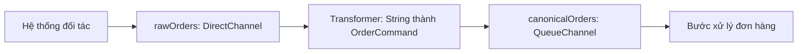

# @Transformer

## 1. Mục tiêu và bối cảnh

Trong chương **Annotation và XML** của module **SPRING_INTEGRATION_CORE**, `@Transformer` giúp biến một phương thức Java thành bước chuyển đổi dữ liệu trong luồng thông điệp. Sau bài này, bạn có thể cấu hình endpoint bằng annotation, hiểu hợp đồng đầu vào/đầu ra, giữ header cần thiết, và biểu diễn cùng một bước bằng XML hoặc Java DSL.

Giả sử hệ thống tiếp nhận đơn hàng dưới dạng chuỗi:

```text
"  od-42 | 3 | 125000.00  "
```

Các bước nghiệp vụ phía sau cần một `OrderCommand` có mã đơn chuẩn hóa, số lượng kiểu `int` và đơn giá kiểu `BigDecimal`. Thay vì buộc bên gửi biết cấu trúc nội bộ, ta đặt một transformer giữa hai bên:



Transformer tập trung vào **cách biểu diễn dữ liệu**. Chọn kênh đi tiếp thuộc router; quyết định chấp nhận thông điệp thuộc filter; gom các thông điệp thuộc aggregator. Trong một luồng thực tế, các endpoint này phối hợp với nhau nhưng mỗi bước nên có trách nhiệm rõ ràng.

## 2. `@Transformer` tạo ra điều gì?

Annotation cần dùng là:

```java
import org.springframework.integration.annotation.Transformer;
```

Khi hạ tầng Spring Integration xử lý một Spring bean có phương thức như sau, nó tạo endpoint nhận message từ `rawOrders`, gọi phương thức với payload phù hợp, rồi gửi kết quả đến `canonicalOrders`:

```java
@Transformer(inputChannel = "rawOrders", outputChannel = "canonicalOrders")
public OrderCommand normalize(String line) {
    return parser.parse(line);
}
```

Luồng gọi có ba lớp cần phân biệt:

1. **Channel** vận chuyển message và quyết định cách giao message cho consumer.
2. **Endpoint/handler** điều phối việc gọi phương thức và gửi kết quả.
3. **Phương thức chuyển đổi** thực hiện quy tắc đổi dữ liệu.

`@Transformer` không tự biến một đối tượng được tạo bằng `new` ở ngoài Spring thành consumer. Đối tượng chứa phương thức phải được đăng ký làm bean, và ứng dụng phải có hạ tầng integration. Ví dụ trong bài dùng `@Configuration`, `@EnableIntegration` và `@Bean` để thể hiện tường minh việc đăng ký; không cần component scan. Xem [Annotation Support](https://docs.spring.io/spring-integration/reference/6.5/configuration/annotations.html).

Một lời gọi Java trực tiếp như `endpoint.normalize(line)` chỉ thực thi thân phương thức. Nó không đi qua input channel, output channel hoặc cơ chế điều phối endpoint. Vì vậy, kiểm thử trực tiếp phương thức và kiểm thử luồng messaging có mục đích khác nhau.

### Các thuộc tính thường gặp

| Thuộc tính | Ý nghĩa thực hành |
| --- | --- |
| `inputChannel` | Tên channel mà endpoint nhận message. |
| `outputChannel` | Tên channel nhận kết quả chuyển đổi. |
| `poller` | Cấu hình lấy message khi input là `PollableChannel`. |
| `adviceChain` | Gắn advice quanh handler, chẳng hạn chính sách retry đã định nghĩa. |
| `autoStartup` | Điều khiển việc tự khởi động endpoint. |
| `sendTimeout` | Thời gian chờ gửi kết quả nếu output channel có giới hạn khiến thao tác gửi phải chờ. |

`sendTimeout` không phải giới hạn thời gian chạy của phương thức chuyển đổi. Một phương thức bị chặn vì gọi dịch vụ từ xa không tự bị ngắt khi giá trị này hết hạn. Ý nghĩa từng thuộc tính được mô tả trong [Javadoc của `@Transformer`](https://docs.spring.io/spring-integration/api/org/springframework/integration/annotation/Transformer.html).

## 3. Hợp đồng đầu vào và đầu ra

### 3.1. Nhận payload hay nhận toàn bộ message?

Chọn chữ ký nhỏ nhất đủ cho công việc:

| Chữ ký minh họa | Khi phù hợp |
| --- | --- |
| `OrderCommand convert(String payload)` | Quy tắc chỉ phụ thuộc dữ liệu trong payload. |
| `OrderCommand convert(String payload, @Header("sourceSystem") String source)` | Cần một header cụ thể để diễn giải dữ liệu. |
| `OrderCommand convert(String payload, @Headers Map<String, Object> headers)` | Cần nhiều metadata và muốn đọc theo tên. |
| `Message<OrderCommand> convert(Message<String> message)` | Cần chủ động xây dựng cả payload lẫn header đầu ra. |

`@Header` và `@Headers` thuộc package `org.springframework.messaging.handler.annotation`. Tham số nhận payload không cần mang kiểu `Message<?>` chỉ vì đang xử lý trong Spring Integration.

Tránh khai báo nhiều tham số không có annotation mà đều có thể được hiểu là payload. Với `String line, String sourceSystem`, framework không thể suy ra chuỗi nào là metadata theo ý của bạn; hãy ghi rõ `@Header` cho tham số thứ hai.

Không nên dựa vào chuyển kiểu ngầm để đọc một định dạng nghiệp vụ. Nếu đầu vào là một dòng văn bản, hãy nhận `String`, tự parse và nêu rõ điều kiện hợp lệ. Dùng `Object` rồi ép kiểu bên trong làm hợp đồng khó nhìn thấy hơn.

### 3.2. Trả payload và trả `Message` khác nhau thế nào?

Nếu phương thức trả `OrderCommand`, framework tạo message đầu ra mang payload đó và truyền tiếp các header đầu vào theo cơ chế propagation mặc định.

Nếu phương thức trả `Message<OrderCommand>`, transformer xem đó là message hoàn chỉnh. Mã ứng dụng chịu trách nhiệm về header của message được trả về; không có bước tự bù toàn bộ header đầu vào bị thiếu. Các cấu hình hạn chế propagation cũng có thể làm thay đổi tập header khi chỉ trả payload. Đây là một khác biệt quan trọng của transformer, được giải thích ở [Message — Header Propagation](https://docs.spring.io/spring-integration/reference/6.5/message.html#message-header-propagation).

Vì vậy, hãy quyết định rõ:

- Chỉ đổi dữ liệu: trả payload thường đơn giản hơn.
- Cần đổi metadata cùng dữ liệu: trả `Message`, xây header có chủ đích.
- Chỉ thêm hoặc bỏ header: cân nhắc header enricher hoặc header filter để thể hiện đúng ý định.

### 3.3. Kết quả không được là `null`

Transformer phải tạo ra một kết quả hợp lệ cho mỗi lần xử lý thành công. Trả `null` bị xem là lỗi, không phải cách âm thầm loại bỏ message. `void` cũng không phù hợp cho hợp đồng này. Muốn loại bỏ dữ liệu không thỏa điều kiện, dùng filter; muốn gọi thao tác có thể không trả lời, xem xét service activator. Hợp đồng này được nêu trong [Transformer](https://docs.spring.io/spring-integration/reference/6.5/transformer.html).

Trả `List<OrderCommand>` tạo một payload kiểu danh sách. Nó không mặc nhiên biến một message thành nhiều message độc lập. Nếu mỗi phần tử cần đi qua luồng riêng, hãy dùng splitter.

## 4. Ví dụ hoàn chỉnh: chuẩn hóa dòng đơn hàng

### 4.1. Môi trường và hợp đồng dữ liệu

Ví dụ sử dụng Java 17 trở lên, Spring Integration 6.x và JUnit Jupiter cho phần kiểm thử. Các API minh họa được tham chiếu theo tài liệu dòng 6.5. Dự án cần dependency `org.springframework.integration:spring-integration-core`; phiên bản Spring Integration và các thư viện Spring phải được quản lý đồng bộ bằng BOM hoặc cơ chế quản lý dependency của dự án.

Nếu dự án dùng Spring Boot với BOM phù hợp, starter tương ứng là:

```xml
<dependency>
    <groupId>org.springframework.boot</groupId>
    <artifactId>spring-boot-starter-integration</artifactId>
</dependency>
<dependency>
    <groupId>org.springframework.boot</groupId>
    <artifactId>spring-boot-starter-test</artifactId>
    <scope>test</scope>
</dependency>
```

Các khai báo này giả định dự án đã có Spring Boot parent hoặc BOM; không phải một `pom.xml` độc lập. Ví dụ không cần broker, database hay kết nối mạng lúc xử lý message.

Quy ước dữ liệu của bài:

| Thành phần | Quy tắc |
| --- | --- |
| Dòng đầu vào | Đúng ba trường, ngăn cách bằng ký tự `\|`. |
| Mã đơn | Bỏ khoảng trắng ở hai đầu, chuyển chữ hoa bằng `Locale.ROOT`, không rỗng. |
| Số lượng | Số nguyên dương nằm trong phạm vi `int`. |
| Đơn giá | Số thập phân dương, dùng dấu chấm, biểu diễn chính xác với scale bằng 2. |
| Header `traceId` | Giữ lại để theo dõi cùng một yêu cầu qua các bước. |

Parser này phục vụ một giao thức văn bản nhỏ, không phải bộ đọc CSV tổng quát: không hỗ trợ dấu phân cách nằm trong trường, escape hoặc trường có dấu nháy.

### 4.2. Kiểu dữ liệu đích

File minh họa `OrderCommand.java`:

```java
package example.integration;

import java.math.BigDecimal;

public record OrderCommand(
        String orderId,
        int quantity,
        BigDecimal unitPrice) {
}
```

Record phù hợp cho ví dụ vì các trường không bị gán lại sau khi tạo. Dùng `BigDecimal` tránh đưa sai số của `double` vào đơn giá ngay từ bước parse.

### 4.3. Tách parser khỏi cách khai báo endpoint

File minh họa `OrderLineParser.java`:

```java
package example.integration;

import java.math.BigDecimal;
import java.math.RoundingMode;
import java.util.Locale;

public class OrderLineParser {

    public OrderCommand parse(String line) {
        if (line == null || line.isBlank()) {
            throw new IllegalArgumentException("Order line must not be blank");
        }

        String[] fields = line.split("\\|", -1);
        if (fields.length != 3) {
            throw new IllegalArgumentException(
                    "Expected format: orderId|quantity|unitPrice");
        }

        String orderId = fields[0].strip().toUpperCase(Locale.ROOT);
        if (orderId.isEmpty()) {
            throw new IllegalArgumentException("orderId must not be blank");
        }

        int quantity = Integer.parseInt(fields[1].strip());
        if (quantity <= 0) {
            throw new IllegalArgumentException("quantity must be positive");
        }

        BigDecimal unitPrice = new BigDecimal(fields[2].strip());
        if (unitPrice.signum() <= 0) {
            throw new IllegalArgumentException("unitPrice must be positive");
        }
        unitPrice = unitPrice.setScale(2, RoundingMode.UNNECESSARY);

        return new OrderCommand(orderId, quantity, unitPrice);
    }
}
```

Tham số `-1` của `split` giữ trường rỗng ở cuối. Chẳng hạn `OD-42|3|` vẫn có ba trường, rồi bị từ chối vì đơn giá rỗng. `RoundingMode.UNNECESSARY` khiến dữ liệu như `125000.001` bị báo lỗi thay vì tự làm tròn; giá trị có thêm chữ số 0 ở cuối vẫn có thể chuyển chính xác về scale 2.

Parser không truy cập channel hoặc application context. Nó có thể được gọi từ annotation, XML, DSL và kiểm thử đơn vị với cùng quy tắc.

### 4.4. Cấu hình channel và endpoint bằng annotation

File minh họa `OrderFlowConfiguration.java`:

```java
package example.integration;

import org.springframework.context.annotation.Bean;
import org.springframework.context.annotation.Configuration;
import org.springframework.integration.annotation.Transformer;
import org.springframework.integration.channel.DirectChannel;
import org.springframework.integration.channel.QueueChannel;
import org.springframework.integration.config.EnableIntegration;
import org.springframework.messaging.MessageChannel;
import org.springframework.messaging.PollableChannel;

@Configuration(proxyBeanMethods = false)
@EnableIntegration
public class OrderFlowConfiguration {

    @Bean
    public MessageChannel rawOrders() {
        return new DirectChannel();
    }

    @Bean
    public PollableChannel canonicalOrders() {
        return new QueueChannel(20);
    }

    @Bean
    public OrderLineParser orderLineParser() {
        return new OrderLineParser();
    }

    @Bean
    public OrderTransformerEndpoint orderTransformerEndpoint(
            OrderLineParser parser) {
        return new OrderTransformerEndpoint(parser);
    }

    public static class OrderTransformerEndpoint {

        private final OrderLineParser parser;

        public OrderTransformerEndpoint(OrderLineParser parser) {
            this.parser = parser;
        }

        @Transformer(
                inputChannel = "rawOrders",
                outputChannel = "canonicalOrders")
        public OrderCommand normalize(String line) {
            return parser.parse(line);
        }
    }
}
```

Ở đây, `@Bean` đăng ký đối tượng chứa phương thức; `@Transformer` trên `normalize` mô tả bước xử lý message. Hai annotation giải quyết hai việc khác nhau.

`rawOrders` là `DirectChannel`, nên việc gọi transformer diễn ra trên luồng đang gửi message. `canonicalOrders` là queue đầu ra, chỉ lưu kết quả cho bên đọc tiếp theo. Queue ở đầu ra không làm parser tự chuyển sang luồng nền.

Không có poller trong cấu hình này vì **input của transformer** là `DirectChannel`. Một queue dùng làm điểm nhận kết quả của ví dụ có thể được đọc trực tiếp bằng `receive`.

### 4.5. Gửi và đọc kết quả

File minh họa `OrderFlowDemo.java`:

```java
package example.integration;

import org.springframework.context.annotation.AnnotationConfigApplicationContext;
import org.springframework.messaging.Message;
import org.springframework.messaging.MessageChannel;
import org.springframework.messaging.PollableChannel;
import org.springframework.messaging.support.MessageBuilder;

public class OrderFlowDemo {

    public static void main(String[] args) {
        try (var context = new AnnotationConfigApplicationContext(
                OrderFlowConfiguration.class)) {

            MessageChannel input = context.getBean(
                    "rawOrders", MessageChannel.class);
            PollableChannel output = context.getBean(
                    "canonicalOrders", PollableChannel.class);

            Message<String> request = MessageBuilder
                    .withPayload("  od-42 | 3 | 125000.00  ")
                    .setHeader("traceId", "trace-order-42")
                    .build();

            if (!input.send(request)) {
                throw new IllegalStateException("Input channel rejected message");
            }

            Message<?> result = output.receive(1000);
            if (result == null) {
                throw new IllegalStateException("No transformed message received");
            }

            System.out.println(result.getPayload());
            System.out.println(result.getHeaders().get("traceId"));
        }
    }
}
```

Kết quả mong đợi:

```text
OrderCommand[orderId=OD-42, quantity=3, unitPrice=125000.00]
trace-order-42
```

Giá trị `true` từ `send` không có nghĩa đơn hàng đã được ghi database hoặc xử lý nghiệp vụ xong. Với cấu hình cụ thể này, transformer đã chạy đồng bộ và đã gửi kết quả vào queue; các bước sau queue vẫn là công việc riêng.

## 5. Khi quy tắc chuyển đổi phụ thuộc header

Giả sử định dạng ở trên chỉ áp dụng cho nguồn `partner-a`. Có thể thay phương thức `normalize` trong endpoint bằng:

```java
import org.springframework.messaging.handler.annotation.Header;

@Transformer(inputChannel = "rawOrders", outputChannel = "canonicalOrders")
public OrderCommand normalize(
        String line,
        @Header("sourceSystem") String sourceSystem) {

    if (!"partner-a".equals(sourceSystem)) {
        throw new IllegalArgumentException("Unsupported sourceSystem");
    }
    return parser.parse(line);
}
```

Khi gửi, bổ sung `.setHeader("sourceSystem", "partner-a")` vào `MessageBuilder`. `@Header` mặc định yêu cầu header tồn tại; thiếu header làm bước phân giải tham số thất bại trước khi chạy thân phương thức.

Nếu metadata được phép thiếu, khai báo `@Header(value = "sourceSystem", required = false)` và dùng kiểu có thể nhận `null`, rồi xác định rõ giá trị mặc định trong mã. Không nên đánh dấu một metadata bắt buộc là tùy chọn chỉ để tránh lỗi cấu hình. Cách gắn tham số header được mô tả trong [Annotation Support — Parameter Annotations](https://docs.spring.io/spring-integration/reference/6.5/configuration/annotations.html).

Nếu có nhiều nguồn với định dạng khác nhau, một thiết kế dễ đọc hơn là router theo `sourceSystem`, mỗi nhánh có parser riêng, rồi cùng đưa về `OrderCommand`. Như vậy transformer không phải chứa một chuỗi điều kiện dài cho mọi đối tác.

## 6. Chủ động xây message và bảo toàn metadata

Đôi khi bước chuyển đổi vừa thay payload vừa cần đánh dấu schema. Khi đó có thể thay phương thức `normalize` ban đầu bằng phiên bản trả `Message` sau:

```java
import org.springframework.messaging.Message;
import org.springframework.messaging.support.MessageBuilder;

@Transformer(inputChannel = "rawOrders", outputChannel = "canonicalOrders")
public Message<OrderCommand> normalize(Message<String> input) {
    OrderCommand command = parser.parse(input.getPayload());

    return MessageBuilder
            .withPayload(command)
            .copyHeaders(input.getHeaders())
            .setHeader("payloadSchema", "order-command-v1")
            .build();
}
```

Đây là **phương án thay thế** phương thức cũ, không phải thêm một consumer khác vào cùng input channel. Thứ tự gọi builder cho thấy header đầu vào được sao chép trước, sau đó `payloadSchema` được đặt theo kiểu dữ liệu mới.

Không sửa trực tiếp `input.getHeaders().put(...)`: cấu trúc `MessageHeaders` là chỉ đọc. Khi tạo message mới qua builder, `id` và `timestamp` hệ thống được quản lý riêng; không dùng chúng thay cho mã theo dõi nghiệp vụ. Một `traceId` hoặc mã yêu cầu riêng phù hợp hơn để nối các bước xử lý. Xem [Message — Headers và Message ID Generation](https://docs.spring.io/spring-integration/reference/6.5/message.html).

Trong ứng dụng thực tế, cân nhắc từng nhóm metadata:

| Nhóm header | Cách xem xét |
| --- | --- |
| Mã truy vết nghiệp vụ | Thường cần giữ để theo dõi yêu cầu qua nhiều bước. |
| `replyChannel`, `errorChannel` | Có ý nghĩa với cơ chế trả lời và báo lỗi trong ứng dụng. |
| Metadata mô tả payload | Cập nhật nếu định dạng hoặc schema đã thay đổi. |
| Correlation và sequence | Kiểm tra nếu phía sau có aggregator/resequencer. |
| Header của transport | Chọn theo ranh giới adapter và chính sách ánh xạ ra hệ thống ngoài. |

`copyHeaders` trong ví dụ là lựa chọn cho một bước nội bộ. Khi xây message mới bằng `MessageBuilder.withPayload(command).build()` mà không sao chép header, transformer có thể làm mất `traceId` hoặc thông tin cần cho gateway/aggregator.

## 7. `DirectChannel`, `QueueChannel` và poller

Loại **input channel** quyết định endpoint được kích hoạt theo cách nào:

| Input channel | Cách chạy transformer | Poller |
| --- | --- | --- |
| `DirectChannel` | Consumer được gọi trên luồng gửi. | Không cấu hình poller. |
| `QueueChannel` | Consumer chủ động lấy message theo lịch. | Cần poller tại endpoint hoặc poller mặc định. |
| `ExecutorChannel` | Giao việc qua executor đã cấu hình. | Không cấu hình poller để đọc queue. |

Ví dụ chuyển đầu vào sang queue thì phải thay cả bean đầu vào lẫn cấu hình phương thức:

```java
// Thay bean rawOrders ban đầu.
@Bean
public PollableChannel rawOrders() {
    return new QueueChannel(100);
}

// Thay annotation trên normalize; giữ nguyên thân phương thức.
@Transformer(
        inputChannel = "rawOrders",
        outputChannel = "canonicalOrders",
        poller = @Poller(fixedDelay = "100", maxMessagesPerPoll = "10"))
public OrderCommand normalize(String line) {
    return parser.parse(line);
}
```

Cần import `org.springframework.integration.annotation.Poller`. `fixedDelay` ở ví dụ là chuỗi biểu diễn số mili giây; `maxMessagesPerPoll` giới hạn số message được xử lý trong một lần polling. Cơ chế này được trình bày trong [Annotation Support — Using the `@Poller` Annotation](https://docs.spring.io/spring-integration/reference/6.5/configuration/annotations.html#using-the-poller-annotation).

Sau thay đổi, `send` chỉ đưa message vào queue. Bên gửi không thể suy ra parser đã thành công ngay sau lệnh gửi. Kiểm thử phải chờ kết quả hoặc lỗi với timeout hữu hạn.

Queue có capacity giúp biểu lộ giới hạn bộ đệm, nhưng không tự biến luồng thành cơ chế lưu trữ bền vững. Ví dụ dùng `QueueChannel` trong bộ nhớ; muốn đáp ứng yêu cầu phục hồi sau khi tiến trình dừng cần thiết kế lưu trữ riêng.

## 8. Cấu hình XML tương đương

XML là một cách khai báo endpoint khác. Ta có thể giữ nguyên `OrderCommand` và `OrderLineParser`, rồi sử dụng cấu hình sau thay cho `OrderFlowConfiguration`:

```xml
<?xml version="1.0" encoding="UTF-8"?>
<beans xmlns="http://www.springframework.org/schema/beans"
       xmlns:xsi="http://www.w3.org/2001/XMLSchema-instance"
       xmlns:int="http://www.springframework.org/schema/integration"
       xsi:schemaLocation="
         http://www.springframework.org/schema/beans
         https://www.springframework.org/schema/beans/spring-beans.xsd
         http://www.springframework.org/schema/integration
         https://www.springframework.org/schema/integration/spring-integration.xsd">

    <int:channel id="rawOrders"/>

    <int:channel id="canonicalOrders">
        <int:queue capacity="20"/>
    </int:channel>

    <bean id="orderLineParser"
          class="example.integration.OrderLineParser"/>

    <int:transformer id="normalizeOrder"
                     input-channel="rawOrders"
                     output-channel="canonicalOrders"
                     ref="orderLineParser"
                     method="parse"/>
</beans>
```

Nếu lưu cấu hình vào classpath với tên `order-flow.xml`, có thể mở context bằng:

```java
try (var context = new org.springframework.context.support
        .ClassPathXmlApplicationContext("order-flow.xml")) {
    // Lấy rawOrders và canonicalOrders, gửi/nhận như ví dụ trước.
}
```

`ref` trỏ tới bean, `method` xác định phương thức xử lý. Parser ở đây không cần `@Transformer`: chính phần tử XML đã tạo endpoint. Cách nối bean và phương thức được mô tả ở [Transformer — Configuring a Transformer with XML](https://docs.spring.io/spring-integration/reference/6.5/transformer.html#transformer-namespace).

| Annotation | XML |
| --- | --- |
| `@Transformer(...)` | `<int:transformer .../>` |
| `inputChannel` | `input-channel` |
| `outputChannel` | `output-channel` |
| Phương thức mang annotation | `ref` kết hợp `method` |
| `poller = @Poller(...)` | Phần tử con `<int:poller .../>` |

Đừng đồng thời nạp cấu hình XML và cấu hình annotation của cùng bước vào một context. Hai endpoint cùng subscribe `DirectChannel` sẽ cạnh tranh nhận message theo cơ chế dispatcher; đó không phải hai cách ghi chú cho một endpoint duy nhất. Muốn chuyển từ annotation sang XML, hãy chuyển cả quyền tạo endpoint sang XML.

## 9. Viết cùng bước bằng Java DSL

Java DSL giúp nhìn thấy thứ tự các bước khi luồng dài hơn. Với parser thuần Java ở trên, cấu hình thay thế hoàn chỉnh là:

```java
package example.integration;

import org.springframework.context.annotation.Bean;
import org.springframework.context.annotation.Configuration;
import org.springframework.integration.channel.DirectChannel;
import org.springframework.integration.channel.QueueChannel;
import org.springframework.integration.config.EnableIntegration;
import org.springframework.integration.dsl.IntegrationFlow;
import org.springframework.messaging.MessageChannel;
import org.springframework.messaging.PollableChannel;

@Configuration(proxyBeanMethods = false)
@EnableIntegration
public class OrderDslConfiguration {

    @Bean
    public MessageChannel rawOrders() {
        return new DirectChannel();
    }

    @Bean
    public PollableChannel canonicalOrders() {
        return new QueueChannel(20);
    }

    @Bean
    public OrderLineParser orderLineParser() {
        return new OrderLineParser();
    }

    @Bean
    public IntegrationFlow orderFlow(OrderLineParser parser) {
        return IntegrationFlow.from("rawOrders")
                .transform(parser, "parse")
                .channel("canonicalOrders")
                .get();
    }
}
```

Ở đây `.transform(...)` tạo bước chuyển đổi; phương thức `parse` không cần mang `@Transformer`. DSL sử dụng trực tiếp các thành phần Spring Integration và đăng ký chúng qua `IntegrationFlow` bean, như mô tả trong [Java DSL](https://docs.spring.io/spring-integration/reference/6.5/dsl.html).

Chỉ nạp một trong ba cấu hình annotation, XML hoặc DSL cho cùng luồng ví dụ. Chúng có thể cùng tồn tại trong một ứng dụng lớn khi mỗi cấu hình sở hữu các endpoint khác nhau.

## 10. Phân biệt hai vị trí sử dụng annotation

### Annotation trên phương thức xử lý

Trong ví dụ chính, `normalize(String line)` là phương thức được gọi **cho từng message**. Đối tượng chứa nó được tạo bởi một phương thức `@Bean` riêng.

### Annotation trên phương thức tạo bean transformer

Spring Integration còn hỗ trợ đặt annotation messaging trên phương thức `@Bean` trả về transformer dựng sẵn. Ví dụ sau giả định hai channel `rawNotes` và `textNotes` đã được đăng ký:

```java
import org.springframework.context.annotation.Bean;
import org.springframework.integration.annotation.Transformer;
import org.springframework.integration.transformer.ObjectToStringTransformer;

@Bean
@Transformer(inputChannel = "rawNotes", outputChannel = "textNotes")
public ObjectToStringTransformer noteToText() {
    return new ObjectToStringTransformer();
}
```

`noteToText()` là factory method chạy khi tạo bean; nó không phải phương thức nhận từng payload. Endpoint sẽ sử dụng đối tượng transformer được trả về. Chú ý sự khác nhau giữa annotation `org.springframework.integration.annotation.Transformer` và interface `org.springframework.integration.transformer.Transformer` khi đọc mã hoặc chọn import.

Không đặt `@Bean` lên phương thức `OrderCommand normalize(String line)` với kỳ vọng Spring truyền payload vào tham số factory. Điều đó trộn thời điểm tạo bean với thời điểm xử lý message.

Nếu factory trả về một `MessageHandler` thay vì một transformer strategy, các tùy chọn của handler phải đặt trên chính handler theo quy tắc tương ứng; không giả định mọi thuộc tính annotation đều được áp dụng như trường hợp POJO. Xem [Messaging Meta-Annotations — Annotations on `@Bean` Methods](https://docs.spring.io/spring-integration/reference/6.5/configuration/meta-annotations.html#annotations_on_bean_methods).

## 11. Xử lý lỗi ở đúng ranh giới

Với `rawOrders` là `DirectChannel`, dữ liệu `OD-42|abc|125000.00` khiến parser ném lỗi trên luồng gửi. Spring Integration có thể bọc nguyên nhân vào exception messaging; bên gọi nên kiểm tra chuỗi `cause` và thông tin message thất bại, thay vì chỉ dựa vào thông báo lỗi ngoài cùng.

Nếu đổi input thành `QueueChannel` và dùng poller, bên gửi đã hoàn tất thao tác enqueue trước khi parser chạy. Lỗi xử lý phải được quan sát qua cơ chế lỗi của tác vụ polling, thường dưới dạng `ErrorMessage`. Error handler mặc định xét header `errorChannel` của message rồi đến channel toàn cục `errorChannel`; poller cũng có thể có cấu hình error channel riêng. Chỉ đặt header này không biến lỗi đồng bộ từ lời gọi trực tiếp `DirectChannel.send` thành xử lý bất đồng bộ. Xem [Error Handling](https://docs.spring.io/spring-integration/reference/6.5/error-handling.html).

| Lỗi | Cách xử lý phù hợp trong ví dụ |
| --- | --- |
| Sai số trường, thiếu mã, số lượng âm | Báo dữ liệu không hợp lệ; sửa hoặc đưa sang luồng xử lý dữ liệu lỗi. |
| Header bắt buộc bị thiếu | Kiểm tra hợp đồng giữa producer và endpoint. |
| Transformer trả `null` | Sửa hợp đồng trả kết quả hoặc dùng filter cho việc loại bỏ. |
| Đơn giá có phần lẻ cần làm tròn | Xác định chính sách nghiệp vụ; ví dụ hiện tại chủ động từ chối. |
| Queue đầu ra đầy | Xem xét tốc độ consumer, capacity và thời gian chờ gửi. |

Retry cùng một chuỗi sai định dạng sẽ không làm dữ liệu trở nên hợp lệ. Với transformer thuần và xác định như parser này, ưu tiên chẩn đoán dữ liệu đầu vào. Nếu có thao tác I/O cần retry, nên tách nó thành bước riêng để hợp đồng và chính sách lỗi rõ ràng.

## 12. Kiểm thử từ quy tắc parse đến đường đi của message

Các đoạn kiểm thử dưới đây là mã mẫu để đưa vào dự án. Kiểm thử parser trả lời câu hỏi quy tắc dữ liệu có đúng không; kiểm thử luồng xác nhận bean, annotation, channel, header và đường lỗi có được nối đúng không.

### 12.1. Kiểm thử parser không cần Spring

File minh họa `OrderLineParserTest.java`:

```java
package example.integration;

import java.math.BigDecimal;
import org.junit.jupiter.api.Test;
import static org.junit.jupiter.api.Assertions.*;

class OrderLineParserTest {

    private final OrderLineParser parser = new OrderLineParser();

    @Test
    void normalizesOrderFields() {
        OrderCommand actual = parser.parse(" od-42 | 3 | 125000.00 ");

        assertEquals(new OrderCommand(
                "OD-42", 3, new BigDecimal("125000.00")), actual);
    }

    @Test
    void rejectsZeroQuantity() {
        assertThrows(IllegalArgumentException.class,
                () -> parser.parse("OD-42|0|125000.00"));
    }

    @Test
    void doesNotRoundUnexpectedPrecision() {
        assertThrows(ArithmeticException.class,
                () -> parser.parse("OD-42|3|125000.001"));
    }
}
```

### 12.2. Kiểm thử endpoint annotation

File minh họa `OrderFlowTest.java`:

```java
package example.integration;

import java.math.BigDecimal;
import org.junit.jupiter.api.AfterEach;
import org.junit.jupiter.api.BeforeEach;
import org.junit.jupiter.api.Test;
import org.springframework.context.annotation.AnnotationConfigApplicationContext;
import org.springframework.messaging.Message;
import org.springframework.messaging.MessageChannel;
import org.springframework.messaging.MessagingException;
import org.springframework.messaging.PollableChannel;
import org.springframework.messaging.support.MessageBuilder;
import static org.junit.jupiter.api.Assertions.*;

class OrderFlowTest {

    private AnnotationConfigApplicationContext context;
    private MessageChannel input;
    private PollableChannel output;

    @BeforeEach
    void openContext() {
        context = new AnnotationConfigApplicationContext(
                OrderFlowConfiguration.class);
        input = context.getBean("rawOrders", MessageChannel.class);
        output = context.getBean("canonicalOrders", PollableChannel.class);
    }

    @AfterEach
    void closeContext() {
        context.close();
    }

    @Test
    void transformsPayloadAndPreservesTraceId() {
        Message<String> request = MessageBuilder
                .withPayload(" od-42 | 3 | 125000.00 ")
                .setHeader("traceId", "trace-order-42")
                .build();

        assertTrue(input.send(request));
        Message<?> result = output.receive(1000);

        assertNotNull(result);
        assertInstanceOf(OrderCommand.class, result.getPayload());
        assertEquals(new OrderCommand(
                "OD-42", 3, new BigDecimal("125000.00")),
                result.getPayload());
        assertEquals("trace-order-42", result.getHeaders().get("traceId"));
        assertNotEquals(request.getHeaders().getId(),
                result.getHeaders().getId());
        assertNull(output.receive(0));
    }

    @Test
    void reportsInvalidDataToDirectChannelSender() {
        Message<String> request = MessageBuilder
                .withPayload("OD-42|abc|125000.00")
                .build();

        MessagingException error = assertThrows(MessagingException.class,
                () -> input.send(request));

        assertInstanceOf(NumberFormatException.class, rootCause(error));
        assertNotNull(error.getFailedMessage());
        assertEquals(request.getPayload(),
                error.getFailedMessage().getPayload());
        assertNull(output.receive(0));
    }

    private static Throwable rootCause(Throwable error) {
        Throwable current = error;
        while (current.getCause() != null) {
            current = current.getCause();
        }
        return current;
    }
}
```

Context mới cho từng test giữ queue sạch và đóng các tài nguyên sau test. `receive(1000)` có thời gian chờ hữu hạn; `receive(0)` đọc ngay để phát hiện message thừa hoặc xác nhận queue chưa có kết quả.

Phép kiểm tra `id` khác nhau gắn với trường hợp cụ thể: đầu vào mang `String`, đầu ra là một message mới mang `OrderCommand`. Không suy ra rằng mọi endpoint đều luôn đổi `id`.

Nếu chuyển sang phương án phụ thuộc header ở mục 5, bổ sung test thiếu `sourceSystem`, nguồn không hỗ trợ và nguồn hợp lệ. Nếu chuyển input sang queue, thay test bắt lỗi từ `send` bằng test nhận `ErrorMessage` tại error channel đã cấu hình. Không dùng cùng một giả định lỗi cho cả hai mô hình thực thi.

## 13. Những nhầm lẫn thường gặp

| Nhầm lẫn | Hệ quả | Cách điều chỉnh |
| --- | --- | --- |
| Tạo endpoint bằng `new` nhưng không đăng ký bean | Annotation không tạo consumer. | Đăng ký bean và bật hạ tầng integration. |
| Gọi thẳng phương thức để kiểm tra toàn bộ luồng | Không kiểm tra wiring và header propagation. | Gửi message qua input channel trong kiểm thử luồng. |
| Trả `null` để bỏ đơn không hợp lệ | Bị xem là lỗi chuyển đổi. | Dùng filter cho quyết định nhận/bỏ. |
| Trả message mới nhưng không giữ header | Mất thông tin truy vết hoặc điều phối. | Xây message và chọn header có chủ đích. |
| Thêm poller vì output là queue | Nhầm phía kích hoạt endpoint. | Xem loại input channel của transformer. |
| Xem `sendTimeout` là timeout của parser | Phương thức vẫn có thể chạy lâu. | Giới hạn thời gian ở đúng thao tác cần kiểm soát. |
| Đăng ký cùng bước bằng annotation và DSL | Tạo thêm endpoint hoặc xung đột bean. | Mỗi bước có một nơi sở hữu khai báo endpoint. |
| Coi danh sách trả về là nhiều message | Bước sau nhận nguyên danh sách. | Dùng splitter khi cần xử lý từng phần tử. |
| Gọi thanh toán hoặc cập nhật database trong parser | Trộn chuyển đổi với tác dụng phụ, khó retry. | Tách thao tác nghiệp vụ sang endpoint riêng. |

Để thiết kế một transformer mới, hãy mô tả được đầu vào, đầu ra, điều kiện lỗi, metadata phải giữ và kiểu thực thi do channel quyết định. Nếu chưa trả lời rõ một trong các phần này, việc thêm annotation chưa đủ để hoàn thiện hợp đồng của bước xử lý.

## 14. Bài thực hành mở rộng

1. Thêm quy tắc chỉ chấp nhận mã đơn bắt đầu bằng `OD-`, kèm dữ liệu hợp lệ và không hợp lệ. Quyết định đó là lỗi cấu trúc dữ liệu của parser hay chính sách tiếp nhận của filter, rồi giải thích lựa chọn.
2. Thay phương thức trả payload bằng phiên bản trả `Message` ở mục 6. Xác nhận `traceId` còn nguyên và `payloadSchema` được đặt đúng.
3. Chuyển input sang `QueueChannel`, thêm poller và cấu hình một error channel riêng. Gửi dữ liệu sai, rồi quan sát lỗi qua message thay vì kỳ vọng `send` ném lỗi parse.
4. Thay cấu hình annotation bằng XML, sau đó bằng DSL. Với mỗi cách, dùng cùng dữ liệu kiểm thử để đối chiếu hợp đồng đầu ra và header.
5. Mở rộng luồng thành `gateway → transformer → router → service activator`. Xác định gateway tiếp nhận lời gọi ứng dụng ở đâu, transformer chuẩn hóa dữ liệu gì và router dựa vào thuộc tính nào của `OrderCommand`.

Kết quả cần đạt là một bước chuyển đổi có hợp đồng rõ ràng, dùng lại được quy tắc dữ liệu và quan sát được hành vi khi ghép vào luồng tích hợp doanh nghiệp.
