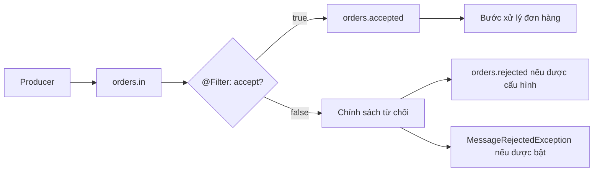

# `@Filter`: kiểm soát thông điệp được đi tiếp trong Spring Integration

## 1. Mục tiêu và vị trí trong luồng tích hợp

Trong module **SPRING_INTEGRATION_CORE**, `@Filter` là cách khai báo một endpoint thực hiện mẫu **Message Filter** bằng annotation. Nó kết nối một điều kiện Java với các `MessageChannel`, giúp quyết định thông điệp nào được tiếp tục xử lý.

Ví dụ, hệ thống tiếp nhận đơn hàng từ nhiều nguồn nhưng chỉ muốn đưa đơn từ website, có mã đơn và tổng tiền dương sang bước xử lý tiếp theo. Đơn không đáp ứng điều kiện cần được giữ ở một nhánh riêng để kiểm tra.

Sau bài này, bạn có thể:

- Viết phương thức `@Filter` nhận payload, `Message<?>` hoặc giá trị header.
- Khai báo kênh đầu vào, kênh chấp nhận và kênh loại bỏ.
- Phân biệt việc trả về `false`, ném lỗi nghiệp vụ khi từ chối và gặp lỗi trong lúc đánh giá điều kiện.
- Chuyển cùng một quy tắc giữa annotation, XML và Java DSL.
- Viết kiểm thử chứng minh thông điệp tới đúng nhánh và giữ được dữ liệu cần thiết.

Các ví dụ dùng Java 17 trở lên, `spring-integration-core` và JUnit Jupiter cho phần kiểm thử. Phiên bản Spring Framework và Spring Integration cần được quản lý bằng bộ dependency tương thích của dự án; nếu dự án dùng Spring Boot, sử dụng bộ quản lý phiên bản của Boot. Ví dụ tạo `ApplicationContext` trực tiếp để làm rõ hạ tầng, không phụ thuộc vào một ứng dụng Boot có sẵn.

## 2. Mô hình xử lý: điều kiện boolean điều khiển đường đi

Một thông điệp gồm payload và headers. Filter đọc dữ liệu cần thiết để trả lời một câu hỏi: **thông điệp này có được đi tiếp trên nhánh chính không?**



Hai hành động ở nhánh từ chối có thể cùng xảy ra; sơ đồ không biểu diễn hai lựa chọn bắt buộc loại trừ nhau.

Khi điều kiện đúng, dữ liệu được chuyển tiếp là thông điệp đầu vào, không phải một thông điệp có payload `true`. Bộ lọc cũng không tự thêm lý do từ chối hoặc sửa payload. Đây là ngữ nghĩa của Message Filter trong [tài liệu Filter của Spring Integration](https://docs.spring.io/spring-integration/reference/filter.html).

Về cấu trúc, có ba phần cần phân biệt:

1. **Phương thức nghiệp vụ** tính kết quả chấp nhận hay từ chối.
2. **Message handler** của filter thực thi lựa chọn và xử lý kết quả.
3. **Consumer endpoint** nhận thông điệp từ channel và gọi handler.

Do đó, chỉ viết một phương thức có annotation chưa đủ: đối tượng chứa nó phải là Spring bean và hạ tầng Spring Integration phải xử lý annotation đó.

### Phân biệt với các endpoint gần giống

| Nhu cầu | Thành phần phù hợp | Ví dụ |
| --- | --- | --- |
| Quyết định có tiếp tục nhánh chính hay không | Filter | Chỉ tiếp nhận đơn đủ điều kiện |
| Chọn một hoặc nhiều nhánh đích theo dữ liệu | Router | Chọn kho miền Bắc, Trung hoặc Nam |
| Tạo dữ liệu đầu ra có cấu trúc hoặc giá trị khác | Transformer | Chuyển JSON thành `Order` |
| Thực hiện một thao tác xử lý | Service activator | Gọi dịch vụ xác nhận đơn |

Nếu yêu cầu là trả về một kết quả gồm `accepted`, `reasonCode` và danh sách lỗi, hãy tính kết quả đó trong một bước xử lý riêng rồi định tuyến theo nó. Một boolean không chứa đủ thông tin để biểu diễn toàn bộ kết quả kiểm tra.

## 3. Chữ ký phương thức và dữ liệu đầu vào

Import đúng annotation của Spring Integration:

```java
import org.springframework.integration.annotation.Filter;
import org.springframework.messaging.Message;
import org.springframework.messaging.handler.annotation.Header;
```

`@Filter` ở đây không phải servlet filter và không phải toán tử `Stream.filter()`.

### 3.1. Chỉ nhận payload

```java
@Filter(inputChannel = "text.in", outputChannel = "text.accepted")
public boolean hasContent(String text) {
    return !text.isBlank();
}
```

Trong đoạn này, tham số là payload kiểu `String`; bạn không cần tự gọi `message.getPayload()`.

### 3.2. Nhận toàn bộ thông điệp

```java
@Filter(inputChannel = "events.in", outputChannel = "events.accepted")
public boolean isTrusted(Message<?> message) {
    return Boolean.TRUE.equals(message.getHeaders().get("trusted"));
}
```

Chữ ký này hữu ích khi điều kiện cần phối hợp payload và nhiều header, hoặc khi cần kiểm tra kiểu payload trước khi sử dụng.

### 3.3. Nhận payload cùng header

```java
@Filter(inputChannel = "text.in", outputChannel = "text.accepted")
public boolean hasContentFromWeb(
        String text,
        @Header(value = "source", required = false) String source) {
    return "WEB".equals(source) && !text.isBlank();
}
```

Các đoạn trên là những cách khai báo thay thế, không phải ba endpoint cần đăng ký chung. Kiểu trả về của phương thức filter là `boolean` hoặc `Boolean`; nên dùng `boolean` để tránh một kết quả `null` không có ý nghĩa nghiệp vụ. Hợp đồng chữ ký được mô tả trong [Javadoc của `@Filter`](https://docs.spring.io/spring-integration/api/org/springframework/integration/annotation/Filter.html).

`@Header` mặc định yêu cầu header phải tồn tại. Trong ví dụ, `required = false` cho phép thiếu `source` và truyền `null` vào phương thức; biểu thức `"WEB".equals(source)` sẽ trả về `false`. Nếu để header bắt buộc, thiếu header sẽ gây lỗi phân giải tham số trước khi quy tắc được đánh giá. Xem [Javadoc của `@Header`](https://docs.spring.io/spring-framework/docs/current/javadoc-api/org/springframework/messaging/handler/annotation/Header.html).

Việc framework có thể chuyển đổi một số kiểu dữ liệu không thay thế cho hợp đồng đầu vào. Ví dụ này quy ước payload là `Order` và `source` là chuỗi. JSON thô cần được chuyển thành `Order` ở bước thích hợp trước filter.

## 4. Ví dụ hoàn chỉnh bằng annotation

### 4.1. Hợp đồng nghiệp vụ

Một đơn hàng được chấp nhận khi đồng thời thỏa mãn:

- Header `source` bằng `WEB`, phân biệt chữ hoa và chữ thường.
- `orderId` không `null`, không rỗng và không chỉ chứa khoảng trắng.
- `total` không `null` và lớn hơn 0.

Mọi trường hợp không thỏa mãn sẽ vào `orders.rejected`. Nhánh này chứa thông điệp bị từ chối để một consumer khác quyết định cách xử lý tiếp.

### 4.2. Mô hình dữ liệu và quy tắc độc lập

Mỗi lớp public sau nằm trong tệp Java cùng tên, thuộc package `example.integration`.

```java
package example.integration;

import java.math.BigDecimal;

public record Order(String orderId, BigDecimal total) {
}
```

```java
package example.integration;

public class OrderPolicy {

    public boolean accepts(Order order, String source) {
        return order != null
                && "WEB".equals(source)
                && order.orderId() != null
                && !order.orderId().isBlank()
                && order.total() != null
                && order.total().signum() > 0;
    }
}
```

Đối tượng `Order` ở đây cho phép trường không hợp lệ để minh họa bộ lọc. Trong dự án thực tế, mô hình dữ liệu và bước validation có thể đặt ràng buộc chặt hơn.

`OrderPolicy` chỉ tính điều kiện. Nó không gửi thông điệp, ghi cơ sở dữ liệu hay thay đổi đơn hàng. Điều này giúp cùng quy tắc được dùng ở cấu hình annotation, XML và Java DSL.

### 4.3. Adapter được đánh dấu `@Filter`

```java
package example.integration;

import org.springframework.integration.annotation.Filter;
import org.springframework.messaging.handler.annotation.Header;

public class AnnotatedOrderFilter {

    private final OrderPolicy policy;

    public AnnotatedOrderFilter(OrderPolicy policy) {
        this.policy = policy;
    }

    @Filter(
            inputChannel = "orders.in",
            outputChannel = "orders.accepted",
            discardChannel = "orders.rejected",
            throwExceptionOnRejection = "false")
    public boolean accept(
            Order order,
            @Header(value = "source", required = false) String source) {
        return policy.accepts(order, source);
    }
}
```

`throwExceptionOnRejection` là thuộc tính kiểu `String` trong annotation, nên giá trị được viết là `"false"`. Cách này cũng cho phép dùng property placeholder khi dự án cần cấu hình từ môi trường.

### 4.4. Khai báo bean và channel

```java
package example.integration;

import org.springframework.context.annotation.Bean;
import org.springframework.context.annotation.Configuration;
import org.springframework.integration.channel.DirectChannel;
import org.springframework.integration.channel.QueueChannel;
import org.springframework.integration.config.EnableIntegration;

@Configuration
@EnableIntegration
public class OrderFilterConfiguration {

    @Bean("orders.in")
    public DirectChannel ordersIn() {
        return new DirectChannel();
    }

    @Bean("orders.accepted")
    public QueueChannel ordersAccepted() {
        return new QueueChannel(100);
    }

    @Bean("orders.rejected")
    public QueueChannel ordersRejected() {
        return new QueueChannel(100);
    }

    @Bean
    public OrderPolicy orderPolicy() {
        return new OrderPolicy();
    }

    @Bean
    public AnnotatedOrderFilter annotatedOrderFilter(OrderPolicy policy) {
        return new AnnotatedOrderFilter(policy);
    }
}
```

Trong context Java độc lập này, `@EnableIntegration` đăng ký hạ tầng tích hợp và các bộ xử lý annotation. `AnnotatedOrderFilter` được đưa vào context bằng `@Bean`, nên không cần thêm component scanning cho lớp đó. Vai trò của hạ tầng được mô tả tại [Configuration and `@EnableIntegration`](https://docs.spring.io/spring-integration/reference/overview.html#configuration-enable-integration).

Việc gọi `new AnnotatedOrderFilter(policy).accept(order, source)` trực tiếp chỉ thực thi Java và trả về boolean. Nó không tạo endpoint hay thực hiện gửi tới `outputChannel` và `discardChannel`.

Không đặt `@Bean` lên chính phương thức nghiệp vụ `accept(...)` trả về boolean trong mô hình này. `@Bean` được dùng để đăng ký đối tượng chứa phương thức, còn `@Filter` mô tả cách phương thức tham gia luồng thông điệp.

### 4.5. Tại sao chọn các kiểu channel này?

`orders.in` dùng `DirectChannel` để lời gọi filter diễn ra trong luồng gửi. Hai kênh đầu ra dùng `QueueChannel` để ví dụ và kiểm thử có thể nhận thông điệp bằng `receive(...)`. Kênh đầu ra dạng queue không đòi hỏi filter phải có poller; poller phụ thuộc vào **kênh đầu vào của endpoint**. Đặc tính các channel được mô tả trong [Message Channel Implementations](https://docs.spring.io/spring-integration/reference/channel/implementations.html).

Các queue trong ví dụ có sức chứa 100 và mặc định ở bộ nhớ. Trong hệ thống chạy lâu dài, cần consumer nhận dữ liệu từ cả hai nhánh; queue đầy có thể làm việc gửi chờ hoặc thất bại. Kênh loại bỏ chưa tự tạo ra cơ chế lưu trữ bền vững hay dead-letter queue trên broker.

## 5. Thuộc tính cấu hình thường gặp

| Thuộc tính | Ý nghĩa trong thiết kế |
| --- | --- |
| `inputChannel` | Kênh cung cấp thông điệp cho endpoint |
| `outputChannel` | Kênh nhận thông điệp vượt qua điều kiện |
| `discardChannel` | Kênh nhận thông điệp bị từ chối |
| `throwExceptionOnRejection` | Bật việc ném lỗi khi điều kiện trả về `false` |
| `poller` | Cách lấy thông điệp nếu đầu vào là `PollableChannel` |

Ngoài các thuộc tính trên, `adviceChain`, `discardWithinAdvice`, `autoStartup` và `sendTimeout` phục vụ những yêu cầu nâng cao. Tên và kiểu thuộc tính cần đối chiếu với [API của `@Filter`](https://docs.spring.io/spring-integration/api/org/springframework/integration/annotation/Filter.html).

Trong cấu hình minh họa, tên channel được khai báo tường minh để nhìn thấy cấu trúc luồng. Nếu bỏ `outputChannel`, việc chuyển tiếp có thể dùng header `replyChannel`; thiếu cả hai thì một thông điệp được chấp nhận vẫn có thể gặp lỗi tìm đích gửi. Cơ chế đích trả lời được giải thích trong [Annotation Support](https://docs.spring.io/spring-integration/reference/configuration/annotations.html).

## 6. Xử lý thông điệp bị từ chối

### 6.1. Ma trận hành vi

Giả sử phương thức đã thực thi bình thường và trả về `false`:

| `discardChannel` | `throwExceptionOnRejection` | Kết quả |
| --- | --- | --- |
| Không cấu hình | `false` | Không đưa thông điệp vào nhánh chính; loại bỏ |
| Có cấu hình | `false` | Gửi thông điệp vào kênh loại bỏ |
| Không cấu hình | `true` | Ném `MessageRejectedException` |
| Có cấu hình | `true` | Gửi vào kênh loại bỏ, sau đó ném `MessageRejectedException` |

Hàng cuối giả định việc gửi vào kênh loại bỏ thành công; nếu chính thao tác đó lỗi, lỗi gửi có thể xuất hiện trước. Hai tùy chọn được đánh giá độc lập theo [Javadoc của `MessageFilter`](https://docs.spring.io/spring-integration/api/org/springframework/integration/filter/MessageFilter.html).

Khi không có discard channel và không bật exception, từ Spring Integration 6.1 filter ghi cảnh báo về thông điệp bị loại. Nếu muốn chủ động bỏ thông điệp không kèm cảnh báo này, có thể đặt `discardChannel = "nullChannel"`. Hành vi ghi log và lựa chọn `NullChannel` được nêu trong [tài liệu Filter](https://docs.spring.io/spring-integration/reference/filter.html).

### 6.2. Trả về `false` khác với gặp exception

Giả sử dữ liệu có `total = 0`: quy tắc tính được kết quả và trả về `false`. Đây là một quyết định từ chối bình thường.

Ngược lại, nếu phương thức gọi một dịch vụ và gặp lỗi kết nối, nó chưa tính được kết quả chấp nhận. Exception phát sinh trong lúc gọi phương thức không được tự chuyển thành `false`, và `discardChannel` không tự trở thành nơi nhận mọi lỗi kỹ thuật.

Vì vậy, tránh cách viết:

```java
// Không nên: mọi lỗi vận hành đều bị biến thành từ chối nghiệp vụ.
public boolean acceptWithHiddenFailure(Order order) {
    try {
        return externalRiskServiceAllows(order);
    }
    catch (RuntimeException exception) {
        return false;
    }
}
```

Đây là mã minh họa lỗi thiết kế; `externalRiskServiceAllows(...)` đại diện cho một lời gọi bên ngoài. Nếu cần quyết định dựa trên dữ liệu từ xa, có thể lấy dữ liệu ở bước service activator hoặc enricher, xử lý lỗi tại đó, rồi để filter đánh giá kết quả đã có.

### 6.3. `send()` không trả kết quả nghiệp vụ của filter

```java
boolean sent = inputChannel.send(message);
```

Giá trị này phản ánh thao tác gửi của channel, không phải giá trị boolean do phương thức `@Filter` trả về.

Trong ví dụ, một đơn bị từ chối vẫn có thể khiến `orders.in.send(message)` trả về `true`: channel đã giao thông điệp cho filter, và filter đã xử lý nó bằng cách gửi sang `orders.rejected`. Muốn biết kết quả nghiệp vụ, hãy quan sát nhánh đầu ra hoặc thiết kế một thông điệp phản hồi riêng.

## 7. Cấu hình XML tương đương

Khi topology cần thể hiện trong XML, vẫn có thể dùng lại `OrderPolicy`. Adapter dưới đây là POJO thông thường, không chứa `@Filter`:

```java
package example.integration;

import org.springframework.messaging.Message;

public class XmlOrderSelector {

    private final OrderPolicy policy;

    public XmlOrderSelector(OrderPolicy policy) {
        this.policy = policy;
    }

    public boolean accept(Message<Order> message) {
        String source = message.getHeaders().get("source", String.class);
        return policy.accepts(message.getPayload(), source);
    }
}
```

Với hợp đồng payload `Order` và header `source` kiểu chuỗi, XML tương ứng là:

```xml
<?xml version="1.0" encoding="UTF-8"?>
<beans xmlns="http://www.springframework.org/schema/beans"
       xmlns:xsi="http://www.w3.org/2001/XMLSchema-instance"
       xmlns:int="http://www.springframework.org/schema/integration"
       xsi:schemaLocation="
           http://www.springframework.org/schema/beans
           https://www.springframework.org/schema/beans/spring-beans.xsd
           http://www.springframework.org/schema/integration
           https://www.springframework.org/schema/integration/spring-integration.xsd">

    <int:channel id="orders.in"/>

    <int:channel id="orders.accepted">
        <int:queue capacity="100"/>
    </int:channel>

    <int:channel id="orders.rejected">
        <int:queue capacity="100"/>
    </int:channel>

    <bean id="orderPolicy" class="example.integration.OrderPolicy"/>

    <bean id="xmlOrderSelector"
          class="example.integration.XmlOrderSelector">
        <constructor-arg ref="orderPolicy"/>
    </bean>

    <int:filter id="orderEligibilityFilter"
                input-channel="orders.in"
                output-channel="orders.accepted"
                discard-channel="orders.rejected"
                throw-exception-on-rejection="false"
                ref="xmlOrderSelector"
                method="accept"/>
</beans>
```

`ref` chọn bean, `method` chọn phương thức đánh giá. Cách dùng POJO trả boolean được mô tả tại [Configuring a Filter with XML](https://docs.spring.io/spring-integration/reference/filter.html#filter-namespace).

XML này là phương án **thay thế** cho `OrderFilterConfiguration`, không phải phần cấu hình cần nạp đồng thời. Nếu cùng đăng ký một endpoint annotation và một endpoint XML trên một `DirectChannel`, chúng có thể trở thành các consumer cạnh tranh. Đừng kỳ vọng hai filter sẽ tự nối tiếp hoặc cùng nhận mọi thông điệp.

## 8. Cùng quy tắc bằng Java DSL

Java DSL thuận tiện khi cần đọc toàn bộ chuỗi bước xử lý trong một khai báo. Ví dụ sau là phương án thay thế thứ ba, vẫn dùng các lớp `Order` và `OrderPolicy` ở trên:

```java
package example.integration;

import org.springframework.context.annotation.Bean;
import org.springframework.context.annotation.Configuration;
import org.springframework.integration.channel.DirectChannel;
import org.springframework.integration.channel.QueueChannel;
import org.springframework.integration.config.EnableIntegration;
import org.springframework.integration.core.MessageSelector;
import org.springframework.integration.dsl.IntegrationFlow;

@Configuration
@EnableIntegration
public class OrderDslConfiguration {

    @Bean("orders.in")
    public DirectChannel ordersIn() {
        return new DirectChannel();
    }

    @Bean("orders.accepted")
    public QueueChannel ordersAccepted() {
        return new QueueChannel(100);
    }

    @Bean("orders.rejected")
    public QueueChannel ordersRejected() {
        return new QueueChannel(100);
    }

    @Bean
    public OrderPolicy orderPolicy() {
        return new OrderPolicy();
    }

    @Bean
    public IntegrationFlow orderEligibilityFlow(OrderPolicy policy) {
        MessageSelector selector = message -> policy.accepts(
                (Order) message.getPayload(),
                message.getHeaders().get("source", String.class));

        return IntegrationFlow.from("orders.in")
                .filter(selector, endpoint -> endpoint
                        .discardChannel("orders.rejected")
                        .throwExceptionOnRejection(false))
                .channel("orders.accepted")
                .get();
    }
}
```

`MessageSelector` nhận `Message<?>` và trả về boolean, nên lambda có thể đọc cả payload lẫn headers. Đây là hợp đồng được công bố trong [Javadoc của `MessageSelector`](https://docs.spring.io/spring-integration/api/org/springframework/integration/core/MessageSelector.html). Phần cấu hình nhánh loại bỏ thuộc [API `FilterEndpointSpec`](https://docs.spring.io/spring-integration/api/org/springframework/integration/dsl/FilterEndpointSpec.html).

Ví dụ DSL ép kiểu payload dựa trên hợp đồng đầu vào. Nếu cần hỗ trợ nhiều kiểu, hãy kiểm tra `instanceof` rõ ràng hoặc thêm bước chuyển đổi trước đó. Không nên trông chờ vào tính an toàn kiểu của một phép ép kiểu trong lambda.

| Thành phần | Annotation | XML | Java DSL |
| --- | --- | --- | --- |
| Bước lọc | `@Filter` | `<int:filter>` | `.filter(...)` |
| Đầu vào | `inputChannel` | `input-channel` | `IntegrationFlow.from(...)` |
| Nhánh chấp nhận | `outputChannel` | `output-channel` | `.channel(...)` sau filter |
| Nhánh từ chối | `discardChannel` | `discard-channel` | `.discardChannel(...)` |
| Từ chối thành lỗi | Chuỗi `"true"` | `"true"` trong XML | Boolean `true` |

Chọn một cách đăng ký endpoint cho mỗi vị trí trong luồng. Có thể kết hợp nhiều phong cách trong cùng ứng dụng, nhưng phải làm rõ endpoint nào thuộc cấu hình nào.

## 9. Khi đầu vào là `QueueChannel`: cần poller

Nếu thay `orders.in` bằng `QueueChannel`, filter phải chủ động lấy thông điệp từ queue thông qua polling consumer. Một biến thể của phương thức annotation là:

```java
import org.springframework.integration.annotation.Filter;
import org.springframework.integration.annotation.Poller;
import org.springframework.messaging.handler.annotation.Header;

@Filter(
        inputChannel = "orders.pending",
        outputChannel = "orders.accepted",
        discardChannel = "orders.rejected",
        poller = @Poller(
                fixedDelay = "200",
                maxMessagesPerPoll = "10",
                receiveTimeout = "0"))
public boolean acceptPending(
        Order order,
        @Header(value = "source", required = false) String source) {
    return policy.accepts(order, source);
}
```

Đoạn này đặt trong một bean có trường `policy`; cần khai báo thêm channel `orders.pending` kiểu `QueueChannel`. Đây là biến thể thay thế, không phải mã bổ sung vào endpoint `orders.in` ban đầu.

Các tham số minh họa polling mỗi chu kỳ với độ trễ cố định 200 ms, lấy tối đa 10 thông điệp mỗi lần và không chờ khi queue trống. Chúng là tham số lấy dữ liệu, không phải quy tắc giới hạn tốc độ nghiệp vụ của `@Filter`. Xem [Javadoc của `@Poller`](https://docs.spring.io/spring-integration/api/org/springframework/integration/annotation/Poller.html).

Nếu không khai báo poller riêng, một polling consumer có thể dùng default poller đã được cấu hình; nếu không có poller phù hợp, việc khởi tạo endpoint sẽ lỗi. Phân biệt poller riêng và default poller trong [Using the `@Poller` Annotation](https://docs.spring.io/spring-integration/reference/configuration/annotations.html#annotations-poller).

Với đầu vào queue, `send()` có thể hoàn tất ngay sau khi đưa dữ liệu vào queue. Lúc đó filter có thể chưa chạy. Kiểm thử bất đồng bộ cần đợi kết quả ở đầu ra bằng timeout hữu hạn, thay vì kiểm tra queue ngay lập tức hoặc dùng `Thread.sleep(...)` cố định.

## 10. Quan hệ với gateway và xử lý lỗi

### 10.1. Filter trong luồng request–reply

Một phương thức gateway có giá trị trả về thường cần downstream gửi phản hồi. Nếu filter trả về `false`, không có bước nào tạo phản hồi và không ném exception, bên gọi có thể phải chờ đến reply timeout.

Ví dụ, một API hỏi “đơn hàng đã được tiếp nhận chưa?” không nên dùng việc loại bỏ thông điệp làm cách biểu diễn câu trả lời “không”. Hãy chọn hợp đồng rõ ràng:

- **Chỉ gửi yêu cầu:** gateway trả `void`, kết quả được quan sát qua cơ chế khác.
- **Từ chối là lỗi của lời gọi:** bật exception và xác định cách caller nhận lỗi.
- **Từ chối là kết quả bình thường:** nhánh từ chối tạo phản hồi có kiểu dữ liệu và mã lý do phù hợp.

Một message được đưa vào `orders.rejected` không tự trở thành phản hồi gateway. Consumer của nhánh đó phải chủ động tạo reply nếu hợp đồng cần reply. Cơ chế gateway và reply channel được giải thích trong [Messaging Gateways](https://docs.spring.io/spring-integration/reference/gateway.html).

### 10.2. Không đồng nhất `discardChannel` với `errorChannel`

| Tình huống | Cần theo dõi |
| --- | --- |
| Điều kiện trả về `false` | Chính sách discard và cờ ném lỗi khi từ chối |
| Thiếu header bắt buộc hoặc sai kiểu dữ liệu | Lỗi ánh xạ/chuyển đổi trước hoặc trong lúc gọi phương thức |
| Phương thức đánh giá ném exception | Đường xử lý lỗi của luồng |
| Gửi sang nhánh chấp nhận hoặc loại bỏ thất bại | Lỗi chuyển giao thông điệp |

Khi dùng `DirectChannel` mặc định và gửi trực tiếp, lỗi xử lý đồng bộ truyền về caller. Với task bất đồng bộ hoặc poller được Spring Integration quản lý, cơ chế error handler có thể đóng gói lỗi thành `ErrorMessage` và gửi tới kênh lỗi phù hợp. Chỉ đặt header `errorChannel` không khiến mọi lỗi đồng bộ tự động chuyển thành thông điệp lỗi. Xem [Error Handling](https://docs.spring.io/spring-integration/reference/error-handling.html).

Thông điệp đi qua `discardChannel` của filter là thông điệp bị từ chối. `ErrorMessage` mang exception là một hợp đồng dữ liệu khác. Consumer xử lý lỗi và consumer xử lý đơn bị từ chối cần hiểu đúng loại dữ liệu mình nhận.

## 11. Advice, retry và tác dụng phụ

Nếu thêm advice cho filter, cần xác định phạm vi tác động của cả nhánh loại bỏ. Theo mặc định, việc discard và exception khi từ chối nằm trong phạm vi advice; `discardWithinAdvice = "false"` chuyển chúng ra ngoài phạm vi đó. Vì vậy, lỗi ở xử lý discard có thể kích hoạt retry nếu retry advice đang bao quanh nó. Xem [Advising Filters](https://docs.spring.io/spring-integration/reference/handler-advice/advising-filters.html).

Ví dụ cần suy nghĩ về hậu quả: nhánh từ chối đã ghi một bản ghi audit rồi phát sinh lỗi, sau đó cơ chế retry chạy lại. Nếu bản ghi không có cách chống trùng, một yêu cầu có thể tạo nhiều bản ghi audit.

Một số nguyên tắc thiết kế cho ví dụ đơn hàng:

- Giữ `OrderPolicy` là phép kiểm tra không sửa dữ liệu.
- Phân biệt lỗi tạm thời của hạ tầng với việc đơn hàng không thỏa quy tắc.
- Không retry vô hạn chỉ vì một đơn có tổng tiền bằng 0.
- Khi nhánh từ chối ghi dữ liệu ra ngoài, thiết kế khóa nghiệp vụ hoặc cơ chế idempotency cho thao tác đó.
- Định nghĩa chính sách phát lại: đơn bị loại có thể được gửi lại sau khi sửa dữ liệu hay phải đi qua một quy trình riêng?

Thay đổi phạm vi advice không tự tạo transaction chung, không bảo đảm xử lý đúng một lần và không thay thế thiết kế lưu trữ bền vững.

## 12. Kiểm thử quy tắc và wiring của endpoint

### 12.1. Những điều cần chứng minh

Chỉ kiểm thử `policy.accepts(...)` chưa chứng minh annotation đã được phát hiện hoặc channel đã nối đúng. Ngược lại, chỉ chứng minh context khởi động cũng chưa kiểm tra đường đi của thông điệp.

| Dữ liệu | Kết quả nghiệp vụ | Nhánh mong đợi |
| --- | --- | --- |
| `WEB`, mã đơn hợp lệ, tổng tiền dương | Chấp nhận | `orders.accepted` |
| `WEB`, tổng tiền bằng 0 hoặc âm | Từ chối | `orders.rejected` |
| `WEB`, thiếu mã đơn hoặc tổng tiền | Từ chối | `orders.rejected` |
| `BATCH`, dữ liệu đơn hợp lệ | Từ chối | `orders.rejected` |
| Không có `source` | Từ chối vì quy tắc, không lỗi thiếu header | `orders.rejected` |

Hai kiểm thử dưới đây tập trung vào wiring, nhánh kết quả và việc giữ payload/header. Các trường hợp biên của quy tắc có thể bổ sung bằng unit test cho `OrderPolicy`.

### 12.2. Kiểm thử bằng context Java độc lập

Đặt lớp kiểm thử trong package `example.integration`, cùng với các lớp của phương án annotation ở mục 4. Không nạp cấu hình XML hoặc DSL trong các kiểm thử này.

```java
package example.integration;

import java.math.BigDecimal;

import org.junit.jupiter.api.Test;
import org.springframework.context.annotation.AnnotationConfigApplicationContext;
import org.springframework.integration.channel.QueueChannel;
import org.springframework.messaging.Message;
import org.springframework.messaging.MessageChannel;
import org.springframework.messaging.support.MessageBuilder;

import static org.junit.jupiter.api.Assertions.assertEquals;
import static org.junit.jupiter.api.Assertions.assertNotNull;
import static org.junit.jupiter.api.Assertions.assertNull;
import static org.junit.jupiter.api.Assertions.assertSame;
import static org.junit.jupiter.api.Assertions.assertTrue;

class OrderFilterIntegrationTest {

    @Test
    void acceptedOrderKeepsPayloadAndBusinessHeader() {
        try (var context = new AnnotationConfigApplicationContext(
                OrderFilterConfiguration.class)) {

            MessageChannel input = context.getBean(
                    "orders.in", MessageChannel.class);
            QueueChannel accepted = context.getBean(
                    "orders.accepted", QueueChannel.class);
            QueueChannel rejected = context.getBean(
                    "orders.rejected", QueueChannel.class);

            Order order = new Order("ORD-101", new BigDecimal("250000"));
            Message<Order> request = MessageBuilder.withPayload(order)
                    .setHeader("source", "WEB")
                    .setHeader("businessCorrelationId", "REQ-101")
                    .build();

            assertTrue(input.send(request, 1000));

            Message<?> result = accepted.receive(1000);
            assertNotNull(result);
            assertSame(order, result.getPayload());
            assertEquals("REQ-101",
                    result.getHeaders().get("businessCorrelationId"));
            assertNull(rejected.receive(0));
        }
    }

    @Test
    void missingOptionalHeaderGoesToRejectedChannel() {
        try (var context = new AnnotationConfigApplicationContext(
                OrderFilterConfiguration.class)) {

            MessageChannel input = context.getBean(
                    "orders.in", MessageChannel.class);
            QueueChannel accepted = context.getBean(
                    "orders.accepted", QueueChannel.class);
            QueueChannel rejected = context.getBean(
                    "orders.rejected", QueueChannel.class);

            Order order = new Order("ORD-102", new BigDecimal("100000"));
            Message<Order> request = MessageBuilder.withPayload(order)
                    .setHeader("businessCorrelationId", "REQ-102")
                    .build();

            // Channel gửi thành công dù quy tắc filter trả về false.
            assertTrue(input.send(request, 1000));

            Message<?> result = rejected.receive(1000);
            assertNotNull(result);
            assertSame(order, result.getPayload());
            assertEquals("REQ-102",
                    result.getHeaders().get("businessCorrelationId"));
            assertNull(accepted.receive(0));
        }
    }
}
```

Mỗi test tạo context mới nên hai queue không còn dữ liệu từ lần kiểm thử trước. `receive(1000)` giới hạn thời gian chờ, còn `receive(0)` kiểm tra ngay nhánh lẽ ra không có dữ liệu. Kiểm tra tức thời nhánh còn lại phù hợp ở đây vì `orders.in` là `DirectChannel` và phần xử lý filter đã hoàn tất khi `send()` trả về.

Kiểm thử giữ payload là để chứng minh filter chuyển tiếp đơn hàng, thay vì gửi boolean làm payload. Kiểm tra header nghiệp vụ giúp phát hiện những thay đổi wiring làm mất ngữ cảnh của yêu cầu.

### 12.3. Mở rộng kiểm thử khi thay đổi chính sách từ chối

Nếu đổi `throwExceptionOnRejection` thành `"true"`, cần thêm kiểm thử với thông điệp không hợp lệ:

1. Lời gọi gửi qua đầu vào đồng bộ phải phát sinh `MessageRejectedException`.
2. Nhánh chấp nhận không có thông điệp.
3. Nếu vẫn cấu hình discard channel, thông điệp đã đến đó trước khi exception được ném, với giả định việc gửi discard thành công.

Nếu chuyển sang input queue và poller, điểm quan sát lỗi phải thay đổi theo cơ chế xử lý bất đồng bộ. Không giữ nguyên giả định rằng caller của `send()` sẽ bắt được exception phát sinh về sau trong polling task.

Các đoạn mã kiểm thử trong bài là ví dụ để người học triển khai; việc sinh tài liệu không đồng nghĩa các kiểm thử đã được chạy trên classpath của dự án.

## 13. Lỗi thường gặp và cách chẩn đoán

| Hiện tượng | Điểm cần kiểm tra |
| --- | --- |
| Phương thức không được gọi | Bean có trong context không; hạ tầng annotation có hoạt động không; đúng tên input channel không |
| `send()` thành công nhưng nhánh chính không có dữ liệu | Quy tắc có trả về `false` không; thông điệp có ở discard channel không |
| Thiếu header làm luồng lỗi | `@Header` đang bắt buộc hay cho phép thiếu; dữ liệu thực tế có đúng kiểu không |
| Có dữ liệu trong input queue nhưng filter không chạy | Poller riêng hoặc default poller đã được cấu hình chưa |
| Chỉ một trong nhiều filter trên cùng đầu vào nhận được message | Đầu vào có phải channel point-to-point với các consumer cạnh tranh không |
| Gateway chờ dù đơn đã bị từ chối | Có nhánh tạo reply hoặc chính sách ném lỗi phù hợp không |
| Đơn từ chối bị ghi nhận nhiều lần | Retry, phát lại hoặc xử lý discard có tác dụng phụ chưa chống trùng |
| Nhánh chính không tìm được nơi gửi | `outputChannel`, `replyChannel` và consumer của channel đích |

Khi quan sát hệ thống, nên ghi nhận mã quy tắc, kết quả chấp nhận/từ chối và mã tương quan nghiệp vụ. Nếu cần lưu lý do từ chối có cấu trúc, tạo nó rõ ràng trong một bước xử lý; `discardChannel` không tự bổ sung lý do. Tránh dùng mã đơn hoặc toàn bộ payload làm nhãn metric có số lượng giá trị không giới hạn.

Nếu đặt filter sau một splitter và trước aggregator, cần xem lại điều kiện hoàn tất nhóm: một số phần tử đã bị loại có thể khiến aggregator tiếp tục đợi số phần tử ban đầu. Đây là hệ quả của topology cần được giải quyết trong thiết kế nhóm và timeout, không phải điều `@Filter` tự điều chỉnh.

## 14. Ghi nhớ khi áp dụng

`@Filter` diễn đạt một phép quyết định boolean tại một vị trí trong luồng. Thiết kế đầy đủ cần quy tắc rõ ràng, bean được đăng ký, kênh đúng kiểu và chính sách từ chối phù hợp với hợp đồng của bên gọi.

Với ví dụ đơn hàng, annotation, XML và Java DSL đều kết nối cùng `OrderPolicy` vào topology gồm `orders.in`, `orders.accepted` và `orders.rejected`. Khi đánh giá một cấu hình, hãy lần theo cả nhánh chấp nhận, nhánh từ chối và trường hợp đánh giá thất bại; đó là cách thấy được hành vi thực tế của endpoint.
