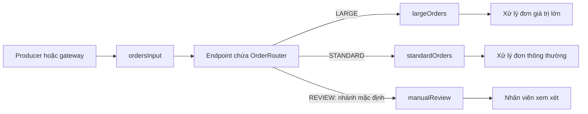

# @Router — định tuyến thông điệp bằng annotation

Trong chương **Annotation và XML** của **SPRING_INTEGRATION_CORE**, `@Router` biểu diễn quyết định đưa một thông điệp sang nhánh xử lý nào. Quyết định có thể dựa vào payload, header hoặc cả hai, còn việc chuyển thông điệp giữa các thành phần do `MessageChannel` và endpoint đảm nhiệm.

Bài học sử dụng tình huống phân luồng đơn hàng để nối các khái niệm `Message`, channel, endpoint, gateway và Java DSL. Sau bài này, bạn có thể viết phương thức định tuyến, ánh xạ khóa sang channel, chọn chính sách khi không có đích phù hợp và kiểm thử đường đi thực tế của thông điệp.

Các ví dụ dùng Java 17 và API Spring Integration 6.5.x. Đây là mốc API của bài học; khi áp dụng vào dự án, dùng bộ phiên bản Spring được quản lý thống nhất bởi BOM của dự án. Ví dụ chính cần `spring-integration-core`; phần kiểm thử cần JUnit Jupiter cùng hỗ trợ parameterized test. Các đoạn XML và DSL là phương án cấu hình thay thế được giải thích riêng.

## 1. Vấn đề mà router giải quyết

Một dịch vụ tiếp nhận đơn hàng có ba quy tắc:

- Đơn có cờ rủi ro phải được nhân viên xem xét, bất kể giá trị.
- Đơn từ 5.000.000 đồng trở lên đi vào quy trình xử lý đơn giá trị lớn.
- Các đơn còn lại đi vào quy trình thông thường.

Nếu thành phần tiếp nhận trực tiếp gọi từng dịch vụ xử lý, nó phải biết cả quy tắc lẫn cách kết nối tới các dịch vụ đó. Với router, bên gửi chỉ đưa `Message<Order>` vào channel đầu vào; router chọn nhánh, còn các endpoint ở nhánh sau thực hiện nghiệp vụ.



Trong ví dụ, `LARGE`, `STANDARD`, `REVIEW` là **khóa quyết định**. `largeOrders`, `standardOrders`, `manualReview` là **tên bean channel**. Tách hai nhóm tên giúp đổi cấu trúc luồng mà ít phải sửa quy tắc nghiệp vụ.

## 2. Phương thức trả về đích, thông điệp tiếp tục mang dữ liệu nghiệp vụ

`@Router` thuộc package `org.springframework.integration.annotation`. Những dạng trả về thông dụng là `String`, `MessageChannel`, danh sách hoặc mảng chứa các giá trị đó. Một kết quả có thể dẫn đến một đích hoặc nhiều đích. [Tài liệu cấu hình router bằng annotation](https://docs.spring.io/spring-integration/reference/6.5/router/annotation.html).

```java
@Router(inputChannel = "input")
public String choose(Order order) {
    return "standardOrders";
}
```

Nếu trả trực tiếp tên channel như trên và không cấu hình ánh xạ hay nhánh mặc định, endpoint tìm channel có tên `standardOrders`, rồi chuyển thông điệp đầu vào đến đó. Payload ở đích vẫn là `Order`; chuỗi `"standardOrders"` chỉ mô tả quyết định định tuyến.

| Thành phần | Trách nhiệm trong luồng đơn hàng | Ý nghĩa điển hình của kết quả phương thức |
| --- | --- | --- |
| Transformer | Chuyển dữ liệu tiếp nhận thành `Order` | Payload hoặc message sau chuyển đổi |
| Filter | Chấp nhận hoặc loại đơn theo điều kiện | Quyết định giữ hay loại |
| Router | Chọn quy trình xử lý đơn | Đích hoặc khóa dùng để tìm đích |
| Service activator | Thực hiện công việc ở một nhánh | Kết quả xử lý, hoặc không trả kết quả |
| Aggregator | Gộp các kết quả có liên quan | Kết quả tổng hợp của một nhóm |

Trả về `"APPROVED"` trong router không tự tạo phản hồi phê duyệt cho người gọi. Muốn gateway trả kết quả nghiệp vụ, nhánh xử lý cuối phải tạo reply phù hợp; nếu luồng chờ kết quả từ nhiều nhánh thì cần thiết kế bước tổng hợp.

## 3. Chọn dữ liệu đầu vào cho phương thức

| Chữ ký minh họa | Khi nên dùng |
| --- | --- |
| `String route(Order order)` | Quy tắc chỉ phụ thuộc payload |
| `String route(@Header("region") String region)` | Quy tắc chỉ phụ thuộc một header |
| `String route(Order order, @Header("riskFlag") Boolean flag)` | Quy tắc kết hợp payload và header |
| `String route(Message<Order> message)` | Cần xem nhiều thông tin của message |
| `List<String> route(Order order)` | Một quyết định cần gửi tới nhiều nhánh |
| `MessageChannel route(Order order)` | Quyết định dùng trực tiếp đối tượng channel |

`@Header` và `@Headers` thuộc `org.springframework.messaging.handler.annotation`. Header bắt buộc bị thiếu có thể làm bước gắn tham số thất bại trước khi thân phương thức chạy. Với header tùy chọn, dùng `required = false`, chọn kiểu tham chiếu như `Boolean` và xử lý `null` rõ ràng. [Cơ chế gắn payload và header vào tham số](https://docs.spring.io/spring-integration/reference/6.5/configuration/annotations.html).

Không cần nhận toàn bộ `Message<?>` chỉ để đọc một trường đã có thể truyền bằng `@Header`. Phương thức nhận đúng dữ liệu cần dùng sẽ dễ gọi trực tiếp trong kiểm thử quy tắc hơn.

## 4. Ví dụ hoàn chỉnh: phân luồng đơn hàng

Ví dụ chính có ba lớp trong package `example.routing`. Channel đầu vào là `DirectChannel`; các channel đầu ra là `QueueChannel` để có thể nhận và quan sát thông điệp mà chưa cần xây dựng đầy đủ dịch vụ nghiệp vụ.

### 4.1. Payload `Order`

```java
package example.routing;

import java.math.BigDecimal;
import java.util.Objects;

public record Order(String id, BigDecimal total) {

    public Order {
        Objects.requireNonNull(id, "id must not be null");
        Objects.requireNonNull(total, "total must not be null");
        if (id.isBlank()) {
            throw new IllegalArgumentException("id must not be blank");
        }
        if (total.signum() < 0) {
            throw new IllegalArgumentException("total must be non-negative");
        }
    }
}
```

Giá trị tiền dùng `BigDecimal`. So sánh bằng `compareTo()` diễn tả ngưỡng theo giá trị số, không phụ thuộc số tiền được biểu diễn thành `5000000`, `5000000.0` hay `5000000.00`.

Kiểm tra dữ liệu đầu vào đặt ở biên tạo đối tượng. Nếu nguồn nhận JSON hoặc văn bản, transformer phía trước chịu trách nhiệm tạo `Order`; router không kiêm phân tích định dạng nguồn.

### 4.2. Lớp chứa quy tắc và annotation

```java
package example.routing;

import java.math.BigDecimal;

import org.springframework.integration.annotation.MessageEndpoint;
import org.springframework.integration.annotation.Router;
import org.springframework.messaging.handler.annotation.Header;

@MessageEndpoint
public class OrderRouter {

    private static final BigDecimal LARGE_ORDER_THRESHOLD =
            new BigDecimal("5000000");

    @Router(
            inputChannel = "ordersInput",
            channelMappings = {
                    "LARGE=largeOrders",
                    "STANDARD=standardOrders"
            },
            defaultOutputChannel = "manualReview",
            resolutionRequired = "false",
            sendTimeout = "1000"
    )
    public String route(
            Order order,
            @Header(value = "riskFlag", required = false) Boolean riskFlag) {

        if (Boolean.TRUE.equals(riskFlag)) {
            return "REVIEW";
        }

        return order.total().compareTo(LARGE_ORDER_THRESHOLD) >= 0
                ? "LARGE"
                : "STANDARD";
    }
}
```

`REVIEW` chủ ý không nằm trong `channelMappings`: trong cấu hình này, khóa chưa được ánh xạ sẽ đi đến `manualReview`. Cờ rủi ro được xét trước ngưỡng tiền để đơn giá trị lớn có rủi ro vẫn được nhân viên xem xét.

`@MessageEndpoint` thể hiện vai trò của lớp trong Spring. Để không phụ thuộc package scanning, cấu hình sau đăng ký lớp bằng `@Import`.

### 4.3. Cấu hình channel và hạ tầng Integration

```java
package example.routing;

import org.springframework.context.annotation.Bean;
import org.springframework.context.annotation.Configuration;
import org.springframework.context.annotation.Import;
import org.springframework.integration.channel.DirectChannel;
import org.springframework.integration.channel.QueueChannel;
import org.springframework.integration.config.EnableIntegration;

@Configuration
@EnableIntegration
@Import(OrderRouter.class)
public class OrderRoutingConfig {

    @Bean
    public DirectChannel ordersInput() {
        return new DirectChannel();
    }

    @Bean
    public QueueChannel largeOrders() {
        return new QueueChannel(100);
    }

    @Bean
    public QueueChannel standardOrders() {
        return new QueueChannel(100);
    }

    @Bean
    public QueueChannel manualReview() {
        return new QueueChannel(100);
    }
}
```

Trong cấu hình Java độc lập này, `@EnableIntegration` bật hạ tầng xử lý annotation. Các bean được khai báo tường minh để loại channel và dung lượng hàng đợi là quyết định có thể nhìn thấy.

Đường đi của đơn 7.000.000 đồng không có cờ rủi ro:

1. Producer gửi `Message<Order>` tới `ordersInput`.
2. Endpoint gọi `OrderRouter.route(order, null)`.
3. Phương thức trả khóa `LARGE`.
4. Mapping đổi `LARGE` thành tên `largeOrders`.
5. Router gửi message tới bean `largeOrders`.
6. Consumer ở nhánh đó nhận payload `Order` ban đầu.

`DirectChannel` gọi subscriber trong luồng của bên gửi. `QueueChannel` lưu thông điệp để bên nhận lấy sau; đưa vào hàng đợi thành công chưa thể hiện nghiệp vụ đã xử lý xong. Hàng đợi trong ví dụ lưu dữ liệu ở bộ nhớ. [Đặc điểm các loại channel](https://docs.spring.io/spring-integration/reference/6.5/channel/implementations.html).

### 4.4. Gửi và quan sát một thông điệp

```java
package example.routing;

import java.math.BigDecimal;

import org.springframework.context.annotation.AnnotationConfigApplicationContext;
import org.springframework.integration.channel.QueueChannel;
import org.springframework.messaging.Message;
import org.springframework.messaging.MessageChannel;
import org.springframework.messaging.support.MessageBuilder;

public class RoutingDemo {

    public static void main(String[] args) {
        try (var context = new AnnotationConfigApplicationContext(
                OrderRoutingConfig.class)) {

            Order order = new Order("OD-1001", new BigDecimal("7000000"));
            Message<Order> request = MessageBuilder.withPayload(order)
                    .setHeader("traceId", "trace-1001")
                    .build();

            MessageChannel input = context.getBean(
                    "ordersInput", MessageChannel.class);
            if (!input.send(request, 1000)) {
                throw new IllegalStateException("Input rejected the message");
            }

            QueueChannel destination = context.getBean(
                    "largeOrders", QueueChannel.class);
            Message<?> result = destination.receive(1000);
            if (result == null) {
                throw new IllegalStateException("No routed message received");
            }

            System.out.println(result.getPayload());
            System.out.println(result.getHeaders().get("traceId"));
        }
    }
}
```

Kết quả mong đợi là thông tin đơn `OD-1001` và header `trace-1001`. Nếu thêm `.setHeader("riskFlag", true)`, cần nhận từ `manualReview` thay cho `largeOrders`.

## 5. Đọc đúng các thuộc tính quan trọng

Một số thuộc tính `@Router` dùng chuỗi, kể cả giá trị mang nghĩa boolean hoặc thời gian. Vì vậy viết `resolutionRequired = "false"`, không viết `resolutionRequired = false`. Chuỗi cũng cho phép dùng property placeholder ở các thuộc tính hỗ trợ, chẳng hạn `sendTimeout = "${orders.routing.send-timeout:1000}"`.

| Thuộc tính | Cách dùng trong thiết kế |
| --- | --- |
| `inputChannel` | Chỉ định điểm nhận thông điệp |
| `channelMappings` | Khai báo các cặp `khóa=tênChannel` |
| `prefix`, `suffix` | Ghép phần tên khi phân giải channel dạng chuỗi |
| `defaultOutputChannel` | Chọn nhánh khi không xác định được channel đích |
| `resolutionRequired` | Quyết định việc không phân giải được tên có gây lỗi ngay không |
| `applySequence` | Bổ sung thông tin chuỗi khi cần phối hợp nhiều nhánh |
| `ignoreSendFailures` | Quyết định cách ứng xử với lỗi gửi tới các đích |
| `sendTimeout` | Giới hạn thời gian chờ gửi khi channel có hỗ trợ chờ |
| `poller` | Cấu hình cách lấy message từ đầu vào dạng pollable |
| `autoStartup`, `phase` | Điều khiển vòng đời endpoint |

Đối chiếu kiểu thuộc tính trong [khai báo `@Router` của Spring Integration 6.5.10](https://github.com/spring-projects/spring-integration/blob/v6.5.10/spring-integration-core/src/main/java/org/springframework/integration/annotation/Router.java).

Ví dụ dùng quy ước tên, áp dụng cho một router độc lập với ví dụ chính:

```java
@Router(
        inputChannel = "regionalInput",
        prefix = "region.",
        suffix = ".orders"
)
public String routeByRegion(@Header("region") String region) {
    return switch (region) {
        case "VN" -> "vn";
        case "SG" -> "sg";
        default -> throw new IllegalArgumentException("Unsupported region");
    };
}
```

Cấu hình này cần các channel `region.vn.orders`, `region.sg.orders` và đầu vào `regionalInput`. Tên ghép có phân biệt chữ hoa, chữ thường. Cần giữ đồng bộ giữa giá trị trả về và tên bean thực tế.

Nếu số nhánh nhỏ và không có quy ước đặt tên xuyên suốt, mapping tường minh thường dễ đọc hơn ghép tên. Không nên để dữ liệu do bên ngoài cung cấp trở thành tên channel tùy ý; hãy đổi dữ liệu đó thành tập khóa nghiệp vụ đã định nghĩa.

## 6. Phân biệt thiếu mapping, không phân giải được và gửi thất bại

Ba tình huống này xảy ra ở các bước khác nhau, nên cần suy luận riêng.

### 6.1. Khóa chưa có mapping

Trong ví dụ chính, `REVIEW` chưa có mapping. Spring Integration từ 6.0 đặt `channelKeyFallback` về `false` khi cấu hình default output channel, trừ khi tùy chọn đó đã được đặt tường minh. Khóa chưa có mapping do đó được đưa đến nhánh mặc định thay vì tiếp tục được xem như tên channel. [Quy tắc của mapping router từ phiên bản 6.0](https://docs.spring.io/spring-integration/reference/6.5/router/common-parameters.html).

`channelKeyFallback` không phải thuộc tính trực tiếp của `@Router`. Khi cần điều khiển tường minh, có thể cấu hình đối tượng router hoặc dùng Java DSL.

### 6.2. Mapping trỏ tới một bean không tồn tại

Giả sử viết nhầm `LARGE=largeOrdes`. Khóa có mapping, nhưng tên `largeOrdes` không phân giải được thành channel.

- Với `resolutionRequired = "true"`, lỗi phân giải được báo ra.
- Với `resolutionRequired = "false"`, đích không phân giải được có thể bị bỏ qua; nếu không còn đích nào thì router dùng default channel nếu có.
- Khi không còn đích và không có default channel, cấu hình mặc định của router vẫn có thể phát sinh lỗi; riêng `resolutionRequired = "false"` không bảo đảm bỏ message một cách im lặng.

Cấu hình mẫu chọn `false` để thể hiện chính sách chuyển trường hợp không tìm được đích sang `manualReview`. Hệ quả là lỗi gõ tên channel cũng có thể bị chuyển sang hàng đợi này. Hệ thống cần phát hiện lỗi cấu hình sớm có thể chọn `true` cho các mapping bắt buộc và kiểm thử riêng nhánh mặc định.

Không nên nhớ công thức “có default thì không bao giờ lỗi”. Cấu hình có default channel và đặt tường minh cả `channelKeyFallback = true`, `resolutionRequired = true` bị mapping router từ chối khi khởi tạo. [Hợp đồng của `AbstractMappingMessageRouter`](https://docs.spring.io/spring-integration/docs/current/api/org/springframework/integration/router/AbstractMappingMessageRouter.html).

### 6.3. Đích tồn tại nhưng không nhận hoặc xử lý được thông điệp

Ví dụ:

- `DirectChannel` đích không có subscriber.
- Hàng đợi đích đầy và hết thời gian chờ gửi.
- Handler sau `DirectChannel` ném exception trong khi xử lý.

Các lỗi này xảy ra sau bước chọn đích. `defaultOutputChannel` không tự trở thành nhánh bắt những exception đó, và `resolutionRequired = "false"` không sửa được chúng.

Nếu nghiệp vụ chủ ý loại thông điệp không khớp, có thể chọn `defaultOutputChannel = "nullChannel"`. Cần ghi rõ đây là chính sách loại bỏ; nếu cần truy vết, một channel xem xét hoặc kiểm toán sẽ thể hiện quyết định rõ hơn. [Nhánh mặc định và lỗi gửi](https://docs.spring.io/spring-integration/reference/router/common-parameters.html).

## 7. Định tuyến theo header một cách rõ ràng

Ví dụ độc lập dưới đây phân luồng dựa trên nguồn tiếp nhận; cần khai báo các channel được nhắc đến trước khi sử dụng:

```java
@Router(
        inputChannel = "sourceInput",
        channelMappings = {
                "WEB=webOrders",
                "STORE=storeOrders"
        },
        defaultOutputChannel = "unknownSourceOrders",
        resolutionRequired = "false"
)
public String routeBySource(
        @Header(value = "source", required = false) String source) {

    if (source == null || source.isBlank()) {
        return "UNKNOWN";
    }
    return switch (source) {
        case "WEB" -> "WEB";
        case "STORE" -> "STORE";
        default -> "UNKNOWN";
    };
}
```

Header vắng mặt hoặc có giá trị lạ đều dẫn tới `unknownSourceOrders`. Các giá trị được chuyển về tập khóa do ứng dụng kiểm soát.

Nên thống nhất kiểu header tại biên tiếp nhận. Ví dụ chính tạo `riskFlag` bằng `Boolean`; nếu nguồn gửi chuỗi `"true"`, luồng cần xác định chỗ chuyển đổi và cách xử lý dữ liệu sai thay vì phụ thuộc chuyển kiểu ngầm ở nhiều nơi.

Quy tắc định tuyến nên tránh cập nhật cơ sở dữ liệu hay gọi dịch vụ có tác dụng phụ. Khi luồng có retry hoặc nguồn phát lại message, quyết định có tác dụng phụ khiến kết quả khó giải thích và khó kiểm thử.

## 8. Gửi đến nhiều nhánh và chuẩn bị cho aggregator

Một đơn có thể đồng thời cần kiểm tra tồn kho và khả năng thanh toán. Đoạn rút gọn này yêu cầu khai báo `verificationInput`, `inventoryChecks`, `paymentChecks` cùng các consumer tương ứng:

```java
@Router(inputChannel = "verificationInput", applySequence = "true")
public java.util.List<String> verificationTargets(Order order) {
    return java.util.List.of("inventoryChecks", "paymentChecks");
}
```

Hai đích nhận thông điệp mang cùng dữ liệu đơn hàng. Hai mục trong danh sách mô tả hai nơi nhận, không phải hai phần dữ liệu được tách khỏi đơn.

Khi cần tổng hợp kết quả, `applySequence = "true"` cung cấp header phục vụ tương quan và thứ tự như `correlationId`, `sequenceNumber`, `sequenceSize`. Aggregator vẫn cần đường đưa kết quả về, điều kiện giải phóng nhóm và chính sách cho nhóm không đủ kết quả. [Cơ chế tương quan và giải phóng nhóm của aggregator](https://docs.spring.io/spring-integration/reference/6.5/aggregator.html).

Ví dụ, mỗi nhánh xác minh cần trả một kết quả giữ thông tin tương quan. Nếu nhánh thanh toán thất bại mà không tạo kết quả thay thế, aggregator chờ đủ hai phần có thể không giải phóng nhóm nếu chưa có chính sách timeout.

Trả nhiều đích không tự làm các nhánh chạy song song. Các đích dùng `DirectChannel` mặc định được xử lý trong luồng gửi; muốn tách luồng cần chọn channel và executor phù hợp. Cũng không có giao dịch phân tán tự động chỉ vì các đích được trả về trong một danh sách.

Thông điệp ở các nhánh không đồng nghĩa payload đã được sao chép sâu. Nên dùng dữ liệu bất biến hoặc tạo bản sao có chủ đích nếu các nhánh cần thay đổi dữ liệu riêng.

## 9. Đầu vào là hàng đợi thì router cần poller

Ví dụ chính không đặt poller vì `ordersInput` là `DirectChannel`. Nếu thay đầu vào bằng `QueueChannel`, endpoint cần cơ chế lấy thông điệp từ hàng đợi.

Ví dụ rút gọn sau đặt trong một bean endpoint; cần khai báo thêm `queuedOrders`, `standardOrders`, `routingErrors`:

```java
import org.springframework.integration.annotation.Poller;
import org.springframework.integration.annotation.Router;

@Router(
        inputChannel = "queuedOrders",
        poller = @Poller(
                fixedDelay = "200",
                maxMessagesPerPoll = "10",
                errorChannel = "routingErrors"
        )
)
public String routeQueuedOrder(Order order) {
    return "standardOrders";
}
```

Poller lấy tối đa 10 thông điệp mỗi lượt và dùng fixed delay 200 ms giữa các lượt theo cơ chế lập lịch. Nếu không chỉ định tại annotation thì cần default poller thích hợp trong application context. [Cấu hình `@Poller` cho endpoint](https://docs.spring.io/spring-integration/reference/6.5/configuration/annotations.html#using-the-poller-annotation).

Điều cần xét là **loại channel đầu vào** của router. Gửi tới `QueueChannel` đầu ra không làm bản thân router cần poller; consumer phía sau hàng đợi đó mới cần cơ chế nhận phù hợp.

## 10. Xử lý lỗi và giới hạn của timeout

### 10.1. Luồng đồng bộ qua `DirectChannel`

Trong ví dụ chính, bên gửi gọi thẳng `MessageChannel.send()`. Nếu quyết định định tuyến hoặc bước đồng bộ bên dưới ném exception, lỗi có thể truyền ngược về bên gửi. Chỉ đặt header `errorChannel` không khiến mọi exception của lệnh gọi đồng bộ tự được chuyển thành `ErrorMessage`.

### 10.2. Luồng có poller hoặc ranh giới bất đồng bộ

Khi xử lý trên tác vụ do hạ tầng Integration quản lý, lỗi có thể được công bố dưới dạng `ErrorMessage` qua error handler phù hợp. Với ví dụ poller ở trên, `errorChannel = "routingErrors"` chỉ định nơi nhận lỗi của poller. Channel đó cần consumer hoặc cách thu nhận lỗi đã được thiết kế. [Xử lý lỗi đồng bộ và bất đồng bộ](https://docs.spring.io/spring-integration/reference/6.5/error-handling.html).

### 10.3. Nhánh mặc định và error flow có nhiệm vụ riêng

`manualReview` trong ví dụ là nhánh nghiệp vụ cho quyết định chưa có mapping. Exception như dịch vụ thanh toán ngừng hoạt động cần error flow, với thông tin nguyên nhân và thông điệp bị lỗi. Hai trường hợp có thể cùng cần con người xử lý nhưng mang ý nghĩa vận hành khác nhau.

`ignoreSendFailures` mặc định là `false`. Khi gửi nhiều đích, lỗi gửi có thể ngăn các đích tiếp theo nhận thông điệp; những đích đã nhận trước đó không tự bị hoàn tác. Đặt `true` cho phép bỏ qua lỗi gửi để tiếp tục các đích sau, nhưng cần chính sách theo dõi phần giao thiếu. [Hành vi lỗi gửi trên router](https://www.springframework.org/spring-integration/docs/current/api/org/springframework/integration/annotation/Router.html).

`sendTimeout = "1000"` trong ví dụ giới hạn việc chờ gửi khi channel đích có giới hạn tương ứng, chẳng hạn hàng đợi đã đầy. Nó không phải thời hạn chạy quy tắc Java hoặc toàn bộ handler sau `DirectChannel`, cũng không thay thế timeout chờ phản hồi của gateway.

## 11. Biểu diễn cùng quyết định bằng XML

Khi cấu hình endpoint bằng XML, có thể tham chiếu POJO và phương thức quyết định. Ví dụ sau dùng lại payload `Order`, nhưng thay `OrderRouter` có annotation bằng POJO `XmlOrderDecider`:

```java
package example.routing;

import java.math.BigDecimal;

import org.springframework.messaging.handler.annotation.Header;

public class XmlOrderDecider {

    private static final BigDecimal LARGE_ORDER_THRESHOLD =
            new BigDecimal("5000000");

    public String route(
            Order order,
            @Header(value = "riskFlag", required = false) Boolean riskFlag) {
        if (Boolean.TRUE.equals(riskFlag)) {
            return "REVIEW";
        }
        return order.total().compareTo(LARGE_ORDER_THRESHOLD) >= 0
                ? "LARGE"
                : "STANDARD";
    }
}
```

Cấu hình XML độc lập:

```xml
<?xml version="1.0" encoding="UTF-8"?>
<beans xmlns="http://www.springframework.org/schema/beans"
       xmlns:xsi="http://www.w3.org/2001/XMLSchema-instance"
       xmlns:int="http://www.springframework.org/schema/integration"
       xsi:schemaLocation="
         http://www.springframework.org/schema/beans
         https://www.springframework.org/schema/beans/spring-beans.xsd
         http://www.springframework.org/schema/integration
         https://www.springframework.org/schema/integration/spring-integration.xsd">

    <int:channel id="ordersInput"/>

    <int:channel id="largeOrders">
        <int:queue capacity="100"/>
    </int:channel>
    <int:channel id="standardOrders">
        <int:queue capacity="100"/>
    </int:channel>
    <int:channel id="manualReview">
        <int:queue capacity="100"/>
    </int:channel>

    <bean id="orderDecider" class="example.routing.XmlOrderDecider"/>

    <int:router id="orderRoutingEndpoint"
                input-channel="ordersInput"
                ref="orderDecider"
                method="route"
                default-output-channel="manualReview"
                resolution-required="false"
                timeout="1000">
        <int:mapping value="LARGE" channel="largeOrders"/>
        <int:mapping value="STANDARD" channel="standardOrders"/>
    </int:router>
</beans>
```

`ref` chọn bean; `method` chọn phương thức; các phần tử `int:mapping` tương ứng với `channelMappings`. Thuộc tính XML giới hạn thời gian gửi là `timeout`, trong khi annotation dùng `sendTimeout`. [Cấu hình generic router bằng XML](https://docs.spring.io/spring-integration/reference/6.5/router/namespace.html).

Để thử phương án này, nạp riêng cấu hình XML và POJO tương ứng. Nếu đồng thời đăng ký endpoint annotation cũ trên cùng `ordersInput`, bạn đã tạo thêm consumer. Với `DirectChannel`, các consumer có thể tham gia phân phối thông điệp giữa chúng, làm kết quả khác ý định chỉ có một router.

Cần phân biệt XML **cấu hình luồng** ở đây với payload định dạng XML. `@Router` không tự phân tích XPath chỉ vì chương đang bàn về Annotation và XML; định tuyến bằng XPath là một lựa chọn router chuyên biệt khác.

## 12. Biểu diễn bằng Java DSL

Để nhìn cấu trúc luồng liền mạch trong Java, có thể dùng `.route(...)`. Đoạn sau là cấu hình thay thế, dùng lại `Order` và các bean channel của ví dụ chính nhưng **bỏ `@Import(OrderRouter.class)`** để không đăng ký endpoint annotation cũ:

```java
@Bean
public org.springframework.integration.dsl.IntegrationFlow orderRoutingFlow() {
    return org.springframework.integration.dsl.IntegrationFlow
            .from("ordersInput")
            .route("orderDecider", "route", router -> router
                    .channelMapping("LARGE", "largeOrders")
                    .channelMapping("STANDARD", "standardOrders")
                    .channelKeyFallback(false)
                    .defaultOutputChannel("manualReview")
                    .resolutionRequired(false)
                    .sendTimeout(1000))
            .get();
}

@Bean
public XmlOrderDecider orderDecider() {
    return new XmlOrderDecider();
}
```

POJO tái sử dụng từ phần XML nên vẫn nhận payload và header theo cùng quy tắc. Trong phương án này, DSL chịu trách nhiệm nối endpoint vào luồng; phương thức quyết định không có `@Router`.

DSL cũng hỗ trợ lambda, biểu thức và các loại router chuyên biệt. Khi chỉ so sánh một giá trị payload, lambda có thể ngắn gọn; khi quy tắc cần kiểm thử độc lập hoặc dùng nhiều tham số header, POJO giúp biểu đạt rõ hơn. [Các cách cấu hình message router trong Java DSL](https://docs.spring.io/spring-integration/reference/6.5/dsl/java-routers.html).

## 13. Kiểm thử quyết định và đường đi của message

Gọi `new OrderRouter().route(order, null)` chỉ xác nhận khóa trả về. Nó không xác nhận mapping, tên bean channel, gắn header hay đăng ký endpoint. Kiểm thử luồng cần gửi message vào channel thật trong application context.

Bộ dữ liệu bao gồm các biên và thứ tự ưu tiên:

| Tổng tiền | `riskFlag` | Khóa mong đợi | Channel mong đợi |
| --- | --- | --- | --- |
| `0` | vắng mặt | `STANDARD` | `standardOrders` |
| `4999999.99` | `false` | `STANDARD` | `standardOrders` |
| `5000000.00` | vắng mặt | `LARGE` | `largeOrders` |
| `7000000` | `false` | `LARGE` | `largeOrders` |
| `100000` | `true` | `REVIEW` | `manualReview` |
| `7000000` | `true` | `REVIEW` | `manualReview` |

JUnit 5 dưới đây dành cho **cấu hình annotation ban đầu**, đặt cùng package `example.routing`. Mỗi lần chạy dùng context mới để thông điệp còn lại không ảnh hưởng trường hợp tiếp theo:

```java
package example.routing;

import java.math.BigDecimal;
import java.util.List;
import java.util.stream.Stream;

import org.junit.jupiter.params.ParameterizedTest;
import org.junit.jupiter.params.provider.Arguments;
import org.junit.jupiter.params.provider.MethodSource;
import org.springframework.context.annotation.AnnotationConfigApplicationContext;
import org.springframework.integration.channel.QueueChannel;
import org.springframework.messaging.Message;
import org.springframework.messaging.MessageChannel;
import org.springframework.messaging.support.MessageBuilder;

import static org.junit.jupiter.api.Assertions.assertEquals;
import static org.junit.jupiter.api.Assertions.assertNotNull;
import static org.junit.jupiter.api.Assertions.assertNull;
import static org.junit.jupiter.api.Assertions.assertSame;
import static org.junit.jupiter.api.Assertions.assertTrue;

class OrderRoutingTest {

    static Stream<Arguments> routingCases() {
        return Stream.of(
                Arguments.of("0", null, "standardOrders"),
                Arguments.of("4999999.99", false, "standardOrders"),
                Arguments.of("5000000.00", null, "largeOrders"),
                Arguments.of("7000000", false, "largeOrders"),
                Arguments.of("100000", true, "manualReview"),
                Arguments.of("7000000", true, "manualReview")
        );
    }

    @ParameterizedTest
    @MethodSource("routingCases")
    void shouldRouteToExactlyOneDestination(
            String total, Boolean riskFlag, String expectedChannel) {

        try (var context = new AnnotationConfigApplicationContext(
                OrderRoutingConfig.class)) {

            Order payload = new Order("OD-test", new BigDecimal(total));
            Message<Order> request = MessageBuilder.withPayload(payload)
                    .setHeader("riskFlag", riskFlag)
                    .setHeader("traceId", "trace-test")
                    .build();

            MessageChannel input = context.getBean(
                    "ordersInput", MessageChannel.class);
            assertTrue(input.send(request, 1000));

            for (String channelName : List.of(
                    "largeOrders", "standardOrders", "manualReview")) {

                QueueChannel channel = context.getBean(
                        channelName, QueueChannel.class);
                Message<?> actual = channel.receive(0);

                if (channelName.equals(expectedChannel)) {
                    assertNotNull(actual, "Expected message on " + channelName);
                    assertSame(payload, actual.getPayload());
                    assertEquals("trace-test",
                            actual.getHeaders().get("traceId"));
                    assertNull(channel.receive(0), "Unexpected duplicate");
                }
                else {
                    assertNull(actual, "Unexpected message on " + channelName);
                }
            }
        }
    }
}
```

Khi `riskFlag` là `null`, `MessageBuilder.setHeader()` không giữ header đó, nên các dòng tương ứng kiểm tra trường hợp header vắng mặt. `receive(0)` phù hợp ở đây vì `DirectChannel` đã chạy router và gửi vào hàng đợi trước khi `send()` trả về. Với đầu vào có poller hoặc executor, phải dùng cách chờ có giới hạn phù hợp.

Ngoài đường đi hợp lệ, nên bổ sung kiểm thử theo chính sách ứng dụng thực sự chọn:

- Mapping gõ sai tên channel phải phát sinh lỗi hay chuyển sang xem xét?
- Header bắt buộc thiếu hoặc sai kiểu phải được phát hiện ở bước nào?
- Hàng đợi đầy có làm hết thời gian chờ gửi đúng dự kiến?
- Với nhiều đích, một nhánh lỗi có cho phép các nhánh sau nhận không?
- Với aggregator, nhóm được xử lý thế nào khi một nhánh không trả kết quả?

Các ca này xác nhận hợp đồng của luồng, thay vì chỉ kiểm tra câu lệnh `if` trong phương thức Java.

## 14. Chẩn đoán các lỗi dễ gặp

| Hiện tượng | Điều cần kiểm tra |
| --- | --- |
| `DirectChannel` không có subscriber | Lớp endpoint đã là Spring bean chưa, hạ tầng Integration đã bật chưa, tên input có khớp không |
| Không tìm được channel đầu ra | Khóa trả về, mapping, tên bean và phần ghép prefix/suffix |
| Tất cả đơn vào `manualReview` | Khóa có trùng mapping không; tên mapping có sai và đang bị bỏ qua vì `resolutionRequired = "false"` không |
| Phương thức chưa chạy đã báo lỗi | Kiểu payload, kiểu header, header bắt buộc và bước gắn tham số |
| Đầu vào là hàng đợi nhưng không xử lý | Poller tại endpoint hoặc default poller đã được cấu hình chưa |
| Một phần message đi qua cấu hình khác | Có nhiều endpoint cùng nhận trên một `DirectChannel`, chẳng hạn nạp cả XML và annotation không |
| Gateway hết thời gian chờ dù router đã chọn nhánh | Nhánh cuối có tạo reply không, thông tin reply có được giữ qua các bước không |
| Aggregator chờ mãi | Số kết quả thực nhận, header tương quan, sequence và chính sách nhóm không hoàn tất |

Khi theo dõi một đơn, nên giữ `traceId` và mã đơn xuyên suốt các nhánh. Quan sát cả số lượng vào từng nhánh và số lượng vào nhánh mặc định: lỗi mapping có thể khiến luồng vẫn nhận message nhưng phân phối sai hoàn toàn.

## 15. Bài thực hành mở rộng

Mở rộng ví dụ với nguồn đơn `WEB`, `STORE` và quy tắc ưu tiên:

1. Đơn có rủi ro luôn tới `manualReview`.
2. Đơn không rủi ro có giá trị từ 5.000.000 đồng tới `largeOrders`.
3. Đơn còn lại từ `STORE` tới `storeOrders`.
4. Đơn còn lại từ `WEB` tới `standardOrders`.
5. Nguồn thiếu hoặc không hỗ trợ tới `unknownSourceOrders`.

Viết bảng quyết định trước khi sửa router. Đặc biệt, thử đơn giá trị lớn từ `STORE` để chứng minh thứ tự ưu tiên đúng, và thử nguồn vắng mặt ở đơn dưới ngưỡng để kiểm tra chính sách cho dữ liệu nguồn chưa xác định.

Sau đó biểu diễn cùng bảng quyết định bằng XML hoặc DSL, mỗi lần chỉ đăng ký một phương án endpoint cho đầu vào. Chạy cùng tập message và so sánh channel nhận, payload cùng header nghiệp vụ. Bài thực hành đạt yêu cầu khi cấu trúc cấu hình thay đổi mà hợp đồng định tuyến vẫn giữ nguyên.
