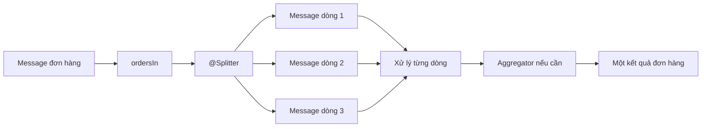

# @Splitter

## 1. Mục tiêu và vị trí trong luồng thông điệp

Trong chương **Annotation và XML** của module **SPRING_INTEGRATION_CORE**, `@Splitter` biểu diễn bước tách một thông điệp thành nhiều thông điệp để xử lý từng phần. Bài học tập trung vào cách nối endpoint này với `MessageChannel`, giữ thông tin của `Message` và phối hợp với transformer, router, filter, aggregator hoặc gateway.

Sau bài học, bạn có thể:

- Khai báo splitter bằng annotation và cấu hình XML có cùng hành vi.
- Phân biệt danh sách nằm trong một payload với nhiều message độc lập.
- Giải thích các header phục vụ gom nhóm và thứ tự.
- Chọn cách xử lý đơn hàng rỗng, lỗi giữa chừng và nguồn dữ liệu chưa biết kích thước.
- Viết kiểm thử cho cả thuật toán tách và endpoint do Spring quản lý.

Các ví dụ dùng Java 17, API Spring Integration 6.5 và JUnit Jupiter. Dự án cần `org.springframework.integration:spring-integration-core`; phần kiểm thử cần JUnit Jupiter. Chọn phiên bản dependency theo BOM hoặc nền tảng Spring đang dùng. Bài không yêu cầu Spring Boot và không cần kết nối broker.

## 2. Bài toán: từ đơn hàng đến từng tác vụ dòng hàng

Một đơn hàng có ba dòng. Hệ thống kho cần tiếp nhận từng dòng độc lập để kiểm tra tồn, chọn kho và ghi nhận kết quả.

```text
Message<PurchaseOrder>
  orderId = ORD-100
  lines   = [L1, L2, L3]

          @Splitter
              |
              +--> Message<LineTask L1>
              +--> Message<LineTask L2>
              +--> Message<LineTask L3>
```

Splitter thay đổi số lượng message đi qua luồng. Một transformer trả về `List<LineTask>` thông thường tạo một message có payload là cả danh sách; splitter diễn giải các phần tử của kết quả tách để phát nhiều message. Khi cần giữ nguyên batch để gửi một API nhận danh sách, transformer phù hợp hơn.

Splitter cũng khác router và publish-subscribe channel:

| Thành phần | Công việc chính | Ví dụ |
| --- | --- | --- |
| Splitter | Tách nội dung thành nhiều phần | Một đơn hàng thành ba tác vụ dòng hàng |
| Router | Chọn đích gửi theo điều kiện | Gửi tác vụ đến kho miền Bắc hoặc miền Nam |
| Filter | Cho qua hoặc loại một message | Chặn tác vụ có dữ liệu không hợp lệ |
| Publish-subscribe channel | Phân phối cùng một message cho các subscriber | Thông báo đơn hàng cho hệ thống kiểm toán và giám sát |
| Aggregator | Gom các message cùng nhóm thành một kết quả | Ghép kết quả ba dòng thành báo cáo đơn hàng |

Các thành phần này có thể đứng nối tiếp. Việc tách không tự chọn kho, không tự xử lý song song và không tự ghép kết quả trở lại.



## 3. Hợp đồng của phương thức @Splitter

`@Splitter` thuộc package `org.springframework.integration.annotation` và thường đặt trên phương thức của một Spring bean. Annotation mô tả vai trò messaging; thuật toán chọn và tạo các phần tử nằm trong phương thức hoặc service được gọi.

Ví dụ tối thiểu về ý nghĩa:

```java
@Splitter(inputChannel = "ordersIn", outputChannel = "lineTasks")
public List<LineTask> split(PurchaseOrder order) {
    return orderSplitter.split(order);
}
```

Có ba bước riêng biệt:

1. Endpoint nhận message từ `ordersIn`.
2. Spring ánh xạ payload vào tham số `PurchaseOrder` rồi gọi phương thức.
3. Splitter phát từng `LineTask` thành một message đến `lineTasks`.

Một lời gọi Java trực tiếp như `endpoints.split(order)` chỉ trả về danh sách. Chính việc gửi message qua channel mới kích hoạt endpoint, tạo message con và bổ sung các header của luồng.

### 3.1. Tham số đầu vào

Dùng tham số payload khi thuật toán chỉ cần dữ liệu nghiệp vụ. Khi cần đọc thông tin của request, có thể nhận `Message<PurchaseOrder>`. Nếu chỉ cần một header, có thể bổ sung tham số với `@Header`:

```java
public List<LineTask> split(
        PurchaseOrder order,
        @Header("tenantId") String tenantId) {
    // Chữ ký minh họa: kiểm tra tenantId rồi tạo các tác vụ.
    return orderSplitter.split(order);
}
```

Đây là một phương án thay thế chữ ký phương thức, không phải endpoint bổ sung. `@Header` nằm trong `org.springframework.messaging.handler.annotation`; mặc định header được yêu cầu phải có. Chỉ dùng `required = false` nếu nghiệp vụ đã xác định cách xử lý khi thiếu.

Cách khai báo tham số và các thuộc tính annotation được mô tả trong [API @Splitter 6.5](https://docs.spring.io/spring-integration/docs/6.5.0/api/org/springframework/integration/annotation/Splitter.html).

### 3.2. Giá trị trả về

Chọn `List<T>` khi muốn ví dụ rõ ràng, giữ thứ tự và biết trước số phần tử.

| Kết quả của thuật toán | Cách endpoint diễn giải |
| --- | --- |
| `List<LineTask>` hoặc collection tương tự | Mỗi phần tử trở thành payload của một message |
| Mảng đối tượng | Mỗi phần tử là một phần cần phát |
| `List<Message<LineTask>>` | Cho phép chủ động đặt thêm header trên từng phần |
| Một đối tượng đơn | Một kết quả đơn được phát |
| `Iterator`, `Iterable`, `Stream` | Duyệt các phần; có thể chưa biết trước tổng số lượng |
| Collection rỗng | Không có message con; có thể cấu hình đường discard |
| `null` | Kết thúc nhánh tại đây, không tạo reply |

Không trả về `void` cho một thuật toán cần phát phần tử. Không để phần tử `null` nằm trong danh sách: message cần payload hợp lệ. Các nguồn `Iterator` hoặc `Stream` cần thiết kế thêm về vòng đời tài nguyên và điều kiện hoàn thành; phần 10 giải thích hệ quả khi ghép lại.

Hợp đồng kết quả và cách dùng collection được trình bày trong [tài liệu Splitter](https://docs.spring.io/spring-integration/reference/6.5/splitter.html).

## 4. Ví dụ đầy đủ bằng annotation

Luồng thực hành là:

```text
ordersIn: DirectChannel
    -> OrderEndpoints.split(...)
    -> lineTasks: QueueChannel
```

`ordersIn` đưa message đến splitter ngay trên thread gửi. `lineTasks` giữ các phần tử để kiểm thử hoặc để một consumer khác nhận sau đó. Trong ví dụ này, queue đầu ra chưa có consumer tự động.

Các public type bên dưới được đặt trong các tệp Java riêng, cùng package `example.splitter`.

### 4.1. Mô hình dữ liệu

```java
package example.splitter;

import java.util.Objects;

public record OrderLine(String lineId, String sku, int quantity) {
    public OrderLine {
        Objects.requireNonNull(lineId, "lineId");
        Objects.requireNonNull(sku, "sku");
        if (quantity <= 0) {
            throw new IllegalArgumentException("quantity must be positive");
        }
    }
}
```

```java
package example.splitter;

import java.util.List;
import java.util.Objects;

public record PurchaseOrder(String orderId, List<OrderLine> lines) {
    public PurchaseOrder {
        Objects.requireNonNull(orderId, "orderId");
        lines = List.copyOf(lines);
    }
}
```

```java
package example.splitter;

public record LineTask(
        String orderId,
        String lineId,
        String sku,
        int quantity) {
}
```

`List.copyOf` tạo bản sao danh sách và từ chối danh sách hoặc phần tử null. Các dòng hàng là record chứa trường bất biến nên ví dụ tránh được việc một consumer sửa chung đối tượng dòng hàng với consumer khác.

`LineTask` giữ `orderId` và `lineId` vì một tác vụ con cần đủ thông tin để truy vết hoặc thử lại độc lập. Chỉ phát SKU có thể làm mất định danh dòng hàng, nhất là khi một đơn có nhiều dòng cùng SKU.

### 4.2. Thuật toán tách độc lập với Spring

```java
package example.splitter;

import java.util.List;

public class OrderSplitter {

    public List<LineTask> split(PurchaseOrder order) {
        if (order.lines().isEmpty()) {
            throw new IllegalArgumentException(
                    "Order must contain at least one line");
        }

        return order.lines().stream()
                .map(line -> new LineTask(
                        order.orderId(),
                        line.lineId(),
                        line.sku(),
                        line.quantity()))
                .toList();
    }
}
```

Chính sách của ví dụ là từ chối đơn hàng không có dòng. Việc trả về danh sách đầy đủ cũng giúp phát hiện lỗi khi tạo tác vụ trước khi endpoint bắt đầu gửi tác vụ đầu tiên. Điều này không bảo đảm các tác vụ sẽ được xử lý thành công cùng nhau ở downstream.

Lớp này không mang annotation messaging nên có thể dùng lại từ XML hoặc Java DSL và kiểm thử bằng một lời gọi Java thông thường.

### 4.3. Endpoint có @Splitter

```java
package example.splitter;

import java.util.List;
import org.springframework.integration.annotation.Splitter;

public class OrderEndpoints {

    private final OrderSplitter orderSplitter;

    public OrderEndpoints(OrderSplitter orderSplitter) {
        this.orderSplitter = orderSplitter;
    }

    @Splitter(
            inputChannel = "ordersIn",
            outputChannel = "lineTasks",
            applySequence = "true",
            sendTimeout = "1000")
    public List<LineTask> split(PurchaseOrder order) {
        return orderSplitter.split(order);
    }
}
```

`applySequence` có kiểu `String` nên phải viết `"true"`. Bật thuộc tính này để có metadata chuỗi dùng cho quan sát và gom nhóm. Giá trị hiệu lực mặc định của splitter là bật sequence; ví dụ ghi rõ để thể hiện hợp đồng.

`sendTimeout = "1000"` đặt thời gian chờ gửi khi channel đầu ra có thể bị chặn, chẳng hạn queue có giới hạn dung lượng. Đây không phải thời hạn hoàn thành nghiệp vụ của một dòng hàng.

### 4.4. Đăng ký bean và channel

```java
package example.splitter;

import org.springframework.context.annotation.Bean;
import org.springframework.context.annotation.Configuration;
import org.springframework.integration.channel.DirectChannel;
import org.springframework.integration.channel.QueueChannel;
import org.springframework.integration.config.EnableIntegration;

@Configuration
@EnableIntegration
public class SplitterConfig {

    @Bean
    public DirectChannel ordersIn() {
        return new DirectChannel();
    }

    @Bean
    public QueueChannel lineTasks() {
        return new QueueChannel(100);
    }

    @Bean
    public OrderSplitter orderSplitter() {
        return new OrderSplitter();
    }

    @Bean
    public OrderEndpoints orderEndpoints(OrderSplitter orderSplitter) {
        return new OrderEndpoints(orderSplitter);
    }
}
```

`@EnableIntegration` đăng ký hạ tầng Spring Integration trong cấu hình Java này. `OrderEndpoints` được đưa vào context bằng `@Bean`, vì thế không cần thêm component scan cho lớp đó. Nếu chọn component scan thì có thể dùng `@Component` hoặc `@MessageEndpoint` và bỏ bean đăng ký trùng.

`@Splitter` trên một đối tượng được tạo bằng `new` ở ngoài Spring context không tự đăng ký consumer. Cũng không đặt `@Splitter` lên phương thức factory `@Bean` trả về `List<LineTask>` với kỳ vọng đó là cách xử lý message; phương thức factory phục vụ khởi tạo bean, còn phương thức xử lý cần hợp đồng endpoint phù hợp.

Cơ chế xử lý annotation tạo endpoint và handler được giải thích trong [Annotation Support](https://docs.spring.io/spring-integration/reference/6.5/configuration/annotations.html).

## 5. Sequence header: hiểu từng nhóm và từng phần

Với cấu hình ở trên, gửi một message đầu vào có ID giả định là `M1` và ba dòng hàng. Các message con có hình dạng:

| Message | Payload | `correlationId` | `sequenceNumber` | `sequenceSize` |
| --- | --- | --- | --- | --- |
| Con 1 | `LineTask(ORD-100, L1, ...)` | `M1` | 1 | 3 |
| Con 2 | `LineTask(ORD-100, L2, ...)` | `M1` | 2 | 3 |
| Con 3 | `LineTask(ORD-100, L3, ...)` | `M1` | 3 | 3 |

Tên hằng Java tương ứng nằm trong `IntegrationMessageHeaderAccessor`:

```java
IntegrationMessageHeaderAccessor.CORRELATION_ID
IntegrationMessageHeaderAccessor.SEQUENCE_NUMBER
IntegrationMessageHeaderAccessor.SEQUENCE_SIZE
```

`correlationId` của lượt tách thông thường gắn với ID message cha, còn `orderId` là định danh nghiệp vụ. Gửi lại cùng nội dung đơn hàng bằng một message mới có thể tạo nhóm correlation mới. Vì vậy, chống xử lý trùng cần khóa nghiệp vụ như `orderId + lineId`, bổ sung phiên bản nghiệp vụ nếu một dòng có thể được xử lý lại hợp lệ.

Các message con là message riêng với ID riêng. Những header ứng dụng như `traceId` được truyền tiếp theo cơ chế tạo kết quả thông thường; cần chủ động bảo toàn chúng nếu tự xây message ở các bước sau. Spring không sao chép sâu toàn bộ payload chỉ vì có một splitter.

### 5.1. applySequence không bảo đảm thứ tự hoàn thành

`sequenceNumber` mô tả vị trí trong chuỗi được phát. Nếu downstream xử lý bất đồng bộ, dòng 3 có thể hoàn thành trước dòng 1. Muốn ghép theo thứ tự nghiệp vụ, phải giữ metadata thứ tự và dùng resequencer hoặc sắp xếp rõ ràng trong logic tạo kết quả.

Với splitter lồng nhau, sequence có nhiều tầng; framework có cơ chế giữ metadata tầng trước để các bước gom nhóm có thể khôi phục. Không nên tự thay toàn bộ sequence header bằng giá trị cố định cho mọi message.

Chỉ đặt `applySequence = "false"` khi downstream không phụ thuộc chuỗi này hoặc bạn đã thiết kế correlation và điều kiện release riêng. Thuộc tính này ngăn splitter thêm sequence của nó; nó không có nghĩa tự động xóa mọi metadata đã tồn tại trên đầu vào.

## 6. Cấu hình XML tương đương

Dùng lại `PurchaseOrder`, `OrderLine`, `LineTask` và POJO `OrderSplitter` ở phần 4. Trong phương án này, XML đăng ký endpoint nên không đăng ký thêm `OrderEndpoints` hay nạp `SplitterConfig`.

```xml
<?xml version="1.0" encoding="UTF-8"?>
<beans xmlns="http://www.springframework.org/schema/beans"
       xmlns:xsi="http://www.w3.org/2001/XMLSchema-instance"
       xmlns:int="http://www.springframework.org/schema/integration"
       xsi:schemaLocation="
           http://www.springframework.org/schema/beans
           https://www.springframework.org/schema/beans/spring-beans.xsd
           http://www.springframework.org/schema/integration
           https://www.springframework.org/schema/integration/spring-integration.xsd">

    <int:channel id="ordersIn"/>

    <int:channel id="lineTasks">
        <int:queue capacity="100"/>
    </int:channel>

    <bean id="orderSplitter" class="example.splitter.OrderSplitter"/>

    <int:splitter id="orderSplitEndpoint"
                  input-channel="ordersIn"
                  output-channel="lineTasks"
                  ref="orderSplitter"
                  method="split"
                  apply-sequence="true"
                  send-timeout="1000"/>
</beans>
```

Các thuộc tính có quan hệ sau:

| Annotation | XML | Ý nghĩa trong ví dụ |
| --- | --- | --- |
| `inputChannel = "ordersIn"` | `input-channel="ordersIn"` | Nơi nhận đơn hàng |
| `outputChannel = "lineTasks"` | `output-channel="lineTasks"` | Nơi phát từng tác vụ |
| `applySequence = "true"` | `apply-sequence="true"` | Bổ sung thông tin chuỗi |
| `sendTimeout = "1000"` | `send-timeout="1000"` | Chờ gửi tối đa theo giới hạn của channel |
| Phương thức được gắn annotation | `ref` cùng `method` | Chọn bean và phương thức thực thi |

Nếu payload đầu vào vốn là collection cần tách trực tiếp, có thể dùng splitter mặc định:

```xml
<int:splitter id="defaultListSplitter"
              input-channel="batchesIn"
              output-channel="itemsOut"/>
```

Đoạn này là cấu hình thay thế cho một luồng có hai channel `batchesIn` và `itemsOut` đã được khai báo. Nó phù hợp với payload như `List<LineTask>`. Với `PurchaseOrder`, cần chỉ định thuật toán lấy các phần tử; không nên trông chờ splitter mặc định tự hiểu trường `lines`.

Khi kết hợp XML và annotation, cần biết cấu hình nào sở hữu mỗi endpoint. Nạp hai splitter cùng nghe `ordersIn` có thể làm message bị phân phối sang consumer khác nhau trên `DirectChannel`. Nếu đầu vào là publish-subscribe channel, mỗi subscriber còn có thể tách lại cùng một đơn. Đây là lỗi đăng ký topology, không phải thuật toán tạo danh sách.

## 7. Biểu diễn cùng luồng bằng Java DSL

Java DSL hữu ích khi muốn đọc chuỗi endpoint liên tiếp tại một nơi. Dưới đây là cấu hình thay thế độc lập cho `SplitterConfig`, dùng API `splitWith` của Spring Integration 6.5:

```java
package example.splitter;

import org.springframework.context.annotation.Bean;
import org.springframework.context.annotation.Configuration;
import org.springframework.integration.channel.DirectChannel;
import org.springframework.integration.channel.QueueChannel;
import org.springframework.integration.config.EnableIntegration;
import org.springframework.integration.dsl.IntegrationFlow;

@Configuration
@EnableIntegration
public class DslSplitterConfig {

    @Bean
    public DirectChannel ordersIn() {
        return new DirectChannel();
    }

    @Bean
    public QueueChannel lineTasks() {
        return new QueueChannel(100);
    }

    @Bean
    public OrderSplitter orderSplitter() {
        return new OrderSplitter();
    }

    @Bean
    public IntegrationFlow orderFlow(OrderSplitter orderSplitter) {
        return IntegrationFlow.from("ordersIn")
                .splitWith(spec -> spec
                        .ref(orderSplitter)
                        .method("split")
                        .applySequence(true)
                        .sendTimeout(1000))
                .channel("lineTasks")
                .get();
    }
}
```

Phương án này không tạo bean `OrderEndpoints`. Logic nghiệp vụ vẫn nằm trong `OrderSplitter`. Nếu không cần tùy chỉnh sequence hoặc timeout, có thể dùng dạng ngắn `.split(orderSplitter, "split")`.

Nếu đầu vào đã là collection, `.split()` biểu diễn bước tách mặc định. Nếu chỉ cần một hàm lấy phần tử, DSL có dạng nhận kiểu payload và hàm tách. Dù chọn dạng nào, hãy kiểm tra overload theo phiên bản dependency đang dùng. API cấu hình ở đây được mô tả trong [SplitterSpec 6.5](https://docs.spring.io/spring-integration/docs/6.5.0/api/org/springframework/integration/dsl/SplitterSpec.html).

## 8. Channel quyết định cách thực thi

### 8.1. DirectChannel ở đầu vào

Trong ví dụ annotation, `ordersIn.send(message)` gọi splitter trên thread gửi. Splitter tạo ba kết quả rồi gửi lần lượt vào `lineTasks`. Khi `send` trả về bình thường, các tác vụ đã được đưa vào queue; điều đó chưa chứng minh rằng nghiệp vụ xử lý kho đã hoàn tất.

`QueueChannel(100)` chứa tối đa 100 message đang chờ. Khi đầy, việc gửi có thể phải đợi; `sendTimeout` giúp giới hạn khoảng chờ đó. Giá trị này không kiểm soát thời gian chạy `OrderSplitter.split` hay một HTTP call ở downstream. Với `DirectChannel` ở đầu ra, `sendTimeout` cũng không ngắt handler đồng bộ đang chạy lâu.

### 8.2. QueueChannel ở đầu vào và @Poller

Nếu muốn splitter nhận đơn từ `QueueChannel`, thay bean `ordersIn` bằng queue và thay annotation trên phương thức xử lý:

```java
@Splitter(
        inputChannel = "ordersIn",
        outputChannel = "lineTasks",
        applySequence = "true",
        sendTimeout = "1000",
        poller = @Poller(
                fixedDelay = "200",
                maxMessagesPerPoll = "1"))
public List<LineTask> split(PurchaseOrder order) {
    return orderSplitter.split(order);
}
```

Import bổ sung là `org.springframework.integration.annotation.Poller`. Đầu vào phải được cấu hình là `QueueChannel` cho biến thể này. Nếu không dùng poller riêng, context phải có default poller phù hợp.

`maxMessagesPerPoll = "1"` giới hạn số message đầu vào được lấy trong một lần poll. Một đơn có 500 dòng vẫn có thể sinh 500 message con; thuộc tính đó không chia đơn thành các batch một dòng.

Cấu hình XML tương ứng của endpoint nhận từ queue:

```xml
<int:splitter id="pollingOrderSplitter"
              input-channel="ordersIn"
              output-channel="lineTasks"
              ref="orderSplitter"
              method="split"
              apply-sequence="true"
              send-timeout="1000">
    <int:poller fixed-delay="200" max-messages-per-poll="1"/>
</int:splitter>
```

Đây cũng là phương án thay thế, không thêm vào XML cũ như một consumer thứ hai. Channel đầu vào xác định endpoint có cần polling hay không; xem [Message Endpoints](https://docs.spring.io/spring-integration/reference/6.5/endpoint.html).

### 8.3. Xử lý song song

Splitter không tự mở một thread cho mỗi phần tử. Có thể đưa tác vụ qua `ExecutorChannel` hoặc qua queue có consumer xử lý bằng executor để tạo concurrency.

Khi làm vậy, cần quyết định giới hạn số tác vụ đang xử lý, sức chứa queue và cách xử lý khi bão hòa. Danh sách 100.000 dòng kéo theo chi phí tạo message, sao chép header, xếp hàng và lưu trạng thái nếu có aggregator. Thêm thread mà không giới hạn tải có thể chỉ chuyển điểm nghẽn sang cơ sở dữ liệu hoặc dịch vụ kho.

## 9. Kết quả rỗng và đường discard

Có ba tình huống khác nhau:

| Tình huống | Hành vi | Cách thiết kế |
| --- | --- | --- |
| Phương thức ném exception | Luồng lỗi theo ranh giới thực thi | Ánh xạ thành lỗi nghiệp vụ hoặc xử lý error message |
| Trả collection rỗng | Không phát phần tử; có thể chuyển request gốc đến discard channel | Xử lý đơn rỗng bằng một nhánh riêng |
| Trả `null` | Dừng nhánh, không có reply | Chỉ dùng nếu việc kết thúc im lặng là chủ ý |

Ví dụ chính chọn ném exception cho đơn rỗng. Nếu nghiệp vụ xem đơn rỗng là trường hợp hợp lệ, hãy thay đổi thuật toán và thiết kế nhánh kết quả rõ ràng. Có thể đặt filter hoặc router trước splitter để xử lý trường hợp này.

Trong một biến thể XML mà hàm tách thực sự có thể trả collection rỗng, thêm thuộc tính:

```xml
<int:splitter id="possiblyEmptyOrderSplitter"
              input-channel="ordersIn"
              output-channel="lineTasks"
              ref="orderSplitter"
              method="split"
              discard-channel="emptyOrders"/>

<int:channel id="emptyOrders">
    <int:queue capacity="20"/>
</int:channel>
```

Đoạn này thay thế endpoint cũ và cần các bean đầu vào, đầu ra, service tương ứng. `emptyOrders` nhận **request gốc**, không phải một message con có payload rỗng. Trong ứng dụng thực tế phải có consumer cho nhánh này; queue đơn thuần chỉ giúp quan sát hoặc lưu tạm.

Trong DSL, cấu hình tương ứng nằm ở `SplitterSpec.discardChannel`. Annotation `@Splitter` 6.5 không có thuộc tính `discardChannel`, nên không thể thêm `discardChannel = "emptyOrders"` vào annotation để thay cho XML.

Nếu một gateway đang chờ một kết quả, nhánh không tạo message con sẽ không tự sinh báo cáo “0 dòng”. Cần tạo kết quả nghiệp vụ ở nhánh xử lý đơn rỗng hoặc chủ động trả lỗi.

## 10. Phối hợp splitter với aggregator và gateway

Một luồng xử lý đơn hàng có thể là:

```text
Gateway -> Splitter -> xử lý từng dòng -> Aggregator -> reply
```

Gateway request-reply thông thường chờ một message trả lời. Nó không tự thu thập các reply của mọi dòng chỉ vì phương thức gateway trả về `List`. Aggregator là thành phần phù hợp để tạo một message chứa danh sách hoặc báo cáo cuối cùng.

Theo cơ chế mặc định, aggregator sử dụng metadata để xác định các phần thuộc cùng nhóm và lúc nhóm đã đủ. Bạn cần giữ các header đó qua các bước xử lý. Nếu một transformer tự tạo message và bỏ metadata, khả năng ghép nhóm sẽ bị ảnh hưởng. Xem [Aggregator](https://docs.spring.io/spring-integration/reference/6.5/aggregator.html).

### 10.1. Filter sau splitter có thể làm nhóm không hoàn thành

Giả sử splitter phát ba message với `sequenceSize = 3`. Filter sau đó loại dòng 2. Aggregator chỉ nhận dòng 1 và dòng 3 nên nhóm có thể chờ mãi theo điều kiện đủ ba phần.

Một số lựa chọn thiết kế:

- Kiểm tra và chọn các dòng cần xử lý trước khi tách, nếu số lượng hợp lệ có thể xác định ngay.
- Mỗi dòng đều phát một kết quả, gồm cả trạng thái từ chối hoặc thất bại.
- Dùng điều kiện release riêng, timeout và chính sách xử lý kết quả thiếu khi nghiệp vụ cho phép.

Router cũng có thể gây tình trạng tương tự nếu chia các phần sang nhiều nhánh nhưng chỉ một nhánh quay lại aggregator. Khi cần báo cáo chung, phải xác định điểm hội tụ và cách biểu diễn kết quả của từng nhánh.

Timeout giúp kết thúc việc chờ theo chính sách; nó không chứng minh rằng mọi dòng đã xử lý thành công.

### 10.2. Iterator và Stream chưa biết tổng số phần tử

Danh sách trong ví dụ có kích thước rõ ràng. Với nguồn duyệt lười mà splitter không xác định được kích thước, `sequenceSize` có thể bằng `0`. Trong ngữ cảnh này, `0` thể hiện chưa biết tổng số phần, không phải bằng chứng đơn hàng rỗng.

Do đó, thiết kế lấy `sequenceSize` làm số kết quả cần có sẽ không đủ. Có thể:

- Dùng collection hữu hạn nếu kích thước dữ liệu phù hợp bộ nhớ.
- Truyền số lượng dự kiến bằng một hợp đồng riêng và thiết kế release strategy tương ứng.
- Dùng tín hiệu kết thúc rõ ràng hoặc timeout với quy tắc hoàn tất phù hợp.

Tín hiệu kết thúc phải được thiết kế cẩn thận khi các phần xử lý song song: nhận được tín hiệu “đã phát hết” chưa đồng nghĩa tất cả tác vụ đã hoàn thành. Nếu nguồn duyệt giữ cursor hoặc tài nguyên I/O, cần quy định việc đóng tài nguyên trong cả trường hợp thành công và thất bại.

## 11. Xử lý lỗi và thử lại

### 11.1. Lỗi trên luồng đồng bộ

Trong ví dụ `DirectChannel -> splitter -> QueueChannel`, nếu thuật toán tách ném exception thì lời gọi `ordersIn.send(...)` nhận lỗi xử lý message. Exception nghiệp vụ có thể nằm trong cause của exception do framework bọc.

Nếu đầu ra cũng là `DirectChannel`, consumer của dòng đầu tiên có thể chạy ngay trong vòng phát của splitter. Khi dòng thứ hai gây exception, dòng thứ nhất có thể đã tạo tác dụng phụ; các dòng sau có thể chưa được phát. Splitter không tự hoàn tác tác dụng phụ đã xảy ra.

### 11.2. Lỗi sau ranh giới bất đồng bộ

Với consumer do poller hoặc executor của Spring Integration thực thi, lỗi thường được chuyển thành `ErrorMessage`. Hệ thống xử lý lỗi có thể chọn channel theo header `errorChannel` hoặc channel lỗi chung tùy cấu hình.

Một lỗi khi enqueue trong chính lời gọi đồng bộ vẫn có thể quay lại caller. Việc queue xuất hiện ở cuối luồng không làm mọi exception trước đó tự chuyển sang luồng lỗi bất đồng bộ. Chi tiết phân biệt này nằm trong [Error Handling](https://docs.spring.io/spring-integration/reference/6.5/error-handling.html).

Khi xử lý `ErrorMessage`, cần lấy exception và thông tin message thất bại phù hợp; payload của error message không phải trực tiếp một `LineTask`. Không nhầm đường discard cho collection rỗng với đường xử lý exception.

### 11.3. Đặt retry ở đúng đơn vị công việc

Nếu thử lại cả message đơn hàng, splitter có thể phát lại mọi dòng, gồm cả dòng đã thành công. Để thử lại một dòng độc lập, đặt chính sách retry ở bước xử lý `LineTask` và sử dụng khóa idempotency phù hợp.

Ví dụ, một lần xử lý `ORD-100/L1` đã ghi nhận trừ kho. Khi gặp lại cùng tác vụ, consumer kiểm tra kết quả đã lưu trước khi thực hiện tác dụng phụ lần nữa. Chỉ dùng `MessageHeaders.ID` làm khóa sẽ không đủ nếu lần gửi lại tạo một message mới.

`@Splitter` có thuộc tính `adviceChain` để gắn advice cho handler, nhưng tên thuộc tính này không tự bảo đảm toàn bộ downstream flow được bao phủ. Phải xác định phạm vi advice, ranh giới transaction và vị trí tác dụng phụ trước khi chọn nơi đặt retry.

## 12. Kiểm thử thuật toán và endpoint

Hai lớp kiểm thử phục vụ hai mục đích khác nhau. Unit test kiểm tra hợp đồng nghiệp vụ; kiểm thử với Spring context xác nhận việc nối channel, phát message và tạo header.

### 12.1. Unit test cho POJO

```java
package example.splitter;

import java.util.List;
import org.junit.jupiter.api.Test;

import static org.junit.jupiter.api.Assertions.*;

class OrderSplitterTest {

    private final OrderSplitter splitter = new OrderSplitter();

    @Test
    void createsOneTaskForEachOrderLine() {
        var order = new PurchaseOrder("ORD-100", List.of(
                new OrderLine("L1", "BOOK", 2),
                new OrderLine("L2", "PEN", 5)));

        var tasks = splitter.split(order);

        assertEquals(List.of(
                new LineTask("ORD-100", "L1", "BOOK", 2),
                new LineTask("ORD-100", "L2", "PEN", 5)),
                tasks);
    }

    @Test
    void rejectsAnOrderWithoutLines() {
        var order = new PurchaseOrder("ORD-EMPTY", List.of());

        assertThrows(IllegalArgumentException.class,
                () -> splitter.split(order));
    }
}
```

Kiểm thử đầu tiên xác định số tác vụ, thứ tự, định danh và dữ liệu cần mang theo. Nó không chứng minh rằng `@Splitter` đã được Spring đăng ký, vì test chưa khởi tạo context.

### 12.2. Kiểm thử luồng annotation qua channel

```java
package example.splitter;

import java.util.List;
import org.junit.jupiter.api.Test;
import org.springframework.context.annotation.AnnotationConfigApplicationContext;
import org.springframework.integration.IntegrationMessageHeaderAccessor;
import org.springframework.integration.channel.DirectChannel;
import org.springframework.integration.channel.QueueChannel;
import org.springframework.messaging.Message;
import org.springframework.messaging.MessagingException;
import org.springframework.messaging.support.MessageBuilder;

import static org.junit.jupiter.api.Assertions.*;

class SplitterEndpointTest {

    @Test
    void emitsThreeMessagesWithSequenceAndTraceHeaders() {
        try (var context =
                     new AnnotationConfigApplicationContext(
                             SplitterConfig.class)) {

            var input = context.getBean("ordersIn", DirectChannel.class);
            var output = context.getBean("lineTasks", QueueChannel.class);

            var order = new PurchaseOrder("ORD-100", List.of(
                    new OrderLine("L1", "BOOK", 2),
                    new OrderLine("L2", "PEN", 5),
                    new OrderLine("L3", "BAG", 1)));

            Message<PurchaseOrder> request = MessageBuilder
                    .withPayload(order)
                    .setHeader("traceId", "TRACE-100")
                    .build();

            assertTrue(input.send(request));

            var expected = List.of(
                    new LineTask("ORD-100", "L1", "BOOK", 2),
                    new LineTask("ORD-100", "L2", "PEN", 5),
                    new LineTask("ORD-100", "L3", "BAG", 1));

            for (int index = 0; index < expected.size(); index++) {
                Message<?> part = output.receive(1000);

                assertNotNull(part);
                assertEquals(expected.get(index), part.getPayload());
                assertEquals("TRACE-100",
                        part.getHeaders().get("traceId"));
                assertEquals(request.getHeaders().getId(),
                        part.getHeaders().get(
                                IntegrationMessageHeaderAccessor.CORRELATION_ID));
                assertEquals(index + 1,
                        part.getHeaders().get(
                                IntegrationMessageHeaderAccessor.SEQUENCE_NUMBER));
                assertEquals(3,
                        part.getHeaders().get(
                                IntegrationMessageHeaderAccessor.SEQUENCE_SIZE));
                assertNotEquals(request.getHeaders().getId(),
                        part.getHeaders().getId());
            }

            assertNull(output.receive(0));
        }
    }

    @Test
    void invalidOrderFailsBeforeAnyTaskIsEmitted() {
        try (var context =
                     new AnnotationConfigApplicationContext(
                             SplitterConfig.class)) {

            var input = context.getBean("ordersIn", DirectChannel.class);
            var output = context.getBean("lineTasks", QueueChannel.class);

            Message<PurchaseOrder> request = MessageBuilder
                    .withPayload(
                            new PurchaseOrder("ORD-EMPTY", List.of()))
                    .build();

            assertThrows(MessagingException.class,
                    () -> input.send(request));
            assertNull(output.receive(0));
        }
    }
}
```

Điểm quyết định là `input.send(request)`. Nếu chỉ lấy bean rồi gọi `split(order)`, test sẽ bỏ qua việc tạo message con và các sequence header.

`receive(1000)` là phép nhận có thời hạn, tránh chờ vô hạn khi endpoint cấu hình sai. `receive(0)` kiểm tra không có message dư ngay tại thời điểm đó. Phép kiểm tra này phù hợp với ví dụ vì việc phát vào queue diễn ra đồng bộ trong `input.send`; với poller hoặc executor phải chờ điều kiện hoàn thành bằng cơ chế kiểm thử bất đồng bộ phù hợp.

### 12.3. Dùng cùng hợp đồng để kiểm tra XML và DSL

Với DSL, khởi tạo context bằng `DslSplitterConfig.class` thay cho `SplitterConfig.class` rồi giữ nguyên các assertion về payload và header.

Với XML, lưu cấu hình phần 6 thành tài nguyên `splitter.xml` trên classpath và mở bằng `ClassPathXmlApplicationContext`:

```java
try (var context = new ClassPathXmlApplicationContext("splitter.xml")) {
    var input = context.getBean("ordersIn", DirectChannel.class);
    var output = context.getBean("lineTasks", QueueChannel.class);
    // Gửi cùng request và áp dụng các assertion như test annotation.
}
```

Import thêm `org.springframework.context.support.ClassPathXmlApplicationContext`. Đây là đoạn thay thế cách khởi tạo context, không phải một test hoàn chỉnh độc lập.

Việc đổi cách cấu hình không nên đổi hợp đồng đầu ra: một tác vụ cho mỗi dòng, đúng định danh, đúng metadata chuỗi và đúng chính sách cho đơn rỗng. Không nạp cả ba cấu hình trong cùng một context để so sánh.

## 13. Các lỗi thường gặp và hướng kiểm tra

| Triệu chứng | Nguyên nhân có thể gặp | Hướng kiểm tra |
| --- | --- | --- |
| Gửi vào channel nhưng không có consumer | Bean endpoint chưa đăng ký hoặc hạ tầng integration chưa bật | Kiểm tra context đã nạp đúng cấu hình |
| Nhận một message chứa cả danh sách | Đang dùng transformer hoặc service activator thông thường | Kiểm tra vai trò endpoint ở bước cần tách |
| Chỉ gọi phương thức mà không thấy message con | Đang thực hiện lời gọi Java trực tiếp | Gửi request qua input channel |
| Đơn rỗng làm gateway chờ hết hạn | Nhánh tách không phát phần tử và không có phản hồi thay thế | Thiết kế kết quả hoặc lỗi cho đơn rỗng |
| Aggregator giữ nhóm chưa hoàn thành | Có phần bị filter, lỗi hoặc đi sang nhánh không hội tụ | Theo dõi số phần dự kiến và kết quả từng dòng |
| Aggregator không thể dựa vào kích thước chuỗi | Nguồn duyệt chưa biết tổng số phần | Thiết kế điều kiện release riêng |
| Thứ tự kết quả thay đổi khi tăng concurrency | Thời gian hoàn thành của mỗi tác vụ khác nhau | Giữ thứ tự nghiệp vụ và sắp xếp tại điểm cần thiết |
| Một số đơn đi qua splitter ngoài dự kiến | Có nhiều consumer cùng đăng ký trên input channel | Rà lại việc nạp cấu hình annotation, XML và DSL |
| Trừ kho lặp sau khi retry đơn | Phát lại các tác vụ đã thành công | Đặt retry theo dòng và kiểm soát idempotency |
| Lỗi khởi tạo khi chuyển input sang queue | Endpoint thiếu poller phù hợp | Thêm poller hoặc default poller |
| Gửi bị chậm khi queue đầu ra đầy | Consumer không theo kịp tốc độ phát | Kiểm tra dung lượng, timeout và khả năng xử lý downstream |

Để quan sát một luồng tách, nên ghi nhận `orderId`, `lineId`, trace ID và metadata chuỗi ở các điểm phát, nhận và hoàn thành. Số phần đã được phát và số phần đã xử lý thành công là hai chỉ số khác nhau.

## 14. Nguyên tắc áp dụng

Chọn splitter khi đơn vị công việc ở downstream là từng phần của một message. Giữ thuật toán tách dễ kiểm thử, để mỗi tác vụ con mang đủ định danh nghiệp vụ và đăng ký một cách cấu hình rõ ràng cho mỗi endpoint.

Trước khi ghép với aggregator hoặc gateway, xác định cách hoàn thành cho đơn rỗng, dòng bị loại và dòng thất bại. Khi chuyển sang xử lý song song hoặc nguồn duyệt lười, xem lại giới hạn tải, thứ tự, khả năng thử lại và điều kiện kết thúc.

Các tài liệu đối chiếu cho phiên bản dùng trong bài:

- [Splitter: mô hình xử lý, collection và cấu hình XML](https://docs.spring.io/spring-integration/reference/6.5/splitter.html).
- [API @Splitter 6.5: tham số cấu hình annotation](https://docs.spring.io/spring-integration/docs/6.5.0/api/org/springframework/integration/annotation/Splitter.html).
- [Annotation Support: đăng ký endpoint và ánh xạ tham số](https://docs.spring.io/spring-integration/reference/6.5/configuration/annotations.html).
- [SplitterSpec 6.5: cấu hình Java DSL và discard channel](https://docs.spring.io/spring-integration/docs/6.5.0/api/org/springframework/integration/dsl/SplitterSpec.html).
- [Message Endpoints: polling và channel đầu vào](https://docs.spring.io/spring-integration/reference/6.5/endpoint.html).
- [Aggregator: correlation và điều kiện release](https://docs.spring.io/spring-integration/reference/6.5/aggregator.html).
- [Error Handling: lỗi đồng bộ và bất đồng bộ](https://docs.spring.io/spring-integration/reference/6.5/error-handling.html).
