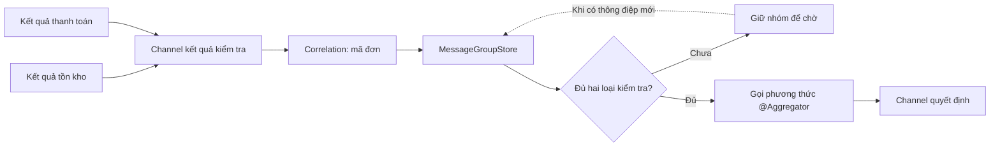

# @Aggregator

Trong module **SPRING_INTEGRATION_CORE**, `@Aggregator` là cách khai báo endpoint gom nhiều thông điệp có liên hệ thành một kết quả. Bài học thuộc chương **Annotation và XML**, tập trung vào cách kết nối phương thức Java với `MessageChannel`, xác định nhóm, quyết định thời điểm phát kết quả và quản lý các nhóm chưa hoàn tất.

Ví dụ xuyên suốt: một đơn hàng cần kết quả kiểm tra **tồn kho** và **thanh toán**. Hai kết quả có thể đến khác thứ tự, xen kẽ với đơn khác hoặc bị gửi lại. Hệ thống chỉ được đưa ra quyết định cuối cùng khi đã có đủ hai loại kiểm tra.

## 1. Mục tiêu học tập

Sau bài học, bạn có thể:

- Phân biệt ba trách nhiệm: correlation, release và aggregation.
- Khai báo `@Aggregator`, `@CorrelationStrategy` và `@ReleaseStrategy` trên một Spring bean.
- Chọn chữ ký nhận collection payload hoặc collection `Message<?>`.
- Nhận biết trường hợp dùng các header sequence mặc định và trường hợp cần quy tắc nghiệp vụ.
- Chuyển sang XML hoặc Java DSL khi cần timeout, message store và chính sách dọn nhóm.
- Thiết kế kiểm thử cho nhóm chưa đủ dữ liệu, thông điệp trùng, thông điệp đến muộn và lỗi xử lý.

Ví dụ Java sử dụng cú pháp Java 17 và API Spring Integration dòng 6.5. Dự án cần dependency `org.springframework.integration:spring-integration-core`; phiên bản Spring nên được quản lý thống nhất bằng BOM hoặc cấu hình dependency của dự án. Phần kiểm thử minh họa sử dụng JUnit Jupiter.

## 2. Ba câu hỏi của một aggregator

Giả sử nhận các payload sau:

| Thứ tự đến | Mã đơn | Loại kiểm tra | Kết quả |
|---|---|---|---|
| 1 | A-101 | INVENTORY | Đạt |
| 2 | B-202 | PAYMENT | Không đạt |
| 3 | A-101 | PAYMENT | Đạt |
| 4 | B-202 | INVENTORY | Đạt |

Aggregator phải trả lời ba câu hỏi khác nhau:

| Trách nhiệm | Câu hỏi | Quy tắc trong ví dụ |
|---|---|---|
| Correlation | Thông điệp thuộc nhóm nào? | Nhóm theo mã đơn |
| Release | Nhóm đã đủ điều kiện xử lý chưa? | Có cả INVENTORY và PAYMENT |
| Aggregation | Tạo kết quả nào từ nhóm? | Đơn được chấp nhận khi cả hai kiểm tra đều đạt |

Một nhóm hoàn tất không đồng nghĩa nghiệp vụ thành công. B-202 vẫn có thể được tổng hợp đầy đủ để phát quyết định từ chối.



Aggregator là một thành phần **có trạng thái**: thông điệp của nhóm được giữ trong `MessageGroupStore` giữa các lần nhận. Phương thức tổng hợp không cần tự duy trì một `Map` toàn cục để chờ dữ liệu.

Tài liệu mô tả vai trò của handler và các chiến lược tại [Spring Integration — Aggregator](https://docs.spring.io/spring-integration/reference/6.5/aggregator.html).

## 3. @Aggregator khai báo điều gì?

Import đúng annotation:

```java
import org.springframework.integration.annotation.Aggregator;
```

Một khai báo ngắn có dạng:

```java
@Aggregator(
    inputChannel = "numbers",
    outputChannel = "totals"
)
public Integer total(List<Integer> values) {
    return values.stream().mapToInt(Integer::intValue).sum();
}
```

`numbers` là channel nhận từng thông điệp đầu vào; `totals` nhận thông điệp có payload là tổng số. Đoạn trên chỉ minh họa phương thức xử lý: để có endpoint hoạt động, đối tượng phải là Spring bean và hạ tầng Spring Integration phải được bật.

`@Aggregator` xác định **cách tạo kết quả của nhóm**. Nó không có nghĩa là “nhận bất kỳ ba thông điệp rồi cộng”, cũng không tự đặt ra mã nhóm và số lượng cần chờ.

### 3.1. Chữ ký phương thức

| Chữ ký đầu vào | Dữ liệu phương thức nhận |
|---|---|
| `List<CheckResult>` | Payload của các thông điệp trong nhóm |
| `Collection<CheckResult>` | Collection các payload |
| `List<Message<?>>` | Các thông điệp, bao gồm payload và header |
| `Collection<Message<?>>` | Collection các thông điệp |

Giữ generic cụ thể giúp thể hiện rõ bạn muốn xử lý payload hay toàn bộ message. Kết quả có thể là một đối tượng nghiệp vụ hoặc một `Message<?>`; đối tượng thông thường được dùng làm payload của thông điệp đầu ra. Xem [API @Aggregator](https://docs.spring.io/spring-integration/api/org/springframework/integration/annotation/Aggregator.html).

Không dựa vào thứ tự phần tử của collection để suy ra thứ tự nghiệp vụ. Nếu kết quả cần được sắp xếp, hãy sắp xếp theo khóa rõ ràng, chẳng hạn số dòng hoặc thời điểm nghiệp vụ.

Phương thức nên tạo kết quả mới. Tránh sửa trực tiếp collection đầu vào hoặc giữ lại tham chiếu collection do framework cung cấp; nếu muốn đưa danh sách thông điệp ra ngoài, hãy sao chép thành collection riêng.

### 3.2. Các thuộc tính thường dùng

| Thuộc tính | Mục đích |
|---|---|
| `inputChannel` | Tên channel tiếp nhận các phần cần gom |
| `outputChannel` | Tên channel nhận kết quả |
| `discardChannel` | Đích nhận các thông điệp bị loại theo chính sách của handler |
| `sendTimeout` | Thời gian chờ khi gửi kết quả vào channel có giới hạn gửi |
| `sendPartialResultsOnExpiry` | Cho phép tổng hợp phần dữ liệu đang có khi nhóm hết hạn |
| `poller` | Cấu hình polling khi đầu vào là channel có thể poll |
| `autoStartup`, `phase` | Điều khiển vòng đời endpoint |

Các giá trị như `sendTimeout = "1000"` và `sendPartialResultsOnExpiry = "false"` là chuỗi trong annotation.

**`sendTimeout` không phải thời gian chờ đủ các phần của nhóm.** Nó liên quan đến thao tác gửi kết quả, chẳng hạn khi một `QueueChannel` có dung lượng giới hạn đang đầy. Đặt `sendTimeout` không tạo deadline cho nhóm.

Đối chiếu tên thuộc tính tại [khai báo @Aggregator của dòng 6.5](https://raw.githubusercontent.com/spring-projects/spring-integration/6.5.x/spring-integration-core/src/main/java/org/springframework/integration/annotation/Aggregator.java).

## 4. Quy tắc mặc định và các header sequence

Nếu không khai báo chiến lược riêng:

- Correlation dùng header `correlationId`.
- Release dùng `SimpleSequenceSizeReleaseStrategy`.

Các header thường gặp là:

| Hằng trong IntegrationMessageHeaderAccessor | Tên header | Ý nghĩa |
|---|---|---|
| `CORRELATION_ID` | `correlationId` | Khóa nhóm |
| `SEQUENCE_NUMBER` | `sequenceNumber` | Vị trí trong một sequence |
| `SEQUENCE_SIZE` | `sequenceSize` | Số phần dự kiến của sequence |

Ví dụ ba thông điệp thuộc cùng sequence:

```text
payload = 10, correlationId = batch-01, sequenceNumber = 1, sequenceSize = 3
payload = 20, correlationId = batch-01, sequenceNumber = 2, sequenceSize = 3
payload = 30, correlationId = batch-01, sequenceNumber = 3, sequenceSize = 3
```

Splitter thông thường cung cấp các header sequence. Với publish-subscribe channel hoặc recipient-list router, cần xem xét bật `applySequence` khi dựa vào cơ chế này để gom lại.

Có một giới hạn cần nhớ: `SimpleSequenceSizeReleaseStrategy` so sánh kích thước nhóm với `sequenceSize`; nó không kiểm tra trùng `sequenceNumber`. Đếm đủ thông điệp không tự chứng minh đã nhận đủ các phần khác nhau. Xem [API SimpleSequenceSizeReleaseStrategy](https://docs.spring.io/spring-integration/api/org/springframework/integration/aggregator/SimpleSequenceSizeReleaseStrategy.html).

Trong ví dụ đơn hàng, dữ liệu phát sinh từ hai nguồn độc lập và có thể gửi lại. Ta chọn correlation theo mã đơn và release theo tập loại kiểm tra, thay vì dựa vào số thông điệp đã đến.

## 5. Ví dụ đầy đủ bằng annotation

Đặt mã sau trong `example/OrderChecksConfig.java`:

```java
package example;

import java.util.EnumMap;
import java.util.EnumSet;
import java.util.List;
import java.util.Objects;
import java.util.Set;

import org.springframework.context.annotation.Bean;
import org.springframework.context.annotation.Configuration;
import org.springframework.integration.annotation.Aggregator;
import org.springframework.integration.annotation.CorrelationStrategy;
import org.springframework.integration.annotation.ReleaseStrategy;
import org.springframework.integration.channel.DirectChannel;
import org.springframework.integration.channel.QueueChannel;
import org.springframework.integration.config.EnableIntegration;

@Configuration
@EnableIntegration
public class OrderChecksConfig {

    public enum CheckType {
        INVENTORY, PAYMENT
    }

    public record CheckResult(
            String orderId,
            CheckType checkType,
            boolean approved) {

        public CheckResult {
            Objects.requireNonNull(orderId, "orderId");
            Objects.requireNonNull(checkType, "checkType");
            if (orderId.isBlank()) {
                throw new IllegalArgumentException("orderId must not be blank");
            }
        }
    }

    public record OrderDecision(
            String orderId,
            boolean complete,
            boolean accepted,
            Set<CheckType> missingChecks) {

        public OrderDecision {
            missingChecks = Set.copyOf(missingChecks);
        }
    }

    @Bean
    public DirectChannel checkResults() {
        return new DirectChannel();
    }

    @Bean
    public QueueChannel orderDecisions() {
        return new QueueChannel();
    }

    @Bean
    public QueueChannel aggregationDiscards() {
        return new QueueChannel();
    }

    @Bean
    public OrderAggregator orderAggregator() {
        return new OrderAggregator();
    }

    public static class OrderAggregator {

        @CorrelationStrategy
        public String correlationKey(CheckResult result) {
            return result.orderId();
        }

        @ReleaseStrategy
        public boolean ready(List<CheckResult> results) {
            return index(results).size() == CheckType.values().length;
        }

        @Aggregator(
            inputChannel = "checkResults",
            outputChannel = "orderDecisions",
            discardChannel = "aggregationDiscards",
            sendPartialResultsOnExpiry = "false"
        )
        public OrderDecision aggregate(List<CheckResult> results) {
            EnumMap<CheckType, CheckResult> checks = index(results);

            EnumSet<CheckType> missing =
                    EnumSet.allOf(CheckType.class);
            missing.removeAll(checks.keySet());

            boolean complete = missing.isEmpty();
            boolean accepted = complete && checks.values().stream()
                    .allMatch(CheckResult::approved);

            return new OrderDecision(
                    results.get(0).orderId(),
                    complete,
                    accepted,
                    missing
            );
        }

        private EnumMap<CheckType, CheckResult> index(
                List<CheckResult> results) {

            if (results.isEmpty()) {
                throw new IllegalArgumentException("Empty check group");
            }

            String orderId = results.get(0).orderId();
            EnumMap<CheckType, CheckResult> indexed =
                    new EnumMap<>(CheckType.class);

            for (CheckResult result : results) {
                if (!orderId.equals(result.orderId())) {
                    throw new IllegalArgumentException("Mixed order group");
                }

                CheckResult previous =
                        indexed.putIfAbsent(result.checkType(), result);

                if (previous != null
                        && previous.approved() != result.approved()) {
                    throw new IllegalArgumentException(
                            "Conflicting check: " + result.checkType()
                    );
                }
            }

            return indexed;
        }
    }
}
```

### 5.1. Vì sao cấu hình này hoạt động?

`@EnableIntegration` bật hạ tầng xử lý endpoint trong ứng dụng Spring Java thuần. Bean `orderAggregator` được post-processor xử lý; ba phương thức annotation trên **cùng đối tượng** được dùng cho ba trách nhiệm tương ứng.

Với dòng 6.5, bộ xử lý `@Aggregator` tìm phương thức correlation và release ngay trên bean đích, đồng thời tạo handler với `SimpleMessageStore`. Chỉ khai báo một bean store khác trong context không làm endpoint annotation này tự động chuyển sang dùng store đó. Cơ chế được thể hiện trong [AggregatorAnnotationPostProcessor](https://raw.githubusercontent.com/spring-projects/spring-integration/6.5.x/spring-integration-core/src/main/java/org/springframework/integration/config/AggregatorAnnotationPostProcessor.java).

`OrderAggregator` không có `@Component` vì đã được đăng ký bằng `@Bean`. Nếu chọn component scanning, có thể dùng `@Component` hoặc `@MessageEndpoint` và cấu hình scan phù hợp. Chỉ chọn một cách đăng ký cho mỗi đối tượng. Xem [Annotation Support](https://docs.spring.io/spring-integration/reference/configuration/annotations.html).

### 5.2. Quy tắc nghiệp vụ trong ví dụ

- Hai kết quả cùng `orderId` thuộc cùng nhóm.
- Hai thông điệp INVENTORY giống nhau vẫn chỉ đại diện cho một loại kiểm tra.
- INVENTORY có kết quả mâu thuẫn trong cùng nhóm làm phát sinh lỗi.
- Có đủ INVENTORY và PAYMENT thì nhóm được release, kể cả khi một kết quả là `approved = false`.
- Quyết định chỉ có `accepted = true` khi dữ liệu đầy đủ và mọi kiểm tra đều đạt.

Đây là chính sách do ví dụ lựa chọn. Ứng dụng thực tế cần xác định rõ có chấp nhận cập nhật kết quả, phiên bản mới hay sự kiện bù hay không.

Khóa `orderId` chỉ phù hợp khi mỗi mã đơn có một lần kiểm tra trong phạm vi lưu nhóm. Nếu có nhiều lần thử hoặc nhiều tenant, nên dùng khóa bất biến gồm `tenantId + orderId + attemptId` để tách chúng.

### 5.3. Chống trùng về ý nghĩa chưa phải chống trùng trong store

Hàm `index` khiến các bản gửi lại giống nhau không làm sai quyết định. Tuy nhiên, các thông điệp có ID khác nhau vẫn có thể được lưu vào nhóm trước khi hoàn tất.

Vì vậy, một nguồn gửi lại liên tục vẫn có thể làm nhóm tăng kích thước. Với tải lớn, cân nhắc idempotent receiver hoặc bước chống trùng trước aggregator, cùng giới hạn thời gian và kích thước nhóm. Không coi phép gom theo `CheckType` là một cơ chế giới hạn bộ nhớ.

## 6. Kiểm thử endpoint qua channel

Gọi trực tiếp `new OrderAggregator().aggregate(...)` chỉ kiểm tra phép tính nghiệp vụ. Muốn kiểm tra wiring, correlation và release, cần gửi từng thông điệp qua channel trong Spring context.

Ví dụ sau dùng `DirectChannel` đầu vào nên việc xử lý xảy ra ngay trong lần gọi `send`. Vì vậy, có thể kiểm tra queue ngay sau đó mà không dùng `Thread.sleep`.

```java
package example;

import example.OrderChecksConfig.CheckResult;
import example.OrderChecksConfig.CheckType;
import example.OrderChecksConfig.OrderDecision;

import org.junit.jupiter.api.Test;
import org.springframework.context.annotation.AnnotationConfigApplicationContext;
import org.springframework.integration.channel.QueueChannel;
import org.springframework.messaging.Message;
import org.springframework.messaging.MessageChannel;
import org.springframework.messaging.support.MessageBuilder;

import static org.junit.jupiter.api.Assertions.*;

class OrderAggregatorTest {

    @Test
    void groupsOrdersAndWaitsForDistinctCheckTypes() {
        try (var context = new AnnotationConfigApplicationContext(
                OrderChecksConfig.class)) {

            MessageChannel input =
                    context.getBean("checkResults", MessageChannel.class);
            QueueChannel output =
                    context.getBean("orderDecisions", QueueChannel.class);
            QueueChannel discards =
                    context.getBean("aggregationDiscards", QueueChannel.class);

            send(input, "A-101", CheckType.INVENTORY, true);
            send(input, "B-202", CheckType.PAYMENT, false);
            assertNull(output.receive(0));

            // Bản gửi lại cùng loại không đủ để release nhóm A.
            send(input, "A-101", CheckType.INVENTORY, true);
            assertNull(output.receive(0));

            send(input, "A-101", CheckType.PAYMENT, true);
            OrderDecision a = receiveDecision(output);
            assertEquals("A-101", a.orderId());
            assertTrue(a.complete());
            assertTrue(a.accepted());
            assertTrue(a.missingChecks().isEmpty());

            send(input, "B-202", CheckType.INVENTORY, true);
            OrderDecision b = receiveDecision(output);
            assertEquals("B-202", b.orderId());
            assertTrue(b.complete());
            assertFalse(b.accepted());

            // Nhóm A đã hoàn tất; thông điệp muộn đi vào discard.
            send(input, "A-101", CheckType.INVENTORY, true);
            Message<?> late = discards.receive(0);
            assertNotNull(late);
            assertInstanceOf(CheckResult.class, late.getPayload());
            assertNull(output.receive(0));
        }
    }

    private static void send(
            MessageChannel channel,
            String orderId,
            CheckType type,
            boolean approved) {

        assertTrue(channel.send(MessageBuilder
                .withPayload(new CheckResult(orderId, type, approved))
                .build()));
    }

    private static OrderDecision receiveDecision(QueueChannel output) {
        Message<?> message = output.receive(0);
        assertNotNull(message);
        return assertInstanceOf(OrderDecision.class, message.getPayload());
    }
}
```

Bài kiểm thử này kiểm tra một hành vi quan trọng: ba thông điệp đầu tiên của đơn A có thể chứa bản gửi lại, nhưng chỉ hai **loại kiểm tra khác nhau** mới làm nhóm hoàn tất.

Trong luồng bất đồng bộ, sử dụng receive có timeout hữu hạn hoặc công cụ chờ theo điều kiện. Giá trị `receive(0)` của ví dụ phù hợp với việc xử lý đồng bộ đã chọn.


## 7. Nhóm thiếu dữ liệu và ý nghĩa của timeout

Cấu hình annotation ở phần 5 chưa đặt thời hạn cho nhóm. Nếu PAYMENT không bao giờ đến, nhóm có thể tiếp tục chờ trong store. `sendPartialResultsOnExpiry = "false"` chỉ quyết định hành vi **khi có expiry**; nó không tự tạo một tác vụ làm nhóm hết hạn.

Cần phân biệt ba khoảng thời gian:

| Khoảng thời gian | Điều khiển việc gì? |
|---|---|
| `sendTimeout` | Chờ gửi kết quả vào channel đích |
| `groupTimeout` | Lên lịch xử lý nhóm chưa hoàn tất khi không có thông điệp mới |
| Timeout chờ reply của gateway | Giới hạn thời gian bên gọi chờ phản hồi |

Gateway hết thời gian chờ không tự xóa nhóm trong aggregator. Một quyết định đến sau vẫn cần được xử lý theo hợp đồng của ứng dụng.

Với `groupTimeout` là một số millisecond, thời gian chờ được tính lại khi nhóm nhận thông điệp mới mà vẫn chưa đủ điều kiện release. Ví dụ `5000` biểu diễn khoảng chờ không có thông điệp mới trong năm giây; một luồng gửi lại liên tục có thể kéo dài thời gian tồn tại nhóm.

Nếu cần deadline tính từ lúc tạo nhóm, phải cấu hình biểu thức hoặc lịch phù hợp, thay vì suy diễn timeout số học là tổng thời gian sống cố định.

### 7.1. Gửi phần dữ liệu đã có hay loại bỏ?

Khi tác vụ timeout chạy, handler còn kiểm tra lại release strategy. Nếu vẫn chưa đủ điều kiện, chính sách expiry quyết định phát kết quả một phần hay discard.

| Chính sách | Tình huống sử dụng |
|---|---|
| `sendPartialResultOnExpiry(false)` | Thiếu kiểm tra bắt buộc thì chuyển sang luồng xử lý thiếu dữ liệu |
| `sendPartialResultOnExpiry(true)` | Cho phép kết quả chưa đầy đủ, có hợp đồng thể hiện phần còn thiếu |

Tên trong annotation là **`sendPartialResultsOnExpiry`**, còn method Java DSL là **`sendPartialResultOnExpiry`**.

`OrderDecision` có trường `complete` và `missingChecks` để biểu diễn kết quả chưa đủ nếu ứng dụng chọn chế độ partial. Khi `complete = false`, downstream cần đi vào nhánh chờ bổ sung hoặc xử lý thiếu dữ liệu; không dùng riêng `accepted = false` để kết luận đơn đã bị từ chối sau đủ kiểm tra.

Tham khảo các tùy chọn lập lịch và expiry tại [CorrelationHandlerSpec của dòng 6.5](https://raw.githubusercontent.com/spring-projects/spring-integration/6.5.x/spring-integration-core/src/main/java/org/springframework/integration/dsl/CorrelationHandlerSpec.java).

## 8. Khi nào cần dùng Java DSL thay cho annotation đơn thuần?

Trong API đang dùng, `@Aggregator` không có các thuộc tính `messageStore`, `groupTimeout` hay `expireGroupsUponCompletion`. Muốn điều khiển trực tiếp chúng, có thể dùng Java DSL, XML hoặc khai báo `AggregatingMessageHandler` bằng `@Bean` và nối qua `@ServiceActivator`.

Ví dụ sau tái sử dụng các kiểu và thuật toán từ `OrderChecksConfig`, nhưng tạo endpoint bằng Java DSL. Đây là **cấu hình thay thế**; khi thử nghiệm, nạp riêng cấu hình này. Đối tượng `policy` được tạo bằng `new`, không đăng ký thành bean annotation riêng.

Đặt trong `example/TimedOrderChecksConfig.java`:

```java
package example;

import org.springframework.beans.factory.annotation.Qualifier;
import org.springframework.context.annotation.Bean;
import org.springframework.context.annotation.Configuration;
import org.springframework.integration.channel.DirectChannel;
import org.springframework.integration.channel.QueueChannel;
import org.springframework.integration.config.EnableIntegration;
import org.springframework.integration.dsl.IntegrationFlow;
import org.springframework.integration.store.MessageGroupStore;
import org.springframework.integration.store.SimpleMessageStore;
import org.springframework.messaging.MessageChannel;

@Configuration
@EnableIntegration
public class TimedOrderChecksConfig {

    @Bean
    public DirectChannel timedChecks() {
        return new DirectChannel();
    }

    @Bean
    public QueueChannel timedDecisions() {
        return new QueueChannel();
    }

    @Bean
    public QueueChannel timedDiscards() {
        return new QueueChannel();
    }

    @Bean
    public MessageGroupStore orderCheckStore() {
        return new SimpleMessageStore();
    }

    @Bean
    public IntegrationFlow timedOrderChecks(
            @Qualifier("timedChecks") MessageChannel input,
            @Qualifier("timedDecisions") MessageChannel output,
            @Qualifier("timedDiscards") MessageChannel discards,
            MessageGroupStore orderCheckStore) {

        var policy = new OrderChecksConfig.OrderAggregator();

        return IntegrationFlow.from(input)
                .aggregate(a -> a
                        .processor(policy)
                        .messageStore(orderCheckStore)
                        .groupTimeout(5_000L)
                        .sendPartialResultOnExpiry(false)
                        .expireGroupsUponCompletion(false)
                        .expireGroupsUponTimeout(false)
                        .discardChannel(discards))
                .channel(output)
                .get();
    }
}
```

Ở đây, `.processor(policy)` sử dụng các phương thức annotation để nhận diện thuật toán tổng hợp, correlation và release. Channel và vòng đời nhóm được cấu hình trên DSL. Xem [AggregatorSpec](https://raw.githubusercontent.com/spring-projects/spring-integration/6.5.x/spring-integration-core/src/main/java/org/springframework/integration/dsl/AggregatorSpec.java) và [Aggregators and Resequencers trong Java DSL](https://docs.spring.io/spring-integration/reference/dsl/java-aggregators.html).

Với đầu vào chỉ có INVENTORY, sau khoảng timeout nhóm sẽ đi theo chính sách discard. Vì ví dụ đặt `expireGroupsUponTimeout(false)`, metadata nhóm đã đóng được giữ để nhận diện thông điệp muộn. Cần bổ sung lịch dọn metadata theo thời gian giữ lại của ứng dụng.

Để thử partial result, đổi `.sendPartialResultOnExpiry(false)` thành `true` và xác nhận đầu ra chứa `complete = false`, `accepted = false`, cùng `missingChecks = [PAYMENT]`. Việc chờ timeout cần được kiểm thử theo điều kiện có giới hạn thời gian; không suy ra kết quả từ việc chỉ gọi trực tiếp thuật toán.

## 9. Cấu hình XML tương ứng về các trách nhiệm

XML cho phép khai báo rõ thuật toán xử lý, correlation, release, store và timeout. Để thấy các trách nhiệm độc lập, ví dụ dưới dùng một batch gồm ba số nguyên, đã có bước chống trùng ở phía trước.

POJO `example/SumPolicy.java`:

```java
package example;

import java.util.List;

public class SumPolicy {

    public Integer sum(List<Integer> values) {
        return values.stream().mapToInt(Integer::intValue).sum();
    }
}
```

Cấu hình XML:

```xml
<?xml version="1.0" encoding="UTF-8"?>
<beans xmlns="http://www.springframework.org/schema/beans"
       xmlns:xsi="http://www.w3.org/2001/XMLSchema-instance"
       xmlns:int="http://www.springframework.org/schema/integration"
       xsi:schemaLocation="
           http://www.springframework.org/schema/beans
           https://www.springframework.org/schema/beans/spring-beans.xsd
           http://www.springframework.org/schema/integration
           https://www.springframework.org/schema/integration/spring-integration.xsd">

    <int:channel id="batchNumbers"/>

    <int:channel id="batchTotals">
        <int:queue/>
    </int:channel>

    <int:channel id="batchDiscards">
        <int:queue/>
    </int:channel>

    <bean id="sumPolicy" class="example.SumPolicy"/>

    <bean id="batchStore"
          class="org.springframework.integration.store.SimpleMessageStore"/>

    <int:aggregator id="batchAggregator"
                    input-channel="batchNumbers"
                    output-channel="batchTotals"
                    ref="sumPolicy"
                    method="sum"
                    correlation-strategy-expression="headers['batchId']"
                    release-strategy-expression="size() == 3"
                    message-store="batchStore"
                    group-timeout="5000"
                    send-partial-result-on-expiry="false"
                    expire-groups-upon-completion="false"
                    expire-groups-upon-timeout="false"
                    discard-channel="batchDiscards"/>
</beans>
```

Mỗi thông điệp đầu vào có payload `Integer` và một `batchId` hợp lệ:

```java
MessageBuilder.withPayload(10)
        .setHeader("batchId", "batch-01")
        .build();
```

Gửi thêm 20 và 30 cùng `batchId` tạo kết quả 60. Hai giá trị đầu chưa tạo kết quả. Quy tắc `size() == 3` giả định batch có đúng ba phần và đã được chống trùng; nếu số phần là dữ liệu nghiệp vụ biến động, phải thay bằng release strategy thích hợp.

Trong XML, `correlation-strategy-expression` làm việc với thông điệp hiện tại, còn `release-strategy-expression` có root là `MessageGroup`. Vì thế `size()` trong release expression là kích thước nhóm. Cấu trúc phần tử được trình bày tại [Configuring an Aggregator with XML](https://docs.spring.io/spring-integration/reference/aggregator.html#aggregator-configuring-xml).

`SumPolicy` là POJO không có annotation endpoint. Khi chuyển một thuật toán giữa XML, annotation và DSL, cần xác định một nơi chịu trách nhiệm tạo endpoint, tránh vô tình đăng ký hai consumer cùng nhận một channel.

## 10. Nhóm hoàn tất, nhóm hết hạn và thông điệp đến muộn

Hai khái niệm cần tách biệt:

- **Complete:** nhóm đã được đánh dấu kết thúc; metadata có thể còn trong store.
- **Expire/remove:** bản ghi nhóm được loại khỏi store; cùng correlation key có thể tạo nhóm mới.

| Cấu hình | Hệ quả cần thiết kế |
|---|---|
| Giữ metadata sau hoàn tất | Nhận diện và loại thông điệp đến muộn của nhóm đã đóng |
| `expireGroupsUponCompletion(true)` | Xóa nhóm sau hoàn tất thông thường; thông điệp sau đó có thể mở nhóm mới |
| `expireGroupsUponTimeout(false)` | Giữ metadata khi nhóm bị đóng do expiry thay vì xóa ngay |
| Dọn metadata sau thời gian giữ lại | Giải phóng store, đồng thời kết thúc khoảng bảo vệ đối với thông điệp muộn |

Ở dòng 6.5, `expireGroupsUponCompletion` mặc định là `false`, còn `expireGroupsUponTimeout` mặc định là `true`. Hai cấu hình không đại diện cho cùng một tình huống; khi timeout chạy mà release strategy cho phép release bình thường, cần xem thêm quy tắc completion áp dụng.

Các API quản lý nhóm và timeout được mô tả tại [AbstractCorrelatingMessageHandler](https://docs.spring.io/spring-integration/api/org/springframework/integration/aggregator/AbstractCorrelatingMessageHandler.html).

Trong ví dụ đơn hàng, xóa nhóm A-101 ngay rồi nhận lại INVENTORY và PAYMENT của lần cũ có thể tạo một quyết định nữa. Chính sách hợp lý thường kết hợp:

1. Correlation key phân biệt lần xử lý, chẳng hạn thêm `attemptId`.
2. Giữ dấu vết nhóm đã hoàn tất trong một khoảng thời gian xác định.
3. Idempotency tại nơi ghi quyết định hoặc phát sinh tác động nghiệp vụ.

Sau khi dấu vết bị dọn, việc xử lý trùng vẫn cần được kiểm soát ở tầng nghiệp vụ nếu nguồn có thể gửi lại dữ liệu cũ.

## 11. Message store, tài nguyên và nhiều instance

`SimpleMessageStore` phù hợp cho minh họa và các tình huống chấp nhận mất trạng thái khi tiến trình dừng. Nếu yêu cầu tiếp tục chờ các phần sau khi khởi động lại, cần chọn `MessageGroupStore` có cơ chế lưu bền phù hợp và kiểm tra khả năng lưu payload, header.

Có bốn câu hỏi cần trả lời khi đưa aggregator vào hệ thống thực:

| Câu hỏi | Ví dụ quyết định cần có |
|---|---|
| Nhóm được chờ bao lâu? | Timeout do thiếu kiểm tra sau một khoảng im lặng |
| Nhóm đã đóng giữ lại bao lâu? | Khoảng bảo vệ trước các bản gửi lại đến muộn |
| Tài nguyên tối đa là bao nhiêu? | Số nhóm đang mở, số phần mỗi nhóm, tổng dung lượng store |
| Khôi phục sau restart thế nào? | Tìm và xử lý nhóm tồn đọng thay vì chờ vô thời hạn |

`MessageGroupStoreReaper` là một lựa chọn để quét các nhóm theo lịch. Cần gắn cơ chế expiry với đúng store và chính sách của endpoint; store dùng cho việc quét nhóm nên được dành riêng hoặc phân vùng đúng cách.

Với nhiều instance cùng xử lý một nhóm, shared store phải đi cùng cơ chế khóa phân tán thích hợp. Một khóa trong bộ nhớ của instance A không bảo vệ được thao tác đồng thời ở instance B. Lưu bền cũng không tự tạo bảo đảm “đúng một lần” cho thao tác ghi database hoặc gọi dịch vụ bên ngoài.

Đối với bài toán đơn hàng, nên đo số nhóm đang mở, tuổi nhóm cũ nhất, số lần timeout, số thông điệp discard và số lỗi dữ liệu mâu thuẫn. Những chỉ số này giúp phát hiện một nhánh kiểm tra ngừng phản hồi trước khi store tăng quá lớn.

## 12. Header của kết quả và việc nối với gateway

Nếu thuật toán trả về `OrderDecision`, framework tạo thông điệp mang payload đó. Nếu cần tự xây header, có thể đổi sang phương thức trả về `Message<OrderDecision>` và xây message bằng `MessageBuilder`.

Đừng mặc định mọi header của mọi phần sẽ xuất hiện nguyên vẹn ở đầu ra. Với cơ chế tổng hợp header mặc định, các header có giá trị xung đột bị loại; header chỉ vắng ở một số phần không tự được xem là xung đột. Xem [DefaultAggregateHeadersFunction](https://docs.spring.io/spring-integration/api/org/springframework/integration/aggregator/DefaultAggregateHeadersFunction.html).

Ví dụ, INVENTORY và PAYMENT có thể có `source` khác nhau. Nếu cần lưu nguồn đóng góp của cả hai, hãy đưa thông tin đó vào một cấu trúc kết quả rõ ràng hoặc định nghĩa hàm tổng hợp header riêng.

Trong luồng request-reply dùng gateway, tất cả các phần cần giữ đúng ngữ cảnh trả lời của yêu cầu gốc. Nếu mỗi phần là một request độc lập với một `replyChannel` khác nhau, không thể giả định một kết quả tổng hợp sẽ đáp ứng được mọi lời gọi. Với các sự kiện độc lập, channel kết quả cố định như ví dụ thường giúp thể hiện hợp đồng rõ ràng hơn.

## 13. Phân biệt discard và lỗi xử lý

`discardChannel` dành cho trường hợp dữ liệu bị loại theo chính sách nhóm, chẳng hạn thông điệp đến sau khi nhóm đóng hoặc phần của nhóm không đủ dữ liệu khi expiry. Nó không tự trở thành nơi nhận mọi exception của phương thức correlation, release hoặc aggregation.

Trong ví dụ, hai kết quả PAYMENT mâu thuẫn làm `index` ném exception. Với `DirectChannel`, lỗi xử lý lan về bên gọi `send`. Khi xử lý bất đồng bộ qua executor hoặc poller, cần cấu hình cơ chế xuất `ErrorMessage` và consumer lỗi phù hợp. Tác vụ timeout dùng scheduler cũng cần đường xử lý lỗi được cấu hình đúng. Xem [Spring Integration — Error Handling](https://docs.spring.io/spring-integration/reference/error-handling.html).

Một exception cũng không phải cam kết rằng nhóm đã tự được xóa hoặc rằng lần thử sau chắc chắn thành công. Cần xem trạng thái lưu và giao dịch thực tế trước khi chọn retry.

Đối với hai kết quả mâu thuẫn, cách xử lý có thể là cách ly cả lần kiểm tra và mở một `attemptId` mới sau khi điều tra. Retry cùng dữ liệu mâu thuẫn liên tục chỉ lặp lại lỗi nghiệp vụ.

## 14. Các tương tác dễ làm nhóm không hoàn tất

### 14.1. Filter đứng trước aggregator

Giả sử splitter phát ba phần và đặt `sequenceSize = 3`, nhưng filter loại một phần. Aggregator dùng release strategy mặc định có thể chỉ nhận hai phần và tiếp tục chờ.

Cách giải quyết phải phản ánh nghiệp vụ: gửi thông điệp bù biểu diễn phần bị loại, thay release strategy hoặc đổi cách xác định tập kết quả mong đợi. Timeout chỉ giúp kết thúc chờ; nó không bổ sung phần dữ liệu đã mất.

### 14.2. Router chuyển các phần sang những nhánh khác nhau

Cần bảo đảm các nhánh cần tham gia quyết định đều có đường quay về channel gom. Một nhánh lỗi và dừng trước aggregator có thể khiến nhóm thiếu kết quả. Với kiểm tra không đạt về nghiệp vụ, phát một `CheckResult(approved = false)` thường rõ ràng hơn việc bỏ thông điệp và để nhóm chờ.

### 14.3. Nhầm aggregator với resequencer hoặc transformer

| Thành phần | Vai trò phù hợp |
|---|---|
| Transformer | Biến đổi một thông điệp thành dạng khác |
| Resequencer | Sắp xếp lại và phát các phần theo thứ tự |
| Aggregator | Tạo kết quả dựa trên một nhóm thông điệp |

Nếu chỉ cần chuẩn hóa một payload đã chứa đầy đủ dữ liệu, transformer thường đủ. Nếu cần chờ các sự kiện riêng lẻ đến theo thời gian rồi đưa ra quyết định chung, aggregator thể hiện đúng mô hình hơn.

## 15. Các tình huống nên kiểm thử thêm

Ngoài ví dụ JUnit ở trên, các kiểm thử sau giúp xác nhận hợp đồng của luồng:

| Tình huống | Kết quả cần kiểm tra |
|---|---|
| PAYMENT đến trước INVENTORY | Vẫn tạo đúng một quyết định sau khi đủ loại |
| Nhiều đơn xen kẽ | Dữ liệu không bị gom sang nhóm khác |
| Chỉ nhận INVENTORY | Chưa có kết quả trước khi expiry |
| Bản gửi lại cùng nội dung | Không làm nhóm đủ điều kiện sớm |
| Cùng loại nhưng kết quả mâu thuẫn | Lỗi được xử lý theo chính sách đã chọn |
| Một kiểm tra không đạt | Nhóm vẫn hoàn tất, quyết định không được chấp nhận |
| Nhóm timeout với partial tắt | Dữ liệu đi vào đường discard |
| Nhóm timeout với partial bật | Kết quả nêu rõ phần thiếu |
| Thông điệp đến sau hoàn tất | Đi đúng chính sách giữ hoặc xóa metadata |
| Restart khi nhóm đang mở | Hành vi phù hợp với store và kế hoạch khôi phục |
| Hai instance xử lý cùng khóa | Không tạo tác động nghiệp vụ trùng do tranh chấp |

Đối với trường hợp timeout, quan sát đầu ra và discard bằng deadline hữu hạn. Đối với khôi phục, cần kiểm thử trên loại store thực tế mà ứng dụng triển khai; kiểm thử với store trong bộ nhớ không chứng minh được khả năng tiếp tục sau restart.

## 16. Ghi nhớ khi thiết kế @Aggregator

Một aggregator đúng cần có **khóa nhóm đúng**, **điều kiện release đúng**, **thuật toán tổng hợp đúng** và **chính sách vòng đời nhóm rõ ràng**.

Trong bài toán kiểm tra đơn hàng, mã đơn xác định nhóm, tập loại kiểm tra xác định tính đầy đủ, còn nội dung các kết quả xác định quyết định nghiệp vụ. Annotation phù hợp để khai báo thuật toán gọn trong Spring bean; XML và Java DSL cung cấp cách cấu hình tường minh hơn cho timeout, store và việc giữ lại metadata.
