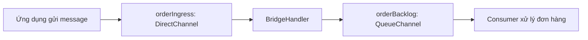
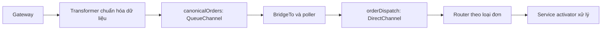

# @BridgeTo

## 1. Mục tiêu và tình huống sử dụng

Trong chương **Annotation và XML** của module **SPRING_INTEGRATION_CORE**, `@BridgeTo` là cách khai báo một messaging bridge ngay trên bean channel nguồn. Bridge chuyển message đến channel tiếp theo, giúp ghép các đoạn của luồng tích hợp mà không cần viết một phương thức nghiệp vụ chỉ để chuyển tiếp dữ liệu.

Sau bài này, bạn có thể xác định đúng chiều nối của annotation, cấu hình bridge cho channel đồng bộ hoặc channel có queue, sử dụng `replyChannel`, và chuyển cách khai báo sang XML hoặc Java DSL. Bạn cũng sẽ biết đặt bridge ở đâu trong luồng có gateway, transformer, router, filter và aggregator.

Giả sử ứng dụng tiếp nhận một `OrderRequest` đã có cấu trúc phù hợp. Đoạn tiếp nhận gửi vào `orderIngress`, còn bộ phận xử lý đọc từ `orderBacklog`. Ta cần nối hai channel:



Bridge không chuẩn hóa mã đơn hoặc kiểm tra số lượng. Nếu dữ liệu chưa đúng định dạng, thêm transformer; nếu cần chấp nhận hoặc loại bỏ, thêm filter. Bridge chỉ giải quyết mối nối giữa các channel trong tình huống này.

## 2. Đọc đúng chiều của `@BridgeTo`

Annotation thuộc package:

```java
import org.springframework.integration.annotation.BridgeTo;
```

Cách dùng cơ bản:

```java
@Bean
@BridgeTo("orderBacklog")
public MessageChannel orderIngress() {
    return new DirectChannel();
}
```

Đọc cấu hình theo quy tắc:

```text
channel được tạo bởi phương thức @Bean → channel được ghi trong value
orderIngress                           → orderBacklog
```

Bean channel mang annotation là **input channel của bridge**. `value` là tên **output channel**. Spring Integration tạo `BridgeHandler` cùng consumer endpoint để nối hai phía. Loại channel nguồn quyết định endpoint dùng cơ chế subscription hay polling. Hợp đồng này được nêu trong [Javadoc của `@BridgeTo`](https://docs.spring.io/spring-integration/api/org/springframework/integration/annotation/BridgeTo.html).

### 2.1. Factory method không phải phương thức xử lý từng message

`orderIngress()` chạy khi Spring tạo bean. Khi message đến, framework không gọi lại phương thức đó để xử lý payload; nó sử dụng channel đã được tạo và bridge endpoint đã đăng ký.

Vì vậy, đặt `@BridgeTo` trên một phương thức nghiệp vụ như `OrderRequest process(OrderRequest request)` không phải cách sử dụng được minh họa ở đây. Annotation này dành cho phương thức `@Bean` tạo `MessageChannel` trong cấu hình Spring. Ứng dụng cũng cần hạ tầng integration; các ví dụ dùng `@EnableIntegration` để thể hiện điều đó.

### 2.2. Phân biệt với `@BridgeFrom`

| Annotation | Bean channel mang annotation | Channel ghi trong `value` |
| --- | --- | --- |
| `@BridgeTo("B")` trên bean `A` | Nguồn `A` | Đích `B` |
| `@BridgeFrom("A")` trên bean `B` | Đích `B` | Nguồn `A` |

Hai cách đều có thể diễn tả `A → B`, nhưng đặt annotation ở hai đầu khác nhau. Chỉ chọn một cách cho cùng mối nối; khai báo cả hai tạo thêm endpoint thay vì bổ sung thông tin cho một endpoint duy nhất. Xem [Creating a Bridge with Annotations](https://docs.spring.io/spring-integration/reference/6.5/configuration/meta-annotations.html).

### 2.3. Bridge tạo một đường chuyển tiếp, không tạo alias

`orderIngress` và `orderBacklog` vẫn là hai đối tượng channel khác nhau. Bridge là consumer của nguồn và producer gửi tiếp đến đích. Việc dừng bridge, thay channel nguồn hoặc thay channel đích có thể làm thay đổi hành vi của đường chuyển tiếp.

Alias bean chỉ là nhiều tên cùng tham chiếu một bean. Nó không thể thay thế một bridge cần nối hai channel có tính chất khác nhau.

## 3. Ví dụ hoàn chỉnh: từ `DirectChannel` đến queue

### 3.1. Môi trường

Ví dụ sử dụng Java 17 trở lên và Spring Integration 6.x, với tài liệu tham chiếu theo dòng 6.5. Dự án cần `org.springframework.integration:spring-integration-core`; phần kiểm thử dùng JUnit Jupiter. Các dependency Spring phải được quản lý đồng bộ bằng BOM hoặc cơ chế quản lý phiên bản của dự án.

Trong dự án đã có Spring Boot parent hoặc BOM phù hợp, có thể dùng:

```xml
<dependency>
    <groupId>org.springframework.boot</groupId>
    <artifactId>spring-boot-starter-integration</artifactId>
</dependency>
<dependency>
    <groupId>org.springframework.boot</groupId>
    <artifactId>spring-boot-starter-test</artifactId>
    <scope>test</scope>
</dependency>
```

Đây là phần dependency để ghép vào dự án đã có quản lý phiên bản, không phải toàn bộ `pom.xml`. Luồng minh họa chạy trong bộ nhớ, không yêu cầu broker hoặc database.

### 3.2. Khai báo cấu hình

File minh họa `DirectBridgeConfiguration.java`:

```java
package example.integration.bridge;

import org.springframework.context.annotation.Bean;
import org.springframework.context.annotation.Configuration;
import org.springframework.integration.annotation.BridgeTo;
import org.springframework.integration.channel.DirectChannel;
import org.springframework.integration.channel.QueueChannel;
import org.springframework.integration.config.EnableIntegration;
import org.springframework.messaging.MessageChannel;
import org.springframework.messaging.PollableChannel;

@Configuration(proxyBeanMethods = false)
@EnableIntegration
public class DirectBridgeConfiguration {

    @Bean
    @BridgeTo("orderBacklog")
    public MessageChannel orderIngress() {
        return new DirectChannel();
    }

    @Bean
    public PollableChannel orderBacklog() {
        return new QueueChannel(20);
    }
}
```

Tên bean mặc định lấy từ tên phương thức. Nếu đổi tên bằng `@Bean("anotherName")`, mọi tham chiếu channel liên quan phải dùng tên bean thực tế.

Trong cấu hình này, đầu vào của bridge là `DirectChannel`, nên bridge được kích hoạt ngay khi có lệnh gửi. Queue chỉ nằm ở **đầu ra**, vì vậy bridge không cần poller. Các quy tắc gửi/nhận của channel được mô tả trong [Message Channel Implementations](https://docs.spring.io/spring-integration/reference/6.5/channel/implementations.html).

### 3.3. Gửi message và đọc lại

File minh họa `DirectBridgeDemo.java`:

```java
package example.integration.bridge;

import org.springframework.context.annotation.AnnotationConfigApplicationContext;
import org.springframework.messaging.Message;
import org.springframework.messaging.MessageChannel;
import org.springframework.messaging.PollableChannel;
import org.springframework.messaging.support.MessageBuilder;

public class DirectBridgeDemo {

    public record OrderRequest(String orderId, int quantity) {
    }

    public static void main(String[] args) {
        try (var context = new AnnotationConfigApplicationContext(
                DirectBridgeConfiguration.class)) {

            MessageChannel ingress = context.getBean(
                    "orderIngress", MessageChannel.class);
            PollableChannel backlog = context.getBean(
                    "orderBacklog", PollableChannel.class);

            Message<OrderRequest> request = MessageBuilder
                    .withPayload(new OrderRequest("OD-42", 3))
                    .setHeader("traceId", "trace-order-42")
                    .build();

            if (!ingress.send(request)) {
                throw new IllegalStateException("Message was not accepted");
            }

            Message<?> forwarded = backlog.receive(1000);
            if (forwarded == null) {
                throw new IllegalStateException("No forwarded message received");
            }

            System.out.println(forwarded.getPayload());
            System.out.println(forwarded.getHeaders().get("traceId"));
        }
    }
}
```

Kết quả mong đợi:

```text
OrderRequest[orderId=OD-42, quantity=3]
trace-order-42
```

Trong luồng này, `send` gọi bridge trên chính luồng gửi và bridge đưa message vào queue trước khi lời gọi hoàn tất. Chưa có consumer nghiệp vụ trong cấu hình: việc đọc queue ở demo chỉ giúp quan sát kết quả chuyển tiếp.

### 3.4. Message được giữ như thế nào?

`BridgeHandler` chuyển tiếp message mà không chủ động biến đổi payload hoặc header. Trong cấu hình tối giản này, payload, `traceId` và message ID có thể được đối chiếu giữa hai đầu. Đây là hành vi của [BridgeHandler](https://docs.spring.io/spring-integration/api/org/springframework/integration/handler/BridgeHandler.html).

Điều đó không phải cam kết rằng mọi thành phần khác của luồng đều giữ nguyên message. Interceptor, message history hoặc transformer được bổ sung sau này có thể tạo message mới hoặc thêm metadata.

Bridge cũng không tạo bản sao sâu của payload. Một đối tượng mutable vẫn có thể bị thay đổi bởi mã khác đang giữ cùng tham chiếu. Với thông điệp được chuyển qua nhiều bước, payload bất biến như record ở ví dụ giúp hợp đồng dễ kiểm soát hơn. Xem [Message và tính bất biến của payload/header](https://docs.spring.io/spring-integration/reference/6.5/message.html).

## 4. Khi channel nguồn có queue: thêm poller

Nếu đầu vào là `QueueChannel`, việc `send` chỉ đưa message vào hàng đợi. Cần consumer lấy message ra để bridge gửi tiếp. Ví dụ thay thế hoàn chỉnh:

```java
package example.integration.bridge;

import org.springframework.context.annotation.Bean;
import org.springframework.context.annotation.Configuration;
import org.springframework.integration.annotation.BridgeTo;
import org.springframework.integration.annotation.Poller;
import org.springframework.integration.channel.QueueChannel;
import org.springframework.integration.config.EnableIntegration;
import org.springframework.messaging.PollableChannel;

@Configuration(proxyBeanMethods = false)
@EnableIntegration
public class PolledBridgeConfiguration {

    @Bean
    @BridgeTo(
            value = "readyOrders",
            poller = @Poller(
                    fixedDelay = "100",
                    maxMessagesPerPoll = "5",
                    receiveTimeout = "0"))
    public PollableChannel bufferedOrders() {
        return new QueueChannel(100);
    }

    @Bean
    public PollableChannel readyOrders() {
        return new QueueChannel(100);
    }
}
```

Đường đi lúc này:

```text
luồng gửi → bufferedOrders
                 ↓ poller lấy message
            BridgeHandler → readyOrders
```

Các tham số trong ví dụ:

| Tham số | Ý nghĩa |
| --- | --- |
| `fixedDelay = "100"` | Lập lịch lần polling tiếp theo sau một khoảng trễ 100 ms khi lần trước hoàn tất, với cấu hình trigger này. |
| `maxMessagesPerPoll = "5"` | Xử lý tối đa 5 message trong một lần polling. |
| `receiveTimeout = "0"` | Không đợi khi queue nguồn đang rỗng. |

`maxMessagesPerPoll` không phải số worker và cũng không gộp 5 message thành một batch payload. Bridge vẫn chuyển tiếp từng message. Khoảng trễ, thời gian xử lý, scheduler và khả năng tiếp nhận ở đầu ra cùng ảnh hưởng thông lượng; không xem cấu hình trên như một SLA tốc độ cố định.

Input là `PollableChannel` cần poller được cấu hình trực tiếp hoặc poller mặc định thích hợp. Thiếu cả hai là lỗi cấu hình, chứ framework không tự chọn một lịch chạy theo ý định ứng dụng. Với `@Poller("namedPoller")`, các tùy chọn phải được khai báo trên bean `PollerMetadata` được tham chiếu. Xem [Using the `@Poller` Annotation](https://docs.spring.io/spring-integration/reference/6.5/configuration/annotations.html).

### Nối queue với một channel có subscriber

Một biến thể phổ biến là `bufferedOrders → orderWorkers`, trong đó `orderWorkers` là `DirectChannel`. Poller nằm ở bridge đọc `bufferedOrders`; các endpoint subscribe `orderWorkers` không cần tự lấy message từ queue.

Khi đó phải có consumer thực sự đăng ký với `orderWorkers`, chẳng hạn service activator xử lý đơn. Tạo một `DirectChannel` làm đích mà không có subscriber sẽ khiến việc giao message thất bại khi bridge gửi đến đó.

### Queue không tự bảo đảm lưu trữ bền vững

Các queue của ví dụ dùng bộ nhớ. `send` thành công vào `bufferedOrders` cho biết message đã được xếp hàng, chưa chứng minh bridge đã chuyển tiếp hoặc nghiệp vụ đã hoàn thành. Nếu tiến trình dừng, queue mặc định không thay thế được persistent message store hoặc broker có cơ chế lưu trữ tương ứng.

## 5. Không ghi đích: chuyển tiếp về `replyChannel`

`@BridgeTo` có thể không khai báo `value`:

```java
package example.integration.bridge;

import org.springframework.context.annotation.Bean;
import org.springframework.context.annotation.Configuration;
import org.springframework.integration.annotation.BridgeTo;
import org.springframework.integration.channel.DirectChannel;
import org.springframework.integration.config.EnableIntegration;
import org.springframework.messaging.MessageChannel;

@Configuration(proxyBeanMethods = false)
@EnableIntegration
public class ReplyBridgeConfiguration {

    @Bean
    @BridgeTo
    public MessageChannel replyExit() {
        return new DirectChannel();
    }
}
```

Đoạn sử dụng bên trong một phương thức:

```java
try (var context = new AnnotationConfigApplicationContext(
        ReplyBridgeConfiguration.class)) {

    MessageChannel exit = context.getBean("replyExit", MessageChannel.class);
    QueueChannel replies = new QueueChannel(1);

    Message<String> reply = MessageBuilder
            .withPayload("ACK-OD-42")
            .setReplyChannel(replies)
            .build();

    exit.send(reply);
    Message<?> received = replies.receive(1000);
    if (received == null) {
        throw new IllegalStateException("No reply received");
    }
    System.out.println(received.getPayload());
}
```

Đoạn này cần các import `AnnotationConfigApplicationContext`, `QueueChannel`, `Message`, `MessageChannel`, `MessageBuilder` như ở các ví dụ trước. Queue `replies` là đối tượng channel được đặt trực tiếp trong header; nó không cần là bean có tên trong context này.

Đối với trường hợp cơ bản của bài, không cấu hình routing slip, quy tắc chọn đích là:

1. Có `value` thì gửi đến channel được cấu hình.
2. Không có `value` thì dùng `replyChannel` của message.
3. Thiếu cả hai thì phát sinh lỗi khi xử lý message.

Header dùng trong Java là `replyChannel`, có hằng `MessageHeaders.REPLY_CHANNEL`. Không tự đặt một header tên `reply-channel` rồi kỳ vọng cơ chế Java đọc được nó.

Bridge không gửi đồng thời đến đích tường minh và reply channel. Khi có đích tường minh, reply header vẫn có thể được giữ để một endpoint phía sau sử dụng. Cách bỏ output channel để dùng địa chỉ trả lời được mô tả trong [Messaging Bridge](https://docs.spring.io/spring-integration/reference/6.5/bridge.html).

Trong luồng request-reply, gateway có thể cung cấp địa chỉ trả lời; bridge ở cuối một đoạn luồng giúp chuyển message đã được tạo về địa chỉ đó. Bridge không tự sinh dữ liệu phản hồi nghiệp vụ, không tự thêm mã ACK và không thay thế toàn bộ vai trò của gateway.

## 6. Các tùy chọn vòng đời và thực thi

| Thuộc tính của `@BridgeTo` | Vai trò |
| --- | --- |
| `value` | Tên output channel; có thể bỏ để dùng cơ chế trả lời của message. |
| `poller` | Cách lấy message nếu channel nguồn cần polling. |
| `autoStartup` | Chuỗi cấu hình có tự khởi động endpoint hay không; mặc định là `"true"`. |
| `phase` | Pha vòng đời khi Spring khởi động/dừng endpoint. |
| `reactive` | Tùy chọn consumer reactive; không cấu hình đồng thời với `poller`. |

Ví dụ tạm không cho bridge đọc queue ngay lúc context khởi động:

```java
@Bean
@BridgeTo(
        value = "readyOrders",
        autoStartup = "false",
        poller = @Poller(fixedDelay = "100", receiveTimeout = "0"))
public PollableChannel bufferedOrders() {
    return new QueueChannel(100);
}
```

Đây là phương án thay thế bean cùng tên trong cấu hình polling, không phải một bean bổ sung. Với queue nguồn, message có thể tích lại khi bridge chưa chạy. Với nguồn `DirectChannel` không còn consumer nào khác, gửi message lúc bridge chưa subscribe sẽ thất bại.

Điều khiển vòng đời cần thao tác với consumer endpoint được tạo, không phải gọi lại factory method tạo channel. Trong ứng dụng lớn, nên đặt quy ước quản lý endpoint và kiểm tra bean thực tế trước khi điều khiển bằng API vòng đời hoặc control bus.

Đừng sao chép thuộc tính từ annotation khác sang `@BridgeTo`. Ví dụ `sendTimeout` không phải thuộc tính của annotation này. Nếu cần cấu hình chi tiết handler, có thể khai báo `BridgeHandler` tường minh qua cấu hình endpoint phù hợp. Danh sách thuộc tính nằm trong [API của `@BridgeTo`](https://docs.spring.io/spring-integration/api/org/springframework/integration/annotation/BridgeTo.html).

## 7. Cấu hình XML tương đương

Để thay cấu hình `DirectBridgeConfiguration`, có thể sử dụng một file `direct-bridge.xml` trong classpath:

```xml
<?xml version="1.0" encoding="UTF-8"?>
<beans xmlns="http://www.springframework.org/schema/beans"
       xmlns:xsi="http://www.w3.org/2001/XMLSchema-instance"
       xmlns:int="http://www.springframework.org/schema/integration"
       xsi:schemaLocation="
         http://www.springframework.org/schema/beans
         https://www.springframework.org/schema/beans/spring-beans.xsd
         http://www.springframework.org/schema/integration
         https://www.springframework.org/schema/integration/spring-integration.xsd">

    <int:channel id="orderIngress"/>

    <int:channel id="orderBacklog">
        <int:queue capacity="20"/>
    </int:channel>

    <int:bridge id="orderIngressBridge"
                input-channel="orderIngress"
                output-channel="orderBacklog"/>
</beans>
```

Mở context XML bằng `ClassPathXmlApplicationContext("direct-bridge.xml")`, rồi lấy `orderIngress` và `orderBacklog` để gửi/nhận như demo Java.

Khi nguồn là queue, phần bridge có poller:

```xml
<int:channel id="bufferedOrders">
    <int:queue capacity="100"/>
</int:channel>

<int:channel id="readyOrders">
    <int:queue capacity="100"/>
</int:channel>

<int:bridge id="bufferedOrdersBridge"
            input-channel="bufferedOrders"
            output-channel="readyOrders">
    <int:poller fixed-delay="100"
                max-messages-per-poll="5"
                receive-timeout="0"/>
</int:bridge>
```

Đoạn thứ hai là phần cấu hình đặt bên trong phần tử `<beans>` có namespace tương ứng; dùng nó để thay các channel và bridge của ví dụ thứ nhất nếu muốn chuyển sang mô hình polling.

| Java annotation | XML |
| --- | --- |
| Bean channel mang `@BridgeTo` | `input-channel` của `<int:bridge>` |
| `@BridgeTo("target")` | `output-channel="target"` |
| `poller = @Poller(...)` | Phần tử con `<int:poller .../>` |
| `autoStartup = "false"` | `auto-startup="false"` trên bridge |
| Không khai báo `value` | Không khai báo `output-channel`; cần địa chỉ trả lời hợp lệ. |

Cách khai báo XML và Java cho messaging bridge được trình bày trong [Messaging Bridge — Configuration](https://docs.spring.io/spring-integration/reference/6.5/bridge.html).

Chỉ nạp một khai báo endpoint cho mỗi mối nối trong ví dụ. Nạp cả XML lẫn annotation của cùng bridge có thể tạo consumer cạnh tranh hoặc xung đột bean. Trên `DirectChannel`, nhiều subscriber không đồng nghĩa mọi subscriber đều nhận một bản sao.

## 8. Biểu diễn bằng Java DSL

Java DSL cho phép nhìn mối nối trong chuỗi các bước của `IntegrationFlow`:

```java
package example.integration.bridge;

import org.springframework.context.annotation.Bean;
import org.springframework.context.annotation.Configuration;
import org.springframework.integration.channel.DirectChannel;
import org.springframework.integration.channel.QueueChannel;
import org.springframework.integration.config.EnableIntegration;
import org.springframework.integration.dsl.IntegrationFlow;
import org.springframework.messaging.MessageChannel;
import org.springframework.messaging.PollableChannel;

@Configuration(proxyBeanMethods = false)
@EnableIntegration
public class DslBridgeConfiguration {

    @Bean
    public MessageChannel orderIngress() {
        return new DirectChannel();
    }

    @Bean
    public PollableChannel orderBacklog() {
        return new QueueChannel(20);
    }

    @Bean
    public IntegrationFlow orderBridgeFlow() {
        return IntegrationFlow.from("orderIngress")
                .bridge()
                .channel("orderBacklog")
                .get();
    }
}
```

`orderIngress()` không mang `@BridgeTo` nữa: `.bridge()` là nơi sở hữu việc khai báo endpoint. Channel vẫn là các bean riêng, còn `IntegrationFlow` mô tả cách ghép chúng. Xem [Java DSL](https://docs.spring.io/spring-integration/reference/6.5/dsl.html).

Với hai bean queue `bufferedOrders` và `readyOrders`, flow polling tương ứng có thể viết:

```java
import org.springframework.integration.dsl.Pollers;

@Bean
public IntegrationFlow bufferedOrderBridgeFlow() {
    return IntegrationFlow.from("bufferedOrders")
            .bridge(endpoint -> endpoint.poller(
                    Pollers.fixedDelay(100)
                            .maxMessagesPerPoll(5)
                            .receiveTimeout(0)))
            .channel("readyOrders")
            .get();
}
```

Đoạn này giả định các channel đã được đăng ký và hạ tầng integration đã bật. Bỏ `@BridgeTo` khỏi bean nguồn khi chuyển quyền tạo bridge sang DSL.

Annotation phù hợp khi muốn khai báo mối nối gần channel nguồn. DSL phù hợp khi cần đọc nhiều bước liên tiếp như transform, route hoặc handle. Dù chọn cách nào, cần giữ cùng hợp đồng message, điểm đặt queue và chính sách lỗi.

## 9. Luồng thực thi, lỗi và giới hạn bộ đệm

### 9.1. Nguồn đồng bộ và nguồn có queue

| Mô hình | Khi `send` hoàn tất thành công | Quan sát lỗi xử lý |
| --- | --- | --- |
| `DirectChannel → bridge → QueueChannel` | Bridge đã gửi message vào queue đích trong cấu hình này. | Lỗi chuyển tiếp có thể ném về luồng gửi. |
| `QueueChannel → poller → bridge → channel đích` | Producer đã đưa message vào queue nguồn. | Lỗi ở tác vụ polling được xử lý qua cơ chế lỗi của poller. |
| `DirectChannel → bridge → DirectChannel → handler` | Đường gọi đồng bộ tới handler đã hoàn tất nếu không có ranh giới bất đồng bộ khác. | Exception có thể lan theo call stack về bên gửi. |

Bridge không tự tạo một thread nền. Queue được đọc bằng poller hoặc channel có executor mới là những điểm làm thay đổi cách thực thi. Chỉ đặt tên channel có chữ `async` không làm thay đổi hành vi.

Đối với polling, có thể khai báo error channel riêng:

```java
@BridgeTo(
        value = "orderWorkers",
        poller = @Poller(
                fixedDelay = "100",
                maxMessagesPerPoll = "5",
                receiveTimeout = "0",
                errorChannel = "bridgeErrors"))
```

Annotation trên được dùng cùng `@Bean` tạo queue nguồn. Cần đăng ký `orderWorkers` và `bridgeErrors`; nếu `bridgeErrors` là queue, cần có bên đọc hoặc consumer xử lý lỗi.

Khi tác vụ polling gặp lỗi, cơ chế error handler có thể phát `ErrorMessage` để ứng dụng quan sát. Với cấu hình mặc định phù hợp, error channel có thể được xác định từ header của message hoặc channel toàn cục; cấu hình riêng trên poller thể hiện chính sách rõ hơn cho bridge này. Header `errorChannel` không tự bắt và chuyển mọi exception của lời gọi `DirectChannel.send` thành message lỗi. Xem [Error Handling](https://docs.spring.io/spring-integration/reference/6.5/error-handling.html).

### 9.2. Queue đầy và timeout

Nếu tốc độ đầu vào vượt tốc độ lấy message, queue có capacity sẽ đầy. Lúc đó thao tác gửi có thể phải chờ hoặc thất bại theo timeout và cấu hình của thành phần đang gửi. Capacity làm giới hạn bộ đệm hiện rõ; nó không làm tăng khả năng xử lý của consumer.

Thời gian chờ truyền cho `source.send(message, timeout)` không tự trở thành deadline cho mọi bước phía sau. Với một bridge, lời gửi tiếp đến output là một thao tác khác do handler thực hiện. Nếu cần giới hạn thời gian gửi của chính handler, dùng cấu hình handler thích hợp và kiểm tra hành vi tại channel đích.

Không suy ra chính sách retry, requeue hoặc exactly-once chỉ từ sự có mặt của bridge. Với queue bộ nhớ không có giao dịch, message đã lấy khỏi queue nguồn không mặc nhiên được đưa lại khi gửi đến đích thất bại. Cơ chế lưu trữ, giao dịch và phục hồi phải được thiết kế riêng theo yêu cầu luồng.

### 9.3. Những cấu trúc dễ gây sự cố

- Bridge từ `A` về chính `A`, hoặc chu trình `A → B → A`, có thể chuyển tiếp vô hạn hay gây tràn stack với đường gọi đồng bộ.
- Thêm consumer trực tiếp vào queue đang được bridge đọc tạo cạnh tranh lấy message; consumer đó có thể nhận message trước bridge.
- Thêm hai bridge trên cùng `DirectChannel` không tạo cơ chế phát cho cả hai nhánh. Nếu yêu cầu là phát bản sao đến nhiều subscriber, xem xét `PublishSubscribeChannel` và chính sách lỗi tương ứng.
- Nối một `DirectChannel` đích chưa có subscriber có thể làm lỗi chỉ xuất hiện khi message đầu tiên đến, dù context đã khởi động được.

## 10. Kiểm thử các hợp đồng quan trọng

Các lớp dưới đây là mã kiểm thử minh họa để đưa vào dự án; chúng kiểm tra wiring của annotation và hành vi quan sát được qua channel. Không cần broker ngoài tiến trình.

### 10.1. Chuyển tiếp và ưu tiên đích tường minh

File minh họa `DirectBridgeTest.java`:

```java
package example.integration.bridge;

import org.junit.jupiter.api.Test;
import org.springframework.context.annotation.AnnotationConfigApplicationContext;
import org.springframework.integration.channel.QueueChannel;
import org.springframework.messaging.Message;
import org.springframework.messaging.MessageChannel;
import org.springframework.messaging.PollableChannel;
import org.springframework.messaging.support.MessageBuilder;
import static org.junit.jupiter.api.Assertions.*;

class DirectBridgeTest {

    @Test
    void forwardsPayloadAndHeaders() {
        try (var context = new AnnotationConfigApplicationContext(
                DirectBridgeConfiguration.class)) {

            MessageChannel input = context.getBean(
                    "orderIngress", MessageChannel.class);
            PollableChannel output = context.getBean(
                    "orderBacklog", PollableChannel.class);

            Message<String> request = MessageBuilder
                    .withPayload("OD-42")
                    .setHeader("traceId", "trace-order-42")
                    .build();

            assertTrue(input.send(request));
            Message<?> actual = output.receive(1000);

            assertNotNull(actual);
            assertEquals(request.getPayload(), actual.getPayload());
            assertEquals("trace-order-42", actual.getHeaders().get("traceId"));
            assertEquals(request.getHeaders().getId(), actual.getHeaders().getId());
            assertNull(output.receive(0));
        }
    }

    @Test
    void explicitOutputIsUsedInsteadOfReplyHeader() {
        try (var context = new AnnotationConfigApplicationContext(
                DirectBridgeConfiguration.class)) {

            MessageChannel input = context.getBean(
                    "orderIngress", MessageChannel.class);
            PollableChannel output = context.getBean(
                    "orderBacklog", PollableChannel.class);
            QueueChannel replies = new QueueChannel(1);

            Message<String> request = MessageBuilder
                    .withPayload("OD-42")
                    .setReplyChannel(replies)
                    .build();

            assertTrue(input.send(request));
            assertNotNull(output.receive(1000));
            assertNull(replies.receive(0));
        }
    }
}
```

Phép kiểm tra message ID gắn với cấu hình tối giản không có bước làm thay đổi message. Nó giúp phát hiện việc vô tình thêm một phép biến đổi vào mối nối đang kỳ vọng chỉ chuyển tiếp.

### 10.2. Chuyển về địa chỉ trả lời và báo lỗi khi thiếu địa chỉ

File minh họa `ReplyBridgeTest.java`:

```java
package example.integration.bridge;

import org.junit.jupiter.api.Test;
import org.springframework.context.annotation.AnnotationConfigApplicationContext;
import org.springframework.integration.channel.QueueChannel;
import org.springframework.messaging.Message;
import org.springframework.messaging.MessageChannel;
import org.springframework.messaging.MessagingException;
import org.springframework.messaging.support.MessageBuilder;
import static org.junit.jupiter.api.Assertions.*;

class ReplyBridgeTest {

    @Test
    void forwardsToReplyChannelWhenOutputIsOmitted() {
        try (var context = new AnnotationConfigApplicationContext(
                ReplyBridgeConfiguration.class)) {

            MessageChannel input = context.getBean(
                    "replyExit", MessageChannel.class);
            QueueChannel replies = new QueueChannel(1);

            Message<String> request = MessageBuilder
                    .withPayload("ACK-OD-42")
                    .setReplyChannel(replies)
                    .build();

            assertTrue(input.send(request));
            Message<?> actual = replies.receive(1000);
            assertNotNull(actual);
            assertEquals("ACK-OD-42", actual.getPayload());
        }
    }

    @Test
    void failsWhenNeitherOutputNorReplyChannelExists() {
        try (var context = new AnnotationConfigApplicationContext(
                ReplyBridgeConfiguration.class)) {

            MessageChannel input = context.getBean(
                    "replyExit", MessageChannel.class);
            Message<String> request = MessageBuilder
                    .withPayload("ACK-OD-42")
                    .build();

            assertThrows(MessagingException.class, () -> input.send(request));
        }
    }
}
```

Test lỗi dùng `DirectChannel`, nên có thể quan sát exception tại lời gọi gửi. Không dùng giả định đó cho một queue được đọc bởi scheduler.

### 10.3. Bridge đọc queue theo lịch

File minh họa `PolledBridgeTest.java`:

```java
package example.integration.bridge;

import org.junit.jupiter.api.Test;
import org.springframework.context.annotation.AnnotationConfigApplicationContext;
import org.springframework.messaging.Message;
import org.springframework.messaging.PollableChannel;
import org.springframework.messaging.support.MessageBuilder;
import static org.junit.jupiter.api.Assertions.*;

class PolledBridgeTest {

    @Test
    void eventuallyForwardsMessageFromSourceQueue() {
        try (var context = new AnnotationConfigApplicationContext(
                PolledBridgeConfiguration.class)) {

            PollableChannel input = context.getBean(
                    "bufferedOrders", PollableChannel.class);
            PollableChannel output = context.getBean(
                    "readyOrders", PollableChannel.class);

            Message<String> request = MessageBuilder
                    .withPayload("OD-42")
                    .setHeader("traceId", "trace-order-42")
                    .build();

            assertTrue(input.send(request, 1000));
            Message<?> actual = output.receive(3000);

            assertNotNull(actual);
            assertEquals("OD-42", actual.getPayload());
            assertEquals("trace-order-42", actual.getHeaders().get("traceId"));
        }
    }
}
```

Thay vì `Thread.sleep` một khoảng cố định rồi hy vọng scheduler đã chạy, test chờ message tại đầu ra với timeout hữu hạn. Context được đóng sau từng test để giải phóng scheduler và tránh trạng thái queue ảnh hưởng kiểm thử khác.

Để kiểm tra đường lỗi polling, tạo một cấu hình riêng có queue nguồn, poller với `errorChannel = "bridgeErrors"`, và đích là `DirectChannel` chưa có subscriber. Gửi message vào queue nguồn, rồi nhận `ErrorMessage` tại queue lỗi. Phép kiểm tra cần xác nhận loại lỗi và message thất bại, đồng thời cho thấy enqueue thành công không đồng nghĩa chuyển tiếp thành công.

## 11. Đặt bridge trong một luồng tích hợp doanh nghiệp

Một luồng tiếp nhận đơn hàng có thể được tổ chức như sau:



Trong thiết kế này:

| Thành phần | Trách nhiệm |
| --- | --- |
| Gateway | Chuyển lời gọi ứng dụng thành tương tác messaging và quản lý hợp đồng trả lời. |
| Transformer | Đưa dữ liệu về mô hình chuẩn mà các bước phía sau hiểu được. |
| Queue | Tạo bộ đệm tại ranh giới đã chọn. |
| Bridge với poller | Lấy message từ bộ đệm và nối sang đoạn xử lý tiếp. |
| Router | Chọn nhánh xử lý theo nội dung hoặc metadata. |
| Filter | Kiểm soát việc message có được đi tiếp theo điều kiện tiếp nhận. |
| Aggregator | Kết hợp các message tương quan theo điều kiện hoàn tất của nhóm. |

Không phải luồng nào cũng cần đủ các thành phần này. Nếu một transformer đã có thể nhận từ queue với poller và gửi đến channel tiếp theo, thêm bridge riêng chỉ hợp lý khi nó thể hiện một ranh giới hoặc yêu cầu quản lý độc lập rõ ràng.

Khi nối một đoạn sau splitter đến aggregator, kiểm tra các header correlation và sequence còn đúng ý nghĩa. Bridge không tạo correlation ID mới hoặc sửa thông tin nhóm cho bạn. Khi nối đến outbound adapter, việc ánh xạ header ra transport thuộc cấu hình adapter, không thuộc `@BridgeTo`.

Một bridge nên nối các channel trong tiến trình theo mục đích cụ thể. Chỉ đặt tên đích giống một topic Kafka hoặc queue RabbitMQ không tạo ra kết nối broker; muốn đi ra hệ thống ngoài cần adapter hay channel được cấu hình cho transport đó.

## 12. Chẩn đoán nhanh các nhầm lẫn thường gặp

| Hiện tượng | Nguyên nhân cần kiểm tra | Điều chỉnh |
| --- | --- | --- |
| Message đi ngược chiều dự kiến | Nhầm bean nguồn với `value` đích. | Vẽ lại `bean mang BridgeTo → value`. |
| Context lỗi khi nguồn là queue | Thiếu poller trực tiếp hoặc poller mặc định. | Khai báo lịch polling phù hợp. |
| Queue đích có message nhưng nghiệp vụ chưa chạy | Chưa có consumer đọc queue. | Bổ sung consumer và hợp đồng xử lý. |
| Gửi đến channel đích bị lỗi không có subscriber | Đích là `DirectChannel` chưa có handler. | Kiểm tra endpoint downstream đã đăng ký và khởi động. |
| Không có `value` rồi phát sinh lỗi | Thiếu địa chỉ trả lời hợp lệ. | Đặt `replyChannel` hoặc cấu hình đích tường minh. |
| Một trong hai nhánh không nhận message | Dùng nhiều consumer trên channel point-to-point. | Chọn cơ chế phân phối đúng với yêu cầu. |
| Message trong queue không được chuyển tiếp | Bridge chưa chạy, poller chưa hoạt động hoặc có consumer khác đang lấy. | Kiểm tra vòng đời, lịch chạy và ownership của queue. |
| Cùng mối nối có hành vi bất thường sau đổi cấu hình | Annotation, XML và DSL cùng tạo endpoint. | Giữ một nơi khai báo endpoint cho mối nối. |
| Tăng `maxMessagesPerPoll` nhưng vẫn chậm | Downstream, scheduler hoặc queue đích là nút thắt. | Quan sát thời gian xử lý và độ sâu queue ở từng đoạn. |
| Đặt `sendTimeout` trong `@BridgeTo` không biên dịch | Annotation không có thuộc tính đó. | Cấu hình handler tường minh nếu cần tùy chọn gửi. |

Khi xử lý sự cố, theo dõi lần lượt message được chấp nhận ở channel nào, endpoint nào đã nhận, đích nào được chọn và lỗi được quan sát ở đâu. Các bước đó giúp phân biệt lỗi wiring, lỗi điều phối và lỗi nghiệp vụ downstream.

## 13. Bài thực hành

1. Với cấu hình đồng bộ, thêm `correlationId` vào request và xác nhận giá trị ở queue đích. Giải thích vì sao bridge không cần một phương thức tự sao chép header.
2. Chuyển nguồn thành `QueueChannel`, giữ cùng dữ liệu đầu vào và thêm poller. Mô tả điều có thể kết luận ngay sau `send` trong từng cấu hình.
3. Viết lại mối nối bằng `@BridgeFrom` trên bean đích. Giữ duy nhất một bridge, sau đó đối chiếu kết quả với `@BridgeTo`.
4. Dùng cấu hình không có `value` để chuyển hai message về hai reply channel khác nhau. Xác nhận mỗi bên chỉ nhận message có địa chỉ trả lời của mình.
5. Chuyển cùng mối nối sang XML rồi DSL; dùng lại các phép kiểm tra payload, header và lỗi thiếu địa chỉ trả lời.
6. Tạo lỗi ở đích của bridge polling, thu nhận `ErrorMessage` và xác định message nào thất bại. Nêu chính sách phục hồi cần bổ sung nếu không được phép mất dữ liệu.

Hoàn thành bài khi bạn giải thích được chiều chuyển tiếp, nơi kích hoạt consumer, cách chọn output và cách quan sát lỗi của từng biến thể bridge.
