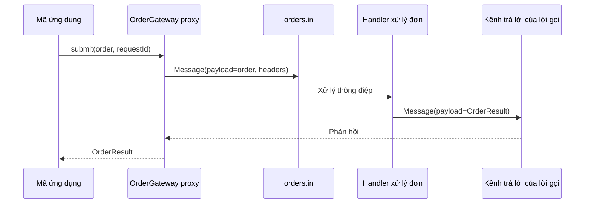

# `@MessagingGateway`: gọi luồng thông điệp qua interface Java

## 1. Mục tiêu và bài toán

Trong module **SPRING_INTEGRATION_CORE**, `@MessagingGateway` là annotation giúp đặt một interface Java trước luồng Spring Integration. Bên gọi làm việc với phương thức có tham số và kiểu trả về rõ ràng; gateway phụ trách chuyển lời gọi đó thành tương tác qua message channel.

Giả sử một chức năng tiếp nhận đơn hàng cần gọi luồng tích hợp để kiểm tra dữ liệu và nhận kết quả. Nếu thao tác trực tiếp với messaging API, bên gọi phải tạo `Message`, đặt headers, chọn channel và xử lý việc nhận phản hồi. Với gateway, bên gọi có thể viết:

```java
OrderResult result = orderGateway.submit(order, "REQ-101");
```

Cấu hình tích hợp quyết định thông điệp được gửi vào đâu và phản hồi được lấy như thế nào. Cơ chế proxy này được mô tả trong [Javadoc của `GatewayProxyFactoryBean`](https://docs.spring.io/spring-integration/api/org/springframework/integration/gateway/GatewayProxyFactoryBean.html).

Sau bài học, bạn có thể:

- Đăng ký interface `@MessagingGateway` thành bean proxy.
- Ánh xạ tham số sang payload, header và kiểu trả về.
- Phân biệt lời gọi có phản hồi với lời gọi một chiều.
- Đặt timeout phù hợp với channel và mô hình thực thi.
- Thiết kế đường trả lời, đường lỗi và các kiểm thử cần thiết.
- Đối chiếu annotation với cấu hình gateway bằng XML và luồng bằng Java DSL.

Ví dụ dùng Java 17 trở lên và Spring Integration **6.2 trở lên**. Mốc 6.2 được chọn vì bài sử dụng `errorOnTimeout`. Cần dependency `spring-integration-core`, hạ tầng Spring Context tương thích và JUnit Jupiter cho mã kiểm thử minh họa. Dự án dùng Spring Boot nên quản lý phiên bản bằng bộ dependency của Boot.

## 2. Vị trí của gateway trong hệ thống



Interface là hợp đồng của bên gọi; proxy do Spring tạo ra là đối tượng thực thi hợp đồng đó. Proxy không tự triển khai logic kiểm tra đơn hàng. Logic nằm ở handler và các endpoint phía sau channel.

`@MessagingGateway` không tự biến một interface thành HTTP API, không tự gửi dữ liệu qua mạng và không tự bổ sung broker. Nếu downstream có adapter HTTP, JDBC, AMQP hoặc Kafka, đó là một phần cấu hình khác của luồng.

### Phân biệt các thành phần liên quan

| Thành phần | Trách nhiệm |
| --- | --- |
| `@MessagingGateway` | Khai báo interface dùng làm cổng vào luồng messaging |
| `@Gateway` | Tùy chỉnh ánh xạ hoặc channel/timeout cho từng phương thức của interface |
| `@ServiceActivator` | Nhận message và gọi logic xử lý phía downstream |
| `MessageChannel` | Kết nối các bước bằng cách chuyển giao thông điệp |
| HTTP/AMQP/JMS gateway | Tích hợp theo giao thức tương ứng khi được cấu hình trong luồng |

Trong Java DSL, toán tử `.gateway(...)` dùng để gọi một luồng request–reply từ bên trong một luồng khác. Nó có liên quan về mẫu tương tác nhưng không thay thế việc đăng ký interface `@MessagingGateway` cho mã ứng dụng.

## 3. Cách đăng ký proxy: annotation phải được phát hiện

### 3.1. Quét bằng `@IntegrationComponentScan`

```java
@Configuration
@EnableIntegration
@IntegrationComponentScan(basePackageClasses = OrderGateway.class)
public class ScannedGatewayConfiguration {
}
```

Đoạn này minh họa việc đăng ký gateway, chưa khai báo channel và handler. `basePackageClasses` chọn package của lớp hoặc interface chỉ định để quét, không có nghĩa là chỉ đăng ký đúng một kiểu đó. Xem [Javadoc của `@IntegrationComponentScan`](https://docs.spring.io/spring-integration/api/org/springframework/integration/annotation/IntegrationComponentScan.html).

`@ComponentScan` thông thường không đủ để tìm và tạo proxy cho interface gateway. Khi không tìm thấy bean, hãy kiểm tra phạm vi quét và cách đăng ký interface trước khi tự viết một lớp implementation. Đây là điểm được nhấn mạnh trong [Javadoc của `@MessagingGateway`](https://docs.spring.io/spring-integration/api/org/springframework/integration/annotation/MessagingGateway.html).

### 3.2. Đăng ký tường minh bằng `@Import`

Từ Spring Integration 6.0, interface có `@MessagingGateway` cũng có thể được đăng ký qua `@Import`. Ví dụ hoàn chỉnh trong bài chọn cách này để context chỉ nhập đúng gateway cần dùng:

```java
@Configuration
@EnableIntegration
@Import(OrderGateway.class)
public class ExplicitGatewayConfiguration {
}
```

Không dùng đồng thời nhiều cách đăng ký cho cùng một gateway nếu không có chủ đích. Hỗ trợ `@Import` được mô tả tại mục đăng ký annotation trong [Messaging Gateways](https://docs.spring.io/spring-integration/reference/gateway.html).

Trong context Java độc lập của bài, `@EnableIntegration` đăng ký các thành phần hạ tầng tích hợp. Việc nhập hoặc quét interface gateway là trách nhiệm khác với việc bật hạ tầng. Xem [Configuration and `@EnableIntegration`](https://docs.spring.io/spring-integration/reference/overview.html#configuration-enable-integration).

## 4. Ví dụ hoàn chỉnh: tiếp nhận đơn hàng và gửi audit

Ví dụ có hai phương thức:

- `submit(...)` gửi vào `orders.in`, chờ một `OrderResult`.
- `audit(...)` gửi vào `orders.audit`, không chờ kết quả nghiệp vụ.

Mỗi lớp hoặc interface public trong ví dụ được đặt trong tệp cùng tên, thuộc package `example.gateway`. Những đoạn cấu hình thay thế ở các mục sau không cần nạp cùng context này.

### 4.1. Định nghĩa dữ liệu

```java
package example.gateway;

import java.math.BigDecimal;

public record OrderRequest(String orderId, BigDecimal total) {
}
```

```java
package example.gateway;

public record OrderResult(
        String orderId,
        String status,
        String requestId,
        String source) {
}
```

`requestId` là mã do ứng dụng cung cấp để đối chiếu một yêu cầu trong ví dụ. Nó không thay thế header kỹ thuật `id` do framework quản lý.

### 4.2. Interface gateway

```java
package example.gateway;

import org.springframework.integration.annotation.Gateway;
import org.springframework.integration.annotation.GatewayHeader;
import org.springframework.integration.annotation.MessagingGateway;
import org.springframework.messaging.handler.annotation.Header;

@MessagingGateway(
        name = "orderGateway",
        defaultRequestChannel = "orders.in",
        defaultRequestTimeout = "1000",
        defaultReplyTimeout = "2000",
        errorOnTimeout = true,
        defaultHeaders = @GatewayHeader(name = "source", value = "PORTAL"))
public interface OrderGateway {

    OrderResult submit(
            OrderRequest order,
            @Header("requestId") String requestId);

    @Gateway(requestChannel = "orders.audit")
    void audit(
            OrderRequest order,
            @Header("requestId") String requestId);
}
```

Phương thức `submit(...)` không cần `@Gateway` vì dùng cấu hình mặc định ở cấp interface. Phương thức `audit(...)` chỉ đổi request channel và chọn hợp đồng một chiều thông qua kiểu trả về `void`.

Ánh xạ của một lời gọi `submit(order, "REQ-101")`:

| Thành phần lời gọi | Trong thông điệp |
| --- | --- |
| `order` | Payload kiểu `OrderRequest` |
| `"REQ-101"` | Header `requestId` |
| `@GatewayHeader` ở interface | Header `source = PORTAL` |
| Giá trị trả về của luồng | Payload phản hồi được trả thành `OrderResult` |

`@GatewayHeader` có thể cung cấp `value` cố định hoặc `expression` để tính giá trị. Chỉ chọn cách biểu diễn phù hợp cho từng header; xem [Javadoc của `@GatewayHeader`](https://docs.spring.io/spring-integration/api/org/springframework/integration/annotation/GatewayHeader.html).

### 4.3. Logic xử lý đơn hàng

```java
package example.gateway;

public class OrderService {

    public OrderResult submit(
            OrderRequest order,
            String requestId,
            String source) {

        if (order.orderId() == null || order.orderId().isBlank()
                || order.total() == null || order.total().signum() <= 0) {
            throw new IllegalArgumentException("Đơn hàng không hợp lệ");
        }

        return new OrderResult(
                order.orderId(), "ACCEPTED", requestId, source);
    }
}
```

Để tập trung vào gateway, dịch vụ chỉ kiểm tra dữ liệu và tạo kết quả, chưa ghi cơ sở dữ liệu hay gọi hệ thống bên ngoài. Trong một ứng dụng thật, trạng thái `ACCEPTED` phải tương ứng với một cam kết nghiệp vụ đã được định nghĩa.

Adapter nối dịch vụ này với message channel:

```java
package example.gateway;

import org.springframework.integration.annotation.ServiceActivator;
import org.springframework.messaging.handler.annotation.Header;

public class OrderEndpoint {

    private final OrderService service;

    public OrderEndpoint(OrderService service) {
        this.service = service;
    }

    @ServiceActivator(inputChannel = "orders.in", requiresReply = "true")
    public OrderResult handle(
            OrderRequest order,
            @Header("requestId") String requestId,
            @Header("source") String source) {
        return service.submit(order, requestId, source);
    }
}
```

Không đặt `outputChannel` cho endpoint cuối, để phản hồi được gửi theo `replyChannel` của request. `requiresReply = "true"` giúp phát hiện trường hợp handler không tạo kết quả; thuộc tính này không đo thời gian chạy handler. Cách service activator chọn đích trả lời được mô tả trong [Service Activator](https://docs.spring.io/spring-integration/reference/service-activator.html).

### 4.4. Cấu hình context

```java
package example.gateway;

import org.springframework.context.annotation.Bean;
import org.springframework.context.annotation.Configuration;
import org.springframework.context.annotation.Import;
import org.springframework.integration.channel.DirectChannel;
import org.springframework.integration.channel.QueueChannel;
import org.springframework.integration.config.EnableIntegration;

@Configuration
@EnableIntegration
@Import(OrderGateway.class)
public class OrderGatewayConfiguration {

    @Bean("orders.in")
    public DirectChannel ordersIn() {
        return new DirectChannel();
    }

    @Bean("orders.audit")
    public QueueChannel ordersAudit() {
        return new QueueChannel(50);
    }

    @Bean
    public OrderService orderService() {
        return new OrderService();
    }

    @Bean
    public OrderEndpoint orderEndpoint(OrderService service) {
        return new OrderEndpoint(service);
    }
}
```

Context độc lập có thể được gọi như sau:

```java
try (var context = new AnnotationConfigApplicationContext(
        OrderGatewayConfiguration.class)) {

    OrderGateway gateway = context.getBean(OrderGateway.class);
    OrderRequest request = new OrderRequest(
            "ORD-101", new BigDecimal("250000"));

    OrderResult result = gateway.submit(request, "REQ-101");
    gateway.audit(request, "REQ-AUDIT-101");
}
```

Đoạn gọi cần import `java.math.BigDecimal` và `org.springframework.context.annotation.AnnotationConfigApplicationContext`.

`submit(...)` chạy qua `DirectChannel` nên phần xử lý đồng bộ trong ví dụ hoàn tất trên luồng gọi. `audit(...)` chỉ đưa message vào một queue còn chỗ trống. Ví dụ chưa đăng ký consumer audit; dữ liệu queue mặc định ở bộ nhớ và sẽ không được giữ qua việc đóng context.

## 5. Ánh xạ phương thức: payload, headers và kết quả

### 5.1. Làm rõ tham số nào là payload

Một tham số không có annotation, có kiểu `OrderRequest`, là lựa chọn đơn giản để làm payload. Các tham số metadata nên được đánh dấu `@Header` hoặc `@Headers` rõ ràng:

```java
OrderResult submit(
        OrderRequest order,
        @Headers Map<String, Object> metadata);
```

Đoạn chữ ký này cần import `java.util.Map` và `org.springframework.messaging.handler.annotation.Headers`. Nó là biến thể của hợp đồng ban đầu, không phải overload bắt buộc bổ sung.

Tránh để nhiều tham số nghiệp vụ không có chỉ dẫn ánh xạ, chẳng hạn `submit(OrderRequest order, Customer customer)`, rồi kỳ vọng framework tự biết cách ghép chúng. Có thể tạo một DTO bao gồm các dữ liệu cần thiết hoặc khai báo payload expression rõ ràng. Hợp đồng ánh xạ tham số và trả về được mô tả trong [Javadoc của `@Gateway`](https://docs.spring.io/spring-integration/api/org/springframework/integration/annotation/Gateway.html).

### 5.2. Chỉ định payload expression

Khi cần chọn payload từ nhiều đối số:

```java
@Gateway(
        requestChannel = "orders.in",
        payloadExpression = "#args[0]")
OrderResult submitSelected(
        OrderRequest order,
        @Header("requestId") String requestId);
```

Trong ví dụ này expression chỉ chọn đối số đầu tiên nên có thể bỏ nó mà hợp đồng vẫn rõ. Giá trị của kỹ thuật này nằm ở những chữ ký phức tạp hơn. Không đưa logic nghiệp vụ dài vào SpEL nếu một DTO hoặc một phương thức Java có thể diễn đạt dễ kiểm thử hơn.

Nếu cấu hình `mapper` tùy chỉnh bằng `MethodArgsMessageMapper`, mapper chịu trách nhiệm tạo `Message`; không phối hợp thêm payload expression và khai báo header theo cách thông thường trên gateway đó. Hợp đồng mapper nằm trong [Javadoc của `MethodArgsMessageMapper`](https://docs.spring.io/spring-integration/api/org/springframework/integration/gateway/MethodArgsMessageMapper.html) và các ràng buộc cấu hình được nêu ở [API `MessagingGateway`](https://docs.spring.io/spring-integration/api/org/springframework/integration/annotation/MessagingGateway.html).

### 5.3. Trả payload hay trả toàn bộ message?

| Chữ ký trả về | Ý nghĩa đối với bên gọi |
| --- | --- |
| `OrderResult` | Nhận payload kết quả |
| `Message<OrderResult>` | Nhận cả payload và headers phản hồi |
| `void` | Không yêu cầu gateway trả một phản hồi nghiệp vụ |
| `CompletableFuture<OrderResult>` | Nhận kết quả qua cơ chế bất đồng bộ được cấu hình |

Nếu phần ứng dụng cần hoàn toàn dùng kiểu nghiệp vụ, ưu tiên `OrderResult`. Nếu cần đọc header từ phản hồi để kiểm tra hoặc tích hợp với một API messaging khác, có thể chọn `Message<OrderResult>` nhưng khi đó caller phụ thuộc vào Spring Messaging.

Khai báo kiểu trả về không tự tạo ra dữ liệu đúng kiểu. Downstream phải trả một kết quả tương thích; cần transformer phù hợp nếu phản hồi thô là JSON, XML hoặc một DTO khác. Không nên giả định mọi cấu trúc dữ liệu có thể tự chuyển thành `OrderResult`.

## 6. Đường trả lời và vai trò của `replyChannel`

Trong request–reply thông thường, gateway tạo kênh trả lời tạm cho lời gọi và đưa địa chỉ trả lời vào headers. Endpoint cuối có thể trả kết quả qua địa chỉ đó. Bạn thường không phải khai báo một `defaultReplyChannel` riêng cho ví dụ như mục 4.

Điều cần giữ nguyên xuyên suốt luồng là **khả năng trả lời đúng lời gọi đang chờ**. Nếu một transformer tự tạo message mới và vô tình làm mất headers phục vụ trả lời, handler cuối vẫn có thể tính được kết quả nhưng gateway không nhận được nó.

Một số quy tắc thiết kế cho ví dụ đơn hàng:

- Các bước xử lý nên giữ ngữ cảnh `requestId` để đối chiếu nghiệp vụ.
- Bước cuối phải tạo kết quả hoặc phát sinh lỗi theo hợp đồng.
- Nếu thêm `outputChannel` vào bước cuối, kiểm tra rằng đường mới vẫn quay về gateway.
- Nếu thêm splitter/aggregator, xác định kết quả cuối là một phản hồi duy nhất hay một tập kết quả.

Một `QueueChannel` dùng chung không tự tạo cơ chế ghép reply theo `requestId`. Không xây dựng mô hình “mọi caller cùng đọc một queue kết quả” rồi kỳ vọng mỗi caller luôn nhận đúng phản hồi của mình. Nếu cần named reply channel, hãy hiểu cơ chế bridge giữa channel đó với kênh trả lời của lời gọi và kiểm thử các lời gọi đồng thời.

Không nên đưa trực tiếp đối tượng channel nội bộ vào dữ liệu truyền qua mạng. Khi luồng đi qua broker hoặc serialize message, cần thiết kế việc ánh xạ header và tương quan request–reply phù hợp với transport.

## 7. Timeout: tách thời gian gửi và thời gian chờ phản hồi

### 7.1. Hai loại timeout

| Thuộc tính | Khi nào có tác dụng đáng chú ý? |
| --- | --- |
| `defaultRequestTimeout` / `requestTimeout` | Giới hạn việc chờ gửi vào channel có thể chặn, ví dụ bounded queue đầy |
| `defaultReplyTimeout` / `replyTimeout` | Giới hạn khoảng chờ reply khi gateway thực hiện nhận phản hồi |

Trong annotation cấp interface, các timeout mặc định là chuỗi như `"1000"`. Trong `@Gateway`, các thuộc tính `requestTimeout` và `replyTimeout` là số `long`, ví dụ:

```java
@Gateway(
        requestChannel = "orders.priority",
        requestTimeout = 300,
        replyTimeout = 1500)
OrderResult submitPriority(
        OrderRequest order,
        @Header("requestId") String requestId);
```

Đây là chữ ký minh họa ghi đè cho một phương thức; cần khai báo `orders.priority` và luồng xử lý tương ứng trước khi dùng.

`replyTimeout` bắt đầu ở giai đoạn gateway chờ reply, sau khi quyền điều khiển quay về gateway. Nó không phải cơ chế hủy một lời gọi đồng bộ đang nằm bên trong `send()`. Chi tiết thời điểm này được nêu trong [Javadoc của `Gateway.replyTimeout`](https://docs.spring.io/spring-integration/api/org/springframework/integration/annotation/Gateway.html#replyTimeout()).

### 7.2. Vì sao `DirectChannel` làm timeout dễ bị hiểu sai?

Giả sử downstream chạy đồng bộ trong 8 giây rồi trả kết quả. Dù đặt reply timeout là 2 giây, gateway không thể dùng nó để ngắt handler ở giây thứ hai: luồng gọi vẫn đang thực thi handler.

```text
Caller -> gateway -> DirectChannel.send() -> handler chạy 8 giây
                                             |
                                             +-> trả kết quả
                         gateway tiếp tục <-+
```

Với input queue có consumer khác luồng, việc gửi có thể xong trước khi xử lý hoàn tất; khi đó gateway mới thực sự có khoảng chờ phản hồi độc lập. Đặc tính cùng luồng của `DirectChannel` và cơ chế đệm của `QueueChannel` được mô tả trong [Message Channel Implementations](https://docs.spring.io/spring-integration/reference/channel/implementations.html).

Vì vậy, nếu downstream gọi HTTP, JDBC hoặc một thư viện có thể chặn, cần cấu hình timeout cho chính thao tác I/O đó. Đổi một con số trên gateway không đủ kiểm soát tổng thời gian xử lý.

### 7.3. Không có phản hồi: `null` hay exception?

Ví dụ chính đặt `errorOnTimeout = true`. Từ Spring Integration 6.2, tùy chọn này cho phép biểu diễn hết thời gian chờ bằng `MessageTimeoutException`, hoặc đi qua error channel nếu có cấu hình phù hợp, thay vì trả về `null` theo hành vi mặc định khi không nhận được reply. Xem [`MessagingGateway.errorOnTimeout`](https://docs.spring.io/spring-integration/api/org/springframework/integration/annotation/MessagingGateway.html#errorOnTimeout()).

Các tình huống cần tính đến gồm:

- Filter loại request và không nhánh nào tạo phản hồi.
- Handler trả `null` trong một luồng không yêu cầu reply.
- Thông điệp được đưa vào queue nhưng không có consumer xử lý.
- Header trả lời bị mất hoặc phản hồi được gửi sang nơi khác.

Hết thời gian chờ không chứng minh thao tác nghiệp vụ chưa xảy ra. Một xử lý bất đồng bộ có thể vẫn tiếp tục sau khi caller đã timeout. Khi thiết kế retry cho thao tác ghi dữ liệu, cần idempotency hoặc một cách tra cứu kết quả theo khóa nghiệp vụ.

## 8. `void` là một chiều, không tự đồng nghĩa với chạy nền

Phương thức `audit(...)` trong ví dụ không chờ `OrderResult`, nhưng nó vẫn phải thực hiện thao tác gửi message. Nếu kênh là queue đầy, caller có thể chờ việc gửi. Nếu kênh là `DirectChannel`, một handler đồng bộ có thể chạy ngay trong lời gọi.

Do đó, có hai câu hỏi riêng:

1. Hợp đồng phương thức có yêu cầu phản hồi không?
2. Luồng xử lý có tách khỏi luồng caller không?

Đổi kiểu trả về thành `void` chỉ trả lời câu hỏi thứ nhất. Muốn xử lý ở luồng khác, cần cấu hình executor hoặc kiểu channel/consumer phù hợp.

Với một lời gọi một chiều, việc phương thức trả về thành công có thể chỉ chứng minh message đã được nhận vào queue. Nó không chứng minh audit đã được ghi bền vững. Nếu caller cần xác nhận một cam kết nghiệp vụ, hãy tạo một phản hồi thể hiện đúng cam kết đó.

Không dùng thông điệp phản hồi từ downstream như một kênh kết quả ngầm cho phương thức `void`. Hợp đồng một chiều phải có cơ chế quan sát lỗi và trạng thái riêng khi cần.

## 9. Xử lý lỗi và hợp đồng với caller

### 9.1. Không cấu hình `errorChannel`

Ví dụ chính không đặt `errorChannel` cho gateway. Khi `OrderService` ném `IllegalArgumentException`, caller phải nhận biết lời gọi thất bại; phần kiểm thử phía sau xác nhận trường hợp này.

Spring Integration có thể bọc lỗi xử lý trong `MessagingException` để giữ ngữ cảnh message. Gateway có cơ chế phân tích chuỗi nguyên nhân và chữ ký `throws` để quyết định exception đưa ra cho caller. Vì vậy, không nên giả định mọi exception luôn xuất hiện dưới cùng một lớp bọc.

Việc chọn giữa exception nghiệp vụ và DTO kết quả là một phần thiết kế API. Một đơn bị từ chối theo quy tắc có thể được biểu diễn bằng kết quả `REJECTED`; lỗi kết nối đến hệ thống khác có thể là một thất bại kỹ thuật. Không gộp hai loại này chỉ vì chúng cùng đi qua gateway.

### 9.2. Cấu hình error flow

Một gateway có thể định tuyến lỗi vào một channel riêng:

```java
@MessagingGateway(
        defaultRequestChannel = "orders.in",
        errorChannel = "orders.errors",
        defaultRequestTimeout = "1000",
        defaultReplyTimeout = "2000",
        errorOnTimeout = true,
        defaultHeaders = @GatewayHeader(name = "source", value = "PORTAL"))
public interface RecoveringOrderGateway {

    OrderResult submit(
            OrderRequest order,
            @Header("requestId") String requestId);
}
```

Đây là biến thể, chưa phải cấu hình chạy đủ: phải đăng ký interface này, khai báo `orders.errors` và consumer xử lý lỗi. Consumer có thể chuyển lỗi thành một DTO phản hồi tương thích với `OrderResult`, hoặc ném lỗi theo chính sách.

Nếu error flow chỉ ghi log rồi kết thúc, nó chưa tạo ra kết quả mà phương thức `submit(...)` yêu cầu. Nếu trả về exception hoặc message có payload `Throwable`, gateway có thể tiếp tục xử lý đó như lỗi; muốn phản hồi bình thường thì phải tạo dữ liệu nghiệp vụ đúng hợp đồng.

Khi đọc lỗi để lấy `requestId`, không giả định mọi exception đều có `failedMessage`. Cần xử lý các trường hợp không có message thất bại và không tự bịa mã đối chiếu.

### 9.3. Luồng bất đồng bộ

Với handler chạy ở luồng khác, exception không thể quay lại caller đơn giản bằng cùng Java call stack. Cơ chế xử lý lỗi cần đưa lỗi về đúng nơi đang chờ hoặc về kênh giám sát lỗi đã thiết kế. Sự khác biệt giữa cùng luồng và bất đồng bộ được trình bày trong [Error Handling](https://docs.spring.io/spring-integration/reference/error-handling.html).

Không đặt `errorChannel = "nullChannel"` chỉ để làm biến mất exception của một API cần biết kết quả. Việc nuốt lỗi khiến caller mất khả năng phân biệt xử lý thành công với xử lý không hoàn tất.

## 10. Cấu hình gateway bằng XML

XML có thể tạo proxy cho một interface không gắn `@MessagingGateway`. Interface thay thế vẫn có thể dùng `@Header` để mô tả tham số:

```java
package example.gateway;

import org.springframework.messaging.handler.annotation.Header;

public interface XmlOrderGateway {

    OrderResult submit(
            OrderRequest order,
            @Header("requestId") String requestId);

    void audit(
            OrderRequest order,
            @Header("requestId") String requestId);
}
```

Để dùng lại `OrderService` mà không đăng ký thêm endpoint annotation, tạo adapter XML không có `@ServiceActivator`:

```java
package example.gateway;

import org.springframework.messaging.Message;

public class XmlOrderHandler {

    private final OrderService service;

    public XmlOrderHandler(OrderService service) {
        this.service = service;
    }

    public OrderResult handle(Message<OrderRequest> message) {
        return service.submit(
                message.getPayload(),
                message.getHeaders().get("requestId", String.class),
                message.getHeaders().get("source", String.class));
    }
}
```

Cấu hình context XML tương ứng:

```xml
<?xml version="1.0" encoding="UTF-8"?>
<beans xmlns="http://www.springframework.org/schema/beans"
       xmlns:xsi="http://www.w3.org/2001/XMLSchema-instance"
       xmlns:int="http://www.springframework.org/schema/integration"
       xsi:schemaLocation="
           http://www.springframework.org/schema/beans
           https://www.springframework.org/schema/beans/spring-beans.xsd
           http://www.springframework.org/schema/integration
           https://www.springframework.org/schema/integration/spring-integration.xsd">

    <int:channel id="orders.in"/>

    <int:channel id="orders.audit">
        <int:queue capacity="50"/>
    </int:channel>

    <int:gateway id="xmlOrderGateway"
                 service-interface="example.gateway.XmlOrderGateway"
                 default-request-channel="orders.in"
                 default-request-timeout="1000"
                 default-reply-timeout="2000"
                 error-on-timeout="true">
        <int:default-header name="source" value="PORTAL"/>
        <int:method name="audit" request-channel="orders.audit"/>
    </int:gateway>

    <bean id="orderService" class="example.gateway.OrderService"/>

    <bean id="xmlOrderHandler" class="example.gateway.XmlOrderHandler">
        <constructor-arg ref="orderService"/>
    </bean>

    <int:service-activator input-channel="orders.in"
                           ref="xmlOrderHandler"
                           method="handle"
                           requires-reply="true"/>
</beans>
```

Đây là context thay thế cho cấu hình annotation ở mục 4. Việc giữ interface XML không có `@Gateway` cũng tránh hai nơi cùng chỉ định channel hoặc timeout cho một phương thức.

| Ý định | Annotation | XML |
| --- | --- | --- |
| Interface dùng để tạo proxy | Interface có `@MessagingGateway` | `service-interface` |
| Channel mặc định | `defaultRequestChannel` | `default-request-channel` |
| Header chung | `defaultHeaders` | `<int:default-header>` |
| Cấu hình một phương thức | `@Gateway` | `<int:method>` |
| Timeout thành lỗi | `errorOnTimeout` | `error-on-timeout` |
| Kênh lỗi | `errorChannel` | `error-channel` |

Khi sử dụng XML, schema của thư viện đang có trên classpath phải hỗ trợ các thuộc tính được dùng. Không trộn dependency cũ với cấu hình có `error-on-timeout` của các phiên bản mới hơn.

## 11. Gateway với luồng Java DSL

Interface gateway chỉ cần biết entry channel; các bước downstream có thể viết bằng DSL. Vì vậy có thể giữ nguyên `OrderGateway` và thay `OrderEndpoint` bằng một `IntegrationFlow`:

```java
@Bean
public IntegrationFlow orderFlow(OrderService service) {
    return IntegrationFlow.from("orders.in")
            .handle(OrderRequest.class, (order, headers) -> service.submit(
                    order,
                    (String) headers.get("requestId"),
                    (String) headers.get("source")))
            .get();
}
```

Đoạn này cần import `org.springframework.integration.dsl.IntegrationFlow` và `org.springframework.context.annotation.Bean`. Đặt nó trong một cấu hình vẫn khai báo hai channel, `OrderService`, hạ tầng integration và cách nhập `OrderGateway` như trước, nhưng **không đăng ký `OrderEndpoint`**.

`handle(...)` tạo bước xử lý trả về `OrderResult`. Vì không đặt một channel đầu ra khác, kết quả quay về địa chỉ trả lời của request. Việc `.handle()` đại diện cho service activator được mô tả trong [Service Activator](https://docs.spring.io/spring-integration/reference/service-activator.html).

Đăng ký đồng thời adapter annotation và flow DSL trên cùng một `DirectChannel` có thể tạo các consumer cạnh tranh. Điều đó không khiến hai bước tự nối tiếp. Cần chọn một topology cụ thể và kiểm thử đường đi của thông điệp.

## 12. Mở rộng có kiểm soát: `CompletableFuture`

Nếu caller cần tiếp tục công việc trong lúc đợi kết quả, có thể dùng gateway trả `CompletableFuture`. Một biến thể dùng executor tường minh:

```java
@MessagingGateway(
        defaultRequestChannel = "orders.in",
        defaultReplyTimeout = "2000",
        errorOnTimeout = true,
        asyncExecutor = "gatewayExecutor",
        defaultHeaders = @GatewayHeader(name = "source", value = "PORTAL"))
public interface AsyncOrderGateway {

    CompletableFuture<OrderResult> submit(
            OrderRequest order,
            @Header("requestId") String requestId);
}
```

Interface cần import `java.util.concurrent.CompletableFuture` và các annotation như ví dụ chính. Đăng ký thêm bean executor trong context của biến thể này:

```java
@Bean("gatewayExecutor")
public ThreadPoolTaskExecutor gatewayExecutor() {
    ThreadPoolTaskExecutor executor = new ThreadPoolTaskExecutor();
    executor.setCorePoolSize(2);
    executor.setMaxPoolSize(4);
    executor.setQueueCapacity(50);
    executor.setThreadNamePrefix("order-gateway-");
    return executor;
}
```

Bean này cần import `org.springframework.scheduling.concurrent.ThreadPoolTaskExecutor`. Spring quản lý khởi tạo và vòng đời của nó. Đồng thời phải nhập hoặc quét `AsyncOrderGateway` và giữ các channel/handler cần thiết.

Trong chế độ dùng executor, downstream của ví dụ vẫn trả `OrderResult`; gateway hoàn thành future với kết quả đó. Nếu downstream tự trả future và bạn muốn chuyển future đó ra ngoài, đó là chế độ cấu hình khác: không nên tự động bọc thêm bằng một executor thứ hai. Đối chiếu [API `GatewayProxyFactoryBean`](https://docs.spring.io/spring-integration/api/org/springframework/integration/gateway/GatewayProxyFactoryBean.html) khi chọn chế độ executor.

`future.get(...)` hoặc `join()` có thể làm caller chờ trở lại. Việc dùng future không tự biến JDBC hay HTTP đồng bộ thành I/O không chặn, và timeout ở caller không tự hủy tác dụng phụ đã bắt đầu chạy downstream.

## 13. Kiểm thử hành vi của gateway

### 13.1. Những điểm cần chứng minh

| Kiểm thử | Ý nghĩa |
| --- | --- |
| Lấy được bean `OrderGateway` | Interface đã được đăng ký đúng |
| `submit` trả `OrderResult` đúng | Request vào đúng luồng và reply quay về caller |
| `requestId`, `source` xuất hiện trong kết quả | Ánh xạ tham số và header mặc định đúng |
| `audit` tạo message trong queue | Cấu hình riêng cho phương thức được áp dụng |
| Đơn không hợp lệ gây lỗi | Caller nhận được thất bại theo hợp đồng |
| Không có reply dẫn tới timeout | Tình huống thiếu phản hồi có giới hạn chờ rõ ràng |

Mock gateway trong unit test của một service chỉ kiểm tra cách service sử dụng hợp đồng. Để kiểm tra proxy và wiring, cần context thật với channel và một downstream nhỏ, như các ví dụ dưới đây.

### 13.2. Kiểm thử request–reply, một chiều và lỗi

```java
package example.gateway;

import java.math.BigDecimal;

import org.junit.jupiter.api.Test;
import org.springframework.context.annotation.AnnotationConfigApplicationContext;
import org.springframework.integration.channel.QueueChannel;
import org.springframework.messaging.Message;

import static org.junit.jupiter.api.Assertions.assertEquals;
import static org.junit.jupiter.api.Assertions.assertNotNull;
import static org.junit.jupiter.api.Assertions.assertSame;
import static org.junit.jupiter.api.Assertions.assertThrows;

class OrderGatewayIntegrationTest {

    @Test
    void submitMapsArgumentsAndReceivesReply() {
        try (var context = new AnnotationConfigApplicationContext(
                OrderGatewayConfiguration.class)) {

            OrderGateway gateway = context.getBean(OrderGateway.class);
            OrderRequest order = new OrderRequest(
                    "ORD-101", new BigDecimal("250000"));

            OrderResult result = gateway.submit(order, "REQ-101");

            assertNotNull(result);
            assertEquals("ORD-101", result.orderId());
            assertEquals("ACCEPTED", result.status());
            assertEquals("REQ-101", result.requestId());
            assertEquals("PORTAL", result.source());
        }
    }

    @Test
    void auditUsesItsOwnChannelWithoutBusinessReply() {
        try (var context = new AnnotationConfigApplicationContext(
                OrderGatewayConfiguration.class)) {

            OrderGateway gateway = context.getBean(OrderGateway.class);
            QueueChannel audit = context.getBean(
                    "orders.audit", QueueChannel.class);
            OrderRequest order = new OrderRequest(
                    "ORD-102", new BigDecimal("100000"));

            gateway.audit(order, "REQ-AUDIT-102");

            Message<?> message = audit.receive(0);
            assertNotNull(message);
            assertSame(order, message.getPayload());
            assertEquals("REQ-AUDIT-102",
                    message.getHeaders().get("requestId"));
            assertEquals("PORTAL", message.getHeaders().get("source"));
        }
    }

    @Test
    void invalidOrderPropagatesBusinessFailure() {
        try (var context = new AnnotationConfigApplicationContext(
                OrderGatewayConfiguration.class)) {

            OrderGateway gateway = context.getBean(OrderGateway.class);
            OrderRequest order = new OrderRequest(
                    "ORD-103", BigDecimal.ZERO);

            assertThrows(IllegalArgumentException.class,
                    () -> gateway.submit(order, "REQ-103"));
        }
    }
}
```

Test audit đọc queue ngay sau lời gọi vì việc gửi vào queue đã hoàn tất. Nó không chứng minh đã có consumer xử lý audit hoặc dữ liệu được lưu bền vững. Mỗi test tạo context mới nên không dùng chung dữ liệu queue của lần kiểm thử trước.

### 13.3. Kiểm thử một request được nhận nhưng không có reply

Để kiểm tra timeout, cần phân biệt “message đã được nhận nhưng không ai trả lời” với “channel không có subscriber nên gửi lỗi ngay”. Fixture sau đăng ký subscriber nhận message rồi kết thúc mà không trả reply:

```java
package example.gateway;

import org.junit.jupiter.api.Test;
import org.springframework.context.annotation.AnnotationConfigApplicationContext;
import org.springframework.context.annotation.Bean;
import org.springframework.context.annotation.Configuration;
import org.springframework.context.annotation.Import;
import org.springframework.integration.MessageTimeoutException;
import org.springframework.integration.annotation.MessagingGateway;
import org.springframework.integration.channel.DirectChannel;
import org.springframework.integration.config.EnableIntegration;

import static org.junit.jupiter.api.Assertions.assertThrows;

class GatewayTimeoutTest {

    @MessagingGateway(
            defaultRequestChannel = "noReply.in",
            defaultReplyTimeout = "50",
            errorOnTimeout = true)
    public interface NoReplyGateway {
        String request(String payload);
    }

    @Configuration
    @EnableIntegration
    @Import(NoReplyGateway.class)
    public static class TimeoutConfiguration {

        @Bean("noReply.in")
        public DirectChannel noReplyInput() {
            DirectChannel channel = new DirectChannel();
            channel.subscribe(message -> {
                // Cố ý nhận message nhưng không tạo reply.
            });
            return channel;
        }
    }

    @Test
    void missingReplyBecomesTimeoutException() {
        try (var context = new AnnotationConfigApplicationContext(
                TimeoutConfiguration.class)) {

            NoReplyGateway gateway = context.getBean(NoReplyGateway.class);

            assertThrows(MessageTimeoutException.class,
                    () -> gateway.request("request-101"));
        }
    }
}
```

Test xác nhận loại lỗi, không đo một mốc thời gian chính xác bằng đồng hồ. Mốc 50 ms chỉ giảm thời gian chờ của fixture nhỏ này. Không dùng nó làm cấu hình timeout mẫu cho môi trường vận hành. Lớp exception được mô tả tại [Javadoc `MessageTimeoutException`](https://docs.spring.io/spring-integration/api/org/springframework/integration/MessageTimeoutException.html).

Mã kiểm thử trong bài là nội dung thực hành; việc sinh tài liệu không đồng nghĩa các test đã được chạy trên classpath của dự án.

## 14. Các lỗi thường gặp khi sử dụng `@MessagingGateway`

| Hiện tượng | Điểm cần kiểm tra |
| --- | --- |
| Không tìm được bean gateway | Interface đã được `@Import` hoặc nằm trong `@IntegrationComponentScan` chưa |
| Có bean nhưng gọi lỗi tìm channel | Tên request channel và cấu hình channel trong context |
| Caller nhận sai kiểu hoặc không chuyển đổi được | Payload reply thực tế có tương thích kiểu trả về không |
| Caller chờ dù handler có xử lý | Handler có tạo reply không; reply đi đâu; header trả lời có còn không |
| `replyTimeout` không ngắt một handler chậm | Handler có đang chạy đồng bộ trong luồng `send()` không |
| Phương thức `void` vẫn chậm | Gửi đang bị chặn hay downstream chạy cùng luồng |
| Error flow có log nhưng caller không có kết quả | Error flow có tạo phản hồi đúng hợp đồng không |
| Lỗi audit xuất hiện sau khi caller đã trả về | Đường lỗi của consumer bất đồng bộ đã được cấu hình và quan sát chưa |
| Retry tạo đơn hoặc audit trùng | Chính sách idempotency và trạng thái thực tế sau timeout |
| Thêm XML/DSL khiến hành vi khó đoán | Có đăng ký nhiều gateway trùng hoặc nhiều consumer cạnh tranh trên cùng channel không |

Một trường hợp dễ gây nhầm khác là phương thức không có tham số. Khi không cấu hình payload, gateway có thể mang ngữ nghĩa nhận từ pollable channel thay vì gửi một lệnh rỗng. Nếu muốn dùng phương thức không tham số để kích hoạt downstream, hãy khai báo payload expression tường minh và kiểm tra hợp đồng đó.

## 15. Nguyên tắc thiết kế hợp đồng gateway

Gateway phù hợp khi cần một cổng vào có kiểu dữ liệu rõ ràng cho luồng tích hợp. Hợp đồng nên làm rõ tên thao tác, dữ liệu yêu cầu, ý nghĩa kết quả và cách biểu diễn thất bại.

Với chức năng tiếp nhận đơn hàng:

- Nếu caller cần biết đơn đã được xác nhận, hãy trả kết quả thể hiện việc xác nhận.
- Nếu chỉ nhận lệnh vào hàng đợi, đừng mô tả việc trả về như bằng chứng xử lý nghiệp vụ đã hoàn tất.
- Đặt timeout ở gateway cùng với timeout I/O của downstream.
- Giữ mã đối chiếu nghiệp vụ xuyên suốt luồng, nhưng để framework quản lý cơ chế trả lời của nó.
- Khi bổ sung filter, router hoặc aggregator, kiểm tra lại mọi đường đi có tạo phản hồi hoặc lỗi phù hợp không.
- Kiểm thử bằng lời gọi gateway thật để xác nhận cả ánh xạ dữ liệu lẫn đường trả lời.

Trong ví dụ, `OrderGateway` là hợp đồng với caller, channel là điểm kết nối, còn annotation endpoint, XML và DSL là những cách tổ chức downstream. Giữ rõ các trách nhiệm này giúp thay đổi topology mà vẫn duy trì được hành vi mà bên gọi trông đợi.
