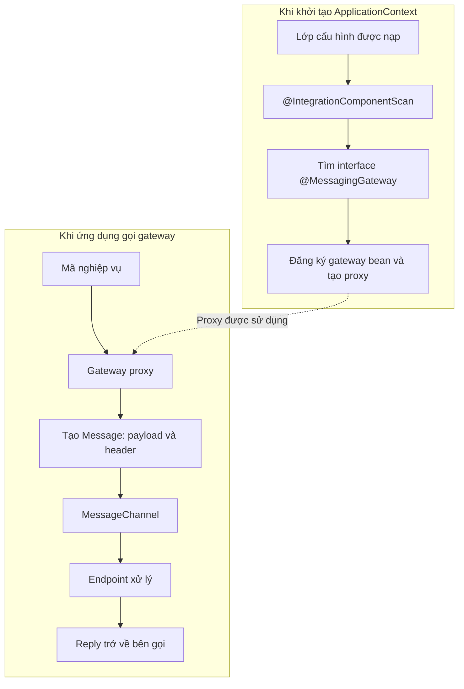

# @IntegrationComponentScan

Trong module **SPRING_INTEGRATION_CORE**, `@IntegrationComponentScan` giúp đăng ký các gateway interface để mã nghiệp vụ gọi một phương thức Java và đi vào luồng thông điệp. Bài học thuộc chương **Annotation và XML**, tập trung vào phạm vi quét, sự khác nhau giữa các cơ chế scan, cách kết nối gateway với channel và cách kiểm tra cấu hình.

Tình huống thực hành: ứng dụng có interface `TextGateway` để chuẩn hóa văn bản theo tenant. Lời gọi `normalize(" spring integration ", "vi")` cần đi qua một channel, được endpoint xử lý và trả về `"vi:SPRING INTEGRATION"`.

## 1. Vì sao gateway interface cần cơ chế quét riêng?

Một gateway thường chỉ khai báo hợp đồng:

```java
@MessagingGateway(defaultRequestChannel = "textRequests")
public interface TextGateway {
    String normalize(String text);
}
```

Interface này không có lớp triển khai nghiệp vụ để bạn khởi tạo bằng `new`. Spring Integration cung cấp proxy thực hiện việc chuyển lời gọi phương thức thành thông điệp, gửi qua channel và nhận kết quả nếu phương thức có giá trị trả về.

`@IntegrationComponentScan` tìm các interface mang `@MessagingGateway` trong phạm vi cấu hình để chúng được đăng ký thành gateway bean. `@ComponentScan` thông thường bỏ qua interface nên việc chỉ quét các `@Component` chưa đủ.

Vai trò này được nêu tại [API IntegrationComponentScan](https://docs.spring.io/spring-integration/api/org/springframework/integration/annotation/IntegrationComponentScan.html) và [khai báo MessagingGateway dòng 6.5](https://raw.githubusercontent.com/spring-projects/spring-integration/6.5.x/spring-integration-core/src/main/java/org/springframework/integration/annotation/MessagingGateway.java).

### Hai thời điểm khác nhau



Scan diễn ra khi xây dựng context. Nó không quét lại package cho mỗi lời gọi gateway, cũng không quyết định thông điệp sẽ chạy đồng bộ hay bất đồng bộ.

## 2. Phân biệt ba annotation dễ bị nhầm

| Annotation | Trách nhiệm chính | Ví dụ thành phần liên quan |
|---|---|---|
| `@ComponentScan` | Tìm các lớp component trong package | `@Service`, `@Component`, `@MessageEndpoint` |
| `@IntegrationComponentScan` | Phát hiện gateway interface theo phạm vi và bộ lọc | Interface có `@MessagingGateway` |
| `@EnableIntegration` | Bật hạ tầng Spring Integration | Các processor, bean hạ tầng và xử lý annotation endpoint |

Một lớp `@MessageEndpoint` có phương thức `@ServiceActivator` thường được đưa vào context bằng component scan, `@Bean` hoặc `@Import`. Gateway interface dùng cơ chế đăng ký gateway phù hợp. Hai loại thành phần cần được đưa vào context trước khi hạ tầng có thể nối chúng thành luồng.

Trong ứng dụng Spring Java thuần, không dùng XML Integration và không dựa vào Spring Boot auto-configuration, thường có cấu hình:

```java
@Configuration
@EnableIntegration
@IntegrationComponentScan(basePackages = "example.integration.api")
public class IntegrationConfig {
}
```

Đây mới là phần khởi tạo và tìm gateway. Ứng dụng vẫn cần khai báo channel, endpoint và các dependency nghiệp vụ.

Xem vai trò của hạ tầng tại [API EnableIntegration](https://docs.spring.io/spring-integration/api/org/springframework/integration/config/EnableIntegration.html), và quan hệ giữa component với endpoint annotation tại [Annotation Support](https://docs.spring.io/spring-integration/reference/6.5/configuration/annotations.html).

## 3. Cấu hình phạm vi quét

Import đúng annotation:

```java
import org.springframework.integration.annotation.IntegrationComponentScan;
```

### 3.1. Quét bằng tên package

Hai cách sau có cùng mục đích:

```java
@IntegrationComponentScan("example.integration.api")
```

```java
@IntegrationComponentScan(basePackages = "example.integration.api")
```

`value` và `basePackages` là alias; nên chọn một cách viết trong cùng khai báo. Có thể truyền mảng nhiều package nếu gateway nằm trong nhiều module.

Phạm vi gồm package gốc được chỉ định và các package con. Chọn package đủ hẹp để danh sách gateway đăng ký phù hợp với chức năng của ứng dụng.

### 3.2. Quét bằng marker type

Ví dụ marker không có hành vi:

```java
package example.integration.api;

public interface GatewayPackage {
}
```

Cấu hình:

```java
@IntegrationComponentScan(basePackageClasses = GatewayPackage.class)
```

`basePackageClasses` lấy **package chứa type** làm gốc quét. Nó không có nghĩa là chỉ đăng ký type được truyền vào. Bản thân marker không cần annotation gateway.

Cách này có lợi khi đổi tên package bằng IDE: tham chiếu type giúp việc refactor dễ theo dõi hơn một chuỗi tên package.

### 3.3. Khi không chỉ định package

Nếu để `@IntegrationComponentScan` không có thuộc tính phạm vi, registrar dùng package của lớp cấu hình khai báo annotation làm gốc. Một lớp ở `example.integration.config` sẽ không tự quét package ngang hàng `example.integration.api`.

Trong dự án có cấu trúc package tách biệt, marker type giúp ý định quét rõ ràng hơn. Cách xác định package mặc định được thể hiện trong [IntegrationComponentScanRegistrar dòng 6.5](https://raw.githubusercontent.com/spring-projects/spring-integration/6.5.x/spring-integration-core/src/main/java/org/springframework/integration/config/IntegrationComponentScanRegistrar.java).

## 4. Ví dụ đầy đủ: gateway, channel và endpoint

Ví dụ sử dụng Java 17, Spring Integration dòng 6.5 và dependency `org.springframework.integration:spring-integration-core`. Phiên bản Spring nên được quản lý thống nhất bằng BOM hoặc cấu hình dependency của dự án. Phần kiểm thử sử dụng JUnit Jupiter.

Cấu trúc mã minh họa:

```text
example.integration
├── api
│   ├── GatewayPackage.java
│   └── TextGateway.java
├── config
│   └── IntegrationConfig.java
├── endpoint
│   └── TextEndpoint.java
└── DemoApplication.java
```

### 4.1. Gateway interface

Tệp `example/integration/api/TextGateway.java`:

```java
package example.integration.api;

import org.springframework.integration.annotation.MessagingGateway;
import org.springframework.messaging.handler.annotation.Header;

@MessagingGateway(
    name = "textGateway",
    defaultRequestChannel = "textRequests",
    defaultReplyTimeout = "1000"
)
public interface TextGateway {

    String normalize(
            String text,
            @Header("tenantId") String tenantId);
}
```

Tham số `text` được dùng làm payload. `tenantId` được ánh xạ vào header có cùng tên đã khai báo. Tên bean được đặt tường minh là `textGateway`.

### 4.2. Marker của package gateway

Tệp `example/integration/api/GatewayPackage.java`:

```java
package example.integration.api;

public interface GatewayPackage {
}
```

### 4.3. Endpoint xử lý

Tệp `example/integration/endpoint/TextEndpoint.java`:

```java
package example.integration.endpoint;

import java.util.Locale;

import org.springframework.integration.annotation.MessageEndpoint;
import org.springframework.integration.annotation.ServiceActivator;
import org.springframework.messaging.handler.annotation.Header;

@MessageEndpoint
public class TextEndpoint {

    @ServiceActivator(inputChannel = "textRequests")
    public String normalize(
            String text,
            @Header("tenantId") String tenantId) {

        if (tenantId.isBlank()) {
            throw new IllegalArgumentException("tenantId must not be blank");
        }

        return tenantId + ":" + text.strip().toUpperCase(Locale.ROOT);
    }
}
```

Endpoint không đặt `outputChannel`. Kết quả có thể trở về gateway thông qua thông tin `replyChannel` mà gateway cung cấp trong lời gọi request-reply.

### 4.4. Lớp cấu hình

Tệp `example/integration/config/IntegrationConfig.java`:

```java
package example.integration.config;

import example.integration.api.GatewayPackage;
import example.integration.endpoint.TextEndpoint;

import org.springframework.context.annotation.Bean;
import org.springframework.context.annotation.ComponentScan;
import org.springframework.context.annotation.Configuration;
import org.springframework.integration.annotation.IntegrationComponentScan;
import org.springframework.integration.channel.DirectChannel;
import org.springframework.integration.config.EnableIntegration;

@Configuration
@EnableIntegration
@IntegrationComponentScan(basePackageClasses = GatewayPackage.class)
@ComponentScan(basePackageClasses = TextEndpoint.class)
public class IntegrationConfig {

    @Bean
    public DirectChannel textRequests() {
        return new DirectChannel();
    }
}
```

Hai cơ chế scan có phạm vi riêng:

- Integration scan tìm `TextGateway` trong package `api`.
- Component scan tìm `TextEndpoint` trong package `endpoint`.

`DirectChannel` được khai báo bằng `@Bean` để việc nối tên channel rõ ràng. Gateway và endpoint cùng sử dụng tên `textRequests`.

### 4.5. Gọi gateway

Tệp `example/integration/DemoApplication.java`:

```java
package example.integration;

import example.integration.api.TextGateway;
import example.integration.config.IntegrationConfig;

import org.springframework.context.annotation.AnnotationConfigApplicationContext;

public class DemoApplication {

    public static void main(String[] args) {
        try (var context = new AnnotationConfigApplicationContext(
                IntegrationConfig.class)) {

            TextGateway gateway = context.getBean(TextGateway.class);

            String result = gateway.normalize(
                    " spring integration ",
                    "vi"
            );

            System.out.println(result);
        }
    }
}
```

Kết quả mong đợi:

```text
vi:SPRING INTEGRATION
```

Không cần viết lớp `TextGatewayImpl`. Đối tượng lấy từ context là gateway proxy do framework cung cấp.

Các quy tắc ánh xạ tham số và tạo reply được mô tả tại [Messaging Gateways dòng 6.5](https://docs.spring.io/spring-integration/reference/6.5/gateway.html).

## 5. Đọc đúng hành vi của ví dụ

Có ba lớp thông tin cấu hình khác nhau:

| Thông tin | Nơi khai báo | Vai trò |
|---|---|---|
| Package chứa gateway | `@IntegrationComponentScan` | Quyết định gateway nào được đăng ký |
| Tên channel đầu vào | `@MessagingGateway` và `@ServiceActivator` | Nối gateway tới endpoint |
| Payload và header | Chữ ký phương thức, `@Header` | Quyết định nội dung thông điệp |

Thay đổi phạm vi scan không sửa tên channel. Thay đổi tên bean gateway không đổi tên channel. Đặt tên hai bên khác nhau khiến gateway không đi vào endpoint mong muốn.

`defaultReplyTimeout = "1000"` điều khiển việc chờ reply; nó không phải timeout quét package. Với luồng xử lý đồng bộ qua `DirectChannel`, thuộc tính này cũng không tự ngắt một phương thức nghiệp vụ đang chạy lâu.

Nếu bạn tạo đối tượng endpoint bằng `new TextEndpoint()` ngoài Spring rồi gọi trực tiếp, phép chuẩn hóa có thể vẫn đúng. Điều đó chưa chứng minh gateway đã được scan hoặc luồng messaging đã nối đúng.

## 6. Kiểm thử việc đăng ký và gọi xuyên suốt luồng

### 6.1. Kiểm thử gateway bean và kết quả

Tệp kiểm thử minh họa:

```java
package example.integration;

import example.integration.api.TextGateway;
import example.integration.config.IntegrationConfig;

import org.junit.jupiter.api.Test;
import org.springframework.context.annotation.AnnotationConfigApplicationContext;

import static org.junit.jupiter.api.Assertions.*;

class IntegrationComponentScanTest {

    @Test
    void registersGatewayAndInvokesTheEndpoint() {
        try (var context = new AnnotationConfigApplicationContext(
                IntegrationConfig.class)) {

            var gateways = context.getBeansOfType(TextGateway.class);

            assertEquals(1, gateways.size());

            TextGateway gateway = context.getBean(
                    "textGateway",
                    TextGateway.class
            );

            assertSame(gateway, context.getBean(TextGateway.class));
            assertEquals(
                    "vi:SPRING INTEGRATION",
                    gateway.normalize(" spring integration ", "vi")
            );
        }
    }
}
```

Kiểm thử xác nhận cả sự tồn tại của bean lẫn đường đi payload/header. Không chỉ kiểm tra tên lớp proxy vì chi tiết hiện thực proxy không phải hợp đồng nghiệp vụ cần bảo vệ.

### 6.2. Kiểm thử đối chứng: chỉ ComponentScan

Cấu hình sau cố tình chỉ dùng component scan, kể cả trên package chứa gateway:

```java
package example.integration;

import example.integration.api.GatewayPackage;
import example.integration.api.TextGateway;
import example.integration.endpoint.TextEndpoint;

import org.junit.jupiter.api.Test;
import org.springframework.beans.factory.NoSuchBeanDefinitionException;
import org.springframework.context.annotation.AnnotationConfigApplicationContext;
import org.springframework.context.annotation.Bean;
import org.springframework.context.annotation.ComponentScan;
import org.springframework.context.annotation.Configuration;
import org.springframework.integration.channel.DirectChannel;
import org.springframework.integration.config.EnableIntegration;

import static org.junit.jupiter.api.Assertions.*;

class MissingGatewayScanTest {

    @Configuration
    @EnableIntegration
    @ComponentScan(basePackageClasses = {
        GatewayPackage.class,
        TextEndpoint.class
    })
    static class ComponentOnlyConfig {

        @Bean
        public DirectChannel textRequests() {
            return new DirectChannel();
        }
    }

    @Test
    void componentScanDoesNotRegisterGatewayInterface() {
        try (var context = new AnnotationConfigApplicationContext(
                ComponentOnlyConfig.class)) {

            assertTrue(context.getBeansOfType(TextGateway.class).isEmpty());

            assertThrows(
                    NoSuchBeanDefinitionException.class,
                    () -> context.getBean(TextGateway.class)
            );
        }
    }
}
```

Đối chứng này dùng Spring context thuần. Nếu chạy trong một context Spring Boot có auto-configuration Integration, gateway có thể được đăng ký bằng cơ chế tự cấu hình, khiến thí nghiệm “chỉ component scan” không còn cô lập đúng điều kiện.


## 7. Các thuộc tính và bộ lọc

Những thuộc tính chính của annotation gồm:

| Thuộc tính | Ý nghĩa |
|---|---|
| `value`, `basePackages` | Các package gốc cần quét |
| `basePackageClasses` | Các type dùng để xác định package gốc |
| `useDefaultFilters` | Có dùng điều kiện phát hiện mặc định hay không |
| `includeFilters` | Bổ sung điều kiện chọn ứng viên |
| `excludeFilters` | Loại các ứng viên khỏi kết quả |
| `nameGenerator` | Chiến lược đặt tên bean được phát hiện |

Mặc định `useDefaultFilters = true`, nên các interface `@MessagingGateway` trong phạm vi quét được xem xét đăng ký. Danh sách thuộc tính và alias có trong [khai báo IntegrationComponentScan dòng 6.5](https://raw.githubusercontent.com/spring-projects/spring-integration/6.5.x/spring-integration-core/src/main/java/org/springframework/integration/annotation/IntegrationComponentScan.java).

Các đoạn dưới minh họa việc **thay khai báo scan** trong cấu hình chính; giữ channel, endpoint và hạ tầng phù hợp khi chạy.

### 7.1. Chỉ chọn một gateway cụ thể trong package

```java
import example.integration.api.GatewayPackage;
import example.integration.api.TextGateway;

import org.springframework.context.annotation.ComponentScan;
import org.springframework.context.annotation.FilterType;
import org.springframework.integration.annotation.IntegrationComponentScan;

@IntegrationComponentScan(
    basePackageClasses = GatewayPackage.class,
    useDefaultFilters = false,
    includeFilters = @ComponentScan.Filter(
        type = FilterType.ASSIGNABLE_TYPE,
        classes = TextGateway.class
    )
)
```

Ở đây tắt bộ lọc mặc định rồi chỉ đưa vào type đáp ứng bộ lọc chỉ định. `TextGateway` vẫn giữ `@MessagingGateway` và các thông tin nối channel.

Nếu giữ `useDefaultFilters = true`, một include filter không biến phạm vi thành “chỉ những gateway khớp filter này”. Các gateway khác vẫn có thể được chọn bởi bộ lọc mặc định. Đây là điểm dễ nhầm khi dùng include filter để mong muốn thu hẹp danh sách.

Bộ lọc cũng chỉ làm việc trong các package được quét. Nó không tự tìm một type nằm ngoài phạm vi package đã chọn.

### 7.2. Loại package gateway nội bộ

Ví dụ loại các type dưới package `example.integration.api.internal`:

```java
@IntegrationComponentScan(
    basePackages = "example.integration.api",
    excludeFilters = @ComponentScan.Filter(
        type = FilterType.REGEX,
        pattern = "example[.]integration[.]api[.]internal[.].*"
    )
)
```

Regex ở đây so khớp tên type đầy đủ. Exclude filter giúp loại các ứng viên dù chúng khớp một điều kiện include.

Một trường hợp cấu hình sai thường gặp là tắt default filters nhưng không cung cấp include filter nào. Khi đó, không còn điều kiện chọn gateway như người viết cấu hình mong đợi.

Không dùng filter rộng để coi mọi interface nghiệp vụ là gateway. Việc chọn ứng viên cần đi cùng hợp đồng `@MessagingGateway` hoặc cơ chế đăng ký gateway tường minh thích hợp.

## 8. Quản lý tên bean và tránh đăng ký trùng

### 8.1. Đặt tên gateway rõ ràng

Ví dụ chính đã dùng:

```java
@MessagingGateway(
    name = "textGateway",
    defaultRequestChannel = "textRequests"
)
```

Tên `textGateway` phục vụ việc định danh bean; `textRequests` là tên channel. Chúng có thể khác nhau và làm hai nhiệm vụ độc lập.

Nếu có nhiều gateway bean cùng đáp ứng một kiểu cần inject, cần dùng tên hoặc qualifier phù hợp ở nơi sử dụng. Đổi package để tránh đụng tên chưa chắc giải quyết được việc có nhiều bean cùng kiểu.

Ví dụ hai module có các interface khác nhau nhưng cùng tên ngắn:

```text
example.sales.api.CommandGateway
example.billing.api.CommandGateway
```

Chiến lược đặt tên mặc định có thể tạo xung đột tên ngắn. Có thể đặt tên riêng bằng `@MessagingGateway(name = "...")`, hoặc chọn chiến lược sinh tên có package.

### 8.2. Dùng tên đầy đủ khi cần

```java
import org.springframework.context.annotation.FullyQualifiedAnnotationBeanNameGenerator;

@IntegrationComponentScan(
    basePackages = {
        "example.sales.api",
        "example.billing.api"
    },
    nameGenerator = FullyQualifiedAnnotationBeanNameGenerator.class
)
```

Generator này dùng tên type đầy đủ làm tên mặc định khi không có tên tường minh. Nếu hai gateway cùng được đặt một tên tường minh, cần sửa chính các tên đó.

Tham khảo [FullyQualifiedAnnotationBeanNameGenerator](https://docs.spring.io/spring-framework/docs/current/javadoc-api/org/springframework/context/annotation/FullyQualifiedAnnotationBeanNameGenerator.html).

### 8.3. Tập trung cấu hình scan

Với registrar dòng 6.5 đang xét, nhiều khai báo `@IntegrationComponentScan` trong cùng registry không nên được xem là các phạm vi tự động cộng dồn. Registrar có kiểm tra đã được đăng ký và cảnh báo khi gặp khai báo tiếp theo.

Cách rõ ràng là tập trung các package cần quét tại một cấu hình:

```java
@IntegrationComponentScan(basePackages = {
    "example.sales.api",
    "example.billing.api"
})
```

Giới hạn này nằm trong [mã nguồn IntegrationComponentScanRegistrar](https://raw.githubusercontent.com/spring-projects/spring-integration/6.5.x/spring-integration-core/src/main/java/org/springframework/integration/config/IntegrationComponentScanRegistrar.java). Khi nâng phiên bản, cần kiểm tra lại hành vi liên quan nếu kiến trúc dựa vào nhiều cấu hình import.

Một gateway cũng có thể bị đăng ký qua scan, XML hoặc import trực tiếp. Xác định một nơi chịu trách nhiệm đăng ký cho từng gateway giúp tránh xung đột tên và khó khăn khi chẩn đoán.

## 9. Spring Boot: kiểm tra auto-configuration trước khi kết luận thiếu scan

Ví dụ trước dùng Spring thuần để thể hiện đầy đủ vai trò từng annotation. Với Spring Boot, hành vi còn phụ thuộc auto-configuration và package của ứng dụng.

Trong dòng Spring Boot 3.5, auto-configuration Integration có thể:

- Bật hạ tầng bằng `@EnableIntegration`.
- Đăng ký cơ chế quét gateway nếu chưa có registrar scan do ứng dụng cung cấp.

Các điều kiện này được thể hiện trong [IntegrationAutoConfiguration dòng 3.5](https://raw.githubusercontent.com/spring-projects/spring-boot/3.5.x/spring-boot-project/spring-boot-autoconfigure/src/main/java/org/springframework/boot/autoconfigure/integration/IntegrationAutoConfiguration.java).

Cơ chế scan tự động lấy phạm vi từ `AutoConfigurationPackages`. Đó không phải lời hứa quét toàn bộ classpath. Xem [IntegrationAutoConfigurationScanRegistrar](https://raw.githubusercontent.com/spring-projects/spring-boot/3.5.x/spring-boot-project/spring-boot-autoconfigure/src/main/java/org/springframework/boot/autoconfigure/integration/IntegrationAutoConfigurationScanRegistrar.java).

### 9.1. Gateway nằm trong thư viện bên ngoài package ứng dụng

Giả sử:

```text
com.company.app.Application
com.company.contracts.api.OrderGateway
```

Gateway trong `com.company.contracts.api` có thể nằm ngoài phạm vi scan tự động của ứng dụng. Khi đó, cấu hình `@IntegrationComponentScan` tường minh với các package cần dùng giúp thể hiện đầy đủ ý định.

Nếu đã thêm scan tường minh, hãy khai báo đủ cả các gateway nội bộ cần thiết. Không mặc định phạm vi mới sẽ được cộng thêm vào một lượt scan tự động độc lập.

### 9.2. scanBasePackages của SpringBootApplication

`@SpringBootApplication(scanBasePackages = "...")` cấu hình alias cho `@ComponentScan`. Không dùng thuộc tính đó như bằng chứng rằng mọi gateway interface trong cùng chuỗi package đã được integration scan xử lý.

Quan hệ alias nằm trong [khai báo SpringBootApplication dòng 3.5](https://raw.githubusercontent.com/spring-projects/spring-boot/3.5.x/spring-boot-project/spring-boot-autoconfigure/src/main/java/org/springframework/boot/autoconfigure/SpringBootApplication.java).

### 9.3. Một cấu hình Boot tường minh

Ví dụ sau là phương án khởi động thay thế, dùng `spring-boot-starter-integration`. Nó tái sử dụng gateway và endpoint đã định nghĩa, nhưng không nạp lớp `IntegrationConfig` của ví dụ Spring thuần:

```java
package example.boot;

import example.integration.api.GatewayPackage;
import example.integration.endpoint.TextEndpoint;

import org.springframework.boot.SpringApplication;
import org.springframework.boot.autoconfigure.SpringBootApplication;
import org.springframework.context.annotation.Bean;
import org.springframework.integration.annotation.IntegrationComponentScan;
import org.springframework.integration.channel.DirectChannel;

@SpringBootApplication(scanBasePackageClasses = TextEndpoint.class)
@IntegrationComponentScan(basePackageClasses = GatewayPackage.class)
public class BootApplication {

    public static void main(String[] args) {
        SpringApplication.run(BootApplication.class, args);
    }

    @Bean
    public DirectChannel textRequests() {
        return new DirectChannel();
    }
}
```

Component scan của ví dụ chọn package endpoint; integration scan chọn package gateway. Hạ tầng Integration do Boot tự cấu hình khi các điều kiện cần thiết đáp ứng.

Khi chẩn đoán trong Boot, xem báo cáo điều kiện auto-configuration và danh sách bean thực tế. Một kiểm thử Spring context thuần và một kiểm thử Boot toàn ứng dụng có thể có kết quả khác nhau vì các nguồn đăng ký bean khác nhau.

## 10. XML: đăng ký gateway tường minh

Nếu muốn chỉ rõ từng gateway bằng XML, có thể dùng `<int:gateway>`. Cách này không cần scan gateway interface cho chính định nghĩa đó.

Ta giữ hợp đồng `TextGateway` và dùng một handler không có annotation tạo endpoint để XML chịu trách nhiệm nối luồng.

Tệp Java minh họa `example/integration/xml/PlainTextHandler.java`:

```java
package example.integration.xml;

import java.util.Locale;

import org.springframework.messaging.handler.annotation.Header;

public class PlainTextHandler {

    public String normalize(
            String text,
            @Header("tenantId") String tenantId) {

        if (tenantId.isBlank()) {
            throw new IllegalArgumentException("tenantId must not be blank");
        }

        return tenantId + ":" + text.strip().toUpperCase(Locale.ROOT);
    }
}
```

Tệp `integration.xml` trên classpath:

```xml
<?xml version="1.0" encoding="UTF-8"?>
<beans xmlns="http://www.springframework.org/schema/beans"
       xmlns:xsi="http://www.w3.org/2001/XMLSchema-instance"
       xmlns:int="http://www.springframework.org/schema/integration"
       xsi:schemaLocation="
           http://www.springframework.org/schema/beans
           https://www.springframework.org/schema/beans/spring-beans.xsd
           http://www.springframework.org/schema/integration
           https://www.springframework.org/schema/integration/spring-integration.xsd">

    <int:channel id="textRequests"/>

    <int:gateway id="textGateway"
                 service-interface="example.integration.api.TextGateway"
                 default-request-channel="textRequests"
                 default-reply-timeout="1000"/>

    <bean id="plainTextHandler"
          class="example.integration.xml.PlainTextHandler"/>

    <int:service-activator input-channel="textRequests"
                           ref="plainTextHandler"
                           method="normalize"/>
</beans>
```

Có thể nạp riêng context XML:

```java
try (var context = new ClassPathXmlApplicationContext("integration.xml")) {
    TextGateway gateway = context.getBean(TextGateway.class);
    System.out.println(gateway.normalize(" spring integration ", "vi"));
}
```

Đoạn gọi cần import `org.springframework.context.support.ClassPathXmlApplicationContext` và gateway interface tương ứng.

Trong cấu hình này, XML tạo gateway proxy và endpoint; parameter annotation `@Header` vẫn phục vụ ánh xạ dữ liệu. Không nạp thêm cấu hình scan gateway cho cùng định nghĩa `textGateway`.

Cơ chế gateway proxy và namespace XML được mô tả tại [Messaging Gateways](https://docs.spring.io/spring-integration/reference/gateway.html).

## 11. Gateway scan kết hợp Java DSL

Gateway là cửa vào của luồng; Java DSL là một cách khai báo các bước xử lý phía sau. Hai cách dùng này kết hợp được.

Ví dụ, thay phần component scan endpoint của `IntegrationConfig` bằng một flow dùng handler thuần đã định nghĩa ở phần XML:

```java
package example.integration.config;

import example.integration.api.GatewayPackage;
import example.integration.xml.PlainTextHandler;

import org.springframework.context.annotation.Bean;
import org.springframework.context.annotation.Configuration;
import org.springframework.integration.annotation.IntegrationComponentScan;
import org.springframework.integration.channel.DirectChannel;
import org.springframework.integration.config.EnableIntegration;
import org.springframework.integration.dsl.IntegrationFlow;

@Configuration
@EnableIntegration
@IntegrationComponentScan(basePackageClasses = GatewayPackage.class)
public class DslIntegrationConfig {

    @Bean
    public DirectChannel textRequests() {
        return new DirectChannel();
    }

    @Bean
    public IntegrationFlow normalizeTextFlow() {
        return IntegrationFlow.from("textRequests")
                .handle(new PlainTextHandler(), "normalize")
                .get();
    }
}
```

Nạp riêng `DslIntegrationConfig` để thử phương án này. Lời gọi gateway vẫn như trước:

```java
gateway.normalize(" spring integration ", "vi");
```

`@IntegrationComponentScan` đăng ký interface gateway. Bean `IntegrationFlow` khai báo consumer trên `textRequests`. Handler thuần thực hiện xử lý và giá trị trả về được dùng làm reply.

Khi mở rộng flow với transformer, router, filter hoặc aggregator, trách nhiệm của scan vẫn là đăng ký gateway. Điều kiện định tuyến, số phần cần gom và cách xử lý lỗi thuộc cấu hình luồng.

## 12. Những lỗi cấu hình thường gặp

| Biểu hiện | Nguyên nhân cần xem xét | Cách kiểm tra |
|---|---|---|
| Không inject được TextGateway | Chưa đăng ký gateway hoặc sai phạm vi scan | Kiểm tra annotation, package và nguồn nạp cấu hình |
| Gateway ở package ngang hàng không xuất hiện | Dùng scan mặc định từ package config quá hẹp | Chỉ định marker hoặc package chính xác |
| Include filter nhưng vẫn có gateway khác | Default filters vẫn được bật | Xem lại tổ hợp filter và danh sách bean |
| Không có gateway sau khi thêm filter | Tắt default filters nhưng không có include phù hợp | Kiểm tra type, package và điều kiện chọn |
| Xung đột tên gateway | Hai interface cùng tên bean hoặc nhiều nguồn đăng ký | Liệt kê bean name và nơi khai báo |
| Có gateway bean nhưng gọi không vào handler | Sai tên channel hoặc thiếu consumer | Đối chiếu request channel với input channel |
| Context thuần thất bại, Boot lại hoạt động | Boot bổ sung hạ tầng hoặc gateway scan | So sánh cấu hình thực sự được nạp |
| Đã khai báo annotation nhưng không có tác dụng | Lớp configuration chưa được đưa vào context | Kiểm tra lớp khởi tạo, import và component scan |
| Gateway có bean nhưng lời gọi không có reply | Luồng không trả kết quả theo hợp đồng | Kiểm tra output, replyChannel, filter và timeout |

### Cách khoanh vùng theo thứ tự

1. Xác nhận loại ứng dụng: Spring thuần, XML hay Boot.
2. Xác nhận lớp cấu hình có scan đã được nạp.
3. Kiểm tra package gốc và các filter.
4. Kiểm tra gateway bean theo cả kiểu và tên khi cần.
5. Gọi một tình huống nhỏ có kết quả xác định.
6. Nếu bean đã tồn tại, tiếp tục kiểm tra channel và endpoint thay vì mở rộng scan tùy ý.

Một lỗi “không có gateway bean” khác với lỗi “gateway có nhưng luồng không trả lời”. Tách hai giai đoạn này giúp xác định đúng lớp cấu hình cần sửa.

## 13. Tổ chức package và ranh giới module

Nên đặt gateway interface ở package thể hiện hợp đồng vào luồng, ví dụ:

```text
com.company.order.integration.api
com.company.order.integration.endpoint
com.company.order.integration.config
```

Package `api` có marker cho integration scan. Package `endpoint` chứa lớp xử lý hoặc các đối tượng được khai báo thành bean. Package `config` tập trung channel và cấu hình wiring.

Một module thư viện có thể cung cấp gateway interface nhưng chưa quyết định ứng dụng nào sẽ đăng ký nó. Ứng dụng tiêu thụ chọn phạm vi scan hoặc import phù hợp. Dependency xuất hiện trên classpath chỉ là điều kiện để type có thể được tìm thấy; nó chưa khẳng định gateway sẽ được đăng ký trong mọi context.

Với số ít gateway cố định, Spring Integration từ dòng 6.0 còn hỗ trợ import trực tiếp interface có `@MessagingGateway`:

```java
@Configuration
@EnableIntegration
@Import(TextGateway.class)
public class ExplicitGatewayConfig {
}
```

Ví dụ này minh họa đăng ký gateway; channel và endpoint vẫn cần được nạp bằng cấu hình thích hợp. Khi dùng import trực tiếp, bỏ scan/XML trùng cho gateway đó.

Khả năng import interface được ghi nhận trong [phần @MessagingGateway Annotation](https://docs.spring.io/spring-integration/reference/6.5/gateway.html#messaging-gateway-annotation).

Chọn scan khi muốn đăng ký một tập gateway theo ranh giới package. Chọn khai báo tường minh khi cần danh sách type cố định và dễ kiểm soát. Dù chọn cách nào, nên có kiểm thử context bảo vệ tập gateway và một đường gọi tiêu biểu.

## 14. Những điểm cần ghi nhớ

`@IntegrationComponentScan` giải quyết việc **đưa gateway interface vào Spring context**. Phạm vi package và filter quyết định gateway nào được phát hiện; hợp đồng gateway quyết định cách biến lời gọi thành thông điệp; channel cùng endpoint quyết định cách thông điệp được xử lý.

Trong cấu hình Spring thuần, đặt hạ tầng, đăng ký gateway và đăng ký endpoint thành các trách nhiệm rõ ràng. Trong Spring Boot, kiểm tra auto-configuration và phạm vi package thực tế trước khi thêm hoặc thay scan. Một kiểm thử lấy được bean rồi gọi gateway đến đúng kết quả giúp xác nhận cả hai giai đoạn này.
