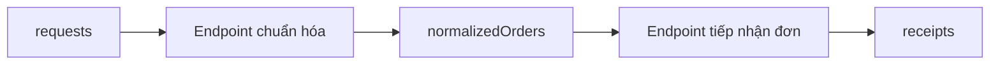

# input-channel và output-channel

## 1. Mục tiêu bài học

Trong chương **Annotation và XML** của module **SPRING_INTEGRATION_CORE**, `input-channel` và `output-channel` mô tả cách nối một endpoint với các kênh thông điệp. Hiểu đúng hai thuộc tính này giúp bạn đọc được topology của luồng, chọn cơ chế thực thi và kiểm tra lý do message dừng hoặc đi sai nhánh.

Sau bài học, bạn có thể:

- Phân biệt channel, endpoint và phương thức nghiệp vụ.
- Chuyển cách khai báo giữa XML, annotation và Java DSL.
- Xác định endpoint nào cần poller và kết quả được gửi đến đâu.
- Phân biệt đích cố định `output-channel` với địa chỉ trả lời trong header.
- Kiểm thử luồng qua channel thay vì chỉ gọi trực tiếp phương thức Java.

Ví dụ dùng cú pháp Java 17 và API Spring Integration 6.5. Cần dependency `org.springframework.integration:spring-integration-core` và JUnit Jupiter cho phần kiểm thử. Phiên bản dependency phải phù hợp với BOM hoặc nền tảng Spring của dự án; bài không cần Spring Boot, broker hay dịch vụ bên ngoài.

## 2. Đọc tên thuộc tính theo góc nhìn endpoint

Một endpoint nhận message từ channel đầu vào, thực hiện một vai trò xử lý rồi có thể phát kết quả đến channel đầu ra:

```text
Producer
    |
    v
requests --[endpoint xử lý]--> results
  input-channel                 output-channel
```

Ở đây:

- `input-channel` là channel mà endpoint **tiêu thụ message**.
- `output-channel` là channel mà handler tạo kết quả **gửi message kết quả tới**.
- Phương thức nghiệp vụ là nơi thực hiện thao tác trên payload hoặc message.
- Channel là điểm truyền thông điệp; bản thân tên channel không chứa thuật toán xử lý.

Cùng một channel có thể là đầu ra của endpoint trước và đầu vào của endpoint sau. Các từ “input” và “output” mô tả quan hệ với từng endpoint, không chia mọi channel trong hệ thống thành hai loại cố định.

Ví dụ:



Với endpoint chuẩn hóa, `normalizedOrders` là output channel. Với endpoint tiếp nhận đơn, chính channel đó là input channel.

### 2.1. Ba loại tên cần phân biệt

```xml
<int:channel id="requests"/>
<int:channel id="results"/>

<int:service-activator id="acceptEndpoint"
                       input-channel="requests"
                       output-channel="results"
                       ref="orderOperations"
                       method="accept"/>
```

Đây là đoạn cấu hình minh họa; bean `orderOperations` phải được khai báo riêng.

| Tên | Đại diện cho | Vai trò |
| --- | --- | --- |
| `requests` | Bean channel | Nhận message từ producer |
| `results` | Bean channel | Nhận kết quả xử lý |
| `acceptEndpoint` | Endpoint | Nối việc nhận message với handler |
| `orderOperations` | Bean nghiệp vụ | Đối tượng có phương thức `accept` |
| `accept` | Phương thức Java | Thực hiện thao tác nghiệp vụ |

Không dùng tên bean service làm `output-channel` trừ khi bean đó thực sự là một channel. Tên channel cũng không tự biến thành tên topic Kafka, queue JMS hoặc URL HTTP. Muốn giao tiếp với hệ thống bên ngoài phải cấu hình adapter, gateway hoặc channel chuyên dụng.

## 3. Cùng một quan hệ, ba cách biểu diễn

| Ý nghĩa | XML | Annotation trên phương thức POJO | Java DSL |
| --- | --- | --- | --- |
| Nhận từ channel | `input-channel="requests"` | `inputChannel = "requests"` | `IntegrationFlow.from("requests")` |
| Gửi kết quả đến channel | `output-channel="results"` | `outputChannel = "results"` | `.channel("results")` sau bước tạo kết quả |
| Gọi service | `ref` và `method` | Phương thức được gắn annotation | `.handle(service, "method")` |
| Chuyển đổi payload | `<int:transformer>` | `@Transformer` | `.transform(...)` |

XML dùng tên thuộc tính có dấu gạch ngang; annotation dùng camelCase. Java DSL thể hiện quan hệ bằng chuỗi thao tác và các channel ở giữa.

Điểm nối phải dựa trên tên bean hoặc tham chiếu channel thực tế. Framework không suy ra “bước tiếp theo” từ thứ tự khai báo phương thức, vị trí bean trong lớp cấu hình hoặc tên có hậu tố `Input`, `Output`.

Một số annotation có thể tự tạo channel khi chưa có bean tương ứng. Trong các ví dụ dưới đây, mọi channel đều được khai báo tường minh để kiểm soát loại channel, sức chứa và cách thực thi. Cơ chế đăng ký annotation được mô tả trong [Annotation Support](https://docs.spring.io/spring-integration/reference/6.5/configuration/annotations.html).

## 4. Ví dụ annotation: chuẩn hóa và tiếp nhận đơn hàng

Luồng mẫu nhận chuỗi mã đơn, chuẩn hóa rồi tạo biên nhận:

```text
requests: DirectChannel
    -> normalize(String)
normalizedOrders: DirectChannel
    -> accept(String)
receipts: QueueChannel
```

Hợp đồng dữ liệu của từng điểm nối:

| Channel | Payload dự kiến | Ví dụ |
| --- | --- | --- |
| `requests` | `String` chứa mã đơn thô | `"  ord-100  "` |
| `normalizedOrders` | `String` đã chuẩn hóa | `"ORD-100"` |
| `receipts` | `OrderReceipt` | Biên nhận có mã đơn và trạng thái |

Tên channel không kiểm tra kiểu payload thay cho handler. Nếu gửi một kiểu dữ liệu ngoài hợp đồng, việc ánh xạ tham số hoặc xử lý có thể thất bại; không nên phụ thuộc vào chuyển đổi kiểu ngầm để che giấu sai lệch hợp đồng.

Các public type trong ví dụ được đặt trong những tệp Java riêng, cùng package `example.channels`.

### 4.1. Payload kết quả và POJO nghiệp vụ

```java
package example.channels;

public record OrderReceipt(String orderId, String status) {
}
```

```java
package example.channels;

import java.util.Locale;
import java.util.Objects;

public class OrderOperations {

    public String normalize(String rawOrderId) {
        String orderId = Objects.requireNonNull(
                rawOrderId, "rawOrderId").strip();

        if (orderId.isEmpty()) {
            throw new IllegalArgumentException("Order ID must not be blank");
        }

        return orderId.toUpperCase(Locale.ROOT);
    }

    public OrderReceipt accept(String orderId) {
        return new OrderReceipt(orderId, "ACCEPTED");
    }
}
```

`accept` ở đây chỉ tạo biên nhận trong bộ nhớ để tập trung quan sát luồng. Trong ứng dụng thực tế, nếu bước này ghi cơ sở dữ liệu hoặc gọi dịch vụ, cần thiết kế thêm transaction, idempotency và xử lý lỗi.

### 4.2. Các phương thức endpoint

```java
package example.channels;

import org.springframework.integration.annotation.ServiceActivator;
import org.springframework.integration.annotation.Transformer;

public class OrderEndpoints {

    private final OrderOperations operations;

    public OrderEndpoints(OrderOperations operations) {
        this.operations = operations;
    }

    @Transformer(
            inputChannel = "requests",
            outputChannel = "normalizedOrders")
    public String normalize(String rawOrderId) {
        return operations.normalize(rawOrderId);
    }

    @ServiceActivator(
            inputChannel = "normalizedOrders",
            outputChannel = "receipts",
            requiresReply = "true",
            sendTimeout = "1000")
    public OrderReceipt accept(String orderId) {
        return operations.accept(orderId);
    }
}
```

Khi gửi message vào `requests`, endpoint đầu tiên lấy payload, gọi `normalize` và gửi kết quả đến `normalizedOrders`. Endpoint thứ hai nhận kết quả đó, gọi `accept` rồi phát `OrderReceipt` vào `receipts`.

`requiresReply = "true"` yêu cầu service activator tạo một kết quả. Nó không có nghĩa caller tự nhận biên nhận bằng giá trị trả về của `MessageChannel.send`. `sendTimeout` giới hạn việc đợi gửi theo khả năng của channel đầu ra; nó không giới hạn thời gian thực thi toàn bộ nghiệp vụ.

### 4.3. Cấu hình Spring context

```java
package example.channels;

import org.springframework.context.annotation.Bean;
import org.springframework.context.annotation.Configuration;
import org.springframework.integration.channel.DirectChannel;
import org.springframework.integration.channel.QueueChannel;
import org.springframework.integration.config.EnableIntegration;

@Configuration
@EnableIntegration
public class ChannelFlowConfig {

    @Bean
    public DirectChannel requests() {
        return new DirectChannel();
    }

    @Bean
    public DirectChannel normalizedOrders() {
        return new DirectChannel();
    }

    @Bean
    public QueueChannel receipts() {
        return new QueueChannel(10);
    }

    @Bean
    public OrderOperations orderOperations() {
        return new OrderOperations();
    }

    @Bean
    public OrderEndpoints orderEndpoints(OrderOperations operations) {
        return new OrderEndpoints(operations);
    }
}
```

`@EnableIntegration` bật hạ tầng integration cho cấu hình Java này. `OrderEndpoints` đã được đăng ký bằng `@Bean` nên không cần component scan cho lớp đó. Nếu chọn dùng `@Component` hoặc `@MessageEndpoint` và scan, tránh đăng ký lại cùng một lớp endpoint bằng một bean khác.

`receipts` chưa có consumer tự động: ví dụ sẽ lấy kết quả bằng `receive` trong kiểm thử. Queue có thể nhận message trước khi có consumer, nhưng việc có message trong queue không chứng minh các bước nghiệp vụ phía sau đã hoàn tất.

### 4.4. Gọi Java và gửi message là hai cách thực thi khác nhau

```java
OrderReceipt receipt = operations.accept("ORD-100");
```

Lời gọi này chỉ chạy một phương thức Java. Nó không đi qua `normalizedOrders`, không kích hoạt endpoint và không đưa biên nhận vào `receipts`.

Để kiểm tra topology, phải gửi một `Message` vào channel của luồng. Sau khi `send` thành công, nhận message ở đầu ra hoặc quan sát consumer thực tế. Kiểm thử ở phần 11 thực hiện đúng đường đi này.

## 5. Cấu hình XML tương đương

Dùng lại `OrderOperations` và `OrderReceipt`. XML đăng ký các endpoint trực tiếp nên phương án này không nạp `ChannelFlowConfig` hoặc đăng ký thêm `OrderEndpoints`.

```xml
<?xml version="1.0" encoding="UTF-8"?>
<beans xmlns="http://www.springframework.org/schema/beans"
       xmlns:xsi="http://www.w3.org/2001/XMLSchema-instance"
       xmlns:int="http://www.springframework.org/schema/integration"
       xsi:schemaLocation="
           http://www.springframework.org/schema/beans
           https://www.springframework.org/schema/beans/spring-beans.xsd
           http://www.springframework.org/schema/integration
           https://www.springframework.org/schema/integration/spring-integration.xsd">

    <int:channel id="requests"/>
    <int:channel id="normalizedOrders"/>

    <int:channel id="receipts">
        <int:queue capacity="10"/>
    </int:channel>

    <bean id="orderOperations"
          class="example.channels.OrderOperations"/>

    <int:transformer id="normalizeEndpoint"
                     input-channel="requests"
                     output-channel="normalizedOrders"
                     ref="orderOperations"
                     method="normalize"/>

    <int:service-activator id="acceptEndpoint"
                           input-channel="normalizedOrders"
                           output-channel="receipts"
                           ref="orderOperations"
                           method="accept"
                           requires-reply="true"
                           send-timeout="1000"/>
</beans>
```

`<int:channel>` không có phần tử con tạo `DirectChannel`. `<int:queue>` thay đổi cơ chế lưu và nhận của channel thành queue. Channel được khai báo ở vị trí nào trong XML không quyết định thứ tự xử lý; quan hệ input/output mới quyết định đường đi. Xem [Configuring Message Channels](https://docs.spring.io/spring-integration/reference/6.5/channel/configuration.html).

Không chạy đồng thời XML này và cấu hình annotation cho cùng topology. Nếu hai consumer cùng nghe một `DirectChannel`, message có thể được phân phối đến consumer khác với mong muốn; đó không phải hai bước xử lý nối tiếp.

## 6. Loại input channel quyết định cách endpoint nhận message

Thuộc tính `input-channel` chọn điểm nhận. Loại channel tại điểm đó quyết định cơ chế kích hoạt endpoint.

| Channel | Cách endpoint nhận | Hệ quả cần nhớ |
| --- | --- | --- |
| `DirectChannel` | Đăng ký handler và được gọi khi có `send` | Thông thường xử lý trên thread gửi |
| `QueueChannel` | Lấy message bằng cơ chế polling | Endpoint consumer cần poller riêng hoặc default poller |
| `PublishSubscribeChannel` | Đăng ký subscriber | Một message được phân phối đến các subscriber |
| `ExecutorChannel` | Dispatch qua executor được cấu hình | Có thể chuyển xử lý sang thread khác; phụ thuộc chính sách executor |

`DirectChannel` có cơ chế phân phối giữa các subscriber và có thể failover khi handler thất bại theo cấu hình. Không dùng việc gắn hai endpoint vào cùng channel này để biểu diễn “chạy endpoint A rồi chạy endpoint B”.

`PublishSubscribeChannel` phù hợp khi cần nhiều subscriber cùng nhận một thông báo. Nó không tự tách collection thành từng phần tử, và không phải cứ publish-subscribe là chạy song song: cơ chế thực thi còn phụ thuộc executor. Các đặc tính channel được trình bày trong [Message Channel Implementations](https://docs.spring.io/spring-integration/reference/6.5/channel/implementations.html).

### 6.1. Poller nằm ở endpoint đọc queue

Thay `normalizedOrders` trong ví dụ bằng `QueueChannel(10)`:

```text
requests: DirectChannel
    -> normalize
normalizedOrders: QueueChannel
    -> poller của accept
    -> accept
receipts: QueueChannel
```

Khi đó, `normalize` vẫn nhận đồng bộ từ `requests`. Chính endpoint `accept` mới cần poller vì input channel của nó là queue.

Thay annotation trên `accept` bằng:

```java
@ServiceActivator(
        inputChannel = "normalizedOrders",
        outputChannel = "receipts",
        requiresReply = "true",
        sendTimeout = "1000",
        poller = @Poller(
                fixedDelay = "200",
                maxMessagesPerPoll = "1"))
public OrderReceipt accept(String orderId) {
    return operations.accept(orderId);
}
```

Cần import `org.springframework.integration.annotation.Poller`. Bean `normalizedOrders` cũng phải đổi thành `QueueChannel`; không chỉ sửa annotation. Đây là biến thể thay thế cấu hình cũ.

XML tương ứng của endpoint nhận từ queue:

```xml
<int:service-activator id="pollingAcceptEndpoint"
                       input-channel="normalizedOrders"
                       output-channel="receipts"
                       ref="orderOperations"
                       method="accept"
                       requires-reply="true"
                       send-timeout="1000">
    <int:poller fixed-delay="200" max-messages-per-poll="1"/>
</int:service-activator>
```

Việc `receipts` là queue đầu ra không làm `accept` cần thêm một poller nữa. Nếu có endpoint khác đọc `receipts` thì endpoint đó mới cần poller. Một phép `receive` trực tiếp trong kiểm thử cũng có thể lấy message, nhưng không thay thế cấu hình consumer của ứng dụng.

### 6.2. Queue là nơi đệm, không phải một worker tự chạy

Queue giữ message chờ bên nhận. Nó không tự gọi service và không tự sinh một thread xử lý nghiệp vụ. Trong biến thể có queue ở giữa, `requests.send(...)` có thể hoàn tất trước khi `accept` chạy.

Queue của ví dụ nằm trong bộ nhớ và có giới hạn dung lượng. Nếu cần dữ liệu còn tồn tại sau khi tiến trình dừng, phải chọn message store hoặc cơ chế vận chuyển phù hợp; đổi tên channel không tạo khả năng lưu bền.

### 6.3. Đường lỗi phụ thuộc ranh giới thực thi

Với hai channel đầu là `DirectChannel` trong ví dụ gốc, lỗi từ handler có thể lan về caller của `send`. Khi công việc được poller hoặc executor của Spring Integration thực thi ở phía bất đồng bộ, hệ thống thường chuyển lỗi thành `ErrorMessage` theo cấu hình error handling.

`output-channel` là đường kết quả nghiệp vụ. Nó không tự trở thành đường nhận exception. Header `errorChannel` và channel lỗi chung phục vụ một hợp đồng khác với `output-channel` hoặc `replyChannel`. Xem [Error Handling](https://docs.spring.io/spring-integration/reference/6.5/error-handling.html).

## 7. Output channel không tự tạo kết quả

Có channel đầu ra chỉ xác định **đích gửi**. Endpoint vẫn cần có kết quả thích hợp để gửi đi.

### 7.1. Service activator trả void hoặc null

Xét một biến thể:

```java
@ServiceActivator(
        inputChannel = "normalizedOrders",
        outputChannel = "receipts")
public void record(String orderId) {
    repository.save(orderId);
}
```

Đây là ví dụ về một phương thức khác; `repository` đại diện cho dependency nghiệp vụ được inject. Dù có `outputChannel`, phương thức `void` không tạo `OrderReceipt` và không tự gửi lại chuỗi mã đơn vào `receipts`.

Nếu muốn tiếp tục luồng sau một tác dụng phụ, hãy tạo hợp đồng kết quả rõ ràng, chẳng hạn trả về mã đơn hoặc một biên nhận. Nếu endpoint được phép kết thúc luồng, bỏ nhu cầu đợi reply ở phía caller.

Với service activator:

| Kết quả phương thức | Cấu hình | Hành vi dự kiến |
| --- | --- | --- |
| Trả một đối tượng | Có đích gửi hợp lệ | Phát message kết quả |
| Trả `void` hoặc `null` | Cho phép không có reply | Kết thúc xử lý tại endpoint |
| Trả `null` | `requiresReply = "true"` | Báo lỗi vì thiếu kết quả bắt buộc |
| Trả đối tượng | Không có output channel hay reply destination dùng được | Lỗi phân giải đích gửi |
| Trả đối tượng | Output là `nullChannel` | Kết quả được bỏ theo chủ ý |

Không áp dụng máy móc quy tắc `null` của service activator cho mọi endpoint. Ví dụ, transformer cần tạo kết quả chuyển đổi hợp lệ; trả `null` không phải cách chung để dùng transformer như filter.

### 7.2. Kết thúc bằng nullChannel

Nếu phương thức có kết quả nhưng nhánh được thiết kế không sử dụng kết quả đó, có thể cấu hình rõ:

```xml
<int:service-activator input-channel="normalizedOrders"
                       output-channel="nullChannel"
                       ref="orderOperations"
                       method="accept"/>
```

`nullChannel` là channel đặc biệt do framework cung cấp. Nó nhận rồi bỏ message. Đây là quyết định kết thúc nhánh; một caller đang chờ biên nhận sẽ không tự được trả kết quả thành công.

### 7.3. Send thành công không đồng nghĩa đã có kết quả nghiệp vụ

`MessageChannel.send` trả `boolean` cho kết quả gửi theo hợp đồng channel; nó không trả payload nghiệp vụ. Với queue, thành công thường chỉ cho biết message đã được đưa vào nơi đệm. Với channel đồng bộ, handler có thể đã chạy, nhưng caller vẫn phải dùng request-reply hoặc nhận từ output channel để lấy kết quả.

Cũng cần phân biệt các giới hạn thời gian:

- Timeout gửi liên quan đến việc channel có thể nhận message, chẳng hạn queue còn chỗ hay không.
- Timeout nhận hoặc đợi reply liên quan đến việc có message trả về.
- Timeout của API hoặc database là giới hạn của thao tác nghiệp vụ tương ứng.

Timeout gửi không ngắt một phương thức Java đang chạy lâu qua `DirectChannel`. Không dùng một giá trị timeout ở channel để thay thế mọi giới hạn của hệ thống.

## 8. Output channel và header replyChannel

Đối với service activator tạo reply, việc chọn đích gửi có thứ tự ưu tiên. Với trường hợp thông thường:

1. Dùng `output-channel` được cấu hình trên handler nếu có.
2. Nếu không có đích cố định đó, xem header `replyChannel` của request.
3. Khi request không có địa chỉ trả lời và kết quả là một `Message`, handler có thể xét `replyChannel` trên message kết quả.
4. Nếu vẫn không có đích hợp lệ cho một reply cần gửi, phát sinh lỗi phân giải đích.

Header `replyChannel` có thể chứa một đối tượng `MessageChannel` hoặc một tên channel có thể phân giải. Cách chọn đích và xử lý kết quả được mô tả trong [Service Activator](https://docs.spring.io/spring-integration/reference/6.5/service-activator.html).

Hai cách cấu hình phục vụ hai nhu cầu:

| Cơ chế | Đặc tính | Trường hợp phù hợp |
| --- | --- | --- |
| `output-channel` | Đích cố định của một bước trong topology | Chuyển từ chuẩn hóa sang tiếp nhận đơn |
| Header `replyChannel` | Địa chỉ trả lời đi cùng request | Gửi kết quả về đúng caller |
| `errorChannel` | Đường thông báo lỗi theo cấu hình thực thi | Xử lý thất bại của công việc bất đồng bộ |

### 8.1. Đầu ra cố định được ưu tiên

Trong ví dụ gốc, endpoint cuối có `outputChannel = "receipts"`. Nếu producer gắn một queue khác vào header `replyChannel`, biên nhận vẫn đi vào `receipts`. Nó không tự gửi thêm một bản sao đến queue trong header.

Đây là một nguyên nhân thường gặp khi gateway chờ reply nhưng kết quả lại nằm ở một queue cố định. Việc gateway gửi request được không chứng minh đường về caller đã nối đúng.

### 8.2. Biến thể endpoint trả lời theo request

Một endpoint ngắn không có output cố định có thể là:

```java
@ServiceActivator(
        inputChannel = "replyRequests",
        requiresReply = "true")
public OrderReceipt accept(String orderId) {
    return new OrderReceipt(orderId, "ACCEPTED");
}
```

Đoạn này là một biến thể độc lập, nhận mã đơn đã chuẩn hóa. Bean endpoint phải được Spring đăng ký và channel `replyRequests` phải có trong context.

Caller có thể tạo một queue riêng cho reply:

```java
QueueChannel replies = new QueueChannel(1);

Message<String> request = MessageBuilder
        .withPayload("ORD-100")
        .setReplyChannel(replies)
        .build();

replyRequests.send(request);
Message<?> reply = replies.receive(1000);
```

`replyRequests` ở đây là tham chiếu đến input channel của biến thể. Queue `replies` không cần tên bean vì header đang mang tham chiếu đối tượng channel. Phần kiểm thử bên dưới cung cấp đầy đủ context cho cách làm này.

Không đồng nhất `outputChannel` với một header tùy ý tên `outputChannel`. Thuộc tính cấu hình handler và địa chỉ trả lời trong `MessageHeaders.REPLY_CHANNEL` là hai cơ chế khác nhau.

### 8.3. Gateway che giấu việc tạo reply channel

Có thể gọi luồng qua một interface:

```java
package example.channels;

import org.springframework.integration.annotation.MessagingGateway;

@MessagingGateway(
        defaultRequestChannel = "replyRequests",
        defaultReplyTimeout = "1000")
public interface OrderGateway {
    OrderReceipt submit(String normalizedOrderId);
}
```

Interface này cần được đăng ký bằng cơ chế gateway, chẳng hạn thêm `@IntegrationComponentScan(basePackageClasses = OrderGateway.class)` vào cấu hình phù hợp. Annotation scan nằm trong `org.springframework.integration.annotation`.

Gateway request-reply thường tạo địa chỉ trả lời tạm thời rồi gắn vào request. Endpoint cuối không có output cố định có thể dùng địa chỉ đó để gửi một `OrderReceipt` về caller. Không bắt buộc tạo một queue reply dùng chung cho mọi người gọi.

Khi luồng có nhiều bước, giữ output channel cố định ở các bước trung gian để đi tiếp đúng pipeline. Chỉ endpoint cuối mới trả lời theo địa chỉ của request nếu hợp đồng luồng yêu cầu. Cần giữ header cần thiết qua các bước, nhất là khi tự dựng message mới. Xem [Messaging Gateways](https://docs.spring.io/spring-integration/reference/6.5/gateway.html).

## 9. Không áp dụng một mẫu thuộc tính cho mọi thành phần

`input-channel` và `output-channel` rất phổ biến nhưng ý nghĩa phát kết quả còn phụ thuộc loại endpoint.

| Thành phần | Điều cần chú ý khi đọc điểm nối |
| --- | --- |
| Transformer | Kết quả chuyển đổi đi đến output channel hoặc địa chỉ trả lời phù hợp |
| Filter | Chỉ message được chấp nhận đi tiếp; nhánh loại có thể dùng discard channel |
| Splitter | Một đầu vào có thể phát nhiều message đến đầu ra |
| Aggregator | Chỉ phát kết quả khi điều kiện release của nhóm được đáp ứng |
| Router | Chọn một hoặc nhiều đích theo luật định tuyến; có thuộc tính dành riêng cho routing |
| Channel adapter | Nhiều adapter dùng thuộc tính `channel` để nối với luồng nội bộ |
| Messaging gateway | Dùng cấu hình request/reply để biểu diễn giao tiếp với caller |

Không thêm `output-channel` vào mọi phần tử XML theo thói quen. Kiểm tra hợp đồng và schema của đúng endpoint, nhất là router, inbound adapter và outbound adapter.

### 9.1. Phương thức POJO và factory @Bean

Ví dụ chính đặt annotation trên phương thức xử lý của một bean POJO. Đây là nơi Spring ánh xạ payload rồi gọi nghiệp vụ cho mỗi message.

Một trường hợp khác là đặt annotation lên factory `@Bean` trả về một `MessageHandler` đã được cấu hình sẵn. Khi đó, endpoint sử dụng **handler do factory tạo ra**; factory không được gọi lại cho mỗi message. Những thuộc tính thuộc handler, như output channel, phải được đặt đúng trên handler theo API tương ứng. Không suy diễn rằng mọi thuộc tính annotation của ví dụ POJO đều áp dụng y hệt cho factory. Xem [Annotations on @Bean Methods](https://docs.spring.io/spring-integration/reference/6.5/configuration/meta-annotations.html).

## 10. Đọc cùng topology bằng Java DSL

Trong một cấu hình Java thay thế, giữ các bean `requests`, `normalizedOrders`, `receipts` và `orderOperations` như phần 4. Bỏ bean `OrderEndpoints` và thay bằng bean flow sau:

```java
import org.springframework.context.annotation.Bean;
import org.springframework.integration.dsl.IntegrationFlow;

@Bean
public IntegrationFlow orderFlow(OrderOperations operations) {
    return IntegrationFlow.from("requests")
            .transform(operations, "normalize")
            .channel("normalizedOrders")
            .handle(operations, "accept",
                    endpoint -> endpoint
                            .requiresReply(true)
                            .sendTimeout(1000))
            .channel("receipts")
            .get();
}
```

Đặt phương thức này trong lớp cấu hình có `@Configuration` và `@EnableIntegration`. Các import cho lớp cấu hình và các bean channel vẫn giống phần 4.

Đọc chuỗi từ trái sang phải:

1. `from("requests")` chỉ đầu vào của luồng.
2. `transform` tạo kết quả chuẩn hóa.
3. `channel("normalizedOrders")` là điểm nối giữa hai bước.
4. `handle` gọi nghiệp vụ tiếp nhận.
5. `channel("receipts")` nhận kết quả cuối.

Giữa những bước DSL liên tiếp có thể có channel nội bộ do framework tạo. Khai báo một channel có tên hữu ích khi cần quan sát, gắn interceptor hoặc thể hiện rõ ranh giới trong hợp đồng luồng.

Không đăng ký đồng thời bean flow này và các endpoint annotation cũ trên cùng các channel. Hai cấu hình thay thế nhau; chúng không tự phối hợp thành một luồng dài hơn.

## 11. Kiểm thử hợp đồng điểm nối

Các test sau dùng JUnit Jupiter và chỉ tạo Spring context trong phạm vi mỗi test. Chúng kiểm tra việc gửi và nhận message, không chỉ giá trị trả về khi gọi POJO trực tiếp.

### 11.1. Đầu ra cố định được ưu tiên hơn replyChannel

```java
package example.channels;

import org.junit.jupiter.api.Test;
import org.springframework.context.annotation.AnnotationConfigApplicationContext;
import org.springframework.integration.channel.DirectChannel;
import org.springframework.integration.channel.QueueChannel;
import org.springframework.messaging.Message;
import org.springframework.messaging.support.MessageBuilder;

import static org.junit.jupiter.api.Assertions.*;

class FixedOutputChannelTest {

    @Test
    void sendsTheReceiptToTheConfiguredOutput() {
        try (var context =
                     new AnnotationConfigApplicationContext(
                             ChannelFlowConfig.class)) {

            var requests =
                    context.getBean("requests", DirectChannel.class);
            var receipts =
                    context.getBean("receipts", QueueChannel.class);
            var callerReplies = new QueueChannel(1);

            Message<String> request = MessageBuilder
                    .withPayload("  ord-100  ")
                    .setHeader("traceId", "TRACE-100")
                    .setReplyChannel(callerReplies)
                    .build();

            assertTrue(requests.send(request));

            Message<?> result = receipts.receive(1000);
            assertNotNull(result);
            assertEquals(
                    new OrderReceipt("ORD-100", "ACCEPTED"),
                    result.getPayload());
            assertEquals("TRACE-100",
                    result.getHeaders().get("traceId"));

            assertNull(callerReplies.receive(0));
            assertNull(receipts.receive(0));
        }
    }
}
```

Test kiểm tra toàn tuyến: chuẩn hóa đã chạy, biên nhận có đúng payload, trace header còn được giữ và kết quả đi đến `receipts`. Queue do caller đưa vào header không nhận thêm một bản sao.

Các phép `receive(0)` phù hợp ở đây vì toàn bộ đường xử lý đến queue cuối là đồng bộ. Với biến thể có poller hoặc executor, cần đợi điều kiện hoàn thành thích hợp trước khi kết luận không còn kết quả.

### 11.2. Dùng địa chỉ trả lời khi không có output cố định

Test dưới đây khai báo một context riêng cho biến thể `replyRequests`. Không nạp topology ba channel ở phần 4.

```java
package example.channels;

import org.junit.jupiter.api.Test;
import org.springframework.context.annotation.AnnotationConfigApplicationContext;
import org.springframework.context.annotation.Bean;
import org.springframework.context.annotation.Configuration;
import org.springframework.integration.annotation.ServiceActivator;
import org.springframework.integration.channel.DirectChannel;
import org.springframework.integration.channel.QueueChannel;
import org.springframework.integration.config.EnableIntegration;
import org.springframework.messaging.Message;
import org.springframework.messaging.MessagingException;
import org.springframework.messaging.support.MessageBuilder;

import static org.junit.jupiter.api.Assertions.*;

class ReplyChannelTest {

    @Test
    void usesTheReplyChannelFromTheRequest() {
        try (var context =
                     new AnnotationConfigApplicationContext(
                             ReplyOnlyConfig.class)) {

            var requests =
                    context.getBean("replyRequests", DirectChannel.class);
            var replies = new QueueChannel(1);

            Message<String> request = MessageBuilder
                    .withPayload("ORD-101")
                    .setReplyChannel(replies)
                    .build();

            assertTrue(requests.send(request));

            Message<?> reply = replies.receive(1000);
            assertNotNull(reply);
            assertEquals(
                    new OrderReceipt("ORD-101", "ACCEPTED"),
                    reply.getPayload());
            assertNull(replies.receive(0));
        }
    }

    @Test
    void failsWhenAResultHasNoReplyDestination() {
        try (var context =
                     new AnnotationConfigApplicationContext(
                             ReplyOnlyConfig.class)) {

            var requests =
                    context.getBean("replyRequests", DirectChannel.class);
            Message<String> request = MessageBuilder
                    .withPayload("ORD-102")
                    .build();

            assertThrows(MessagingException.class,
                    () -> requests.send(request));
        }
    }

    @Configuration
    @EnableIntegration
    static class ReplyOnlyConfig {

        @Bean
        public DirectChannel replyRequests() {
            return new DirectChannel();
        }

        @Bean
        public ReturnAddressEndpoint returnAddressEndpoint() {
            return new ReturnAddressEndpoint();
        }
    }

    static class ReturnAddressEndpoint {

        @ServiceActivator(
                inputChannel = "replyRequests",
                requiresReply = "true")
        public OrderReceipt accept(String orderId) {
            return new OrderReceipt(orderId, "ACCEPTED");
        }
    }
}
```

Test đầu xác nhận header đủ để cung cấp đích trả lời. Test sau cho thấy bỏ output channel không đồng nghĩa kết quả sẽ bị bỏ hoặc tự quay về input channel. Khi handler có kết quả cần gửi mà không có đích hợp lệ, luồng báo lỗi.

### 11.3. Đối chiếu XML và DSL bằng cùng assertion

Để kiểm tra XML, lưu cấu hình phần 5 thành tài nguyên `channel-flow.xml` trên classpath rồi dùng `ClassPathXmlApplicationContext` thay cho cách khởi tạo context của test đầu. Các bean `requests` và `receipts` vẫn giữ tên và kiểu nên hợp đồng payload, trace header và ưu tiên đầu ra không thay đổi.

Với DSL, nạp lớp cấu hình thay thế đã đăng ký `orderFlow`. Không nạp thêm `ChannelFlowConfig` chứa endpoint annotation.

Kiểm thử cần quan sát được kết quả của hợp đồng. Việc context khởi tạo thành công chưa chứng minh message đến đúng đích; một output `DirectChannel` chưa có subscriber có thể chỉ bộc lộ lỗi khi có message gửi tới.

## 12. Các lỗi thường gặp và cách suy luận

| Triệu chứng | Điểm cần kiểm tra |
| --- | --- |
| Message vào nhưng không thấy bước tiếp theo | Handler có tạo kết quả không; output có đúng tên channel không |
| Có output channel nhưng không có message đầu ra | Phương thức có trả `void` hoặc `null`; filter có loại message không |
| Gửi vào channel đồng bộ báo không có subscriber | Endpoint đã đăng ký, đang chạy và nghe đúng input channel chưa |
| Chuyển channel sang queue rồi endpoint không chạy | Consumer đọc queue có poller hoặc default poller chưa |
| Queue có message nhưng nghiệp vụ chưa chạy | Có consumer thực sự lấy message không |
| Gateway chờ hết hạn nhưng output queue có kết quả | Endpoint cuối có output cố định làm reply không đi về caller không |
| Kết quả báo lỗi vì thiếu đích trả lời | Có output hoặc header `replyChannel` dùng được không |
| Hai service không chạy lần lượt | Có đang cùng nghe một point-to-point channel thay vì nối qua hai channel không |
| Message lặp liên tục | Output có trỏ ngược vào input hoặc tạo chu trình không có điều kiện dừng không |
| Gửi bị chậm khi tải cao | Queue có đầy hoặc downstream đồng bộ có chạy lâu không |
| Lỗi không xuất hiện ở output channel | Đang nhầm đường kết quả với cơ chế error handling không |

Nếu output của một endpoint trỏ về chính input qua `DirectChannel`, một luồng không có điều kiện dừng có thể gọi lặp và làm cạn stack. Với queue ở giữa, chu trình có thể khiến cùng công việc được xử lý lặp qua các lần poll. Mỗi vòng lặp trong topology phải có chủ ý và có điều kiện kết thúc hoặc giới hạn phù hợp.

Khi đọc một luồng chưa quen, hãy lần theo từng cạnh: ai gửi vào channel, endpoint nào nhận, handler trả gì và kết quả đi đâu. Sau đó mới xét thread, poller, giới hạn hàng đợi và đường lỗi. Cách đọc này áp dụng nhất quán cho XML, annotation và DSL.

## 13. Tài liệu đối chiếu

- [Annotation Support](https://docs.spring.io/spring-integration/reference/6.5/configuration/annotations.html): khai báo phương thức messaging và nối channel.
- [Service Activator](https://docs.spring.io/spring-integration/reference/6.5/service-activator.html): kết quả, output channel và reply destination.
- [Configuring Message Channels](https://docs.spring.io/spring-integration/reference/6.5/channel/configuration.html): khai báo channel bằng Java và XML.
- [Message Channel Implementations](https://docs.spring.io/spring-integration/reference/6.5/channel/implementations.html): cơ chế phân phối và lưu đệm.
- [Messaging Gateways](https://docs.spring.io/spring-integration/reference/6.5/gateway.html): request channel và địa chỉ trả lời.
- [Annotations on @Bean Methods](https://docs.spring.io/spring-integration/reference/6.5/configuration/meta-annotations.html): phân biệt factory bean và phương thức POJO.
- [Error Handling](https://docs.spring.io/spring-integration/reference/6.5/error-handling.html): ranh giới lỗi đồng bộ và bất đồng bộ.
