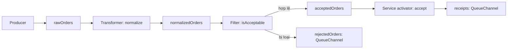

# XML namespace configuration — cấu hình luồng Spring Integration bằng XML

Trong chương **Annotation và XML** của **SPRING_INTEGRATION_CORE**, XML namespace configuration là cách khai báo channel, endpoint và các thành phần tích hợp bằng những phần tử XML có ý nghĩa nghiệp vụ như `channel`, `transformer`, `filter`, `router`, `service-activator` và `gateway`.

Bài học dùng một luồng chuẩn hóa, kiểm tra và tiếp nhận đơn hàng để giải thích cấu trúc namespace, cách nối các endpoint và hành vi thực thi. Bạn sẽ biết cách đọc cấu hình XML thành sơ đồ luồng thông điệp, nạp nó vào Spring, thêm poller khi cần và kiểm thử cả nhánh thành công lẫn nhánh bị loại.

Các ví dụ lấy Java 17 và Spring Integration 6.5.x làm mốc API. Ví dụ chính cần `spring-integration-core` cùng các thư viện Spring tương thích; phần kiểm thử dùng JUnit Jupiter. Hãy để BOM của dự án quản lý các phiên bản Spring đồng bộ. Các tên tệp và lớp dưới đây là bố cục minh họa để thực hành, không phải yêu cầu thay đổi cấu trúc dự án hiện tại.

## 1. Namespace giúp diễn đạt điều gì?

Nếu dùng cấu hình bean thông thường, một endpoint có thể cần nhiều khai báo cho handler, consumer, channel và các tham chiếu giữa chúng. Namespace Integration cung cấp cú pháp thể hiện trực tiếp ý định:

```xml
<int:service-activator id="acceptOrderEndpoint"
                       input-channel="acceptedOrders"
                       output-channel="receipts"
                       ref="orderFlowService"
                       method="accept"/>
```

Đọc cấu hình từ trái sang phải về mặt luồng: nhận message ở `acceptedOrders`, gọi phương thức `accept` của bean `orderFlowService`, chuyển kết quả tới `receipts`.

Phần tử XML được parser của Spring Integration chuyển thành bean definitions. Khi context khởi tạo, các bean đó tạo nên channel, handler và endpoint thực thi luồng. XML là cách mô tả cấu trúc ứng dụng; nó không phải một bộ máy xử lý message riêng biệt. [Cơ chế mở rộng XML bằng namespace của Spring](https://docs.spring.io/spring-framework/reference/core/appendix/xml-custom.html).

Vì vậy, đổi từ annotation hay Java DSL sang XML không làm mất các khái niệm cốt lõi của module: message vẫn có payload và headers, channel vẫn quyết định cách chuyển giao, endpoint vẫn kết nối thành phần xử lý vào channel.

## 2. Đọc đúng phần đầu của tài liệu XML

Một tài liệu cấu hình core tối thiểu có cấu trúc:

```xml
<?xml version="1.0" encoding="UTF-8"?>
<beans xmlns="http://www.springframework.org/schema/beans"
       xmlns:xsi="http://www.w3.org/2001/XMLSchema-instance"
       xmlns:int="http://www.springframework.org/schema/integration"
       xsi:schemaLocation="
         http://www.springframework.org/schema/beans
         https://www.springframework.org/schema/beans/spring-beans.xsd
         http://www.springframework.org/schema/integration
         https://www.springframework.org/schema/integration/spring-integration.xsd">

    <int:channel id="input"/>

</beans>
```

Có ba thông tin cần tách biệt:

| Thành phần | Ý nghĩa |
| --- | --- |
| `xmlns:int` | Gắn tiền tố `int` với namespace URI của Spring Integration |
| Namespace URI | Định danh nhóm phần tử, ví dụ `http://www.springframework.org/schema/integration` |
| `xsi:schemaLocation` | Các cặp namespace URI và vị trí XSD dùng để kiểm tra cấu trúc XML |

`schemaLocation` là danh sách **các cặp**, không phải danh sách URL độc lập. Mỗi namespace cần đi cùng XSD tương ứng. Tiền tố `int` có thể đổi tên nếu dùng nhất quán; URI mới là định danh thực sự. [Cấu hình namespace core chính thức](https://docs.spring.io/spring-integration/reference/6.5/configuration/namespace.html).

Trong mẫu này, namespace URI dùng `http`, còn vị trí XSD dùng `https`. Đó là hai vai trò khác nhau. Không tự đổi URI thành `https://www.springframework.org/schema/integration` chỉ để trông đồng nhất: namespace handler được đăng ký theo URI cụ thể. [Ánh xạ namespace handler trong module core](https://github.com/spring-projects/spring-integration/blob/v6.5.10/spring-integration-core/src/main/resources/META-INF/spring.handlers).

### Namespace mặc định quyết định các thẻ không có tiền tố

Vì `xmlns` mặc định ở ví dụ là namespace `beans`, `<bean>` và `<import>` thuộc Spring Beans. Phần tử Integration cần tiền tố, như `<int:channel>`.

Cũng có thể đặt Integration làm namespace mặc định, nhưng khi đó bean thông thường phải viết với tiền tố, chẳng hạn `<beans:bean>`. Trong cùng nhóm cấu hình, nên chọn một cách viết nhất quán để người đọc không phải đoán mỗi thẻ thuộc schema nào.

### XSD không cài thư viện và không chọn phiên bản runtime

Thêm URL XSD không đưa `spring-integration-core` vào classpath. XSD kiểm tra cú pháp, còn parser và lớp thực thi phải có trong dependency của ứng dụng.

Module core đóng gói ánh xạ `META-INF/spring.schemas`, cho phép Spring phân giải các URL schema được hỗ trợ tới tài nguyên nằm trong JAR. Do đó, ứng dụng không nhất thiết tải XSD từ mạng ở mỗi lần khởi động. URL XSD không có số phiên bản cũng không có nghĩa runtime tự nâng lên bản mới nhất. [Các ánh xạ schema đóng gói trong Spring Integration](https://github.com/spring-projects/spring-integration/blob/v6.5.10/spring-integration-core/src/main/resources/META-INF/spring.schemas).

## 3. Chuẩn bị ví dụ: luồng tiếp nhận đơn hàng

Giả sử bên ngoài gửi đơn gồm mã đơn và số lượng. Luồng cần:

1. Xóa khoảng trắng đầu cuối và viết hoa mã đơn.
2. Chấp nhận mã không rỗng và số lượng lớn hơn 0.
3. Với đơn hợp lệ, tạo biên nhận.
4. Với đơn không hợp lệ, đưa thông điệp sang hàng đợi riêng để kiểm tra.



Các channel giữa các bước là `DirectChannel`. Hai channel cuối dùng hàng đợi để người học nhận và quan sát kết quả mà chưa cần viết consumer vận hành đầy đủ.

### 3.1. Hai kiểu payload

Đặt mỗi lớp public trong tệp Java tương ứng, cùng package `example.xmlflow`:

```java
package example.xmlflow;

import java.util.Objects;

public record OrderCommand(String id, int quantity) {

    public OrderCommand {
        Objects.requireNonNull(id, "id must not be null");
    }
}
```

```java
package example.xmlflow;

public record OrderReceipt(String orderId, int quantity, String status) {
}
```

Số lượng không bị chặn ngay trong constructor để có thể thực hành nhánh filter từ chối. Mã đơn `null` là lỗi dữ liệu không phù hợp hợp đồng kiểu đầu vào; chuỗi rỗng hoặc chỉ có khoảng trắng được phép đi vào luồng để filter quyết định.

### 3.2. POJO chứa nghiệp vụ

```java
package example.xmlflow;

import java.util.Locale;

public class OrderFlowService {

    public OrderCommand normalize(OrderCommand command) {
        return new OrderCommand(
                command.id().strip().toUpperCase(Locale.ROOT),
                command.quantity());
    }

    public boolean isAcceptable(OrderCommand command) {
        return !command.id().isBlank() && command.quantity() > 0;
    }

    public OrderReceipt accept(OrderCommand command) {
        return new OrderReceipt(
                command.id(), command.quantity(), "ACCEPTED");
    }
}
```

Lớp này không cần `@Transformer`, `@Filter` hay `@ServiceActivator`, vì XML sẽ xác định phương thức nào đóng vai trò gì. Việc tách POJO giúp kiểm thử nghiệp vụ độc lập với cấu hình kết nối.

## 4. Cấu hình XML hoàn chỉnh

Khi thực hành, đặt tài nguyên sau tại `src/main/resources/integration/order-flow.xml` để có đường dẫn classpath `integration/order-flow.xml`:

```xml
<?xml version="1.0" encoding="UTF-8"?>
<beans xmlns="http://www.springframework.org/schema/beans"
       xmlns:xsi="http://www.w3.org/2001/XMLSchema-instance"
       xmlns:int="http://www.springframework.org/schema/integration"
       xsi:schemaLocation="
         http://www.springframework.org/schema/beans
         https://www.springframework.org/schema/beans/spring-beans.xsd
         http://www.springframework.org/schema/integration
         https://www.springframework.org/schema/integration/spring-integration.xsd">

    <bean id="orderFlowService"
          class="example.xmlflow.OrderFlowService"/>

    <int:channel id="rawOrders"/>
    <int:channel id="normalizedOrders"/>
    <int:channel id="acceptedOrders"/>

    <int:channel id="rejectedOrders">
        <int:queue capacity="100"/>
    </int:channel>

    <int:channel id="receipts">
        <int:queue capacity="100"/>
    </int:channel>

    <int:transformer id="normalizeOrderEndpoint"
                     input-channel="rawOrders"
                     output-channel="normalizedOrders"
                     ref="orderFlowService"
                     method="normalize"/>

    <int:filter id="validateOrderEndpoint"
                input-channel="normalizedOrders"
                output-channel="acceptedOrders"
                discard-channel="rejectedOrders"
                throw-exception-on-rejection="false"
                ref="orderFlowService"
                method="isAcceptable"/>

    <int:service-activator id="acceptOrderEndpoint"
                           input-channel="acceptedOrders"
                           output-channel="receipts"
                           requires-reply="true"
                           ref="orderFlowService"
                           method="accept"/>

</beans>
```

Thứ tự các thẻ trong tệp không quyết định thứ tự xử lý message. Các liên kết `input-channel`, `output-channel` và `discard-channel` mới tạo ra cấu trúc luồng. Đặt channel và bean trước endpoint chỉ là cách tổ chức để dễ đọc.

Filter chuyển thông điệp bị loại tới `discard-channel`; nó không tạo `OrderReceipt` cho đơn đó. Thuộc tính `throw-exception-on-rejection="false"` thể hiện chủ ý coi đây là nhánh phân loại thay vì exception. [Cấu hình filter bằng XML](https://docs.spring.io/spring-integration/reference/6.5/filter.html).

`requires-reply="true"` buộc service activator báo lỗi nếu handler không tạo kết quả yêu cầu. `output-channel="receipts"` xác định nơi chuyển biên nhận. [Cấu hình service activator và phản hồi](https://docs.spring.io/spring-integration/reference/6.5/service-activator.html).

## 5. Nạp XML và quan sát message

Ứng dụng Java độc lập có thể nạp tài nguyên bằng `ClassPathXmlApplicationContext`. Chỉ đặt tệp XML trong resources chưa khiến nó tự được nạp.

```java
package example.xmlflow;

import org.springframework.context.support.ClassPathXmlApplicationContext;
import org.springframework.messaging.Message;
import org.springframework.messaging.MessageChannel;
import org.springframework.messaging.PollableChannel;
import org.springframework.messaging.support.MessageBuilder;

public class XmlFlowDemo {

    public static void main(String[] args) {
        try (var context = new ClassPathXmlApplicationContext(
                "integration/order-flow.xml")) {

            MessageChannel input = context.getBean(
                    "rawOrders", MessageChannel.class);
            PollableChannel receipts = context.getBean(
                    "receipts", PollableChannel.class);

            Message<OrderCommand> request = MessageBuilder
                    .withPayload(new OrderCommand("  od-42  ", 3))
                    .setHeader("traceId", "trace-42")
                    .build();

            if (!input.send(request, 1000)) {
                throw new IllegalStateException("Input rejected the message");
            }

            Message<?> reply = receipts.receive(1000);
            if (reply == null) {
                throw new IllegalStateException("No receipt available");
            }

            System.out.println(reply.getPayload());
            System.out.println(reply.getHeaders().get("traceId"));
        }
    }
}
```

Payload mong đợi là `OrderReceipt` có mã `OD-42`, số lượng `3`, trạng thái `ACCEPTED`; header nghiệp vụ `traceId` vẫn theo kết quả.

Transformer trả một payload `OrderCommand` mới, còn framework đóng gói nó vào message để chuyển tiếp. Nếu bạn tự trả một `Message<?>` từ transformer, việc xây dựng tập headers cần được xem xét theo hợp đồng của transformer, đặc biệt các header dùng để tương quan hay trả lời. [Vai trò và các dạng kết quả của transformer](https://docs.spring.io/spring-integration/reference/6.5/transformer.html).

Không dùng `send()` trả `true` để kết luận mọi đơn đều được chấp nhận. Với số lượng `0`, input vẫn có thể nhận message thành công, nhưng filter chuyển nó tới `rejectedOrders` và không tạo biên nhận.

## 6. Nhìn XML như các bean và liên kết giữa chúng

| Thuộc tính | Câu hỏi nó trả lời |
| --- | --- |
| `id` | Thành phần này mang tên gì trong Spring context? |
| `input-channel` | Endpoint nhận message từ đâu? |
| `output-channel` | Kết quả được chuyển tới đâu? |
| `ref` | Dùng bean xử lý nào? |
| `method` | Gọi phương thức public nào trên bean đó? |
| `discard-channel` | Filter chuyển message bị loại đến đâu? |
| `auto-startup` | Endpoint có tự khởi động theo vòng đời context không? |

`ref="orderFlowService"` là tên bean, không phải tên lớp `OrderFlowService`. Trong `<bean>`, thuộc tính `class` mới là tên lớp đầy đủ. Tên endpoint `acceptOrderEndpoint` cũng khác tên POJO `orderFlowService`; cả hai có vai trò riêng.

Một POJO không trạng thái có thể cung cấp nhiều phương thức cho các endpoint như ví dụ. Khi thêm trạng thái dùng chung, phải xét khả năng nhiều luồng cùng gọi vào singleton đó.

XSD hợp lệ chỉ xác nhận cấu trúc mà schema biết. Nó không chứng minh lớp Java có trên classpath, bean tham chiếu đã tồn tại, phương thức nhận đúng payload hay luồng luôn có đích nhận. Những điều đó phải được kiểm tra khi context khởi tạo và khi gửi message.

### Bộ từ vựng thường gặp của namespace core

| Phần tử | Vai trò trong luồng |
| --- | --- |
| `int:channel` | Khai báo đường chuyển giao point-to-point hoặc channel có hàng đợi |
| `int:publish-subscribe-channel` | Phân phối message tới các subscriber |
| `int:transformer` | Chuyển payload hoặc tạo message theo biểu diễn khác |
| `int:filter` | Giữ hoặc loại theo điều kiện |
| `int:router` | Chọn một hoặc nhiều channel đích |
| `int:splitter` | Tạo các phần message từ một đầu vào |
| `int:aggregator` | Tương quan và gộp các message liên quan |
| `int:service-activator` | Kết nối bean xử lý nghiệp vụ vào channel |
| `int:gateway` | Tạo cổng gọi qua interface Java |
| `int:bridge` | Chuyển message giữa các channel |
| `int:poller` | Mô tả cách endpoint lấy message theo lịch |

Không phải mọi endpoint có cùng bộ thuộc tính. Router thường quyết định đích bằng mapping hoặc kết quả phương thức; không nên lấy thuộc tính của service activator gắn sang router theo suy đoán. Tra cứu schema cùng phiên bản thư viện khi IDE hoặc parser báo một thuộc tính không được hỗ trợ. [Schema core Spring Integration 6.5.10](https://github.com/spring-projects/spring-integration/blob/v6.5.10/spring-integration-core/src/main/resources/org/springframework/integration/config/spring-integration.xsd).

## 7. Loại channel quyết định cách endpoint nhận thông điệp

Hai cấu hình gần giống nhau có thể mang hành vi thực thi khác nhau:

```xml
<!-- DirectChannel: handler được gọi trong luồng gửi. -->
<int:channel id="directInput"/>

<!-- QueueChannel: thông điệp được lưu để bên nhận lấy sau. -->
<int:channel id="queuedInput">
    <int:queue capacity="100"/>
</int:channel>

<!-- Broadcast tới các subscriber. -->
<int:publish-subscribe-channel id="orderEvents"/>
```

`int:channel` không có phần tử con tạo `DirectChannel`; thêm `int:queue` tạo channel pollable có bộ đệm. Với đầu vào subscribable, endpoint có thể đăng ký để nhận; với đầu vào pollable, endpoint cần lấy message bằng cơ chế polling. [Cấu hình channel bằng XML](https://docs.spring.io/spring-integration/reference/6.5/channel/configuration.html).

Trong ví dụ chính, `receipts` là hàng đợi đầu ra và được chương trình chủ động gọi `receive()`. Không cần thêm poller chỉ vì nó có hàng đợi. Poller cần thiết khi một **endpoint** được nối vào hàng đợi đó để nhận tự động.

`capacity="100"` là giới hạn số message có thể nằm trong queue. Nó không phải số worker xử lý đồng thời. Queue trong ví dụ ở bộ nhớ; khai báo dung lượng không làm nó trở thành hàng đợi bền vững hay broker bên ngoài.

`DirectChannel` cũng không phải broadcast: thêm hai service activator cùng nhận từ một channel không đồng nghĩa cả hai luôn nhận bản sao của mọi message. Khi cần mỗi consumer nhận sự kiện, hãy cân nhắc publish-subscribe và thiết kế rõ hành vi khi một subscriber thất bại.

## 8. Cấu hình poller khi chuyển đầu vào sang hàng đợi

Để thử biến thể, thay khai báo `rawOrders` của ví dụ chính thành queue, rồi **thay** transformer cũ bằng endpoint có poller sau. Không giữ hai transformer cùng nhận từ `rawOrders`.

```xml
<int:channel id="rawOrders">
    <int:queue capacity="100"/>
</int:channel>

<int:channel id="flowErrors">
    <int:queue capacity="100"/>
</int:channel>

<int:transformer id="normalizeOrderEndpoint"
                 input-channel="rawOrders"
                 output-channel="normalizedOrders"
                 ref="orderFlowService"
                 method="normalize">
    <int:poller fixed-delay="200"
                max-messages-per-poll="10"
                receive-timeout="0"
                error-channel="flowErrors"/>
</int:transformer>
```

Poller lấy tối đa 10 message mỗi lượt, dùng fixed delay 200 ms giữa các lượt và không chờ khi một lần nhận gặp queue rỗng. Những số này không cam kết thông lượng hay thời gian hoàn thành nghiệp vụ; thời gian xử lý handler vẫn ảnh hưởng toàn bộ lượt.

Có thể tách poller thành khai báo dùng lại:

```xml
<int:poller id="orderPoller"
            fixed-delay="200"
            max-messages-per-poll="10"
            receive-timeout="0"
            error-channel="flowErrors"/>

<!-- Phần con bên trong endpoint dùng poller này. -->
<int:poller ref="orderPoller"/>
```

Hai phần trên có vị trí khác nhau: poller có `id` nằm ở cấp cao nhất trong `beans`; poller có `ref` nằm trong endpoint. Không kết hợp `ref` với các thuộc tính lịch như `fixed-delay` trên cùng phần tử.

Nếu muốn default poller cho những endpoint cần polling nhưng chưa chỉ định riêng, khai báo một poller cấp cao nhất có `default="true"`. Chỉ có một global default poller trong context; lựa chọn này làm thay đổi cách cấu hình mặc định của nhiều endpoint nên cần đặt ở vị trí dễ nhìn. [Endpoint namespace support và các tùy chọn poller](https://docs.spring.io/spring-integration/reference/6.5/endpoint.html#endpoint-namespace).

## 9. Phân biệt nhánh loại bỏ và xử lý exception

Trong luồng mẫu, số lượng không hợp lệ là một quyết định nghiệp vụ: message đi tới `rejectedOrders`. Payload ở đó vẫn là `OrderCommand` đã được chuẩn hóa.

Nếu `normalize()` hoặc `accept()` ném exception, đó là sự cố xử lý. `discard-channel` của filter không tự bắt mọi exception trong luồng.

Với chuỗi `DirectChannel` và producer gọi `send()` trực tiếp, exception có thể truyền ngược trong cùng call stack. Chỉ thêm header `errorChannel` không khiến mọi lỗi đồng bộ tự chuyển thành error message.

Với biến thể có poller, lỗi trong lượt xử lý được error handler của poller chuyển tới channel lỗi phù hợp. `error-channel="flowErrors"` chỉ định nơi nhận lỗi của poller; ví dụ không đặt header lỗi riêng trên message. Payload của `ErrorMessage` là exception, khác payload đơn hàng trong `rejectedOrders`. [Cơ chế xử lý lỗi của Spring Integration](https://docs.spring.io/spring-integration/reference/6.5/error-handling.html).

Trong bản thực hành, có thể nhận từ `flowErrors` để quan sát. Trong hệ thống vận hành, cần consumer xử lý lỗi, lưu thông tin tương quan và chính sách khôi phục. Tên `flowErrors` tự nó không tạo retry, giao dịch hay bảo đảm không mất message.

## 10. Biểu thức SpEL, placeholder và ký tự XML

### 10.1. Chọn POJO hoặc expression cho một endpoint

Filter của ví dụ có thể được thay bằng một expression tương đương:

```xml
<int:filter id="validateOrderEndpoint"
            input-channel="normalizedOrders"
            output-channel="acceptedOrders"
            discard-channel="rejectedOrders"
            expression="!payload.id().isBlank() &amp;&amp; payload.quantity() &gt; 0"/>
```

Trong `expression`, `payload` và `headers` được truy cập theo ngữ cảnh message. Không cần bọc biểu thức endpoint này bằng `#{...}`. Dùng một cách xác định logic, chẳng hạn `expression` hoặc `ref` kèm `method`; đừng ghép cả hai như thể đó là hai bước chạy nối tiếp.

Expression phù hợp với điều kiện ngắn. Khi điều kiện có nhiều nhánh hoặc dùng dịch vụ khác, POJO thường giúp đặt tên và kiểm thử rõ hơn.

### 10.2. Placeholder là cấu hình môi trường

Để dùng namespace `context`, thêm vào thẻ gốc:

```xml
xmlns:context="http://www.springframework.org/schema/context"
```

Và thêm cặp schema tương ứng vào `xsi:schemaLocation`:

```text
http://www.springframework.org/schema/context
https://www.springframework.org/schema/context/spring-context.xsd
```

Khi đó có thể cấu hình:

```xml
<context:property-placeholder/>

<int:poller id="orderPoller"
            fixed-delay="${orders.poll-delay-ms:200}"
            max-messages-per-poll="${orders.max-per-poll:10}"
            receive-timeout="0"/>
```

Các giá trị có thể lấy từ property sources của environment; nếu không có thì dùng giá trị mặc định sau dấu `:`. Đây là bước cấu hình bean, không phải phép đọc payload của mỗi message. Nếu dùng thuộc tính `location` để trỏ một tệp properties, tài nguyên đó phải thực sự có trên classpath. [Phối hợp XML, cấu hình Java và property placeholder](https://docs.spring.io/spring-framework/reference/core/beans/java/composing-configuration-classes.html).

### 10.3. Escape đúng theo luật XML

| Ký tự cần biểu diễn trong giá trị thuộc tính | Cách viết |
| --- | --- |
| `&` | `&amp;` |
| `<` | `&lt;` |
| `>` | Có thể viết `&gt;` để dễ nhận diện |
| Dấu `"` khi thuộc tính được bao bằng `"` | `&quot;` |

Ví dụ điều kiện Java có `&&` phải viết thành `&amp;&amp;` trong thuộc tính XML. `CDATA` là cách biểu diễn nội dung phần tử, không phải cách bao một đoạn ngay bên trong giá trị thuộc tính.

## 11. Biến thể gateway: gọi luồng qua interface Java

Ví dụ chính chủ động gửi vào channel rồi nhận từ queue `receipts`. Nếu muốn bên gọi chỉ thấy một phương thức nghiệp vụ, có thể cấu hình gateway.

```java
package example.xmlflow;

public interface OrderGateway {
    OrderReceipt submit(OrderCommand command);
}
```

Đây là **biến thể request-reply**. Dùng lại bean, transformer và các channel trung gian của cấu hình chính, rồi thực hiện các thay thế sau:

- Thêm gateway trỏ tới `rawOrders`.
- Thay filter cũ bằng filter báo exception khi từ chối, tránh để lời gọi chờ một biên nhận sẽ không được tạo.
- Thay service activator cuối bằng bản không có `output-channel`, để kết quả trở về `replyChannel` của lời gọi gateway.

```xml
<int:gateway id="orderGateway"
             service-interface="example.xmlflow.OrderGateway"
             default-request-channel="rawOrders"
             default-request-timeout="1000"
             default-reply-timeout="1000"/>

<int:filter id="validateOrderEndpoint"
            input-channel="normalizedOrders"
            output-channel="acceptedOrders"
            throw-exception-on-rejection="true"
            ref="orderFlowService"
            method="isAcceptable"/>

<int:service-activator id="acceptOrderEndpoint"
                       input-channel="acceptedOrders"
                       requires-reply="true"
                       ref="orderFlowService"
                       method="accept"/>
```

Với biến thể này, `OrderGateway.submit()` trả `OrderReceipt`. Gateway tự quản lý reply channel tạm thời, nên không cần đặt `default-reply-channel` chỉ để có phản hồi thông thường. Hàng đợi `receipts` trong cấu hình chính không còn là điểm nhận kết quả của đường gọi này. [Gateway và namespace XML](https://docs.spring.io/spring-integration/reference/6.5/gateway.html).

Không giữ thêm các endpoint cũ cùng nhận trên những input channel đó. Cũng cần phân biệt timeout chờ reply với thời hạn chạy handler: trong chuỗi xử lý đồng bộ cùng luồng, reply timeout không cắt ngang phương thức nghiệp vụ đang chạy lâu.

Nếu nghiệp vụ cần trả phản hồi từ chối thay vì exception, hãy thiết kế một nhánh tạo kết quả từ chối có kiểu phù hợp với hợp đồng gateway. Không thể chỉ chuyển message sang queue bị loại rồi mặc định coi đó là reply.

## 12. Phối hợp namespace, chia tệp và cấu hình Java

### 12.1. Core và các namespace bổ sung

| Prefix thường dùng | Namespace URI | Vai trò |
| --- | --- | --- |
| `int` | `http://www.springframework.org/schema/integration` | Các mẫu tích hợp và channel core |
| `context` | `http://www.springframework.org/schema/context` | Component scanning, placeholder và hạ tầng Spring Context |
| `int-file` | `http://www.springframework.org/schema/integration/file` | Adapter làm việc với tệp |
| `int-jms` | `http://www.springframework.org/schema/integration/jms` | Thành phần tích hợp JMS |
| `int-xml` | `http://www.springframework.org/schema/integration/xml` | Thành phần xử lý payload XML, chẳng hạn XPath |

Mỗi namespace được sử dụng cần khai báo `xmlns`, cặp schema phù hợp và dependency thực thi tương ứng. Ví dụ namespace file cần module `spring-integration-file`; chỉ thêm `xmlns:int-file` không đủ.

XML cấu hình Spring và payload XML là hai chủ đề riêng. Luồng khai báo bằng XML vẫn xử lý được record Java như `OrderCommand`; thêm namespace xử lý XML payload là một lựa chọn khác. [Namespace cho các thành phần xử lý XML](https://docs.spring.io/spring-integration/reference/6.5/xml/xpath-namespace-support.html).

### 12.2. Chia theo trách nhiệm rồi import rõ ràng

Trong một cấu hình gốc có namespace `beans`, có thể nạp luồng bằng:

```xml
<import resource="classpath:integration/order-flow.xml"/>
```

Khi hệ thống lớn hơn, có thể tách channel dùng chung, adapter tiếp nhận và luồng nghiệp vụ vào các tài nguyên riêng. Mỗi tệp XML cần phần khai báo namespace của chính nó; khai báo namespace không tự truyền từ tệp import sang tệp được import.

Nên để một cấu hình gốc chịu trách nhiệm nhập các tài nguyên, đồng thời thống nhất tên channel dùng chung. Tránh vừa import một tài nguyên trực tiếp, vừa nạp thêm một cấu hình khác cũng đăng ký lại các endpoint của nó.

### 12.3. Nạp XML từ cấu hình Java

Nếu ứng dụng lấy cấu hình Java làm điểm vào, có thể dùng:

```java
package example.xmlflow;

import org.springframework.context.annotation.Configuration;
import org.springframework.context.annotation.ImportResource;

@Configuration
@ImportResource("classpath:integration/order-flow.xml")
public class IntegrationXmlConfig {
}
```

Context Java phải đăng ký hoặc quét được `IntegrationXmlConfig` thì annotation mới có tác dụng. `@ImportResource` nạp định nghĩa trong XML vào context đó; không cần tự mở thêm một context XML chỉ để dùng cùng các bean. [Phối hợp cấu hình Java với XML](https://docs.spring.io/spring-framework/reference/core/beans/java/composing-configuration-classes.html#beans-java-combining).

Khi trộn các phong cách, cần xác định ai đăng ký từng endpoint. Nếu `accept()` đã được nối bằng `int:service-activator`, việc thêm một `@ServiceActivator(inputChannel = "acceptedOrders")` trên một bean được quét có thể tạo thêm endpoint. Nếu dùng Java DSL cho một đoạn thay thế, cũng phải bỏ đoạn XML tương ứng.

## 13. Kiểm thử cả cấu hình và đường đi thông điệp

Kiểm thử POJO chỉ xác nhận `normalize()` hoặc `isAcceptable()` trả đúng kết quả. Kiểm thử namespace configuration còn cần nạp XML thật để phát hiện sai schema, thiếu bean, sai `ref`, sai tên channel và cách nối nhánh.

Ví dụ JUnit 5 sau áp dụng cho **cấu hình chính ở mục 4**, chưa thay bằng gateway hoặc đầu vào có poller. Tài nguyên `integration/order-flow.xml` phải có trên test classpath.

```java
package example.xmlflow;

import java.util.stream.Stream;

import org.junit.jupiter.api.Test;
import org.junit.jupiter.params.ParameterizedTest;
import org.junit.jupiter.params.provider.MethodSource;
import org.springframework.context.support.ClassPathXmlApplicationContext;
import org.springframework.messaging.Message;
import org.springframework.messaging.MessageChannel;
import org.springframework.messaging.PollableChannel;
import org.springframework.messaging.support.MessageBuilder;

import static org.junit.jupiter.api.Assertions.assertEquals;
import static org.junit.jupiter.api.Assertions.assertInstanceOf;
import static org.junit.jupiter.api.Assertions.assertNotNull;
import static org.junit.jupiter.api.Assertions.assertNull;
import static org.junit.jupiter.api.Assertions.assertTrue;

class OrderXmlFlowTest {

    @Test
    void acceptedOrderShouldBeNormalizedAndProduceOneReceipt() {
        try (var context = new ClassPathXmlApplicationContext(
                "integration/order-flow.xml")) {

            MessageChannel input = context.getBean(
                    "rawOrders", MessageChannel.class);
            PollableChannel receipts = context.getBean(
                    "receipts", PollableChannel.class);
            PollableChannel rejected = context.getBean(
                    "rejectedOrders", PollableChannel.class);

            var request = MessageBuilder
                    .withPayload(new OrderCommand("  od-42  ", 1))
                    .setHeader("traceId", "trace-42")
                    .build();

            assertTrue(input.send(request, 1000));

            Message<?> result = receipts.receive(0);
            assertNotNull(result);
            assertEquals(new OrderReceipt("OD-42", 1, "ACCEPTED"),
                    result.getPayload());
            assertEquals("trace-42", result.getHeaders().get("traceId"));
            assertNull(receipts.receive(0), "Unexpected extra receipt");
            assertNull(rejected.receive(0), "Accepted order was discarded");
        }
    }

    static Stream<OrderCommand> invalidOrders() {
        return Stream.of(
                new OrderCommand("OD-1", 0),
                new OrderCommand("OD-2", -1),
                new OrderCommand("   ", 2));
    }

    @ParameterizedTest
    @MethodSource("invalidOrders")
    void rejectedOrderShouldNotProduceReceipt(OrderCommand command) {
        try (var context = new ClassPathXmlApplicationContext(
                "integration/order-flow.xml")) {

            MessageChannel input = context.getBean(
                    "rawOrders", MessageChannel.class);
            PollableChannel receipts = context.getBean(
                    "receipts", PollableChannel.class);
            PollableChannel rejected = context.getBean(
                    "rejectedOrders", PollableChannel.class);

            var request = MessageBuilder.withPayload(command)
                    .setHeader("traceId", "trace-rejected")
                    .build();

            assertTrue(input.send(request, 1000));

            Message<?> discarded = rejected.receive(0);
            assertNotNull(discarded);
            OrderCommand actual = assertInstanceOf(
                    OrderCommand.class, discarded.getPayload());
            assertEquals(command.quantity(), actual.quantity());
            assertEquals("trace-rejected",
                    discarded.getHeaders().get("traceId"));
            assertNull(receipts.receive(0), "Rejected order got a receipt");
            assertNull(rejected.receive(0), "Unexpected duplicate discard");
        }
    }
}
```

Các ca kiểm thử xác nhận cả biên `quantity = 1` được nhận và `quantity = 0` bị loại. Context mới cho mỗi lần chạy giữ các queue độc lập, không để message dư từ ca trước làm sai kết quả.

`receive(0)` phù hợp ở đây vì chuỗi xử lý đầu vào là đồng bộ: khi `send()` trả về, kết quả đã được gửi vào một trong hai queue cuối. Với biến thể có poller, cần nhận với thời gian chờ có giới hạn hoặc dùng cơ chế chờ điều kiện; không nên thêm `sleep()` tùy ý rồi hy vọng poller đã chạy.

Không dừng ở một phép kiểm tra XML well-formed: tài liệu đúng cú pháp XML vẫn có thể dùng phương thức Java không tồn tại hoặc nối luồng sai. Kiểm thử nạp context và kiểm thử message bổ sung hai lớp bằng chứng khác nhau.

## 14. Liên hệ với annotation và Java DSL

Cả ba cách đều cấu hình các khái niệm Integration đã học:

| XML | Annotation thường gặp | Java DSL thường gặp |
| --- | --- | --- |
| `int:transformer` | `@Transformer` | `.transform(...)` |
| `int:filter` | `@Filter` | `.filter(...)` |
| `int:router` | `@Router` | `.route(...)` |
| `int:splitter` | `@Splitter` | `.split(...)` |
| `int:aggregator` | `@Aggregator` | `.aggregate(...)` |
| `int:service-activator` | `@ServiceActivator` | `.handle(...)` |
| `int:gateway` | `@MessagingGateway` trên interface | Cấu hình gateway hoặc bước gateway phù hợp với vị trí trong luồng |

Bảng thể hiện vai trò tương ứng, không phải phép đổi tên từng thuộc tính. Chẳng hạn, Java annotation dùng tên dạng `inputChannel`, XML dùng `input-channel`, còn DSL biểu diễn liên kết qua chuỗi lời gọi cấu hình.

XML hữu ích khi nhóm muốn quan sát các liên kết trong một tài nguyên cấu hình tách khỏi lớp nghiệp vụ. Annotation đặt vai trò endpoint gần phương thức xử lý. DSL giúp biểu diễn cấu trúc luồng bằng Java và thuận tiện với lambda. Lựa chọn cần phù hợp cách nhóm đọc, thay đổi và kiểm thử hệ thống.

Khi chuyển đổi một đoạn XML sang DSL hoặc annotation, hãy giữ bộ kiểm thử hợp đồng: cùng input phải tạo cùng payload, headers nghiệp vụ và đường đi tới các đích. Đồng thời kiểm tra lại loại channel, polling, nhánh bị loại và cách phản hồi lỗi; các yếu tố này không được suy ra chỉ từ tên phương thức nghiệp vụ.

## 15. Chẩn đoán lỗi theo tầng

| Dấu hiệu | Tầng cần kiểm tra | Hướng kiểm tra cụ thể |
| --- | --- | --- |
| Prefix chưa được khai báo | Cú pháp XML | Khai báo `xmlns:int` hoặc prefix đang dùng ngay trên tài liệu đó |
| Không tìm được khai báo của phần tử | Schema | Kiểm tra URI, các cặp `schemaLocation`, namespace mặc định và XSD tương ứng |
| Không tìm được namespace handler | Classpath | Kiểm tra dependency module và URI có khớp ánh xạ đóng gói không |
| Thuộc tính không được phép | Phiên bản/schema | Tra phần tử trong XSD của dependency đang chạy; kiểm tra phần tử có bị đặt sai cấp không |
| Không tìm được bean tham chiếu | Bean wiring | Kiểm tra `id`, `ref`, tên channel và tài nguyên đã import |
| Không tìm được phương thức phù hợp | Gắn phương thức | Kiểm tra `method`, mức truy cập public, payload và tham số header |
| Channel không có subscriber | Kết nối endpoint | Kiểm tra endpoint đã được nạp, khởi động và trỏ đúng input chưa |
| Đầu vào có queue nhưng không được lấy | Polling | Kiểm tra poller cục bộ hoặc default poller và vòng đời endpoint |
| Gateway chờ rồi hết timeout | Hợp đồng reply | Kiểm tra nhánh filter loại message, handler trả null và điểm chuyển reply |
| Chỉ một trong nhiều consumer nhận | Channel semantics | Kiểm tra có đang dùng point-to-point cho nhu cầu broadcast không |
| Chạy khác sau khi thêm cấu hình Java | Đăng ký trùng | Kiểm tra cùng đoạn luồng có được XML, annotation hoặc DSL cùng đăng ký không |

Với lỗi khởi động, đọc nguyên nhân gốc và vị trí tài nguyên XML được báo, thay vì chỉ xem exception bao ngoài. Với lỗi xử lý, theo dõi mã đơn và `traceId` để xác định message đã đi qua bước nào.

IDE có thể báo lỗi XSD do catalog riêng của IDE, trong khi runtime phân giải được schema đóng gói. Chiều ngược lại cũng có thể xảy ra: IDE tìm được XSD qua mạng nhưng ứng dụng thiếu dependency chứa parser. Do đó, thông báo của IDE cần được đối chiếu với việc nạp application context thật.

## 16. Bài thực hành mở rộng

Từ cấu hình chính, bổ sung bước router sau `acceptedOrders` để đơn có số lượng từ 10 trở lên đi tới `bulkOrders`, phần còn lại đi tới `standardOrders`. Mỗi nhánh tạo `OrderReceipt` với trạng thái riêng, rồi chuyển tới queue `receipts`.

Thực hiện theo thứ tự:

1. Vẽ các channel và endpoint mới, đồng thời xác định service activator cũ nào sẽ được thay thế.
2. Chọn quyết định routing bằng POJO hoặc expression và khai báo mapping tường minh.
3. Giữ nhánh `rejectedOrders` cho dữ liệu không hợp lệ trước bước routing.
4. Kiểm thử số lượng `0`, `1`, `9`, `10` và xác nhận mỗi đơn chỉ tạo kết quả trên đường dự kiến.
5. Chuyển `rawOrders` sang queue, thêm poller và điều chỉnh cách chờ kết quả trong kiểm thử.
6. Nạp luồng XML qua `@ImportResource` và xác nhận chỉ có một bộ endpoint của luồng được đăng ký.

Sau cùng, thử viết riêng một biến thể gateway và kiểm tra cả phản hồi thành công lẫn đơn bị từ chối. Khi có thể giải thích từ khai báo namespace tới payload cuối cùng, bạn đã nắm được cách dùng XML để lắp ghép các thành phần cốt lõi của Spring Integration.
