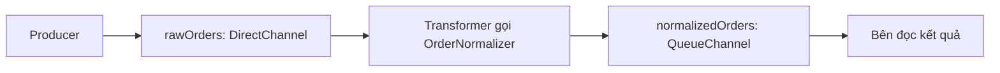

# Java config và XML config

## 1. Mục tiêu: cùng một luồng, nhiều cách khai báo

Trong chương **Annotation và XML** của module **SPRING_INTEGRATION_CORE**, Java config và XML config là hai cách mô tả cách Spring tạo bean, đăng ký endpoint và nối các channel. Chúng giúp xây dựng luồng thông điệp từ những thành phần như transformer, router, filter, aggregator và gateway.

Điều cần so sánh là **đồ thị thành phần và hành vi khi chạy**, không chỉ hình thức viết. Hai cấu hình cùng có một transformer nhưng khác loại input channel có thể khác nhau về thread thực thi, thời điểm phát sinh lỗi và nhu cầu có poller.

Sau bài này, bạn có thể:

- Khai báo một luồng bằng Java config, XML config và Java DSL.
- Phân biệt bean nghiệp vụ, handler, endpoint và channel.
- Kết hợp Java với XML trong cùng application context mà không khai báo trùng.
- Chuyển đổi cấu hình dựa trên hợp đồng message, kiểm thử và chính sách vận hành.

Ví dụ xuyên suốt là bước chuẩn hóa mã đơn hàng:



Input là chuỗi `"  od-42  "`; output là chuỗi `"OD-42"`. Header `traceId` cần được giữ. Dữ liệu chỉ chứa khoảng trắng phải bị báo lỗi. Ta giữ nguyên hợp đồng này khi thay cách cấu hình.

## 2. Ba lớp khái niệm cần tách biệt

### 2.1. Cấu hình container

Spring Framework quản lý các bean và dependency của chúng:

| Java config | XML config | Vai trò |
| --- | --- | --- |
| `@Configuration` | Tài liệu `<beans>` | Cung cấp định nghĩa bean. |
| Phương thức `@Bean` | Phần tử `<bean>` | Tạo và cấu hình một đối tượng do container quản lý. |
| Tham số của phương thức `@Bean` | `constructor-arg`, `property`, `ref` | Nối dependency giữa các bean. |
| `@Import` | `<import resource="..."/>` cho tài nguyên XML | Chia nhỏ và kết hợp cấu hình; hai cơ chế nhận loại đầu vào khác nhau. |
| `@ImportResource` | Nạp thêm XML từ cấu hình Java | Kết hợp hai cách khai báo. |

`@Bean` tạo một đối tượng được quản lý, nhưng không tự biến mọi đối tượng thành consumer của một channel. Muốn có consumer endpoint, cần khai báo thêm mối nối và vai trò xử lý. Khái niệm `@Bean`/`@Configuration` được giải thích trong [Spring Framework — Basic Concepts](https://docs.spring.io/spring-framework/reference/6.2/core/beans/java/basic-concepts.html).

### 2.2. Cấu hình luồng Spring Integration

Một endpoint thường liên quan đến handler thực hiện xử lý, channel đầu vào và cơ chế kích hoạt consumer. XML namespace như `<int:transformer>` tạo các định nghĩa cần thiết cho vai trò này; Java có messaging annotation, cấu hình bean tường minh hoặc Java DSL.

Java config và XML đều sử dụng các thành phần Spring Integration khi chạy. XML không phải một engine tích hợp riêng và cũng không buộc payload phải là XML. Payload vẫn có thể là `String`, record, POJO, `byte[]` hoặc kiểu phù hợp khác. Xem [Overview of Spring Integration Framework](https://docs.spring.io/spring-integration/reference/6.5/overview.html).

### 2.3. Quy tắc nghiệp vụ

Quy tắc chuẩn hóa mã đơn có thể nằm trong một lớp Java thuần. Java config hoặc XML chỉ quyết định lớp đó được tạo và gọi như thế nào trong luồng messaging.

Cách tách này giúp thay cấu hình mà không đồng thời viết lại nghiệp vụ. Nếu thay cấu hình lẫn quy tắc dữ liệu trong một lần chuyển đổi, rất khó xác định nguyên nhân khi kết quả khác nhau.

## 3. Chuẩn bị ví dụ dùng chung

### 3.1. Môi trường và dependency

Các ví dụ sử dụng Java 17 trở lên, Spring Integration 6.x và JUnit Jupiter. Tài liệu integration được tham chiếu theo dòng 6.5. Dự án cần `org.springframework.integration:spring-integration-core`; phiên bản các thư viện Spring cần được quản lý đồng bộ.

Trong dự án đã có Spring Boot parent hoặc BOM phù hợp, dependency có thể là:

```xml
<dependency>
    <groupId>org.springframework.boot</groupId>
    <artifactId>spring-boot-starter-integration</artifactId>
</dependency>
<dependency>
    <groupId>org.springframework.boot</groupId>
    <artifactId>spring-boot-starter-test</artifactId>
    <scope>test</scope>
</dependency>
```

Đây là phần khai báo ghép vào dự án đã có quản lý phiên bản, không phải toàn bộ `pom.xml`. Các ví dụ tự mở application context nên có thể quan sát rõ cấu hình nào đang được nạp, không phụ thuộc vào việc quét toàn bộ package của ứng dụng.

### 3.2. Bean nghiệp vụ không phụ thuộc cách cấu hình

File minh họa `OrderNormalizer.java`:

```java
package example.integration.config;

import java.util.Locale;

public class OrderNormalizer {

    public String normalize(String rawOrderId) {
        if (rawOrderId == null || rawOrderId.isBlank()) {
            throw new IllegalArgumentException("orderId must not be blank");
        }
        return rawOrderId.strip().toUpperCase(Locale.ROOT);
    }
}
```

Lớp này không tự đăng ký endpoint. Nó chỉ định nghĩa quy tắc chuyển dữ liệu. Dùng `Locale.ROOT` làm quy tắc chuyển chữ hoa độc lập với locale mặc định của máy chạy.

### 3.3. Hợp đồng cần giữ giữa các phiên bản cấu hình

| Hạng mục | Hợp đồng của ví dụ |
| --- | --- |
| Input channel | Bean tên `rawOrders`, kiểu `DirectChannel`. |
| Output channel | Bean tên `normalizedOrders`, kiểu `QueueChannel`, capacity 20. |
| Phép chuyển đổi | Gọi `OrderNormalizer.normalize`. |
| Input/output payload | `String` → `String` đã bỏ khoảng trắng hai đầu và viết hoa. |
| Metadata | Giữ header `traceId` khi transformer chỉ trả payload. |
| Input không hợp lệ | Báo lỗi với chuỗi chỉ chứa khoảng trắng. |
| Thực thi | Transformer chạy trên thread gửi; output được đưa vào queue. |

Queue ở đầu ra không tự làm bước chuẩn hóa chạy bất đồng bộ. Chính loại input channel và cấu hình consumer mới quyết định cách kích hoạt bước đó.

## 4. Cách thứ nhất: Java config với messaging annotation

### 4.1. Khai báo channel và endpoint

File minh họa `JavaOrderConfiguration.java`:

```java
package example.integration.config;

import org.springframework.context.annotation.Bean;
import org.springframework.context.annotation.Configuration;
import org.springframework.integration.annotation.Transformer;
import org.springframework.integration.channel.DirectChannel;
import org.springframework.integration.channel.QueueChannel;
import org.springframework.integration.config.EnableIntegration;
import org.springframework.messaging.MessageChannel;
import org.springframework.messaging.PollableChannel;

@Configuration(proxyBeanMethods = false)
@EnableIntegration
public class JavaOrderConfiguration {

    @Bean
    public MessageChannel rawOrders() {
        return new DirectChannel();
    }

    @Bean
    public PollableChannel normalizedOrders() {
        return new QueueChannel(20);
    }

    @Bean
    public OrderNormalizer orderNormalizer() {
        return new OrderNormalizer();
    }

    @Bean
    public NormalizationEndpoint normalizationEndpoint(
            OrderNormalizer normalizer) {
        return new NormalizationEndpoint(normalizer);
    }

    public static class NormalizationEndpoint {

        private final OrderNormalizer normalizer;

        public NormalizationEndpoint(OrderNormalizer normalizer) {
            this.normalizer = normalizer;
        }

        @Transformer(
                inputChannel = "rawOrders",
                outputChannel = "normalizedOrders")
        public String normalize(String payload) {
            return normalizer.normalize(payload);
        }
    }
}
```

Trong cấu hình này:

- `@Bean` đăng ký các channel, bean nghiệp vụ và đối tượng chứa phương thức xử lý.
- `@Transformer` cung cấp thông tin để tạo endpoint nhận message và gửi kết quả.
- `@EnableIntegration` đăng ký hạ tầng và các bộ xử lý cấu hình integration.

Không cần component scan vì các bean đã được đăng ký tường minh. Cách chuyển phương thức thành endpoint được mô tả trong [Annotation Support](https://docs.spring.io/spring-integration/reference/6.5/configuration/annotations.html).

### 4.2. Vì sao truyền dependency bằng tham số?

`normalizationEndpoint(OrderNormalizer normalizer)` nhận bean từ container. Ta không gọi trực tiếp `orderNormalizer()` bên trong phương thức tạo endpoint.

Với `@Configuration(proxyBeanMethods = false)`, lời gọi trực tiếp một phương thức `@Bean` là lời gọi Java thông thường và có thể tạo một đối tượng mới ngoài đối tượng mà bạn muốn tham chiếu. Truyền dependency bằng tham số thể hiện rõ ý định dùng bean do container quản lý. Cơ chế này được giải thích ở [Java Configuration — Full và Lite Mode](https://docs.spring.io/spring-framework/reference/6.2/core/beans/java/basic-concepts.html).

### 4.3. Java config kiểm tra được những gì?

Compiler kiểm tra kiểu Java, tên lớp và lời gọi `normalizer.normalize(payload)`. Tuy nhiên, tên channel trong `inputChannel` và `outputChannel` vẫn là chuỗi. Khả năng nhận payload thực tế và nhiều quan hệ wiring chỉ được kiểm tra khi context được khởi động hoặc message được gửi.

Vì thế, không kết luận rằng Java config loại bỏ mọi lỗi runtime. Việc khai báo channel tường minh và kiểm thử đường đi của message vẫn cần thiết.

## 5. Cách thứ hai: XML config với integration namespace

File minh họa `src/main/resources/integration/order-flow.xml`:

```xml
<?xml version="1.0" encoding="UTF-8"?>
<beans xmlns="http://www.springframework.org/schema/beans"
       xmlns:xsi="http://www.w3.org/2001/XMLSchema-instance"
       xmlns:int="http://www.springframework.org/schema/integration"
       xsi:schemaLocation="
         http://www.springframework.org/schema/beans
         https://www.springframework.org/schema/beans/spring-beans.xsd
         http://www.springframework.org/schema/integration
         https://www.springframework.org/schema/integration/spring-integration.xsd">

    <int:channel id="rawOrders"/>

    <int:channel id="normalizedOrders">
        <int:queue capacity="20"/>
    </int:channel>

    <bean id="orderNormalizer"
          class="example.integration.config.OrderNormalizer"/>

    <int:transformer id="normalizeOrder"
                     input-channel="rawOrders"
                     output-channel="normalizedOrders"
                     ref="orderNormalizer"
                     method="normalize"/>
</beans>
```

`<int:channel>` không có phần tử queue hay executor trong ví dụ này tạo channel trực tiếp. `<int:queue>` thể hiện bộ đệm ở đầu ra. `<int:transformer>` vừa chọn bean nghiệp vụ qua `ref`, vừa xác định phương thức qua `method`.

XML không cần lớp `NormalizationEndpoint` của phương án Java: phần tử transformer đã thể hiện vai trò xử lý và mối nối channel. `OrderNormalizer` vẫn là lớp dùng chung, không cần gắn `@Transformer` để XML gọi phương thức được chỉ định. Xem [Transformer — Configuring a Transformer with XML](https://docs.spring.io/spring-integration/reference/6.5/transformer.html).

### Namespace không phải dữ liệu của message

Các URI trong `xmlns` và `xsi:schemaLocation` mô tả ngữ pháp cấu hình. Đừng thay namespace URI tùy ý chỉ vì đổi địa chỉ tài liệu schema từ HTTP sang HTTPS. Prefix `int` có thể đổi nếu sử dụng nhất quán; namespace URI mới là định danh có ý nghĩa với parser.

Schema giúp kiểm tra cấu trúc phần tử và thuộc tính. Nó không bảo đảm tên phương thức Java được gõ đúng, bean đích tồn tại với ý nghĩa mong muốn hoặc payload thực tế thỏa hợp đồng. Những điểm đó cần context và kiểm thử khi chạy.

### Hạ tầng integration được nạp khi nào?

Khi parser gặp các phần tử thuộc Spring Integration namespace, framework đăng ký hạ tầng cần thiết để hỗ trợ cấu hình đó. Trong cấu hình chỉ dùng Java của ví dụ trước, `@EnableIntegration` làm nhiệm vụ đăng ký hạ tầng một cách tường minh. Đây là khác biệt về cách khởi tạo cấu hình, không phải khác biệt về mẫu tích hợp. Xem [Configuration and `@EnableIntegration`](https://docs.spring.io/spring-integration/reference/6.5/overview.html).

## 6. Khởi động và quan sát cùng một hợp đồng

### 6.1. Mở context Java hoặc XML

Với Java:

```java
try (var context = new AnnotationConfigApplicationContext(
        JavaOrderConfiguration.class)) {
    // Gửi message và đọc kết quả tại đây.
}
```

Với XML:

```java
try (var context = new ClassPathXmlApplicationContext(
        "integration/order-flow.xml")) {
    // Gửi message và đọc kết quả tại đây.
}
```

Hai lớp context thuộc `org.springframework.context.annotation` và `org.springframework.context.support` tương ứng. XML phải có trong classpath của ứng dụng hoặc kiểm thử; chỉ tạo file rồi không nạp nó sẽ không tạo endpoint.

### 6.2. Gửi và nhận không phụ thuộc cách cấu hình

Đặt đoạn sau vào bên trong một trong hai khối context ở trên:

```java
MessageChannel input = context.getBean("rawOrders", MessageChannel.class);
PollableChannel output = context.getBean(
        "normalizedOrders", PollableChannel.class);

Message<String> request = MessageBuilder
        .withPayload("  od-42  ")
        .setHeader("traceId", "trace-order-42")
        .build();

if (!input.send(request)) {
    throw new IllegalStateException("Message was not accepted");
}

Message<?> result = output.receive(1000);
if (result == null) {
    throw new IllegalStateException("No normalized message received");
}

System.out.println(result.getPayload());
System.out.println(result.getHeaders().get("traceId"));
```

Các kiểu `Message`, `MessageChannel`, `PollableChannel` thuộc `org.springframework.messaging`; `MessageBuilder` thuộc `org.springframework.messaging.support`. Kết quả mong đợi cho cả hai cấu hình:

```text
OD-42
trace-order-42
```

Một lần `send` thành công trong luồng cụ thể này cho biết transformer đã gửi kết quả vào queue. Điều đó chưa chứng minh một nghiệp vụ phía sau queue đã xử lý xong đơn hàng.

## 7. Java DSL nằm ở đâu trong Java config?

Java config là khái niệm rộng hơn Java DSL. Bạn có thể tạo bean và dùng messaging annotation như mục 4; hoặc đăng ký `IntegrationFlow` để mô tả chuỗi bước bằng fluent API.

File minh họa `DslOrderConfiguration.java`:

```java
package example.integration.config;

import org.springframework.context.annotation.Bean;
import org.springframework.context.annotation.Configuration;
import org.springframework.integration.channel.DirectChannel;
import org.springframework.integration.channel.QueueChannel;
import org.springframework.integration.config.EnableIntegration;
import org.springframework.integration.dsl.IntegrationFlow;
import org.springframework.messaging.MessageChannel;
import org.springframework.messaging.PollableChannel;

@Configuration(proxyBeanMethods = false)
@EnableIntegration
public class DslOrderConfiguration {

    @Bean
    public MessageChannel rawOrders() {
        return new DirectChannel();
    }

    @Bean
    public PollableChannel normalizedOrders() {
        return new QueueChannel(20);
    }

    @Bean
    public OrderNormalizer orderNormalizer() {
        return new OrderNormalizer();
    }

    @Bean
    public IntegrationFlow normalizeOrderFlow(OrderNormalizer normalizer) {
        return IntegrationFlow.from("rawOrders")
                .transform(String.class, normalizer::normalize)
                .channel("normalizedOrders")
                .get();
    }
}
```

Ở đây, `.transform(...)` là nơi tạo bước chuyển đổi; không cần một bean `NormalizationEndpoint` mang annotation nữa. Method reference giúp compiler kiểm tra lời gọi phương thức, nhưng đầu vào messaging lúc chạy vẫn cần đúng kiểu và đúng ngữ nghĩa.

DSL sử dụng trực tiếp các thành phần Spring Integration, không chuyển flow thành một tài liệu XML để thực thi. Xem [Java DSL](https://docs.spring.io/spring-integration/reference/6.5/dsl.html).

Khi thử từng phương án, chỉ nạp cấu hình Java annotation, XML hoặc DSL tương ứng. Việc nạp cả ba không phải cách kiểm tra tính tương đương: nó có thể tạo bean trùng hoặc nhiều consumer cho cùng channel.

## 8. Đối chiếu cấu hình theo thành phần

| Nội dung | Java config/annotation | XML config | Điểm cần giữ |
| --- | --- | --- | --- |
| Channel trực tiếp | `new DirectChannel()` | `<int:channel id="..."/>` trong cấu hình cơ bản | Kiểu giao message và subscriber. |
| Channel có queue | `new QueueChannel(20)` | `<int:queue capacity="20"/>` | Capacity và chính sách chờ gửi/nhận. |
| Transformer | Phương thức mang `@Transformer`, hoặc `.transform(...)` | `<int:transformer ref="..." method="..."/>` | Kiểu payload, quy tắc đổi và header. |
| Service activator | `@ServiceActivator`, hoặc `.handle(...)` | `<int:service-activator .../>` | Lời gọi nghiệp vụ và hợp đồng trả kết quả. |
| Filter | `@Filter`, hoặc `.filter(...)` | `<int:filter .../>` | Điều kiện nhận/bỏ và đường xử lý message bị loại. |
| Router | `@Router`, hoặc `.route(...)` | `<int:router .../>` | Cách chọn nhánh và mapping channel. |
| Aggregator | `@Aggregator`, hoặc `.aggregate(...)` | `<int:aggregator .../>` | Correlation, release, timeout và message store. |
| Gateway | `@MessagingGateway` và cơ chế đăng ký proxy | `<int:gateway .../>` | Request channel, reply, timeout và lỗi. |
| Poller | `@Poller`, hoặc cấu hình `Pollers` trong DSL | `<int:poller .../>` | Lịch chạy, giới hạn mỗi poll và error handler. |

Bảng này là bản đồ để đọc cấu hình, không phải cam kết rằng mọi thuộc tính đều chuyển nguyên tên hoặc nguyên mặc định. Với handler được tạo bằng `@Bean`, một số tùy chọn cần đặt trực tiếp trên đối tượng handler thay vì đặt lên annotation. Loại đối tượng được trả về quyết định cách framework áp dụng cấu hình. Xem [Annotations on `@Bean` Methods](https://docs.spring.io/spring-integration/reference/6.5/configuration/meta-annotations.html).

### Những cơ chế quét thường bị nhầm

- `@EnableIntegration` đăng ký hạ tầng integration; nó không thay cho việc chọn các bean nghiệp vụ cần nạp.
- `@ComponentScan` quét các lớp component trong phạm vi đã chọn.
- `@IntegrationComponentScan` hỗ trợ phát hiện interface mang `@MessagingGateway` để tạo proxy messaging.
- Khai báo `<bean>` tường minh trong XML không yêu cầu component scan chỉ để tạo chính bean đó.

Đừng mở rộng component scan ra toàn bộ package trong các ví dụ so sánh: nó có thể vô tình nạp cả các cấu hình thay thế. Đặc điểm quét gateway được mô tả trong [IntegrationComponentScan](https://docs.spring.io/spring-integration/docs/6.5.2/api/org/springframework/integration/annotation/IntegrationComponentScan.html).

## 9. Kết hợp Java và XML trong cùng application context

Một ứng dụng có thể giữ các flow XML đang ổn định, đồng thời dùng Java cho bean nghiệp vụ hoặc các flow mới. Điều kiện cần là xác định rõ cấu hình nào tạo từng bean và endpoint.

### 9.1. Java làm điểm khởi động, XML sở hữu channel và endpoint

File minh họa `HybridOrderConfiguration.java`:

```java
package example.integration.config;

import org.springframework.context.annotation.Bean;
import org.springframework.context.annotation.Configuration;
import org.springframework.context.annotation.ImportResource;
import org.springframework.integration.config.EnableIntegration;

@Configuration(proxyBeanMethods = false)
@EnableIntegration
@ImportResource("classpath:integration/order-hybrid.xml")
public class HybridOrderConfiguration {

    @Bean
    public OrderNormalizer orderNormalizer() {
        return new OrderNormalizer();
    }
}
```

File minh họa `src/main/resources/integration/order-hybrid.xml`:

```xml
<?xml version="1.0" encoding="UTF-8"?>
<beans xmlns="http://www.springframework.org/schema/beans"
       xmlns:xsi="http://www.w3.org/2001/XMLSchema-instance"
       xmlns:int="http://www.springframework.org/schema/integration"
       xsi:schemaLocation="
         http://www.springframework.org/schema/beans
         https://www.springframework.org/schema/beans/spring-beans.xsd
         http://www.springframework.org/schema/integration
         https://www.springframework.org/schema/integration/spring-integration.xsd">

    <int:channel id="rawOrders"/>

    <int:channel id="normalizedOrders">
        <int:queue capacity="20"/>
    </int:channel>

    <int:transformer id="normalizeOrder"
                     input-channel="rawOrders"
                     output-channel="normalizedOrders"
                     ref="orderNormalizer"
                     method="normalize"/>
</beans>
```

Khởi động bằng `new AnnotationConfigApplicationContext(HybridOrderConfiguration.class)`. XML dùng `ref="orderNormalizer"` để tham chiếu bean do Java tạo trong cùng context. Không có `<bean id="orderNormalizer">` thứ hai trong XML.

Đây là một context kết hợp hai nguồn định nghĩa bean, không phải hai container độc lập tự chia sẻ mọi bean với nhau. Cơ chế kết hợp và nhập tài nguyên được giải thích trong [Spring Framework — Composing Java-based Configurations](https://docs.spring.io/spring-framework/reference/6.2/core/beans/java/composing-configuration-classes.html).

### 9.2. Quyền sở hữu cần rõ ràng

| Thành phần trong ví dụ hybrid | Nơi khai báo |
| --- | --- |
| Bean `orderNormalizer` | Java config. |
| Channel `rawOrders`, `normalizedOrders` | XML. |
| Transformer endpoint | XML. |
| Điểm khởi động application context | Java. |

Không đồng thời import `order-flow.xml` đầy đủ từ mục 5 và `order-hybrid.xml`: chúng mô tả cùng channel và endpoint. Cũng không đăng ký thêm `NormalizationEndpoint` hoặc `normalizeOrderFlow` cho cùng bước.

Chiều ngược lại cũng được Spring hỗ trợ: một ứng dụng khởi động từ XML có thể đăng ký lớp `@Configuration` với cơ chế xử lý annotation thích hợp. Khi áp dụng, cần phân biệt việc nạp lớp cấu hình Java với việc khai báo lại các endpoint mà lớp đó đã tạo.

## 10. Khi thay đổi channel, phải chuyển cả ngữ nghĩa thực thi

### 10.1. Ví dụ đổi input từ trực tiếp sang queue

Trong phương án Java annotation, thay bean `rawOrders`:

```java
@Bean
public PollableChannel rawOrders() {
    return new QueueChannel(100);
}
```

Đồng thời thay annotation trên phương thức xử lý:

```java
@Transformer(
        inputChannel = "rawOrders",
        outputChannel = "normalizedOrders",
        poller = @Poller(
                fixedDelay = "100",
                maxMessagesPerPoll = "5",
                receiveTimeout = "0"))
public String normalize(String payload) {
    return normalizer.normalize(payload);
}
```

Cần import `org.springframework.integration.annotation.Poller`. Với XML, phần thay thế tương ứng là:

```xml
<int:channel id="rawOrders">
    <int:queue capacity="100"/>
</int:channel>

<int:transformer id="normalizeOrder"
                 input-channel="rawOrders"
                 output-channel="normalizedOrders"
                 ref="orderNormalizer"
                 method="normalize">
    <int:poller fixed-delay="100"
                max-messages-per-poll="5"
                receive-timeout="0"/>
</int:transformer>
```

Đoạn XML này đặt trong `<beans>` đã có namespace và các bean còn lại; nó thay input channel và transformer cũ, không bổ sung một transformer thứ hai.

### 10.2. Điều thay đổi sau khi thêm queue nguồn

| Khía cạnh | Input `DirectChannel` | Input `QueueChannel` với poller |
| --- | --- | --- |
| Thời điểm gọi normalizer | Trong đường gọi của bên gửi. | Khi consumer lấy message theo lịch. |
| Ý nghĩa gửi thành công | Bước đồng bộ đã hoàn tất theo đường nối cụ thể. | Message đã được đưa vào queue nguồn. |
| Lỗi dữ liệu | Có thể ném về bên gửi dưới dạng exception messaging. | Cần quan sát lỗi của tác vụ polling. |
| Cấu hình polling | Không có poller trên consumer này. | Có poller trực tiếp hoặc poller mặc định hợp lệ. |

Cùng một thay đổi về channel phải được phản ánh ở mọi bản cấu hình cần giữ tương đương. Nếu chỉ đổi Java sang queue nhưng giữ XML là direct, hai bản không còn cùng hành vi.

Queue mặc định của ví dụ dùng bộ nhớ. Khi cần phục hồi sau khi tiến trình dừng, phải thiết kế message store hoặc transport có khả năng lưu trữ phù hợp. Chọn Java hay XML không tự thay đổi độ bền lưu trữ của channel. Xem [Message Channel Implementations](https://docs.spring.io/spring-integration/reference/6.5/channel/implementations.html).

## 11. Thuộc tính môi trường, vòng đời và lỗi

### 11.1. Cùng giá trị cấu hình, cùng giá trị mặc định

Queue capacity, lịch poll, endpoint tự khởi động và timeout là những phần của hành vi cần đối chiếu. Có thể đưa chúng ra nguồn cấu hình bên ngoài.

Ví dụ Java, khi property source và cơ chế phân giải placeholder đã được cấu hình:

```java
@Bean
public PollableChannel normalizedOrders(
        @Value("${orders.queue-capacity:20}") int capacity) {
    return new QueueChannel(capacity);
}
```

Cần import `org.springframework.beans.factory.annotation.Value`. XML tương ứng, với cơ chế property placeholder đã đăng ký:

```xml
<int:channel id="normalizedOrders">
    <int:queue capacity="${orders.queue-capacity:20}"/>
</int:channel>
```

Chỉ ghi `${...}` trong file không làm ứng dụng tự biết mọi nguồn property. Cần xác định cách nạp nguồn cấu hình trong application context hoặc cơ chế cấu hình của ứng dụng đang dùng. Khi chuyển đổi, giữ cả giá trị mặc định; đừng để Java dùng 20 còn XML rơi về một capacity khác.

Profile và điều kiện đăng ký bean cũng cần được đối chiếu. Trong bài so sánh, các context được tạo riêng để tránh nhiều cấu hình thay thế cùng hoạt động. Trong ứng dụng thật, có thể dùng profile hoặc điểm import rõ ràng để chọn cấu hình cần chạy.

### 11.2. Phân biệt lỗi cấu hình và lỗi xử lý message

| Giai đoạn | Ví dụ lỗi | Cách quan sát |
| --- | --- | --- |
| Biên dịch Java | Sai kiểu trả về hoặc lời gọi phương thức không tồn tại. | Compiler và IDE. |
| Nạp XML | XML không hợp lệ, sai phần tử hoặc thuộc tính schema. | Lỗi parse/khởi tạo context. |
| Ghép bean | Bean trùng, dependency không xác định được, ref sai. | Lỗi context, đôi khi lúc phân giải tham chiếu được trì hoãn. |
| Giao message | Không có subscriber hoặc không tìm được đích. | Lỗi gửi/điều phối khi chạy. |
| Xử lý dữ liệu | Payload không hợp lệ, normalizer ném exception. | Exception đồng bộ hoặc message lỗi tùy ranh giới thực thi. |

Với input trực tiếp, chỉ đặt header `errorChannel` không tự chuyển mọi lỗi thành `ErrorMessage`. Với polling hoặc tác vụ được thực thi theo cơ chế bất đồng bộ của framework, error handler có thể gửi lỗi qua channel lỗi. Giữ cùng chính sách này khi chuyển đổi cấu hình; xem [Error Handling](https://docs.spring.io/spring-integration/reference/6.5/error-handling.html).

### 11.3. Tên bean và vòng đời không chỉ là chi tiết trình bày

XML có thể đặt `id` endpoint tường minh; annotation và DSL có quy tắc sinh tên riêng. Không suy ra tên endpoint bằng cách đổi dấu gạch ngang thành camelCase. Nếu hệ thống có control bus, giám sát hoặc thao tác start/stop theo tên, cần kiểm tra các tên thực tế sau chuyển đổi.

Tương tự, `autoStartup`/`auto-startup` và `phase` ảnh hưởng lúc endpoint bắt đầu nhận message. XML nằm ngoài mã Java không đồng nghĩa có thể sửa file đang chạy rồi mọi endpoint tự tái cấu hình. Việc nạp lại hay đăng ký động cần một cơ chế cụ thể của ứng dụng.

## 12. Kiểm thử cùng hợp đồng cho mọi cách cấu hình

Các đoạn dưới đây là mã kiểm thử minh họa để đưa vào dự án. Mục đích là kiểm tra hành vi của luồng, không so sánh số dòng cấu hình hoặc chuỗi biểu diễn của bean.

File minh họa `ConfigurationContractTest.java`:

```java
package example.integration.config;

import org.junit.jupiter.params.ParameterizedTest;
import org.junit.jupiter.params.provider.ValueSource;
import org.springframework.context.ConfigurableApplicationContext;
import org.springframework.context.annotation.AnnotationConfigApplicationContext;
import org.springframework.context.support.ClassPathXmlApplicationContext;
import org.springframework.integration.channel.DirectChannel;
import org.springframework.integration.channel.QueueChannel;
import org.springframework.messaging.Message;
import org.springframework.messaging.MessageChannel;
import org.springframework.messaging.MessagingException;
import org.springframework.messaging.PollableChannel;
import org.springframework.messaging.support.MessageBuilder;
import static org.junit.jupiter.api.Assertions.*;

class ConfigurationContractTest {

    @ParameterizedTest
    @ValueSource(strings = {"java", "xml", "dsl", "hybrid"})
    void normalizesPayloadAndPreservesTraceId(String style) {
        try (ConfigurableApplicationContext context = openContext(style)) {
            MessageChannel input = context.getBean(
                    "rawOrders", MessageChannel.class);
            PollableChannel output = context.getBean(
                    "normalizedOrders", PollableChannel.class);

            assertInstanceOf(DirectChannel.class, input);
            assertInstanceOf(QueueChannel.class, output);

            Message<String> request = MessageBuilder
                    .withPayload("  od-42  ")
                    .setHeader("traceId", "trace-order-42")
                    .build();

            assertTrue(input.send(request));
            Message<?> actual = output.receive(1000);

            assertNotNull(actual);
            assertEquals("OD-42", actual.getPayload());
            assertEquals("trace-order-42", actual.getHeaders().get("traceId"));
            assertNull(output.receive(0));
        }
    }

    @ParameterizedTest
    @ValueSource(strings = {"java", "xml", "dsl", "hybrid"})
    void reportsBlankInputToDirectChannelSender(String style) {
        try (ConfigurableApplicationContext context = openContext(style)) {
            MessageChannel input = context.getBean(
                    "rawOrders", MessageChannel.class);
            PollableChannel output = context.getBean(
                    "normalizedOrders", PollableChannel.class);
            Message<String> request = MessageBuilder.withPayload("   ").build();

            MessagingException error = assertThrows(MessagingException.class,
                    () -> input.send(request));

            assertInstanceOf(IllegalArgumentException.class, rootCause(error));
            assertNull(output.receive(0));
        }
    }

    private static ConfigurableApplicationContext openContext(String style) {
        return switch (style) {
            case "java" -> new AnnotationConfigApplicationContext(
                    JavaOrderConfiguration.class);
            case "xml" -> new ClassPathXmlApplicationContext(
                    "integration/order-flow.xml");
            case "dsl" -> new AnnotationConfigApplicationContext(
                    DslOrderConfiguration.class);
            case "hybrid" -> new AnnotationConfigApplicationContext(
                    HybridOrderConfiguration.class);
            default -> throw new IllegalArgumentException("Unknown style");
        };
    }

    private static Throwable rootCause(Throwable error) {
        Throwable current = error;
        while (current.getCause() != null) {
            current = current.getCause();
        }
        return current;
    }
}
```

Các test này dùng phiên bản input trực tiếp của từng cấu hình, trước thay đổi polling ở mục 10. Nếu chuyển input sang queue, cần điều chỉnh kỳ vọng lỗi: enqueue có thể thành công, còn lỗi normalizer xuất hiện sau đó và cần được nhận ở error channel đã cấu hình.

Một context mới cho mỗi lần chạy giúp tách trạng thái queue và đóng tài nguyên sau kiểm thử. `receive` có timeout hữu hạn cho phép phát hiện thiếu message; `receive(0)` đọc ngay để kiểm tra kết quả dư trong luồng tối giản.

Với luồng phức tạp hơn, hợp đồng kiểm thử cần bao gồm cả nhánh router, message bị filter loại, điều kiện release của aggregator, metadata tương quan và timeout của gateway. Chỉ so sánh payload thành công chưa đủ để chứng minh hai cấu hình tương đương về vận hành.

## 13. Chọn cách cấu hình và chuyển đổi có kiểm soát

### 13.1. Tiêu chí lựa chọn

| Tình huống | Cách cân nhắc |
| --- | --- |
| Nhóm làm việc chủ yếu với Java, thường refactor lớp và phương thức | Java config thuận tiện cho điều hướng mã, dependency injection và compiler. |
| Muốn đọc chuỗi nhiều bước trong một chỗ | Java DSL giúp thể hiện thứ tự xử lý và các nhánh theo API của flow. |
| Hệ thống đang có nhiều flow XML rõ ràng và ổn định | Tiếp tục bảo trì XML hoặc kết hợp có chọn lọc có thể giảm phạm vi thay đổi. |
| Bean nghiệp vụ cần dùng lại ở nhiều flow | Giữ nghiệp vụ độc lập; Java hoặc XML đều có thể tham chiếu bean dùng chung. |
| Cần điều chỉnh theo môi trường | Dùng cơ chế property/profile phù hợp, giữ giá trị mặc định và điều kiện kích hoạt rõ ràng. |
| Cần thay đổi flow khi ứng dụng đang chạy | Xác định cơ chế đăng ký và quản lý vòng đời riêng; định dạng Java/XML chưa quyết định được khả năng này. |

Không có quy tắc rằng XML luôn chậm hơn hoặc Java luôn an toàn kiểu hoàn toàn. Hiệu năng thực thi chủ yếu còn phụ thuộc channel, handler, adapter, I/O và các thiết lập của luồng. So sánh cần dựa trên cấu hình cụ thể và số liệu phù hợp.

### 13.2. Trình tự chuyển đổi một flow

1. Ghi lại input/output channel, loại channel, endpoint và bean nghiệp vụ của flow hiện tại.
2. Chốt hợp đồng payload, header, lỗi, nhánh điều khiển và thời điểm hoàn tất.
3. Giữ nguyên lớp nghiệp vụ khi viết cấu hình thay thế.
4. Đối chiếu poller, executor, capacity, timeout, transaction, message store và vòng đời.
5. Chạy cùng các phép kiểm tra hợp đồng trên từng cấu hình được nạp riêng.
6. Khi chọn cấu hình mới, bỏ đường import hoặc đăng ký endpoint cũ tương ứng.
7. Kiểm tra lại các tham chiếu vận hành theo tên endpoint và hành vi tại ranh giới adapter.

Nếu bật cơ chế ghi đè bean chỉ để ứng dụng khởi động sau khi nạp cả hai cấu hình, bạn có thể che mất xung đột. Ngay cả khi tên bean khác nhau, hai endpoint cùng đọc một channel vẫn có thể làm thay đổi phân phối message.

## 14. Bài thực hành

1. Thêm header `sourceSystem` vào request và xác nhận cả bốn cách cấu hình giữ được metadata này ở đầu ra.
2. Đổi capacity queue qua một property bên ngoài, dùng cùng giá trị mặc định ở Java và XML. Xác định nơi property source được nạp.
3. Chuyển input sang queue và cấu hình poller tương đương. Viết lại phép kiểm tra lỗi để nhận `ErrorMessage` ở channel lỗi riêng.
4. Thêm filter trước transformer để loại mã đơn không thuộc phạm vi tiếp nhận. Đối chiếu cả đường đi được chấp nhận và đường bị loại giữa Java/XML.
5. Chia cấu hình hybrid thành các phần có quyền sở hữu rõ ràng: Java tạo service, XML tạo channel và endpoint. Kiểm tra không có bean hoặc consumer trùng.
6. Mở rộng thành `gateway → transformer → router → service activator`; ghi lại hợp đồng của từng mối nối trước khi chuyển cách khai báo.

Hoàn thành bài khi bạn có thể thay cách khai báo một flow mà vẫn giải thích và kiểm chứng được hợp đồng message, mô hình thực thi và hành vi lỗi của nó.
