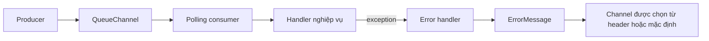

# Header `errorChannel`: chọn nơi nhận lỗi cho từng thông điệp

## 1. Mục tiêu và bài toán

Trong module **SPRING_INTEGRATION_CORE**, header `errorChannel` giúp một thông điệp mang theo địa chỉ nhận lỗi của chính nó. Nhờ đó, các yêu cầu cùng đi qua một luồng xử lý có thể được gửi lỗi về những nơi khác nhau mà không buộc handler nghiệp vụ biết nơi nhận lỗi.

Ví dụ, luồng xử lý đơn hàng tiếp nhận yêu cầu từ website và một tác vụ nhập dữ liệu. Handler kiểm tra đơn có thể dùng chung, nhưng lỗi của yêu cầu website cần được đối chiếu theo request, còn lỗi của tác vụ nhập dữ liệu cần đi về nhánh vận hành của tác vụ đó.

Sau bài học, bạn có thể:

- Đặt header đúng tên và đúng kiểu giá trị.
- Xác định lúc nào header được cơ chế xử lý lỗi sử dụng.
- Giải thích thứ tự ưu tiên giữa header và kênh lỗi mặc định.
- Đọc `ErrorMessage`, exception và thông điệp tại điểm thất bại.
- Giữ hoặc thay đổi địa chỉ lỗi có chủ đích khi xây dựng luồng bằng Java, XML và DSL.
- Kiểm thử riêng lỗi đồng bộ, lỗi trong polling task và việc chọn đích lỗi.

Điểm cần nắm ngay: **header là địa chỉ nhận lỗi; phải có thành phần bắt exception và phát thông điệp lỗi thì địa chỉ đó mới được sử dụng**. Việc thêm header không tự biến mọi exception thành một lần gửi message.

## 2. Hợp đồng của header

### 2.1. Tên header và hằng số chuẩn

Trong Java, dùng hằng số của Spring Messaging:

```java
import org.springframework.messaging.MessageHeaders;

String headerName = MessageHeaders.ERROR_CHANNEL; // "errorChannel"
```

Đây là tên header của message. Nó khác với thuộc tính `error-channel` trong XML hoặc `errorChannel` trên một annotation cấu hình endpoint, dù các cấu hình đó có thể liên quan đến cùng cơ chế xử lý lỗi.

`MessageHeaders` là cấu trúc bất biến. Không dùng `message.getHeaders().put(...)` để sửa trực tiếp; hãy tạo message bằng builder. Hợp đồng này được mô tả trong [Javadoc của `MessageHeaders`](https://docs.spring.io/spring-framework/docs/current/javadoc-api/org/springframework/messaging/MessageHeaders.html).

### 2.2. Hai kiểu giá trị thường dùng

| Giá trị của header | Ý nghĩa | Ví dụ |
| --- | --- | --- |
| Một đối tượng `MessageChannel` | Gửi lỗi tới chính channel đó | Tham chiếu tới một `QueueChannel` trong context |
| Một chuỗi không rỗng | Phân giải tên channel rồi gửi lỗi | `"orders.requestErrors"` |

Ví dụ đặt tên channel:

```java
Message<OrderRequest> request = MessageBuilder.withPayload(order)
        .setHeader("requestId", "REQ-101")
        .setHeader(MessageHeaders.ERROR_CHANNEL, "orders.requestErrors")
        .build();
```

Ví dụ đặt tham chiếu đối tượng:

```java
Message<OrderRequest> request = MessageBuilder.withPayload(order)
        .setHeader("requestId", "REQ-102")
        .setHeader(MessageHeaders.ERROR_CHANNEL, requestErrors)
        .build();
```

Trong đoạn thứ hai, `requestErrors` phải là một `MessageChannel`, không phải chuỗi biểu diễn đối tượng. Các kiểu được hỗ trợ trong quá trình phân giải có thể đối chiếu ở [mã nguồn chính thức của `MessagePublishingErrorHandler`](https://raw.githubusercontent.com/spring-projects/spring-integration/v6.5.0/spring-integration-core/src/main/java/org/springframework/integration/channel/MessagePublishingErrorHandler.java).

Tên channel không phải tên queue trên broker, URL webhook hay địa chỉ email. Chẳng hạn `"orders.requestErrors"` chỉ có ý nghĩa khi bộ phân giải đích của ứng dụng tìm được channel tương ứng.

## 3. Khi nào header có tác dụng?

### 3.1. Gửi trực tiếp qua `DirectChannel`

Với `DirectChannel` mặc định, handler chạy trên luồng gửi. Nếu handler ném exception, exception đi ngược lên call stack của caller. Chỉ đặt header `errorChannel` không làm channel tự bắt lỗi và gửi sang đó.

```text
Caller
  -> DirectChannel.send(message)
     -> handler ném exception
  <- exception truyền về caller
```

Tính chất cùng luồng của channel được giải thích trong [Message Channel Implementations](https://docs.spring.io/spring-integration/reference/channel/implementations.html).

Để chuyển lỗi đồng bộ thành một thông điệp lỗi, cần cơ chế được thiết kế rõ ràng, chẳng hạn error flow của gateway, advice hoặc một lớp bắt và phát lỗi có chủ đích. Cơ chế đó là thành phần bổ sung, không phải hành vi tự có chỉ vì xuất hiện header.

### 3.2. Polling task hoặc tác vụ bất đồng bộ có error handler

Khi message được đưa vào `QueueChannel`, caller có thể hoàn tất việc gửi trước khi polling consumer xử lý. Nếu handler lỗi về sau, không còn call stack đồng bộ để ném lại exception cho caller ban đầu.

Trong cơ chế xử lý lỗi tiêu chuẩn, một error handler tạo `ErrorMessage` rồi gửi tới channel phù hợp. Poller do Spring Integration quản lý có đường xử lý lỗi này; với executor hoặc scheduler tùy chỉnh, cần kiểm tra error handler thực tế đã được gắn hay chưa. Xem [Error Handling](https://docs.spring.io/spring-integration/reference/error-handling.html).



Một `ExecutorService.submit(...)` bất kỳ của ứng dụng không tự trở thành tác vụ Spring Integration chỉ vì mã bên trong đang giữ một `Message`. Thành phần tạo tác vụ phải xác định cách tiếp nhận và xử lý lỗi của tác vụ đó.

### 3.3. Phân biệt lỗi sau khi nhận với lỗi ngay lúc gửi

| Thời điểm lỗi | Ví dụ | Điều cần xác định |
| --- | --- | --- |
| Trong thao tác gửi | Không tìm thấy subscriber; queue đầy và hết thời gian chờ | Caller hoặc thành phần gửi xử lý thất bại như thế nào |
| Sau khi gửi đã hoàn tất | Poller lấy message rồi handler thất bại | Error handler của tác vụ gửi lỗi đi đâu |
| Trước khi lấy được message | Poller hoặc nguồn dữ liệu lỗi khi chưa có request cụ thể | Có ngữ cảnh message để đọc header hay phải dùng mặc định |

Vì vậy, không nên kiểm tra một lệnh `send()` trả về thành công rồi kết luận toàn bộ luồng nghiệp vụ đã thành công.

## 4. Thứ tự chọn kênh lỗi

Trong đường xử lý sử dụng `MessagePublishingErrorHandler`, có thể suy luận theo thứ tự sau:

1. Nếu lỗi có ngữ cảnh message thất bại và message đó có header `errorChannel` hợp lệ, dùng địa chỉ trong header.
2. Nếu không có địa chỉ theo message, dùng default error channel đã cấu hình cho error handler đó.
3. Nếu không đặt mặc định riêng, cơ chế tiêu chuẩn sử dụng channel toàn cục có bean name `errorChannel`.

`MessagePublishingErrorHandler` là thành phần thực hiện việc phát `ErrorMessage`; nó cho phép cấu hình kênh mặc định bằng đối tượng hoặc tên. Xem [Javadoc của `MessagePublishingErrorHandler`](https://docs.spring.io/spring-integration/api/org/springframework/integration/channel/MessagePublishingErrorHandler.html).

### Header và `@Poller(errorChannel = ...)`

```java
poller = @Poller(
        fixedDelay = "100",
        errorChannel = "orders.fallbackErrors")
```

Thuộc tính trên đặt **kênh mặc định của error handler cho poller**, không ghi đè header của từng request. Ý nghĩa này được nêu rõ trong [Javadoc của `Poller.errorChannel`](https://docs.spring.io/spring-integration/api/org/springframework/integration/annotation/Poller.html#errorChannel()).

| Header của message | Mặc định riêng của poller | Đích mong đợi trong ví dụ |
| --- | --- | --- |
| `orders.requestErrors` | `orders.fallbackErrors` | `orders.requestErrors` |
| Không có | `orders.fallbackErrors` | `orders.fallbackErrors` |
| Không có | Không có cấu hình riêng | `errorChannel` toàn cục |

Đây là chọn một đích, không phải mặc định phát đồng thời tới cả kênh riêng và kênh toàn cục. Nếu muốn vừa lưu lỗi riêng vừa ghi nhận ở một nơi tập trung, cần kết nối các nhánh quan sát đó tường minh.

Không coi việc viết sai tên channel là cách yêu cầu fallback. Một giá trị có mặt nhưng không phân giải được có thể làm chính việc xử lý lỗi thất bại; nó khác với việc không có header.

## 5. Ví dụ hoàn chỉnh: lỗi đơn hàng trong polling consumer

### 5.1. Topology và giả định

Ví dụ dùng Java 17 trở lên, `spring-integration-core`, Spring Context tương thích và JUnit Jupiter cho phần kiểm thử. Mỗi lớp public nằm trong tệp cùng tên, thuộc package `example.errorheader`.

Luồng gồm bốn channel dạng queue:

- `orders.in`: nhận đơn cần xử lý.
- `orders.processed`: nhận đơn được xử lý bình thường.
- `orders.requestErrors`: nhận lỗi theo header của request.
- `orders.fallbackErrors`: nhận lỗi khi request không có địa chỉ riêng.

Các queue được dùng để có thể quan sát đường đi trong ví dụ. Chúng mặc định ở bộ nhớ, không phải kho lỗi bền vững hay dead-letter queue trên broker.

### 5.2. Dữ liệu và nghiệp vụ

```java
package example.errorheader;

import java.math.BigDecimal;

public record OrderRequest(String orderId, BigDecimal total) {
}
```

```java
package example.errorheader;

public class OrderProcessor {

    public void process(OrderRequest order) {
        if (order.orderId() == null || order.orderId().isBlank()
                || order.total() == null || order.total().signum() <= 0) {
            throw new IllegalArgumentException("Đơn hàng không hợp lệ");
        }

        // Ví dụ chỉ kiểm tra dữ liệu, chưa ghi ra hệ thống bên ngoài.
    }
}
```

Lớp nghiệp vụ không cần đọc `errorChannel`. Nơi nhận lỗi là mối quan tâm của luồng tích hợp.

### 5.3. Endpoint có poller

```java
package example.errorheader;

import org.springframework.integration.annotation.Poller;
import org.springframework.integration.annotation.ServiceActivator;

public class PollingOrderEndpoint {

    private final OrderProcessor processor;

    public PollingOrderEndpoint(OrderProcessor processor) {
        this.processor = processor;
    }

    @ServiceActivator(
            inputChannel = "orders.in",
            outputChannel = "orders.processed",
            poller = @Poller(
                    fixedDelay = "100",
                    maxMessagesPerPoll = "1",
                    receiveTimeout = "0",
                    errorChannel = "orders.fallbackErrors"))
    public OrderRequest handle(OrderRequest order) {
        processor.process(order);
        return order;
    }
}
```

Poller lấy tối đa một message mỗi lần, không chờ khi queue trống và dùng một kênh lỗi mặc định riêng. Nếu message xử lý có header `errorChannel`, header đó vẫn là địa chỉ được ưu tiên trong đường xử lý đang minh họa.

### 5.4. Khai báo context

```java
package example.errorheader;

import org.springframework.context.annotation.Bean;
import org.springframework.context.annotation.Configuration;
import org.springframework.integration.channel.QueueChannel;
import org.springframework.integration.config.EnableIntegration;

@Configuration
@EnableIntegration
public class ErrorHeaderConfiguration {

    @Bean("orders.in")
    public QueueChannel ordersIn() {
        return new QueueChannel(100);
    }

    @Bean("orders.processed")
    public QueueChannel ordersProcessed() {
        return new QueueChannel(100);
    }

    @Bean("orders.requestErrors")
    public QueueChannel ordersRequestErrors() {
        return new QueueChannel(20);
    }

    @Bean("orders.fallbackErrors")
    public QueueChannel ordersFallbackErrors() {
        return new QueueChannel(20);
    }

    @Bean
    public OrderProcessor orderProcessor() {
        return new OrderProcessor();
    }

    @Bean
    public PollingOrderEndpoint pollingOrderEndpoint(OrderProcessor processor) {
        return new PollingOrderEndpoint(processor);
    }
}
```

`@EnableIntegration` và các bean trên cung cấp hạ tầng cho context Java độc lập. Endpoint được đưa vào context bằng `@Bean`, nên phương thức của nó mới được xử lý như một endpoint annotation; gọi `new PollingOrderEndpoint(...)` trực tiếp không tạo polling consumer. Cách cấu hình poller bằng annotation được trình bày trong [Annotation Support](https://docs.spring.io/spring-integration/reference/configuration/annotations.html).

### 5.5. Gửi một request có kênh lỗi riêng

```java
try (var context = new AnnotationConfigApplicationContext(
        ErrorHeaderConfiguration.class)) {

    MessageChannel input = context.getBean("orders.in", MessageChannel.class);
    QueueChannel requestErrors = context.getBean(
            "orders.requestErrors", QueueChannel.class);

    OrderRequest order = new OrderRequest("ORD-101", BigDecimal.ZERO);
    Message<OrderRequest> request = MessageBuilder.withPayload(order)
            .setHeader("requestId", "REQ-101")
            .setHeader(MessageHeaders.ERROR_CHANNEL, "orders.requestErrors")
            .build();

    if (!input.send(request, 1000)) {
        throw new IllegalStateException("Không gửi được yêu cầu vào input queue");
    }

    Message<?> received = requestErrors.receive(3000);
    if (!(received instanceof ErrorMessage error)) {
        throw new IllegalStateException("Chưa nhận được ErrorMessage mong đợi");
    }

    Throwable failure = error.getPayload();
    // Phân tích failure và thông điệp thất bại như mục tiếp theo.
}
```

Đoạn gọi cần các import: `java.math.BigDecimal`, `AnnotationConfigApplicationContext`, `Message`, `MessageChannel`, `MessageHeaders`, `QueueChannel`, `MessageBuilder` và `ErrorMessage` theo các package trong ví dụ kiểm thử cuối bài.

`send()` chỉ đưa đơn vào queue. Poller xử lý sau đó, phát hiện tổng tiền bằng 0, tạo lỗi và gửi `ErrorMessage` sang `orders.requestErrors`. Nhánh `orders.fallbackErrors` không được chọn cho request này.

Các thời gian chờ ở đây phục vụ một ví dụ nhỏ. Không lấy chúng làm cam kết thời gian xử lý của hệ thống thật.

## 6. Đọc thông điệp lỗi đúng cấu trúc

### 6.1. Payload của `ErrorMessage` là exception

Một lỗi không được gửi dưới dạng payload `OrderRequest` như trên nhánh thành công:

```text
ErrorMessage
  payload: Throwable
    thường là MessagingException
      failedMessage: Message tại điểm thất bại
      cause: lỗi nghiệp vụ hoặc lỗi hạ tầng
  originalMessage: có thể có, tùy thành phần tạo lỗi
```

`ErrorMessage` là `Message<Throwable>`. Payload thường là `MessagingException`, còn `originalMessage` là tùy chọn. `failedMessage` và `originalMessage` có thể khác nhau nếu luồng đã biến đổi message trước khi lỗi. Xem [Javadoc của `ErrorMessage`](https://docs.spring.io/spring-framework/docs/current/javadoc-api/org/springframework/messaging/support/ErrorMessage.html).

Không ép `error.getPayload()` thành đơn hàng. Muốn lấy mã đơn hoặc `requestId`, cần tìm message ngữ cảnh thích hợp.

### 6.2. Tìm message tại điểm thất bại

Một helper có thể dùng khi chẩn đoán:

```java
package example.errorheader;

import org.springframework.messaging.Message;
import org.springframework.messaging.MessagingException;
import org.springframework.messaging.support.ErrorMessage;

public final class ErrorContext {

    private ErrorContext() {
    }

    public static Message<?> findFailedMessage(Throwable failure) {
        for (Throwable current = failure;
                current != null;
                current = current.getCause()) {

            if (current instanceof MessagingException messagingException
                    && messagingException.getFailedMessage() != null) {
                return messagingException.getFailedMessage();
            }
        }
        return null;
    }

    public static Message<?> messageForDiagnostics(ErrorMessage error) {
        Message<?> failed = findFailedMessage(error.getPayload());
        return failed != null ? failed : error.getOriginalMessage();
    }
}
```

Helper tìm message thất bại có sẵn trong chuỗi nguyên nhân. Nếu không có, nó mới dùng `originalMessage` cho mục đích chẩn đoán; kết quả vẫn có thể là `null`. Hợp đồng `getFailedMessage()` nằm trong [Javadoc của `MessagingException`](https://docs.spring.io/spring-framework/docs/current/javadoc-api/org/springframework/messaging/MessagingException.html).

Không dùng helper này như cách thay thế thuật toán chọn channel của mọi thành phần. Mỗi error publisher có cách tạo ngữ cảnh và xử lý exception riêng.

### 6.3. Không giả định headers nghiệp vụ được chép sang lỗi

```java
Message<?> contextMessage = ErrorContext.messageForDiagnostics(error);

Object requestId = contextMessage == null
        ? null
        : contextMessage.getHeaders().get("requestId");

OrderRequest failedOrder = contextMessage != null
        && contextMessage.getPayload() instanceof OrderRequest order
        ? order
        : null;
```

`error.getHeaders().get("requestId")` không phải lúc nào cũng chứa giá trị từ request. `ErrorMessage` có headers của nó, còn request có headers của request. Tương tự, không giả định `getOriginalMessage()` luôn có dữ liệu: chiến lược tạo lỗi có thể không được cung cấp original message. Xem [DefaultErrorMessageStrategy](https://docs.spring.io/spring-integration/api/org/springframework/integration/support/DefaultErrorMessageStrategy.html).

Đối với một bản ghi lỗi nghiệp vụ, nên xác định rõ thông tin nào lấy được chắc chắn, thông tin nào có thể thiếu, và message nào đang được mô tả. Nếu thông điệp đã qua transformer, payload ở điểm lỗi có thể không còn là `OrderRequest` ban đầu.

## 7. Đặt header trong Java DSL và XML

### 7.1. Java DSL: thêm header trước khi vào nhánh xử lý

Thay vì buộc mọi producer tự gắn địa chỉ lỗi, có thể gắn tại entry của một nhánh:

```java
@Bean("orders.entry")
public DirectChannel ordersEntry() {
    return new DirectChannel();
}

@Bean
public IntegrationFlow attachOrderErrorChannel() {
    return IntegrationFlow.from("orders.entry")
            .enrichHeaders(headers -> headers.errorChannel(
                    "orders.requestErrors", true))
            .channel("orders.in")
            .get();
}
```

Đặt hai bean này trong cấu hình đã có các queue và endpoint của mục 5. Cần import `DirectChannel`, `IntegrationFlow` và `Bean`. Producer gửi vào `orders.entry`, header được gắn xong rồi message đi vào `orders.in` để poller xử lý.

Đối số `true` ở đây yêu cầu ghi đè địa chỉ lỗi đã có. Chỉ chọn hành vi này khi entry của nhánh có trách nhiệm quyết định lại chính sách lỗi. Nếu muốn giữ địa chỉ do caller cung cấp, chọn `false`. API hỗ trợ tên bean hoặc channel instance được mô tả tại [HeaderEnricherSpec](https://docs.spring.io/spring-integration/api/org/springframework/integration/dsl/HeaderEnricherSpec.html).

Việc enrich header không tạo error boundary cho chính `orders.entry`. Lỗi đồng bộ xảy ra ngay trong bước enrich hoặc gửi vào queue vẫn cần được caller hay thành phần gửi xử lý theo cơ chế tương ứng.

### 7.2. XML: header enricher với tham chiếu channel

Fragment XML tương đương, với prefix `int` thuộc namespace Spring Integration:

```xml
<int:channel id="orders.entry"/>

<int:header-enricher input-channel="orders.entry"
                     output-channel="orders.in">
    <int:error-channel ref="orders.requestErrors" overwrite="true"/>
</int:header-enricher>
```

Fragment giả định `orders.in`, `orders.requestErrors` và polling endpoint đã được khai báo trong context. `ref` đưa tham chiếu channel vào header. Nếu cần lưu một chuỗi tên channel, có thể dùng khai báo header thông thường:

```xml
<int:header-enricher input-channel="orders.entry"
                     output-channel="orders.in">
    <int:header name="errorChannel"
                value="orders.requestErrors"
                overwrite="true"/>
</int:header-enricher>
```

Hai header enricher trên là hai cách thay thế, không đăng ký cả hai như các consumer cạnh tranh trên cùng `orders.entry`. Các phần tử hỗ trợ header đặc biệt được trình bày trong [Content Enricher](https://docs.spring.io/spring-integration/reference/content-enrichment.html).

## 8. Giữ, ghi đè hoặc bỏ header có chủ đích

### 8.1. Giữ ngữ cảnh khi tạo message mới

Nếu một bước Java tự dựng message từ payload mà không sao chép headers, địa chỉ lỗi có thể mất:

```java
// Có nguy cơ làm mất requestId, errorChannel và ngữ cảnh khác.
Message<OrderRequest> rebuilt = MessageBuilder.withPayload(order).build();
```

Khi vẫn dùng cùng payload và cần sửa header, có thể bắt đầu từ message hiện có:

```java
Message<OrderRequest> routed = MessageBuilder.fromMessage(request)
        .setHeader(MessageHeaders.ERROR_CHANNEL, "orders.requestErrors")
        .build();
```

Khi đổi kiểu payload, hãy dùng cơ chế transformer hoặc builder có chiến lược sao chép headers phù hợp. Điểm cần kiểm tra là message tại nơi có thể thất bại còn địa chỉ lỗi và mã đối chiếu cần thiết hay không.

### 8.2. Ghi đè là thay đổi hợp đồng của nhánh

Ví dụ, caller muốn nhận lỗi của request qua một kênh riêng, nhưng một bước giữa luồng ghi đè sang kênh vận hành chung. Từ đó, caller có thể không còn nhận được kết quả lỗi như mong đợi.

Vì vậy, mỗi nơi ghi đè cần có lý do cụ thể: ranh giới ứng dụng, nhánh xử lý độc lập hoặc hợp đồng vận hành mới. Không gắn lại một giá trị mặc định ở mọi bước chỉ vì tiện sao chép cấu hình.

### 8.3. Bỏ header để quay về chính sách mặc định

```java
Message<OrderRequest> usingDefaultPolicy = MessageBuilder.fromMessage(request)
        .removeHeader(MessageHeaders.ERROR_CHANNEL)
        .build();
```

Khi header đã bị bỏ, đường xử lý tiêu chuẩn có thể sử dụng kênh mặc định của error handler. Chỉ thực hiện khi nhánh thực sự không nên sử dụng địa chỉ lỗi cũ; đặc biệt cần xem xét tác động tới gateway đang chờ phản hồi.

## 9. Phân biệt với các cấu hình cùng tên hoặc gần nghĩa

| Khái niệm | Phạm vi và vai trò |
| --- | --- |
| Header `errorChannel` | Địa chỉ lỗi mang theo một message |
| Bean toàn cục tên `errorChannel` | Đích lỗi mặc định trong hạ tầng tiêu chuẩn |
| `@Poller(errorChannel = ...)` | Mặc định riêng cho error handler của poller |
| `@MessagingGateway(errorChannel = ...)` | Cấu hình error flow tại gateway, liên quan tới hợp đồng lời gọi |
| Header `replyChannel` | Địa chỉ nhận phản hồi của một tương tác messaging |
| `discardChannel` của filter | Đích cho message bị điều kiện lọc từ chối |

Không suy ra mọi thuộc tính tên `errorChannel` trên mọi adapter đều có cùng thứ tự ưu tiên. Cần xem thành phần nào đang bắt lỗi, có request message hay không và publisher nào được sử dụng.

### Gateway và lỗi đồng bộ

Gateway có thể bắt lỗi của lời gọi và đưa vào error flow theo cấu hình của chính gateway. Do đó, một luồng đồng bộ được gọi qua gateway có thể có hành vi khác với việc gửi trực tiếp vào `DirectChannel`.

Với phương thức có giá trị trả về, error flow có thể chuyển exception thành DTO tương thích để trả cho caller. Một consumer chỉ ghi log rồi kết thúc chưa tạo phản hồi đó. Cấu hình lỗi của gateway được giải thích trong [Messaging Gateways](https://docs.spring.io/spring-integration/reference/gateway.html).

### Filter từ chối không nhất thiết tạo lỗi

Filter trả về `false` có thể chỉ gửi message vào `discardChannel` hoặc loại message theo chính sách. Header `errorChannel` không tự nhận một message chỉ vì filter từ chối nó.

Chỉ khi có exception và cơ chế xử lý lỗi tương ứng thì mới xuất hiện đường phát lỗi. Vì vậy, nhánh từ chối nghiệp vụ và nhánh lỗi kỹ thuật cần được thiết kế rõ ràng, ngay cả khi cuối cùng chúng cùng được đưa vào một nơi quan sát.

## 10. Retry, recovery và kết quả nghiệp vụ

Header không phải chính sách retry. Nó không quy định số lần thử lại, khoảng cách giữa các lần thử hoặc loại exception nào nên thử lại.

Nếu advice thực hiện retry bên trong một lần xử lý và lần sau thành công, lỗi tạm thời trước đó có thể không được phát ra đường lỗi bên ngoài. Nếu retry hết lượt rồi exception thoát ra, error handler bên ngoài mới có thể xử lý nó. Nếu recovery đã nhận lỗi và chuyển sang một đích cụ thể, hành vi cũng phụ thuộc recovery đó.

Ví dụ với đơn hàng:

- Tổng tiền bằng 0 là dữ liệu không hợp lệ; retry cùng dữ liệu thường không thay đổi kết quả.
- Một lần gọi dịch vụ bị gián đoạn tạm thời có thể phù hợp với retry có giới hạn.
- Một lần ghi có thể đã thành công nhưng mất phản hồi thì cần kiểm tra trạng thái hoặc chống trùng trước khi thử lại.

Các thành phần retry và recovery là cấu hình riêng; có thể đối chiếu [Provided Advice Classes](https://docs.spring.io/spring-integration/reference/handler-advice/classes.html).

Đưa `ErrorMessage` vào queue không đồng nghĩa dữ liệu gốc được rollback, message trên broker được requeue hoặc một thao tác ngoài hệ thống bị hủy. Những điều đó thuộc transaction, acknowledgment và hợp đồng của adapter hoặc dịch vụ liên quan.

## 11. Thiết kế nhánh xử lý lỗi có thể vận hành

### 11.1. Error channel phải có nơi tiêu thụ

Trong ví dụ, các lỗi được giữ trong queue để kiểm thử lấy ra quan sát. Với ứng dụng chạy lâu dài, cần consumer đọc chúng và thực hiện hành động đã định nghĩa: ghi bản ghi lỗi, thông báo nội bộ, phân loại hoặc đưa vào quy trình xử lý lại.

Nếu dùng `DirectChannel` làm kênh lỗi, phải có subscriber phù hợp. Nếu dùng `QueueChannel`, cần theo dõi sức chứa, thời gian lưu và tốc độ xử lý. Queue không có consumer rồi đầy lên có thể khiến chính việc phát lỗi chờ hoặc thất bại.

Một lỗi gửi vào kênh riêng không được bảo đảm tự động thử lại ở kênh toàn cục nếu kênh riêng gặp sự cố. Phải thiết kế cách quan sát lỗi chuyển giao và điểm kết thúc của error flow.

### 11.2. Phân loại mà không tạo vòng lặp

Một consumer nhận `ErrorMessage` nên hiểu rằng payload của nó là `Throwable`. Nếu gửi message lỗi trở lại channel chuyên xử lý đơn hàng, handler nhận `OrderRequest` có thể tiếp tục thất bại.

Nếu cần phát lại, hãy lấy đúng dữ liệu nghiệp vụ, xác nhận việc sửa dữ liệu hoặc điều kiện thử lại và tạo request theo hợp đồng phát lại. Không gửi lại vô hạn chỉ vì đã tìm được `failedMessage`.

Nhánh xử lý lỗi cũng có thể lỗi. Cần một đích cuối phù hợp hoặc cách ghi nhận vận hành để tránh một topology cứ đưa lỗi quay lại chính bước vừa thất bại.

### 11.3. Quan sát theo mã tương quan

Các thông tin thường hữu ích gồm `requestId`, mã nghiệp vụ, bước thất bại, loại exception, trạng thái retry và kết quả xử lý lỗi. `requestId` nên lấy từ message ngữ cảnh đã xác định, không giả định luôn nằm trên headers của `ErrorMessage`.

Không đưa toàn bộ payload hoặc stack trace vào nhãn metric. Khi ghi bản ghi lỗi, chọn dữ liệu đủ để đối chiếu và phát lại theo yêu cầu của hệ thống, thay vì mặc định sao chép mọi header kỹ thuật.

## 12. Header khi đi qua ranh giới lưu trữ hoặc transport

Một tham chiếu channel Java có ý nghĩa trong tiến trình đang giữ đối tượng đó. Nó không tự chuyển thành một địa chỉ từ xa dùng được sau khi serialize message hoặc sau khi ứng dụng khởi động lại.

Tên bean dưới dạng chuỗi dễ biểu diễn hơn, nhưng ứng dụng nhận vẫn phải biết cách phân giải tên đó. Việc gửi chuỗi `orders.requestErrors` sang một dịch vụ khác không tự tạo bean cùng tên ở dịch vụ đó.

Spring Integration có `HeaderChannelRegistry` và thao tác chuyển header channel thành chuỗi để giữ ánh xạ cho việc phân giải sau đó. Ánh xạ có vòng đời; token registry không phải địa chỉ bền vững dùng được vô hạn ở mọi tiến trình. Cơ chế được mô tả tại [Header Channel Registry](https://docs.spring.io/spring-integration/reference/content-enrichment.html#header-channel-registry).

Khi message qua broker hoặc message store, cần quyết định:

1. Header nào thực sự được ánh xạ qua transport?
2. Địa chỉ nhận lỗi được phân giải ở ứng dụng nào?
3. Nếu không còn caller hoặc context ban đầu thì lỗi được lưu và xử lý ở đâu?
4. Dữ liệu nào đủ để đối chiếu hoặc phát lại mà không phụ thuộc vào đối tượng channel đã hết vòng đời?

Đối với quy trình cần tồn tại qua việc khởi động lại, hãy thiết kế hợp đồng lỗi bền vững riêng thay vì chỉ giữ một tham chiếu channel trong header.

## 13. Kiểm thử việc chọn đích lỗi

### 13.1. Các tình huống cần bao phủ

| Tình huống | Điều cần chứng minh |
| --- | --- |
| Header là tên channel hợp lệ | Lỗi tới channel được chỉ định |
| Header là đối tượng channel | Lỗi tới đối tượng đó |
| Không có header | Dùng mặc định riêng của poller |
| Không có cả header lẫn mặc định riêng | Đường lỗi dùng kênh toàn cục theo cấu hình |
| Tên channel không tồn tại | Phát hiện lỗi cấu hình, không giả định fallback thành công |
| Gửi trực tiếp đồng bộ | Exception vẫn truyền về caller nếu không có cơ chế chuyển lỗi bổ sung |
| Request hợp lệ | Có kết quả bình thường, không tạo thông điệp lỗi cho request đó |

Các kiểm thử minh họa sau tập trung vào hai đường định tuyến cơ bản và sự khác biệt đồng bộ. Những trường hợp còn lại có thể bổ sung theo topology thực tế.

### 13.2. Header riêng được ưu tiên hơn mặc định poller

```java
package example.errorheader;

import java.math.BigDecimal;

import org.junit.jupiter.api.Test;
import org.springframework.context.annotation.AnnotationConfigApplicationContext;
import org.springframework.integration.channel.QueueChannel;
import org.springframework.messaging.Message;
import org.springframework.messaging.MessageChannel;
import org.springframework.messaging.MessageHeaders;
import org.springframework.messaging.MessagingException;
import org.springframework.messaging.support.ErrorMessage;
import org.springframework.messaging.support.MessageBuilder;

import static org.junit.jupiter.api.Assertions.assertEquals;
import static org.junit.jupiter.api.Assertions.assertInstanceOf;
import static org.junit.jupiter.api.Assertions.assertNotNull;
import static org.junit.jupiter.api.Assertions.assertNull;
import static org.junit.jupiter.api.Assertions.assertSame;
import static org.junit.jupiter.api.Assertions.assertTrue;

class ErrorHeaderRoutingTest {

    @Test
    void messageHeaderOverridesPollerDefault() {
        try (var context = new AnnotationConfigApplicationContext(
                ErrorHeaderConfiguration.class)) {

            MessageChannel input = context.getBean(
                    "orders.in", MessageChannel.class);
            QueueChannel requestErrors = context.getBean(
                    "orders.requestErrors", QueueChannel.class);
            QueueChannel fallbackErrors = context.getBean(
                    "orders.fallbackErrors", QueueChannel.class);
            QueueChannel processed = context.getBean(
                    "orders.processed", QueueChannel.class);

            OrderRequest order = new OrderRequest("ORD-101", BigDecimal.ZERO);
            Message<OrderRequest> request = MessageBuilder.withPayload(order)
                    .setHeader("requestId", "REQ-101")
                    .setHeader(MessageHeaders.ERROR_CHANNEL,
                            "orders.requestErrors")
                    .build();

            assertTrue(input.send(request, 1000));

            Message<?> received = requestErrors.receive(3000);
            ErrorMessage error = assertInstanceOf(ErrorMessage.class, received);
            MessagingException failure = assertInstanceOf(
                    MessagingException.class, error.getPayload());
            Message<?> failedMessage = failure.getFailedMessage();

            assertNotNull(failedMessage);
            assertSame(order, failedMessage.getPayload());
            assertEquals("REQ-101", failedMessage.getHeaders().get("requestId"));
            assertInstanceOf(IllegalArgumentException.class,
                    failure.getMostSpecificCause());
            assertNull(fallbackErrors.receive(0));
            assertNull(processed.receive(0));
        }
    }

    @Test
    void missingHeaderUsesPollerDefault() {
        try (var context = new AnnotationConfigApplicationContext(
                ErrorHeaderConfiguration.class)) {

            MessageChannel input = context.getBean(
                    "orders.in", MessageChannel.class);
            QueueChannel requestErrors = context.getBean(
                    "orders.requestErrors", QueueChannel.class);
            QueueChannel fallbackErrors = context.getBean(
                    "orders.fallbackErrors", QueueChannel.class);

            Message<OrderRequest> request = MessageBuilder.withPayload(
                            new OrderRequest("ORD-102", BigDecimal.ZERO))
                    .setHeader("requestId", "REQ-102")
                    .build();

            assertTrue(input.send(request, 1000));

            ErrorMessage error = assertInstanceOf(
                    ErrorMessage.class, fallbackErrors.receive(3000));
            Message<?> failedMessage = ErrorContext.findFailedMessage(
                    error.getPayload());

            assertNotNull(failedMessage);
            assertEquals("REQ-102", failedMessage.getHeaders().get("requestId"));
            assertNull(requestErrors.receive(0));
        }
    }
}
```

Các test tạo context riêng nên không còn message lỗi từ lần kiểm thử trước. `receive(3000)` chờ có giới hạn cho polling task; không cần `Thread.sleep(...)` để đoán thời điểm handler chạy.

Việc kiểm tra queue còn lại bằng `receive(0)` diễn ra sau khi đã quan sát kết quả ở đích mong đợi, trong một fixture chỉ có một request. Nó kiểm tra đường đi cụ thể của fixture, không phải bằng chứng cho mọi hành vi trong hệ thống có nhiều tác vụ đồng thời.

Muốn kiểm tra giá trị header kiểu đối tượng, thay giá trị `"orders.requestErrors"` bằng bean `requestErrors` trong một test riêng và giữ các khẳng định về đích nhận lỗi.

### 13.3. Header không tự bắt lỗi đồng bộ

```java
package example.errorheader;

import org.junit.jupiter.api.Test;
import org.springframework.integration.channel.DirectChannel;
import org.springframework.integration.channel.QueueChannel;
import org.springframework.messaging.Message;
import org.springframework.messaging.MessageHandlingException;
import org.springframework.messaging.MessageHeaders;
import org.springframework.messaging.support.MessageBuilder;

import static org.junit.jupiter.api.Assertions.assertNull;
import static org.junit.jupiter.api.Assertions.assertThrows;

class SynchronousErrorHeaderTest {

    @Test
    void directSendStillThrowsToCaller() {
        DirectChannel input = new DirectChannel();
        QueueChannel errors = new QueueChannel();

        input.subscribe(message -> {
            throw new MessageHandlingException(message, "Lỗi đồng bộ minh họa");
        });

        Message<String> request = MessageBuilder.withPayload("request-101")
                .setHeader(MessageHeaders.ERROR_CHANNEL, errors)
                .build();

        assertThrows(MessageHandlingException.class,
                () -> input.send(request));
        assertNull(errors.receive(0));
    }
}
```

Test không có gateway, advice hay error publisher khác. Nó cô lập đúng nhận định rằng một header không tự tạo cơ chế bắt và phát lỗi cho lần gửi đồng bộ.

Mã kiểm thử trong bài là nội dung thực hành; việc tạo tài liệu không đồng nghĩa các test đã được chạy trên classpath của dự án.

## 14. Chẩn đoán khi lỗi không đến đúng nơi

| Hiện tượng | Điểm cần kiểm tra |
| --- | --- |
| Caller nhận exception nhưng queue lỗi trống | Đang gửi đồng bộ trực tiếp hay có thành phần bắt và phát lỗi? |
| Lỗi đi về kênh mặc định | Message tại điểm lỗi có còn header không; exception có giữ được message ngữ cảnh không? |
| Header có tên channel nhưng không gửi được | Tên có đúng không; channel có trong context mà resolver đang dùng không? |
| Lỗi tới kênh riêng nhưng log toàn cục không có | Có thiết kế chuyển tiếp hoặc quan sát tập trung hay chưa? |
| Không tìm được `requestId` trên `ErrorMessage` | Đã đọc `failedMessage` hoặc original message thích hợp chưa? |
| Gửi thành công nhưng mã nghiệp vụ chưa chạy | Queue có poller/consumer không; endpoint đã khởi động chưa? |
| Error queue đầy dần | Consumer lỗi có hoạt động không; sức chứa và tốc độ xử lý có phù hợp không? |
| Lỗi phát lại xuất hiện liên tục | Có gửi lại sai kiểu payload hoặc retry vô hạn cùng dữ liệu không? |
| Message qua broker mất địa chỉ lỗi | Header mapping, serialization và cách phân giải đích ở phía nhận |

Khi lần theo một sự cố, bắt đầu từ message tại điểm thất bại, xác định error handler đang chạy rồi kiểm tra địa chỉ nó chọn. Chỉ nhìn cấu hình của producer ban đầu có thể bỏ sót việc header đã bị biến đổi giữa luồng.

## 15. Ghi nhớ khi thiết kế luồng

`errorChannel` là một địa chỉ điều khiển theo từng message. Giá trị của nó phát huy tác dụng trong một đường xử lý lỗi có thành phần tạo và gửi `ErrorMessage`, với ngữ cảnh đủ để tìm địa chỉ đó.

Trong ví dụ đơn hàng, poller cung cấp error boundary, header chọn kênh lỗi riêng và mặc định poller xử lý các request không có địa chỉ riêng. Một thiết kế hoàn chỉnh còn cần consumer của nhánh lỗi, cách đối chiếu request và chính sách khôi phục phù hợp với tác dụng phụ của nghiệp vụ.
