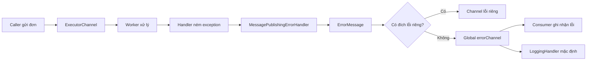

# Global errorChannel

Trong module **SPRING_INTEGRATION_CORE**, global `errorChannel` là đích xử lý lỗi dùng chung của hạ tầng Spring Integration khi cơ chế phát lỗi không chọn một đích riêng. Bài học thuộc chương **Error handling**, tập trung vào việc lỗi đi đến đâu, thông tin nào có trong `ErrorMessage`, cách bổ sung consumer và cách kiểm thử các ranh giới đồng bộ, bất đồng bộ.

Ví dụ xuyên suốt là xử lý đơn hàng. Một tác vụ chạy trên worker thread bị lỗi; ứng dụng cần thu được mã đơn, mã thông điệp và mã truy vết để ghi nhận thất bại, đồng thời phân biệt tình huống này với lỗi trả trực tiếp về bên gọi.

## 1. Mục tiêu học tập

Sau bài học, bạn có thể:

- Giải thích vai trò và phạm vi của bean có tên chính xác `errorChannel`.
- Phân biệt exception lan theo call stack với lỗi được phát thành thông điệp.
- Đọc payload, `failedMessage` và `originalMessage` đúng ngữ cảnh.
- Bổ sung consumer cho global error channel mà không vô tình thay đổi cấu hình mặc định.
- Kiểm tra ưu tiên giữa header `errorChannel`, cấu hình lỗi cục bộ và đích dùng chung.
- Thiết kế luồng ghi nhận, phân loại và phục hồi có giới hạn rõ ràng.

Ví dụ dùng Java 17 và API Spring Integration dòng 6.5. Dependency chính là `org.springframework.integration:spring-integration-core`; phần kiểm thử minh họa sử dụng JUnit Jupiter. Phiên bản Spring cần được quản lý thống nhất theo BOM hoặc cấu hình dependency của dự án.

## 2. Global errorChannel là gì?

`errorChannel` là **tên bean channel** được Spring Integration dùng làm đích lỗi mặc định trong các cơ chế hỗ trợ phát lỗi thành thông điệp.

“Global” ở đây chỉ vai trò dùng chung trong ngữ cảnh hạ tầng ứng dụng. Nó không phải bộ bắt mọi exception trong JVM, cũng không tự thu lỗi từ các tiến trình hay dịch vụ khác.

Với hạ tầng mặc định được bật, nếu ứng dụng chưa cung cấp channel cùng tên, Spring Integration tạo:

- Một `PublishSubscribeChannel` tên `errorChannel`.
- Một subscriber `LoggingHandler` ghi lỗi ở mức `ERROR`.

Cơ chế khởi tạo nằm trong [DefaultConfiguringBeanFactoryPostProcessor dòng 6.5](https://raw.githubusercontent.com/spring-projects/spring-integration/6.5.x/spring-integration-core/src/main/java/org/springframework/integration/config/DefaultConfiguringBeanFactoryPostProcessor.java).

Phân biệt các khái niệm:

| Thành phần | Vai trò |
|---|---|
| `errorChannel` | Đích nhận thông điệp lỗi |
| `ErrorMessage` | Thông điệp có payload là `Throwable` |
| `MessagePublishingErrorHandler` | Bắt lỗi trong phạm vi được tích hợp và phát thông điệp lỗi |
| Consumer của error channel | Ghi nhận, phân loại hoặc chuyển sang bước xử lý tiếp theo |

Có channel và có nơi phát lỗi là hai điều kiện riêng. Một exception chỉ đến được channel khi luồng có cơ chế bắt và phát lỗi phù hợp.

## 3. Lỗi đồng bộ và lỗi bất đồng bộ

### 3.1. DirectChannel: lỗi thường trở về bên gọi

Với luồng đồng bộ:

```text
caller thread
    -> DirectChannel
        -> handler ném exception
    <- exception lan về send(...)
```

Bên gọi có thể nhận `MessagingException` hoặc exception liên quan theo API đang sử dụng. Chỉ vì có bean `errorChannel` trong context không có nghĩa lỗi trên tự động được đưa đến đó.

Ngay cả khi message có header `errorChannel`, việc gọi trực tiếp `DirectChannel.send(...)` vẫn cần một thành phần thực sự bắt và phát lỗi. Header chỉ là thông tin định tuyến cho cơ chế hỗ trợ nó.

### 3.2. ExecutorChannel: lỗi ở worker cần một đường thông báo khác

Trong trường hợp executor thực sự chuyển công việc sang worker thread:



Caller có thể đã kết thúc thao tác gửi trước khi handler gặp lỗi. Exception trên worker không thể tự quay ngược vào một call stack đã trả về.

`ExecutorChannel` do Spring quản lý được tích hợp với cơ chế thực thi có xử lý lỗi. Điều này khác với việc bạn tự chạy một `Runnable` bất kỳ trên thread hoặc executor ngoài luồng Integration. Xem [mã nguồn ExecutorChannel](https://raw.githubusercontent.com/spring-projects/spring-integration/6.5.x/spring-integration-core/src/main/java/org/springframework/integration/channel/ExecutorChannel.java).

### 3.3. Những trường hợp cần xem riêng

| Tình huống | Đường xử lý điển hình |
|---|---|
| Gọi trực tiếp DirectChannel | Exception lan về bên gọi |
| Handler chạy sau ExecutorChannel được quản lý | Cơ chế xử lý lỗi của tác vụ phát ErrorMessage |
| Polling consumer xử lý message từ QueueChannel | Error handler của poller xử lý lỗi tác vụ |
| Gateway đồng bộ | Mặc định trả lỗi về bên gọi; có thể cấu hình error channel |
| Retry advice có recovery callback | Callback quyết định hành vi khi hết lần thử |
| Thread tự tạo hoặc tác vụ ngoài Integration | Cần cơ chế xử lý lỗi của chính tác vụ đó |

`QueueChannel` tự nó chỉ giữ thông điệp. Việc nhận rồi xử lý message bằng polling consumer mới tạo ra ranh giới tác vụ và đường xử lý lỗi tương ứng.

Tổng quan về ranh giới thực thi được mô tả tại [Spring Integration — Error Handling](https://docs.spring.io/spring-integration/reference/6.5/error-handling.html).

## 4. Chọn channel lỗi: đích riêng và đích mặc định

Đối với `MessagePublishingErrorHandler` đang xét, thông tin trên message bị lỗi có thể chỉ định channel riêng:

```java
MessageBuilder.withPayload(command)
        .setHeader(MessageHeaders.ERROR_CHANNEL, "orderErrors")
        .build();
```

Giá trị header có thể là tên channel hoặc một đối tượng `MessageChannel` phù hợp. Nếu không có chỉ định riêng, error handler sử dụng đích mặc định; trong cấu hình hạ tầng thông thường, đích đó là global `errorChannel`.

```text
failedMessage.headers.errorChannel có giá trị hợp lệ
    -> đích được chỉ định

không có chỉ định riêng
    -> đích mặc định của cơ chế phát lỗi
    -> thường là bean "errorChannel"
```

Cấu hình poller, gateway hoặc recoverer có thể thay đổi đích lỗi trong phạm vi của chính nó. Vì vậy, hãy xác định **thành phần nào đang phát lỗi**, rồi mới xác định đích cuối cùng.

Không mặc định rằng chọn một channel riêng sẽ đồng thời gửi một bản đến global channel. Nếu muốn cả hai nơi nhận, phải thiết kế một bước chuyển tiếp hoặc fan-out rõ ràng.

Cũng không coi channel riêng bị gõ sai tên là một cơ chế tự động failover về global. Lỗi không resolve được channel là lỗi cấu hình cần được phát hiện và kiểm thử.

Quy tắc chọn đích được thể hiện trong [MessagePublishingErrorHandler dòng 6.5](https://raw.githubusercontent.com/spring-projects/spring-integration/6.5.x/spring-integration-core/src/main/java/org/springframework/integration/channel/MessagePublishingErrorHandler.java).

## 5. Đọc ErrorMessage đúng cách

Import lớp thông điệp:

```java
import org.springframework.messaging.support.ErrorMessage;
```

Ba đối tượng thường cần phân biệt:

| Vị trí | Chứa gì? | Lưu ý |
|---|---|---|
| `error.getPayload()` | Throwable mô tả lỗi | Có thể là wrapper MessagingException |
| `MessagingException.getFailedMessage()` | Message tại điểm xử lý thất bại | Có thể không có; payload có thể đã được biến đổi |
| `error.getOriginalMessage()` | Message ngữ cảnh được gắn khi tạo ErrorMessage | Có thể null và không nhất thiết trùng failedMessage |

`ErrorMessage` không có hợp đồng rằng mọi error header là bản sao của header nghiệp vụ. Muốn lấy `orderId` hoặc `traceId`, trước hết cần xác định message ngữ cảnh thích hợp.

Ví dụ một transformer đổi payload trước khi bước gọi dịch vụ gặp lỗi: message tại điểm thất bại có thể khác message ở ranh giới nơi publisher bắt lỗi.

Xem [API ErrorMessage](https://docs.spring.io/spring-framework/docs/current/javadoc-api/org/springframework/messaging/support/ErrorMessage.html). Việc gắn `originalMessage` còn phụ thuộc chiến lược tạo lỗi và ngữ cảnh được cung cấp; [DefaultErrorMessageStrategy](https://docs.spring.io/spring-integration/api/org/springframework/integration/support/DefaultErrorMessageStrategy.html) chỉ gắn thông tin đó khi có trong context.

Một consumer lỗi nên xử lý được trường hợp thiếu message gốc. Đừng để phép cast payload hoặc việc đọc header làm chính đường ghi nhận lỗi phát sinh một lỗi mới.

## 6. Ví dụ hoàn chỉnh: ghi nhận lỗi từ tác vụ đơn hàng

Cấu hình sau giữ global `errorChannel` mặc định và bổ sung consumer của ứng dụng. Không khai báo một bean `errorChannel` mới.

Tệp minh họa `example/GlobalErrorConfig.java`:

```java
package example;

import java.util.Objects;
import java.util.UUID;

import org.springframework.beans.factory.annotation.Qualifier;
import org.springframework.context.annotation.Bean;
import org.springframework.context.annotation.Configuration;
import org.springframework.integration.annotation.ServiceActivator;
import org.springframework.integration.channel.DirectChannel;
import org.springframework.integration.channel.ExecutorChannel;
import org.springframework.integration.channel.QueueChannel;
import org.springframework.integration.config.EnableIntegration;
import org.springframework.messaging.Message;
import org.springframework.messaging.MessagingException;
import org.springframework.messaging.support.ErrorMessage;
import org.springframework.scheduling.concurrent.ThreadPoolTaskExecutor;

@Configuration
@EnableIntegration
public class GlobalErrorConfig {

    public record OrderCommand(String orderId) {
        public OrderCommand {
            Objects.requireNonNull(orderId, "orderId");
        }
    }

    public record FailureReport(
            String orderId,
            UUID failedMessageId,
            String traceId,
            String exceptionType) {
    }

    @Bean
    public ThreadPoolTaskExecutor orderWorkers() {
        var executor = new ThreadPoolTaskExecutor();
        executor.setCorePoolSize(1);
        executor.setMaxPoolSize(1);
        executor.setQueueCapacity(20);
        executor.setThreadNamePrefix("order-worker-");
        executor.setWaitForTasksToCompleteOnShutdown(true);
        executor.setAwaitTerminationSeconds(5);
        return executor;
    }

    @Bean
    public ExecutorChannel orderInput(
            @Qualifier("orderWorkers") ThreadPoolTaskExecutor executor) {
        return new ExecutorChannel(executor);
    }

    @Bean
    public DirectChannel directOrderInput() {
        return new DirectChannel();
    }

    @Bean
    public QueueChannel processedOrders() {
        return new QueueChannel(100);
    }

    @Bean
    public QueueChannel failureReports() {
        return new QueueChannel(100);
    }

    @Bean
    public QueueChannel orderErrors() {
        return new QueueChannel(100);
    }

    @Bean
    public OrderHandlers orderHandlers() {
        return new OrderHandlers();
    }

    public static class OrderHandlers {

        @ServiceActivator(
            inputChannel = "orderInput",
            outputChannel = "processedOrders"
        )
        public String processAsync(OrderCommand command) {
            return process(command);
        }

        @ServiceActivator(
            inputChannel = "directOrderInput",
            outputChannel = "processedOrders"
        )
        public String processDirect(OrderCommand command) {
            return process(command);
        }

        private String process(OrderCommand command) {
            if (command.orderId().startsWith("FAIL-")) {
                throw new IllegalStateException("Order processing failed");
            }
            return "PROCESSED:" + command.orderId();
        }

        @ServiceActivator(
            inputChannel = "errorChannel",
            outputChannel = "failureReports"
        )
        public FailureReport recordFailure(ErrorMessage error) {
            Throwable failure = error.getPayload();

            Message<?> failed = failure instanceof MessagingException ex
                    ? ex.getFailedMessage()
                    : null;

            if (failed == null) {
                failed = error.getOriginalMessage();
            }

            String orderId = "unknown";
            UUID failedMessageId = null;
            String traceId = "unknown";

            if (failed != null) {
                failedMessageId = failed.getHeaders().getId();

                Object trace = failed.getHeaders().get("traceId");
                if (trace != null) {
                    traceId = trace.toString();
                }

                if (failed.getPayload() instanceof OrderCommand command) {
                    orderId = command.orderId();
                }
            }

            Throwable detail = failure.getCause() != null
                    ? failure.getCause()
                    : failure;

            return new FailureReport(
                    orderId,
                    failedMessageId,
                    traceId,
                    detail.getClass().getName()
            );
        }
    }
}
```

### 6.1. Đường đi của đơn lỗi

Với `orderId = "FAIL-101"` và không có header chỉ định đích lỗi riêng:

1. Caller gửi message vào `orderInput`.
2. Worker thực hiện `processAsync`.
3. Bước nghiệp vụ ném `IllegalStateException`.
4. Hạ tầng tạo thông điệp lỗi và gửi tới global `errorChannel`.
5. `recordFailure` tạo `FailureReport` trong `failureReports`.
6. Logging subscriber mặc định cũng có thể ghi nhận thông điệp lỗi.

`send(...)` trả về thành công chỉ xác nhận thông điệp đã được tiếp nhận cho việc gửi/xử lý theo channel. Nó không chứng minh đơn hàng đã xử lý thành công trên worker.

### 6.2. Phạm vi của logic trích xuất

Consumer minh họa ưu tiên `failedMessage` trên wrapper trực tiếp, rồi dùng `originalMessage` nếu cần. `exceptionType` lấy cause trực tiếp nếu có.

Trong hệ thống có nhiều lớp wrapper, nên bổ sung cách duyệt cause chain và quy tắc chọn message phù hợp. Phần router bên dưới dùng thành phần chuyên dụng cho việc phân loại lỗi qua cause chain.

Các queue ở đây phục vụ quan sát kết quả và kiểm thử trong bộ nhớ. Chúng chưa đại diện cho cơ chế lưu lỗi bền vững hay kế hoạch phục hồi sau restart.


## 7. Kiểm thử đường đi của lỗi

Ví dụ kiểm thử sau tạo một context riêng cho mỗi tình huống. Với xử lý bất đồng bộ, dùng `receive` có timeout hữu hạn để chờ kết quả thay vì `Thread.sleep`.

Tệp minh họa `example/GlobalErrorChannelTest.java`:

```java
package example;

import example.GlobalErrorConfig.FailureReport;
import example.GlobalErrorConfig.OrderCommand;

import org.junit.jupiter.api.Test;
import org.springframework.context.annotation.AnnotationConfigApplicationContext;
import org.springframework.integration.channel.QueueChannel;
import org.springframework.messaging.Message;
import org.springframework.messaging.MessageChannel;
import org.springframework.messaging.MessageHeaders;
import org.springframework.messaging.MessagingException;
import org.springframework.messaging.support.ErrorMessage;
import org.springframework.messaging.support.MessageBuilder;

import static org.junit.jupiter.api.Assertions.*;

class GlobalErrorChannelTest {

    @Test
    void asyncFailureWithoutOverrideGoesToGlobalChannel() {
        try (var context = new AnnotationConfigApplicationContext(
                GlobalErrorConfig.class)) {

            MessageChannel input =
                    context.getBean("orderInput", MessageChannel.class);
            QueueChannel reports =
                    context.getBean("failureReports", QueueChannel.class);
            QueueChannel processed =
                    context.getBean("processedOrders", QueueChannel.class);

            Message<OrderCommand> request = MessageBuilder
                    .withPayload(new OrderCommand("FAIL-101"))
                    .setHeader("traceId", "trace-101")
                    .build();

            assertTrue(input.send(request));

            Message<?> reportMessage = reports.receive(2_000);
            assertNotNull(reportMessage);

            FailureReport report = assertInstanceOf(
                    FailureReport.class,
                    reportMessage.getPayload()
            );

            assertEquals("FAIL-101", report.orderId());
            assertEquals(
                    request.getHeaders().getId(),
                    report.failedMessageId()
            );
            assertEquals("trace-101", report.traceId());
            assertEquals(
                    IllegalStateException.class.getName(),
                    report.exceptionType()
            );
            assertNull(processed.receive(0));
        }
    }

    @Test
    void messageErrorChannelHeaderSelectsLocalDestination() {
        try (var context = new AnnotationConfigApplicationContext(
                GlobalErrorConfig.class)) {

            MessageChannel input =
                    context.getBean("orderInput", MessageChannel.class);
            QueueChannel localErrors =
                    context.getBean("orderErrors", QueueChannel.class);
            QueueChannel globalReports =
                    context.getBean("failureReports", QueueChannel.class);

            Message<OrderCommand> request = MessageBuilder
                    .withPayload(new OrderCommand("FAIL-202"))
                    .setHeader(MessageHeaders.ERROR_CHANNEL, "orderErrors")
                    .build();

            assertTrue(input.send(request));

            Message<?> delivered = localErrors.receive(2_000);
            assertNotNull(delivered);

            ErrorMessage error = assertInstanceOf(
                    ErrorMessage.class,
                    delivered
            );

            MessagingException failure = assertInstanceOf(
                    MessagingException.class,
                    error.getPayload()
            );

            assertNotNull(failure.getFailedMessage());
            assertEquals(
                    request.getHeaders().getId(),
                    failure.getFailedMessage().getHeaders().getId()
            );
            assertNull(globalReports.receive(0));
        }
    }

    @Test
    void directFailurePropagatesEvenWhenErrorHeaderIsPresent() {
        try (var context = new AnnotationConfigApplicationContext(
                GlobalErrorConfig.class)) {

            MessageChannel input =
                    context.getBean("directOrderInput", MessageChannel.class);
            QueueChannel localErrors =
                    context.getBean("orderErrors", QueueChannel.class);
            QueueChannel globalReports =
                    context.getBean("failureReports", QueueChannel.class);

            Message<OrderCommand> request = MessageBuilder
                    .withPayload(new OrderCommand("FAIL-303"))
                    .setHeader(MessageHeaders.ERROR_CHANNEL, "orderErrors")
                    .build();

            MessagingException failure = assertThrows(
                    MessagingException.class,
                    () -> input.send(request)
            );

            assertNotNull(failure.getFailedMessage());
            assertEquals(
                    request.getHeaders().getId(),
                    failure.getFailedMessage().getHeaders().getId()
            );
            assertNull(localErrors.receive(0));
            assertNull(globalReports.receive(0));
        }
    }
}
```

Các kiểm thử bảo vệ ba hợp đồng khác nhau:

| Trường hợp | Điều được xác nhận |
|---|---|
| Async, không có override | Consumer global nhận được thông tin đơn lỗi |
| Async, có header đích riêng | ErrorMessage đến channel riêng |
| Direct, có header đích riêng | Header không tự biến exception thành message lỗi |

Khi kiểm thử luồng thành công, gửi một mã không bắt đầu bằng `FAIL-` rồi kiểm tra `processedOrders`. Đừng dùng việc không thấy error message trong một khoảng thời gian ngắn làm bằng chứng duy nhất rằng nghiệp vụ đã thành công.

## 8. Bổ sung consumer hay thay channel?

### 8.1. Bổ sung consumer là lựa chọn đơn giản

Cấu hình chính chỉ thêm:

```java
@ServiceActivator(
    inputChannel = "errorChannel",
    outputChannel = "failureReports"
)
```

Áp dụng annotation này trên phương thức `recordFailure` đã trình bày trong ví dụ đầy đủ.

Với global channel mặc định kiểu publish-subscribe, ứng dụng có thể thêm consumer để ghi nhận hoặc phân loại mà vẫn giữ logging subscriber mặc định.

Tuy vậy, publish-subscribe không có nghĩa mỗi subscriber luôn chạy trên một thread độc lập. `PublishSubscribeChannel` không có executor gọi subscriber trên thread đang gửi vào channel. Xem [API PublishSubscribeChannel](https://docs.spring.io/spring-integration/api/org/springframework/integration/channel/PublishSubscribeChannel.html).

Trong ví dụ, consumer lỗi có thể chạy trên chính worker đang xử lý thất bại. Một thao tác ghi báo cáo chậm có thể giữ worker lâu hơn dự kiến.

### 8.2. Thay global errorChannel khi cần điều khiển đặc tính channel

Ví dụ cấu hình thay thế cho bean mặc định:

```java
@Bean(name = "errorChannel")
public PublishSubscribeChannel applicationErrorChannel() {
    return new PublishSubscribeChannel(true);
}
```

Constructor với `true` yêu cầu có subscriber. Đoạn này cần import `org.springframework.integration.channel.PublishSubscribeChannel` và một consumer lỗi thích hợp.

Khi đã cung cấp bean `errorChannel` riêng, không giả định logging subscriber mặc định vẫn được hạ tầng tạo kèm. Nếu cần logging, hãy đăng ký nó hoặc một consumer tương ứng trong cấu hình của ứng dụng.

### 8.3. Nếu chọn QueueChannel

Một phương án khác:

```java
@Bean(name = "errorChannel")
public QueueChannel applicationErrorChannel() {
    return new QueueChannel(500);
}
```

Khi đó consumer cần poller hoặc một cơ chế nhận chủ động:

```java
@ServiceActivator(
    inputChannel = "errorChannel",
    poller = @Poller(fixedDelay = "100", maxMessagesPerPoll = "10")
)
public void consumeGlobalError(ErrorMessage error) {
    // Ghi nhận hoặc bàn giao sang bước xử lý tiếp theo.
}
```

Đây là cấu hình thay thế, không nạp cùng consumer không có poller của ví dụ chính. Cần import `org.springframework.integration.annotation.Poller`.

Queue tách thời điểm gửi lỗi khỏi thời điểm consumer nhận, nhưng queue trong bộ nhớ không tự lưu bền. Khi đầy, thao tác gửi lỗi có thể phải chờ hoặc thất bại theo chính sách timeout của publisher.

Các cách khai báo channel và polling consumer được mô tả tại [Configuring Message Channels](https://docs.spring.io/spring-integration/reference/6.5/channel/configuration.html) và [Poller](https://docs.spring.io/spring-integration/reference/6.5/polling-consumer.html).

## 9. requireSubscribers, thứ tự consumer và lỗi trong chính đường xử lý lỗi

### 9.1. Ý nghĩa của requireSubscribers

Global error channel mặc định ở dòng 6.5 yêu cầu có subscriber. Khi channel không có subscriber phù hợp để dispatch, việc gửi không được coi là đã được xử lý bình thường.

Cơ chế này giúp phát hiện việc đường lỗi không còn consumer, chẳng hạn trong một số giai đoạn dừng context. Nó không tự bổ sung lưu bền, retry hay bảo đảm thông điệp nguồn sẽ được giao lại.

Điều gì xảy ra sau khi không gửi được lỗi còn tùy publisher, adapter và giao dịch. Đối với `MessagePublishingErrorHandler` dòng 6.5, lỗi khi giao `ErrorMessage` có thể được bắt và ghi log; cần kiểm tra tình huống này riêng nếu ứng dụng yêu cầu bảo đảm không mất thông tin lỗi.

Đừng chuyển sang chế độ bỏ qua việc thiếu subscriber chỉ để làm log yên hơn mà chưa xác định nơi tiếp nhận lỗi thay thế.

### 9.2. Thứ tự subscriber có ảnh hưởng

Logging subscriber mặc định có order `Ordered.LOWEST_PRECEDENCE - 100`. Nếu consumer đứng trước nó ném exception và dispatch dừng tại đó, những consumer phía sau có thể chưa được gọi.

Vì vậy, “đã đăng ký nhiều subscriber” chưa đủ để khẳng định tất cả đều nhận được lỗi khi một subscriber thất bại. Cần kiểm tra thứ tự, chính sách failure của channel và cách cô lập các công việc chậm hoặc dễ lỗi.

### 9.3. Tránh vòng lặp xử lý lỗi

Một đường đi nguy hiểm:

```text
errorChannel
    -> gọi lại dịch vụ đang hỏng
        -> lại thất bại
            -> chuyển lại cùng errorChannel
                -> tiếp tục lặp
```

Consumer global nên làm ít công việc, có giới hạn thời gian và có đích cuối rõ ràng. Nếu việc ghi nhận gặp lỗi, cần một đường dự phòng đã thiết kế, chẳng hạn ghi cục bộ hoặc lưu sự cố vào nơi độc lập, thay vì gửi lại vô hạn.

Trong ví dụ chính, gửi báo cáo vào queue cũng có thể thất bại khi queue đầy. Một báo cáo đã tạo trong RAM không đồng nghĩa lỗi đã được lưu an toàn.


## 10. Poller, scheduler và gateway dùng global channel như thế nào?

### 10.1. Lỗi từ polling consumer

Khi endpoint poll `QueueChannel`, lỗi có thể phát sinh trong lúc nhận hoặc xử lý thông điệp. Cơ chế xử lý lỗi của tác vụ poller chịu trách nhiệm chuyển lỗi sang đường lỗi phù hợp.

Ví dụ một poller dùng đích mặc định:

```java
@ServiceActivator(
    inputChannel = "polledOrders",
    poller = @Poller(fixedDelay = "200")
)
public void consumeOrder(OrderCommand command) {
    throw new IllegalStateException("Polling consumer failed");
}
```

Đây là phương thức trên một bean được quản lý; cần khai báo `polledOrders` là `QueueChannel` và bật hạ tầng Integration. Nếu cần đích riêng cho poller, có thể chỉ định `errorChannel` trong `@Poller` và khai báo consumer tương ứng.

Khi message đã có header đích lỗi riêng, cần xét quy tắc của error handler đang được sử dụng, thay vì cho rằng poller luôn gửi về global.

### 10.2. Scheduler tự khai báo

Scheduler mặc định của Spring Integration được nối với cơ chế xuất lỗi. Nếu thay bằng một scheduler riêng, hãy cấu hình error handler phù hợp khi muốn giữ hành vi đó.

Ví dụ tái sử dụng error handler hạ tầng:

```java
@Bean(name = "taskScheduler")
public ThreadPoolTaskScheduler taskScheduler(
        @Qualifier("integrationMessagePublishingErrorHandler")
        ErrorHandler errorHandler) {

    var scheduler = new ThreadPoolTaskScheduler();
    scheduler.setPoolSize(2);
    scheduler.setThreadNamePrefix("integration-scheduler-");
    scheduler.setErrorHandler(errorHandler);
    return scheduler;
}
```

Đoạn này cần import `org.springframework.scheduling.concurrent.ThreadPoolTaskScheduler` và `org.springframework.util.ErrorHandler`, cùng các annotation Spring tương ứng.

Tên `integrationMessagePublishingErrorHandler` là bean hạ tầng được đăng ký trong dòng 6.5 đang xét. Cấu hình scheduler riêng cần được kiểm tra trong context thực tế, nhất là khi kết hợp auto-configuration của Spring Boot.

### 10.3. Gateway đồng bộ có cấu hình errorChannel

Gateway là một thành phần có khả năng bắt và định tuyến lỗi theo cấu hình, kể cả khi phần xử lý bên dưới chạy đồng bộ. Vì vậy, phải phân biệt:

- Gọi trực tiếp `DirectChannel.send(...)`.
- Gọi qua gateway có cấu hình `errorChannel`.

Nếu gateway cần một giá trị trả về, consumer lỗi phải tuân theo hợp đồng phản hồi đã chọn. Một consumer chỉ ghi log hoặc đẩy báo cáo vào queue không tự tạo ra kết quả nghiệp vụ đúng kiểu cho lời gọi gateway.

Trong ví dụ chính, `recordFailure` gửi đầu ra tới `failureReports`. Nó phục vụ ghi nhận lỗi tác vụ, không được mặc định dùng làm fallback trả `String` cho một gateway request-reply.

Hành vi lỗi và unwrapping của gateway được trình bày tại [Messaging Gateways — Error Handling](https://docs.spring.io/spring-integration/reference/6.5/gateway.html).

## 11. Phân loại lỗi từ global channel

Một global channel có thể nhận lỗi từ nhiều luồng. Nên chuyển chúng sang những nhánh có trách nhiệm rõ ràng, thay vì viết một consumer chứa mọi cách phục hồi.

`ErrorMessageExceptionTypeRouter` định tuyến theo loại exception trong cause chain, giúp xử lý tình huống exception nghiệp vụ bị bọc trong một `MessagingException`.

Ví dụ bổ sung router và các đích quan sát:

```java
@Bean
public QueueChannel validationErrors() {
    return new QueueChannel(100);
}

@Bean
public QueueChannel transientErrors() {
    return new QueueChannel(100);
}

@Bean
public QueueChannel unexpectedErrors() {
    return new QueueChannel(100);
}

@Bean
@ServiceActivator(inputChannel = "errorChannel")
public ErrorMessageExceptionTypeRouter globalErrorRouter() {
    var router = new ErrorMessageExceptionTypeRouter();

    router.setChannelMapping(
            IllegalArgumentException.class.getName(),
            "validationErrors"
    );

    router.setChannelMapping(
            java.net.SocketTimeoutException.class.getName(),
            "transientErrors"
    );

    router.setChannelKeyFallback(false);
    router.setResolutionRequired(false);
    router.setDefaultOutputChannelName("unexpectedErrors");

    return router;
}
```

Cần import `org.springframework.integration.router.ErrorMessageExceptionTypeRouter`. Đặt các phương thức trên trong một lớp configuration có hạ tầng Integration.

Đây có thể là subscriber bổ sung của global channel hoặc consumer nghiệp vụ thay thế cho bước ghi báo cáo. Nếu giữ cả hai trên channel publish-subscribe, chúng là hai nhánh nhận lỗi; cần chủ động xác định việc xử lý song song đó có đúng ý định hay không.

| Nhánh | Hành vi ứng dụng có thể thiết kế |
|---|---|
| validationErrors | Ghi nhận dữ liệu không hợp lệ, yêu cầu sửa đầu vào |
| transientErrors | Bàn giao cho chính sách phục hồi có giới hạn |
| unexpectedErrors | Giữ thông tin để điều tra và cảnh báo theo mức độ |

Tên nhánh `transientErrors` không chứng minh mọi lỗi timeout đều retry an toàn. Nếu thao tác phía xa có thể đã thành công trước khi mất phản hồi, việc thử lại cần khóa idempotency hoặc quy tắc đối soát.

Router chỉ chọn đích; các queue trong ví dụ cần consumer nếu muốn xử lý tiếp. API và thuật toán duyệt nguyên nhân được mô tả tại [ErrorMessageExceptionTypeRouter](https://docs.spring.io/spring-integration/api/org/springframework/integration/router/ErrorMessageExceptionTypeRouter.html) và [mã nguồn dòng 6.5](https://raw.githubusercontent.com/spring-projects/spring-integration/6.5.x/spring-integration-core/src/main/java/org/springframework/integration/router/ErrorMessageExceptionTypeRouter.java).

## 12. Global errorChannel, retry và lưu lỗi là các trách nhiệm khác nhau

Đưa exception vào một channel chưa xác định việc đơn hàng sẽ được thử lại, bị hủy hay được chấp nhận với kết quả thay thế.

| Trách nhiệm | Câu hỏi cần trả lời |
|---|---|
| Error routing | Lỗi đến consumer nào? |
| Retry | Có thử lại không, tối đa bao nhiêu lần, chờ bao lâu? |
| Recovery | Khi không thể tiếp tục, ứng dụng làm gì? |
| Lưu lỗi | Thông tin nào được giữ lại và có sống qua restart không? |
| Acknowledgement/giao dịch | Nguồn có coi message đã xử lý xong không? |
| Idempotency | Việc giao lại có tạo tác động nghiệp vụ trùng không? |

`RequestHandlerRetryAdvice` có thể áp dụng retry tại endpoint. Khi hết lần thử, một recovery callback như `ErrorMessageSendingRecoverer` có thể phát lỗi cuối cùng tới channel được chọn. Nếu lỗi đã được recovery callback xử lý và không ném tiếp, tầng bên ngoài có thể không quan sát cùng một exception theo cách trước đó.

Tham khảo [Retry Advice](https://docs.spring.io/spring-integration/reference/6.5/handler-advice/classes.html) và [ErrorMessageSendingRecoverer](https://docs.spring.io/spring-integration/api/org/springframework/integration/handler/advice/ErrorMessageSendingRecoverer.html).

Trong bài toán đơn hàng, có thể cần một bản ghi thất bại bền vững trước khi coi việc bàn giao lỗi là hoàn tất. Một phương án thiết kế cần xác định:

1. Khóa nghiệp vụ nhận diện đơn và lần xử lý.
2. Nguyên nhân thất bại, bước thất bại và số lần đã thử.
3. Cách lưu đủ dữ liệu để điều tra hoặc thực hiện lại.
4. Quy tắc ai được phép kích hoạt phục hồi.
5. Cách tránh gửi hoặc ghi trùng khi nguồn giao lại.

Global channel mặc định trong bộ nhớ không tự trở thành dead-letter queue của broker. Tương tự, ghi log thành công không chứng minh giao dịch nguồn đã rollback hoặc message sẽ được redelivery. Hành vi đó thuộc adapter, giao dịch và chính sách phục hồi thực tế.

## 13. Thiết kế consumer lỗi cho vận hành

Một consumer dùng chung nên có hợp đồng nhỏ, dễ quan sát và xử lý được dữ liệu thiếu.

### 13.1. Giữ thông tin đủ để tìm lại sự cố

Các trường hữu ích thường gồm:

- Mã nghiệp vụ, chẳng hạn `orderId`.
- ID của message tại điểm thất bại và mã truy vết.
- Tên luồng hoặc endpoint nếu có.
- Loại exception ngoài cùng và nguyên nhân cần phân loại.
- Thời điểm, số lần thử và quyết định xử lý tiếp theo.

Thông tin nguồn cấu hình và endpoint trong exception cũng giúp tìm vị trí wiring gây lỗi. Không chỉ dựa vào chuỗi `exception.getMessage()`, vì chuỗi này có thể thiếu hoặc không đủ để phân loại.

`failedMessage` có thể chứa payload lớn hay dữ liệu không nên đưa toàn bộ vào log. Consumer có thể trích xuất các trường cần thiết và kiểm soát nội dung báo cáo theo hợp đồng ứng dụng.

### 13.2. Kiểm soát tài nguyên của chính đường lỗi

Một luồng lỗi tăng đột biến có thể làm queue báo cáo đầy hoặc khiến worker dành phần lớn thời gian để xử lý lỗi.

Cần định nghĩa dung lượng, timeout gửi, tốc độ tiêu thụ và cách xử lý khi hệ thống ghi nhận không sẵn sàng. Nếu mọi thông điệp lỗi đều gọi lại chính dịch vụ đang hỏng, đường lỗi có thể chịu cùng nguyên nhân thất bại với luồng chính.

Khi tách công việc bằng executor hoặc queue, hãy tính cả trường hợp bàn giao thất bại và shutdown. Tách thread không tự bảo đảm lưu được lỗi.

### 13.3. Quan sát số liệu có ý nghĩa

Đối với ví dụ đơn hàng, nên phân biệt:

| Chỉ số | Điều cần phát hiện |
|---|---|
| Số lỗi xử lý đơn | Dịch vụ nghiệp vụ hoặc dữ liệu đang có vấn đề |
| Số lỗi đi vào channel riêng | Lưu lượng có thể không xuất hiện ở consumer global |
| Số lỗi khi ghi báo cáo | Đường ghi nhận đang gặp sự cố riêng |
| Tuổi và kích thước backlog lỗi | Consumer không theo kịp hoặc ngừng hoạt động |
| Số lần retry, recovery và bàn giao thất bại | Việc phục hồi có thực sự tiến triển hay chỉ lặp lại |

Một lỗi có thể được logger mặc định và consumer riêng cùng ghi nhận. Khi xây dashboard, cần biết mỗi chỉ số đo ở điểm nào để tránh cộng một sự cố thành nhiều lần thất bại nghiệp vụ.

## 14. Những tình huống cần kiểm tra trước khi tin vào đường lỗi

Ngoài ba kiểm thử chính, nên chọn các kiểm thử phù hợp với kiến trúc triển khai:

| Tình huống | Điều cần xác nhận |
|---|---|
| Đơn xử lý thành công | Có kết quả thành công và không tạo báo cáo lỗi tương ứng |
| ErrorMessage không có originalMessage | Consumer vẫn xử lý được |
| Payload lỗi không phải MessagingException | Không cast mù hoặc làm consumer lỗi thêm |
| Message đã qua transformer | Trích xuất đúng dữ liệu từ message tại điểm thất bại |
| Tên channel lỗi riêng không tồn tại | Cấu hình sai được phát hiện theo đường lỗi đã thiết kế |
| Queue ghi lỗi đầy | Timeout và phương án dự phòng hoạt động |
| Consumer lỗi ném exception | Biết subscriber nào được gọi và điều gì bị bỏ dở |
| Poller hoặc scheduler tự cấu hình bị lỗi | Lỗi đến đích đã dự kiến |
| Context đang dừng | Chính sách tiếp nhận, drain và báo lỗi phù hợp |
| Nguồn có giao dịch hoặc acknowledgement | Kết quả commit, rollback hoặc redelivery đúng hợp đồng |
| Có retry/recovery tại endpoint | Không ghi nhầm mỗi lần thử thành một lỗi cuối cùng |

Kiểm thử bằng cách tự gửi `new ErrorMessage(...)` vào global channel chỉ xác nhận consumer hoạt động. Nó chưa kiểm tra việc framework bắt lỗi, chọn đích và giữ ngữ cảnh `failedMessage`. Cần có ít nhất một kiểm thử gây lỗi thật trong tác vụ như ví dụ.

## 15. Ghi nhớ khi sử dụng global errorChannel

Global `errorChannel` là điểm tiếp nhận mặc định của những cơ chế phát lỗi đã được tích hợp với Spring Integration. Muốn hiểu một lỗi đi đâu, hãy xác định nơi thực thi, thành phần bắt lỗi và quy tắc chọn đích.

Giữ rõ ba kết quả khác nhau: thông điệp đã được gửi, nghiệp vụ đã thành công và lỗi đã được ghi nhận an toàn. Consumer global giúp quan sát và phân loại thất bại; retry, phục hồi, lưu bền và giao dịch cần được thiết kế và kiểm thử theo hợp đồng riêng.
