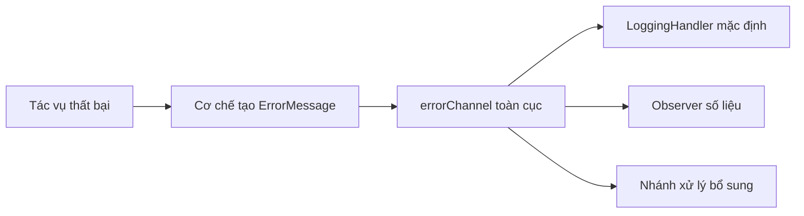

# PublishSubscribeChannel mặc định

## 1. Phạm vi và mục tiêu

Trong chương **Error handling** của module **SPRING_INTEGRATION_CORE**, chủ đề này nói về **channel lỗi toàn cục có tên bean là `errorChannel`**. Khi ứng dụng bật hạ tầng Spring Integration và chưa cung cấp bean mang tên đó, framework tạo một `PublishSubscribeChannel` cùng subscriber ghi log.

Bài học giúp bạn:

- Nhận diện cấu hình mặc định của `errorChannel`.
- Giải thích vì sao nhiều subscriber có thể cùng quan sát một lỗi.
- Phân biệt lỗi phát thành message với exception lan về caller.
- Lấy thông tin request thất bại từ `ErrorMessage`.
- Bổ sung observer và kiểm thử cơ chế broadcast mà vẫn giữ hạ tầng mặc định.

Các ví dụ dùng Java 17, API Spring Integration 6.5 và JUnit Jupiter. Cần dependency `org.springframework.integration:spring-integration-core`; phần kiểm thử cần JUnit Jupiter. Chọn phiên bản dependency theo nền tảng Spring của dự án. Ví dụ dùng Spring context thuần, không cần broker hoặc dịch vụ bên ngoài.

## 2. “Mặc định” là cấu hình của bean errorChannel

Cần phân biệt hai việc:

1. Framework tự đăng ký channel lỗi toàn cục khi chưa có bean `errorChannel`.
2. Lập trình viên tự khởi tạo một đối tượng bằng `new PublishSubscribeChannel()`.

Hai trường hợp dùng cùng lớp nhưng không có đầy đủ cùng cấu hình:

| Đặc điểm trong Spring Integration 6.5 | `errorChannel` tự tạo | `new PublishSubscribeChannel()` |
| --- | --- | --- |
| Mục đích mặc định | Nhận các error message được chuyển về channel lỗi chung | Channel broadcast thông thường |
| `requireSubscribers` | `true` | `false` |
| `ignoreFailures` | `true` | `false` |
| Executor riêng để dispatch | Không được cung cấp trong cấu hình mặc định | Không được cung cấp |
| Subscriber ghi log tự động | Có, do hạ tầng đăng ký cùng channel | Không tự có chỉ vì gọi constructor |
| Tên bean đặc biệt | `errorChannel` | Chỉ có tên nếu được đăng ký thành bean |

Các giá trị của channel lỗi tự tạo được điều khiển bởi global properties, trong đó:

```properties
spring.integration.channels.error.requireSubscribers=true
spring.integration.channels.error.ignoreFailures=true
```

Đây là giá trị mặc định của phiên bản dùng trong bài, không phải hai dòng cấu hình bắt buộc phải thêm. Các giá trị được công bố trong [Global Properties](https://docs.spring.io/spring-integration/reference/6.5/configuration/global-properties.html). Constructor và các tùy chọn của lớp channel được mô tả trong [API PublishSubscribeChannel](https://docs.spring.io/spring-integration/docs/6.5.0/api/org/springframework/integration/channel/PublishSubscribeChannel.html).

Chỉ nhìn thấy kiểu `PublishSubscribeChannel` trong debugger chưa đủ để kết luận đó là channel lỗi toàn cục hoặc nó có đúng các giá trị trong cột mặc định. Cần xem tên bean, cách khởi tạo và các cấu hình đã ghi đè.

## 3. Vai trò của broadcast trong xử lý lỗi

Giả sử một tác vụ kiểm tra kho thất bại. Hệ thống có thể cần đồng thời:

- Ghi log để chẩn đoán.
- Cập nhật số liệu lỗi.
- Chuyển thông tin cần thiết sang một luồng xử lý nghiệp vụ.

Một channel publish-subscribe cho phép các subscriber cùng nhận sự kiện lỗi:



Đây là việc phân phối một error message đến nhiều subscriber. Nó không tự chia công việc giữa các subscriber như một nhóm consumer cạnh tranh và không tự chia payload thành các phần nhỏ.

Channel mặc định cũng không phải nơi lưu bền lỗi. Nó dispatch đến các subscriber đang đăng ký; không tự giữ một lịch sử để subscriber đăng ký muộn đọc lại. Nếu cần lưu lỗi để xử lý sau, phải thiết kế bước lưu trữ hoặc đệm riêng.

### 3.1. Subscriber LoggingHandler

Hạ tầng mặc định đăng ký `LoggingHandler` với mức log `ERROR`. Thứ tự xử lý của subscriber này là:

```java
Ordered.LOWEST_PRECEDENCE - 100
```

Giá trị `order` nhỏ hơn được ưu tiên trước giá trị lớn hơn. Khi muốn log mặc định chạy trước subscriber tùy chỉnh, subscriber bổ sung cần có thứ tự phù hợp, thường là giá trị số lớn hơn thứ tự của logger.

Cấu hình logger này được mô tả trong [Error Handling](https://docs.spring.io/spring-integration/reference/6.5/error-handling.html). Không diễn giải chữ “precedence” theo hướng số càng lớn thì càng chạy trước.

Ghi log thành công chỉ chứng minh một subscriber đã quan sát lỗi. Nó không chứng minh tác vụ đã được thử lại, dữ liệu đã được khôi phục hoặc caller đã nhận một kết quả nghiệp vụ.

### 3.2. Broadcast mặc định vẫn chạy trên thread đang publish lỗi

`PublishSubscribeChannel` không có executor riêng gọi các handler trên thread gửi message vào nó. Với channel lỗi mặc định, thread đó có thể là thread poller hoặc worker đang báo lỗi.

Ví dụ:

```text
Thread caller:
    gửi request vào workRequests
    tiếp tục công việc khác

Thread poller:
    nhận request
    gọi nghiệp vụ -> exception
    tạo và publish ErrorMessage
    chạy logger
    chạy các subscriber lỗi khác
```

Việc xử lý nghiệp vụ đã rời thread caller không làm các subscriber lỗi tự động chạy song song với nhau. Một observer lỗi gọi HTTP lâu có thể giữ thread đang báo lỗi và ảnh hưởng khả năng xử lý các tác vụ tiếp theo.

Không gọi `receive()` trên `PublishSubscribeChannel` để lấy lỗi. Đây là `SubscribableChannel`: muốn nhận message, phải đăng ký subscriber hoặc endpoint tiêu thụ tương ứng.

## 4. Lỗi nào đi vào channel toàn cục?

Channel chỉ nhận message được gửi đến nó. Nó không tự bắt mọi exception trong JVM.

### 4.1. DirectChannel: exception thường lan về người gửi

Khi caller gửi vào một `DirectChannel` và handler chạy trên cùng thread, lỗi thường lan qua call stack về caller. Một header `errorChannel` trên request không tự biến mọi lời gọi đồng bộ thành cơ chế publish lỗi.

```text
caller -> DirectChannel -> handler ném exception
   ^                          |
   +------ exception ---------+
```

Gateway có thể cung cấp cơ chế xử lý lỗi riêng theo cấu hình. Khi đọc một trường hợp cụ thể, cần xác định ai bắt exception và ai có trách nhiệm tạo error message.

### 4.2. Poller và executor do integration quản lý

Với một endpoint đọc `QueueChannel` bằng poller, caller đã đưa message vào queue trước khi handler chạy. Exception phát sinh trong tác vụ poller không thể quay ngược bằng một lệnh `throw` thông thường về lời gọi `send` đã kết thúc.

Hạ tầng xử lý lỗi của Spring Integration có thể bọc exception thành `ErrorMessage` rồi gửi nó đến channel lỗi đã chọn. `MessagePublishingErrorHandler` là một thành phần phục vụ cơ chế này; xem [API MessagePublishingErrorHandler](https://docs.spring.io/spring-integration/docs/6.5.0/api/org/springframework/integration/channel/MessagePublishingErrorHandler.html).

Một tác vụ tùy ý được đưa vào executor tự tạo không tự có đầy đủ cơ chế này chỉ vì trong ứng dụng tồn tại bean `errorChannel`. Cần nối error handler phù hợp với thành phần thực thi.

### 4.3. Header errorChannel và channel lỗi chung

Trong cơ chế xử lý lỗi mặc định có hỗ trợ thông tin request:

1. Nếu request thất bại cung cấp header `errorChannel` hợp lệ, error handler có thể dùng địa chỉ đó.
2. Nếu không có địa chỉ riêng, cơ chế xử lý lỗi dùng channel lỗi mặc định của nó; thông thường là bean toàn cục `errorChannel`.
3. Poller, adapter hoặc gateway có thể có cấu hình lỗi riêng, nên cần đối chiếu đúng thành phần.

Không có quy tắc rằng lỗi gửi đến channel riêng sẽ được gửi thêm một bản đến channel toàn cục. Nếu muốn tổng hợp cả hai nơi, phải nối thêm nhánh chuyển tiếp có chủ ý.

`replyChannel` là địa chỉ trả lời và `errorChannel` là địa chỉ báo lỗi. Cả hai là metadata liên quan đến request nhưng phục vụ những hợp đồng khác nhau.

## 5. Đọc ErrorMessage đúng lớp dữ liệu

`ErrorMessage` thuộc package `org.springframework.messaging.support` và mang payload kiểu `Throwable`. Payload thường là một `MessagingException` có thông tin message tại điểm thất bại:

```text
ErrorMessage
  headers: metadata của message lỗi
  payload: Throwable
      có thể là MessagingException
          failedMessage: message tại điểm lỗi
          cause: exception phía dưới
  originalMessage: message gốc nếu cơ chế tạo lỗi cung cấp
```

Không ép `error.getPayload()` thành đối tượng đơn hàng. Nó là exception, còn payload nghiệp vụ nằm trong message gốc hoặc message thất bại khi thông tin đó có sẵn.

Một hàm tiện ích để tìm request phục vụ quan sát:

```java
package example.errors;

import org.springframework.messaging.Message;
import org.springframework.messaging.MessagingException;
import org.springframework.messaging.support.ErrorMessage;

public final class ErrorInspection {

    private ErrorInspection() {
    }

    public static Message<?> messageAtFailure(ErrorMessage error) {
        Throwable current = error.getPayload();

        while (current != null) {
            if (current instanceof MessagingException messaging
                    && messaging.getFailedMessage() != null) {
                return messaging.getFailedMessage();
            }

            Throwable next = current.getCause();
            if (next == current) {
                break;
            }
            current = next;
        }

        return error.getOriginalMessage();
    }
}
```

Đây là chính sách quan sát đơn giản: ưu tiên message tại điểm thất bại, sau đó dùng `originalMessage` làm phương án dự phòng. Kết quả vẫn có thể là `null`, chẳng hạn khi tự tạo `ErrorMessage` chỉ từ một exception.

`failedMessage` và `originalMessage` không nhất thiết là cùng message. Một chuỗi transformer có thể đã thay đổi payload trước khi lỗi xảy ra. Trace ID cũng không được bảo đảm xuất hiện trên chính header của error message; khi cần hãy tìm trên request đã xác định và xử lý trường hợp thiếu.

Hợp đồng payload và tính tùy chọn của `originalMessage` được giải thích trong [API ErrorMessage](https://docs.spring.io/spring-framework/docs/6.2.x/javadoc-api/org/springframework/messaging/support/ErrorMessage.html).

## 6. Ví dụ: lỗi từ poller vào channel toàn cục

Luồng thực hành:

```text
workRequests: QueueChannel
    -> poller
    -> InventoryWorker.process(...)
    -> exception
    -> ErrorMessage
    -> errorChannel mặc định
          +-> LoggingHandler mặc định
          +-> observer của ví dụ
                  -> errorProbe: QueueChannel
```

`errorProbe` chỉ dùng làm điểm quan sát trong thực hành. Nó không phải channel lỗi toàn cục và không thay thế bean `errorChannel`.

Các public type sau được đặt trong những tệp Java riêng, cùng package `example.errors`.

### 6.1. Worker chủ động tạo lỗi

```java
package example.errors;

import org.springframework.integration.annotation.Poller;
import org.springframework.integration.annotation.ServiceActivator;

public class InventoryWorker {

    @ServiceActivator(
            inputChannel = "workRequests",
            poller = @Poller(
                    fixedDelay = "50",
                    maxMessagesPerPoll = "1"))
    public void process(String orderId) {
        fail(orderId);
    }

    @ServiceActivator(inputChannel = "syncRequests")
    public void processSynchronously(String orderId) {
        fail(orderId);
    }

    private void fail(String orderId) {
        throw new IllegalStateException(
                "Inventory unavailable for " + orderId);
    }
}
```

Hai endpoint gọi cùng một thao tác cố ý thất bại. `workRequests` dùng queue và poller; `syncRequests` dùng `DirectChannel` để đối chiếu cách lỗi đi về caller.

Các phương thức trả `void` vì bài tập chỉ quan sát lỗi, không tạo reply nghiệp vụ.

### 6.2. Đăng ký thêm subscriber, giữ nguyên errorChannel tự tạo

```java
package example.errors;

import org.springframework.beans.factory.annotation.Qualifier;
import org.springframework.context.annotation.Bean;
import org.springframework.context.annotation.Configuration;
import org.springframework.integration.annotation.ServiceActivator;
import org.springframework.integration.channel.DirectChannel;
import org.springframework.integration.channel.QueueChannel;
import org.springframework.integration.config.EnableIntegration;
import org.springframework.messaging.MessageDeliveryException;
import org.springframework.messaging.MessageHandler;
import org.springframework.messaging.support.ErrorMessage;

@Configuration
@EnableIntegration
public class DefaultErrorChannelConfig {

    @Bean
    public QueueChannel workRequests() {
        return new QueueChannel(10);
    }

    @Bean
    public DirectChannel syncRequests() {
        return new DirectChannel();
    }

    @Bean
    public QueueChannel errorProbe() {
        return new QueueChannel(10);
    }

    @Bean
    public InventoryWorker inventoryWorker() {
        return new InventoryWorker();
    }

    @Bean
    @ServiceActivator(inputChannel = "errorChannel")
    public MessageHandler captureErrors(
            @Qualifier("errorProbe") QueueChannel errorProbe) {

        return message -> {
            if (!(message instanceof ErrorMessage)) {
                throw new IllegalArgumentException(
                        "Expected an ErrorMessage");
            }

            if (!errorProbe.send(message, 0)) {
                throw new MessageDeliveryException(
                        message, "Error probe is full");
            }
        };
    }
}
```

Cấu hình này không khai báo bean `errorChannel`. `@EnableIntegration` bật hạ tầng, framework tạo channel lỗi chung và logger; bean `captureErrors` đăng ký thêm một subscriber vào channel đó.

Factory `captureErrors` trả một `MessageHandler`. Nó được gọi để tạo handler lúc khởi tạo context, còn lambda xử lý được gọi cho mỗi message lỗi.

Phép gửi sang probe dùng timeout bằng `0` để không chờ vô hạn khi queue đầy. Việc ném lỗi nếu probe đầy giúp trường hợp thất bại của observer có thể được quan sát qua cơ chế dispatch; với `ignoreFailures=true`, thất bại này không tự biến thành việc lưu lỗi thành công.

Trong ứng dụng thực tế, nhánh quan sát có thể ghi metric hoặc gửi một bản ghi lỗi đã chọn lọc sang hệ thống lưu trữ. Queue probe trong bài không có cơ chế lưu bền, retry hay cảnh báo tự động.

## 7. Kiểm thử cơ chế mặc định

Các test tạo context mới cho từng trường hợp và dùng phép nhận có thời hạn. Không cần `Thread.sleep` để đoán lúc poller đã chạy xong.

### 7.1. Lỗi poller trở thành ErrorMessage

```java
package example.errors;

import org.junit.jupiter.api.Test;
import org.springframework.context.annotation.AnnotationConfigApplicationContext;
import org.springframework.integration.channel.PublishSubscribeChannel;
import org.springframework.integration.channel.QueueChannel;
import org.springframework.messaging.Message;
import org.springframework.messaging.MessagingException;
import org.springframework.messaging.support.ErrorMessage;
import org.springframework.messaging.support.MessageBuilder;

import static org.junit.jupiter.api.Assertions.*;

class PollerErrorTest {

    @Test
    void publishesAnErrorForTheFailedRequest() {
        try (var context =
                     new AnnotationConfigApplicationContext(
                             DefaultErrorChannelConfig.class)) {

            assertInstanceOf(PublishSubscribeChannel.class,
                    context.getBean("errorChannel"));

            var input =
                    context.getBean("workRequests", QueueChannel.class);
            var probe =
                    context.getBean("errorProbe", QueueChannel.class);

            Message<String> request = MessageBuilder
                    .withPayload("ORD-100")
                    .setHeader("traceId", "TRACE-100")
                    .build();

            assertTrue(input.send(request, 1000));

            Message<?> observed = probe.receive(3000);
            ErrorMessage error =
                    assertInstanceOf(ErrorMessage.class, observed);
            assertInstanceOf(MessagingException.class,
                    error.getPayload());

            Message<?> failed =
                    ErrorInspection.messageAtFailure(error);
            assertNotNull(failed);
            assertEquals("ORD-100", failed.getPayload());
            assertEquals("TRACE-100",
                    failed.getHeaders().get("traceId"));
        }
    }
}
```

`input.send` thành công vì request đã được đưa vào queue. Kiểm thử sau đó quan sát một kết quả khác ở nhánh lỗi, chứng minh poller đã chạy và phát hiện thất bại.

Test đọc trace ID trên message thất bại. Nó không giả định error message tự sao chép mọi header nghiệp vụ.

### 7.2. Broadcast tiếp tục khi một observer thất bại

Để kiểm tra cả fan-out và `ignoreFailures=true`, test đăng ký thêm một handler cố ý thất bại ở thứ tự cao nhất và một observer ghi nhận message:

```java
package example.errors;

import java.util.concurrent.atomic.AtomicInteger;
import java.util.concurrent.atomic.AtomicReference;
import org.junit.jupiter.api.Test;
import org.springframework.context.annotation.AnnotationConfigApplicationContext;
import org.springframework.core.Ordered;
import org.springframework.integration.channel.PublishSubscribeChannel;
import org.springframework.integration.channel.QueueChannel;
import org.springframework.messaging.Message;
import org.springframework.messaging.MessageHandler;
import org.springframework.messaging.support.ErrorMessage;

import static org.junit.jupiter.api.Assertions.*;

class ErrorBroadcastTest {

    @Test
    void continuesBroadcastAfterAnObserverFails() {
        try (var context =
                     new AnnotationConfigApplicationContext(
                             DefaultErrorChannelConfig.class)) {

            var errors = context.getBean(
                    "errorChannel", PublishSubscribeChannel.class);
            var probe =
                    context.getBean("errorProbe", QueueChannel.class);

            var throwingObserver = new ThrowingObserver();
            var seen = new AtomicReference<Message<?>>();
            MessageHandler secondObserver = seen::set;

            assertTrue(errors.subscribe(throwingObserver));
            assertTrue(errors.subscribe(secondObserver));

            try {
                ErrorMessage error = new ErrorMessage(
                        new IllegalStateException("Demo failure"));

                assertTrue(errors.send(error));

                assertEquals(1, throwingObserver.calls.get());
                assertSame(error, seen.get());
                assertSame(error, probe.receive(1000));
            }
            finally {
                errors.unsubscribe(throwingObserver);
                errors.unsubscribe(secondObserver);
            }
        }
    }

    static class ThrowingObserver implements MessageHandler, Ordered {

        final AtomicInteger calls = new AtomicInteger();

        @Override
        public int getOrder() {
            return Ordered.HIGHEST_PRECEDENCE;
        }

        @Override
        public void handleMessage(Message<?> message) {
            calls.incrementAndGet();
            throw new IllegalStateException("Observer unavailable");
        }
    }
}
```

Handler ném lỗi chạy trước các observer khác. Việc probe và observer thứ hai vẫn nhận được message minh họa cấu hình `ignoreFailures=true` của channel lỗi tự tạo.

Đây là phép phát error message có chủ ý để kiểm tra channel, không phải ví dụ về framework tự bắt một exception. Test ở phần 7.1 mới kiểm tra đường tạo lỗi từ poller.

Các assertion `assertSame` phù hợp với cấu hình mặc định trong ví dụ, không bật sequence và không chuyển qua transport. Chúng không có nghĩa mọi topology broadcast đều giữ nguyên cùng một đối tượng Java.

### 7.3. DirectChannel không tự chuyển lỗi đồng bộ vào nhánh chung

```java
package example.errors;

import org.junit.jupiter.api.Test;
import org.springframework.context.annotation.AnnotationConfigApplicationContext;
import org.springframework.integration.channel.DirectChannel;
import org.springframework.integration.channel.QueueChannel;
import org.springframework.messaging.MessagingException;
import org.springframework.messaging.support.MessageBuilder;

import static org.junit.jupiter.api.Assertions.*;

class SynchronousErrorTest {

    @Test
    void throwsToTheCallerEvenWithAnErrorChannelHeader() {
        try (var context =
                     new AnnotationConfigApplicationContext(
                             DefaultErrorChannelConfig.class)) {

            var input =
                    context.getBean("syncRequests", DirectChannel.class);
            var probe =
                    context.getBean("errorProbe", QueueChannel.class);

            var request = MessageBuilder
                    .withPayload("ORD-SYNC")
                    .setErrorChannelName("errorChannel")
                    .build();

            assertThrows(MessagingException.class,
                    () -> input.send(request));
            assertNull(probe.receive(0));
        }
    }
}
```

Không có request nào được gửi vào queue công việc trong test này. Luồng lỗi đồng bộ đã kết thúc tại caller, nên kiểm tra probe ngay bằng `receive(0)` có ý nghĩa.

Nếu thay lời gọi trực tiếp bằng gateway có cấu hình error handling, kết quả có thể khác. Cần kiểm tra đúng ranh giới gọi, không suy rộng test này thành quy tắc rằng mọi gateway hoặc adapter đều xử lý giống nhau.

## 8. requireSubscribers và ignoreFailures giải quyết hai vấn đề khác nhau

### 8.1. requireSubscribers: có nơi nhận hay không?

Trong cấu hình mặc định của phiên bản dùng trong bài, `requireSubscribers=true` yêu cầu phải có subscriber khi dispatch. Khi không còn subscriber, chẳng hạn do các endpoint đã dừng trong quá trình shutdown, channel không âm thầm xem việc bỏ message lỗi là bình thường.

Hành vi này được áp dụng cho channel lỗi mặc định từ Spring Integration 5.4.3. Trong một số integration với nguồn ngoài, thất bại khi báo lỗi có thể ảnh hưởng đến callback, rollback hoặc negative acknowledgment; kết quả cụ thể phụ thuộc adapter và transaction.

Thuộc tính này không bảo đảm:

- Có đủ mọi observer mà nghiệp vụ mong đợi.
- Observer đã lưu dữ liệu thành công.
- Error message đã được lưu bền.
- Request thất bại sẽ tự được gửi lại.

Channel mặc định thường có logger đăng ký sẵn nên không cần tự thêm subscriber chỉ để thỏa điều kiện tối thiểu này. Tuy nhiên, logger đang tồn tại không thay cho một recovery handler cần thiết của nghiệp vụ.

### 8.2. ignoreFailures: một observer lỗi có chặn các observer khác không?

`ignoreFailures=true` của channel lỗi tự tạo cho phép dispatcher tiếp tục cố gắng gửi message đến các subscriber còn lại khi một handler ném exception. Cấu hình global dành cho hành vi này có từ Spring Integration 5.5.

Phân biệt hai lỗi:

```text
Lỗi gốc:
    tác vụ kiểm tra kho thất bại

Lỗi của subscriber:
    observer muốn ghi lỗi kho nhưng không kết nối được nơi lưu
```

`ignoreFailures` điều khiển cách dispatcher phản ứng với **lỗi của subscriber**. Nó không sửa lỗi kho và không tự thử lại việc ghi lỗi thất bại.

Với dispatcher đồng bộ có `ignoreFailures=false`, một subscriber ném exception có thể ngăn các handler phía sau nhận message. Nếu tự cấu hình channel hoặc thay global property, hãy xét lại cả thứ tự handler và cơ chế báo lỗi của observer. Các quy tắc này được mô tả trong [BroadcastingDispatcher](https://docs.spring.io/spring-integration/docs/6.5.0/api/org/springframework/integration/dispatcher/BroadcastingDispatcher.html).

### 8.3. Không dùng giá trị send làm chứng nhận phục hồi

Một lời gọi `errorChannel.send(error)` trả `true` không phải chứng nhận rằng mọi observer đã thành công. Trong cấu hình bỏ qua lỗi dispatch, một observer có thể thất bại trong khi những subscriber khác tiếp tục chạy.

Nếu một thao tác recovery bắt buộc phải hoàn tất, hãy có hợp đồng riêng để kiểm tra trạng thái hoàn thành hoặc lưu công việc phục hồi. Không dùng việc log hoặc broadcast đã trả về làm bằng chứng thay thế.

Khi cần thay global properties trong ứng dụng Spring thuần, một cơ chế được framework hỗ trợ là tài nguyên `META-INF/spring.integration.properties` trên classpath. Việc đổi những giá trị này là thay đổi chính sách vận hành; cần kiểm tra đúng cấu hình có hiệu lực của ứng dụng.

## 9. Bổ sung subscriber bằng DSL hoặc XML

Ví dụ Java ở phần 6 đã đăng ký một observer bằng `@ServiceActivator`. Có thể thể hiện nhánh tương đương bằng DSL:

```java
import org.springframework.context.annotation.Bean;
import org.springframework.integration.dsl.IntegrationFlow;

@Bean
public IntegrationFlow captureGlobalErrors() {
    return IntegrationFlow.from("errorChannel")
            .bridge(endpoint -> endpoint.sendTimeout(0))
            .channel("errorProbe")
            .get();
}
```

Đây là bean thay thế cho `captureErrors` trong cấu hình mẫu. Giữ bean `errorProbe` và các bean công việc, đồng thời bỏ phương thức `captureErrors` để tránh chuyển cùng một lỗi sang probe hai lần.

Channel lỗi toàn cục vẫn do framework tạo. Nhánh bridge chỉ là subscriber bổ sung. Timeout gửi bằng `0` giới hạn việc chờ ở queue probe; nếu gửi thất bại, cần quan sát lỗi của chính observer theo chính sách đã chọn.

Trong XML có namespace `int` của Spring Integration và đã bật hạ tầng tương ứng, có thể khai báo:

```xml
<int:channel id="errorProbe">
    <int:queue capacity="10"/>
</int:channel>

<int:bridge id="captureGlobalErrors"
            input-channel="errorChannel"
            output-channel="errorProbe"
            send-timeout="0"/>
```

Đây là phần cấu hình nhánh quan sát, không phải một tệp XML hoàn chỉnh. Nó thay thế các bean probe và subscriber tương ứng trong ví dụ Java; không khai báo lặp lại các bean cùng tên.

Điểm chung của ba cách là **đăng ký thêm consumer trên channel đã có**. Không cần tự khai báo lại `errorChannel` chỉ để thêm một observer.

## 10. Tự định nghĩa errorChannel là thay đổi cấu hình mặc định

Giả sử ứng dụng thêm:

```java
@Bean
public PublishSubscribeChannel errorChannel() {
    return new PublishSubscribeChannel();
}
```

Điều này cung cấp bean cùng tên với channel lỗi chung. Nó không đơn thuần thêm một subscriber. Constructor không tham số không bật sẵn `requireSubscribers` và `ignoreFailures` như cấu hình lỗi tự tạo.

Trong Spring Integration 6.5, việc đăng ký channel lỗi và logger mặc định nằm trong nhánh kiểm tra chưa có bean `errorChannel`. Khi ứng dụng đã cung cấp channel này, không nên giả định logger mặc định vẫn được tự thêm như trước. Có thể đối chiếu [mã khởi tạo hạ tầng 6.5.0](https://github.com/spring-projects/spring-integration/blob/v6.5.0/spring-integration-core/src/main/java/org/springframework/integration/config/DefaultConfiguringBeanFactoryPostProcessor.java).

Nếu chủ động cung cấp channel nhưng muốn giữ các hành vi quan trọng tương tự, có thể cấu hình tường minh:

```java
package example.errors;

import org.springframework.context.annotation.Bean;
import org.springframework.context.annotation.Configuration;
import org.springframework.core.Ordered;
import org.springframework.integration.annotation.ServiceActivator;
import org.springframework.integration.channel.PublishSubscribeChannel;
import org.springframework.integration.config.EnableIntegration;
import org.springframework.integration.handler.LoggingHandler;

@Configuration
@EnableIntegration
public class CustomErrorChannelConfig {

    @Bean
    public PublishSubscribeChannel errorChannel() {
        var channel = new PublishSubscribeChannel(true);
        channel.setIgnoreFailures(true);
        return channel;
    }

    @Bean
    @ServiceActivator(inputChannel = "errorChannel")
    public LoggingHandler explicitErrorLogger() {
        var logger = new LoggingHandler(LoggingHandler.Level.ERROR);
        logger.setOrder(Ordered.LOWEST_PRECEDENCE - 100);
        return logger;
    }
}
```

Đây là cấu hình tối thiểu cho một channel lỗi do ứng dụng sở hữu. Nó không tự mang theo worker hoặc probe của phần thực hành. Mục tiêu của ví dụ là chỉ ra những quyết định phải được thực hiện rõ ràng khi thay hạ tầng mặc định.

Nếu thay channel chung bằng `QueueChannel`, cơ chế cũng thay đổi: lỗi được đệm để consumer lấy bằng polling, và nhiều consumer cạnh tranh nhận message thay vì cùng nhận mọi lỗi. Cần thiết kế lại poller, dung lượng, khả năng lưu bền và quan sát. Đó là một lựa chọn topology khác, không phải cách giữ nguyên broadcast mặc định.

## 11. Những giới hạn cần đưa vào thiết kế luồng

### 11.1. Log không đồng nghĩa retry hoặc redelivery

Trong ví dụ queue, request đã được poller lấy ra trước khi handler thất bại. Chỉ gửi lỗi đến logger không tự đưa request trở lại queue.

Retry phải có chính sách riêng: lỗi nào được thử lại, số lần, khoảng chờ và đơn vị công việc. Redelivery từ broker hoặc nguồn ngoài còn phụ thuộc acknowledgment và transaction của adapter tương ứng.

Nếu hai subscriber cùng quyết định gửi lại request, một lần lỗi có thể gây nhiều lần thử lại. Vì vậy, nên chỉ định rõ thành phần chịu trách nhiệm phục hồi; các observer số liệu hoặc log chỉ quan sát theo hợp đồng của chúng.

### 11.2. Subscriber chậm vẫn ảnh hưởng thread báo lỗi

`ignoreFailures=true` giúp xử lý exception của observer; nó không giới hạn thời gian observer chạy. Một lời gọi treo không ném exception vẫn có thể giữ thread publish lỗi.

Nếu cần tách một nhánh quan sát chậm, có thể đặt queue hoặc executor ở nhánh đó. Khi làm vậy phải tiếp tục xác định sức chứa, cơ chế khi đầy và cách quan sát thất bại sau ranh giới bất đồng bộ. Channel lỗi mặc định không tự thực hiện các quyết định này.

### 11.3. Không tạo vòng lặp xử lý lỗi

Không gửi lại cùng một error message vào chính `errorChannel` từ subscriber đang nghe channel đó nếu không có điều kiện dừng. Trong dispatch đồng bộ, cách nối này có thể gây đệ quy; trong một topology bất đồng bộ, nó có thể tạo chuỗi sự kiện lỗi không kết thúc.

Lỗi xảy ra trong observer cần có cách xử lý phù hợp với vai trò của observer. Thêm một vòng gửi lại vào channel chung không tự tạo được một recovery policy.

### 11.4. Channel lỗi riêng không tự broadcast về channel chung

Ví dụ gửi request vào queue công việc nhưng chỉ định một channel lỗi riêng:

```java
QueueChannel privateErrors = new QueueChannel(10);

var request = MessageBuilder
        .withPayload("ORD-PRIVATE")
        .setErrorChannel(privateErrors)
        .build();

workRequests.send(request, 1000);
Message<?> failure = privateErrors.receive(3000);
```

Đoạn này dùng tham chiếu `workRequests` từ context mẫu và các import messaging tương ứng. Với cơ chế lỗi mặc định của poller trong ví dụ, địa chỉ riêng trên request dẫn lỗi đến `privateErrors`. Không nên mong probe của channel toàn cục nhận thêm một bản sao nếu chưa nối nhánh chuyển tiếp.

### 11.5. ErrorMessage không tự hoàn thành hợp đồng nghiệp vụ

Khi một dòng hàng sau splitter bị lỗi, việc logger ghi nhận exception không tự tạo một kết quả cho aggregator. Nhóm có thể vẫn thiếu phần tử.

Tương tự, một gateway chờ reply không tự nhận biên nhận chỉ vì một subscriber lỗi đã log thành công. Nếu nghiệp vụ cần một kết quả thất bại, hãy thiết kế message kết quả hoặc cơ chế trả lỗi tương ứng ở đúng ranh giới.

## 12. Các điểm kiểm tra khi không thấy lỗi như mong đợi

| Triệu chứng | Điểm cần kiểm tra |
| --- | --- |
| Caller nhận exception nhưng channel lỗi không có message | Handler có đang chạy đồng bộ qua DirectChannel không |
| Không còn log mặc định sau khi chỉnh cấu hình | Có tự cung cấp bean errorChannel và quên đăng ký logger không |
| Chỉ một nhánh nhận lỗi thay vì tất cả observer | Channel thực tế có bị đổi thành QueueChannel hoặc DirectChannel không |
| Observer khác vẫn chạy dù một observer lỗi | Có đang dùng ignoreFailures=true của channel lỗi mặc định không |
| Subscriber sau không chạy | Có cấu hình fail-fast, thứ tự handler hoặc observer bị treo không |
| Không nhận lỗi của request ở channel toàn cục | Request, poller hoặc adapter có chọn channel lỗi riêng không |
| Không tìm thấy trace ID trên ErrorMessage | Đã kiểm tra failedMessage hoặc originalMessage chưa |
| Log có lỗi nhưng dữ liệu không phục hồi | Đã có recovery handler, retry hoặc lưu công việc phục hồi chưa |
| Xử lý lỗi làm giảm tốc độ nhận công việc | Subscriber có thực hiện thao tác chậm trên thread báo lỗi không |
| Có message lỗi nhưng không gọi receive được | Channel là PubSub và cần đăng ký subscriber thay vì polling không |

Khi quan sát luồng, nên phân biệt số tác vụ thất bại, số error message được phát và số thao tác phục hồi hoàn tất. Broadcast đến nhiều observer có thể tạo nhiều bản ghi quan sát cho một lỗi gốc; đó không nhất thiết là nhiều lần nghiệp vụ thất bại.

## 13. Tài liệu đối chiếu

- [Error Handling](https://docs.spring.io/spring-integration/reference/6.5/error-handling.html): channel lỗi chung, logger và ranh giới thực thi.
- [Global Properties](https://docs.spring.io/spring-integration/reference/6.5/configuration/global-properties.html): giá trị requireSubscribers và ignoreFailures của channel lỗi tự tạo.
- [API PublishSubscribeChannel](https://docs.spring.io/spring-integration/docs/6.5.0/api/org/springframework/integration/channel/PublishSubscribeChannel.html): constructor và cấu hình dispatch.
- [BroadcastingDispatcher](https://docs.spring.io/spring-integration/docs/6.5.0/api/org/springframework/integration/dispatcher/BroadcastingDispatcher.html): broadcast và phản ứng khi subscriber thất bại.
- [API ErrorMessage](https://docs.spring.io/spring-framework/docs/6.2.x/javadoc-api/org/springframework/messaging/support/ErrorMessage.html): payload Throwable và thông tin message gốc.
- [MessagePublishingErrorHandler](https://docs.spring.io/spring-integration/docs/6.5.0/api/org/springframework/integration/channel/MessagePublishingErrorHandler.html): publish exception thành error message.
- [Mã đăng ký hạ tầng Spring Integration 6.5.0](https://github.com/spring-projects/spring-integration/blob/v6.5.0/spring-integration-core/src/main/java/org/springframework/integration/config/DefaultConfiguringBeanFactoryPostProcessor.java): điều kiện tự tạo errorChannel và logger.
