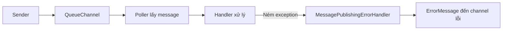
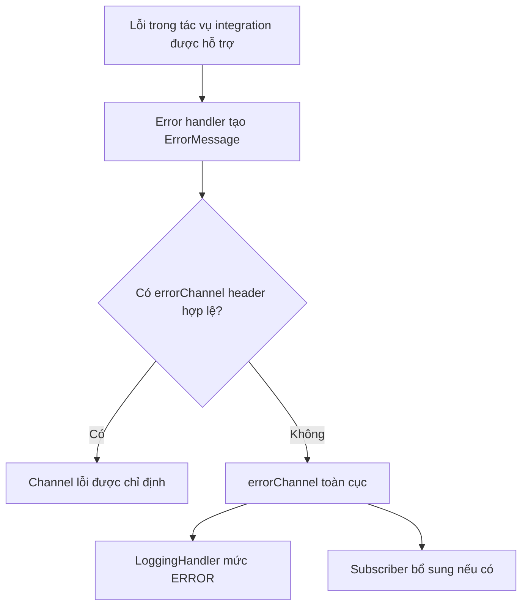

# Default error flow

## 1. Mục tiêu và phạm vi

Trong module **SPRING_INTEGRATION_CORE**, một luồng thông điệp có thể đi qua gateway, transformer, router, filter, aggregator và các endpoint gọi nghiệp vụ. Khi một bước thất bại, câu hỏi đầu tiên là: **lỗi còn có thể quay về call stack của bên gửi, hay phải được biểu diễn bằng một message riêng?**

Default error flow là đường xử lý lỗi do hạ tầng Spring Integration cung cấp khi ứng dụng chưa thay thế các thành phần mặc định liên quan. Trường hợp điển hình là một tác vụ polling thất bại, framework tạo `ErrorMessage`, gửi đến channel lỗi thích hợp, rồi subscriber mặc định ghi log.

Sau bài này, bạn có thể:

- Phân biệt exception đồng bộ và lỗi được phát qua messaging.
- Nhận diện vai trò của `errorChannel`, `MessagePublishingErrorHandler` và `LoggingHandler`.
- Đọc `ErrorMessage`, tìm nguyên nhân và message tại điểm thất bại.
- Quan sát hoặc mở rộng error flow mặc định mà không vô tình thay thế nó.
- Kiểm thử đường lỗi mặc định, đường lỗi riêng theo header và trường hợp lỗi trực tiếp về bên gửi.

Các ví dụ sử dụng Java 17 trở lên và Spring Integration 6.x; những giá trị mặc định được tham chiếu theo tài liệu dòng 6.5. Nếu ứng dụng đã tùy chỉnh channel lỗi, scheduler, adapter hoặc gateway, cần đối chiếu cấu hình thực tế trước khi áp dụng kết luận về mặc định.

## 2. Lỗi đồng bộ và lỗi trong tác vụ polling

### 2.1. Handler chạy trên thread gửi

Với một đường gọi chỉ dùng `DirectChannel` và các handler đồng bộ:

```text
sender → DirectChannel → handler → exception
   ↑___________________________________|
                exception theo call stack
```

Bên gửi vẫn đang ở trong lời gọi `send`, nên có thể nhận exception. Spring Integration thường bổ sung ngữ cảnh messaging hoặc bọc nguyên nhân trong một exception messaging. Chỉ có bean tên `errorChannel` trong context không khiến mọi exception của ứng dụng tự bị bắt và chuyển sang bean đó.

Đặc biệt, đặt header `errorChannel` vào message không tự thay đổi cơ chế gọi trực tiếp này. Phải có thành phần xử lý lỗi thực sự đọc header và phát message lỗi. Quy tắc phân biệt đường đồng bộ với tác vụ bất đồng bộ được mô tả trong [Error Handling](https://docs.spring.io/spring-integration/reference/6.5/error-handling.html).

### 2.2. Handler chạy sau khi message đã vào queue

Với queue được một polling consumer đọc:



Bên gửi có thể đã hoàn tất enqueue trước khi handler chạy. Exception phát sinh sau đó không thể nhảy ngược vào một lời gọi `send` đã kết thúc. Framework cần một đường quan sát lỗi riêng.

Trong ví dụ của bài, tác vụ polling sử dụng scheduler và cơ chế error handler của Spring Integration. Một thread hoặc `CompletableFuture` do ứng dụng tự tạo không mặc nhiên được tích hợp vào error flow này chỉ vì chạy nền.

### 2.3. Hai loại thất bại tại hai thời điểm

| Thời điểm | Ví dụ | Bên gửi có thể quan sát gì? |
| --- | --- | --- |
| Khi gửi vào queue | Queue đầy, hết thời gian chờ enqueue. | Kết quả gửi hoặc lỗi tại thao tác gửi, tùy API và channel. |
| Khi polling consumer xử lý | Gọi ERP thất bại sau khi đã lấy message. | Cần quan sát lỗi do tác vụ xử lý phát ra. |

Không dùng việc `send` trả `true` để kết luận đơn hàng đã được xử lý nghiệp vụ thành công.

## 3. Những thành phần tạo nên đường lỗi mặc định

Khi hạ tầng integration được bật và ứng dụng không cung cấp bean thay thế, framework đăng ký channel tên `errorChannel` cùng thành phần ghi log mặc định.



### 3.1. `MessagePublishingErrorHandler`

`MessagePublishingErrorHandler` triển khai giao diện `ErrorHandler`: nó nhận lỗi và thực hiện việc phát `ErrorMessage` đến một `MessageChannel`. Đây là thành phần chủ động biến lỗi của tác vụ thành tương tác messaging; channel không tự bắt exception từ mọi nơi. Xem [API của MessagePublishingErrorHandler](https://docs.spring.io/spring-integration/api/org/springframework/integration/channel/MessagePublishingErrorHandler.html).

Với cơ chế được dùng trong bài, header lỗi của message thất bại được xét để chọn đích; nếu không có địa chỉ riêng phù hợp thì dùng đích mặc định, thông thường là `errorChannel` toàn cục. Khi tác vụ không gắn được một failed message, cũng có thể không có header nghiệp vụ để phân giải.

### 3.2. `errorChannel` toàn cục

Channel mặc định là `PublishSubscribeChannel`, cho phép nhiều subscriber quan sát cùng một message lỗi. Nó không phải một queue lưu lỗi để ứng dụng gọi `receive()` về sau.

Trong cấu hình mặc định này, channel không có executor riêng. Subscriber được gọi trên thread đang phát message lỗi, thường là thread của tác vụ polling trong ví dụ. Việc nghiệp vụ chạy nền không đồng nghĩa mọi subscriber lỗi đều chạy song song trên thread riêng.

Hành vi phân phối của publish-subscribe channel và vai trò của executor được mô tả trong [Configuring Message Channels](https://docs.spring.io/spring-integration/reference/6.5/channel/configuration.html).

### 3.3. `LoggingHandler` mặc định

Framework gắn một subscriber ghi log mức `ERROR`. Trong dòng phiên bản tham chiếu, handler này có thứ tự `Ordered.LOWEST_PRECEDENCE - 100`. Một subscriber bổ sung là thành phần độc lập, không thay thế logger chỉ vì cùng subscribe vào channel.

Ghi log thành công cho biết lỗi đã được quan sát ở đường ghi log. Nó chưa làm thao tác ERP thành công, chưa lưu lại đơn hàng để phát lại và chưa tạo một phản hồi nghiệp vụ cho người gọi.

Việc tạo channel và logger mặc định nằm trong [DefaultConfiguringBeanFactoryPostProcessor của Spring Integration 6.5](https://github.com/spring-projects/spring-integration/blob/6.5.x/spring-integration-core/src/main/java/org/springframework/integration/config/DefaultConfiguringBeanFactoryPostProcessor.java).

### 3.4. Điều kiện có subscriber và lỗi của subscriber

Trong dòng 6.5, các global property liên quan có giá trị mặc định:

```properties
spring.integration.channels.error.requireSubscribers=true
spring.integration.channels.error.ignoreFailures=true
```

`requireSubscribers` ngăn việc im lặng coi message lỗi là đã được phân phối khi không có subscriber. `ignoreFailures` cho phép dispatcher của channel lỗi tiếp tục với subscriber tiếp theo khi một subscriber thất bại theo chính sách này. Hai tùy chọn giải quyết hai tình huống khác nhau; chúng không bảo đảm một hệ thống nhận lỗi bên ngoài luôn hoạt động.

Đây là cấu hình của channel lỗi toàn cục mặc định, không phải mặc định suy ra cho mọi `PublishSubscribeChannel` do ứng dụng tự tạo. Xem [Global Properties](https://docs.spring.io/spring-integration/reference/6.5/configuration/global-properties.html).

## 4. Đọc đúng cấu trúc `ErrorMessage`

`ErrorMessage` là một message có payload kiểu `Throwable`:

```text
ErrorMessage
├── payload: Throwable
│   └── thường là MessagingException
│       ├── failedMessage: message tại điểm thất bại, nếu có
│       └── cause: nguyên nhân bên trong
├── headers: header của message lỗi
└── originalMessage: ngữ cảnh ban đầu được cung cấp, nếu có
```

`ErrorMessage` không phải chính exception: nó là lớp vỏ messaging chứa exception. Trong service activator nhận `Throwable`, tham số thường là payload lỗi; khi nhận `ErrorMessage`, mã có thể truy cập cả envelope và ngữ cảnh kèm theo. Xem [Javadoc của ErrorMessage](https://docs.spring.io/spring-framework/docs/6.2.x/javadoc-api/org/springframework/messaging/support/ErrorMessage.html).

### 4.1. `failedMessage` và `originalMessage` không phải một khái niệm

| Dữ liệu | Ý nghĩa | Có luôn tồn tại không? |
| --- | --- | --- |
| `error.getPayload()` | Exception được chứa trong message lỗi. | Payload của một `ErrorMessage` hợp lệ không là `null`. |
| `MessagingException.getFailedMessage()` | Message gắn với exception tại điểm thất bại. | Có thể `null`. |
| `error.getOriginalMessage()` | Message ngữ cảnh được cung cấp khi tạo envelope lỗi. | Có thể `null`. |
| Root cause | Nguyên nhân sâu hơn trong chuỗi exception. | Không nhất thiết có `cause` lồng bên trong. |

Ví dụ, một request dạng chuỗi được transformer chuyển thành `OrderCommand`, rồi service activator thất bại. Message tại điểm thất bại có thể mang `OrderCommand`; nếu strategy có giữ ngữ cảnh ban đầu thì `originalMessage` có thể phản ánh một điểm trước đó. Không tự giả định hai message này giống nhau hoặc luôn được điền đầy đủ.

API `getFailedMessage()` cho phép giá trị không có message; xem [MessagingException](https://docs.spring.io/spring-framework/docs/6.2.x/javadoc-api/org/springframework/messaging/MessagingException.html).

### 4.2. Đọc ngữ cảnh với kiểm tra kiểu và giá trị rỗng

Một hàm tiện ích trong lớp xử lý lỗi có thể tìm message thất bại trong chuỗi nguyên nhân:

```java
static Message<?> findFailedMessage(Throwable failure) {
    Throwable current = failure;
    while (current != null) {
        if (current instanceof MessagingException messagingFailure
                && messagingFailure.getFailedMessage() != null) {
            return messagingFailure.getFailedMessage();
        }
        current = current.getCause();
    }
    return null;
}
```

Đoạn này dùng `Message` và `MessagingException` thuộc `org.springframework.messaging`. Nếu không tìm được failed message, có thể xem `originalMessage` như nguồn ngữ cảnh bổ sung, đồng thời giữ rõ nguồn gốc của dữ liệu đó.

Đừng giả định `traceId` của request nằm ngay trong `error.getHeaders()`. Khi cần truy vết lỗi đơn hàng, hãy lấy metadata từ message nghiệp vụ được xác định phù hợp. ID của envelope lỗi có vai trò khác ID của message đang thất bại.

## 5. Ví dụ Java: giữ nguyên error flow mặc định

### 5.1. Môi trường

Dự án cần `org.springframework.integration:spring-integration-core`; phần kiểm thử dùng JUnit Jupiter. Quản lý phiên bản Spring đồng bộ bằng BOM hoặc cơ chế dependency của dự án.

Trong dự án đã có Spring Boot parent hoặc BOM phù hợp, có thể dùng:

```xml
<dependency>
    <groupId>org.springframework.boot</groupId>
    <artifactId>spring-boot-starter-integration</artifactId>
</dependency>
<dependency>
    <groupId>org.springframework.boot</groupId>
    <artifactId>spring-boot-starter-test</artifactId>
    <scope>test</scope>
</dependency>
```

Đây là phần dependency để ghép vào dự án đã quản lý phiên bản. Ví dụ tự mở application context và không cần một ERP thật.

### 5.2. Dịch vụ cố ý thất bại để quan sát lỗi

File minh họa `UnavailableOrderService.java`:

```java
package example.integration.errors;

public class UnavailableOrderService {

    public void process(String orderId) {
        throw new IllegalStateException("ERP unavailable for order " + orderId);
    }
}
```

Đây là dịch vụ giả lập cho bài học. Mỗi lần gọi đều thất bại để ta đối chiếu chính xác đường lỗi của cùng một thao tác.

### 5.3. Hai input channel, cùng dịch vụ xử lý

File minh họa `DefaultErrorFlowConfiguration.java`:

```java
package example.integration.errors;

import org.springframework.context.annotation.Bean;
import org.springframework.context.annotation.Configuration;
import org.springframework.integration.annotation.Poller;
import org.springframework.integration.annotation.ServiceActivator;
import org.springframework.integration.channel.DirectChannel;
import org.springframework.integration.channel.QueueChannel;
import org.springframework.integration.config.EnableIntegration;
import org.springframework.messaging.MessageChannel;
import org.springframework.messaging.PollableChannel;

@Configuration(proxyBeanMethods = false)
@EnableIntegration
public class DefaultErrorFlowConfiguration {

    @Bean
    public MessageChannel ordersDirect() {
        return new DirectChannel();
    }

    @Bean
    public PollableChannel ordersQueued() {
        return new QueueChannel(10);
    }

    @Bean
    public UnavailableOrderService orderService() {
        return new UnavailableOrderService();
    }

    @Bean
    public OrderEndpoints orderEndpoints(UnavailableOrderService service) {
        return new OrderEndpoints(service);
    }

    public static class OrderEndpoints {

        private final UnavailableOrderService service;

        public OrderEndpoints(UnavailableOrderService service) {
            this.service = service;
        }

        @ServiceActivator(inputChannel = "ordersDirect")
        public void processDirect(String orderId) {
            service.process(orderId);
        }

        @ServiceActivator(
                inputChannel = "ordersQueued",
                poller = @Poller(
                        fixedDelay = "50",
                        maxMessagesPerPoll = "1",
                        receiveTimeout = "0"))
        public void processQueued(String orderId) {
            service.process(orderId);
        }
    }
}
```

Cấu hình không khai báo bean `errorChannel`, không đặt error channel riêng trên poller và không có header lỗi riêng. Vì vậy lỗi xử lý queue sẽ đi theo đường mặc định của framework.

Poller đọc tối đa một message trong mỗi lần polling; `receiveTimeout = "0"` tránh chờ khi queue rỗng. Cách cấu hình poller nằm trong [Annotation Support](https://docs.spring.io/spring-integration/reference/6.5/configuration/annotations.html).

## 6. Quan sát lỗi mà không thay thế channel mặc định

File minh họa `DefaultErrorFlowDemo.java`:

```java
package example.integration.errors;

import java.util.concurrent.BlockingQueue;
import java.util.concurrent.LinkedBlockingQueue;
import java.util.concurrent.TimeUnit;
import org.springframework.context.annotation.AnnotationConfigApplicationContext;
import org.springframework.integration.channel.PublishSubscribeChannel;
import org.springframework.messaging.Message;
import org.springframework.messaging.MessageHandler;
import org.springframework.messaging.MessagingException;
import org.springframework.messaging.PollableChannel;
import org.springframework.messaging.support.ErrorMessage;
import org.springframework.messaging.support.MessageBuilder;

public class DefaultErrorFlowDemo {

    public static void main(String[] args) throws InterruptedException {
        try (var context = new AnnotationConfigApplicationContext(
                DefaultErrorFlowConfiguration.class)) {

            PublishSubscribeChannel errors = context.getBean(
                    "errorChannel", PublishSubscribeChannel.class);
            PollableChannel orders = context.getBean(
                    "ordersQueued", PollableChannel.class);

            BlockingQueue<ErrorMessage> observed = new LinkedBlockingQueue<>();
            MessageHandler observer = message -> {
                if (message instanceof ErrorMessage error) {
                    observed.offer(error);
                }
            };

            errors.subscribe(observer);
            try {
                Message<String> request = MessageBuilder
                        .withPayload("OD-42")
                        .setHeader("traceId", "trace-order-42")
                        .build();

                if (!orders.send(request, 1000)) {
                    throw new IllegalStateException("Could not enqueue order");
                }

                ErrorMessage error = observed.poll(3, TimeUnit.SECONDS);
                if (error == null) {
                    throw new IllegalStateException("No error message observed");
                }

                System.out.println(error.getPayload().getClass().getName());
                if (error.getPayload() instanceof MessagingException failure) {
                    Message<?> failed = failure.getFailedMessage();
                    if (failed != null) {
                        System.out.println(failed.getPayload());
                        System.out.println(failed.getHeaders().get("traceId"));
                    }
                }
            }
            finally {
                errors.unsubscribe(observer);
            }
        }
    }
}
```

Observer được đăng ký **trước khi gửi** để không bỏ lỡ message lỗi. Logger mặc định vẫn là subscriber khác của cùng channel. Queue `observed` là công cụ quan sát trong demo, không phải cơ chế lưu trữ lỗi bền vững.

Điều cần quan sát:

1. Lệnh gửi vào `ordersQueued` được chấp nhận.
2. Dịch vụ xử lý thất bại trong tác vụ polling.
3. Đường mặc định phát một `ErrorMessage` đến `errorChannel` và logger ghi lỗi nếu cấu hình logging cho phép mức `ERROR`.
4. Observer nhận exception messaging; message thất bại chứa payload `OD-42` và header `trace-order-42`.

Tên lớp wrapper và định dạng log có thể phụ thuộc điểm xử lý và phiên bản. Hợp đồng quan trọng là giữ được nguyên nhân cùng ngữ cảnh phù hợp, không phải khớp từng dòng stack trace.

## 7. `errorChannel` header thay đổi đích nhận lỗi như thế nào?

Với `ordersQueued` trong cấu hình trên, có thể đặt một channel lỗi riêng cho một request:

```java
QueueChannel localErrors = new QueueChannel(1);

Message<String> request = MessageBuilder
        .withPayload("OD-42")
        .setHeader("traceId", "trace-order-42")
        .setErrorChannel(localErrors)
        .build();

orders.send(request, 1000);
Message<?> error = localErrors.receive(3000);
```

Đoạn này giả định `orders` là bean `ordersQueued`; cần import `QueueChannel`, `Message` và `MessageBuilder`. Channel được đặt trực tiếp trong header nên không cần đăng ký nó làm bean trong ví dụ.

Có thể dùng tên bean qua `.setErrorChannelName("orderErrors")` nếu channel đó được đăng ký và resolver phân giải được. Header chuẩn trong Java là `errorChannel`, có hằng `MessageHeaders.ERROR_CHANNEL`.

Các điểm cần phân biệt:

- Header chọn một đích lỗi riêng, không tự phát một bản sao tới global `errorChannel`.
- Logger mặc định trên global channel không tự nhận lỗi đã được chuyển riêng sang `localErrors`.
- Nếu channel riêng hỏng hoặc không thể nhận, không coi global channel như cơ chế cứu hộ tự động bảo đảm nhận lại mọi lỗi.
- Nếu thay `orders` bằng `ordersDirect`, header đó vẫn không biến exception đồng bộ thành publication tự động.

Thứ tự phân giải header và đích mặc định của thành phần dùng trong ví dụ thể hiện trong [MessagePublishingErrorHandler của dòng 6.5](https://github.com/spring-projects/spring-integration/blob/6.5.x/spring-integration-core/src/main/java/org/springframework/integration/channel/MessagePublishingErrorHandler.java).

Muốn vừa xử lý riêng vừa quan sát tập trung, hãy thiết kế một đường chuyển tiếp hoặc publish-subscribe rõ ràng. Tránh gửi message lỗi trở lại cùng đầu vào lỗi theo một chu trình không có điểm kết thúc.

## 8. Biểu diễn cùng ví dụ bằng XML

Có thể giữ `UnavailableOrderService` và sử dụng XML sau thay cho `DefaultErrorFlowConfiguration`:

```xml
<?xml version="1.0" encoding="UTF-8"?>
<beans xmlns="http://www.springframework.org/schema/beans"
       xmlns:xsi="http://www.w3.org/2001/XMLSchema-instance"
       xmlns:int="http://www.springframework.org/schema/integration"
       xsi:schemaLocation="
         http://www.springframework.org/schema/beans
         https://www.springframework.org/schema/beans/spring-beans.xsd
         http://www.springframework.org/schema/integration
         https://www.springframework.org/schema/integration/spring-integration.xsd">

    <int:channel id="ordersDirect"/>

    <int:channel id="ordersQueued">
        <int:queue capacity="10"/>
    </int:channel>

    <bean id="orderService"
          class="example.integration.errors.UnavailableOrderService"/>

    <int:service-activator id="directOrderEndpoint"
                           input-channel="ordersDirect"
                           ref="orderService"
                           method="process"/>

    <int:service-activator id="queuedOrderEndpoint"
                           input-channel="ordersQueued"
                           ref="orderService"
                           method="process">
        <int:poller fixed-delay="50"
                    max-messages-per-poll="1"
                    receive-timeout="0"/>
    </int:service-activator>
</beans>
```

Lưu ví dụ vào classpath, chẳng hạn `integration/default-errors.xml`, rồi mở bằng `ClassPathXmlApplicationContext("integration/default-errors.xml")`. XML không khai báo một `errorChannel` khác, nên vẫn sử dụng hạ tầng mặc định do integration namespace đăng ký.

Chỉ nạp Java config hoặc XML của ví dụ này vào một context. Nếu nạp cả hai, các bean có thể trùng và các consumer có thể cạnh tranh nhận message.

## 9. Mở rộng subscriber và thay thế channel là hai việc khác nhau

### 9.1. Thêm một subscriber quan sát

Có thể tạo bean chứa phương thức:

```java
@ServiceActivator(inputChannel = "errorChannel")
public void observeFailure(ErrorMessage error) {
    Throwable failure = error.getPayload();
    // Trích xuất ngữ cảnh cần thiết, cập nhật thống kê hoặc chuyển tiếp có chủ đích.
}
```

Đây là phương thức đặt trong một Spring bean với hạ tầng integration đang bật. Nó không tạo lại channel; logger mặc định vẫn tồn tại trong cấu hình gốc. Observer cần có chính sách rõ cho tác vụ chậm và lỗi của chính nó vì nó có thể chạy trên thread đang báo lỗi.

Nếu muốn khai báo một observer bằng Java DSL, có thể thêm flow sau trong một lớp cấu hình đang bật integration:

```java
@Bean
public IntegrationFlow errorObservationFlow() {
    return IntegrationFlow.from("errorChannel")
            .handle(Throwable.class, (failure, headers) -> {
                System.err.println("Observed error type: "
                        + failure.getClass().getName());
                return null;
            })
            .get();
}
```

Cần import `IntegrationFlow` thuộc `org.springframework.integration.dsl` và `Bean` thuộc `org.springframework.context.annotation`. `Throwable` ở lambda là payload lỗi; `headers` là header của envelope lỗi. Muốn đọc failed message, cần xem exception hoặc nhận toàn bộ envelope theo chữ ký phù hợp.

Flow minh họa kết thúc sau khi quan sát; nó không tạo một business reply. Việc trả `null` trong service-activator-style handler terminal ở đây không phải quy tắc cho transformer: transformer có hợp đồng trả kết quả khác `null`.

### 9.2. Khai báo bean tên `errorChannel`

Ví dụ sau là **thay thế cấu hình mặc định**:

```java
@Bean
public QueueChannel errorChannel() {
    return new QueueChannel(100);
}
```

Lúc này channel lỗi là queue. Ứng dụng phải thiết kế cách đọc queue, giới hạn bộ đệm, điều kiện lỗi khi gửi và việc lưu trữ. Không giả định logger pub-sub mặc định vẫn được framework gắn vào channel do ứng dụng khai báo.

Trong cơ chế đăng ký của dòng 6.5, việc tạo logger mặc định nằm cùng nhánh tạo error channel mặc định khi chưa có bean thay thế. Vì vậy, nếu mục đích chỉ là thêm thống kê hoặc quan sát, thêm subscriber thường trực tiếp hơn thay toàn bộ channel.

Nếu cần lưu lỗi bền vững, một queue trong bộ nhớ chưa đủ. Cần một nơi lưu hoặc transport phù hợp và một hợp đồng về dữ liệu được lưu, quyền phát lại và trạng thái xử lý.

## 10. Những việc default error flow chưa tự quyết định

| Mong muốn của ứng dụng | Hành vi cần thiết kế thêm |
| --- | --- |
| Tự thử lại thao tác thất bại | Retry policy, số lần thử và điều kiện retry. |
| Bảo đảm message không mất sau khi lấy khỏi queue | Lưu trữ, giao dịch, acknowledgment hoặc cơ chế phục hồi phù hợp nguồn. |
| Phát lại đơn hàng sau khi ERP phục hồi | Nơi giữ message, điều kiện phát lại và chống xử lý trùng. |
| Trả phản hồi lỗi có cấu trúc cho caller | Hợp đồng gateway/reply và phép chuyển đổi lỗi thành dữ liệu phản hồi. |
| Chuyển lỗi không xử lý được đến DLQ | Đường chuyển tiếp, schema dữ liệu và chính sách vận hành của DLQ. |
| Phân loại lỗi nghiệp vụ và lỗi hạ tầng | Router hoặc logic phân loại dựa trên exception/ngữ cảnh. |
| Bù trừ một tác dụng phụ đã thành công trước đó | Quy tắc nghiệp vụ bù trừ và trạng thái liên quan. |

Default logging không phải một lần retry. Nó cũng không có nghĩa message đã được đưa lại vào queue nguồn. Với ví dụ dùng queue bộ nhớ và không có transaction/recovery, cần coi việc xử lý failed message là một trách nhiệm chưa được hoàn tất chỉ bằng dòng log.

Gateway có cơ chế truyền lỗi và cấu hình error channel riêng. Một request-reply gateway có thể vẫn truyền exception về caller dù đoạn xử lý có ranh giới bất đồng bộ, vì gateway quản lý tương tác trả lời. Không áp dụng máy móc kết luận của lệnh enqueue trực tiếp cho mọi lời gọi gateway. Xem [Messaging Gateways — Error Handling](https://docs.spring.io/spring-integration/reference/6.5/gateway.html).

Trong luồng có transformer, router, filter và aggregator, cũng cần tách lỗi khỏi các kết quả được cấu hình hợp lệ: filter loại message hoặc aggregator chưa đủ điều kiện release không mặc nhiên là exception để default error flow ghi nhận.

## 11. Kiểm thử đường lỗi mặc định và các ranh giới

Các đoạn dưới đây là mã kiểm thử minh họa để đưa vào dự án. Chúng quan sát message thực tế, không chỉ tìm một dòng chữ trong log.

File minh họa `DefaultErrorFlowTest.java`:

```java
package example.integration.errors;

import java.util.concurrent.BlockingQueue;
import java.util.concurrent.LinkedBlockingQueue;
import java.util.concurrent.TimeUnit;
import org.junit.jupiter.api.Test;
import org.springframework.context.annotation.AnnotationConfigApplicationContext;
import org.springframework.integration.channel.PublishSubscribeChannel;
import org.springframework.integration.channel.QueueChannel;
import org.springframework.messaging.Message;
import org.springframework.messaging.MessageChannel;
import org.springframework.messaging.MessageHandler;
import org.springframework.messaging.MessagingException;
import org.springframework.messaging.PollableChannel;
import org.springframework.messaging.support.ErrorMessage;
import org.springframework.messaging.support.MessageBuilder;
import static org.junit.jupiter.api.Assertions.*;

class DefaultErrorFlowTest {

    @Test
    void polledFailureReachesDefaultGlobalErrorChannel()
            throws InterruptedException {
        try (var context = openContext();
             var capture = captureDefaultErrors(context)) {

            PollableChannel input = context.getBean(
                    "ordersQueued", PollableChannel.class);
            Message<String> request = request();

            assertTrue(input.send(request, 1000));
            ErrorMessage error = capture.poll(3000);

            assertNotNull(error);
            MessagingException failure = assertInstanceOf(
                    MessagingException.class, error.getPayload());
            assertInstanceOf(IllegalStateException.class, rootCause(failure));

            Message<?> failed = failure.getFailedMessage();
            assertNotNull(failed);
            assertEquals("OD-42", failed.getPayload());
            assertEquals("trace-order-42", failed.getHeaders().get("traceId"));
        }
    }

    @Test
    void errorHeaderSelectsLocalChannelInsteadOfGlobalChannel()
            throws InterruptedException {
        try (var context = openContext();
             var capture = captureDefaultErrors(context)) {

            PollableChannel input = context.getBean(
                    "ordersQueued", PollableChannel.class);
            QueueChannel localErrors = new QueueChannel(1);
            Message<String> request = MessageBuilder.fromMessage(request())
                    .setErrorChannel(localErrors)
                    .build();

            assertTrue(input.send(request, 1000));
            ErrorMessage error = assertInstanceOf(
                    ErrorMessage.class, localErrors.receive(3000));

            assertInstanceOf(IllegalStateException.class,
                    rootCause(error.getPayload()));
            assertNull(capture.poll(0));
        }
    }

    @Test
    void directFailureIsThrownEvenWhenErrorHeaderExists()
            throws InterruptedException {
        try (var context = openContext();
             var capture = captureDefaultErrors(context)) {

            MessageChannel input = context.getBean(
                    "ordersDirect", MessageChannel.class);
            QueueChannel localErrors = new QueueChannel(1);
            Message<String> request = MessageBuilder.fromMessage(request())
                    .setErrorChannel(localErrors)
                    .build();

            MessagingException failure = assertThrows(MessagingException.class,
                    () -> input.send(request));

            assertInstanceOf(IllegalStateException.class, rootCause(failure));
            assertNull(localErrors.receive(0));
            assertNull(capture.poll(0));
        }
    }

    private static AnnotationConfigApplicationContext openContext() {
        return new AnnotationConfigApplicationContext(
                DefaultErrorFlowConfiguration.class);
    }

    private static ErrorCapture captureDefaultErrors(
            AnnotationConfigApplicationContext context) {
        return new ErrorCapture(context.getBean(
                "errorChannel", PublishSubscribeChannel.class));
    }

    private static Message<String> request() {
        return MessageBuilder.withPayload("OD-42")
                .setHeader("traceId", "trace-order-42")
                .build();
    }

    private static Throwable rootCause(Throwable error) {
        Throwable current = error;
        while (current.getCause() != null) {
            current = current.getCause();
        }
        return current;
    }

    private static final class ErrorCapture implements AutoCloseable {

        private final PublishSubscribeChannel channel;
        private final BlockingQueue<ErrorMessage> messages =
                new LinkedBlockingQueue<>();
        private final MessageHandler observer = message -> {
            if (message instanceof ErrorMessage error) {
                messages.offer(error);
            }
        };

        private ErrorCapture(PublishSubscribeChannel channel) {
            this.channel = channel;
            channel.subscribe(observer);
        }

        private ErrorMessage poll(long timeoutMillis) throws InterruptedException {
            return messages.poll(timeoutMillis, TimeUnit.MILLISECONDS);
        }

        @Override
        public void close() {
            channel.unsubscribe(observer);
        }
    }
}
```

Mỗi test mở context mới và gắn observer trước khi gửi. Try-with-resources tháo observer trước khi đóng context. Thời gian chờ hữu hạn trên queue quan sát tránh phụ thuộc vào một lệnh `Thread.sleep` cố định.

Ba test lần lượt kiểm tra:

1. Lỗi polling không có địa chỉ riêng đi đến global channel mặc định.
2. Header lỗi chọn channel riêng, không tự gửi bản sao về global channel.
3. Lỗi trên đường `DirectChannel` về caller qua exception dù message có header lỗi.

Logger mặc định có thể tạo log `ERROR` trong test đầu; đó là kết quả được mong đợi của tình huống cố ý thất bại. Các phép kiểm tra tập trung vào exception và message context, không phụ thuộc định dạng logging backend.

## 12. Chẩn đoán khi lỗi không xuất hiện ở nơi dự kiến

| Hiện tượng | Điều cần kiểm tra |
| --- | --- |
| `send` ném exception nhưng global observer không nhận | Đường xử lý có đang chạy trực tiếp trên thread gửi không? |
| Gửi queue thành công nhưng không thấy xử lý | Endpoint đã chạy, poller đã hoạt động và input channel có đúng tên không? |
| Global logger không ghi lỗi của một request | Message có `errorChannel` riêng hoặc poller/adapter có đường lỗi riêng không? |
| Không ép được bean `errorChannel` thành `PublishSubscribeChannel` | Ứng dụng có khai báo một channel khác cùng tên không? |
| Không tìm được `traceId` trong header lỗi | Metadata cần tìm có nằm trong failed message hoặc original message không? |
| `getFailedMessage()` hoặc `getOriginalMessage()` là `null` | Exception/strategy tại điểm tạo lỗi có cung cấp message đó không? |
| Lỗi tăng lên nhưng không có dữ liệu để phát lại | Hệ thống mới ghi log hay đã có một nơi lưu và hợp đồng phục hồi? |
| Error subscriber xử lý rất chậm | Nó có đang chặn thread phát lỗi và scheduler của luồng không? |
| Lỗi mới xuất hiện trong quá trình báo lỗi | Đích lỗi, subscriber, resolver hoặc hệ thống nhận lỗi có thất bại không? |
| Đóng context làm xuất hiện lỗi phân phối | Subscriber và endpoint đã dừng trong khi còn tác vụ đang phát lỗi không? |

Không sửa bằng cách gửi mọi lỗi về cùng channel theo một vòng lặp. Trước hết xác định tác vụ nào thất bại, error handler nào đang chạy và đích nào thực sự được chọn.

Một bản ghi quan sát hữu ích thường có loại lỗi, endpoint hoặc giai đoạn xử lý, thời điểm, định danh nghiệp vụ và trace/correlation ID nếu có. Chỉ lấy những trường cần thiết từ message thay vì phụ thuộc vào việc toàn bộ payload luôn có thể in hoặc lưu nguyên vẹn.

## 13. Bài thực hành

1. Chạy cùng một request qua `ordersDirect` và `ordersQueued`; ghi lại nơi exception được quan sát và ý nghĩa của `send` thành công.
2. Thêm một transformer trước dịch vụ xử lý. Xác định payload trong `failedMessage` phản ánh dữ liệu ở bước nào.
3. Đặt một channel lỗi riêng bằng tên bean, rồi so sánh với cách đặt trực tiếp một đối tượng channel vào header.
4. Thêm subscriber thống kê trên global `errorChannel` mà không thay bean channel. Xác nhận observer và logger vẫn có vai trò riêng.
5. Thay channel lỗi toàn cục bằng queue trong một cấu hình thử nghiệm riêng. Xác định consumer nào đọc queue và trách nhiệm nào trước đây do cấu hình mặc định cung cấp.
6. Thiết kế thêm một đường lưu lỗi cần xử lý lại, kèm khóa chống xử lý trùng. Phân biệt phần do default error flow cung cấp với phần phục hồi do ứng dụng bổ sung.

Hoàn thành bài khi bạn có thể lần theo một lỗi từ điểm phát sinh đến đích nhận, giải thích dữ liệu trong ErrorMessage và xác định rõ trách nhiệm phục hồi còn lại của ứng dụng.
