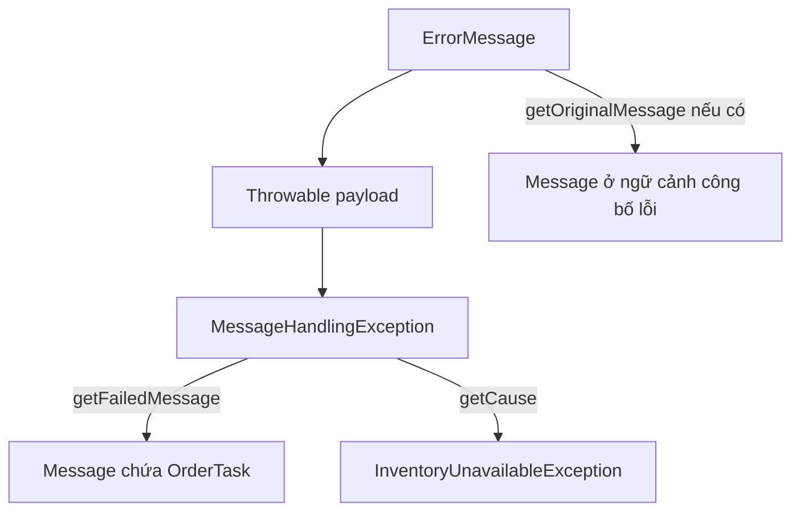

# Exception payload — đọc và xử lý dữ liệu lỗi trong Spring Integration

Trong chương **Error handling** của **SPRING_INTEGRATION_CORE**, exception payload là đối tượng lỗi được đặt vào payload của một thông điệp xử lý lỗi. Hiểu cấu trúc này giúp bạn tìm nguyên nhân, nhận diện thông điệp nghiệp vụ gặp sự cố và đưa lỗi sang nhánh xử lý thích hợp mà vẫn giữ được ngữ cảnh.

Bài học tập trung vào `ErrorMessage`, chuỗi nguyên nhân của `Throwable`, `MessagingException.getFailedMessage()` và `ErrorMessage.getOriginalMessage()`. Ví dụ kết nối channel, endpoint và poller để tạo một lỗi thực sự trong luồng, sau đó chuyển thông tin cần thiết thành một thông báo lỗi có cấu trúc để kiểm thử.

Các ví dụ dùng Java 17 và API Spring Integration 6.5.x làm mốc. Phần cấu hình cần `spring-integration-core` cùng các dependency Spring tương thích; phần kiểm thử dùng JUnit Jupiter. Các lớp Java được minh họa trong package `example.errors`, mỗi lớp public đặt trong tệp tương ứng khi thực hành. Không có ví dụ nào tự động retry hoặc phát lại tác vụ chỉ vì đã nhận được thông tin lỗi.

## 1. Khi payload không còn là dữ liệu nghiệp vụ

Trong nhánh nghiệp vụ, message có thể mang một tác vụ kiểm tra tồn kho:

```text
Message<OrderTask>
  headers: traceId = trace-73
  payload: OrderTask(orderId = OD-73)
```

Nếu endpoint xử lý tác vụ gặp sự cố và cơ chế xử lý lỗi công bố một `ErrorMessage`, payload ở nhánh lỗi có hình dạng khác:

```text
ErrorMessage
  headers: metadata của thông điệp lỗi
  payload: Throwable
    ví dụ MessageHandlingException
      failedMessage: Message<OrderTask>
      cause: InventoryUnavailableException
  originalMessage: có thể có hoặc không
```

`ErrorMessage` thuộc `org.springframework.messaging.support` và kế thừa `GenericMessage<Throwable>`. Payload được yêu cầu không null; kiểu bảo đảm ở API là `Throwable`, không phải luôn là `MessagingException`. [Hợp đồng của `ErrorMessage`](https://docs.spring.io/spring-framework/docs/6.2.x/javadoc-api/org/springframework/messaging/support/ErrorMessage.html).

Vì vậy, một error handler không thể mặc định ép `errorMessage.getPayload()` thành `OrderTask`. Nó đang nhận **lỗi**, còn tác vụ nghiệp vụ phải được tìm trong ngữ cảnh được giữ lại.

## 2. Bốn đối tượng cần phân biệt

| Đối tượng hoặc giá trị | Bạn lấy được gì? | Điều cần kiểm tra |
| --- | --- | --- |
| `errorMessage` | Envelope của nhánh xử lý lỗi | Headers ở đây thuộc message lỗi |
| `errorMessage.getPayload()` | Đối tượng `Throwable` được công bố | Có thể là wrapper hoặc lỗi không bọc |
| `messagingException.getFailedMessage()` | Message tại điểm lỗi mà exception giữ lại | Có thể null; exception có thể nằm sâu trong cause chain |
| `errorMessage.getOriginalMessage()` | Message ở ngữ cảnh tạo error message, nếu được cung cấp | Có thể null và có thể khác failed message |

`MessagingException` thuộc `org.springframework.messaging`, là lớp cơ sở cho nhiều lỗi messaging. Nó có constructor nhận message, nhưng cũng có constructor chỉ nhận mô tả hoặc nguyên nhân. Vì vậy, ngay cả khi đã xác nhận kiểu `MessagingException`, vẫn cần kiểm tra `getFailedMessage()` có giá trị hay không. [API của `MessagingException`](https://docs.spring.io/spring-framework/docs/6.2.x/javadoc-api/org/springframework/messaging/MessagingException.html).

### 2.1. Failed message là dữ liệu tại điểm gặp sự cố

Giả sử luồng nhận chuỗi JSON, transformer tạo `OrderTask`, rồi service activator kiểm tra tồn kho thất bại. Message được giữ ở điểm lỗi có thể mang `OrderTask`, trong khi message ở ngữ cảnh phía ngoài vẫn mang chuỗi JSON.

Nếu cần biết handler đang xử lý kiểu dữ liệu gì khi thất bại, failed message là nguồn thông tin phù hợp hơn việc mặc định đọc payload đầu vào ban đầu.

### 2.2. Original message phụ thuộc nơi công bố lỗi

Tên `originalMessage` không bảo đảm đó là request đầu tiên đi vào toàn bộ hệ thống. Nó là message gắn với ngữ cảnh nơi error message được tạo. `DefaultErrorMessageStrategy` chỉ đưa original message vào khi context có thuộc tính input message tương ứng; nếu không có, nó tạo error message chỉ với throwable. [Chiến lược tạo error message mặc định](https://docs.spring.io/spring-integration/docs/6.5.0/api/org/springframework/integration/support/DefaultErrorMessageStrategy.html).

Một luồng có nhiều tầng gateway, transformer hoặc adapter có thể giữ lại những mốc ngữ cảnh khác nhau. Hãy ghi rõ nguồn của message được dùng để chẩn đoán, thay vì đặt chung mọi trường hợp thành “request gốc”.

### 2.3. Headers của envelope lỗi không tự là headers nghiệp vụ

Khi đọc `traceId`, `orderId`, `replyChannel` hoặc các thông tin tương quan, cần xác định bạn đang đọc từ error envelope, failed message hay original message. Cách tạo error message có thể cung cấp headers riêng; không nên giả định các header nghiệp vụ luôn được sao chép sang envelope lỗi.

Trong ví dụ của bài, mã đơn và `traceId` được lấy tường minh từ message ngữ cảnh. Thông báo lỗi cũng ghi lại đã chọn nguồn `FAILED_MESSAGE`, `ORIGINAL_MESSAGE` hay `NONE`.

## 3. Wrapper và chuỗi nguyên nhân

Một lỗi có thể được bọc qua nhiều lớp:



Wrapper mô tả việc gì thất bại ở tầng messaging. Cause mô tả nguyên nhân được giữ lại ở tầng dưới. Cả hai đều có giá trị:

- `MessageHandlingException` cho biết lỗi xảy ra khi xử lý message và có thể giữ failed message.
- `InventoryUnavailableException` giúp nhận diện nhóm lỗi của ví dụ nghiệp vụ.
- Một cause sâu hơn nữa, nếu có, có thể là lỗi thư viện kết nối hoặc lỗi hạ tầng.

`Throwable.getMessage()` chỉ là chuỗi mô tả, còn `getCause()` là liên kết tới nguyên nhân. Java cũng có suppressed exceptions qua `getSuppressed()`, thường cần khi chẩn đoán việc đóng tài nguyên. Suppressed exceptions không phải các mắt xích của `getCause()`. [Cấu trúc và cơ chế exception chaining của Java](https://docs.oracle.com/en/java/javase/17/docs/api/java.base/java/lang/Throwable.html).

### Không giả định lỗi nghiệp vụ luôn ở `getCause()` đầu tiên

Đoạn sau có thể bỏ sót một lỗi được bọc thêm một tầng:

```java
boolean inventoryFailure =
        errorMessage.getPayload().getCause()
                instanceof InventoryUnavailableException;
```

Đồng thời, payload có thể không có cause. Cách đọc ổn định hơn là duyệt chuỗi nguyên nhân, giữ wrapper ngoài cùng và tìm loại lỗi cần quan tâm ở bất kỳ tầng nào được phép kiểm tra.

“Nguyên nhân sâu nhất” cũng không tự động là “nguyên nhân dùng để quyết định nghiệp vụ”. Chẳng hạn một exception nghiệp vụ có thể bọc lỗi I/O; quyết định xử lý có thể cần cả ý nghĩa nghiệp vụ lẫn loại sự cố hạ tầng.

## 4. Đọc exception payload bằng một hàm có hợp đồng rõ ràng

Ví dụ dưới đây tạo một snapshot để phân tích nội bộ. Nó giữ riêng exception payload, các cause đã duyệt, failed message và original message.

```java
package example.errors;

import java.util.List;

import org.springframework.messaging.Message;

public record FailureSnapshot(
        Throwable exceptionPayload,
        List<Throwable> causeChain,
        boolean causeChainComplete,
        Message<?> failedMessage,
        Message<?> originalMessage) {
}
```

Hàm phân tích:

```java
package example.errors;

import java.util.ArrayList;
import java.util.Collections;
import java.util.IdentityHashMap;
import java.util.List;
import java.util.Set;

import org.springframework.messaging.Message;
import org.springframework.messaging.MessagingException;
import org.springframework.messaging.support.ErrorMessage;

public final class ExceptionPayloads {

    private static final int MAX_CAUSES = 32;

    private ExceptionPayloads() {
    }

    public static FailureSnapshot inspect(ErrorMessage errorMessage) {
        List<Throwable> causes = new ArrayList<>();
        Set<Throwable> visited = Collections.newSetFromMap(
                new IdentityHashMap<>());

        Throwable current = errorMessage.getPayload();
        Message<?> failedMessage = null;

        while (current != null
                && causes.size() < MAX_CAUSES
                && visited.add(current)) {

            causes.add(current);

            if (failedMessage == null
                    && current instanceof MessagingException messaging
                    && messaging.getFailedMessage() != null) {
                failedMessage = messaging.getFailedMessage();
            }

            current = current.getCause();
        }

        return new FailureSnapshot(
                errorMessage.getPayload(),
                List.copyOf(causes),
                current == null,
                failedMessage,
                errorMessage.getOriginalMessage());
    }
}
```

Đây là **chính sách phân tích của ví dụ**, không phải một quy tắc bắt buộc của framework:

1. Giữ nguyên đối tượng throwable ngoài cùng để còn ngữ cảnh wrapper.
2. Tìm failed message đầu tiên có giá trị khi duyệt từ ngoài vào trong.
3. Giữ original message độc lập, không thay tên nó thành failed message.
4. Dừng khi gặp lại cùng một đối tượng hoặc khi đã duyệt 32 tầng.
5. Chỉ đánh dấu `causeChainComplete = true` khi đã đi tới cause null.

Nếu chuỗi bị dừng bởi giới hạn hoặc vòng lặp, phần tử cuối tìm được không được khẳng định là root cause. Hàm này cũng không duyệt suppressed exceptions; khi cần hiển thị chúng, nên bổ sung một chính sách phân tích riêng.

`IdentityHashMap` được dùng để nhận biết cùng đối tượng throwable theo identity. Giới hạn độ sâu giúp error handler không tốn tài nguyên vô hạn cho một cấu trúc exception bất thường.

## 5. Chọn thông tin cho quyết định và cho quan sát

Sau khi có snapshot, có thể tìm một loại lỗi theo kiểu:

```java
boolean inventoryFailure = snapshot.causeChain().stream()
        .anyMatch(InventoryUnavailableException.class::isInstance);
```

Cách kiểm tra này nhận diện cả các subclass, thay vì so sánh tên lớp hoặc tìm chuỗi trong thông báo exception. Nếu `causeChainComplete` là false và chưa tìm thấy loại cần quan tâm, kết quả chỉ có nghĩa “chưa tìm thấy trong phần đã duyệt”.

Các thuộc tính nên giữ phục vụ chẩn đoán gồm loại wrapper, các loại cause, điểm xử lý, mã nghiệp vụ và mã tương quan. Một chuỗi như `exception.getMessage()` có thể hữu ích để đọc log, nhưng không phải hợp đồng ổn định cho quyết định retry hay phân nhánh.

Đối với dữ liệu sẽ đi qua ranh giới hệ thống, nên chuyển thành một DTO có trường được định nghĩa rõ. Việc throwable có thể triển khai `Serializable` không tạo ra một schema sự kiện ổn định giữa các dịch vụ, ngôn ngữ hoặc phiên bản thư viện.

## 6. Ví dụ hoàn chỉnh: biến lỗi xử lý đơn thành thông báo có cấu trúc

Ví dụ sử dụng các lớp `FailureSnapshot` và `ExceptionPayloads` đã khai báo ở mục 4. Luồng thực thi:

```text
workQueue: QueueChannel
  -> poller
  -> FailingWorker.handle(OrderTask)
  -> exception
  -> error handler của poller
  -> processingErrors: DirectChannel
  -> ErrorObserver.observe(ErrorMessage)
  -> failureNotices: QueueChannel
```

### 6.1. Tác vụ và exception minh họa

```java
package example.errors;

import java.util.Objects;

public record OrderTask(String orderId) {

    public OrderTask {
        Objects.requireNonNull(orderId, "orderId must not be null");
        if (orderId.isBlank()) {
            throw new IllegalArgumentException("orderId must not be blank");
        }
    }
}
```

```java
package example.errors;

public class InventoryUnavailableException extends RuntimeException {

    public InventoryUnavailableException(String message) {
        super(message);
    }
}
```

Tên exception thể hiện nhóm lỗi của bài thực hành. Chỉ nhận diện được nhóm lỗi này chưa đủ để kết luận tác vụ có thể phát lại an toàn: quyết định đó còn phụ thuộc tác dụng phụ, tính lặp an toàn và chính sách retry của luồng.

### 6.2. Thông báo sau khi phân tích

```java
package example.errors;

import java.util.List;

public record FailureNotice(
        String orderId,
        String traceId,
        String contextSource,
        String exceptionType,
        List<String> causeTypes,
        boolean causeChainComplete,
        boolean inventoryFailure) {
}
```

DTO này giữ thông tin cần để quan sát và phân loại. `FailureSnapshot` chứa tham chiếu tới throwable và message để phân tích nội bộ, còn `FailureNotice` chỉ chứa các giá trị đã chọn.

### 6.3. Cấu hình channel và endpoint

```java
package example.errors;

import java.util.List;

import org.springframework.context.annotation.Bean;
import org.springframework.context.annotation.Configuration;
import org.springframework.context.annotation.Import;
import org.springframework.integration.annotation.MessageEndpoint;
import org.springframework.integration.annotation.Poller;
import org.springframework.integration.annotation.ServiceActivator;
import org.springframework.integration.channel.DirectChannel;
import org.springframework.integration.channel.QueueChannel;
import org.springframework.integration.config.EnableIntegration;
import org.springframework.messaging.Message;
import org.springframework.messaging.support.ErrorMessage;

@Configuration
@EnableIntegration
@Import({
        ExceptionPayloadConfig.FailingWorker.class,
        ExceptionPayloadConfig.ErrorObserver.class
})
public class ExceptionPayloadConfig {

    @Bean
    public QueueChannel workQueue() {
        return new QueueChannel(100);
    }

    @Bean
    public DirectChannel processingErrors() {
        return new DirectChannel();
    }

    @Bean
    public QueueChannel failureNotices() {
        return new QueueChannel(100);
    }

    @MessageEndpoint
    public static class FailingWorker {

        @ServiceActivator(
                inputChannel = "workQueue",
                poller = @Poller(
                        fixedDelay = "50",
                        maxMessagesPerPoll = "1",
                        receiveTimeout = "0",
                        errorChannel = "processingErrors"
                )
        )
        public void handle(OrderTask task) {
            throw new InventoryUnavailableException(
                    "Inventory service unavailable for " + task.orderId());
        }
    }

    @MessageEndpoint
    public static class ErrorObserver {

        @ServiceActivator(
                inputChannel = "processingErrors",
                outputChannel = "failureNotices"
        )
        public FailureNotice observe(ErrorMessage errorMessage) {
            FailureSnapshot snapshot = ExceptionPayloads.inspect(errorMessage);

            Message<?> context = snapshot.failedMessage();
            String contextSource = "FAILED_MESSAGE";

            if (context == null) {
                context = snapshot.originalMessage();
                contextSource = context == null ? "NONE" : "ORIGINAL_MESSAGE";
            }

            String orderId = context != null
                    && context.getPayload() instanceof OrderTask task
                    ? task.orderId()
                    : "UNKNOWN";

            Object traceValue = context == null
                    ? null
                    : context.getHeaders().get("traceId");
            String traceId = traceValue instanceof String value
                    ? value
                    : "UNKNOWN";

            List<String> causeTypes = snapshot.causeChain().stream()
                    .map(cause -> cause.getClass().getName())
                    .toList();

            boolean inventoryFailure = snapshot.causeChain().stream()
                    .anyMatch(InventoryUnavailableException.class::isInstance);

            return new FailureNotice(
                    orderId,
                    traceId,
                    contextSource,
                    snapshot.exceptionPayload().getClass().getName(),
                    causeTypes,
                    snapshot.causeChainComplete(),
                    inventoryFailure);
        }
    }
}
```

`FailingWorker` cố ý luôn ném lỗi để minh họa exception payload. Đây không phải một lời gọi đến dịch vụ tồn kho thực tế.

`@Poller.errorChannel` cấu hình error handler cho tác vụ polling. `processingErrors` là `DirectChannel` và đã có `ErrorObserver` nhận; không cần thêm poller ở nhánh này. Queue `failureNotices` là nơi chương trình kiểm thử chủ động nhận kết quả. [Cách cấu hình poller và error channel bằng annotation](https://docs.spring.io/spring-integration/reference/6.5/configuration/annotations.html#using-the-poller-annotation).

Quy tắc chọn context trong observer là ưu tiên failed message, rồi mới tới original message. Nếu đã chọn failed message nhưng nó thiếu `traceId`, ví dụ ghi `UNKNOWN`; nó không tự trộn headers từ nhiều mốc dữ liệu. Ứng dụng có thể xây dựng chính sách fallback theo từng trường, nhưng phải chỉ rõ nguồn và cách giải quyết thông tin xung đột.

### 6.4. Gửi tác vụ và nhận kết quả

```java
package example.errors;

import org.springframework.context.annotation.AnnotationConfigApplicationContext;
import org.springframework.messaging.Message;
import org.springframework.messaging.MessageChannel;
import org.springframework.messaging.PollableChannel;
import org.springframework.messaging.support.MessageBuilder;

public class ExceptionPayloadDemo {

    public static void main(String[] args) {
        try (var context = new AnnotationConfigApplicationContext(
                ExceptionPayloadConfig.class)) {

            MessageChannel input = context.getBean(
                    "workQueue", MessageChannel.class);
            PollableChannel notices = context.getBean(
                    "failureNotices", PollableChannel.class);

            Message<OrderTask> request = MessageBuilder
                    .withPayload(new OrderTask("OD-73"))
                    .setHeader("traceId", "trace-73")
                    .build();

            if (!input.send(request, 1000)) {
                throw new IllegalStateException("Work queue rejected request");
            }

            Message<?> noticeMessage = notices.receive(5000);
            if (noticeMessage == null) {
                throw new IllegalStateException("No failure notice received");
            }

            System.out.println(noticeMessage.getPayload());
        }
    }
}
```

Kết quả mong đợi có `orderId = OD-73`, `traceId = trace-73`, nguồn context là `FAILED_MESSAGE`, và danh sách cause chứa `InventoryUnavailableException`.

Việc `send()` thành công ở đây chỉ cho biết tác vụ đã vào queue. Exception phát sinh khi poller xử lý sau đó; nó được chuyển tới nhánh lỗi để tạo thông báo, không quay về bằng exception từ chính lời gọi `send()` đã hoàn tất.

## 7. Exception được ném và exception được công bố là hai hành vi khác nhau

Không phải mọi lệnh `throw` đều tự tạo `ErrorMessage`. Cơ chế công bố lỗi phụ thuộc nơi thực thi, gateway, adapter hoặc error handler đang bao quanh bước xử lý.

| Tình huống | Cách lỗi thường được quan sát |
| --- | --- |
| Gọi trực tiếp `send()` vào chuỗi `DirectChannel` | Exception có thể truyền ngược tới bên gửi trong cùng call stack |
| Endpoint nhận từ queue qua poller | Error handler của poller có thể công bố `ErrorMessage` |
| Gateway có cấu hình chuyển lỗi | Gateway áp dụng hợp đồng error handling của chính nó |
| Chủ động gửi `new ErrorMessage(failure)` | Bạn đã tạo envelope lỗi, nhưng vẫn phải thiết kế channel và consumer |

Với luồng bất đồng bộ có cơ chế công bố lỗi phù hợp, header `errorChannel` của message có thể tham gia chọn nơi nhận lỗi. Khi không có cấu hình chuyên biệt, hạ tầng có thể dùng channel lỗi toàn cục. Tên channel và việc tạo exception payload là hai quyết định riêng. [Cơ chế xử lý lỗi đồng bộ và bất đồng bộ](https://docs.spring.io/spring-integration/reference/6.5/error-handling.html).

Một channel mang tên `processingErrors` cũng không tự kiểm tra rằng mọi message đi qua đều là `ErrorMessage`. Đó là hợp đồng của luồng và các producer. Nếu nhiều nguồn gửi vào channel, cần thống nhất loại envelope mà error handler hỗ trợ.

## 8. Chọn chữ ký error handler phù hợp

Các chữ ký sau phục vụ nhu cầu khác nhau; chúng là những lựa chọn thay thế cho một endpoint, không nên cùng đăng ký tùy ý trên một channel point-to-point:

```java
public void observe(Throwable failure) {
    // Nhận trực tiếp exception payload.
}
```

```java
public void observe(ErrorMessage errorMessage) {
    // Nhận cả envelope, throwable và originalMessage nếu có.
}
```

```java
public void observe(org.springframework.messaging.Message<Throwable> message) {
    // Nhận payload và headers theo interface Message.
    // Chỉ có getOriginalMessage() sau khi xác nhận kiểu ErrorMessage.
}
```

Chữ ký nhận `Throwable` thuận tiện nếu chỉ phân loại lỗi. Khi cần message gốc ở ngữ cảnh công bố, chữ ký nhận `ErrorMessage` cho phép đọc thông tin đó trực tiếp. Cơ chế gắn tham số của endpoint phân biệt tham số kiểu message với tham số kiểu payload. [Hỗ trợ tham số message, payload và header](https://docs.spring.io/spring-integration/reference/6.5/configuration/annotations.html).

Trong Java DSL, lambda được khai báo nhận payload thường nhìn thấy `Throwable` ở nhánh lỗi. Nó không tự nhận `OrderTask` bên trong failed message. Khi cần đủ envelope, hãy dùng handler có hợp đồng nhận message rõ ràng hoặc tham chiếu một phương thức như `observe(ErrorMessage)` trong ví dụ.

## 9. Tạo error message và giữ nguyên nhân khi tự bọc exception

Khi đã bắt được lỗi và biết message tại điểm lỗi, có thể tạo wrapper có ngữ cảnh:

```java
var wrapped = new org.springframework.messaging.MessageHandlingException(
        failedMessage,
        "Inventory processing failed",
        originalFailure);

var errorMessage = new org.springframework.messaging.support.ErrorMessage(
        wrapped,
        originalMessage);
```

Trong đoạn này, `failedMessage` và `originalMessage` là các message do mã gọi cung cấp; `originalFailure` là throwable đã bắt được. Constructor giữ lại cause và message giúp nhánh lỗi phân tích được cả sự cố lẫn dữ liệu tại điểm thất bại. [Các constructor của `MessageHandlingException`](https://docs.spring.io/spring-framework/docs/6.2.x/javadoc-api/org/springframework/messaging/MessageHandlingException.html).

Tránh cách bọc chỉ sao chép chuỗi mô tả rồi bỏ cause:

```java
// Làm mất liên kết nguyên nhân và không giữ failed message.
throw new RuntimeException(originalFailure.getMessage());
```

Nếu chỉ cần thêm ngữ cảnh kỹ thuật vào một exception thông thường, constructor nhận cause sẽ giữ được chuỗi nguyên nhân. Nếu cần cả message lỗi, chọn loại exception messaging và constructor tương ứng.

Cũng cần phân biệt ba thao tác:

| Thao tác | Ý nghĩa |
| --- | --- |
| `throw failure` | Báo lỗi bằng cơ chế exception của Java |
| `return failure` trong handler có kết quả | Trả một giá trị payload; không tự tương đương với ném exception |
| `new ErrorMessage(failure)` | Tạo envelope lỗi; chưa tự gửi tới channel nào |

Để công bố envelope vừa tạo, phải có lệnh gửi hoặc một error publisher/error handler thực hiện việc đó. Nếu xây dựng cơ chế công bố lỗi dùng lại, `ErrorMessageStrategy` là điểm mở rộng để tạo `ErrorMessage` từ throwable và context. [Hợp đồng của `ErrorMessageStrategy`](https://docs.spring.io/spring-integration/docs/6.5.0/api/org/springframework/integration/support/ErrorMessageStrategy.html).

## 10. Phân loại theo exception trong luồng

Nếu tất cả payload ngoài cùng đều là `MessageHandlingException`, việc định tuyến chỉ theo lớp payload ngoài cùng sẽ không phân biệt được các cause bên dưới. Khi mục tiêu là phân loại exception chain, Spring Integration cung cấp `ErrorMessageExceptionTypeRouter`.

Ví dụ DSL rút gọn cho một nhánh độc lập:

```java
@Bean
public org.springframework.integration.dsl.IntegrationFlow classifyErrors() {
    return org.springframework.integration.dsl.IntegrationFlow
            .from("errorsForRouting")
            .routeByException(router -> router
                    .channelMapping(
                            InventoryUnavailableException.class,
                            "inventoryIncidents")
                    .defaultOutputChannel("unclassifiedIncidents"))
            .get();
}
```

Đoạn này cần hạ tầng Integration và ba channel được khai báo: `errorsForRouting`, `inventoryIncidents`, `unclassifiedIncidents`. Chẳng hạn đầu vào có thể là `DirectChannel`, hai đầu ra là `QueueChannel` để kiểm thử. Đây là ví dụ riêng, không thêm một consumer cạnh tranh với observer trên `processingErrors` của cấu hình chính.

Router chuyên biệt kiểm tra chuỗi cause và các lớp exception phù hợp. Nó chuyển thông điệp lỗi tới đích, không tự thay payload bằng cause tìm thấy. Ở đích, bạn vẫn có thể giữ envelope để đọc wrapper và message ngữ cảnh. XML có phần tử tương ứng `int:exception-type-router`. [Định tuyến theo loại exception](https://docs.spring.io/spring-integration/reference/6.5/router/implementations.html#routing-and-error-handling).

Khi có các mapping chồng lấn giữa lớp tổng quát và subclass, thứ tự mapping có thể ảnh hưởng kết quả lựa chọn. Hãy kiểm thử các tổ hợp wrapper/cause cụ thể, thay vì chỉ gửi một exception không bọc rồi coi cấu hình đã được xác nhận.

## 11. Payload lỗi hỗ trợ quyết định, không tự tạo cơ chế phục hồi

Từ exception payload, bạn có thể thu được dữ liệu để đánh giá chính sách:

| Thông tin quan sát được | Câu hỏi chính sách cần trả lời tiếp |
| --- | --- |
| Lỗi do dữ liệu đầu vào | Có thể sửa dữ liệu, từ chối hay cần người xử lý? |
| Lỗi dịch vụ tạm thời không sẵn sàng | Tác vụ có thể thực hiện lại an toàn và có giới hạn retry không? |
| Failed message đã qua transformer | Muốn phát lại từ đầu luồng hay tiếp tục ở điểm lỗi? |
| Không tìm thấy message ngữ cảnh | Có thể tra cứu bằng định danh khác, hay cần ghi nhận thiếu ngữ cảnh? |
| Chuỗi cause chưa được duyệt đầy đủ | Có cần phân loại là chưa xác định hoặc chuyển sang kiểm tra thủ công? |

Spring Integration có retry advice và cơ chế recoverer công bố `ErrorMessage` khi thực hiện recovery sau retry. Các thành phần đó phải được cấu hình; nhận một throwable trong error handler không tự bật retry. [Retry advice và recovery](https://docs.spring.io/spring-integration/reference/6.5/handler-advice/classes.html#retry-advice).

Nếu phát lại, cần xác định dùng payload của failed message hay original message. Trong luồng đã chuyển đổi dữ liệu, gửi nhầm kiểu payload về đầu vào có thể làm transformer chạy sai; gửi lại vào điểm sau cũng có thể bỏ qua bước kiểm tra cần thiết.

Tương tự, error flow hoàn thành không mặc định bảo đảm tác vụ nghiệp vụ đã thành công, đã rollback hoặc đã được nguồn bên ngoài xác nhận. Những điều đó thuộc hợp đồng của endpoint, transaction và adapter tương ứng.

Khi error handler gọi một hệ thống khác để lưu sự cố, bản thân thao tác đó cũng có thể thất bại. Cần có đường quan sát sự cố của error flow và tránh tự gửi lặp lại vô hạn về chính channel đang xử lý lỗi.

Kiểu API là `Throwable`, nhưng điều này không có nghĩa mọi `Error` nghiêm trọng của JVM đều là lỗi nghiệp vụ có thể phục hồi. Việc công bố và xử lý phụ thuộc thành phần bắt lỗi; chính sách phục hồi vẫn phải dựa trên loại sự cố thực tế.

## 12. Kiểm thử exception payload và ngữ cảnh lỗi

Cần phân biệt hai tầng kiểm thử:

- Kiểm thử hàm phân tích xác nhận việc đọc wrapper, cause và các nguồn message.
- Kiểm thử Integration xác nhận endpoint thật tạo lỗi, error handler công bố lỗi và observer nhận được nó qua channel đã cấu hình.

Ví dụ JUnit 5 sau dùng các lớp của bài và cấu hình ở mục 6:

```java
package example.errors;

import org.junit.jupiter.api.Test;
import org.springframework.context.annotation.AnnotationConfigApplicationContext;
import org.springframework.messaging.Message;
import org.springframework.messaging.MessageChannel;
import org.springframework.messaging.MessageHandlingException;
import org.springframework.messaging.PollableChannel;
import org.springframework.messaging.support.ErrorMessage;
import org.springframework.messaging.support.MessageBuilder;

import static org.junit.jupiter.api.Assertions.assertEquals;
import static org.junit.jupiter.api.Assertions.assertFalse;
import static org.junit.jupiter.api.Assertions.assertInstanceOf;
import static org.junit.jupiter.api.Assertions.assertNotNull;
import static org.junit.jupiter.api.Assertions.assertNull;
import static org.junit.jupiter.api.Assertions.assertSame;
import static org.junit.jupiter.api.Assertions.assertTrue;

class ExceptionPayloadTest {

    @Test
    void preservesNestedFailureAndDistinctMessageContexts() {
        Message<String> original = MessageBuilder
                .withPayload("incoming order document")
                .setHeader("traceId", "trace-original")
                .build();
        Message<OrderTask> failed = MessageBuilder
                .withPayload(new OrderTask("OD-73"))
                .setHeader("traceId", "trace-worker")
                .build();

        var inventory = new InventoryUnavailableException("Unavailable");
        var handling = new MessageHandlingException(
                failed, "Inventory step failed", inventory);
        var outer = new IllegalStateException("Outer task wrapper", handling);
        var error = new ErrorMessage(outer, original);

        FailureSnapshot snapshot = ExceptionPayloads.inspect(error);

        assertSame(outer, snapshot.exceptionPayload());
        assertSame(failed, snapshot.failedMessage());
        assertSame(original, snapshot.originalMessage());
        assertEquals(3, snapshot.causeChain().size());
        assertSame(inventory, snapshot.causeChain().get(2));
        assertTrue(snapshot.causeChainComplete());

        FailureNotice notice = new ExceptionPayloadConfig.ErrorObserver()
                .observe(error);
        assertEquals("OD-73", notice.orderId());
        assertEquals("trace-worker", notice.traceId());
        assertEquals("FAILED_MESSAGE", notice.contextSource());
        assertTrue(notice.inventoryFailure());
    }

    @Test
    void handlesThrowableWithoutMessagingContext() {
        var failure = new IllegalArgumentException("Invalid request");
        var error = new ErrorMessage(failure);

        FailureSnapshot snapshot = ExceptionPayloads.inspect(error);

        assertSame(failure, snapshot.exceptionPayload());
        assertNull(snapshot.failedMessage());
        assertNull(snapshot.originalMessage());
        assertEquals(1, snapshot.causeChain().size());
        assertTrue(snapshot.causeChainComplete());

        FailureNotice notice = new ExceptionPayloadConfig.ErrorObserver()
                .observe(error);
        assertEquals("NONE", notice.contextSource());
        assertEquals("UNKNOWN", notice.orderId());
        assertFalse(notice.inventoryFailure());
    }

    @Test
    void usesOriginalMessageWhenNoFailedMessageExists() {
        Message<OrderTask> original = MessageBuilder
                .withPayload(new OrderTask("OD-74"))
                .setHeader("traceId", "trace-74")
                .build();
        var error = new ErrorMessage(
                new InventoryUnavailableException("Unavailable"), original);

        FailureNotice notice = new ExceptionPayloadConfig.ErrorObserver()
                .observe(error);

        assertEquals("ORIGINAL_MESSAGE", notice.contextSource());
        assertEquals("OD-74", notice.orderId());
        assertEquals("trace-74", notice.traceId());
        assertTrue(notice.inventoryFailure());
    }

    @Test
    void stopsWhenCauseChainContainsACycle() {
        var first = new RuntimeException("First");
        var second = new RuntimeException("Second", first);
        first.initCause(second);

        FailureSnapshot snapshot = ExceptionPayloads.inspect(
                new ErrorMessage(first));

        assertEquals(2, snapshot.causeChain().size());
        assertFalse(snapshot.causeChainComplete());
    }

    @Test
    void pollerPublishesFailureAndObserverProducesNotice() {
        try (var context = new AnnotationConfigApplicationContext(
                ExceptionPayloadConfig.class)) {

            MessageChannel input = context.getBean(
                    "workQueue", MessageChannel.class);
            PollableChannel notices = context.getBean(
                    "failureNotices", PollableChannel.class);
            Message<OrderTask> request = MessageBuilder
                    .withPayload(new OrderTask("OD-75"))
                    .setHeader("traceId", "trace-75")
                    .build();

            assertTrue(input.send(request, 1000));

            Message<?> result = notices.receive(5000);
            assertNotNull(result, "No failure notice received");
            FailureNotice notice = assertInstanceOf(
                    FailureNotice.class, result.getPayload());

            assertEquals("OD-75", notice.orderId());
            assertEquals("trace-75", notice.traceId());
            assertEquals("FAILED_MESSAGE", notice.contextSource());
            assertTrue(notice.inventoryFailure());
            assertTrue(notice.causeTypes().contains(
                    InventoryUnavailableException.class.getName()));
            assertTrue(notice.causeChainComplete());
            assertNull(notices.receive(0), "Unexpected extra notice");
        }
    }
}
```

Ca đầu tiên cố ý đặt `traceId` khác nhau giữa original và failed message. Nhờ vậy, kiểm thử chứng minh observer đã đọc đúng nguồn theo chính sách của ví dụ, thay vì chỉ chứng minh rằng một chuỗi `traceId` xuất hiện ở đâu đó.

Ca Integration dùng `receive(5000)` để đợi kết quả bất đồng bộ có giới hạn. Nó không giả định lỗi đã được xử lý xong ngay khi `send()` trả về và không cần chèn `sleep()` theo thời gian phỏng đoán.

Các ca còn nên bổ sung khi triển khai chính sách riêng:

| Trường hợp | Kỳ vọng cần xác định |
| --- | --- |
| `MessagingException` không giữ failed message | Tiếp tục tìm ở cause hoặc dùng original theo chính sách |
| Failed message có payload khác `OrderTask` | Giữ thông tin loại dữ liệu, không ép kiểu sai |
| Có context nhưng thiếu `traceId` | Ghi thiếu thông tin hoặc dùng fallback có nguồn rõ ràng |
| Cause chain dài hơn giới hạn | Đánh dấu phân tích chưa hoàn tất |
| Có nhiều loại cause khớp mapping router | Chọn nhánh đúng theo cấu hình và thứ tự mapping |
| Observer hoặc nơi lưu thông báo lỗi thất bại | Có cách quan sát sự cố của chính error flow |

Không nên xác nhận thành công chỉ bằng cách assert chuỗi `getMessage()` của wrapper. Chuỗi đó có thể thay đổi theo tên endpoint hoặc phiên bản thư viện; kiểu lỗi, message ngữ cảnh và các trường nghiệp vụ là bằng chứng phù hợp hơn cho hợp đồng của ví dụ.

## 13. Những nhầm lẫn thường gặp

| Nhầm lẫn | Cách đọc và xử lý đúng |
| --- | --- |
| Payload của error message là đơn hàng thất bại | Payload là `Throwable`; tìm đơn hàng trong message ngữ cảnh |
| Mọi throwable đều là `MessagingException` | Kiểm tra kiểu trước khi gọi API riêng của messaging exception |
| `getFailedMessage()` luôn khác null | Xử lý trường hợp không có message được giữ lại |
| `getOriginalMessage()` luôn là đầu vào đầu tiên của hệ thống | Xác định ngữ cảnh nơi envelope lỗi được tạo |
| Header trên error envelope luôn được chép từ đơn hàng | Đọc headers từ nguồn message đã xác định |
| Chỉ kiểm tra một lần `getCause()` là đủ | Duyệt chuỗi có giới hạn và giữ cả wrapper cần thiết |
| Phần tử cuối đã duyệt luôn là root cause | Chỉ khẳng định khi phân tích đã đi tới cause null |
| Phân loại lỗi tạm thời tự bảo đảm retry an toàn | Kiểm tra tác dụng phụ, khả năng thực hiện lại và chính sách retry |
| Trả về một exception tự kích hoạt error handler | Phân biệt giá trị trả về với exception được ném |
| Đặt tên channel là `errorChannel` tự tạo envelope | Producer hoặc cơ chế xử lý lỗi phải tạo và công bố message |

Khi ghi log, giữ cả ngữ cảnh xử lý và throwable nếu cần stack trace. Khi tạo sự kiện để lưu hoặc gửi ra ngoài, chọn các trường cần thiết thay vì phụ thuộc toàn bộ `toString()` của error envelope. Một message ngữ cảnh có thể chứa dữ liệu lớn hoặc thông tin không thuộc hợp đồng thông báo lỗi.

Nếu sự cố xảy ra sau transformer, filter, router hay aggregator, bước đầu tiên vẫn là xác định loại exception payload và message tại điểm lỗi. Sau đó mới quyết định đọc dữ liệu nghiệp vụ, phân nhánh hoặc phục hồi từ mốc nào của luồng.

## 14. Bài thực hành mở rộng

Mở rộng ví dụ với hai nhóm lỗi: `InventoryUnavailableException` và một exception dữ liệu đầu vào do bạn định nghĩa. Giữ mục tiêu là quan sát và phân loại, rồi thực hiện:

1. Thêm transformer trước worker để chuyển một dạng dữ liệu đầu vào thành `OrderTask`.
2. Tạo một ca lỗi trước transformer và một ca lỗi sau transformer; ghi lại kiểu payload của failed message trong từng ca.
3. Tạo thủ công một `ErrorMessage` có original và failed message khác nhau, rồi kiểm tra chính sách chọn context.
4. Thêm router phân loại theo exception chain và một nhánh cho lỗi chưa nhận diện.
5. Kiểm thử wrapper nhiều tầng, thiếu context, thiếu header và cause chain vượt giới hạn.
6. Thiết kế một DTO thông báo lỗi có mã nghiệp vụ, mã tương quan, nhóm lỗi và nguồn ngữ cảnh rõ ràng.

Kết quả cần chứng minh rằng một lỗi vẫn có thể được quan sát có cấu trúc ngay cả khi original message vắng mặt hoặc exception được bọc nhiều tầng. Việc gửi lại tác vụ, retry và giao dịch là các chính sách tiếp theo, được xây dựng dựa trên ngữ cảnh đã đọc đúng.
