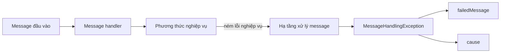

# `MessageHandlingException`: đọc nguyên nhân và ngữ cảnh khi xử lý thông điệp thất bại

## 1. Mục tiêu và ý nghĩa của ngoại lệ

Trong module **SPRING_INTEGRATION_CORE**, `MessageHandlingException` là một ngoại lệ quan trọng khi chẩn đoán lỗi tại các endpoint xử lý thông điệp. Nó diễn đạt rằng đã xảy ra lỗi trong quá trình xử lý message, đồng thời giúp giữ lại message liên quan và nguyên nhân bên dưới.

Ví dụ, một service activator nhận lệnh giữ hàng cho đơn mua. Dịch vụ nghiệp vụ từ chối số lượng bằng 0 và ném một exception của miền nghiệp vụ. Lớp tích hợp có thể đưa exception đó vào một `MessageHandlingException`, gắn với message tại điểm xử lý thất bại.

Thông tin cần đọc không dừng ở tên lớp bao ngoài:

- **Ngữ cảnh messaging:** message nào đang được xử lý, với payload và headers nào?
- **Nguyên nhân:** dữ liệu không hợp lệ, lỗi I/O, cấu hình sai hay lỗi lập trình?
- **Đường truyền lỗi:** caller đồng bộ nhận exception hay một consumer nhận `ErrorMessage`?

Sau bài này, bạn có thể giải thích cấu trúc ngoại lệ, lần theo chuỗi nguyên nhân, đọc `failedMessage`, lựa chọn cách phân loại lỗi và kiểm thử cả đường đồng bộ lẫn polling consumer.

## 2. Đúng lớp, đúng package và đúng vai trò

Import lớp của Spring Messaging:

```java
import org.springframework.messaging.MessageHandlingException;
```

Lớp này thuộc Spring Framework, được Spring Integration sử dụng trong hạ tầng xử lý message. Quan hệ kế thừa chính:

```text
RuntimeException
  └─ NestedRuntimeException
      └─ MessagingException
          └─ MessageHandlingException
```

Đây là unchecked exception, không bắt buộc khai báo trong `throws`. Các constructor nhận message thất bại, có thể kèm mô tả và cause. Xem [Javadoc của `MessageHandlingException`](https://docs.spring.io/spring-framework/docs/current/javadoc-api/org/springframework/messaging/MessageHandlingException.html).

Ví dụ tạo ngoại lệ có đầy đủ ngữ cảnh:

```java
MessageHandlingException failure = new MessageHandlingException(
        request,
        "Không xử lý được yêu cầu giữ hàng",
        originalFailure);
```

Trong đoạn này, `request` là một `Message<?>`, còn `originalFailure` là exception gây thất bại. Mô tả nên chỉ ra thao tác thất bại; nguyên nhân chi tiết được giữ bằng cause.

Chỉ tạo đối tượng exception chưa thực hiện gửi thông điệp lỗi, retry hay rollback. Những hành động đó phụ thuộc vào nơi exception được ném, thành phần nào bắt nó và cấu hình của luồng.

### Phân biệt các khái niệm gần nhau

| Khái niệm | Ý nghĩa khi chẩn đoán |
| --- | --- |
| `MessageHandlingException` | Lỗi trong quá trình xử lý message |
| `MessageDeliveryException` | Lỗi liên quan đến chuyển giao message |
| `MessageConversionException` | Lỗi chuyển đổi dữ liệu messaging |
| `MessageRejectedException` | Selector từ chối message theo chính sách có ném lỗi |
| `ErrorMessage` | Message có payload là `Throwable`, không phải một lớp exception |

`MessageDeliveryException` và `MessageHandlingException` đều thuộc họ `MessagingException`; tên lớp ngoài cùng cần được đọc cùng cause và vị trí xảy ra lỗi. Xem [Javadoc của `MessageDeliveryException`](https://docs.spring.io/spring-framework/docs/current/javadoc-api/org/springframework/messaging/MessageDeliveryException.html).

`MessageRejectedException` là một lớp con của `MessageHandlingException`. Vì vậy, một khối `catch (MessageHandlingException ex)` cũng có thể bắt lỗi từ chối này; không nên suy ra mọi lỗi bắt được đều có cùng nguyên nhân. Xem [Javadoc của `MessageRejectedException`](https://docs.spring.io/spring-integration/api/org/springframework/integration/MessageRejectedException.html).

## 3. Vì sao một exception nghiệp vụ trở thành lỗi messaging?

Một phương thức nghiệp vụ thuần Java có thể chỉ biết về dữ liệu và quy tắc miền:

```java
public ReservationResult reserve(ReservationCommand command) {
    if (command.quantity() <= 0) {
        throw new InvalidReservationException("INVALID_QUANTITY");
    }
    // Tiếp tục xử lý yêu cầu hợp lệ.
}
```

Đây là đoạn minh họa một phần phương thức; ví dụ đầy đủ nằm ở mục 5.

Khi phương thức được gọi bởi một message handler, hạ tầng cần bổ sung ngữ cảnh mà exception nghiệp vụ không biết: message gây lỗi, endpoint đang chạy và thông tin cấu hình liên quan.



Trong đường xử lý của `AbstractMessageHandler`, lỗi được đưa qua cơ chế bọc khi cần thiết. Mã nguồn minh họa việc bổ sung ngữ cảnh ở [AbstractMessageHandler của Spring Integration](https://raw.githubusercontent.com/spring-projects/spring-integration/v6.5.0/spring-integration-core/src/main/java/org/springframework/integration/handler/AbstractMessageHandler.java).

Không phải mỗi lớp trung gian đều luôn tạo thêm một `MessageHandlingException`. Một `MessagingException` đã có `failedMessage` có thể được giữ nguyên; lỗi ở thành phần chuyên biệt cũng có thể dùng kiểu ngoại lệ riêng. Điều kiện bọc có thể đối chiếu tại [IntegrationUtils](https://raw.githubusercontent.com/spring-projects/spring-integration/v6.5.0/spring-integration-core/src/main/java/org/springframework/integration/support/utils/IntegrationUtils.java).

Hai liên kết mã nguồn dùng phiên bản 6.5.0 để minh họa một cách triển khai cụ thể. Khi chẩn đoán một ứng dụng khác phiên bản, hãy đối chiếu stack trace và mã nguồn tương ứng thay vì phụ thuộc vào chính xác số lớp bọc của ví dụ.

## 4. Đọc ba nhóm thông tin quan trọng

### 4.1. `failedMessage`: message tại điểm xử lý thất bại

```java
Message<?> failed = failure.getFailedMessage();

Object requestId = failed == null
        ? null
        : failed.getHeaders().get("requestId");

Object failedPayload = failed == null ? null : failed.getPayload();
```

`getFailedMessage()` được kế thừa từ `MessagingException`. Không nên bỏ qua kiểm tra `null` trong mã chẩn đoán dùng chung cho cả họ ngoại lệ này; hợp đồng getter cho phép thiếu message. Xem [Javadoc của `MessagingException`](https://docs.spring.io/spring-framework/docs/current/javadoc-api/org/springframework/messaging/MessagingException.html).

`failedMessage` không nhất thiết là message đầu tiên producer tạo. Nếu luồng đã chuyển JSON thành một command rồi mới lỗi, payload tại điểm lỗi có thể là command, không còn là chuỗi JSON.

Ngoài ra, message wrapper và headers có thể bất biến nhưng payload là đối tượng Java do ứng dụng quản lý. Nếu mã nghiệp vụ sửa một payload mutable tại chỗ, tham chiếu trong exception không tự tạo ra bản sao lịch sử của dữ liệu trước khi sửa.

### 4.2. Cause trực tiếp và nguyên nhân sâu nhất

| API | Dữ liệu trả về |
| --- | --- |
| `getCause()` | Cause trực tiếp; có thể là một lớp bọc khác |
| `getRootCause()` | Cause sâu nhất nếu có; có thể `null` |
| `getMostSpecificCause()` | Cause sâu nhất, hoặc chính exception hiện tại nếu không có cause |
| `contains(SomeException.class)` | Kiểm tra kiểu ở chính exception hoặc trong chuỗi cause |

Các tiện ích này được kế thừa từ [NestedRuntimeException](https://docs.spring.io/spring-framework/docs/current/javadoc-api/org/springframework/core/NestedRuntimeException.html).

Ví dụ:

```java
Throwable directCause = failure.getCause();
Throwable mostSpecific = failure.getMostSpecificCause();
boolean invalidRequest = failure.contains(InvalidReservationException.class);
```

Không giả định `getCause()` luôn là lỗi nghiệp vụ gốc. Cũng không nên chỉ giữ lại nguyên nhân sâu nhất rồi bỏ phần còn lại: một exception miền nghiệp vụ ở giữa chuỗi có thể chứa mã lỗi hoặc ngữ cảnh mà exception thấp hơn không có.

### 4.3. Mô tả và stack trace

`getMessage()` và stack trace hỗ trợ tìm handler, cấu hình và vị trí thất bại. Tuy nhiên, phần chuỗi mô tả của framework không phải một hợp đồng ổn định để làm điều kiện định tuyến.

Thay vì kiểm tra `ex.getMessage().contains("INVALID_QUANTITY")`, hãy tìm kiểu `InvalidReservationException` và đọc thuộc tính mã lỗi do ứng dụng định nghĩa.

Khi ghi log, giữ exception để còn stack trace và cause. Một dòng chỉ ghi `ex.getMessage()` thường không đủ để hiểu nguồn gốc lỗi. Đồng thời, cân nhắc dữ liệu trong message khi ghi log vì exception có thể mang theo payload và headers của yêu cầu.

## 5. Ví dụ hoàn chỉnh: giữ hàng thất bại

### 5.1. Mục đích của ví dụ

Ví dụ dùng Java 17 trở lên, `spring-integration-core`, Spring Context tương thích và JUnit Jupiter cho phần kiểm thử. Mỗi lớp public nằm trong tệp cùng tên, thuộc package `example.handling`.

Hai entry channel dùng chung một dịch vụ:

- `reservations.direct`: `DirectChannel`, xử lý trên luồng gửi.
- `reservations.queued`: `QueueChannel`, được poller xử lý.

Kết quả thành công vào `reservations.results`; lỗi của polling task vào `reservations.errors`. Hai queue đầu ra phục vụ quan sát và kiểm thử, chưa phải nơi lưu bền vững.

### 5.2. Command và kết quả

```java
package example.handling;

public record ReservationCommand(
        String orderId,
        String sku,
        int quantity) {
}
```

```java
package example.handling;

public record ReservationResult(
        String orderId,
        String sku,
        int quantity,
        String status) {
}
```

### 5.3. Exception của miền nghiệp vụ

```java
package example.handling;

public class InvalidReservationException extends RuntimeException {

    private final String code;

    public InvalidReservationException(String code) {
        super(code);
        this.code = code;
    }

    public String code() {
        return code;
    }
}
```

Exception này không phụ thuộc vào Spring Messaging. Nó diễn tả yêu cầu giữ hàng không hợp lệ và mang một mã lỗi có cấu trúc.

### 5.4. Dịch vụ nghiệp vụ

```java
package example.handling;

public class ReservationService {

    public ReservationResult reserve(ReservationCommand command) {
        if (command.orderId() == null || command.orderId().isBlank()) {
            throw new InvalidReservationException("ORDER_ID_REQUIRED");
        }
        if (command.sku() == null || command.sku().isBlank()) {
            throw new InvalidReservationException("SKU_REQUIRED");
        }
        if (command.quantity() <= 0) {
            throw new InvalidReservationException("INVALID_QUANTITY");
        }

        return new ReservationResult(
                command.orderId(), command.sku(), command.quantity(), "RESERVED");
    }
}
```

Đây là dịch vụ mô phỏng: nó kiểm tra dữ liệu và tạo kết quả, chưa trừ tồn kho hay ghi dữ liệu thật. Trong hệ thống thực, trạng thái `RESERVED` phải gắn với một cam kết nghiệp vụ cụ thể.

### 5.5. Cấu hình hai luồng bằng Java DSL

```java
package example.handling;

import java.time.Duration;

import org.springframework.context.annotation.Bean;
import org.springframework.context.annotation.Configuration;
import org.springframework.integration.channel.DirectChannel;
import org.springframework.integration.channel.QueueChannel;
import org.springframework.integration.config.EnableIntegration;
import org.springframework.integration.dsl.IntegrationFlow;
import org.springframework.integration.dsl.Pollers;

@Configuration
@EnableIntegration
public class ReservationConfiguration {

    @Bean("reservations.direct")
    public DirectChannel directInput() {
        return new DirectChannel();
    }

    @Bean("reservations.queued")
    public QueueChannel queuedInput() {
        return new QueueChannel(100);
    }

    @Bean("reservations.results")
    public QueueChannel results() {
        return new QueueChannel(100);
    }

    @Bean("reservations.errors")
    public QueueChannel errors() {
        return new QueueChannel(100);
    }

    @Bean
    public ReservationService reservationService() {
        return new ReservationService();
    }

    @Bean
    public IntegrationFlow directReservationFlow(ReservationService service) {
        return IntegrationFlow.from("reservations.direct")
                .handle(service, "reserve")
                .channel("reservations.results")
                .get();
    }

    @Bean
    public IntegrationFlow queuedReservationFlow(ReservationService service) {
        return IntegrationFlow.from("reservations.queued")
                .handle(service, "reserve", endpoint -> endpoint.poller(
                        Pollers.fixedDelay(Duration.ofMillis(100))
                                .maxMessagesPerPoll(1)
                                .receiveTimeout(0)
                                .errorChannel("reservations.errors")))
                .channel("reservations.results")
                .get();
    }
}
```

`.handle(service, "reserve")` tạo service activator gọi phương thức của bean nghiệp vụ; cách dùng này được mô tả trong [Service Activator](https://docs.spring.io/spring-integration/reference/service-activator.html).

Poller thuộc consumer nhận từ `reservations.queued`, không thuộc queue đầu ra. Cấu hình mặc định của kênh lỗi cho polling task có thể đối chiếu với [PollerSpec](https://docs.spring.io/spring-integration/api/org/springframework/integration/dsl/PollerSpec.html).

Hai luồng có hai entry riêng, vì vậy không cạnh tranh trên cùng một input channel. Một lần gửi của ví dụ chỉ đi qua luồng được chọn.

## 6. Quan sát lỗi trong đường đồng bộ

Ví dụ gửi trực tiếp một command có số lượng bằng 0:

```java
Message<ReservationCommand> request = MessageBuilder.withPayload(
                new ReservationCommand("ORD-101", "SKU-01", 0))
        .setHeader("requestId", "REQ-101")
        .build();

try {
    directInput.send(request, 1000);
}
catch (MessageHandlingException failure) {
    Message<?> failed = failure.getFailedMessage();
    Throwable mostSpecific = failure.getMostSpecificCause();

    // Dùng failed để lấy requestId; dùng cause để phân loại lỗi.
    throw failure;
}
```

Đoạn này giả định `directInput` được lấy từ context ở mục 5; các import đầy đủ xuất hiện trong phần kiểm thử. Việc bắt rồi ném lại minh họa vị trí có thể chẩn đoán mà không thay đổi hợp đồng thất bại.

Trong fixture này, caller nhận `MessageHandlingException`, payload của `failedMessage` là command gây lỗi và chuỗi cause chứa `InvalidReservationException`.

Không có `ErrorMessage` tự động xuất hiện chỉ vì handler đã ném `MessageHandlingException`. Đường lỗi đồng bộ đi về caller, trừ khi có gateway, advice hoặc cơ chế khác chủ động chuyển nó thành thông điệp lỗi.

Nếu request có header `errorChannel` nhưng được gửi trực tiếp trên đường đồng bộ này, bản thân header cũng không thay thế cơ chế bắt và phát lỗi.

## 7. Quan sát cùng lỗi trong polling task

Với cùng dữ liệu không hợp lệ nhưng gửi vào `reservations.queued`:

```text
Caller gửi vào queue -> thao tác gửi hoàn tất

Polling task:
  lấy command
  -> ReservationService ném InvalidReservationException
  -> message handler bổ sung ngữ cảnh lỗi
  -> error handler phát ErrorMessage
  -> reservations.errors
```

Payload của message trên `reservations.errors` là một `Throwable`, thường mang ngoại lệ xử lý message. Trong ví dụ này, đó là `MessageHandlingException` với message thất bại và cause nghiệp vụ.

```java
Message<?> received = errors.receive(3000);

if (received instanceof ErrorMessage error) {
    Throwable throwable = error.getPayload();
    if (throwable instanceof MessageHandlingException failure) {
        Message<?> failed = failure.getFailedMessage();
        // Phân tích failed và chuỗi cause.
    }
}
```

`MessageHandlingException` là đối tượng exception; `ErrorMessage` là phương tiện mang lỗi qua channel. Hai khái niệm này không thay thế nhau. Cấu trúc `ErrorMessage` được mô tả trong [Javadoc của ErrorMessage](https://docs.spring.io/spring-framework/docs/current/javadoc-api/org/springframework/messaging/support/ErrorMessage.html).

Trong trường hợp tổng quát, không ép mọi payload lỗi thành đúng `MessageHandlingException`. Error channel còn có thể nhận lỗi chuyển giao, timeout, nguồn dữ liệu hoặc lỗi của thành phần khác.

Ngoài ra, headers nghiệp vụ của request không bắt buộc được sao chép sang headers của `ErrorMessage`. Muốn lấy `requestId`, hãy đọc message ngữ cảnh trong exception nếu có. `ErrorMessage.getOriginalMessage()` là dữ liệu tùy chọn và có thể khác với `failedMessage` tại điểm thất bại.

Cách hạ tầng phát lỗi bất đồng bộ và xử lý lỗi của scheduled poller được trình bày trong [Error Handling](https://docs.spring.io/spring-integration/reference/error-handling.html).

## 8. Phân loại theo nguyên nhân thay vì lớp bao ngoài

Hai exception có cùng lớp ngoài `MessageHandlingException` có thể cần hai quyết định xử lý hoàn toàn khác nhau.

| Nguyên nhân bên trong | Hướng đánh giá |
| --- | --- |
| `InvalidReservationException` | Dữ liệu không hợp lệ; cần sửa yêu cầu hoặc trả kết quả từ chối |
| Timeout khi gọi dịch vụ | Xác định thao tác đã xảy ra chưa và có thể thử lại an toàn không |
| Sai kiểu payload hoặc thiếu header bắt buộc | Kiểm tra hợp đồng và wiring của luồng |
| Lỗi lập trình như truy cập giá trị không hợp lệ | Sửa mã hoặc dữ liệu giả định; không mặc định retry vô hạn |

Ví dụ tìm exception nghiệp vụ trong chuỗi cause:

```java
package example.handling;

public final class ReservationFailures {

    private ReservationFailures() {
    }

    public static InvalidReservationException findInvalidRequest(
            Throwable failure) {

        for (Throwable current = failure;
                current != null;
                current = current.getCause()) {

            if (current instanceof InvalidReservationException invalid) {
                return invalid;
            }
        }
        return null;
    }
}
```

Sau đó đọc mã lỗi có cấu trúc:

```java
InvalidReservationException invalid = ReservationFailures.findInvalidRequest(
        error.getPayload());

if (invalid != null) {
    String code = invalid.code();
    // Ánh xạ code sang kết quả hoặc bản ghi lỗi của ứng dụng.
}
```

Đây là helper cho một hợp đồng nghiệp vụ cụ thể, không phải một chính sách retry tổng quát. Khi có nhiều nhóm lỗi, cần xác định quy tắc ưu tiên phân loại và cách xử lý nhóm chưa biết.

Spring Integration cung cấp `ErrorMessageExceptionTypeRouter` để định tuyến dựa trên kiểu exception trong chuỗi nguyên nhân; router ưu tiên nguyên nhân cụ thể nhất có mapping phù hợp. Xem [Javadoc của ErrorMessageExceptionTypeRouter](https://docs.spring.io/spring-integration/api/org/springframework/integration/router/ErrorMessageExceptionTypeRouter.html).

Không chỉ map tất cả `MessageHandlingException` vào một nhánh retry, vì như vậy dữ liệu sai cũng có thể bị thử đi thử lại.

## 9. Khi nào nên tự ném `MessageHandlingException`?

### 9.1. Tại adapter hoặc handler có trách nhiệm messaging

Một handler tự viết, nhận `Message<?>`, có thể cần giữ message khi bọc lỗi từ một API khác. Ví dụ một biến thể adapter:

```java
public ReservationResult handle(Message<ReservationCommand> message) {
    try {
        return service.reserve(message.getPayload());
    }
    catch (InvalidReservationException cause) {
        throw new MessageHandlingException(
                message,
                "Không thực hiện được yêu cầu giữ hàng",
                cause);
    }
}
```

Đoạn này đặt trong một lớp adapter có trường `ReservationService service`, không phải phần cần thêm vào ví dụ DSL ban đầu. Nó minh họa constructor có message, mô tả và cause.

### 9.2. Trong dịch vụ nghiệp vụ thuần Java

Thông thường nên để `ReservationService` ném exception nghiệp vụ, rồi hạ tầng messaging bổ sung ngữ cảnh như ở mục 5. Nếu mọi phương thức nghiệp vụ đều phải nhận `Message<?>` chỉ để tạo exception, lớp nghiệp vụ sẽ phụ thuộc mạnh vào Spring Messaging.

Không cần bọc thủ công ở mọi tầng chỉ để tên exception trông giống lỗi tích hợp. Các lớp bọc thừa có thể làm việc chẩn đoán và phân loại phức tạp hơn.

### 9.3. Những cách làm mất thông tin

```java
// Không giữ được cause gốc.
throw new MessageHandlingException(message, cause.getMessage());
```

Trong tình huống muốn bọc nguyên nhân, hãy dùng constructor nhận cause:

```java
throw new MessageHandlingException(
        message, "Không xử lý được yêu cầu giữ hàng", cause);
```

Tương tự, tránh bắt lỗi, chỉ ghi log rồi trả kết quả thành công giả. Nếu chủ động chuyển thất bại thành DTO, đó phải là hợp đồng kết quả rõ ràng của luồng hoặc gateway.

Không bắt `Throwable` chung để biến mọi lỗi của JVM thành một lỗi nghiệp vụ có thể tiếp tục xử lý. Phạm vi bắt cần phù hợp với trách nhiệm của adapter và các lỗi mà nó thực sự có thể xử lý.

## 10. Gateway có thể thay đổi exception mà caller nhìn thấy

Một ứng dụng gọi qua `@MessagingGateway` có thể không nhận cùng lớp exception ngoài cùng như khi gửi trực tiếp vào channel.

Gateway có cơ chế xem chữ ký `throws` và chuỗi cause để chuyển exception phù hợp ra caller. Nếu không chỉ định một exception messaging cần giữ, caller có thể nhận exception nghiệp vụ được mở bọc từ lỗi downstream. Nếu cấu hình error channel tại gateway, lỗi còn có thể được chuyển sang error flow.

Vì vậy, hai quan sát sau có thể cùng đúng:

- Kiểm thử gửi trực tiếp vào channel nhận `MessageHandlingException`.
- Kiểm thử gọi gateway nhận `InvalidReservationException` hoặc một DTO lỗi theo cấu hình gateway.

Hành vi mở bọc và vai trò chữ ký `throws` được giải thích tại [Messaging Gateways](https://docs.spring.io/spring-integration/reference/gateway.html).

Khi viết API gateway, quyết định caller cần nhìn thấy loại thất bại nào. Khi viết kiểm thử, gọi đúng boundary mà ứng dụng thực tế sử dụng; không lấy exception bắt được bên trong error flow làm giả định tuyệt đối cho caller bên ngoài.

## 11. Retry và transaction không được suy ra từ tên exception

`MessageHandlingException` có thể bọc cả lỗi tạm thời lẫn lỗi không thể khắc phục bằng retry. Chính sách thử lại cần dựa vào nguyên nhân, tác dụng phụ và hợp đồng của thao tác.

Với lệnh giữ hàng:

- `INVALID_QUANTITY` không thay đổi nếu gửi lại cùng command.
- Lỗi kết nối trước khi thực hiện thao tác có thể phù hợp với retry có giới hạn.
- Mất phản hồi sau khi đã giữ hàng có thể dẫn tới giữ hàng trùng nếu thử lại mà không có khóa chống trùng.

Nếu dùng `RequestHandlerRetryAdvice`, kiểm tra phạm vi advice bao quanh bước nào, exception nào được phân loại và recovery làm gì sau khi hết lượt. Không mặc định cause traversal của mọi retry policy giống nhau. Xem [Provided Advice Classes](https://docs.spring.io/spring-integration/reference/handler-advice/classes.html).

Một runtime exception có thể dẫn tới rollback nếu nó thoát qua một transaction boundary được cấu hình phù hợp. Nhưng chỉ thấy `MessageHandlingException` trong log chưa đủ chứng minh đã rollback: transaction có thể không tồn tại, không bao phủ thao tác ngoài hệ thống hoặc exception đã được recovery xử lý.

Tương tự, một `ErrorMessage` được nhận thành công không tự chứng minh message gốc trên broker đã được acknowledgment, requeue hay đưa vào dead-letter queue. Cần đọc cấu hình adapter và transaction liên quan.

## 12. Kiểm thử exception và ngữ cảnh của ví dụ

### 12.1. Gửi đồng bộ: giữ command, header và cause

```java
package example.handling;

import org.junit.jupiter.api.Test;
import org.springframework.context.annotation.AnnotationConfigApplicationContext;
import org.springframework.integration.channel.QueueChannel;
import org.springframework.messaging.Message;
import org.springframework.messaging.MessageChannel;
import org.springframework.messaging.MessageHandlingException;
import org.springframework.messaging.support.ErrorMessage;
import org.springframework.messaging.support.MessageBuilder;

import static org.junit.jupiter.api.Assertions.assertEquals;
import static org.junit.jupiter.api.Assertions.assertInstanceOf;
import static org.junit.jupiter.api.Assertions.assertNotNull;
import static org.junit.jupiter.api.Assertions.assertNull;
import static org.junit.jupiter.api.Assertions.assertSame;
import static org.junit.jupiter.api.Assertions.assertThrows;
import static org.junit.jupiter.api.Assertions.assertTrue;

class MessageHandlingExceptionTest {

    @Test
    void directFailureKeepsMessageAndBusinessCause() {
        try (var context = new AnnotationConfigApplicationContext(
                ReservationConfiguration.class)) {

            MessageChannel input = context.getBean(
                    "reservations.direct", MessageChannel.class);
            QueueChannel results = context.getBean(
                    "reservations.results", QueueChannel.class);
            QueueChannel errors = context.getBean(
                    "reservations.errors", QueueChannel.class);

            ReservationCommand command = new ReservationCommand(
                    "ORD-101", "SKU-01", 0);
            Message<ReservationCommand> request = MessageBuilder.withPayload(command)
                    .setHeader("requestId", "REQ-101")
                    .build();

            MessageHandlingException failure = assertThrows(
                    MessageHandlingException.class,
                    () -> input.send(request, 1000));

            Message<?> failed = failure.getFailedMessage();
            assertNotNull(failed);
            assertSame(command, failed.getPayload());
            assertEquals("REQ-101", failed.getHeaders().get("requestId"));
            assertTrue(failure.contains(InvalidReservationException.class));

            InvalidReservationException invalid = assertInstanceOf(
                    InvalidReservationException.class,
                    failure.getMostSpecificCause());
            assertEquals("INVALID_QUANTITY", invalid.code());
            assertNull(results.receive(0));
            assertNull(errors.receive(0));
        }
    }

    @Test
    void pollingFailureArrivesInsideErrorMessage() {
        try (var context = new AnnotationConfigApplicationContext(
                ReservationConfiguration.class)) {

            MessageChannel input = context.getBean(
                    "reservations.queued", MessageChannel.class);
            QueueChannel errors = context.getBean(
                    "reservations.errors", QueueChannel.class);
            QueueChannel results = context.getBean(
                    "reservations.results", QueueChannel.class);

            ReservationCommand command = new ReservationCommand(
                    "ORD-102", "SKU-01", 0);
            Message<ReservationCommand> request = MessageBuilder.withPayload(command)
                    .setHeader("requestId", "REQ-102")
                    .build();

            assertTrue(input.send(request, 1000));

            ErrorMessage error = assertInstanceOf(
                    ErrorMessage.class, errors.receive(3000));
            MessageHandlingException failure = assertInstanceOf(
                    MessageHandlingException.class, error.getPayload());
            Message<?> failed = failure.getFailedMessage();

            assertNotNull(failed);
            assertSame(command, failed.getPayload());
            assertEquals("REQ-102", failed.getHeaders().get("requestId"));
            InvalidReservationException invalid = ReservationFailures
                    .findInvalidRequest(failure);
            assertNotNull(invalid);
            assertEquals("INVALID_QUANTITY", invalid.code());
            assertNull(results.receive(0));
        }
    }

    @Test
    void validCommandProducesNormalResult() {
        try (var context = new AnnotationConfigApplicationContext(
                ReservationConfiguration.class)) {

            MessageChannel input = context.getBean(
                    "reservations.direct", MessageChannel.class);
            QueueChannel results = context.getBean(
                    "reservations.results", QueueChannel.class);
            QueueChannel errors = context.getBean(
                    "reservations.errors", QueueChannel.class);

            Message<ReservationCommand> request = MessageBuilder.withPayload(
                            new ReservationCommand("ORD-103", "SKU-01", 2))
                    .setHeader("requestId", "REQ-103")
                    .build();

            assertTrue(input.send(request, 1000));

            Message<?> response = results.receive(1000);
            assertNotNull(response);
            ReservationResult result = assertInstanceOf(
                    ReservationResult.class, response.getPayload());
            assertEquals("RESERVED", result.status());
            assertEquals(2, result.quantity());
            assertEquals("REQ-103", response.getHeaders().get("requestId"));
            assertNull(errors.receive(0));
        }
    }
}
```

### 12.2. Vì sao các khẳng định này có ý nghĩa?

Test thứ nhất kiểm tra đúng đường đồng bộ: caller thấy exception, message ngữ cảnh giữ payload và header nghiệp vụ, cause vẫn có kiểu và mã lỗi cần thiết. Error queue trống vì không có thành phần tự phát lỗi cho lời gọi trực tiếp này.

Test thứ hai kiểm tra đường poller: thao tác gửi vào queue thành công nhưng xử lý về sau thất bại. Kiểm thử chờ có giới hạn ở error queue, rồi đọc exception bên trong `ErrorMessage`.

Test thứ ba chứng minh dữ liệu hợp lệ vẫn đi qua đường kết quả bình thường. Nhờ vậy, fixture không chỉ là một endpoint được cấu hình để luôn lỗi.

Mỗi test dùng context riêng. Không khẳng định toàn bộ chuỗi mô tả exception bằng một chuỗi cố định của framework, và không dùng `Thread.sleep(...)` để đoán lúc polling task hoàn tất.

Việc dùng `getMostSpecificCause()` để lấy `InvalidReservationException` trong test thứ nhất phù hợp vì exception nghiệp vụ của fixture không có cause sâu hơn. Với phân loại tổng quát, helper tìm kiểu trong chuỗi cause như mục 8 giữ được ngữ nghĩa tốt hơn.

Các đoạn kiểm thử là nội dung thực hành của bài; việc tạo tài liệu không đồng nghĩa các test đã được chạy trên classpath của dự án.

## 13. Quy trình chẩn đoán một lỗi thực tế

Khi gặp `MessageHandlingException`, có thể làm theo thứ tự sau:

1. Xác định boundary đang quan sát: `send()` trực tiếp, lời gọi gateway hay error channel.
2. Tìm handler hoặc thành phần thất bại trong stack trace và mô tả cấu hình.
3. Đọc `failedMessage` nếu có: kiểu payload, `requestId`, mã nghiệp vụ và các headers cần thiết.
4. Lần theo cause để tìm exception có ý nghĩa nghiệp vụ hoặc hạ tầng.
5. Xem luồng đã biến đổi message ở đâu trước điểm lỗi.
6. Kiểm tra retry, recovery và transaction trước khi quyết định gửi lại.
7. Đối chiếu trạng thái thật của thao tác có tác dụng phụ.

Ví dụ, với `INVALID_QUANTITY`, hành động phù hợp là sửa dữ liệu hoặc trả một kết quả từ chối rõ ràng. Với một timeout sau khi gọi dịch vụ giữ hàng, cần xác định dịch vụ đã giữ hàng hay chưa trước khi phát lại.

### Các kết luận dễ nhầm

| Quan sát | Điều chưa thể kết luận chỉ từ quan sát đó |
| --- | --- |
| Có `MessageHandlingException` | Spring Integration là nguyên nhân gốc |
| Cause là lỗi I/O | Thử lại luôn an toàn |
| `failedMessage` có payload command | Đó là bản sao dữ liệu nguyên thủy trước mọi thay đổi |
| Có header `errorChannel` | Mọi exception đồng bộ đều tự chuyển thành `ErrorMessage` |
| Error queue nhận được lỗi | Transaction đã rollback hoặc broker đã requeue |
| Gateway trả exception nghiệp vụ | Downstream không từng tạo lớp bọc messaging |

Những thông tin chẩn đoán nên đủ để lần theo yêu cầu nhưng không biến toàn bộ payload thành dữ liệu log mặc định. Với hệ thống nhiều tầng, chọn nơi ghi lỗi chính để tránh nhiều bản ghi giống nhau che khuất sự kiện gốc.

## 14. Ghi nhớ khi áp dụng

`MessageHandlingException` bổ sung ngữ cảnh messaging cho một thất bại xử lý. Giá trị chính của nó nằm ở việc kết nối **message tại điểm lỗi** với **chuỗi nguyên nhân**.

Trong ví dụ giữ hàng, cùng một lỗi nghiệp vụ có thể xuất hiện dưới dạng exception truyền về caller hoặc payload của `ErrorMessage`, tùy entry channel và error boundary. Đọc đúng boundary, giữ cause và phân loại theo ngữ nghĩa sẽ giúp chọn cách sửa dữ liệu, trả lỗi hoặc khôi phục phù hợp.
