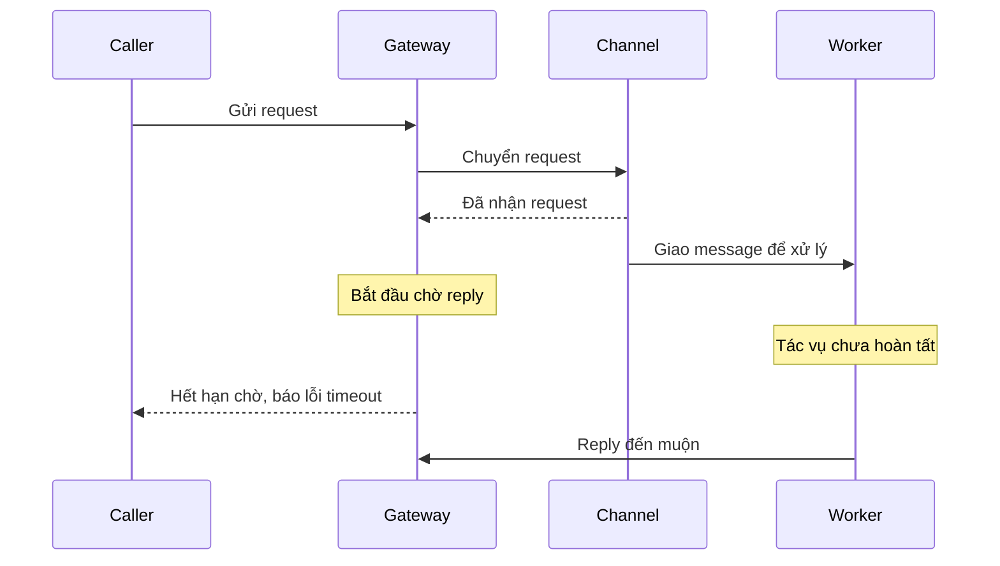

# MessageTimeoutException

## 1. Mục tiêu và phạm vi

Trong một luồng Spring Integration, producer gửi `Message` qua `MessageChannel`, các endpoint xử lý dữ liệu và gateway có thể chờ phản hồi để trả kết quả cho mã Java gọi nó. Khi hết thời gian chờ, điều quan trọng là xác định **đang chờ bước nào**: đưa request vào channel, nhận reply hay gọi một hệ thống bên ngoài.

Bài học thuộc chương **Error handling** của module **SPRING_INTEGRATION_CORE**, tập trung vào `MessageTimeoutException`, cách cấu hình gateway, xử lý lỗi bằng Java DSL và kiểm thử hành vi không nhận được reply. Sau bài học, bạn cần có khả năng:

- Nhận diện đúng lớp ngoại lệ và đọc thông tin message gây lỗi.
- Phân biệt timeout gửi request với timeout chờ reply.
- Cấu hình để gateway phát sinh lỗi thay vì âm thầm trả `null`.
- Thiết kế nhánh xử lý lỗi, phản hồi thay thế và chính sách thử lại phù hợp.
- Giải thích vì sao một tác vụ vẫn có thể hoàn tất sau khi caller đã nhận timeout.

Các ví dụ dùng Java 17 và API Spring Integration **6.2 trở lên**. Thuộc tính `errorOnTimeout` trên `@MessagingGateway` và `GatewayEndpointSpec` có từ 6.2; các cấu hình dưới đây đặt timeout tường minh để người đọc không phải dựa vào giá trị mặc định. Xem [API MessagingGateway](https://docs.spring.io/spring-integration/api/org/springframework/integration/annotation/MessagingGateway.html).

## 2. MessageTimeoutException biểu diễn điều gì?

Tên đầy đủ của lớp là:

```java
org.springframework.integration.MessageTimeoutException
```

Quan hệ kế thừa cần nhớ:

```text
RuntimeException
  └─ NestedRuntimeException
      └─ MessagingException
          └─ MessageDeliveryException
              └─ MessageTimeoutException
```

Đây là unchecked exception, thuộc nhóm lỗi chuyển giao thông điệp. Trong luồng request–reply của gateway, nó có thể biểu diễn việc không nhận được phản hồi trong khoảng thời gian cho phép khi đã bật chế độ báo lỗi. Không nên suy luận rằng mọi thao tác hết hạn trong Spring Integration đều phát sinh chính lớp này.

Một số constructor cho phép gắn message và nguyên nhân:

```java
new MessageTimeoutException("Không nhận được phản hồi đúng hạn");

new MessageTimeoutException(
        requestMessage,
        "Không nhận được phản hồi từ luồng tra cứu");

new MessageTimeoutException(
        requestMessage,
        "Không hoàn tất thao tác trong thời gian cho phép",
        cause);
```

Khi phân tích lỗi, ba dữ liệu hữu ích là `getMessage()`, `getFailedMessage()` và `getCause()`. `getFailedMessage()` có thể là `null`, chẳng hạn khi ngoại lệ được tạo chỉ với chuỗi mô tả. Xem [API MessageTimeoutException](https://docs.spring.io/spring-integration/api/org/springframework/integration/MessageTimeoutException.html).

Vì lớp này kế thừa `MessageDeliveryException`, thứ tự bắt lỗi phải đi từ cụ thể đến tổng quát:

```java
try {
    // Gọi gateway request–reply.
}
catch (MessageTimeoutException timeout) {
    // Áp dụng chính sách dành riêng cho việc hết thời gian chờ.
}
catch (MessageDeliveryException deliveryFailure) {
    // Những lỗi chuyển giao khác.
}
```

Nếu bắt `MessageDeliveryException` trước, nhánh `MessageTimeoutException` phía sau không hợp lệ vì đã bị nhánh cha bao phủ.

## 3. Phân biệt các loại timeout và kết quả trả về

### 3.1. Channel, template và gateway có hợp đồng khác nhau

| Thao tác | Điều đang chờ | Kết quả cần phân biệt khi không hoàn tất |
| --- | --- | --- |
| `queueChannel.send(message, timeout)` | Có chỗ trong queue để nhận message | Có thể trả `false`; không tự động chuyển thành `MessageTimeoutException` |
| `queueChannel.receive(timeout)` | Có message để lấy ra | Trả `null` khi không nhận được message |
| `messagingTemplate.send(channel, message)` | Channel chấp nhận message | Khi channel trả `false`, template ném `MessageDeliveryException` |
| `messagingTemplate.sendAndReceive(channel, message)` | Gửi request rồi nhận reply | Có thể trả `null` nếu không có reply; lỗi gửi vẫn có thể được ném ra |
| Gateway request–reply, `errorOnTimeout = false` | Nhận reply theo hợp đồng gateway | Thông thường trả `null` khi hết thời gian chờ reply |
| Gateway request–reply, `errorOnTimeout = true` | Nhận reply theo hợp đồng gateway | Tạo `MessageTimeoutException`; lỗi có thể đi qua error channel được cấu hình |

Hợp đồng của channel và template nằm ở hai tầng khác nhau. Một `false` ở thao tác gửi trực tiếp chưa phải một exception. Trong mã `GenericMessagingTemplate`, việc channel từ chối gửi được chuyển thành `MessageDeliveryException`, còn kết quả nhận không có message có thể vẫn là `null`. Xem [mã nguồn GenericMessagingTemplate, Spring Framework 6.2.0](https://github.com/spring-projects/spring-framework/blob/v6.2.0/spring-messaging/src/main/java/org/springframework/messaging/core/GenericMessagingTemplate.java).

Với `QueueChannel` có dung lượng giới hạn, thời gian chờ gửi chỉ có ý nghĩa khi queue đầy. `send()` thành công xác nhận message đã được nhận vào queue, chưa chứng minh consumer đã xử lý thành công. Giá trị `0` cho các thao tác channel này yêu cầu thử ngay, còn giá trị âm cho phép chờ không giới hạn. Xem [Message Channel Implementations](https://docs.spring.io/spring-integration/reference/channel/implementations.html).

### 3.2. Request timeout và reply timeout

Trong gateway, hai cấu hình giải quyết hai bước khác nhau:

- **Request timeout**: thời gian cho phép để gửi request vào channel có khả năng chặn.
- **Reply timeout**: thời gian gateway chờ reply sau khi quyền điều khiển trở lại gateway.

Ví dụ, nếu request nằm trong queue 400 ms rồi consumer xử lý 200 ms, khoảng chờ reply có thể đã bao gồm cả thời gian nằm trong queue. Ngược lại, nếu toàn bộ xử lý diễn ra đồng bộ trong `send()`, thời gian xử lý đó xảy ra trước khi gateway bắt đầu chờ reply.

Do đó, không thể coi `replyTimeout = 500` là cam kết mọi lời gọi gateway đều hoàn tất trong 500 ms. Thời gian thực tế còn phụ thuộc đường gửi, các handler đồng bộ, chuyển đổi dữ liệu và luồng xử lý lỗi. Xem [Gateway Timeouts](https://docs.spring.io/spring-integration/reference/gateway.html#gateway-timeouts).

### 3.3. Những lỗi hoặc thời hạn không đồng nghĩa với MessageTimeoutException

Một client HTTP có thể báo lỗi kết nối hoặc đọc dữ liệu; `Future.get(timeout, unit)` có thể ném `java.util.concurrent.TimeoutException`; handler có thể thất bại bằng `MessageHandlingException`. Cần đọc chuỗi nguyên nhân để biết lớp nào và thành phần nào tạo lỗi, thay vì phân loại chỉ từ chữ “timeout” trong thông báo.

Tương tự, thời hạn hoàn tất một nhóm trong aggregator thuộc vòng đời nhóm thông điệp. Tùy cấu hình, nhóm có thể phát kết quả một phần hoặc bị loại bỏ. Chỉ khi caller không nhận được reply đúng hạn và gateway áp dụng chính sách báo lỗi tương ứng thì caller mới gặp lỗi timeout ở tầng gateway.

## 4. Ranh giới thread quyết định hiệu lực của reply timeout

### 4.1. DirectChannel: handler chạy trên thread của caller

Xét đường đi:

```text
Caller → Gateway → DirectChannel → Handler chậm → Reply
```

Nếu handler gọi một dịch vụ bên ngoài và bị chặn trong 5 giây, thread của caller cũng đang thực thi lời gọi đó. Gateway chưa lấy lại quyền điều khiển để bắt đầu thao tác chờ reply, nên `replyTimeout = 500` không tự ngắt handler sau nửa giây.

Khi handler cuối cùng trả kết quả, reply có thể đã có sẵn lúc gateway bắt đầu nhận. Khi ấy lời gọi thành công dù tổng thời gian vượt 500 ms. Đây là hệ quả của việc xử lý cùng thread, không chứng minh rằng Spring bỏ qua mọi cấu hình timeout. Tài liệu [Messaging Gateways](https://docs.spring.io/spring-integration/reference/gateway.html) mô tả rõ giới hạn này.

Muốn giới hạn lời gọi mạng, cần cấu hình timeout của client mạng đang thực hiện I/O. Nếu yêu cầu một deadline cho toàn bộ nghiệp vụ, cần thêm cơ chế theo dõi ngân sách thời gian xuyên suốt luồng.

### 4.2. QueueChannel hoặc ExecutorChannel: có thể tách thread xử lý

Khi có ranh giới bất đồng bộ, caller có thể quay lại gateway và bắt đầu chờ trong lúc worker xử lý:



`ExecutorChannel` thường giao việc cho executor, nhưng không phải mọi rejection policy đều giữ được ranh giới này. Chẳng hạn `CallerRunsPolicy` có thể cho caller chạy tác vụ khi executor bão hòa. Khi đánh giá timeout, cần kiểm tra cấu hình executor và hành vi quá tải thực tế. Xem [ExecutorChannel](https://docs.spring.io/spring-integration/reference/channel/implementations.html#channel-implementations-executorchannel).

Một điểm khác cần giữ rõ: **hết thời gian chờ không đồng nghĩa với hủy công việc**. Reply đến muộn không thể tự biến lần gọi đã báo lỗi thành lần gọi thành công.

## 5. Cấu hình gateway báo lỗi khi không nhận reply

Ví dụ sử dụng luồng tra cứu báo giá. Đầu vào là mã sản phẩm; output đơn giản hóa thành chuỗi để tập trung vào cơ chế messaging.

### 5.1. Khai báo hợp đồng gateway

Đặt interface sau trong một tệp Java riêng của ứng dụng:

```java
package example.timeout;

import org.springframework.integration.annotation.MessagingGateway;
import org.springframework.messaging.Message;

@MessagingGateway(
        defaultRequestChannel = "quoteRequests",
        defaultRequestTimeout = "100",
        defaultReplyTimeout = "500",
        errorOnTimeout = true)
public interface QuoteGateway {

    String quote(Message<String> request);
}
```

Ở đây:

- `100` và `500` có đơn vị millisecond.
- Method có kiểu trả về khác `void`, nên thể hiện hợp đồng cần reply.
- `errorOnTimeout = true` yêu cầu báo lỗi khi không nhận được reply.
- Chưa cấu hình error channel riêng cho gateway, nên ngoại lệ timeout được truyền về caller.

Đối với thao tác có kết quả bắt buộc, cách cấu hình này làm cho nhánh thất bại hiện rõ. Với API cho phép “không có kết quả”, có thể chọn chính sách trả `null`, nhưng caller phải xử lý trường hợp đó theo hợp đồng đã định nghĩa. Cơ chế `errorOnTimeout` được mô tả trong [MessagingGatewaySupport](https://docs.spring.io/spring-integration/api/org/springframework/integration/gateway/MessagingGatewaySupport.html).

### 5.2. Xây dựng luồng bằng Java DSL

```java
package example.timeout;

import org.springframework.beans.factory.annotation.Qualifier;
import org.springframework.context.annotation.Bean;
import org.springframework.context.annotation.Configuration;
import org.springframework.core.task.TaskExecutor;
import org.springframework.integration.annotation.IntegrationComponentScan;
import org.springframework.integration.channel.ExecutorChannel;
import org.springframework.integration.config.EnableIntegration;
import org.springframework.integration.dsl.IntegrationFlow;
import org.springframework.scheduling.concurrent.ThreadPoolTaskExecutor;

@Configuration
@EnableIntegration
@IntegrationComponentScan(basePackageClasses = QuoteGateway.class)
public class QuoteFlowConfig {

    @Bean
    public ThreadPoolTaskExecutor quoteExecutor() {
        ThreadPoolTaskExecutor executor = new ThreadPoolTaskExecutor();
        executor.setCorePoolSize(2);
        executor.setMaxPoolSize(4);
        executor.setQueueCapacity(20);
        executor.setThreadNamePrefix("quote-worker-");
        return executor;
    }

    @Bean
    public ExecutorChannel quoteRequests(
            @Qualifier("quoteExecutor") TaskExecutor executor) {
        return new ExecutorChannel(executor);
    }

    @Bean
    public IntegrationFlow quoteFlow() {
        return IntegrationFlow.from("quoteRequests")
                .<String, String>transform(String::trim)
                .<String>handle(
                        (sku, headers) -> "PRICE:" + sku,
                        endpoint -> endpoint.requiresReply(true))
                .get();
    }
}
```

`@EnableIntegration` đăng ký hạ tầng tích hợp trong cấu hình Spring thuần. `@IntegrationComponentScan` tìm gateway interface. Bean executor do Spring quản lý vòng đời; ví dụ không tự tạo executor cho từng request.

Luồng trên thường phản hồi ngay vì chưa có thao tác chậm. Nó minh họa vị trí cấu hình, không cố ý tạo timeout. Khi thay phần handler bằng lời gọi tra cứu thật, cần thiết lập timeout của client tương ứng. Giá trị `defaultRequestTimeout` cũng không biến thời gian chờ trong hàng đợi của executor thành một deadline cho tác vụ.

Không chỉ định output channel ở handler cuối giúp framework sử dụng reply channel trong header của request để gửi kết quả về. Thuộc tính `requiresReply(true)` yêu cầu handler phải có kết quả; nếu trả `null`, framework báo `ReplyRequiredException`. Cơ chế này phát hiện thiếu kết quả, không ngắt một handler đang bị chặn. Xem [Service Activator](https://docs.spring.io/spring-integration/reference/service-activator.html).

### 5.3. Gọi gateway và đọc ngữ cảnh lỗi

Đoạn sau nằm trong method của một service đã được inject `QuoteGateway gateway`:

```java
Message<String> request = MessageBuilder.withPayload(" SKU-100 ")
        .setHeader("requestId", "quote-request-1001")
        .build();

try {
    String quote = gateway.quote(request);
    // Sử dụng báo giá.
}
catch (MessageTimeoutException timeout) {
    Message<?> failed = timeout.getFailedMessage();
    Object requestId = failed == null
            ? null
            : failed.getHeaders().get("requestId");

    // Ghi nhận requestId và trạng thái không nhận được phản hồi đúng hạn.
    // Áp dụng chính sách trả lỗi hoặc phản hồi thay thế của ứng dụng.
}
```

Các import bổ sung cho đoạn gọi:

```java
import org.springframework.integration.MessageTimeoutException;
import org.springframework.messaging.Message;
import org.springframework.messaging.support.MessageBuilder;
```

`MessageHeaders.ID` nhận diện một message cụ thể. Một `requestId` do ứng dụng đặt có thể theo dõi cùng một yêu cầu nghiệp vụ qua nhiều message hoặc nhiều lần thử. Không nên mặc định hai định danh này có cùng vòng đời.

## 6. Xử lý timeout qua errorChannel và trả phản hồi thay thế

Nếu caller cần một kết quả có kiểm soát, có thể chuyển lỗi của gateway sang luồng xử lý lỗi. Thay annotation trên `QuoteGateway` bằng cấu hình sau, giữ nguyên method:

```java
@MessagingGateway(
        defaultRequestChannel = "quoteRequests",
        defaultRequestTimeout = "100",
        defaultReplyTimeout = "500",
        errorChannel = "quoteErrors",
        errorOnTimeout = true)
```

Thêm các bean sau vào `QuoteFlowConfig`, cùng import cho `DirectChannel` và `MessageTimeoutException`:

```java
@Bean
public DirectChannel quoteErrors() {
    return new DirectChannel();
}

@Bean
public IntegrationFlow quoteErrorFlow() {
    return IntegrationFlow.from("quoteErrors")
            .<Throwable, String>handle((failure, headers) -> {
                if (failure instanceof MessageTimeoutException) {
                    return "QUOTE_UNAVAILABLE_TIMEOUT";
                }
                if (failure instanceof RuntimeException runtimeFailure) {
                    throw runtimeFailure;
                }
                throw new IllegalStateException(
                        "Luồng báo giá gặp lỗi ngoài chính sách fallback",
                        failure);
            })
            .get();
}
```

Khi xử lý lỗi bằng messaging, `ErrorMessage` chứa một `Throwable` trong payload. Vì vậy handler trên nhận `Throwable`, thay vì giả định payload còn là mã sản phẩm. Cơ chế truyền lỗi đồng bộ và bất đồng bộ có khác nhau; không phải mọi exception trong hệ thống đều tự động được gửi đến bean toàn cục `errorChannel`. Xem [Error Handling](https://docs.spring.io/spring-integration/reference/error-handling.html).

Trong ví dụ này, gateway nhận được lỗi timeout, gửi error message đến `quoteErrors` và nhận chuỗi fallback làm kết quả. Nhánh này áp dụng cho lỗi có payload trực tiếp là `MessageTimeoutException`. Nếu ứng dụng có các lớp bọc ngoại lệ riêng, cần quy định rõ cách tìm và phân loại nguyên nhân trước khi chọn fallback.

Có ba quyết định thiết kế cần thống nhất:

1. **Fallback là một trạng thái nghiệp vụ rõ ràng.** Chuỗi `QUOTE_UNAVAILABLE_TIMEOUT` chỉ để minh họa; ứng dụng thực tế nên dùng một kiểu kết quả thể hiện được trạng thái và nguồn dữ liệu. Không dùng giá `0` để ngầm biểu diễn dịch vụ hết thời gian chờ.
2. **Nhánh lỗi phải hoàn tất hợp đồng phản hồi.** Một handler chỉ ghi log rồi trả `void` không tạo reply thay thế cho gateway request–reply. Nếu nhánh lỗi cũng không có reply, gateway có thể tiếp tục gặp timeout.
3. **Thời gian chạy nhánh lỗi cũng thuộc thời gian caller phải chờ.** Error flow đồng bộ chạy lâu có thể làm tổng thời gian vượt timeout chờ reply ban đầu.

Mã nguồn gateway còn phân biệt tình huống không có reply từ luồng chính và không có reply từ error channel. Khi debug, cần xem thông báo và điểm phát sinh lỗi để biết nhánh nào đã không hoàn tất. Xem [MessagingGatewaySupport, phiên bản 6.5.0](https://github.com/spring-projects/spring-integration/blob/v6.5.0/spring-integration-core/src/main/java/org/springframework/integration/gateway/MessagingGatewaySupport.java).

## 7. Gateway nằm giữa một IntegrationFlow

Ngoài gateway interface ở biên ứng dụng, Java DSL cho phép gọi một luồng khác bằng toán tử `.gateway(...)`:

```java
@Bean
public IntegrationFlow checkoutQuoteFlow() {
    return IntegrationFlow.from("checkoutQuoteRequests")
            .gateway("quoteRequests", gateway -> gateway
                    .requestTimeout(100L)
                    .replyTimeout(500L)
                    .errorOnTimeout(true)
                    .errorChannel("quoteErrors"))
            .get();
}
```

Đoạn này tái sử dụng `quoteRequests` và `quoteErrors` từ cấu hình trước. `checkoutQuoteRequests` là điểm vào mới của luồng. Khi gọi, request vẫn cần có đường trả kết quả phù hợp nếu phía gọi mong đợi reply.

Toán tử `.gateway(...)` tạo một ranh giới request–reply ở giữa flow. Timeout của gateway lồng nhau và timeout của gateway bên ngoài là các cấu hình riêng; không tự động chia sẻ một ngân sách thời gian duy nhất. Xem [Operator gateway()](https://docs.spring.io/spring-integration/reference/dsl/java-gateway.html) và [GatewayEndpointSpec 6.5.0](https://github.com/spring-projects/spring-integration/blob/v6.5.0/spring-integration-core/src/main/java/org/springframework/integration/dsl/GatewayEndpointSpec.java).

Ví dụ, gateway ngoài chỉ đợi 300 ms trong khi gateway trong đợi 500 ms thì caller bên ngoài có thể ngừng chờ trước. Trong thiết kế nhiều tầng, cần truyền deadline nghiệp vụ hoặc phân bổ timeout theo ngân sách còn lại thay vì đặt cùng một con số cho mọi gateway.

## 8. Khi nào ứng dụng chủ động tạo MessageTimeoutException?

Nếu ứng dụng thao tác trực tiếp với channel, nó có thể chủ động chuyển kết quả gửi không thành công thành chính sách ngoại lệ của riêng mình:

```java
import org.springframework.integration.MessageTimeoutException;
import org.springframework.messaging.Message;
import org.springframework.messaging.MessageChannel;

public final class RequiredMessageSender {

    public void sendRequired(
            MessageChannel channel,
            Message<?> message,
            long timeoutMillis) {

        if (timeoutMillis < 0) {
            throw new IllegalArgumentException(
                    "Ví dụ này yêu cầu thời gian chờ hữu hạn");
        }

        boolean accepted = channel.send(message, timeoutMillis);
        if (!accepted) {
            if (Thread.currentThread().isInterrupted()) {
                throw new IllegalStateException(
                        "Thread bị ngắt trong lúc gửi message");
            }
            throw new MessageTimeoutException(
                    message,
                    "Không gửi được message trong khoảng chờ cho phép: "
                            + timeoutMillis + " ms");
        }
    }
}
```

Đây là adapter do ứng dụng viết. Việc nó ném `MessageTimeoutException` xuất phát từ lựa chọn trong code, không phải quy tắc rằng `MessageChannel.send()` luôn ném ngoại lệ đó.

Hợp đồng sử dụng adapter cũng cần giới hạn rõ loại channel. Với bounded `QueueChannel`, kết quả `false` thường liên quan đến việc không có chỗ trong khoảng chờ; một channel tùy chỉnh có thể có lý do từ chối khác. Thread bị ngắt cũng cần được phân biệt với hết hạn chờ thông thường.

Adapter trên chỉ chuẩn hóa kết quả gửi; nó không thêm cơ chế cưỡng chế timeout cho handler đồng bộ bên trong `DirectChannel`.

## 9. Tìm nguyên nhân không có reply trong các mẫu tích hợp

Timeout thường là triệu chứng ở cuối chuỗi. Hãy lần ngược đường đi của message trước khi tăng thời gian chờ.

| Thành phần hoặc tình huống | Câu hỏi cần kiểm tra | Hướng điều chỉnh |
| --- | --- | --- |
| Transformer hoặc service activator | Có nhánh nào trả `null` dù hợp đồng cần kết quả không? | Định nghĩa kết quả cho nhánh đó; bật yêu cầu reply ở endpoint thích hợp |
| Filter | Request bị loại là kết quả hợp lệ hay vi phạm hợp đồng? | Trả trạng thái từ chối qua một nhánh có reply, hoặc cấu hình báo lỗi khi bị từ chối |
| Router | Tất cả loại request đều có tuyến xử lý và đường trả kết quả chưa? | Kiểm tra mapping, tuyến mặc định và chính sách không tìm thấy tuyến |
| Aggregator | Nhóm có đủ điều kiện release không? Khóa correlation có đúng không? | Kiểm tra chiến lược nhóm, điều kiện release và xử lý nhóm hết hạn |
| QueueChannel | Có consumer hoạt động không? Poller có đang chạy không? | Kiểm tra endpoint lifecycle, poller và backlog |
| ExecutorChannel | Worker có bận toàn bộ không? Task có bị từ chối không? | Đo độ bão hòa, kiểm tra queue và chính sách quá tải |
| Handler gọi dịch vụ bên ngoài | Client I/O có timeout hữu hạn không? | Đặt timeout ở client, đo thời gian phụ thuộc và phân loại lỗi |
| Nhánh xử lý lỗi | Có trả reply hay chỉ ghi log? | Hoàn tất hợp đồng của error flow hoặc chủ động truyền lỗi |

Ví dụ, một filter loại bỏ mã sản phẩm không hợp lệ có thể đang làm đúng chức năng lọc. Nhưng nếu gateway hứa trả kết quả cho mọi request thì thiết kế tổng thể vẫn thiếu đường trả lời cho trường hợp bị loại. Trả một kết quả “mã sản phẩm không hợp lệ” sẽ giúp caller phân biệt lỗi đầu vào với việc dịch vụ phản hồi chậm.

Với aggregator, giả sử cần phản hồi từ ba nguồn nhưng chỉ có hai nguồn trả lời. Gateway bên ngoài có thể hết hạn trước khi nhóm được giải phóng. Cần thống nhất hai chính sách: caller chịu chờ bao lâu và nhóm thiếu dữ liệu được xử lý ra sao. Chỉ tăng timeout gateway không giải quyết một nhóm có điều kiện release không bao giờ đạt được.

## 10. Tác vụ tiếp tục chạy, reply đến muộn và chính sách retry

### 10.1. Timeout thể hiện giới hạn quan sát của caller

Xét một lệnh giữ hàng:

```text
t = 0 ms      Gửi lệnh giữ hàng.
t = 500 ms    Gateway không có reply và báo timeout.
t = 700 ms    Worker ghi nhận giữ hàng thành công.
t = 750 ms    Worker gửi reply, nhưng caller đã ngừng chờ.
```

Ở thời điểm 500 ms, caller biết rằng chưa nhận được xác nhận. Nó chưa đủ thông tin để kết luận lệnh giữ hàng đã thất bại. Vì vậy việc tự động gửi lại một lệnh mới có thể gây lặp tác động nghiệp vụ.

Tùy chính sách late reply, phản hồi muộn có thể dẫn đến log cảnh báo hoặc lỗi chuyển giao ở phía gửi reply. Thuộc tính `throwExceptionOnLateReply` liên quan đến tình huống này trong messaging template; nó khác với `errorOnTimeout`, vốn quyết định cách gateway báo việc không nhận reply đúng hạn. Xem [MessagingTemplate 6.5.0](https://github.com/spring-projects/spring-integration/blob/v6.5.0/spring-integration-core/src/main/java/org/springframework/integration/core/MessagingTemplate.java) và [GenericMessagingTemplate 6.2.0](https://github.com/spring-projects/spring-framework/blob/v6.2.0/spring-messaging/src/main/java/org/springframework/messaging/core/GenericMessagingTemplate.java).

### 10.2. Retry cần đi cùng tính lũy đẳng và ngân sách thời gian

Trước khi thử lại, cần trả lời:

1. Request trước có thể đã được xử lý chưa?
2. Cùng một khóa nghiệp vụ có được bảo vệ khỏi thực thi lặp không?
3. Lỗi xuất phát từ mất phản hồi, thiếu consumer hay hệ thống đã quá tải?
4. Còn đủ thời gian để thử lại và trả kết quả cho caller không?

Với thao tác tạo tác động, nên thiết kế khóa idempotency và khả năng tra cứu trạng thái theo khóa đó. Khóa này phải được giữ qua các lần thử lại. UUID của một message mới không tự cung cấp sự bảo vệ đó.

Retry quanh lời gọi gateway có thể gửi lại toàn bộ request. Retry quanh handler có thể thực thi lại handler. Hai vị trí này tạo phạm vi thực thi khác nhau; cần chọn theo tác động thực tế của đoạn code được lặp lại.

Trong hệ thống đang bão hòa, tăng số lần retry có thể làm backlog lớn hơn. Một lỗi “không có consumer” cũng không được sửa bằng việc thử lại ngay với cùng cấu hình. Giới hạn số lần, có khoảng nghỉ phù hợp và đo hiệu quả của retry trước khi mở rộng chính sách.

### 10.3. Deadline cho toàn bộ yêu cầu

Một cách thiết kế là ứng dụng gắn header như `deadlineEpochMillis` và kiểm tra ngân sách còn lại trước mỗi thao tác đắt tiền. Đây là header do ứng dụng quy ước; Spring Integration không tự biến một header tùy ý thành cơ chế hủy tác vụ.

Ngân sách của một lần gọi có thể gồm:

```text
Thời gian chuyển giao
+ Thời gian nằm trong queue
+ Thời gian xử lý và I/O
+ Thời gian xử lý lỗi hoặc fallback
+ Chi phí trả kết quả
```

Nếu caller chỉ chấp nhận chờ khoảng 2 giây, không nên để mỗi tầng độc lập sử dụng hết 2 giây rồi tiếp tục retry. Cần phân bổ thời gian cho các bước và dự phòng cho đường trả kết quả. Các con số cuối cùng phải dựa vào độ trễ đo được và yêu cầu nghiệp vụ.

Việc caller timeout cũng không tự rollback một transaction đang chạy trên worker khác. Cơ chế hủy, bù trừ và đối soát phải được thiết kế riêng theo cách thực thi của hệ thống.

## 11. Kiểm thử hành vi timeout mà không phụ thuộc Thread.sleep

Các ví dụ dưới dùng JUnit Jupiter, Spring Context và `spring-integration-core` trong môi trường đã có dependency phù hợp. Đây là mã minh họa để đưa vào dự án học tập; không yêu cầu thêm poller hay broker.

Ý tưởng là tạo `QueueChannel` không có consumer. Request có thể được nhận vào queue, nhưng chắc chắn chưa có reply. Đặt timeout nhận bằng `0` để kiểm tra nhánh không có phản hồi ngay lập tức, tránh phép đo dựa vào scheduler hoặc máy chạy nhanh/chậm.

```java
package example.timeout;

import org.junit.jupiter.api.Test;
import org.springframework.beans.factory.annotation.Qualifier;
import org.springframework.context.annotation.AnnotationConfigApplicationContext;
import org.springframework.context.annotation.Bean;
import org.springframework.context.annotation.Configuration;
import org.springframework.integration.MessageTimeoutException;
import org.springframework.integration.channel.QueueChannel;
import org.springframework.integration.config.EnableIntegration;
import org.springframework.integration.core.MessagingTemplate;
import org.springframework.integration.gateway.GatewayProxyFactoryBean;
import org.springframework.integration.gateway.RequestReplyExchanger;
import org.springframework.messaging.Message;
import org.springframework.messaging.MessageChannel;
import org.springframework.messaging.MessageDeliveryException;
import org.springframework.messaging.support.MessageBuilder;

import static org.junit.jupiter.api.Assertions.*;

class MessageTimeoutBehaviorTest {

    @Test
    void rawChannelReturnsFalseWhenFull() {
        QueueChannel queue = new QueueChannel(1);
        Message<String> first = message("first");
        Message<String> second = message("second");

        assertTrue(queue.send(first, 0));
        assertFalse(queue.send(second, 0));
    }

    @Test
    void templateConvertsUnsuccessfulSendToDeliveryException() {
        QueueChannel queue = new QueueChannel(1);
        assertTrue(queue.send(message("first"), 0));

        MessagingTemplate template = new MessagingTemplate();
        template.setSendTimeout(0);

        MessageDeliveryException failure = assertThrows(
                MessageDeliveryException.class,
                () -> template.send(queue, message("second")));

        assertFalse(failure instanceof MessageTimeoutException);
    }

    @Test
    void strictGatewayThrowsWhenNoReplyIsAvailable() {
        try (var context = new AnnotationConfigApplicationContext(
                GatewayTestConfig.class)) {

            RequestReplyExchanger gateway = context.getBean(
                    "strictGateway", RequestReplyExchanger.class);

            assertThrows(MessageTimeoutException.class,
                    () -> gateway.exchange(message("SKU-100")));

            QueueChannel requests = context.getBean(
                    "parkedRequests", QueueChannel.class);
            Message<?> queued = requests.receive(0);

            assertNotNull(queued);
            assertEquals("SKU-100", queued.getPayload());
        }
    }

    @Test
    void lenientGatewayReturnsNullWhenNoReplyIsAvailable() {
        try (var context = new AnnotationConfigApplicationContext(
                GatewayTestConfig.class)) {

            RequestReplyExchanger gateway = context.getBean(
                    "lenientGateway", RequestReplyExchanger.class);

            assertNull(gateway.exchange(message("SKU-100")));
        }
    }

    private static Message<String> message(String payload) {
        return MessageBuilder.withPayload(payload).build();
    }

    @Configuration
    @EnableIntegration
    static class GatewayTestConfig {

        @Bean
        QueueChannel parkedRequests() {
            return new QueueChannel(1);
        }

        @Bean
        GatewayProxyFactoryBean<RequestReplyExchanger> strictGateway(
                @Qualifier("parkedRequests") MessageChannel requests) {
            return gatewayFactory(requests, true);
        }

        @Bean
        GatewayProxyFactoryBean<RequestReplyExchanger> lenientGateway(
                @Qualifier("parkedRequests") MessageChannel requests) {
            return gatewayFactory(requests, false);
        }

        private GatewayProxyFactoryBean<RequestReplyExchanger> gatewayFactory(
                MessageChannel requests,
                boolean errorOnTimeout) {

            GatewayProxyFactoryBean<RequestReplyExchanger> factory =
                    new GatewayProxyFactoryBean<>(RequestReplyExchanger.class);
            factory.setDefaultRequestChannel(requests);
            factory.setDefaultRequestTimeout(0L);
            factory.setDefaultReplyTimeout(0L);
            factory.setErrorOnTimeout(errorOnTimeout);
            return factory;
        }
    }
}
```

Bốn test xác nhận bốn hợp đồng khác nhau: channel trả `false`, template báo lỗi gửi, gateway nghiêm ngặt báo timeout và gateway cho phép thiếu reply trả `null`. Test gateway nghiêm ngặt còn chứng minh request vẫn ở trong queue sau khi caller đã nhận lỗi. Mỗi test gateway tạo context riêng để tránh ảnh hưởng từ queue của test khác.

Timeout bằng `0` ở đây kiểm tra việc không có reply tại thời điểm nhận, chưa chứng minh hành vi đợi một khoảng thời gian dương. Khi cần kiểm thử luồng bất đồng bộ thực tế, có thể dùng latch để giữ worker và quan sát caller, sau đó giải phóng worker trong `finally`. Không đặt điều kiện “thời gian phải bằng chính xác 500 ms”, vì scheduling và tải máy tạo sai số.

Những ca kiểm thử tích hợp nên bổ sung khi dự án có luồng thật:

- Handler phản hồi trong hạn, gateway trả đúng dữ liệu.
- Error flow trả được fallback và giữ thông tin nhận diện request cần thiết.
- Error flow không có reply, caller không chờ vô hạn.
- Reply đến sau timeout được quan sát theo chính sách đã chọn.
- Một request gửi lại với cùng khóa idempotency không tạo tác động trùng.
- Executor quá tải vẫn giữ hành vi phù hợp với mục tiêu về thời gian phản hồi.

## 12. Chẩn đoán và quan sát trong vận hành

Khi gặp `MessageTimeoutException`, hãy thu thập đủ dữ liệu để phân biệt “không xử lý” và “xử lý nhưng chưa phản hồi”.

| Dữ liệu | Mục đích |
| --- | --- |
| Tên gateway và channel | Xác định vị trí caller đang chờ |
| `requestId`, correlation hoặc khóa nghiệp vụ | Nối log caller, worker và các lần thử |
| Loại ngoại lệ ngoài cùng và cause | Phân biệt timeout gateway với lỗi client hoặc lỗi nhánh xử lý |
| Timeout đã cấu hình và thời gian thực tế | Phát hiện giới hạn chỉ áp dụng cho một giai đoạn |
| Độ sâu queue, số worker bận, task bị từ chối | Nhận diện thiếu năng lực xử lý hoặc tắc nghẽn |
| Log vào/ra endpoint và trạng thái nhóm aggregator | Tìm điểm message dừng lại |
| Số lần retry và phản hồi muộn | Đánh giá tác động của chính sách phục hồi |

Nên ghi các định danh cần thiết thay vì toàn bộ payload hoặc toàn bộ `failedMessage`, nhất là khi request chứa dữ liệu nhạy cảm. `getFailedMessage()` không có dữ liệu thì log phải vẫn hoạt động được.

Trình tự điều tra thực tế:

1. Xác định ai tạo exception: gateway, adapter do ứng dụng viết hay một thành phần khác.
2. Kiểm tra request đã vào channel chưa và có consumer thực sự hoạt động không.
3. Xác định message đã đến endpoint nào, thread nào đang xử lý.
4. Kiểm tra các nhánh có thể không tạo reply: `null`, `void`, filter, router và aggregator.
5. Kiểm tra đường reply/error có còn nối đúng về caller không.
6. Đánh giá thời gian I/O, backlog và phạm vi retry trước khi điều chỉnh timeout.

Thông điệp thiết kế cốt lõi là: `MessageTimeoutException` cho biết một bước giao tiếp cần thiết đã không hoàn tất trong khoảng chờ áp dụng cho nó. Để xử lý đúng, cần biết hợp đồng của API, ranh giới thread và trạng thái nghiệp vụ của request sau thời điểm caller ngừng chờ.
