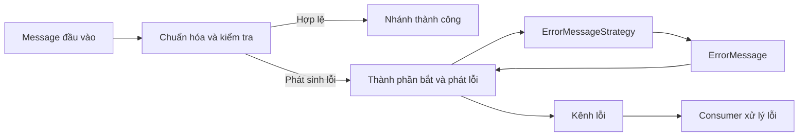

# ErrorMessageStrategy: tạo thông điệp lỗi có đủ ngữ cảnh

Trong Spring Integration Core, một nhánh xử lý lỗi thường cần trả lời ba câu hỏi: thao tác nào thất bại, message ở thời điểm thất bại có gì và message đầu vào của đoạn xử lý là gì. `ErrorMessageStrategy` là điểm mở rộng để đóng gói thông tin đó vào `ErrorMessage` trước khi thành phần phát lỗi gửi nó đi.

Bài học thuộc chương **Error handling** của module `SPRING_INTEGRATION_CORE`. Mục tiêu là hiểu hợp đồng của strategy, sử dụng hành vi mặc định, bổ sung header phục vụ theo dõi và nối strategy với một luồng Java DSL. Các ví dụ sử dụng API Spring Integration **6.5.x**, Java 17 trở lên và JUnit Jupiter cho phần kiểm thử minh họa. Đây là mốc API của ví dụ, không phải yêu cầu đổi phiên bản của dự án đang học.

## 1. Vị trí của strategy trong luồng lỗi

Giả sử hệ thống tiếp nhận mã đơn hàng dưới dạng chuỗi. Message ban đầu có payload `" INVALID "`; bước chuẩn hóa tạo message mới có payload `"INVALID"`; bước kiểm tra định dạng phát sinh `IllegalArgumentException`. Để điều tra được trường hợp này, nhánh lỗi cần giữ cả chuỗi đầu vào và chuỗi đã chuẩn hóa.



Các vai trò cần được xác định riêng:

| Thành phần | Trách nhiệm trong ví dụ |
| --- | --- |
| Handler xử lý đơn hàng | Chuẩn hóa dữ liệu và kiểm tra mã đơn |
| Cơ chế bắt lỗi | Quyết định lỗi nào được chuyển sang luồng message |
| `ErrorMessageStrategy` | Tạo một `ErrorMessage` từ exception và context được cung cấp |
| Thành phần phát lỗi | Gọi strategy rồi gửi kết quả đến kênh đã cấu hình |
| Consumer của kênh lỗi | Ghi nhận, phân loại, cảnh báo hoặc tổ chức xử lý tiếp |

`ErrorMessageStrategy` là functional interface với phương thức chính dưới đây. Context có thể là `null`; kiểu trả về phải là `ErrorMessage`. Hợp đồng này cho phép dùng class hoặc lambda khi cấu hình thành phần phát lỗi. [Javadoc ErrorMessageStrategy](https://docs.spring.io/spring-integration/docs/6.5.0/api/org/springframework/integration/support/ErrorMessageStrategy.html).

```java
ErrorMessage buildErrorMessage(
        Throwable failure,
        AttributeAccessor context);
```

Tên tham số trong ví dụ được chọn để diễn đạt mục đích. `failure` là lỗi mà thành phần gọi chuyển vào, còn `context` là nơi tra cứu ngữ cảnh cho lần tạo message hiện tại.

Từ ranh giới này, có thể thấy việc tạo một strategy chưa thiết lập retry, rollback hoặc đích gửi lỗi. Những chính sách đó cần được cấu hình ở thành phần sở hữu chúng. Với strategy, nên đặt mục tiêu nhỏ và có thể kiểm chứng: tạo đúng envelope lỗi, giữ nguyên exception và thêm metadata cần thiết.

## 2. Đọc đúng cấu trúc ErrorMessage

`ErrorMessage` là một loại `Message<Throwable>`. Nó có headers, payload lỗi và thuộc tính `originalMessage` tùy chọn. Khi payload là `MessagingException`, exception còn có thể mang `failedMessage`. Hai vị trí giữ message này phục vụ hai mốc khác nhau của quá trình xử lý. [Javadoc ErrorMessage](https://docs.spring.io/spring-framework/docs/6.2.x/javadoc-api/org/springframework/messaging/support/ErrorMessage.html).

| Vị trí | Nội dung mong đợi trong tình huống mã đơn hàng |
| --- | --- |
| `error.getPayload()` | Exception mô tả thất bại; thường là `MessagingException` hoặc subclass |
| `error.getOriginalMessage()` | Message đầu vào được context chỉ định, có payload `" INVALID "` |
| `((MessagingException) error.getPayload()).getFailedMessage()` | Message tại điểm kiểm tra, có payload `"INVALID"` |
| `error.getPayload().getCause()` | Nguyên nhân được bọc trực tiếp, ở ví dụ là `IllegalArgumentException` |
| `error.getHeaders()` | Metadata của envelope lỗi, chẳng hạn `traceId` và `failureService` do ứng dụng bổ sung |

Trong một luồng dài, “đầu vào” phải gắn với phạm vi của thành phần đang xử lý. Một gateway hoặc một subflow có thể coi message đi vào chính nó là đầu vào. Không nên mặc định `originalMessage` luôn là message đầu tiên từng xuất hiện trong toàn hệ thống.

Ví dụ có thể mô tả kết quả mong đợi như sau:

```text
ErrorMessage
  headers.traceId = "trace-101"
  headers.failureService = "SPRING_INTEGRATION_CORE"
  originalMessage.payload = " INVALID "
  payload = MessageHandlingException
    failedMessage.payload = "INVALID"
    cause = IllegalArgumentException
```

Giữ wrapper exception giúp người xử lý lỗi truy cập thông tin của Spring Messaging và chuỗi nguyên nhân. Nếu thay toàn bộ payload bằng exception sâu nhất, một phần ngữ cảnh có thể bị bỏ lại ở wrapper. Trong bài này, việc phân loại nguyên nhân được thực hiện sau khi đã bảo toàn exception đầu vào.

## 3. Context và hành vi mặc định

### 3.1. Hai khóa context cần biết

`AttributeAccessor` là túi thuộc tính mà thành phần gọi truyền vào strategy. Đây không phải là toàn bộ headers của request. Spring Integration cung cấp các khóa và hàm tiện ích để tạo context tương ứng với message đầu vào và message thất bại. [Javadoc ErrorMessageUtils](https://docs.spring.io/spring-integration/docs/6.5.0/api/org/springframework/integration/support/ErrorMessageUtils.html).

| API | Ý nghĩa khi xây dựng context |
| --- | --- |
| `ErrorMessageUtils.INPUT_MESSAGE_CONTEXT_KEY` | Vị trí chứa message đầu vào của phạm vi xử lý |
| `ErrorMessageUtils.FAILED_MESSAGE_CONTEXT_KEY` | Vị trí chứa message tại điểm thất bại |
| `ErrorMessageUtils.getAttributeAccessor(input, failed)` | Tạo accessor từ hai message được cung cấp |

Không nên tự gõ chuỗi giá trị của các hằng số. Khi đọc một thuộc tính tùy chọn, hãy kiểm tra kiểu trước khi sử dụng. Context không chứa message đầu vào vẫn là trường hợp strategy cần xử lý được.

### 3.2. DefaultErrorMessageStrategy làm gì

`DefaultErrorMessageStrategy` giữ exception làm payload. Nếu context chứa một `Message` tại khóa `INPUT_MESSAGE_CONTEXT_KEY`, nó dùng message đó làm `originalMessage`; nếu không có thì tạo envelope lỗi không có message gốc. Strategy mặc định không tự tìm message đầu vào trong toàn bộ lịch sử của flow. [Javadoc DefaultErrorMessageStrategy](https://docs.spring.io/spring-integration/docs/6.5.0/api/org/springframework/integration/support/DefaultErrorMessageStrategy.html).

Ví dụ sau tạo hai message để thể hiện rõ ranh giới trước và sau chuẩn hóa:

```java
import org.springframework.core.AttributeAccessor;
import org.springframework.integration.support.DefaultErrorMessageStrategy;
import org.springframework.integration.support.ErrorMessageUtils;
import org.springframework.messaging.Message;
import org.springframework.messaging.MessageHandlingException;
import org.springframework.messaging.support.ErrorMessage;
import org.springframework.messaging.support.MessageBuilder;

Message<String> input = MessageBuilder.withPayload(" INVALID ")
        .setHeader("traceId", "trace-101")
        .build();

Message<String> failed = MessageBuilder.withPayload("INVALID")
        .setHeader("traceId", "trace-101")
        .build();

IllegalArgumentException cause =
        new IllegalArgumentException("Order id must match ORD- followed by 3 digits");

MessageHandlingException failure = new MessageHandlingException(
        failed, "Order validation failed", cause);

AttributeAccessor context =
        ErrorMessageUtils.getAttributeAccessor(input, failed);

ErrorMessage error = new DefaultErrorMessageStrategy()
        .buildErrorMessage(failure, context);

System.out.println(error.getOriginalMessage().getPayload()); // " INVALID "
System.out.println(failure.getFailedMessage().getPayload()); // "INVALID"
```

Trong ví dụ này, `failedMessage` có mặt vì ứng dụng đã truyền nó vào `MessageHandlingException`. Chỉ đặt thuộc tính `FAILED_MESSAGE_CONTEXT_KEY` rồi gọi trực tiếp strategy mặc định không có nghĩa là strategy sẽ sửa exception để thêm `failedMessage`.

Một điểm khác cũng dễ bị bỏ sót: headers của message gốc không tự trở thành headers của envelope lỗi chỉ vì `originalMessage` đã được giữ lại. Khi cần `traceId` ngay trên message gửi đến consumer lỗi, hãy bổ sung nó theo một quy ước rõ ràng.

## 4. Viết strategy bổ sung metadata

### 4.1. Quy ước của ví dụ

Nhánh lỗi của ứng dụng cần bốn header:

| Header | Giá trị hoặc nguồn dữ liệu |
| --- | --- |
| `failureService` | Định danh module `SPRING_INTEGRATION_CORE` |
| `failureType` | Tên class của exception mà strategy nhận được |
| `traceId` | Chuỗi theo dõi lấy từ message đầu vào; dự phòng từ `failedMessage` |
| `orderRef` | Mã tham chiếu nghiệp vụ lấy theo cùng quy tắc |

Hai header cuối chỉ được sao chép nếu là chuỗi không rỗng, dài tối đa 128 ký tự. Giới hạn này là chính sách minh họa của ứng dụng. `failureType` biểu diễn exception ngoài cùng, không phải quy tắc xác định nguyên nhân sâu nhất hoặc lỗi có được retry hay không.

### 4.2. Cài đặt OrderErrorMessageStrategy

Đặt class dưới đây trong cùng package với cấu hình và kiểm thử ở các phần tiếp theo, hoặc bổ sung package và import tương ứng trong dự án thực hành.

```java
import java.util.HashMap;
import java.util.Map;

import org.springframework.core.AttributeAccessor;
import org.springframework.integration.support.DefaultErrorMessageStrategy;
import org.springframework.integration.support.ErrorMessageStrategy;
import org.springframework.messaging.Message;
import org.springframework.messaging.MessagingException;
import org.springframework.messaging.support.ErrorMessage;

public final class OrderErrorMessageStrategy implements ErrorMessageStrategy {

    private final DefaultErrorMessageStrategy delegate =
            new DefaultErrorMessageStrategy();

    @Override
    public ErrorMessage buildErrorMessage(
            Throwable failure, AttributeAccessor context) {

        ErrorMessage baseline = delegate.buildErrorMessage(failure, context);
        Message<?> original = baseline.getOriginalMessage();

        Message<?> metadataSource = original;
        if (metadataSource == null && failure instanceof MessagingException ex) {
            metadataSource = ex.getFailedMessage();
        }

        Map<String, Object> headers = new HashMap<>();
        headers.put("failureService", "SPRING_INTEGRATION_CORE");
        headers.put("failureType", failure.getClass().getSimpleName());

        copyTextHeader(metadataSource, headers, "traceId");
        copyTextHeader(metadataSource, headers, "orderRef");

        return new ErrorMessage(failure, headers, original);
    }

    private static void copyTextHeader(
            Message<?> source, Map<String, Object> target, String name) {

        if (source == null) {
            return;
        }

        Object value = source.getHeaders().get(name);
        if (value instanceof String text
                && !text.isBlank()
                && text.length() <= 128) {
            target.put(name, text);
        }
    }
}
```

Class này có một số lựa chọn thiết kế đáng chú ý:

- Delegate xác định `originalMessage` theo hành vi mặc định; class tùy chỉnh không tự định nghĩa lại ý nghĩa của nó.
- Payload đầu ra giữ chính đối tượng `failure`, nhờ đó giữ nguyên wrapper và chuỗi nguyên nhân.
- Nếu thiếu message đầu vào, `failedMessage` chỉ được dùng làm nguồn metadata. Nó không tự được đổi tên thành `originalMessage`.
- Khi message đầu vào có mặt, toàn bộ metadata được đọc từ đó. Phiên bản minh họa không trộn từng header còn thiếu từ nhiều mốc xử lý.
- Map mới chỉ chứa các header được chọn. Không sao chép `id`, `timestamp`, `replyChannel`, `errorChannel` hoặc thông tin xác thực từ request.

Đây là class không giữ trạng thái theo từng request. Map được tạo riêng trong mỗi lần gọi nên các lần lỗi đồng thời không chia sẻ dữ liệu vừa đọc. Nếu mở rộng class, tránh lưu message hoặc exception hiện tại vào field của bean singleton.

### 4.3. Giữ ngữ cảnh và bảo vệ dữ liệu

Không sao chép header xác thực lên envelope lỗi không đồng nghĩa dữ liệu nhạy cảm đã được loại bỏ. `originalMessage`, `failedMessage` và chính exception vẫn có thể tham chiếu dữ liệu đầu vào. Vì vậy, consumer lỗi cần kiểm soát nội dung log, quyền truy cập và thời gian giữ dữ liệu.

Đối với ví dụ này, log chỉ nên trích các trường đã chọn như `traceId`, `orderRef` và loại exception. Nếu phải đưa lỗi ra hệ thống ngoài, hãy tạo DTO riêng chứa thông tin được phép công bố thay vì serialize trực tiếp toàn bộ `ErrorMessage`.

Strategy cũng nên tránh gọi mạng, ghi cơ sở dữ liệu hoặc gửi cảnh báo trực tiếp. Đặt các thao tác đó ở consumer giúp người đọc flow thấy nơi phát sinh tác dụng phụ và cách xử lý khi chính tác dụng phụ thất bại.

## 5. Gắn strategy vào thành phần phát lỗi

### 5.1. Khai báo bean phải đi cùng cấu hình nơi sử dụng

Trong ví dụ, `ErrorMessagePublisher` là thành phần nhận exception, gọi strategy và gửi kết quả đến kênh lỗi. Nó cung cấp các setter cấu hình strategy, kênh và thời gian chờ gửi. [Javadoc ErrorMessagePublisher](https://docs.spring.io/spring-integration/docs/6.5.0/api/org/springframework/integration/core/ErrorMessagePublisher.html).

Một bean mang kiểu `ErrorMessageStrategy` chỉ trở nên hữu ích khi thành phần phát lỗi thực sự sử dụng bean đó. Cấu hình sau thiết lập quan hệ này bằng `setErrorMessageStrategy(...)` và chỉ rõ `orderFailures` là đích gửi.

### 5.2. Cấu hình Java DSL hoàn chỉnh

Ví dụ cần dependency `org.springframework.integration:spring-integration-core` thuộc dòng 6.5.x. Java DSL nằm trong artifact core. Phần kiểm thử bên dưới cần thêm JUnit Jupiter; khi dùng Spring Boot, để BOM tương ứng quản lý các phiên bản Spring thay vì ghép tùy ý các dòng phiên bản.

```java
import org.springframework.beans.factory.annotation.Qualifier;
import org.springframework.context.annotation.Bean;
import org.springframework.context.annotation.Configuration;
import org.springframework.integration.channel.DirectChannel;
import org.springframework.integration.channel.QueueChannel;
import org.springframework.integration.config.EnableIntegration;
import org.springframework.integration.core.ErrorMessagePublisher;
import org.springframework.integration.dsl.IntegrationFlow;
import org.springframework.integration.support.ErrorMessageStrategy;
import org.springframework.messaging.Message;
import org.springframework.messaging.MessageChannel;
import org.springframework.messaging.MessageDeliveryException;
import org.springframework.messaging.MessageHandler;
import org.springframework.messaging.MessageHandlingException;
import org.springframework.messaging.support.MessageBuilder;

@Configuration
@EnableIntegration
public class OrderErrorConfiguration {

    @Bean
    public DirectChannel orderInput() {
        return new DirectChannel();
    }

    @Bean
    public QueueChannel acceptedOrders() {
        return new QueueChannel(20);
    }

    @Bean
    public QueueChannel orderFailures() {
        return new QueueChannel(20);
    }

    @Bean
    public ErrorMessageStrategy orderErrorMessageStrategy() {
        return new OrderErrorMessageStrategy();
    }

    @Bean
    public ErrorMessagePublisher orderErrorPublisher(
            @Qualifier("orderFailures") MessageChannel errors,
            ErrorMessageStrategy orderErrorMessageStrategy) {

        ErrorMessagePublisher publisher = new ErrorMessagePublisher();
        publisher.setChannel(errors);
        publisher.setSendTimeout(1_000);
        publisher.setErrorMessageStrategy(orderErrorMessageStrategy);
        return publisher;
    }

    @Bean
    public IntegrationFlow orderFlow(
            @Qualifier("orderInput") MessageChannel input,
            @Qualifier("acceptedOrders") MessageChannel accepted,
            ErrorMessagePublisher orderErrorPublisher) {

        return IntegrationFlow.from(input)
                .handle((MessageHandler) original -> {
                    String normalized = ((String) original.getPayload()).trim();

                    Message<String> candidate = MessageBuilder
                            .withPayload(normalized)
                            .copyHeaders(original.getHeaders())
                            .build();

                    try {
                        validate(candidate.getPayload());
                    }
                    catch (IllegalArgumentException ex) {
                        MessageHandlingException failure =
                                new MessageHandlingException(
                                        candidate, "Order validation failed", ex);

                        orderErrorPublisher.publish(original, failure);
                        return;
                    }

                    if (!accepted.send(candidate, 1_000)) {
                        throw new MessageDeliveryException(
                                candidate, "acceptedOrders rejected the message");
                    }
                })
                .get();
    }

    private static void validate(String orderId) {
        if (!orderId.matches("ORD-\\d{3}")) {
            throw new IllegalArgumentException(
                    "Order id must match ORD- followed by 3 digits");
        }
    }
}
```

Flow dùng overload `.handle(MessageHandler)` của Java DSL để xử lý toàn bộ message, không chỉ payload. Các API DSL cho phép đăng ký handler vào flow được Spring quản lý. [Javadoc BaseIntegrationFlowDefinition](https://docs.spring.io/spring-integration/docs/6.5.0/api/org/springframework/integration/dsl/BaseIntegrationFlowDefinition.html).

Luồng thực hiện các bước sau:

1. Nhận message chuỗi qua `orderInput`.
2. Tạo message mới sau khi loại bỏ khoảng trắng đầu cuối.
3. Kiểm tra định dạng `ORD-` theo sau bởi ba chữ số.
4. Nếu định dạng sai, tạo exception mang `candidate` rồi truyền cả `original` vào publisher.
5. Publisher gọi strategy và gửi một `ErrorMessage` đến `orderFailures`.
6. Nếu hợp lệ, chuyển message đã chuẩn hóa vào `acceptedOrders`.

Chỉ lỗi kiểm tra định dạng được bắt và chuyển thành message lỗi trong ví dụ. Payload sai kiểu và lỗi gửi ở nhánh thành công vẫn đi theo đường exception. Điểm bắt lỗi có phạm vi nhỏ giúp tránh vô tình coi lỗi hạ tầng là lỗi dữ liệu.

### 5.3. Ý nghĩa của ranh giới bắt lỗi

`orderInput` là `DirectChannel`; handler chạy đồng bộ với lời gọi gửi. Ví dụ có nhánh lỗi vì code đã chủ động bắt exception kiểm tra định dạng và gọi publisher. Một handler đồng bộ khác ném exception ra ngoài sẽ không tự đi qua strategy này chỉ vì ứng dụng có bean strategy. [Spring Integration: Error Handling](https://docs.spring.io/spring-integration/reference/6.5/error-handling.html).

Khi nhánh lỗi được ghi nhận thành công, `orderInput.send(...)` có thể trả về `true`. Với hợp đồng của ví dụ, điều đó chỉ xác nhận lần gửi và handler đã xử lý theo chính sách cấu hình; nghiệp vụ có thể đã chuyển sang nhánh lỗi. Người gọi cần quan sát kết quả nghiệp vụ qua kênh hoặc giao thức đã thống nhất.

Hai `QueueChannel` giữ message trong bộ nhớ để dễ quan sát. Chúng chưa đại diện cho kho lỗi bền vững. Trong ứng dụng thật, cần consumer hoặc poller đọc các queue; nếu queue đầy, thời gian chờ gửi và lỗi phát sinh cần có chính sách xử lý riêng.

## 6. Chọn đúng overload của ErrorMessagePublisher

Một lỗi khó phát hiện là truyền đúng `failedMessage` nhưng lại không truyền message đầu vào. Với API 6.5.0, các overload sau tạo context khác nhau. [Mã nguồn ErrorMessagePublisher 6.5.0](https://raw.githubusercontent.com/spring-projects/spring-integration/v6.5.0/spring-integration-core/src/main/java/org/springframework/integration/core/ErrorMessagePublisher.java).

| Cách gọi | Ngữ cảnh chính được cung cấp |
| --- | --- |
| `publish(failed, throwable)` | Có message thất bại; không chỉ định message đầu vào |
| `publish(messagingException)` | Lấy message thất bại từ exception; không chỉ định message đầu vào |
| `publish(input, messagingException)` | Có message đầu vào và message thất bại trong exception |
| `publish(input, failed, throwable)` | Cung cấp tường minh cả hai message |
| `publish(throwable, context)` | Caller tự chuẩn bị context phù hợp |

Ví dụ cấu hình dùng `publish(original, failure)` với `failure` được khai báo kiểu `MessageHandlingException`. Vì vậy, overload nhận `MessagingException` được chọn và message đầu vào có mặt trong context. Đừng đổi biến này sang kiểu `Throwable` mà không kiểm tra lại overload mà Java sẽ chọn.

Khi publisher nhận một `Throwable` chưa phải `MessagingException`, nó có thể tạo wrapper trước khi gọi strategy. Do đó, assertion “payload chính là exception nghiệp vụ ban đầu” chỉ đúng nếu đang kiểm tra đối tượng thực sự được truyền đến strategy, hoặc biết rõ đường gọi không tạo wrapper. Trong ví dụ chính, wrapper được tạo tường minh nên quan hệ giữa các đối tượng dễ kiểm tra.

### Phân biệt tạo envelope với chọn kênh

Publisher của ví dụ được gắn trực tiếp với `orderFailures`. Việc thêm hoặc giữ header `errorChannel` ở một message không làm publisher đã cấu hình này tự chọn một đích khác. Nếu ứng dụng cần chính sách chọn kênh theo request, hãy cấu hình cơ chế phát lỗi có hỗ trợ chính sách đó.

`MessagePublishingErrorHandler` là một `ErrorHandler` phát `ErrorMessage` và kế thừa khả năng cấu hình strategy từ `ErrorMessagePublisher`. Đây là điểm gắn phù hợp khi bộ lập lịch hoặc thành phần thực thi đang sử dụng error handler đó. Khai báo riêng một error handler cũng cần đi cùng việc gắn nó vào thành phần thực thi thực tế. [Javadoc MessagePublishingErrorHandler](https://docs.spring.io/spring-integration/docs/6.5.0/api/org/springframework/integration/channel/MessagePublishingErrorHandler.html).

## 7. Sử dụng cùng strategy ở các điểm phát lỗi khác

Giữ quy ước envelope thống nhất giúp consumer dùng cùng cách đọc lỗi ở nhiều cửa vào. Tuy nhiên, mỗi thành phần phải được cấu hình riêng và context thực tế phụ thuộc vào điểm gọi.

| Điểm phát lỗi | Cách áp dụng |
| --- | --- |
| Publisher do ứng dụng tạo | Gọi `setErrorMessageStrategy(...)` như ví dụ |
| Producer endpoint hỗ trợ strategy | Gắn strategy vào chính endpoint được sử dụng |
| Gateway hỗ trợ strategy | Cấu hình strategy trên gateway cùng với chính sách xử lý lỗi của gateway |
| Recovery sau retry | Truyền strategy vào recoverer được sử dụng làm recovery callback |

`MessageProducerSupport` cung cấp `setErrorMessageStrategy(...)` và cơ chế chuẩn bị thuộc tính cho message lỗi. Khi dùng adapter dựa trên lớp này, hãy kiểm tra API cấu hình cụ thể của adapter và bảo đảm đang cấu hình đúng bean. [Javadoc MessageProducerSupport](https://docs.spring.io/spring-integration/docs/6.5.0/api/org/springframework/integration/endpoint/MessageProducerSupport.html).

Tương tự, `MessagingGatewaySupport` có setter cho strategy và bước tạo message lỗi từ request cùng exception. Với gateway, cần xem thêm hợp đồng request/reply: nhánh lỗi trả về một phản hồi dự phòng hay để exception được trả về caller là quyết định riêng của ứng dụng. [Javadoc MessagingGatewaySupport](https://docs.spring.io/spring-integration/docs/6.5.0/api/org/springframework/integration/gateway/MessagingGatewaySupport.html).

Đối với dòng API 6.5.x, `ErrorMessageSendingRecoverer` có constructor nhận kênh và strategy. Recoverer được gọi khi retry đã cạn, nên có thể dùng quy ước envelope giống publisher mà không đưa việc chờ giữa các lần thử vào strategy. [Javadoc ErrorMessageSendingRecoverer](https://docs.spring.io/spring-integration/docs/6.5.0/api/org/springframework/integration/handler/advice/ErrorMessageSendingRecoverer.html).

```java
import org.springframework.integration.handler.advice.ErrorMessageSendingRecoverer;
import org.springframework.integration.support.ErrorMessageStrategy;
import org.springframework.messaging.MessageChannel;

// Phần cấu hình recovery; cần gắn callback này vào retry advice thực tế.
ErrorMessageSendingRecoverer createRecoverer(
        MessageChannel failures, ErrorMessageStrategy strategy) {

    return new ErrorMessageSendingRecoverer(failures, strategy);
}
```

Đoạn cấu hình recovery là phương án mở rộng độc lập, không phải phần bắt buộc để chạy flow ở mục 5. Với API 6.5.x, phương án này còn cần Spring Retry tương thích. Khi chuyển sang dòng phiên bản khác, hãy đối chiếu lại API retry trước khi sử dụng.

Không nên vừa bắt lỗi rồi gửi thủ công trong handler, vừa cấu hình một tầng recovery khác gửi lại cùng lỗi mà chưa xác định quyền sở hữu. Trước khi ghép các tầng, hãy quyết định rõ tầng nào phát bản ghi lỗi cuối cùng và tầng nào vẫn phải ném exception để kích hoạt rollback hoặc retry.

## 8. Kiểm thử hợp đồng của strategy và luồng phát lỗi

Phần này cung cấp mã kiểm thử minh họa cho dự án thực hành. Các đoạn kiểm thử là nội dung bài học; chúng chưa được thực thi ở bước viết tài liệu này.

### 8.1. Kiểm thử độc lập strategy

Các kiểm thử tập trung vào khả năng giữ exception, phân biệt hai message và xử lý thiếu context. Không cần khởi tạo Spring context cho những hợp đồng này.

```java
import org.junit.jupiter.api.Test;
import org.springframework.integration.support.ErrorMessageUtils;
import org.springframework.messaging.Message;
import org.springframework.messaging.MessageHandlingException;
import org.springframework.messaging.MessagingException;
import org.springframework.messaging.support.ErrorMessage;
import org.springframework.messaging.support.MessageBuilder;

import static org.junit.jupiter.api.Assertions.*;

class OrderErrorMessageStrategyTest {

    private final OrderErrorMessageStrategy strategy =
            new OrderErrorMessageStrategy();

    @Test
    void createsErrorWithoutContext() {
        IllegalStateException failure =
                new IllegalStateException("Upstream unavailable");

        ErrorMessage error = strategy.buildErrorMessage(failure, null);

        assertSame(failure, error.getPayload());
        assertNull(error.getOriginalMessage());
        assertEquals("SPRING_INTEGRATION_CORE",
                error.getHeaders().get("failureService"));
        assertFalse(error.getHeaders().containsKey("traceId"));
    }

    @Test
    void keepsOriginalAndFailedMessageDistinct() {
        Message<String> input = MessageBuilder.withPayload(" INVALID ")
                .setHeader("traceId", "trace-101")
                .setHeader("Authorization", "example-sensitive-value")
                .build();

        Message<String> failed = MessageBuilder.withPayload("INVALID")
                .setHeader("traceId", "trace-after-transform")
                .build();

        IllegalArgumentException cause =
                new IllegalArgumentException("Invalid order id");
        MessageHandlingException failure = new MessageHandlingException(
                failed, "Order validation failed", cause);

        ErrorMessage error = strategy.buildErrorMessage(failure,
                ErrorMessageUtils.getAttributeAccessor(input, failed));

        assertSame(failure, error.getPayload());
        assertSame(input, error.getOriginalMessage());
        assertSame(failed,
                ((MessagingException) error.getPayload()).getFailedMessage());
        assertSame(cause, error.getPayload().getCause());
        assertEquals("trace-101", error.getHeaders().get("traceId"));
        assertFalse(error.getHeaders().containsKey("Authorization"));
    }

    @Test
    void usesFailedMessageForMetadataWhenInputIsMissing() {
        Message<String> failed = MessageBuilder.withPayload("INVALID")
                .setHeader("traceId", "trace-failed-only")
                .build();

        MessageHandlingException failure = new MessageHandlingException(
                failed, "Order validation failed",
                new IllegalArgumentException("Invalid order id"));

        ErrorMessage error = strategy.buildErrorMessage(failure,
                ErrorMessageUtils.getAttributeAccessor(null, failed));

        assertNull(error.getOriginalMessage());
        assertSame(failure, error.getPayload());
        assertEquals("trace-failed-only", error.getHeaders().get("traceId"));
    }
}
```

Assertion loại bỏ `Authorization` chỉ nói về headers của envelope mới. Nó không khẳng định toàn bộ object graph đã được làm sạch; kiểm thử vẫn chủ động giữ `input` làm `originalMessage`.

Khi mở rộng chính sách metadata, thêm tình huống header sai kiểu, quá dài và trường hợp nhiều lần gọi đồng thời nếu strategy bắt đầu giữ trạng thái. Mỗi kiểm thử nên bảo vệ một yêu cầu sử dụng thực tế thay vì chỉ đếm số lần gọi một hàm nội bộ.

### 8.2. Kiểm thử luồng từ input đến hai queue kết quả

Kiểm thử sau sử dụng cấu hình ở mục 5, gửi lần lượt một mã không hợp lệ và một mã hợp lệ. Các assertion xác nhận cả đường đi của message lẫn dữ liệu mà consumer lỗi sẽ nhìn thấy.

```java
import org.junit.jupiter.api.Test;
import org.springframework.context.annotation.AnnotationConfigApplicationContext;
import org.springframework.integration.channel.QueueChannel;
import org.springframework.messaging.Message;
import org.springframework.messaging.MessageChannel;
import org.springframework.messaging.MessageHandlingException;
import org.springframework.messaging.support.ErrorMessage;
import org.springframework.messaging.support.MessageBuilder;

import static org.junit.jupiter.api.Assertions.*;

class OrderErrorFlowTest {

    @Test
    void sendsInvalidAndValidOrdersToTheirExpectedChannels() {
        try (AnnotationConfigApplicationContext context =
                     new AnnotationConfigApplicationContext(
                             OrderErrorConfiguration.class)) {

            MessageChannel input =
                    context.getBean("orderInput", MessageChannel.class);
            QueueChannel failures =
                    context.getBean("orderFailures", QueueChannel.class);
            QueueChannel accepted =
                    context.getBean("acceptedOrders", QueueChannel.class);

            Message<String> invalid = MessageBuilder.withPayload(" INVALID ")
                    .setHeader("traceId", "trace-flow-101")
                    .setHeader("orderRef", "request-101")
                    .build();

            assertTrue(input.send(invalid));

            ErrorMessage error = assertInstanceOf(
                    ErrorMessage.class, failures.receive(1_000));
            MessageHandlingException failure = assertInstanceOf(
                    MessageHandlingException.class, error.getPayload());

            assertSame(invalid, error.getOriginalMessage());
            assertNotNull(failure.getFailedMessage());
            assertEquals("INVALID", failure.getFailedMessage().getPayload());
            assertInstanceOf(IllegalArgumentException.class, failure.getCause());
            assertEquals("trace-flow-101", error.getHeaders().get("traceId"));
            assertEquals("request-101", error.getHeaders().get("orderRef"));
            assertEquals("SPRING_INTEGRATION_CORE",
                    error.getHeaders().get("failureService"));
            assertNull(accepted.receive(0));
            assertNull(failures.receive(0));

            assertTrue(input.send(
                    MessageBuilder.withPayload(" ORD-123 ").build()));

            Message<?> success = accepted.receive(1_000);
            assertNotNull(success);
            assertEquals("ORD-123", success.getPayload());
            assertNull(failures.receive(0));
        }
    }
}
```

`receive(1_000)` đặt giới hạn chờ cho message cần có; `receive(0)` kiểm tra queue ngay lập tức. Trong flow minh họa, xử lý input và việc đưa kết quả vào queue diễn ra đồng bộ, nên có thể kiểm tra queue trống sau khi `send(...)` kết thúc mà không cần `Thread.sleep(...)`.

Khi đổi flow sang thực thi bất đồng bộ, điều kiện “không có thêm message” cần được kiểm tra theo một khoảng thời gian quan sát thích hợp. Assertion queue trống ngay tại một thời điểm sẽ không chứng minh được các tác vụ nền không phát thêm lỗi sau đó.

## 9. Những lỗi thiết kế thường gặp

| Hiện tượng | Nguyên nhân cần kiểm tra | Hướng xử lý |
| --- | --- | --- |
| Có bean strategy nhưng metadata không xuất hiện | Thành phần thực sự phát lỗi chưa sử dụng bean đó | Gắn strategy vào publisher, gateway hoặc endpoint đúng nơi |
| `originalMessage` là `null` | Context không có message đầu vào hoặc đã chọn overload không truyền đầu vào | Kiểm tra context và kiểu tham số khi gọi `publish(...)` |
| Không biết dữ liệu tại thời điểm thất bại | Đã bỏ wrapper hoặc tạo exception không có message | Giữ exception phù hợp và cung cấp `failedMessage` khi có |
| Header theo dõi không có ở envelope lỗi | Chỉ giữ message gốc mà chưa bổ sung header cần dùng | Chọn các header cần thiết và sao chép tường minh |
| Exception ở `DirectChannel` vẫn đến caller | Không có điểm bắt và phát lỗi trên đường thực thi đó | Xác định lại chính sách xử lý tại handler hoặc gateway |
| Một lỗi xuất hiện nhiều lần | Nhiều tầng cùng gửi lỗi hoặc caller gửi lại request | Xác định một nơi sở hữu việc phát lỗi cuối và dùng khóa nghiệp vụ khi khử trùng lặp |
| Gửi thành công nhưng nghiệp vụ thất bại | Handler đã chuyển lỗi sang queue rồi kết thúc bình thường | Thiết kế kết quả nghiệp vụ riêng với trạng thái gửi message |
| Nhánh lỗi bị treo khi tải tăng | Consumer không theo kịp hoặc queue đầy | Kiểm tra consumer, dung lượng, timeout và cơ chế lưu trữ phù hợp |
| Log lộ dữ liệu đầu vào | In toàn bộ message hoặc exception mà chưa xét dữ liệu được giữ bên trong | Trích trường được phép và kiểm soát nơi lưu lỗi |

Nếu chính việc phát lỗi thất bại, cần quan sát được thất bại thứ hai đó. Ví dụ chính không đặt một khối `catch` rỗng quanh `publisher.publish(...)`; khi không gửi được vào queue lỗi, lần thực thi không được coi là đã ghi nhận lỗi thành công.

Khi áp dụng `ErrorMessageStrategy` vào một flow mới, hãy xác định trước phạm vi của message đầu vào, message tại điểm thất bại, tập metadata cần giữ và thành phần nào sở hữu việc phát lỗi. Sau đó dùng kiểm thử bảo vệ cả nội dung envelope lẫn đường đi thực tế của message.
