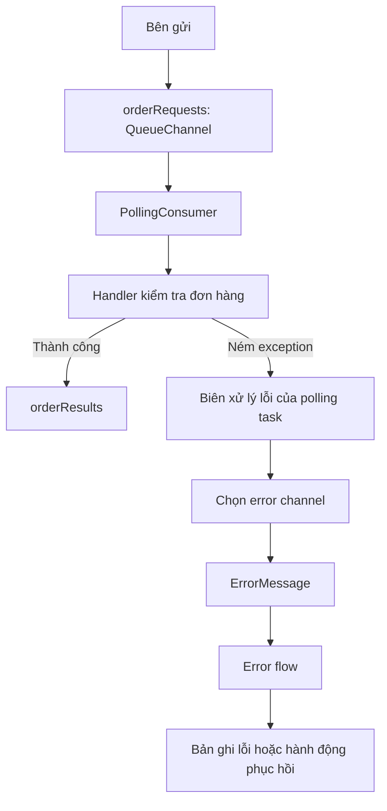

# Error channel của endpoint

Trong module **SPRING_INTEGRATION_CORE**, endpoint nối các thành phần xử lý với `MessageChannel`. Khi thiết kế luồng bằng transformer, router, filter, aggregator hay service activator, cần xác định cả đường đi của message thành công lẫn nơi tiếp nhận lỗi. Bài này tập trung vào **error channel tại biên thực thi của endpoint**, đặc biệt là endpoint nhận message bằng poller.

Ví dụ sử dụng Java 17 trở lên và API Spring Integration 6.5 làm mốc trình bày. Đây là lựa chọn cho ví dụ học tập; khi đưa vào ứng dụng, dùng bộ phiên bản Spring tương thích do dự án quản lý.

## 1. Mục tiêu và kiến thức cần có

Sau bài học, bạn có thể:

- Phân biệt exception truyền về caller với lỗi được đóng gói thành `ErrorMessage`.
- Chọn đúng vị trí cấu hình kênh lỗi: poller, producer/gateway có hỗ trợ, hoặc header của message.
- Giải thích thứ tự chọn kênh lỗi của `MessagePublishingErrorHandler`.
- Viết một error flow nhận đúng ngữ cảnh message thất bại.
- Kiểm thử đường lỗi cục bộ, header ghi đè và đường xử lý đồng bộ.

Bạn nên biết cấu trúc `Message<T>`, header, `DirectChannel`, `QueueChannel`, service activator và cách khai báo `IntegrationFlow`.

## 2. Hiểu đúng “error channel của endpoint”

Error channel là một `MessageChannel` tiếp nhận thông điệp mô tả lỗi. Tên gọi này thể hiện vai trò trong luồng; nó không phải một lớp channel riêng.

Cần phân biệt ba thành phần:

| Thành phần | Vai trò |
|---|---|
| Handler | Chạy logic xử lý, chẳng hạn chuyển đổi dữ liệu hoặc gọi dịch vụ |
| Endpoint | Kết nối handler với input channel; có thể quản lý việc polling |
| Error handler/publisher | Bắt lỗi tại biên được hỗ trợ, tạo `ErrorMessage` và gửi đến kênh lỗi |

Với input là `PollableChannel`, framework dùng `PollingConsumer`. Với input là `SubscribableChannel`, framework dùng `EventDrivenConsumer`. Vì vậy, cùng một handler có thể được gọi trong các mô hình thực thi khác nhau. [Tài liệu Message Endpoints](https://docs.spring.io/spring-integration/reference/6.5/endpoint.html).

Cụm “cấu hình error channel cho endpoint” cần được hiểu theo loại endpoint:

| Trường hợp | Cấu hình phù hợp |
|---|---|
| Service activator đọc `QueueChannel` | Cấu hình kênh lỗi trên poller của endpoint |
| Handler được gọi qua `DirectChannel` trong thread bên gửi | Exception truyền lên call stack; cần caller, gateway hoặc advice xử lý |
| Inbound producer hoặc gateway | Dùng khả năng xử lý lỗi mà component đó công bố |
| Muốn chỉ định nơi nhận lỗi cho từng message | Dùng header `MessageHeaders.ERROR_CHANNEL`, nếu biên bắt lỗi hỗ trợ việc phân giải header này |

Không suy ra rằng mọi endpoint đều có một setter `setErrorChannel(...)`, hay mọi consumer trong Java DSL đều có `e.errorChannel(...)`. Trong ví dụ polling của bài, cấu hình nằm trong `e.poller(...errorChannel(...))`.

## 3. Biên thread quyết định cách quan sát lỗi

### 3.1. Gọi đồng bộ qua DirectChannel

Xét luồng:

```text
thread HTTP -> DirectChannel -> transformer -> service activator
```

Nếu tất cả bước chạy trên thread HTTP và handler ném exception, exception quay ngược về caller qua call stack. Chỉ thêm header `errorChannel` không khiến `DirectChannel` tự bắt và phát lỗi.

### 3.2. Gửi vào QueueChannel rồi được poller xử lý

Xét luồng:

```text
thread HTTP -> QueueChannel -> trả kết quả send
                               |
thread scheduler --------------+-> poller -> handler
```

Bên gửi có thể đã hoàn tất thao tác `send` khi handler bắt đầu chạy. Lỗi tại handler sau đó không thể được ném ngược vào call stack đã kết thúc của bên gửi.

Spring Integration hỗ trợ phát `ErrorMessage` cho các biên thực thi bất đồng bộ và tác vụ poller được framework quản lý. Gửi thành công vào queue chỉ xác nhận thao tác đưa message vào channel, không xác nhận nghiệp vụ đã hoàn tất. [Tài liệu Error Handling](https://docs.spring.io/spring-integration/reference/error-handling.html).



Kênh `DirectChannel` trong error flow vẫn có thể phù hợp: nó cho error consumer chạy ngay trên thread đang công bố lỗi. Tính bất đồng bộ so với bên gửi ban đầu đến từ queue/poller, không bắt buộc mọi kênh trong nhánh lỗi đều phải bất đồng bộ.

## 4. Phân biệt ba nơi khai báo đích lỗi

### 4.1. Header errorChannel

Header `MessageHeaders.ERROR_CHANNEL` nằm trên request message. Với `MessagePublishingErrorHandler`, giá trị được hỗ trợ là một `MessageChannel` hoặc tên channel dạng `String` có thể phân giải trong application context.

Ví dụ chỉ định một queue nhận lỗi cho riêng request:

```java
QueueChannel requestErrors = new QueueChannel(10);

Message<OrderCommand> request = MessageBuilder
        .withPayload(new OrderCommand("ORD-101", 0))
        .setHeader(MessageHeaders.ERROR_CHANNEL, requestErrors)
        .build();

boolean accepted = orderRequests.send(request, 1_000);
```

Ở đây, `requestErrors` là object channel trong cùng JVM. Nếu message phải đi qua broker hoặc được serialize, không giả định tham chiếu object này có thể mang sang tiến trình khác.

### 4.2. Kênh lỗi mặc định của poller

Java DSL cho phép khai báo tên bean hoặc object channel bằng `PollerSpec.errorChannel(...)`. Đây là đích mặc định của cơ chế xử lý lỗi gắn với poller, không phải quy tắc bắt mọi exception trong ứng dụng. [API PollerSpec 6.5.0](https://docs.spring.io/spring-integration/docs/6.5.0/api/org/springframework/integration/dsl/PollerSpec.html).

```java
e -> e.poller(
        Pollers.fixedDelay(Duration.ofMillis(100))
                .maxMessagesPerPoll(1)
                .errorChannel("orderEndpointErrors"))
```

Kênh riêng giúp đội phụ trách luồng đơn hàng nhận lỗi đúng ngữ cảnh. Các poller khác vẫn có thể dùng chính sách lỗi riêng của chúng.

### 4.3. Kênh errorChannel toàn cục

Framework tạo kênh có tên bean `errorChannel` làm đích lỗi chung. Cấu hình mặc định sử dụng `PublishSubscribeChannel` với một subscriber ghi log mức `ERROR`. Từ Spring Integration 5.4.3, kênh mặc định yêu cầu có subscriber khi gửi lỗi. Nếu tự định nghĩa lại bean, cần chủ động thiết kế subscriber và chính sách tiếp nhận của mình. [Tài liệu về kênh lỗi mặc định](https://docs.spring.io/spring-integration/reference/error-handling.html).

Kênh toàn cục là điểm nhận chung cho những lỗi đi qua cơ chế phát lỗi tương ứng. Nó không tương đương một `try/catch` bao quanh mọi thread hoặc mọi thư viện.

## 5. Thứ tự chọn kênh lỗi

Với `MessagePublishingErrorHandler` dùng trong mô hình polling của bài, thứ tự thực tế có thể biểu diễn như sau:

```text
Nếu có failedMessage và header errorChannel hợp lệ:
    dùng channel từ header
Nếu không có đích từ header:
    dùng default error channel đã cấu hình cho error handler của poller
Nếu chưa cấu hình default riêng:
    dùng bean errorChannel toàn cục
```

Điểm cần nhớ là **đích trong header của failed message có thể được ưu tiên hơn kênh mặc định của poller**. Quy tắc này được thể hiện trong phần phân giải kênh của [MessagePublishingErrorHandler ở Spring Integration 6.5.0](https://github.com/spring-projects/spring-integration/blob/v6.5.0/spring-integration-core/src/main/java/org/springframework/integration/channel/MessagePublishingErrorHandler.java).

Ví dụ:

| Header trên failed message | Mặc định của poller | Đích được chọn |
|---|---|---|
| Không có | `orderEndpointErrors` | `orderEndpointErrors` |
| Tên `customerRequestErrors` hợp lệ | `orderEndpointErrors` | `customerRequestErrors` |
| Object `QueueChannel` | `orderEndpointErrors` | Object queue trong header |
| Không có | Không cấu hình riêng | `errorChannel` toàn cục |

Một số giới hạn quan trọng:

- Nếu polling thất bại trước khi có message, chẳng hạn lỗi khi đọc nguồn, có thể không có `failedMessage` để lấy header.
- Header có kiểu dữ liệu sai hoặc tên channel không tồn tại là lỗi cấu hình; không trông chờ cơ chế âm thầm chuyển sang global channel.
- Một component có error publisher riêng có thể có quy tắc khác. Không áp dụng bảng trên một cách máy móc cho mọi inbound adapter, gateway hoặc recovery callback.

Trong một hệ thống có hợp đồng phân quyền theo luồng, đội phát triển cần quyết định bên gửi có được chỉ định đích lỗi hay không. Nếu không, hãy thiết lập lại hoặc loại bỏ header tại ingress thích hợp.

## 6. Đọc ErrorMessage mà vẫn giữ được ngữ cảnh

`ErrorMessage` có payload là `Throwable`. Payload thường là một `MessagingException`, với `failedMessage` mô tả message tại thời điểm lỗi. Thuộc tính `originalMessage` của `ErrorMessage` là tùy chọn và có thể khác message thất bại sau biến đổi. [API ErrorMessage](https://docs.spring.io/spring-framework/docs/6.2.x/javadoc-api/org/springframework/messaging/support/ErrorMessage.html).

Ví dụ:

```text
Message<String> chứa JSON
    -> transformer tạo Message<OrderCommand>
    -> service activator kiểm tra số lượng và thất bại
```

Trong tình huống này, message thất bại có thể chứa `OrderCommand`. Không giả định `getOriginalMessage()` luôn chứa chuỗi JSON đầu vào, hoặc luôn khác `null`.

Một cách đọc ngữ cảnh có phòng vệ:

```java
static Message<?> findFailedMessage(ErrorMessage error) {
    Throwable current = error.getPayload();

    while (current != null) {
        if (current instanceof MessagingException messagingException
                && messagingException.getFailedMessage() != null) {
            return messagingException.getFailedMessage();
        }

        Throwable next = current.getCause();
        if (next == current) {
            break;
        }
        current = next;
    }

    return error.getOriginalMessage();
}
```

Hàm này ưu tiên message ở điểm thất bại, rồi mới dùng message gốc nếu có. Nó phù hợp với chuỗi cause thông thường của ví dụ.

Để phân loại nguyên nhân nghiệp vụ, có thể xem cause bên trong wrapper. Để truy vết, giữ cả exception gốc lẫn message thất bại. Chỉ log chuỗi `getMessage()` thường làm mất loại exception và stack trace; ngược lại, log nguyên payload có thể vô tình ghi dữ liệu khách hàng.

## 7. Ví dụ hoàn chỉnh: kênh lỗi riêng cho polling endpoint

### 7.1. Kịch bản

Một luồng nhận `OrderCommand` vào queue:

- Số lượng dương tạo kết quả `ACCEPTED:<orderId>`.
- Số lượng không hợp lệ gây `IllegalArgumentException`.
- Poller mặc định chuyển lỗi đến `orderEndpointErrors`.
- Error flow rút gọn ngữ cảnh thành `FailureRecord` và đưa vào queue quan sát `errorAudit`.

`errorAudit` phục vụ minh họa và kiểm thử trong bộ nhớ. Nó chưa phải kho lưu lỗi bền vững hay dead-letter queue của broker.

Ví dụ cần thư viện `spring-integration-core` cùng các dependency Spring tương thích. Java DSL đã nằm trong core; không cần tạo thêm module DSL riêng.

### 7.2. Cấu hình Java DSL

Toàn bộ đoạn sau thuộc một file `OrderErrorChannelConfig.java` trong ứng dụng thực hành:

```java
package example.integration;

import java.time.Duration;

import org.springframework.context.annotation.Bean;
import org.springframework.context.annotation.Configuration;
import org.springframework.integration.channel.DirectChannel;
import org.springframework.integration.channel.QueueChannel;
import org.springframework.integration.config.EnableIntegration;
import org.springframework.integration.dsl.IntegrationFlow;
import org.springframework.integration.dsl.Pollers;
import org.springframework.messaging.Message;
import org.springframework.messaging.MessageHandler;
import org.springframework.messaging.MessagingException;
import org.springframework.messaging.support.ErrorMessage;
import org.springframework.messaging.support.MessageBuilder;

@Configuration
@EnableIntegration
public class OrderErrorChannelConfig {

    public record OrderCommand(String orderId, int quantity) {
    }

    public record FailureRecord(
            String flow,
            String orderId,
            String traceId,
            String exceptionType) {
    }

    @Bean
    public QueueChannel orderRequests() {
        return new QueueChannel(100);
    }

    @Bean
    public QueueChannel orderResults() {
        return new QueueChannel(100);
    }

    @Bean
    public DirectChannel orderEndpointErrors() {
        return new DirectChannel();
    }

    @Bean
    public QueueChannel errorAudit() {
        return new QueueChannel(100);
    }

    @Bean
    public IntegrationFlow orderFlow() {
        return IntegrationFlow.from("orderRequests")
                .handle(OrderCommand.class, (order, headers) -> {
                    if (order.quantity() <= 0) {
                        throw new IllegalArgumentException(
                                "quantity must be greater than zero");
                    }
                    return "ACCEPTED:" + order.orderId();
                }, endpoint -> endpoint
                        .id("validateOrderEndpoint")
                        .poller(Pollers.fixedDelay(
                                        Duration.ofMillis(100))
                                .receiveTimeout(0)
                                .maxMessagesPerPoll(1)
                                .errorChannel("orderEndpointErrors")))
                .channel("orderResults")
                .get();
    }

    @Bean
    public IntegrationFlow orderErrorFlow() {
        MessageHandler errorConsumer = message -> {
            if (!(message instanceof ErrorMessage error)) {
                throw new IllegalArgumentException(
                        "Expected ErrorMessage");
            }

            Message<?> failed = findFailedMessage(error);
            Throwable cause = rootCause(error.getPayload());

            String orderId = "unknown";
            if (failed != null
                    && failed.getPayload() instanceof OrderCommand order) {
                orderId = order.orderId();
            }

            Object traceValue = failed == null
                    ? null
                    : failed.getHeaders().get("traceId");

            FailureRecord record = new FailureRecord(
                    "orderFlow",
                    orderId,
                    traceValue == null ? "unknown" : traceValue.toString(),
                    cause.getClass().getSimpleName());

            boolean recorded = errorAudit().send(
                    MessageBuilder.withPayload(record).build(),
                    1_000);

            if (!recorded) {
                throw new IllegalStateException(
                        "errorAudit queue is full");
            }
        };

        return IntegrationFlow.from("orderEndpointErrors")
                .handle(errorConsumer)
                .get();
    }

    static Message<?> findFailedMessage(ErrorMessage error) {
        Throwable current = error.getPayload();

        while (current != null) {
            if (current instanceof MessagingException messagingException
                    && messagingException.getFailedMessage() != null) {
                return messagingException.getFailedMessage();
            }

            Throwable next = current.getCause();
            if (next == current) {
                break;
            }
            current = next;
        }

        return error.getOriginalMessage();
    }

    static Throwable rootCause(Throwable failure) {
        Throwable current = failure;

        while (current.getCause() != null
                && current.getCause() != current) {
            current = current.getCause();
        }

        return current;
    }
}
```

`@EnableIntegration` bật hạ tầng Spring Integration trong cấu hình Spring thuần của ví dụ. Do lớp dùng `@Configuration` mặc định, lời gọi `errorAudit()` bên trong lớp được Spring quản lý và trả về bean queue tương ứng. Nếu chuyển sang cấu hình không proxy phương thức bean, cần đổi sang dependency injection thay vì giữ nguyên cách gọi này.

`receiveTimeout(0)` giúp poller không chờ khi queue rỗng. `maxMessagesPerPoll(1)` giới hạn một message mỗi lượt trong bài thực hành. Hai cấu hình này làm ví dụ dễ quan sát; cấu hình thông lượng thực tế cần dựa trên tải.

`MessageHandler` được dùng có chủ đích để nhận toàn bộ envelope `ErrorMessage`. Với lambda xử lý theo payload, tham số nhận được thường là `Throwable`; không nên nhầm nó với toàn bộ message.

### 7.3. Gửi message và quan sát

Trong context đã khởi tạo cấu hình trên:

```java
Message<OrderErrorChannelConfig.OrderCommand> request = MessageBuilder
        .withPayload(new OrderErrorChannelConfig.OrderCommand(
                "ORD-201", 0))
        .setHeader("traceId", "trace-201")
        .build();

if (!orderRequests.send(request, 1_000)) {
    throw new IllegalStateException("orderRequests queue is full");
}

Message<?> auditMessage = errorAudit.receive(3_000);

if (auditMessage == null) {
    throw new IllegalStateException("No failure record received");
}

OrderErrorChannelConfig.FailureRecord failure =
        (OrderErrorChannelConfig.FailureRecord) auditMessage.getPayload();
```

Kết quả mong đợi:

```text
flow          = orderFlow
orderId       = ORD-201
traceId       = trace-201
exceptionType = IllegalArgumentException
```

Bên gửi không nhận `IllegalArgumentException` từ `send` trong đường xử lý này. Exception xảy ra sau khi poller nhận message. Bên gửi vẫn có thể gặp lỗi của chính thao tác gửi, chẳng hạn channel không tiếp nhận; cần phân biệt điều đó với lỗi nghiệp vụ xảy ra về sau.

## 8. Cấu hình bằng annotation hoặc XML

Các cách dưới đây là **phương án thay thế** cho consumer `orderFlow`, không đăng ký cùng lúc với consumer Java DSL ở trên. Nếu nhiều consumer cùng đọc `orderRequests`, mỗi message có thể được lấy bởi consumer khác nhau, làm thay đổi hành vi mong muốn.

### 8.1. Annotation

Trong một bean đã được Spring đăng ký:

```java
import org.springframework.integration.annotation.Poller;
import org.springframework.integration.annotation.ServiceActivator;

@ServiceActivator(
        inputChannel = "orderRequests",
        outputChannel = "orderResults",
        poller = @Poller(
                fixedDelay = "100",
                receiveTimeout = "0",
                maxMessagesPerPoll = "1",
                errorChannel = "orderEndpointErrors"))
public String validateOrder(
        OrderErrorChannelConfig.OrderCommand order) {
    if (order.quantity() <= 0) {
        throw new IllegalArgumentException(
                "quantity must be greater than zero");
    }
    return "ACCEPTED:" + order.orderId();
}
```

Thuộc tính `@Poller.errorChannel` xác định tên bean của kênh lỗi mặc định cho `MessagePublishingErrorHandler` bên dưới. Nếu dùng `@Poller("namedPoller")` để tham chiếu một `PollerMetadata`, các thuộc tính khác không được khai báo đồng thời trên annotation đó. [API @Poller 6.5.0](https://docs.spring.io/spring-integration/docs/6.5.0/api/org/springframework/integration/annotation/Poller.html).

### 8.2. XML

Đoạn sau minh họa vị trí của `error-channel`. Các bean channel và `orderService` được khai báo riêng trong application context:

```xml
<int:service-activator
        id="validateOrderEndpoint"
        input-channel="orderRequests"
        output-channel="orderResults"
        ref="orderService"
        method="validateOrder">

    <int:poller
            fixed-delay="100"
            receive-timeout="0"
            max-messages-per-poll="1"
            error-channel="orderEndpointErrors"/>
</int:service-activator>
```

Ở đây, `error-channel` nằm trên `<int:poller>`. Ví dụ chỉ là fragment XML, cần namespace `int` tương ứng trong file cấu hình đầy đủ.

## 9. Kênh lỗi của poller bao phủ đến đâu?

Giả sử luồng được nối như sau:

```text
QueueChannel A
    -> poller P
    -> transformer
    -> DirectChannel B
    -> service activator
```

Nếu các bước sau poller vẫn chạy đồng bộ trong cùng polling task, exception từ service activator có thể đi ngược về biên bắt lỗi của P. Do đó kênh lỗi của poller không nhất thiết chỉ nhận lỗi từ một phương thức handler ngay sát nó.

Nếu thay B bằng một queue được poller Q khác đọc:

```text
QueueChannel A -> poller P -> QueueChannel B -> poller Q -> handler
```

Sau khi message được đưa vào B, lỗi phát sinh khi Q xử lý thuộc biên thực thi của Q. Cấu hình mặc định của P không tự trở thành chính sách mặc định cho Q. Header lỗi trên message, nếu được giữ lại, vẫn có thể ảnh hưởng tới đích được Q lựa chọn.

Tương tự, việc chuyển sang executor hoặc một callback ngoài framework tạo ra một biên cần xem xét riêng. Không giả định mọi `CompletableFuture`, thread tự tạo hay reactive publisher đều được poller ban đầu theo dõi đến khi hoàn tất.

Với `PublishSubscribeChannel` có executor, framework hỗ trợ error handler; khi không có executor, error handler của channel bị bỏ qua và exception được ném về thread caller. [Cấu hình PublishSubscribeChannel](https://docs.spring.io/spring-integration/reference/6.5/channel/configuration.html).

## 10. Liên hệ với gateway, retry và transaction

### 10.1. Gateway có cơ chế lỗi riêng

Messaging gateway có thể được cấu hình một `errorChannel` để chuyển exception thành message rồi xử lý theo hợp đồng của gateway, kể cả khi downstream chạy đồng bộ. Đây là một cơ chế bắt lỗi tường minh; không phải hiệu ứng tự động của `DirectChannel`.

Nếu gateway yêu cầu reply, error flow cần có kết quả phù hợp với hợp đồng gọi hoặc chủ động ném lỗi. Một nhánh chỉ ghi log rồi kết thúc có thể khiến caller không nhận được reply mong đợi. [Error Handling của Messaging Gateway](https://docs.spring.io/spring-integration/reference/6.5/gateway.html#error-handling).

Vì vậy, không dùng nguyên error flow audit của ví dụ để thay thế chính sách phản hồi của một gateway request-reply.

### 10.2. Error channel không tự retry

Error channel chỉ cung cấp đường truyền lỗi. Nó không tự gọi lại handler, tăng bộ đếm hay tạo backoff.

Trong một thiết kế có retry advice:

```text
handler lỗi
    -> retry theo chính sách
    -> nếu vẫn lỗi và exception còn được ném ra
    -> biên xử lý lỗi bên ngoài tiếp nhận
```

Với Spring Integration 6.5, `RequestHandlerRetryAdvice` hỗ trợ retry và recovery callback. Recovery callback có thể xử lý lỗi sau cùng, nên không phải lúc nào poller cũng còn nhận được exception để công bố tiếp. [Provided Advice Classes: Retry Advice](https://docs.spring.io/spring-integration/reference/6.5/handler-advice/classes.html).

Nếu tự xây dựng chức năng phát lại message từ error flow, cần giới hạn số lần, phân loại lỗi có thể thử lại và dùng khóa idempotency. Gửi vô hạn failed message trở lại input channel dễ tạo vòng lặp.

### 10.3. Công bố lỗi không đồng nghĩa rollback hoặc redelivery

Transaction, acknowledgment và redelivery phụ thuộc nguồn message, transaction manager, advice và vị trí bắt lỗi. Không thể kết luận “đã vào error channel nên message chắc chắn rollback”.

Trong ví dụ, `QueueChannel` mặc định dùng bộ nhớ. Message đã được poller lấy ra không tự được đưa lại vào queue khi handler ném lỗi. Bản ghi trong `errorAudit` cũng mất khi tiến trình dừng nếu chưa có cơ chế lưu bền vững.

Khi tích hợp nguồn ngoài, phải kiểm tra chính sách của chính adapter và transaction đang sử dụng, thay vì suy ra từ tên kênh lỗi.

## 11. Kiểm thử hành vi của endpoint

Những kiểm thử dưới đây minh họa cho ứng dụng thực hành dùng cấu hình ở mục 7. Chúng cần JUnit Jupiter, Spring Test và dependency core đã nêu. Đây là mã để người học thực hiện; bài viết không khẳng định các kiểm thử đã được chạy trong repository này.

### 11.1. Các trường hợp cần chứng minh

| Đầu vào hoặc cấu hình | Điều cần quan sát |
|---|---|
| Đơn có quantity bằng 0, không có header lỗi | Có `FailureRecord` trong `errorAudit` |
| Đơn lỗi có header trỏ đến queue riêng | Queue riêng nhận `ErrorMessage`; nhánh mặc định không ghi audit cho request đó |
| Đơn hợp lệ | Có kết quả thành công và không có bản ghi lỗi |
| Handler chạy trực tiếp trên thread bên gửi | Caller bắt được exception; header lỗi tự nó không làm phát `ErrorMessage` |

### 11.2. Kiểm thử luồng polling và độ ưu tiên header

Đặt lớp test trong package `example.integration` để truy cập các helper cùng package:

```java
package example.integration;

import static org.junit.jupiter.api.Assertions.assertEquals;
import static org.junit.jupiter.api.Assertions.assertNotNull;
import static org.junit.jupiter.api.Assertions.assertNull;
import static org.junit.jupiter.api.Assertions.assertTrue;

import org.junit.jupiter.api.Test;
import org.springframework.beans.factory.annotation.Autowired;
import org.springframework.beans.factory.annotation.Qualifier;
import org.springframework.integration.channel.QueueChannel;
import org.springframework.messaging.Message;
import org.springframework.messaging.MessageHeaders;
import org.springframework.messaging.support.ErrorMessage;
import org.springframework.messaging.support.MessageBuilder;
import org.springframework.test.annotation.DirtiesContext;
import org.springframework.test.context.junit.jupiter.SpringJUnitConfig;

@SpringJUnitConfig(OrderErrorChannelConfig.class)
@DirtiesContext(classMode = DirtiesContext.ClassMode.AFTER_EACH_TEST_METHOD)
class OrderErrorChannelTest {

    @Autowired
    @Qualifier("orderRequests")
    QueueChannel requests;

    @Autowired
    @Qualifier("orderResults")
    QueueChannel results;

    @Autowired
    @Qualifier("errorAudit")
    QueueChannel audit;

    @Test
    void pollingFailureGoesToEndpointErrorFlow() {
        assertTrue(requests.send(MessageBuilder
                .withPayload(new OrderErrorChannelConfig.OrderCommand(
                        "ORD-301", 0))
                .setHeader("traceId", "trace-301")
                .build(), 1_000));

        Message<?> received = audit.receive(3_000);
        assertNotNull(received);
        assertTrue(received.getPayload()
                instanceof OrderErrorChannelConfig.FailureRecord);

        var failure = (OrderErrorChannelConfig.FailureRecord)
                received.getPayload();

        assertEquals("ORD-301", failure.orderId());
        assertEquals("trace-301", failure.traceId());
        assertEquals("IllegalArgumentException",
                failure.exceptionType());
        assertNull(results.receive(0));
    }

    @Test
    void messageHeaderOverridesPollerDefault() {
        QueueChannel privateErrors = new QueueChannel(1);

        assertTrue(requests.send(MessageBuilder
                .withPayload(new OrderErrorChannelConfig.OrderCommand(
                        "ORD-302", 0))
                .setHeader(MessageHeaders.ERROR_CHANNEL, privateErrors)
                .build(), 1_000));

        Message<?> received = privateErrors.receive(3_000);
        assertNotNull(received);
        assertTrue(received instanceof ErrorMessage);

        ErrorMessage error = (ErrorMessage) received;
        Message<?> failed =
                OrderErrorChannelConfig.findFailedMessage(error);
        assertNotNull(failed);

        var command = (OrderErrorChannelConfig.OrderCommand)
                failed.getPayload();

        assertEquals("ORD-302", command.orderId());
        assertTrue(OrderErrorChannelConfig.rootCause(error.getPayload())
                instanceof IllegalArgumentException);
        assertNull(audit.receive(200));
    }

    @Test
    void validOrderUsesSuccessChannel() {
        assertTrue(requests.send(MessageBuilder
                .withPayload(new OrderErrorChannelConfig.OrderCommand(
                        "ORD-303", 2))
                .build(), 1_000));

        Message<?> received = results.receive(3_000);
        assertNotNull(received);
        assertEquals("ACCEPTED:ORD-303", received.getPayload());
        assertNull(audit.receive(200));
    }
}
```

Các phép `receive(timeout)` chờ một tín hiệu hữu ích thay vì ngủ một khoảng cố định rồi đoán poller đã chạy xong. Timeout hữu hạn cũng ngăn test treo vô thời hạn. Context được tạo lại giữa các test để tách trạng thái queue.

Hai phép kiểm tra không có audit dùng cửa sổ quan sát ngắn trong ví dụ. Với hệ thống thực tế có nhiều executor, nên bổ sung điểm đồng bộ hoặc quan sát trạng thái hoàn tất phù hợp, tránh dựa hoàn toàn vào thời gian chờ để chứng minh không có message đến muộn.

### 11.3. Kiểm thử DirectChannel không tự dùng header lỗi

Đây là một test độc lập, không cần application context:

```java
package example.integration;

import static org.junit.jupiter.api.Assertions.assertNull;
import static org.junit.jupiter.api.Assertions.assertThrows;

import org.junit.jupiter.api.Test;
import org.springframework.integration.channel.DirectChannel;
import org.springframework.integration.channel.QueueChannel;
import org.springframework.messaging.Message;
import org.springframework.messaging.MessageHandlingException;
import org.springframework.messaging.MessageHeaders;
import org.springframework.messaging.support.MessageBuilder;

class DirectChannelErrorTest {

    @Test
    void exceptionReturnsToSenderOnSameThread() {
        DirectChannel direct = new DirectChannel();
        QueueChannel errors = new QueueChannel(1);

        direct.subscribe(message -> {
            throw new MessageHandlingException(
                    message, new IllegalArgumentException("invalid order"));
        });

        Message<String> request = MessageBuilder
                .withPayload("ORD-304")
                .setHeader(MessageHeaders.ERROR_CHANNEL, errors)
                .build();

        assertThrows(MessageHandlingException.class,
                () -> direct.send(request));
        assertNull(errors.receive(0));
    }
}
```

Test này chứng minh vai trò của biên bắt lỗi: có một header đích lỗi chưa đủ; cần một cơ chế xử lý lỗi thực sự đọc header và công bố `ErrorMessage`.

## 12. Thiết kế error flow để vận hành được

### 12.1. Chọn channel theo nhu cầu nhận lỗi

| Loại channel | Ý nghĩa khi dùng cho nhánh lỗi |
|---|---|
| `DirectChannel` | Xử lý ngay trên thread đang phát lỗi; phù hợp với xử lý ngắn và rõ ràng |
| `QueueChannel` | Tách thời điểm nhận lỗi và xử lý lỗi; cần consumer/poller để rút queue |
| `PublishSubscribeChannel` | Phát lỗi đến nhiều subscriber, chẳng hạn audit và cảnh báo |

Một queue chỉ nhận lỗi mà không có consumer sẽ tích lũy message. Queue có giới hạn còn cần chính sách khi đầy. Publish-subscribe trong bộ nhớ cũng không tự tạo lưu trữ bền vững.

### 12.2. Đặt tên theo phạm vi trách nhiệm

Các tên như `orderEndpointErrors`, `paymentIngressErrors` hoặc `invoiceProcessingErrors` giúp xác định luồng chịu trách nhiệm xử lý. Tách kênh theo nhu cầu nghiệp vụ và vận hành; không cần tạo một kênh riêng cho mọi phương thức.

Nếu muốn lỗi cục bộ cũng đến một điểm quan sát chung, hãy thiết kế nhánh chuyển tiếp hoặc publish-subscribe rõ ràng. Việc chọn kênh cục bộ không tự phát thêm một bản sao vào global `errorChannel`.

### 12.3. Giữ dữ liệu đủ để điều tra

Một bản ghi lỗi hữu ích thường gồm:

- Định danh luồng hoặc endpoint.
- Định danh nghiệp vụ, chẳng hạn `orderId`.
- Correlation ID hoặc trace ID.
- Loại exception, thời điểm lỗi và trạng thái xử lý.
- Tham chiếu tới dữ liệu gốc được lưu ở nơi phù hợp.

Trong ví dụ, `FailureRecord` chỉ chứa một tập dữ liệu tối thiểu. Việc rút gọn này giúp bài tập tập trung vào đường đi của lỗi; hệ thống thực tế cần bổ sung lưu trữ và thông tin chẩn đoán theo yêu cầu.

### 12.4. Xử lý cả lỗi của nhánh lỗi

Error consumer có thể thất bại khi ghi database, đẩy queue hoặc gọi dịch vụ cảnh báo. Cần có phương án cuối cùng như log có kiểm soát, kho lỗi độc lập hoặc cảnh báo vận hành.

Không thiết kế vòng lặp “error handler lỗi thì luôn gửi lại chính error channel đó”. Đồng thời, không giả định error publisher sẽ tự thử lại đến khi gửi thành công. Với implementation `MessagePublishingErrorHandler` ở mốc 6.5.0, lỗi khi gửi thông điệp lỗi có thể được ghi log; cơ chế này không phải bảo đảm lưu lỗi bền vững.

## 13. Những lỗi cấu hình thường gặp

| Hiện tượng | Nguyên nhân nên kiểm tra | Cách xử lý |
|---|---|---|
| Handler ném lỗi nhưng kênh lỗi không nhận được | Luồng chạy đồng bộ qua `DirectChannel` | Kiểm tra exception ở caller hoặc cấu hình gateway/advice phù hợp |
| Lỗi không đến kênh riêng của poller | Failed message có header `errorChannel` khác | Kiểm tra header ở điểm thất bại và chính sách ingress |
| Queue lỗi tăng liên tục | Chưa có consumer hoặc consumer quá chậm | Bổ sung consumer, giới hạn queue và quan sát thông lượng |
| Error consumer không lấy được payload nghiệp vụ | Đang đọc payload `Throwable` như `OrderCommand` | Tìm `failedMessage` trong `MessagingException` |
| Mất `traceId` trong bản ghi lỗi | Đọc nhầm header của `ErrorMessage` hoặc đánh rơi header khi biến đổi | Lấy từ failed message và duy trì correlation có chủ đích |
| Cùng lỗi nhưng kết quả nhận thay đổi | Nhiều consumer cạnh tranh trên channel điểm-điểm | Xác định một consumer xử lý chính hoặc dùng fan-out phù hợp |
| Lỗi xuất hiện sau bước queue nhưng cấu hình poller trước đó không có tác dụng | Đã chuyển sang một biên polling khác | Cấu hình biên mới và kiểm tra header được truyền tiếp |
| Audit thành công nhưng dữ liệu nguồn không được phát lại | Đang đồng nhất công bố lỗi với redelivery | Thiết kế riêng retry, acknowledgment và phục hồi |
| Nhánh lỗi không có reply làm gateway chờ | Đang dùng error flow chỉ audit cho hợp đồng request-reply | Trả response lỗi hợp lệ hoặc truyền exception theo hợp đồng |

## 14. Áp dụng vào các mẫu tích hợp cốt lõi

Với transformer, lỗi có thể phát sinh khi dữ liệu không đúng định dạng. Với router, lỗi có thể nằm ở logic lựa chọn đích hoặc cấu hình channel. Với filter, message bị loại theo điều kiện chưa chắc là exception: cần phân biệt discard hợp lệ và thất bại xử lý.

Với aggregator, thao tác release hoặc timeout có thể xảy ra ở một thời điểm và biên thực thi khác với message đầu vào. Vì vậy, không mặc định kênh lỗi trên một poller phía trước sẽ bao phủ mọi lỗi vòng đời của nhóm message.

Khi ghép các mẫu này bằng Java DSL, hãy đánh dấu từng điểm chuyển thread hoặc lưu đệm, rồi xác định ai bắt lỗi tại mỗi điểm. Cách làm đó giúp đặt error channel theo đúng quyền sở hữu của luồng và xây dựng kiểm thử sát hành vi cần bảo đảm.

Một endpoint được thiết kế đầy đủ cần trả lời được: exception được bắt ở đâu, error message đến kênh nào, ngữ cảnh thất bại còn lại gì, và thành phần nào chịu trách nhiệm phục hồi sau khi nhận lỗi.
