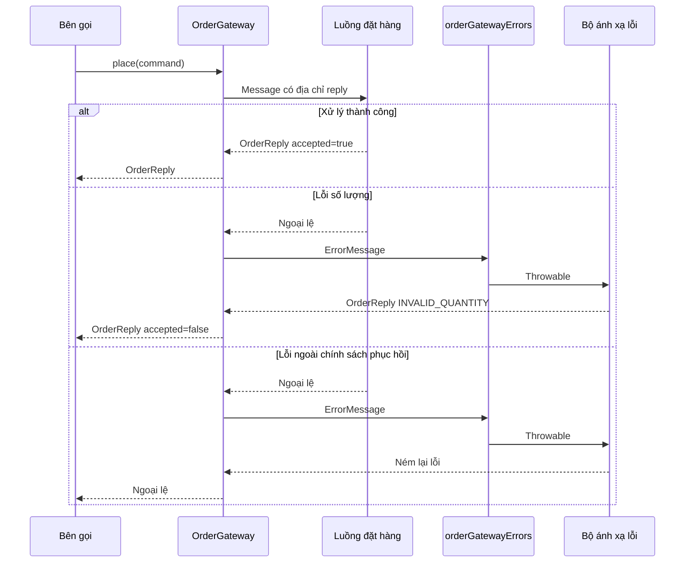

# Error channel của gateway

## Mục tiêu và phạm vi

Trong chương **Error handling** của `SPRING_INTEGRATION_CORE`, bài này tập trung vào ranh giới giữa lời gọi Java qua gateway và luồng thông điệp. Khi luồng thất bại, bên gọi cần nhận một ngoại lệ, một phản hồi từ chối hợp lệ, hay chỉ một thông báo rằng yêu cầu đã được tiếp nhận? Quyết định đó xác định cách thiết kế error channel.

Sau bài học, bạn có thể:

- Cấu hình error channel riêng cho gateway bằng Java DSL hoặc annotation.
- Chuyển lỗi nghiệp vụ thành phản hồi đúng kiểu mà gateway công bố.
- Phân biệt thuộc tính `errorChannel` của gateway, header cùng tên và kênh lỗi toàn cục.
- Đọc `ErrorMessage`, lần theo nguyên nhân và lấy thông tin request khi có.
- Nhận diện lỗi thiết kế liên quan đến xử lý bất đồng bộ, thiếu reply và timeout.

Ví dụ dùng Java 17 và API Spring Integration 6.5.x; các dependency Spring nên được quản lý đồng bộ theo BOM của ứng dụng. Bạn cần hiểu `Message`, `MessageChannel`, service activator và cấu trúc cơ bản của `IntegrationFlow`. Không cần HTTP, JMS hay broker để theo dõi ví dụ.

## 1. Gateway đặt hợp đồng xử lý lỗi ở đâu?

Giả sử ứng dụng cung cấp phương thức:

```java
OrderReply place(OrderCommand command);
```

Hợp đồng của ứng dụng trong bài này có ba kết quả:

| Tình huống | Kết quả mong muốn ở bên gọi | Ý nghĩa |
| --- | --- | --- |
| Số lượng hợp lệ | `OrderReply` với `accepted=true` | Yêu cầu được chấp nhận |
| Số lượng không hợp lệ | `OrderReply` với mã `INVALID_QUANTITY` | Từ chối nghiệp vụ có chủ đích |
| Thành phần xử lý gặp sự cố ngoài dự kiến | Ngoại lệ | Chưa thể kết luận yêu cầu thành công |

Gateway mặc định truyền lỗi downstream về bên gọi; cấu hình error channel cho phép chạy một luồng xử lý lỗi và dùng kết quả của luồng đó làm phản hồi. Một transformer có thể chuyển ngoại lệ thành DTO đáp ứng hợp đồng của phương thức gateway. Đây là cơ chế của messaging gateway trong tiến trình, không tự quy định HTTP status hay định dạng phản hồi của một giao thức bên ngoài. Xem [Messaging Gateways — Error Handling](https://docs.spring.io/spring-integration/reference/6.5/gateway.html#error-handling).

Trong ví dụ đặt hàng, error flow chỉ chuyển lỗi số lượng thành kết quả từ chối. Việc chuyển mọi ngoại lệ thành `accepted=false` sẽ làm mất sự khác nhau giữa dữ liệu đầu vào sai và lỗi vận hành. Chính sách đó phải được quyết định theo nghiệp vụ, thay vì suy ra từ việc có error channel.

## 2. Ba khái niệm cùng mang tên errorChannel

| Khái niệm | Nơi xuất hiện | Trách nhiệm |
| --- | --- | --- |
| Thuộc tính `errorChannel` của gateway | `@MessagingGateway(errorChannel = "orderGatewayErrors")` hoặc DSL | Định tuyến lỗi tại ranh giới gateway |
| Header `MessageHeaders.ERROR_CHANNEL` | Trên request message | Cung cấp địa chỉ nhận lỗi cho cơ chế phát lỗi đang xử lý message |
| Bean tên `errorChannel` | Trong application context | Địa chỉ lỗi toàn cục được dùng khi cơ chế phát lỗi không có địa chỉ riêng |
| Header `MessageHeaders.REPLY_CHANNEL` | Trên message của thao tác request–reply | Cung cấp địa chỉ trả kết quả |

Khi cơ chế xử lý lỗi bất đồng bộ chuẩn phát `ErrorMessage`, nó ưu tiên header `errorChannel` của request; nếu không có thì dùng bean toàn cục `errorChannel`. Kênh toàn cục mặc định là `PublishSubscribeChannel` có subscriber ghi log mức ERROR. Quy tắc này không có nghĩa mọi ngoại lệ trên `DirectChannel` đều tự động được gửi đến kênh toàn cục. Xem [Error Handling](https://docs.spring.io/spring-integration/reference/error-handling.html).

Vì vậy, việc nhìn thấy một bean `errorChannel` trong context chưa chứng minh rằng gateway đã có chính sách phục hồi. Với bài toán đặt hàng, ta khai báo rõ `orderGatewayErrors` và gắn nó vào gateway.

## 3. Luồng thành công và luồng lỗi



Sơ đồ mô tả ví dụ đồng bộ bên dưới. Gateway thường dùng một reply channel tạm cho từng lượt trao đổi, được đưa vào header `replyChannel`; bạn không cần tự tạo một queue dùng chung để ghép phản hồi với từng lời gọi. Xem [Messaging Gateways — Setting the Default Reply Channel](https://docs.spring.io/spring-integration/reference/gateway.html#gateway-default-reply-channel).

Trong thiết kế này, một yêu cầu có một kết quả quyết định. Thành phần quan sát và ghi log có thể nhận bản sao sự kiện; chúng không nên đồng thời tạo thêm phản hồi nghiệp vụ.

## 4. ErrorMessage chứa những gì?

`ErrorMessage` là một `Message<Throwable>`. Payload thường là `MessagingException`, trong đó `failedMessage` là message ở điểm thất bại. Thuộc tính `originalMessage` của `ErrorMessage` là tùy chọn và có thể giữ message ở điểm tạo thông báo lỗi. Hai message này có thể khác nhau nếu luồng đã biến đổi payload. Xem [ErrorMessage API](https://docs.spring.io/spring-framework/docs/current/javadoc-api/org/springframework/messaging/support/ErrorMessage.html).

Ví dụ về hình dạng dữ liệu, không phải cấu trúc bắt buộc trong mọi lỗi:

```text
ErrorMessage
├── payload: MessageHandlingException
│   ├── failedMessage: Message<OrderCommand>
│   └── cause: OrderRejectedException
└── originalMessage: message gốc nếu được cung cấp
```

Để đọc ngữ cảnh một cách phòng thủ, có thể dùng helper sau trong một error handler:

```java
import org.springframework.messaging.Message;
import org.springframework.messaging.MessagingException;
import org.springframework.messaging.support.ErrorMessage;

static Message<?> findContext(ErrorMessage error) {
    for (Throwable current = error.getPayload();
         current != null;
         current = current.getCause()) {

        if (current instanceof MessagingException messaging
                && messaging.getFailedMessage() != null) {
            return messaging.getFailedMessage();
        }
    }
    return error.getOriginalMessage();
}
```

Kết quả có thể là `null`. Hãy kiểm tra kiểu payload trước khi ép sang `OrderCommand`. Nếu error flow cần `requestId`, nên xác định trước nguồn dữ liệu: header riêng, payload gốc hoặc ngoại lệ nghiệp vụ có mang định danh. Không giả định mọi header của request đều nằm trực tiếp trên `ErrorMessage`.

## 5. Ví dụ đầy đủ bằng Java DSL

Ví dụ dưới đây gói các kiểu dữ liệu và cấu hình vào một lớp để dễ theo dõi. Classpath cần có `spring-integration-core` và các dependency Spring tương thích. Khi đưa vào dự án, bạn có thể tách các kiểu ra thành tệp riêng.

Gateway được đăng ký trực tiếp bởi `IntegrationFlow.from(OrderGateway.class, ...)`. Cách tạo proxy từ service interface này được mô tả trong [IntegrationFlow as a Gateway](https://docs.spring.io/spring-integration/reference/dsl/integration-flow-as-gateway.html); các tùy chọn tên bean, error channel và timeout nằm trong [GatewayProxySpec API](https://docs.spring.io/spring-integration/docs/6.5.0/api/org/springframework/integration/dsl/GatewayProxySpec.html).

```java
package demo.gateway;

import java.util.Collections;
import java.util.IdentityHashMap;
import java.util.Set;

import org.springframework.context.annotation.AnnotationConfigApplicationContext;
import org.springframework.context.annotation.Bean;
import org.springframework.context.annotation.Configuration;
import org.springframework.integration.channel.DirectChannel;
import org.springframework.integration.config.EnableIntegration;
import org.springframework.integration.dsl.IntegrationFlow;
import org.springframework.messaging.MessageChannel;
import org.springframework.messaging.MessagingException;

public class GatewayErrorDemo {

    public record OrderCommand(
            String requestId, String sku, int quantity) {
    }

    public record OrderReply(
            String requestId,
            boolean accepted,
            String code,
            String message) {
    }

    public interface OrderGateway {
        OrderReply place(OrderCommand command);
    }

    public static final class OrderRejectedException extends RuntimeException {
        private final String requestId;

        public OrderRejectedException(String requestId) {
            super("Quantity must be positive");
            this.requestId = requestId;
        }

        public String requestId() {
            return requestId;
        }
    }

    public static OrderReply process(OrderCommand command) {
        if (command.quantity() <= 0) {
            throw new OrderRejectedException(command.requestId());
        }
        if ("BROKEN".equals(command.sku())) {
            throw new IllegalStateException("Demo storage unavailable");
        }
        return new OrderReply(
                command.requestId(), true, "ACCEPTED", "Đã chấp nhận");
    }

    public static OrderReply recover(Throwable failure) {
        // Duyệt chuỗi cause, không giả định payload là lỗi nghiệp vụ trực tiếp.
        Set<Throwable> visited =
                Collections.newSetFromMap(new IdentityHashMap<>());

        for (Throwable current = failure;
             current != null && visited.add(current);
             current = current.getCause()) {

            if (current instanceof OrderRejectedException rejected) {
                return new OrderReply(
                        rejected.requestId(),
                        false,
                        "INVALID_QUANTITY",
                        "Số lượng phải lớn hơn 0");
            }
        }

        // Giữ lỗi ngoài chính sách phục hồi ở dạng ngoại lệ.
        if (failure instanceof RuntimeException runtime) {
            throw runtime;
        }
        throw new IllegalStateException("Unrecoverable gateway failure", failure);
    }

    @Configuration
    @EnableIntegration
    public static class Config {

        @Bean
        public MessageChannel orderGatewayErrors() {
            return new DirectChannel();
        }

        @Bean
        public IntegrationFlow orderFlow() {
            return IntegrationFlow
                    .from(OrderGateway.class, gateway -> gateway
                            .beanName("orderGateway")
                            .errorChannel("orderGatewayErrors")
                            .replyTimeout(2_000))
                    .handle(OrderCommand.class,
                            (command, headers) -> process(command),
                            endpoint -> endpoint.requiresReply(true))
                    .get();
        }

        @Bean
        public IntegrationFlow orderErrorFlow() {
            return IntegrationFlow
                    .from("orderGatewayErrors")
                    .<Throwable, OrderReply>transform(GatewayErrorDemo::recover)
                    .get();
        }
    }

    public static void main(String[] args) {
        try (var context =
                new AnnotationConfigApplicationContext(Config.class)) {

            OrderGateway gateway = context.getBean(OrderGateway.class);

            System.out.println(gateway.place(
                    new OrderCommand("req-101", "BOOK", 2)));

            System.out.println(gateway.place(
                    new OrderCommand("req-102", "BOOK", 0)));

            try {
                gateway.place(new OrderCommand("req-103", "BROKEN", 1));
                throw new AssertionError("Expected a failure");
            } catch (RuntimeException failure) {
                System.out.println("Nhận ngoại lệ: "
                        + failure.getClass().getSimpleName());
            }
        }
    }
}
```

Kết quả cần quan sát:

```text
req-101 → accepted=true, code=ACCEPTED
req-102 → accepted=false, code=INVALID_QUANTITY
req-103 → phát sinh ngoại lệ
```

Ở đây `requestId` đi cùng ngoại lệ nghiệp vụ nên bộ ánh xạ không cần ép kiểu `failedMessage`. Chuỗi cause vẫn được duyệt vì framework có thể bọc lỗi nghiệp vụ bằng ngoại lệ messaging.

`orderErrorFlow` kết thúc bằng transformer trả `OrderReply`; nó không chỉ ghi log rồi dừng. DTO được chọn theo hợp đồng của `OrderGateway`, vì vậy bên gọi không phải nhận một `String` trong nhánh thành công và một kiểu khác trong nhánh lỗi.

Trong DSL, `.handle(...)` là một service activator. Khi không cấu hình output channel, endpoint sinh phản hồi có thể dùng header `replyChannel`; `requiresReply(true)` khiến việc handler trả `null` trở thành `ReplyRequiredException`. Cờ này kiểm tra sự hiện diện của reply, không đặt giới hạn thời gian thực thi handler. Xem [Service Activator](https://docs.spring.io/spring-integration/reference/service-activator.html).

## 6. Biến thể dùng @MessagingGateway

Nếu ứng dụng muốn khai báo channel bằng tên rõ ràng trên interface, có thể thay cách đăng ký gateway trong ví dụ bằng annotation:

```java
import org.springframework.integration.annotation.MessagingGateway;

@MessagingGateway(
        name = "orderGateway",
        defaultRequestChannel = "orderRequests",
        errorChannel = "orderGatewayErrors",
        defaultReplyTimeout = "2000")
public interface OrderGateway {
    OrderReply place(OrderCommand command);
}
```

Cấu hình theo biến thể này cần:

```java
import org.springframework.integration.annotation.IntegrationComponentScan;

@Configuration
@EnableIntegration
@IntegrationComponentScan(basePackageClasses = OrderGateway.class)
public class OrderConfig {

    @Bean
    public MessageChannel orderRequests() {
        return new DirectChannel();
    }

    @Bean
    public MessageChannel orderGatewayErrors() {
        return new DirectChannel();
    }

    @Bean
    public IntegrationFlow orderFlow() {
        return IntegrationFlow.from("orderRequests")
                .handle(OrderCommand.class,
                        (command, headers) -> GatewayErrorDemo.process(command),
                        endpoint -> endpoint.requiresReply(true))
                .get();
    }

    @Bean
    public IntegrationFlow orderErrorFlow() {
        return IntegrationFlow.from("orderGatewayErrors")
                .<Throwable, OrderReply>transform(GatewayErrorDemo::recover)
                .get();
    }
}
```

Các đoạn biến thể tái sử dụng `OrderCommand`, `OrderReply` và hàm xử lý của ví dụ chính; cần import các kiểu đó nếu đặt ngoài `GatewayErrorDemo`. Chỉ dùng một trong hai cách đăng ký proxy để tránh tạo hai bean gateway cho cùng một hợp đồng.

`@IntegrationComponentScan` dùng để phát hiện interface `@MessagingGateway`; component scan thông thường bỏ qua interface. `errorChannel` nhận tên bean channel, còn `defaultReplyTimeout` nhận chuỗi giá trị mili giây. Xem [MessagingGateway API 6.5.0](https://docs.spring.io/spring-integration/docs/6.5.0/api/org/springframework/integration/annotation/MessagingGateway.html).

## 7. Đồng bộ, bất đồng bộ và gateway void

### 7.1. DirectChannel vẫn xử lý trên thread bên gọi

`DirectChannel` chuyển message đến một subscriber ngay trong thread gửi. `ExecutorChannel` giao công việc cho executor; nó thường chuyển việc xử lý sang thread khác, tùy cấu hình executor. `QueueChannel` lưu message để consumer nhận sau. Ba cơ chế đó tạo ra các ranh giới thực thi khác nhau. Xem [Message Channel Implementations](https://docs.spring.io/spring-integration/reference/channel/implementations.html).

Ở ví dụ chính, gateway nhận được ngoại lệ qua call stack và áp dụng error flow riêng. Đặt một header `errorChannel` khi gửi trực tiếp vào `DirectChannel` không thay thế hành vi của gateway; cơ chế bắt và phát lỗi vẫn phải tồn tại ở thành phần thích hợp.

### 7.2. Gateway trả kết quả có thể chờ một luồng chạy ở thread khác

Hãy phân biệt hai câu hỏi:

1. Handler downstream chạy ở thread nào?
2. Bên gọi gateway có đang chờ kết quả hay không?

Một phương thức trả `OrderReply` vẫn có thể chặn thread gọi trong lúc handler chạy qua executor. Nếu sau này chuyển ví dụ sang cách này, cần kiểm tra đường quay về của cả reply lẫn lỗi, đồng thời giữ các header phục vụ trao đổi nội bộ.

Đưa message ra broker hoặc chuyển sang một tác vụ tự tạo không tự bảo toàn toàn bộ hợp đồng request–reply trong tiến trình. Khi thiết kế thêm ranh giới đó, nên xác định cách lưu `requestId`, thời hạn chờ và địa chỉ phản hồi từ đầu.

### 7.3. void là hợp đồng một chiều

Ví dụ một cổng tiếp nhận sự kiện:

```java
@MessagingGateway(
        defaultRequestChannel = "orderEvents",
        errorChannel = "orderEventErrors")
public interface OrderEventGateway {
    void submit(OrderCommand command);
}
```

Với gateway `void`, từ Spring Integration 5.0, error channel được cấu hình sẽ được đưa vào header `errorChannel` của message gửi đi để luồng bất đồng bộ chuẩn có thể chuyển lỗi về địa chỉ riêng. Xem [Messaging Gateways — one-way error handling](https://docs.spring.io/spring-integration/reference/6.5/gateway.html#error-handling).

`void` không tự tạo thread mới. Giả sử `orderEvents` là `ExecutorChannel` dùng thread pool, lời gọi có thể trả về trước khi xử lý nghiệp vụ kết thúc. Error flow khi ấy phục vụ quan sát, lưu lỗi hoặc điều phối xử lý tiếp; nó không thể thay đổi một lời gọi đã trả về thành một `OrderReply`.

Nếu người dùng cần biết kết quả cuối cùng, hãy thiết kế một hợp đồng có phản hồi hoặc cơ chế truy vấn trạng thái theo `requestId`. Không diễn giải việc `submit()` đã trả về như bằng chứng đơn hàng đã hoàn tất.

## 8. Timeout, thiếu reply và các kết quả dễ nhầm

| Cơ chế | Điều nó kiểm soát | Điều cần thiết kế thêm |
| --- | --- | --- |
| `requestTimeout` | Thời gian chờ gửi khi channel hỗ trợ thao tác gửi có thể chặn | Chính sách khi không đưa được request vào channel |
| `replyTimeout` | Thời gian chờ reply ở giai đoạn nhận phản hồi | Kết quả cho bên gọi khi không có reply |
| `requiresReply(true)` | Handler trả `null` có được chấp nhận không | Cách xử lý `ReplyRequiredException` |
| `errorOnTimeout` | Có biến việc hết thời gian chờ reply thành lỗi không | Error flow có xử lý loại lỗi timeout không |

Với một handler chạy chậm trực tiếp trên thread gọi, `replyTimeout` không ngắt handler. Với luồng qua thread khác, gateway có thể hết thời gian chờ trước khi công việc kết thúc; công việc đó không tự bị hủy. Xem [Messaging Gateways — Gateway Behavior When No response Arrives](https://docs.spring.io/spring-integration/reference/6.5/gateway.html#gateway-no-response).

Trong ví dụ chính, `replyTimeout(2_000)` không hứa rằng toàn bộ `place()` sẽ luôn kết thúc trong hai giây. Các thao tác mạng hoặc lưu trữ thực tế cần timeout ở chính client hoặc thành phần thực hiện chúng.

Mặc định của `@MessagingGateway.errorOnTimeout` trong API 6.5.0 là `false`. Có thể khai báo `errorOnTimeout = true` để timeout sinh `MessageTimeoutException` hoặc được phát thành error message đến error channel. Cấu hình này không khiến mọi error mapper tự biết cách phục hồi timeout. Xem [MessagingGateway.errorOnTimeout API](https://docs.spring.io/spring-integration/docs/6.5.0/api/org/springframework/integration/annotation/MessagingGateway.html#errorOnTimeout()).

Ba tình huống cần phân biệt khi đọc error flow:

- **Trả DTO:** có một phản hồi theo hợp đồng nghiệp vụ.
- **Trả `Throwable`, hoặc một message có payload là `Throwable`:** gateway coi đây là lỗi và có thể ném ngoại lệ về bên gọi; bọc ngoại lệ trong `ErrorMessage` không biến nó thành DTO thành công.
- **Chỉ ghi log, trả `void` hoặc kết thúc mà không có reply:** chưa cung cấp phản hồi cho gateway request–reply. Khi đó phải xét đường chờ và timeout cụ thể; không suy ra rằng ngoại lệ ban đầu chắc chắn sẽ được ném lại.

Đối với gateway cần trả kết quả, hãy chọn rõ kết thúc của error flow: trả một DTO phù hợp hoặc để lỗi thoát ra theo chính sách. `nullChannel` có thể dùng để bỏ thông báo lỗi, nhưng không tạo ra một phản hồi nghiệp vụ. Xem [Messaging Gateways](https://docs.spring.io/spring-integration/reference/gateway.html#error-handling).

## 9. Giữ đường phản hồi rõ ràng

`orderGatewayErrors` trong ví dụ là `DirectChannel` với một luồng quyết định kết quả. Nếu có nhiều nơi cần quan sát, có thể tách một nhánh ghi log hoặc metrics khỏi nhánh tạo phản hồi.

Ví dụ ý tưởng:

```text
orderGatewayErrors
        │
        ├── bản sao để ghi log / metrics
        │
        └── ánh xạ duy nhất → OrderReply hoặc ngoại lệ
```

Không đăng ký hai handler tạo `OrderReply` cạnh tranh trên cùng `DirectChannel` với ý định cả hai đều chạy. Cũng không phát cho nhiều subscriber rồi để mỗi subscriber gửi một reply cho cùng lời gọi. Các lựa chọn channel phải phản ánh đúng số nơi quan sát và số nơi quyết định kết quả.

Giữ payload dạng DTO khi có thể để framework tiếp tục xử lý đường reply. Nếu tự tạo `Message` mới hoặc lọc header trong các bước mở rộng, hãy kiểm tra rằng `replyChannel`, `errorChannel` và định danh yêu cầu vẫn đáp ứng hợp đồng. Lỗi mất địa chỉ phản hồi thường xuất hiện dưới dạng chờ hết hạn, dù phần xử lý nghiệp vụ đã chạy.

## 10. Error flow, retry và giao dịch

Error channel cung cấp một tuyến xử lý lỗi. Nếu muốn thử lại thao tác, cần cấu hình retry tại thành phần phù hợp, chẳng hạn dùng `RequestHandlerRetryAdvice`. Khi retry hết lượt, ngoại lệ có thể tiếp tục đi đến gateway nếu không bị recovery callback xử lý hết. Xem [Provided Advice Classes — Retry Advice, nhánh 6.5](https://docs.spring.io/spring-integration/reference/6.5/handler-advice/classes.html).

Với ví dụ đặt hàng, một chính sách có thể là:

| Loại thất bại | Hướng xử lý được lựa chọn | Lý do |
| --- | --- | --- |
| Số lượng bằng 0 | Trả `INVALID_QUANTITY` ngay | Thử lại cùng dữ liệu không làm số lượng hợp lệ |
| Lỗi kết nối được xác định là tạm thời | Retry có giới hạn tại thao tác kết nối | Có khả năng thành công ở lần tiếp theo |
| Lỗi ngoài dự kiến | Giữ ngoại lệ và ghi nhận ngữ cảnh | Chưa có quy tắc nghiệp vụ để phục hồi |

Nếu recovery callback đã tiêu thụ lỗi và trả `null`, cần kiểm tra tác động lên gateway đang chờ reply; không giả định error flow của gateway sẽ vẫn nhận được ngoại lệ.

Việc mapper tạo `OrderReply` từ chối cũng không tự hoàn tác các thay đổi dữ liệu đã xảy ra. Khi bổ sung giao dịch, hãy xác định transaction nằm quanh handler, quanh lời gọi gateway hay ở một dịch vụ khác. Với luồng qua executor, không giả định transaction của thread bên gọi đi theo message. Tham khảo giới hạn giao dịch của [ExecutorChannel](https://docs.spring.io/spring-integration/reference/channel/implementations.html#channel-implementations-executorchannel).

## 11. Kiểm thử hành vi mà bên gọi thực sự nhận

Với ví dụ chính, ba ca quan trọng là nhánh thành công, từ chối nghiệp vụ và lỗi ngoài chính sách phục hồi. Đoạn minh họa sau dùng JUnit Jupiter và tạo context Spring thật; đây là mã kiểm thử để đưa vào dự án, không phải kết quả đã chạy.

```java
package demo.gateway;

import org.junit.jupiter.api.Test;
import org.springframework.context.annotation.AnnotationConfigApplicationContext;

import static org.junit.jupiter.api.Assertions.*;

class GatewayErrorDemoTest {

    @Test
    void acceptsAValidOrder() {
        try (var context = new AnnotationConfigApplicationContext(
                GatewayErrorDemo.Config.class)) {
            var gateway = context.getBean(GatewayErrorDemo.OrderGateway.class);

            var reply = gateway.place(new GatewayErrorDemo.OrderCommand(
                    "req-ok", "BOOK", 2));

            assertTrue(reply.accepted());
            assertEquals("ACCEPTED", reply.code());
            assertEquals("req-ok", reply.requestId());
        }
    }

    @Test
    void mapsBusinessFailureToAReply() {
        try (var context = new AnnotationConfigApplicationContext(
                GatewayErrorDemo.Config.class)) {
            var gateway = context.getBean(GatewayErrorDemo.OrderGateway.class);

            var reply = gateway.place(new GatewayErrorDemo.OrderCommand(
                    "req-invalid", "BOOK", 0));

            assertFalse(reply.accepted());
            assertEquals("INVALID_QUANTITY", reply.code());
            assertEquals("req-invalid", reply.requestId());
        }
    }

    @Test
    void keepsUnexpectedFailureVisible() {
        try (var context = new AnnotationConfigApplicationContext(
                GatewayErrorDemo.Config.class)) {
            var gateway = context.getBean(GatewayErrorDemo.OrderGateway.class);

            RuntimeException failure = assertThrows(RuntimeException.class,
                    () -> gateway.place(new GatewayErrorDemo.OrderCommand(
                            "req-broken", "BROKEN", 1)));

            boolean foundStorageFailure = false;
            for (Throwable current = failure;
                 current != null;
                 current = current.getCause()) {
                if (current instanceof IllegalStateException
                        && "Demo storage unavailable".equals(
                                current.getMessage())) {
                    foundStorageFailure = true;
                    break;
                }
            }
            assertTrue(foundStorageFailure);
        }
    }
}
```

Ca cuối không khóa cứng lớp wrapper ngoài cùng. Nó kiểm tra điều có ý nghĩa với chính sách của ví dụ: lỗi storage vẫn xuất hiện trong chuỗi nguyên nhân và không bị biến thành một kết quả từ chối thông thường.

Khi mở rộng sang luồng bất đồng bộ, bổ sung các kịch bản sau:

| Kịch bản | Điều cần quan sát |
| --- | --- |
| Gateway `void`, handler ném lỗi ở executor | Error flow riêng nhận lỗi cùng đúng `requestId` |
| Handler không tạo reply | Gateway kết thúc theo cấu hình đã chọn, không chờ vô hạn ngoài ý muốn |
| Error mapper tự ném lỗi | Bên gọi hoặc hệ thống quan sát nhận được thất bại |
| Hai request được xử lý đồng thời | Kết quả không bị ghép nhầm định danh |
| Gateway hết thời gian chờ nhưng handler hoàn tất muộn | Hành vi với reply muộn và trạng thái nghiệp vụ được xác định |

Với kiểm thử bất đồng bộ, dùng latch hoặc công cụ chờ có thời hạn và luôn đóng context/executor. Chỉ chờ cố định bằng `Thread.sleep()` dễ tạo kiểm thử phụ thuộc tốc độ máy.

## 12. Chẩn đoán các lỗi cấu hình thường gặp

| Triệu chứng | Giả thuyết cần kiểm tra | Hành động |
| --- | --- | --- |
| Có log lỗi nhưng gateway nhận `null` | Error flow chỉ quan sát, không tạo reply | Xem endpoint kết thúc và chính sách timeout |
| Gateway vẫn ném ngoại lệ | Mapper chủ động ném lại hoặc trả payload `Throwable` | Đối chiếu với hợp đồng lỗi đã chọn |
| Gateway chưa nhận được lỗi riêng | Sai tên bean, mất header hoặc ranh giới thực thi khác dự kiến | Kiểm tra cấu hình và đường đi message |
| `replyTimeout` không giới hạn lời gọi chậm | Handler đang chạy trên thread gọi | Đặt timeout ở thao tác chậm thực tế |
| Nhiều phản hồi cho một yêu cầu | Nhiều nhánh cùng tạo reply | Chọn một nhánh quyết định kết quả |
| Không có bean gateway annotation | Interface chưa được quét đúng cơ chế | Kiểm tra `@IntegrationComponentScan` và phạm vi package |

Để quan sát ví dụ, những trường hữu ích là `requestId`, mã kết quả, loại nguyên nhân và endpoint thất bại. Có thể phân biệt số lượt bị từ chối nghiệp vụ với số lỗi kỹ thuật để việc điều tra không bị lẫn giữa hai nhóm.

## 13. Bài tập thực hành

1. Chạy ví dụ với `quantity=-1`, `quantity=1` và `sku="BROKEN"`; ghi lại kết quả bên gọi nhận được.
2. Thêm lỗi nghiệp vụ `UnknownSkuException` và ánh xạ thành mã `UNKNOWN_SKU`, vẫn giữ `requestId`.
3. Thay mapper bằng một handler chỉ ghi log. Dự đoán trước hành vi request–reply rồi kiểm chứng với timeout hữu hạn.
4. Tạo một biến thể gateway `void` đi qua executor. Dùng latch để chứng minh lỗi đến `orderEventErrors` sau khi lời gọi gửi đã trả về.
5. Mô phỏng thao tác chậm trong một cấu hình bất đồng bộ riêng; mô tả cả kết quả timeout và điều xảy ra khi thao tác hoàn tất muộn.

Hoàn thành bài tập khi bạn giải thích được đường đi của một yêu cầu qua cả nhánh thành công lẫn nhánh lỗi, chỉ ra nơi tạo phản hồi cuối cùng, và chứng minh bên gọi nhận đúng hợp đồng đã công bố.
