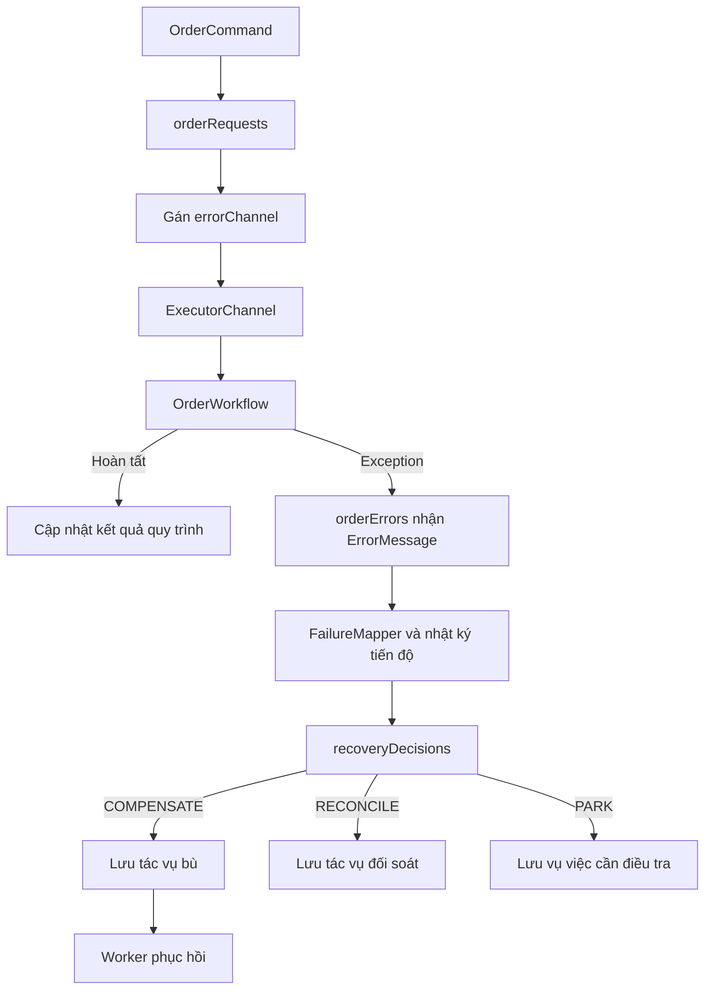

# Error flow và compensation

## 1. Mục tiêu và phạm vi

Trong Spring Integration Core, **error flow** là luồng thông điệp tiếp nhận lỗi, bổ sung ngữ cảnh và quyết định bước xử lý tiếp theo. **Compensation** là hành động nghiệp vụ nhằm bù lại tác động của những bước đã hoàn tất khi toàn bộ quy trình không thể tiếp tục.

Sau bài này, bạn có thể:

- Xác định lỗi được ném về caller hay được chuyển thành thông điệp.
- Lấy thông điệp thất bại và định danh quy trình từ `ErrorMessage`.
- Tách quyết định retry, compensation, reconciliation và chuyển xử lý thủ công.
- Dùng channel, endpoint và Java DSL để nối một error flow với nơi lưu tác vụ phục hồi.
- Thiết kế kiểm thử cho lỗi sau khi đã có tác động nghiệp vụ, thông điệp trùng và compensation thất bại.

Ví dụ xuyên suốt là quy trình đặt hàng: giữ tồn kho, thu tiền, rồi xác nhận giao hàng. Các đoạn Java dùng Java 17+ và API Spring Integration 6.5; dự án cần `spring-integration-core` hoặc starter tương ứng do dependency management của dự án quản lý. Các kho trạng thái và cổng dịch vụ trong ví dụ là hợp đồng ứng dụng, không phải tính năng tự sinh của framework.

## 2. Ba tình huống thường bị nhầm

Giả sử đơn hàng `O-014` đã giữ tồn kho thành công, đã thu tiền, nhưng nhà vận chuyển từ chối nhận đơn.

| Cơ chế | Thực hiện điều gì? | Áp dụng trong tình huống này |
| --- | --- | --- |
| Retry | Gọi lại thao tác thất bại | Có thể thử lại yêu cầu giao hàng nếu lỗi tạm thời và thao tác cho phép gọi lại an toàn |
| Rollback transaction | Hủy thay đổi thuộc transaction đang mở | Có thể hủy cập nhật cơ sở dữ liệu cục bộ chưa commit |
| Compensation | Tạo thao tác nghiệp vụ mới để bù tác động đã hoàn tất | Hoàn tiền và giải phóng phần tồn kho đã giữ |
| Reconciliation | Đối soát để xác định kết quả thực tế | Hỏi nhà cung cấp khi đã gửi yêu cầu thu tiền nhưng bị timeout |

Error flow có thể kích hoạt các cơ chế trên, nhưng nhận được lỗi không tự động có nghĩa là phải compensation. Chẳng hạn, nếu chưa biết cổng thanh toán đã thu tiền hay chưa, gửi lệnh thu lại hoặc hoàn tiền ngay đều có thể sai.

Compensation tuân theo quy tắc nghiệp vụ: hoàn tiền có thể mất thời gian, chịu phí hoặc cần phê duyệt. Nó không đảm bảo khôi phục chính xác mọi dữ liệu về thời điểm ban đầu. Đây là đặc điểm của [Compensating Transaction pattern](https://learn.microsoft.com/en-us/azure/architecture/patterns/compensating-transaction).

## 3. Lỗi đi đâu phụ thuộc vào ranh giới thực thi

### 3.1. Luồng đồng bộ qua DirectChannel

Nếu gửi trực tiếp vào `DirectChannel`, handler chạy trên thread của sender; exception có thể lan ngược theo call stack. Header `errorChannel` tự nó không biến mọi lời gọi đồng bộ thành một error flow. Xem [Error Handling của Spring Integration](https://docs.spring.io/spring-integration/reference/6.5/error-handling.html).

```java
try {
    orderRequests.send(message);
} catch (MessagingException ex) {
    // Caller chịu trách nhiệm theo hợp đồng của lời gọi trực tiếp này.
}
```

Một `try/catch` như trên chỉ bắt được lỗi xảy ra trước khi lời gọi trả về trên thread đó. Nếu flow bàn giao công việc cho thread khác thì lỗi xử lý về sau không quay lại khối catch này bằng call stack thông thường.

### 3.2. Luồng qua ExecutorChannel hoặc poller

`ExecutorChannel` giao việc cho executor và không chia sẻ transaction của sender với handler như một chuỗi đồng bộ. Xem [ExecutorChannel API](https://docs.spring.io/spring-integration/docs/6.5.0/api/org/springframework/integration/channel/ExecutorChannel.html).

Khi cơ chế publish lỗi của Spring Integration hoạt động, đích nhận được ưu tiên như sau:

1. Header `MessageHeaders.ERROR_CHANNEL` trên request đang được xử lý.
2. Channel mặc định toàn cục có bean name `errorChannel` nếu không có header đó.

Mặc định toàn cục là `PublishSubscribeChannel` có subscriber ghi log mức ERROR. Nó chưa cung cấp quy tắc hoàn tiền hay cơ chế lưu tác vụ phục hồi. Các quy tắc chọn channel này được mô tả trong [Error Handling](https://docs.spring.io/spring-integration/reference/6.5/error-handling.html).

Poller và scheduler do framework cấu hình có cơ chế publish lỗi; `MessagePublishingErrorHandler` là thành phần chuyển exception thành `ErrorMessage` gửi vào channel. Một scheduler hoặc thread tự tạo cần được tích hợp error handler phù hợp. Xem [MessagePublishingErrorHandler API](https://docs.spring.io/spring-integration/docs/6.5.0/api/org/springframework/integration/channel/MessagePublishingErrorHandler.html).

Đối với ứng dụng đặt hàng, cần phân biệt hai mốc: **đã nhận công việc** và **đã xử lý nghiệp vụ thành công**. `send()` trả về thành công sau khi executor chấp nhận công việc chưa phải bằng chứng rằng đơn hàng đã hoàn tất. Lỗi từ chối nhận task do quá tải cũng cần được xử lý ở đầu vào.

### 3.3. Gateway có hợp đồng phản hồi riêng

Messaging gateway có thể dùng `errorChannel` cấu hình trên gateway để chuyển lỗi sang error flow. Với request–reply, error flow phải trả một kết quả phù hợp hoặc truyền lỗi theo hợp đồng; một consumer chỉ ghi log không tạo ra business reply. Một `Throwable` được trả về có ý nghĩa đặc biệt đối với gateway. Xem [Messaging Gateways — Error Handling](https://docs.spring.io/spring-integration/reference/6.5/gateway.html).

Nếu API nhận đơn trả `ACCEPTED`, nên cho client truy vấn trạng thái quy trình bằng định danh ổn định. Nếu API hứa trả kết quả cuối cùng, cần thiết kế deadline, phản hồi lỗi và hành vi khi phục hồi vẫn đang chạy. Timeout của caller không tự chứng minh rằng nghiệp vụ phía sau đã dừng.

## 4. Đọc đúng ErrorMessage

`ErrorMessage` mang payload là `Throwable`. Payload thường là `MessagingException`, trong đó `failedMessage` trỏ tới message ở điểm thất bại. `originalMessage` là thông tin tùy chọn ở điểm tạo lỗi, có thể khác message đã qua transformer. Xem [ErrorMessage API](https://docs.spring.io/spring-framework/docs/6.2.x/javadoc-api/org/springframework/messaging/support/ErrorMessage.html).

Một error flow thường cần hai loại ngữ cảnh:

| Ngữ cảnh | Dùng để làm gì? |
| --- | --- |
| Exception và cause chain | Chẩn đoán lỗi kỹ thuật, phân loại lỗi có thể thử lại |
| `processId`, `orderId`, mã tác vụ | Tra cứu tiến độ và chọn hành động nghiệp vụ |
| `reservationId`, `paymentId` | Xác định tài nguyên cụ thể phải giải phóng hoặc hoàn tiền |
| Lịch sử xử lý và version trạng thái | Phát hiện thông điệp trùng, lỗi đến muộn và cạnh tranh |

Không giả định header trên chính error message đã sao chép đầy đủ header của request. Trong ví dụ dưới đây, ta tìm `failedMessage` trong cause chain, rồi mới dùng `originalMessage` làm phương án dự phòng.

```java
import java.util.Collections;
import java.util.IdentityHashMap;
import java.util.Set;
import org.springframework.messaging.Message;
import org.springframework.messaging.MessagingException;
import org.springframework.messaging.support.ErrorMessage;

public final class FailureMessages {
    private FailureMessages() {
    }

    // Trả null khi không có message ngữ cảnh phù hợp.
    public static Message<?> find(ErrorMessage error) {
        Set<Throwable> visited = Collections.newSetFromMap(
                new IdentityHashMap<Throwable, Boolean>());
        Throwable current = error.getPayload();
        while (current != null && visited.add(current)) {
            if (current instanceof MessagingException messaging
                    && messaging.getFailedMessage() != null) {
                return messaging.getFailedMessage();
            }
            current = current.getCause();
        }
        return error.getOriginalMessage();
    }
}
```

Đây là chính sách chọn message của ví dụ, không phải cam kết rằng message tìm thấy luôn là request ban đầu. Sau transformer, payload có thể đã đổi kiểu. Nên giữ định danh quy trình xuyên suốt các bước, và đọc tiến độ từ kho trạng thái thay vì suy toàn bộ lịch sử từ payload hiện tại. Nếu tự tạo message mới, cần chủ động giữ những định danh cần thiết.

Khi không tìm được định danh, lưu bản ghi chẩn đoán vào nhánh chờ xử lý. Không đoán `paymentId`, không hoàn tiền theo một exception thiếu ngữ cảnh và không để lỗi ép kiểu làm mất lỗi ban đầu.

## 5. Ra quyết định từ lỗi và tiến độ nghiệp vụ

Trong bài, `RECONCILE` nghĩa là đối soát kết quả chưa rõ; `PARK` nghĩa là lưu vụ việc để điều tra hoặc xử lý thủ công. Đây là tên hành động do ứng dụng định nghĩa.

| Điều đã biết | Quyết định hợp lý |
| --- | --- |
| Chưa có tác động bên ngoài, dữ liệu đầu vào sai | Từ chối nghiệp vụ; không tạo compensation |
| Lỗi tạm thời, thao tác có idempotency key và còn ngân sách thử lại | Retry có giới hạn |
| Đã giữ tồn kho, thanh toán bị từ chối chắc chắn | Tạo tác vụ giải phóng tồn kho |
| Đã thu tiền, giao hàng bị từ chối chắc chắn | Tạo tác vụ hoàn tiền rồi giải phóng tồn kho theo chính sách |
| Yêu cầu thu tiền timeout, chưa biết kết quả | Đối soát cổng thanh toán trước |
| Không tìm được quy trình hoặc dữ liệu tiến độ mâu thuẫn | PARK và phát tín hiệu vận hành |
| Lỗi cũ đến sau khi quy trình đã kết thúc hợp lệ | Ghi nhận trùng/đến muộn theo state machine; không tự hoàn tiền |

`ErrorMessageExceptionTypeRouter` có thể định tuyến theo cause phù hợp với mapping exception. Nó hữu ích cho phân loại kỹ thuật; quyết định compensation vẫn cần tiến độ nghiệp vụ. Xem [ErrorMessageExceptionTypeRouter API](https://docs.spring.io/spring-integration/docs/6.5.0/api/org/springframework/integration/router/ErrorMessageExceptionTypeRouter.html).

Một lỗi `TimeoutException` không đủ để kết luận “chưa thu tiền”. Tương tự, `PaymentDeclinedException` sau một đợt thử lại không đủ để phủ nhận giao dịch đã thành công trước đó nếu hệ thống không giữ được lịch sử và khóa chống trùng.

## 6. Trạng thái cần lưu trước khi thiết kế compensation

Một message chỉ mô tả công việc đang di chuyển. Để phục hồi sau khi ứng dụng dừng đột ngột, quy trình cần có nhật ký tiến độ bền vững, chẳng hạn:

| Trường | Ví dụ | Ý nghĩa |
| --- | --- | --- |
| `processId` | `P-014` | Định danh một lần thực hiện quy trình |
| `orderId` | `O-014` | Định danh đơn hàng nghiệp vụ |
| `step` | `CHARGE_PAYMENT` | Bước đang thực hiện |
| `status` | `STARTED`, `SUCCEEDED`, `FAILED`, `UNKNOWN` | Trạng thái riêng của bước |
| `externalReference` | `PAY-812` | Mã tham chiếu do nhà cung cấp trả về |
| `idempotencyKey` | `P-014:CHARGE:v1` | Khóa chống lặp của thao tác |
| `version` | `7` | Phục vụ cập nhật có điều kiện khi nhiều worker cạnh tranh |

`STARTED` cần được lưu trước lời gọi bên ngoài. Sau khi nhận kết quả, lưu trạng thái và mã tham chiếu. Nếu ứng dụng chết giữa hai mốc, bước còn `STARTED` phải được coi là cần xác minh; không tự kết luận chưa có tác động.

Ví dụ khoảng trống dễ gây lỗi:

```text
1. Ghi ý định thu tiền với key P-014:CHARGE:v1.
2. Gọi payment provider.
3. Provider đã thu tiền thành công.
4. Ứng dụng dừng trước khi lưu PAY-812.
5. Sau khởi động lại, đọc lại ý định và đối soát theo cùng key.
```

Lưu nhật ký trong cơ sở dữ liệu cục bộ không làm lời gọi HTTP và cập nhật cơ sở dữ liệu trở thành một transaction chung. Khóa idempotency, API đối soát và cơ chế xử lý trường hợp chưa rõ kết quả phải phối hợp để khép khoảng trống đó.

Một chính sách mapping lỗi có thể được mô tả bằng mã giả sau. Các thao tác `load`, `inspect` và `decide` là nghiệp vụ ứng dụng:

```text
context = tìm message tại điểm thất bại, dự phòng originalMessage
identity = lấy processId/orderId từ context hoặc tra cứu định danh đáng tin cậy
nếu thiếu identity:
    tạo quyết định PARK với mã MISSING_PROCESS_CONTEXT
ngược lại:
    snapshot = đọc nhật ký tiến độ bền vững của identity
    nếu có bước đang STARTED/UNKNOWN mà chưa xác định kết quả bên ngoài:
        tạo quyết định RECONCILE
    nếu lỗi đến muộn hoặc trạng thái không cho phép bù:
        lưu chẩn đoán theo chính sách, không tạo lệnh bù
    nếu có thất bại chắc chắn và các bước đã thành công cần bù:
        tạo quyết định COMPENSATE
    nếu không có chính sách phù hợp:
        tạo quyết định PARK
```

Các nhánh phải được đánh giá cùng trạng thái hiện hành và version. Với hệ thống nhiều worker, việc kiểm tra rồi cập nhật trạng thái cần dùng cập nhật có điều kiện hoặc cơ chế khóa phù hợp; chỉ đọc snapshot rồi gửi lệnh bù vô điều kiện có thể tạo race condition.

## 7. Nối error flow bằng Java DSL

### 7.1. Hợp đồng dữ liệu và dịch vụ ứng dụng

Để giữ ví dụ tập trung vào Core, flow dưới đây gọi các cổng ứng dụng thay vì gắn trực tiếp với một nhà cung cấp thanh toán hoặc cơ sở dữ liệu cụ thể. Mỗi public type được đặt trong tệp Java tương ứng khi triển khai.

```java
import org.springframework.messaging.support.ErrorMessage;

public record OrderCommand(String processId, String orderId) {
}

public enum RecoveryAction {
    COMPENSATE, RECONCILE, PARK
}

public record FailureDecision(
        String decisionKey,
        String processId,
        String orderId,
        RecoveryAction action,
        String reasonCode) {
}

public interface OrderWorkflow {
    void execute(OrderCommand command);
}

public interface FailureMapper {
    FailureDecision map(ErrorMessage error);
}

public interface RecoveryInbox {
    void saveCompensation(FailureDecision decision);
    void saveReconciliation(FailureDecision decision);
    void park(FailureDecision decision);
}
```

Ứng dụng cung cấp bean triển khai ba interface cuối:

- `OrderWorkflow` điều phối các bước đi tới và lưu tiến độ. Nó ném lỗi khi không thể tiếp tục; không giấu lỗi bằng một kết quả thành công giả.
- `FailureMapper` áp dụng chính sách ở mục 6. Thiếu ngữ cảnh hoặc gặp lỗi đến muộn phải tạo quyết định chẩn đoán thích hợp, không dựng lệnh hoàn tiền bằng suy đoán.
- `RecoveryInbox` lưu quyết định/tác vụ bằng transaction cục bộ, có ràng buộc chống trùng. Phương thức chỉ trả về sau khi lưu thành công; nếu chỉ enqueue vào một collection trong RAM thì chưa đáp ứng hợp đồng này.

Trong thiết kế này, một `decisionKey` có thể dựa trên `processId`, định danh sự cố và revision của kế hoạch phục hồi. Các lần giao lại cùng một sự cố phải dùng cùng key. Một sự cố mới hợp lệ cần key mới; dùng duy nhất `orderId` có thể vô tình chặn lần phục hồi tiếp theo của cùng đơn hàng.

### 7.2. Cấu hình flow

```java
import org.springframework.beans.factory.annotation.Qualifier;
import org.springframework.context.annotation.Bean;
import org.springframework.context.annotation.Configuration;
import org.springframework.integration.channel.DirectChannel;
import org.springframework.integration.config.EnableIntegration;
import org.springframework.integration.dsl.IntegrationFlow;
import org.springframework.messaging.MessageHandler;
import org.springframework.messaging.MessageHeaders;
import org.springframework.messaging.support.ErrorMessage;
import org.springframework.messaging.support.GenericMessage;
import org.springframework.scheduling.concurrent.ThreadPoolTaskExecutor;

@Configuration
@EnableIntegration
public class OrderErrorFlows {

    @Bean
    public DirectChannel orderRequests() {
        return new DirectChannel();
    }

    @Bean
    public DirectChannel orderErrors() {
        return new DirectChannel();
    }

    @Bean
    public DirectChannel recoveryDecisions() {
        return new DirectChannel();
    }

    @Bean
    public ThreadPoolTaskExecutor orderExecutor() {
        ThreadPoolTaskExecutor executor = new ThreadPoolTaskExecutor();
        executor.setCorePoolSize(2);
        executor.setMaxPoolSize(4);
        executor.setQueueCapacity(100);
        executor.setThreadNamePrefix("order-work-");
        return executor; // Spring quản lý khởi tạo và vòng đời bean.
    }

    @Bean
    public IntegrationFlow orderFlow(
            @Qualifier("orderExecutor") ThreadPoolTaskExecutor executor,
            OrderWorkflow workflow) {
        return IntegrationFlow.from("orderRequests")
                .enrichHeaders(headers -> headers.header(
                        MessageHeaders.ERROR_CHANNEL, "orderErrors", true))
                .channel(channels -> channels.executor(executor))
                .handle(OrderCommand.class, (command, headers) -> {
                    workflow.execute(command);
                    return null;
                })
                .get();
    }

    @Bean
    public IntegrationFlow orderErrorIntake(
            FailureMapper mapper,
            @Qualifier("recoveryDecisions") DirectChannel decisions) {
        return IntegrationFlow.from("orderErrors")
                .handle((MessageHandler) message -> {
                    ErrorMessage error = (ErrorMessage) message;
                    FailureDecision decision = mapper.map(error);
                    boolean sent = decisions.send(new GenericMessage<>(decision));
                    if (!sent) {
                        throw new IllegalStateException(
                                "Cannot deliver recovery decision");
                    }
                })
                .get();
    }

    @Bean
    public IntegrationFlow recoveryDecisionFlow(RecoveryInbox inbox) {
        return IntegrationFlow.from("recoveryDecisions")
                .route(FailureDecision.class,
                        decision -> decision.action().name(),
                        routes -> routes
                            .subFlowMapping("COMPENSATE", flow -> flow
                                .handle((MessageHandler) message ->
                                    inbox.saveCompensation(
                                        (FailureDecision) message.getPayload())))
                            .subFlowMapping("RECONCILE", flow -> flow
                                .handle((MessageHandler) message ->
                                    inbox.saveReconciliation(
                                        (FailureDecision) message.getPayload())))
                            .subFlowMapping("PARK", flow -> flow
                                .handle((MessageHandler) message ->
                                    inbox.park(
                                        (FailureDecision) message.getPayload()))))
                .get();
    }
}
```

Cú pháp channel, handler và router được xây trên [Java DSL API](https://docs.spring.io/spring-integration/docs/6.5.0/api/org/springframework/integration/dsl/BaseIntegrationFlowDefinition.html). Đây là cấu hình nối luồng; để chạy ứng dụng cần các bean nghiệp vụ theo hợp đồng ở trên.

Các điểm cần đọc rõ trong cấu hình:

1. Header `errorChannel` được gán **trước** channel dùng executor. Tham số `true` chủ động ghi đè header cũ: ví dụ này có hợp đồng nhận lệnh một chiều và sở hữu chính sách lỗi của luồng. Khi ghép vào request–reply gateway, cần thiết kế lại chính sách này cùng hợp đồng phản hồi.
2. Handler `OrderCommand` trả `null` để kết thúc nhánh đi tới. Flow này không cung cấp kết quả cuối cùng cho một gateway đang chờ reply.
3. Handler nhận lỗi dùng `MessageHandler` để truy cập toàn bộ `ErrorMessage`. Nếu dùng lambda có payload là `Throwable`, không nên nhầm payload đó với envelope chứa `originalMessage`.
4. Chuyển sang `FailureDecision` tạo một thông điệp ứng dụng mới. Các định danh cần phục hồi nằm trong record; không sao chép toàn bộ header vận chuyển của request sang tác vụ lâu dài.
5. Router gửi quyết định tới đúng endpoint lưu tác vụ. Worker thực thi compensation đọc các tác vụ đã lưu ở giai đoạn sau, nên không giữ thread xử lý lỗi trong một chuỗi hoàn tiền dài.

Sơ đồ tương ứng:



### 7.3. Giới hạn độ bền của ví dụ

`DirectChannel` và executor trong ví dụ không phải hàng đợi bền vững. `RecoveryInbox` chỉ bảo vệ công việc **sau khi lưu thành công**. Ứng dụng vẫn có thể dừng sau khi dịch vụ ngoài đã thay đổi trạng thái nhưng trước khi error flow kịp lưu quyết định.

Vì vậy, hệ thống cần một nguồn khôi phục ngoài đường lỗi tức thời: tiến trình quét các quy trình treo, nguồn lệnh có khả năng giao lại, hoặc thiết kế outbox/inbox thích hợp. Khi dùng outbox, cần ghi thay đổi trạng thái và bản ghi cần phát trong cùng transaction cơ sở dữ liệu cục bộ, rồi để publisher phát lại có chống trùng. Chỉ thêm một channel vào sơ đồ chưa tạo ra bảo đảm đó.

Nếu `FailureMapper` hoặc `RecoveryInbox` lỗi, việc có log không đồng nghĩa đã lưu tác vụ. Cần đo số lần lưu thất bại và có cơ chế phát hiện quy trình còn treo. Không cấu hình một vòng chuyển lỗi quay lại chính `orderErrors` vô hạn.

## 8. Thực thi compensation như một quy trình có trạng thái

### 8.1. Chỉ bù những tác động đã được xác nhận

Với tiến độ `giữ tồn kho → thu tiền → tạo giao hàng`, một kế hoạch bù có thể là:

| Bước đi tới đã thành công | Dữ liệu cần giữ | Hành động bù |
| --- | --- | --- |
| Giữ tồn kho | `reservationId`, lượng đã giữ | Release đúng reservation |
| Thu tiền | `paymentId`, số tiền, tiền tệ | Refund theo giao dịch gốc |
| Tạo giao hàng | `shipmentId`, trạng thái xử lý | Cancel nếu nhà vận chuyển còn cho phép |

Trong ví dụ, nếu giao hàng bị từ chối chắc chắn trước khi tạo shipment, kế hoạch chỉ gồm refund và release. Nếu lời gọi tạo giao hàng timeout, phải xác minh xem shipment đã được tạo hay chưa trước khi kết luận kế hoạch tương tự vẫn đúng.

Thứ tự đảo ngược các bước thường là điểm khởi đầu hợp lý, nhưng thứ tự thực tế phụ thuộc quan hệ nghiệp vụ. Một số hành động cần ưu tiên vì giữ tài nguyên khan hiếm hoặc sắp hết cửa sổ hủy. Compensation cũng có thể thất bại và cần chạy tiếp từ nơi đã dừng; các điểm này được thảo luận trong [Compensating Transaction pattern](https://learn.microsoft.com/en-us/azure/architecture/patterns/compensating-transaction).

### 8.2. Trạng thái tác vụ bù

Một thiết kế ứng dụng có thể dùng các trạng thái sau:

```text
PENDING -> RUNNING -> SUCCEEDED
              |
              +-> RETRY_WAIT -> RUNNING
              +-> UNKNOWN -> RECONCILIATION_PENDING
              +-> MANUAL_REQUIRED
```

`SUCCEEDED` của một tác vụ refund chưa có nghĩa là toàn bộ quy trình đã `COMPENSATED`. Chỉ đánh dấu quy trình đã bù xong khi tất cả hành động bắt buộc đã được xác nhận hoàn tất theo kế hoạch hiện hành.

Worker có thể thực hiện thuật toán sau. Đây là mã giả cho dịch vụ phục hồi, không phải API của Spring Integration:

```text
task = nhận một tác vụ tới hạn bằng lease hoặc claim có version
nếu task đã SUCCEEDED:
    kết thúc xử lý bản giao lại

kiểm tra version quy trình và điều kiện được phép bù
nạp kết quả lần chạy trước, reference bên ngoài và idempotency key

nếu kết quả lần trước UNKNOWN:
    tạo/tiếp tục đối soát, không gọi bù mù quáng
ngược lại:
    ghi STARTED cùng cùng một idempotency key cho hành động logic này
    gọi dịch vụ bù
    nếu xác nhận thành công:
        ghi SUCCEEDED và reference của kết quả
    nếu thất bại tạm thời và được phép thử lại:
        ghi RETRY_WAIT, số lần thử và thời điểm thử tiếp
    nếu kết quả chưa rõ:
        ghi UNKNOWN rồi lên lịch đối soát
    nếu lỗi không thể tự xử lý:
        ghi MANUAL_REQUIRED cùng nguyên nhân

nếu mọi tác vụ bắt buộc đã SUCCEEDED:
    chuyển quy trình sang COMPENSATED bằng cập nhật có điều kiện
```

Lease hết hạn có thể làm một worker khác nhận lại tác vụ. Khóa trong cơ sở dữ liệu giúp điều phối worker, nhưng không tự ngăn được dịch vụ ngoài xử lý trùng nếu worker cũ vẫn đang gọi. Với refund, cần phối hợp idempotency key ở nhà cung cấp hoặc một cơ chế tương đương có thể kiểm chứng.

### 8.3. Idempotency phải gắn với hành động nghiệp vụ

Ví dụ các khóa ổn định:

```text
P-014:REFUND:PAY-812:plan-1
P-014:RELEASE:RES-377:plan-1
```

Một lần retry của cùng lệnh refund phải dùng lại khóa cũ. Tạo UUID mới cho mỗi lần thử sẽ làm nhà cung cấp nhìn thấy các thao tác khác nhau.

Có hai lớp chống trùng cần phân biệt:

- **Trong kho tác vụ:** ràng buộc duy nhất ngăn cùng sự cố tạo thêm cùng tác vụ logic.
- **Ở nơi tạo tác động:** cùng idempotency key không làm tiền được hoàn hai lần hoặc cùng reservation được giải phóng hai lần.

Với tồn kho, thao tác `release(reservationId)` có thể được thiết kế để lần gọi tiếp theo trả lại trạng thái đã release. Câu lệnh “cộng số lượng vào tồn kho” vô điều kiện không có thuộc tính đó.

Nếu nhà cung cấp không hỗ trợ chống trùng và không có API tra cứu kết quả đáng tin cậy, ứng dụng không nên tuyên bố bảo đảm xử lý tác động đúng một lần. Khi đó chính sách đối soát hoặc xử lý thủ công phải là một phần rõ ràng của quy trình.

## 9. Kết hợp retry, transaction và error flow

### 9.1. Retry ở đâu?

Retry nên bao quanh thao tác nhỏ nhất có thể gọi lại an toàn. Retry toàn bộ `OrderWorkflow` từ đầu có thể giữ tồn kho hoặc thu tiền lặp lại nếu các bước trước đã thành công.

Trong Spring Integration 6.5, `RequestHandlerRetryAdvice` hỗ trợ retry cho handler; có thể cấu hình recovery callback khi hết số lần thử. Nếu recovery callback đã chuyển lỗi thành kết quả phục hồi, không nên đồng thời giả định exception cuối cùng vẫn đi qua mọi error flow phía ngoài. Xem [Provided Advice Classes — Retry Advice](https://docs.spring.io/spring-integration/reference/6.5/handler-advice/classes.html).

Chính sách ứng dụng cần chỉ rõ:

- Lỗi nào được retry và kết quả nào cần đối soát trước.
- Giới hạn số lần thử, deadline và khoảng nghỉ.
- Chủ thể chịu trách nhiệm retry: advice, nguồn thông điệp hay worker phục hồi.
- Mốc tạo quyết định compensation sau khi đã dừng nhánh đi tới.

Tránh để nguồn thông điệp giao lại nhiều lần, advice cũng thử lại nhiều lần, rồi worker lại khởi động toàn bộ quy trình. Ngân sách thử lại cần được tính trên hành động nghiệp vụ và ghi nhận đủ để quan sát.

### 9.2. Transaction không tự bao phủ toàn bộ sơ đồ

Trong mô hình transaction thông thường của Spring, ngữ cảnh gắn với thread. Một chuỗi đồng bộ có thể tham gia transaction phù hợp nếu các tài nguyên hỗ trợ; ranh giới executor hoặc pollable channel cần được thiết kế riêng. Xem [Transaction Boundaries](https://docs.spring.io/spring-integration/reference/6.5/transactions.html).

Với ví dụ đặt hàng, có thể dùng transaction cục bộ để cập nhật nhật ký và tạo tác vụ outbox cùng nhau. HTTP refund và HTTP release vẫn cần chính sách phục hồi riêng. Việc thêm `@Transactional` vào một method điều phối không tự hủy các tác động đã commit ở hệ thống bên ngoài.

Tương tự, “đã gửi vào error channel” và “transaction nguồn sẽ rollback” là hai vấn đề khác nhau. Nếu một tầng bắt lỗi rồi trả về bình thường, tầng ngoài có thể coi xử lý đã hoàn tất. Khi kết hợp với adapter hoặc broker, cần xác định rõ hành vi acknowledge, rollback và redelivery theo cấu hình của nguồn cụ thể.

### 9.3. Không để xử lý lỗi tạo vòng lỗi

Một consumer trên error channel cũng là endpoint và có thể thất bại. Ví dụ, cơ sở dữ liệu lưu tác vụ đang ngừng hoạt động. Gửi chính lỗi đó trở lại cùng nhánh với cùng chính sách có thể tạo vòng lặp hoặc làm cạn tài nguyên.

Đường xử lý lỗi cần có giới hạn rõ: ghi nhận thất bại lưu tác vụ, giữ bằng chứng có thể khôi phục và để tiến trình giám sát phát hiện quy trình treo. Nếu có kho dự phòng thì phải nêu rõ độ bền và cách phát lại của kho đó. Log trong RAM hoặc log không được thu thập chưa phải là một hàng đợi phục hồi.

## 10. Kiểm thử hành vi phục hồi

### 10.1. Kiểm thử đường lỗi bất đồng bộ

Mẫu JUnit 5 dưới đây dùng các type ở mục 4 và 7. Workflow giả lập việc đã thu tiền bằng một cờ, sau đó ném lỗi. Mapper trong test cố định một quyết định để kiểm tra cách nối channel, không thay thế kiểm thử phân loại nghiệp vụ.

```java
import java.util.concurrent.CountDownLatch;
import java.util.concurrent.TimeUnit;
import java.util.concurrent.atomic.AtomicBoolean;
import java.util.concurrent.atomic.AtomicReference;
import org.junit.jupiter.api.Test;
import org.springframework.context.annotation.AnnotationConfigApplicationContext;
import org.springframework.messaging.Message;
import org.springframework.messaging.MessageChannel;
import org.springframework.messaging.support.GenericMessage;
import static org.junit.jupiter.api.Assertions.*;

class OrderErrorFlowsTest {

    @Test
    void asynchronousFailureReachesCompensationBranch() throws Exception {
        AtomicBoolean chargeRecorded = new AtomicBoolean();
        AtomicReference<FailureDecision> saved = new AtomicReference<>();
        AtomicReference<RecoveryAction> branch = new AtomicReference<>();
        CountDownLatch received = new CountDownLatch(1);

        try (var context = new AnnotationConfigApplicationContext()) {
            context.registerBean(OrderWorkflow.class, () -> command -> {
                chargeRecorded.set(true);
                throw new IllegalStateException("SHIPMENT_REJECTED");
            });
            context.registerBean(FailureMapper.class, () -> error -> {
                Message<?> failed = FailureMessages.find(error);
                if (failed == null
                        || !(failed.getPayload() instanceof OrderCommand command)) {
                    throw new IllegalStateException("Missing test command");
                }
                return new FailureDecision(
                        command.processId() + ":shipment-failure:1",
                        command.processId(), command.orderId(),
                        RecoveryAction.COMPENSATE, "SHIPMENT_REJECTED");
            });
            context.registerBean(RecoveryInbox.class, () -> new RecoveryInbox() {
                @Override
                public void saveCompensation(FailureDecision decision) {
                    record(RecoveryAction.COMPENSATE, decision);
                }

                @Override
                public void saveReconciliation(FailureDecision decision) {
                    record(RecoveryAction.RECONCILE, decision);
                }

                @Override
                public void park(FailureDecision decision) {
                    record(RecoveryAction.PARK, decision);
                }

                private void record(RecoveryAction selected, FailureDecision decision) {
                    branch.set(selected);
                    saved.set(decision);
                    received.countDown();
                }
            });
            context.register(OrderErrorFlows.class);
            context.refresh();

            MessageChannel requests = context.getBean(
                    "orderRequests", MessageChannel.class);
            assertTrue(requests.send(new GenericMessage<>(
                    new OrderCommand("P-014", "O-014"))));

            assertTrue(received.await(3, TimeUnit.SECONDS));
            assertTrue(chargeRecorded.get());
            assertEquals(RecoveryAction.COMPENSATE, branch.get());
            assertEquals("O-014", saved.get().orderId());
            assertEquals("P-014", saved.get().processId());
        }
    }
}
```

`CountDownLatch` giúp test đợi tín hiệu có giới hạn thay vì đoán thời gian bằng `Thread.sleep()`. `RecoveryInbox` trong test là test double trong bộ nhớ; test này không chứng minh khả năng lưu bền vững, chống trùng, hoàn tiền thật hay phục hồi sau restart.

### 10.2. Các tình huống kiểm thử nghiệp vụ cần bổ sung

| Tình huống | Bằng chứng cần kiểm tra |
| --- | --- |
| Lỗi trước khi giữ tồn kho | Không có lệnh release/refund vô căn cứ |
| Thanh toán bị từ chối sau khi giữ hàng | Có release đúng `reservationId`; không refund |
| Thu tiền thành công, giao hàng bị từ chối | Có đúng các tác vụ bù bắt buộc và reference tương ứng |
| Timeout thanh toán | Có đối soát; chưa thu lại hoặc hoàn tiền mù quáng |
| Hai bản giao lại cùng một sự cố | Một tác vụ logic theo ràng buộc duy nhất |
| Refund thành công nhưng chưa lưu kết quả thì ứng dụng dừng | Sau khởi động lại, đối soát hoặc dùng lại cùng key; không hoàn thêm lần nữa |
| Refund lỗi tạm thời | Tác vụ chuyển `RETRY_WAIT`; quy trình chưa `COMPENSATED` |
| Hai worker cùng nhận lại task | Claim/version và khóa phía nhà cung cấp ngăn tác động lặp |
| Error flow không lưu được tác vụ | Có tín hiệu thất bại và cơ chế phát hiện quy trình treo |
| Thiếu failed message hoặc payload đã qua transformer | Chọn nhánh xử lý được định nghĩa; không lỗi ép kiểu làm mất vụ việc |
| Lỗi đến sau khi quy trình đã hoàn tất | State machine từ chối hành động bù không còn hợp lệ |

Kiểm thử sự cố giữa lời gọi ngoài và cập nhật nhật ký cần mô phỏng đúng hai kết quả khác nhau: tác động ngoài đã xảy ra và chưa xảy ra. Chỉ kiểm thử một exception được ném trước lời gọi sẽ bỏ sót khoảng trống quan trọng nhất của compensation.

## 11. Quan sát và vận hành

Một bản ghi phục hồi nên chứa định danh quy trình, quyết định, bước thất bại, reason code, reference ngoài, số lần thử và thời điểm xử lý tiếp. Giữ liên kết với lỗi ban đầu khi ghi nhận thêm lỗi refund hoặc release; nếu thay thế hoàn toàn nguyên nhân gốc thì việc điều tra sẽ khó hơn.

Các số đo có ích gồm:

- Số tác vụ bù đang chờ và tuổi của tác vụ lâu nhất.
- Số quy trình `UNKNOWN` đang chờ đối soát.
- Số lần lưu quyết định thất bại và số vụ `MANUAL_REQUIRED`.
- Số lần nhận thông điệp trùng đã được bỏ qua đúng chính sách.
- Tỷ lệ và thời gian từ phát hiện lỗi đến khi hoàn tất bù.

Dùng `processId` và reference để tra cứu trong log hoặc trace; tránh đưa định danh có số lượng giá trị lớn vào nhãn metric. Chỉ ghi dữ liệu cần cho phục hồi và chẩn đoán; payload thanh toán đầy đủ thường không cần xuất hiện trong log lỗi.

## 12. Tự kiểm tra thiết kế

Trước khi coi một error flow có thể phục hồi nghiệp vụ, hãy trả lời được các câu sau:

1. Exception được bắt ở đâu và message lỗi được publish bởi thành phần nào?
2. Caller nhận kết quả cuối cùng hay chỉ nhận xác nhận đã tiếp nhận?
3. Có tìm lại được tiến độ khi message lỗi thiếu payload ban đầu không?
4. Bằng chứng nào xác nhận tác động bên ngoài đã xảy ra?
5. Lần giao lại dùng lại khóa nghiệp vụ nào, và nơi tạo tác động có chống trùng không?
6. Ứng dụng dừng giữa lời gọi bên ngoài và cập nhật trạng thái thì ai phục hồi?
7. Nếu compensation lỗi hoặc có kết quả chưa rõ, tác vụ sẽ ở trạng thái nào?
8. Điều kiện nào cho phép đánh dấu toàn bộ quy trình `COMPENSATED`?

Trong Spring Integration Core, channel và endpoint tạo đường đi cho thông điệp lỗi, router thể hiện quyết định và Java DSL nối các thành phần lại. Khả năng bù đúng tác động nghiệp vụ còn phụ thuộc vào nhật ký tiến độ, khóa chống trùng, quy tắc chuyển trạng thái và cơ chế khôi phục do ứng dụng thiết kế.
