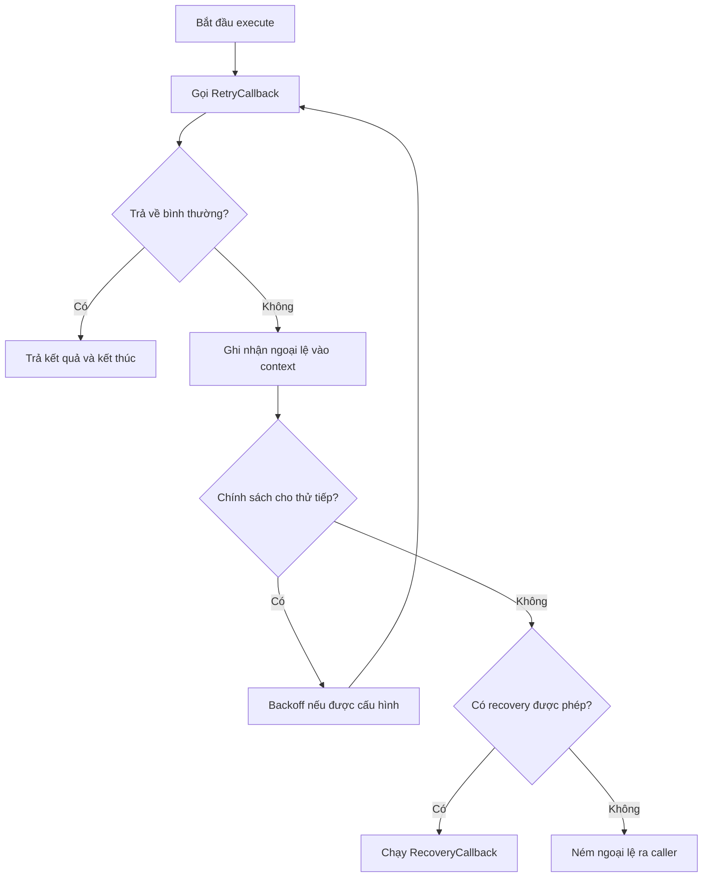
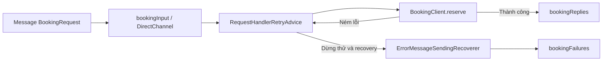

# RetryCallback

## 1. Mục tiêu và phạm vi API

Trong chương **Advice và retry** của module `SPRING_INTEGRATION_CORE`, `RetryCallback` giúp mô tả chính xác phần công việc được phép thực hiện lại khi xử lý một thông điệp. Hiểu ranh giới này là cơ sở để gắn retry vào endpoint, giữ luồng Java DSL dễ đọc và kiểm soát kết quả thành công, thất bại hoặc phục hồi.

Sau bài học, bạn có thể:

- Viết callback có kiểu kết quả và kiểu ngoại lệ rõ ràng.
- Đọc `RetryContext` để phân biệt lần gọi đầu tiên với các lần thử lại.
- Kết hợp callback, chính sách retry, backoff và recovery mà không trộn trách nhiệm.
- Đặt retry quanh một handler trong Spring Integration và dự đoán đường đi của thông điệp.
- Thiết kế thao tác lặp an toàn và kiểm thử số lần gọi thực tế.

**Phạm vi phiên bản:** bài này giải thích `org.springframework.retry.RetryCallback` trong **Spring Retry 2.x**, dùng cùng **Spring Integration 6.5.x**. Ví dụ Java sử dụng Java 17 trở lên. Spring Integration 7.0 đã thay API Spring Retry bằng retry của Spring Framework Core, đổi package của `RetryTemplate` và thay đổi API cấu hình advice. Vì vậy, các ví dụ có `setRetryTemplate(...)` dưới đây thuộc dòng 6.5.x; cần đọc hướng dẫn chuyển đổi khi làm việc với dòng 7.x. [Nguồn: thay đổi từ Spring Integration 6.5 sang 7.0](https://docs.spring.io/spring-integration/reference/changes-6.5-7.0.html).

Để dùng ví dụ tích hợp, dự án cần `org.springframework.integration:spring-integration-core` và `org.springframework.retry:spring-retry`. Phiên bản phụ thuộc phải được quản lý nhất quán bởi BOM hoặc `dependencyManagement` của dự án. Các đoạn kiểm thử dùng JUnit Jupiter.

## 2. RetryCallback là hợp đồng cho một lần thực hiện

Hợp đồng cốt lõi của API có dạng:

```java
public interface RetryCallback<T, E extends Throwable> {
    T doWithRetry(RetryContext context) throws E;
}
```

`T` là kiểu kết quả của thao tác; `E` là kiểu ngoại lệ callback có thể ném ra. `RetryContext` cung cấp trạng thái của đợt retry đang diễn ra. Đây là interface có thể triển khai bằng lambda. [Nguồn: Javadoc RetryCallback 2.0.12](https://docs.spring.io/spring-retry/docs/2.0.12/apidocs/org/springframework/retry/RetryCallback.html).

Mỗi lần `doWithRetry(...)` được gọi phải tương ứng với **một lần thử**. Callback không cần tự viết vòng lặp, đếm số lần thử hoặc gọi `Thread.sleep(...)`.

```java
RetryCallback<String, IOException> callback = context ->
        carrierClient.reserve(orderId);

String reservationId = retryTemplate.execute(callback);
```

Đây là đoạn minh họa hợp đồng: `carrierClient.reserve(...)` trả về `String` và có thể ném `IOException`; `orderId` và client được cung cấp bởi ứng dụng. `IOException` được dùng để minh họa ngoại lệ có kiểm tra, không có nghĩa mọi lỗi I/O đều phù hợp để retry.

Một callback chỉ thành công khi nó trả về bình thường. Nếu lời gọi từ xa trả về đối tượng biểu diễn thất bại nhưng callback vẫn trả đối tượng đó, chính sách dựa trên ngoại lệ sẽ không tự suy ra rằng phải gọi lại. Ứng dụng cần ánh xạ lỗi có khả năng phục hồi sang một ngoại lệ phù hợp trước khi ra khỏi callback.

### Phân chia trách nhiệm

| Thành phần | Câu hỏi mà thành phần trả lời | Ví dụ trong luồng đặt vận chuyển |
| --- | --- | --- |
| `RetryCallback` | Mỗi lần thử làm gì? | Gọi dịch vụ giữ chỗ cho một đơn hàng |
| `RetryTemplate` / `RetryOperations` | Điều phối các lần gọi như thế nào? | Gọi callback, ghi nhận lỗi và trả kết quả |
| `RetryPolicy` | Lỗi này còn được thử tiếp không? | Tối đa ba lần gọi, chỉ với lỗi tạm thời |
| `BackOffPolicy` | Chờ bao lâu trước lần thử tiếp theo? | Chờ 200 ms giữa hai lần gọi |
| `RetryContext` | Đợt xử lý hiện đang ở trạng thái nào? | Đã thất bại một lần, lỗi trước là timeout |
| `RecoveryCallback` | Làm gì khi không tiếp tục retry? | Trả trạng thái chờ xử lý hoặc công bố lỗi |

Phân chia này cho phép thay số lần thử hoặc khoảng chờ mà không sửa nghiệp vụ trong callback.

## 3. Vòng đời thực thi và cách đọc RetryContext

Với thực thi **stateless**, `RetryTemplate.execute(...)` giữ quyền điều khiển trong suốt các lần thử. Callback trả về thành công thì kết thúc; callback ném lỗi thì template hỏi chính sách có được tiếp tục hay không. Nếu không còn được thử, template đi tới recovery nếu được cung cấp và được phép, hoặc ném lỗi ra ngoài. [Nguồn: Javadoc RetryTemplate](https://docs.spring.io/spring-retry/docs/2.0.12/apidocs/org/springframework/retry/support/RetryTemplate.html).



Sơ đồ mô tả đường đi thông thường; các cơ chế dừng sớm, lỗi trong backoff và listener có thể khiến việc thực thi kết thúc theo đường khác.

### getRetryCount không phải số thứ tự bắt đầu từ một

Trong trường hợp thông thường với Spring Retry, `context.getRetryCount()` bằng `0` khi callback được gọi lần đầu và tăng sau mỗi lần thất bại được ghi nhận. Nếu muốn ghi log số thứ tự lần gọi bên trong callback, dùng `getRetryCount() + 1`.

| Thời điểm quan sát | `getRetryCount()` | Ý nghĩa |
| --- | ---: | --- |
| Bắt đầu callback lần đầu | 0 | Chưa có lần thất bại nào |
| Bắt đầu callback lần hai | 1 | Lần đầu đã thất bại |
| Bắt đầu callback lần ba | 2 | Hai lần trước đã thất bại |
| Vào recovery sau ba lần đều thất bại | 3 | Đã ghi nhận ba thất bại |

`context.getLastThrowable()` có thể là `null`, đặc biệt ở lần gọi đầu tiên. Luôn kiểm tra trước khi đọc thông tin lỗi. Không cộng thêm một vào retry count trong recovery để gọi đó là số lần đã thực hiện. [Nguồn: Javadoc RetryContext](https://docs.spring.io/spring-retry/docs/2.0.12/apidocs/org/springframework/retry/RetryContext.html).

### maxAttempts bao gồm lần gọi đầu

Trong builder của Spring Retry 2.x, `maxAttempts(3)` nghĩa là tối đa **ba lần gọi tổng cộng**, tương đương một lần đầu và tối đa hai lần thử lại. `fixedBackoff(200)` sử dụng mili giây và chỉ có khoảng chờ khi chuyển sang lần thử tiếp theo. [Nguồn: Javadoc RetryTemplateBuilder](https://docs.spring.io/spring-retry/docs/2.0.12/apidocs/org/springframework/retry/support/RetryTemplateBuilder.html).

```text
Lần 1 thất bại -> chờ 200 ms
Lần 2 thất bại -> chờ 200 ms
Lần 3 thành công -> trả kết quả
```

Do đó, riêng tổng thời gian chờ trong kịch bản trên là khoảng 400 ms, chưa tính thời gian chạy từng lần gọi.

## 4. Ví dụ độc lập: thành công ở lần gọi thứ ba

Ví dụ sau là một lớp Java hoàn chỉnh. `FakeCarrierClient` mô phỏng hai lần mất kết nối, sau đó trả về mã giữ chỗ. Không có dịch vụ mạng thật trong ví dụ.

```java
import java.io.IOException;
import java.util.concurrent.atomic.AtomicInteger;

import org.springframework.retry.RetryCallback;
import org.springframework.retry.support.RetryTemplate;

public class RetryCallbackDemo {

    public static void main(String[] args) throws IOException {
        RetryTemplate template = RetryTemplate.builder()
                .maxAttempts(3)
                .fixedBackoff(200)
                .retryOn(IOException.class)
                .build();

        FakeCarrierClient client = new FakeCarrierClient();
        String orderId = "ORDER-42";

        RetryCallback<String, IOException> operation = context -> {
            Throwable previous = context.getLastThrowable();
            System.out.printf("attempt=%d, previous=%s%n",
                    context.getRetryCount() + 1,
                    previous == null
                            ? "none"
                            : previous.getClass().getSimpleName());

            return client.reserve(orderId);
        };

        String reservationId = template.execute(operation);
        System.out.println(reservationId);
    }

    static class FakeCarrierClient {
        private final AtomicInteger calls = new AtomicInteger();

        String reserve(String orderId) throws IOException {
            if (calls.incrementAndGet() <= 2) {
                throw new IOException("Mất kết nối tạm thời");
            }
            return "RESERVED-" + orderId;
        }
    }
}
```

Kết quả dự kiến, ngoài log nội bộ của thư viện:

```text
attempt=1, previous=none
attempt=2, previous=IOException
attempt=3, previous=IOException
RESERVED-ORDER-42
```

`AtomicInteger` ở đây chỉ tạo hành vi giả lập cho client. Chính `RetryTemplate` điều phối việc thử lại; không dùng biến đếm của client thay cho cơ chế retry trong ứng dụng.

Nếu client luôn ném `IOException`, phương thức `main` kết thúc bằng ngoại lệ sau tối đa ba lần gọi vì chưa cung cấp recovery. Nếu client thành công ngay lần đầu thì callback chỉ được gọi một lần.

## 5. Viết callback để template nhìn thấy đúng lỗi

### Không nuốt ngoại lệ bên trong callback

Đoạn sau khiến lần xử lý được coi là thành công với kết quả `null`:

```java
String result = retryTemplate.execute(context -> {
    try {
        return carrierClient.reserve(orderId);
    } catch (IOException ex) {
        return null;
    }
});
```

Nếu cần bổ sung ngữ cảnh, có thể ghi log rồi ném lại ngoại lệ. Chỉ chuyển sang một kiểu lỗi nghiệp vụ khi kiểu đó còn giữ nguyên nguyên nhân và phù hợp với chính sách phân loại lỗi.

```java
String result = retryTemplate.execute(context ->
        carrierClient.reserve(orderId));
```

Việc khai báo `RetryCallback<String, IOException>` không tự cấu hình retry riêng cho `IOException`. Generic `E` mô tả hợp đồng kiểu của Java; điều kiện retry được quyết định bởi `RetryPolicy` hoặc cấu hình builder.

### Phân loại lỗi theo khả năng phục hồi

| Tình huống ví dụ | Quyết định thiết kế thường phù hợp | Điều kiện cần kiểm tra |
| --- | --- | --- |
| Kết nối tạm thời không mở được | Retry có giới hạn | Dịch vụ còn trong ngân sách thời gian |
| Timeout sau khi đã gửi lệnh | Kiểm tra kết quả hoặc retry có idempotency | Lệnh trước có thể đã thực hiện thành công |
| Dữ liệu đơn hàng thiếu trường bắt buộc | Báo lỗi ngay | Gửi lại cùng dữ liệu không sửa được nguyên nhân |
| Sai thông tin xác thực cố định | Sửa cấu hình hoặc làm mới thông tin theo thiết kế | Retry cùng thông tin không làm nó hợp lệ |
| Dịch vụ yêu cầu giảm tải | Chờ theo hợp đồng dịch vụ | Tôn trọng thời điểm được phép gửi lại |

Đây là các quyết định thiết kế cho ví dụ, không phải phân loại tự động của thư viện. Client nên ánh xạ lỗi giao thức sang các ngoại lệ mà tầng retry hiểu được.

### Chú ý ngoại lệ bọc trong messaging

Trong luồng Integration, lỗi nghiệp vụ có thể nằm trong chuỗi `cause` của một ngoại lệ messaging. Khi chỉ retry với `TemporaryCarrierException`, cần xét xem lỗi tới template có bị bọc hay không. Builder Spring Retry hỗ trợ `.traversingCauses()` để xét chuỗi nguyên nhân. [Nguồn: cấu hình phân loại lỗi của RetryTemplateBuilder](https://docs.spring.io/spring-retry/docs/2.0.12/apidocs/org/springframework/retry/support/RetryTemplateBuilder.html).

Không mở rộng thành retry mọi `RuntimeException` chỉ để vượt qua vấn đề bọc lỗi. Cách đó còn đưa lỗi lập trình và lỗi dữ liệu vào vòng thử lại.

## 6. Phân biệt RetryCallback với RecoveryCallback

`RetryCallback` mô tả công việc chính ở mỗi lần thử. `RecoveryCallback<T>` mô tả một kết quả thay thế hoặc hành động xử lý khi không thể tiếp tục retry theo chính sách. Phương thức của recovery là `T recover(RetryContext context) throws Exception`. [Nguồn: Javadoc RecoveryCallback](https://docs.spring.io/spring-retry/docs/2.0.12/apidocs/org/springframework/retry/RecoveryCallback.html).

Có thể thay lời gọi `execute(operation)` trong ví dụ ở mục 4 bằng:

```java
String reservationIdOrPending = template.execute(
        operation,
        context -> {
            System.err.printf(
                    "Chuyển đơn %s sang chờ xử lý sau %d thất bại%n",
                    orderId,
                    context.getRetryCount());
            return "PENDING-" + orderId;
        });
```

Với client giả lập ở mục 4, recovery chưa được gọi vì lần thứ ba thành công. Để quan sát nhánh recovery, cho client luôn ném `IOException`. Khi đó, callback chính được gọi ba lần và kết quả thay thế là `PENDING-ORDER-42`.

Giá trị `PENDING-...` biểu thị chưa hoàn thành việc giữ chỗ. Trong thiết kế thực tế, nên dùng một kiểu kết quả có trạng thái tường minh thay cho việc suy trạng thái từ tiền tố chuỗi.

Ba điểm cần giữ rõ trong hợp đồng:

- **Không retry một lỗi không đồng nghĩa cấm recovery cho lỗi đó.** Việc được thử lại và việc được phục hồi là hai quyết định khác nhau; cần thiết kế và kiểm thử cả hai.
- **Recovery không phải một lần gọi nghiệp vụ bổ sung.** Nếu recovery lại gọi dịch vụ từ xa, ứng dụng đã tự thêm một thao tác ngoài số lần retry được mô tả ban đầu.
- **Recovery có thể thất bại.** Lỗi khi ghi trạng thái chờ hoặc công bố lỗi vẫn phải được đưa tới cơ chế xử lý của ứng dụng.

Kết quả recovery chỉ có nghĩa lỗi đã được xử lý theo hợp đồng phục hồi. Nó không chứng minh thao tác ban đầu đã hoàn thành ở hệ thống bên ngoài.

## 7. Đưa mô hình callback vào endpoint Spring Integration

Trong Spring Integration 6.5.x, `RequestHandlerRetryAdvice` dùng Spring Retry để bọc việc gọi handler. Ta cung cấp `RetryTemplate` cho advice, rồi gắn advice vào endpoint. Không cần đăng ký một bean `RetryCallback` để framework tự tìm và gọi. [Nguồn: Javadoc RequestHandlerRetryAdvice 6.5.0](https://docs.spring.io/spring-integration/docs/6.5.0/api/org/springframework/integration/handler/advice/RequestHandlerRetryAdvice.html).

Các lambda có hình thức gần nhau nhưng vai trò khác nhau:

| Dạng callback | Đầu vào | Người gọi và vai trò |
| --- | --- | --- |
| `RetryCallback<T, E>` | `RetryContext` | `RetryTemplate` gọi để thực hiện một lần thử |
| Lambda của `.handle(...)` | Payload và headers | Endpoint gọi để xử lý thông điệp |
| `AbstractRequestHandlerAdvice.ExecutionCallback` | Không phải payload/context truyền vào lambda | Advice dùng để gọi tiếp handler được bọc |
| `RecoveryCallback<T>` | `RetryContext` | Template gọi khi chuyển sang đường phục hồi được phép |

Khi advice áp dụng retry, việc gọi handler được đưa vào cơ chế thực thi của template. Vì thế, logic nghiệp vụ của handler phải chịu được việc được gọi nhiều lần dù trong mã Java DSL chỉ có một bước `.handle(...)`.

### Cấu hình Java DSL

Cấu hình sau sử dụng một input channel, một queue chứa reply và một queue chứa lỗi phục hồi. `BookingClient` là cổng gọi hệ thống vận chuyển; ứng dụng phải cung cấp một bean triển khai interface này. Các record và ngoại lệ trong ví dụ được khai báo ngay trong lớp cấu hình.

```java
import org.springframework.beans.factory.annotation.Qualifier;
import org.springframework.context.annotation.Bean;
import org.springframework.context.annotation.Configuration;
import org.springframework.integration.channel.DirectChannel;
import org.springframework.integration.channel.QueueChannel;
import org.springframework.integration.config.EnableIntegration;
import org.springframework.integration.dsl.IntegrationFlow;
import org.springframework.integration.handler.advice.ErrorMessageSendingRecoverer;
import org.springframework.integration.handler.advice.RequestHandlerRetryAdvice;
import org.springframework.messaging.MessageChannel;
import org.springframework.retry.support.RetryTemplate;

@Configuration
@EnableIntegration
public class BookingFlowConfiguration {

    @Bean
    public DirectChannel bookingInput() {
        return new DirectChannel();
    }

    @Bean
    public QueueChannel bookingReplies() {
        return new QueueChannel();
    }

    @Bean
    public QueueChannel bookingFailures() {
        return new QueueChannel();
    }

    @Bean
    public RetryTemplate bookingRetryTemplate() {
        return RetryTemplate.builder()
                .maxAttempts(3)
                .fixedBackoff(100)
                .retryOn(TemporaryCarrierException.class)
                .traversingCauses()
                .build();
    }

    @Bean
    public RequestHandlerRetryAdvice bookingRetryAdvice(
            @Qualifier("bookingRetryTemplate") RetryTemplate template,
            @Qualifier("bookingFailures") MessageChannel failures) {

        RequestHandlerRetryAdvice advice = new RequestHandlerRetryAdvice();
        advice.setRetryTemplate(template);
        advice.setRecoveryCallback(new ErrorMessageSendingRecoverer(failures));
        return advice;
    }

    @Bean
    public IntegrationFlow bookingFlow(
            BookingClient client,
            @Qualifier("bookingRetryAdvice") RequestHandlerRetryAdvice advice) {

        return IntegrationFlow.from("bookingInput")
                .<BookingRequest>handle(
                        (request, headers) -> client.reserve(request),
                        endpoint -> endpoint.advice(advice))
                .channel("bookingReplies")
                .get();
    }

    public interface BookingClient {
        BookingReply reserve(BookingRequest request);
    }

    public record BookingRequest(String orderId) {
    }

    public record BookingReply(String orderId, String reservationId) {
    }

    public static class TemporaryCarrierException extends RuntimeException {
        public TemporaryCarrierException(String message) {
            super(message);
        }
    }
}
```

Luồng thực thi:



`ErrorMessageSendingRecoverer` triển khai `RecoveryCallback<Object>` và gửi lỗi cuối dưới dạng `ErrorMessage` tới channel được chỉ định. Payload của thông điệp lỗi là một `Throwable`; nếu đó là `MessagingException`, có thể kiểm tra `getFailedMessage()` khi giá trị này tồn tại. Không ép payload của `ErrorMessage` trực tiếp thành `BookingRequest`. [Nguồn: Javadoc ErrorMessageSendingRecoverer](https://docs.spring.io/spring-integration/docs/6.5.0/api/org/springframework/integration/handler/advice/ErrorMessageSendingRecoverer.html).

Trong cấu hình này, recoverer không tạo `BookingReply` thay thế. Khi lỗi đã được công bố thành công và recoverer trả về `null`, handler không sinh reply bình thường. Do đó, không thiết kế gateway chờ một `BookingReply` cho mọi trường hợp chỉ vì đã có recovery; muốn trả trạng thái thay thế thì phải quy định riêng hợp đồng kết quả và cấu hình tương ứng.

Cả hai `QueueChannel` chỉ dùng để minh họa và quan sát. Chúng giữ thông điệp trong bộ nhớ; hệ thống thực tế cần consumer cho nhánh lỗi và cơ chế lưu bền nếu yêu cầu không mất dữ liệu khi tiến trình dừng.

## 8. Ranh giới retry, thread và thông điệp

### Retry quanh handler không tự chạy lại cả flow

Giả sử luồng gồm:

```text
input -> kiểm tra dữ liệu -> gọi vận chuyển có retry -> lưu kết quả -> output
```

Advice gắn vào bước gọi vận chuyển thì giới hạn retry ở handler đó. Một lỗi ở bước lưu kết quả phía sau không tự động khiến advice này gọi lại toàn bộ các bước trước. Với handler sinh reply, request handler advice thường bọc phần xử lý request trước khi gửi reply xuống flow. [Nguồn: Handling Message Advice của Spring Integration 6.5](https://docs.spring.io/spring-integration/reference/6.5/handler-advice/handle-message.html).

Điều này dẫn tới cách bố trí thực tế: đặt kiểm tra dữ liệu trước lời gọi có retry, giữ thao tác từ xa trong một handler có phạm vi rõ ràng, và xử lý thất bại của bước lưu kết quả theo hợp đồng riêng.

Nếu cùng một bước đã có `RetryTemplate.execute(...)` bên trong và lại được bọc bằng advice retry bên ngoài, số lần gọi có thể nhân lên. Ví dụ hai tầng đều cho tối đa ba lần gọi thì một yêu cầu có thể tạo tới chín lần gọi dịch vụ ngoài. Chọn rõ tầng chịu trách nhiệm retry cho thao tác đó.

### Stateless retry sử dụng thread đang xử lý

Với `DirectChannel` trong cấu hình trên, thread gửi message cũng thực hiện handler và chịu các khoảng chờ retry. Dùng backoff dài sẽ giữ thread này lâu hơn. Retry advice stateless không tự tạo một bộ lập lịch để chuyển từng lần thử sang thread khác. [Nguồn: Retry Advice 6.5](https://docs.spring.io/spring-integration/reference/6.5/handler-advice/classes.html).

Không suy ra rằng cứ có `errorChannel` là mọi lỗi đồng bộ sẽ tự biến thành message lỗi. Khi không có recovery, lỗi qua `DirectChannel` thường truyền về caller; xử lý lỗi qua channel còn phụ thuộc gateway, poller hoặc hạ tầng thực thi bất đồng bộ. Trong ví dụ, chính recoverer chủ động gửi tới `bookingFailures`. [Nguồn: Error Handling 6.5](https://docs.spring.io/spring-integration/reference/6.5/error-handling.html).

### Stateful retry là một cơ chế phối hợp khác

Với stateful retry, trạng thái cần được nhận diện khi cùng công việc được đưa trở lại, chẳng hạn sau broker redelivery. Ở dòng 6.5.x, advice dùng `RetryStateGenerator` để xây dựng nhận diện này. Callback vẫn mô tả một lần thử, nhưng không nên hiểu rằng một lời gọi hiện tại sẽ luôn chạy hết mọi lần thử trong cùng stack. [Nguồn: cấu hình stateful trong Retry Advice 6.5](https://docs.spring.io/spring-integration/reference/6.5/handler-advice/classes.html).

Cần một khóa nghiệp vụ ổn định qua các lần giao lại, cùng chính sách rollback, redelivery và phục hồi phù hợp. Một `MessageHeaders.ID` mới được tạo khi dựng lại message có thể không đại diện cho cùng công việc. Retry callback không tự cấu hình cơ chế giao lại của broker.

## 9. Idempotency và dữ liệu dùng chung trong callback

Tình huống dễ gây lỗi nhất là timeout sau khi hệ thống vận chuyển đã tạo giữ chỗ nhưng ứng dụng chưa nhận được phản hồi. Gọi lại có thể tạo giữ chỗ thứ hai. Vì vậy, cần thiết kế định danh nghiệp vụ trước khi quyết định retry.

Với ví dụ đặt vận chuyển, một thiết kế có thể là:

1. Tạo khóa thao tác ổn định từ `orderId` và loại hành động.
2. Gửi cùng khóa đó trong mọi lần gọi cho cùng thao tác.
3. Dịch vụ vận chuyển ghi nhận khóa và trả lại cùng kết quả nếu thao tác đã hoàn tất.
4. Khi không xác định được trạng thái, tra cứu theo khóa trước khi tạo thao tác mới nếu hợp đồng dịch vụ hỗ trợ.

Chỉ gửi header `Idempotency-Key` không đủ; bên nhận phải thực hiện ngữ nghĩa chống lặp và lưu trạng thái theo hợp đồng. `RetryContext` cũng không phải kho lưu bền cho kết quả nghiệp vụ.

### Giữ đầu vào ổn định qua các lần thử

Đừng tạo mã đơn hàng hoặc mã thao tác mới bên trong callback cho mỗi lần gọi. Hãy chuẩn bị chúng bên ngoài, rồi truyền vào callback hoặc giữ trong message:

```java
String operationKey = "reserve:" + orderId;

String result = retryTemplate.execute(context ->
        carrierClient.reserveWithKey(orderId, operationKey));
```

Đoạn này giả định client có phương thức `reserveWithKey(...)` với hợp đồng chống lặp. Khóa được tạo từ dữ liệu nghiệp vụ nên vẫn có thể dựng lại nếu một lần xử lý mới bắt đầu sau khi tiến trình khởi động lại.

### Không dùng field biến đổi làm trạng thái riêng của message

`RetryTemplate` hỗ trợ thực thi đồng thời, nhưng callback và client do ứng dụng cung cấp vẫn phải tự bảo đảm an toàn khi dùng chung. Một field như `currentOrderId` hoặc `lastException` trong singleton service có thể bị thông điệp khác ghi đè. [Nguồn: đặc tính truy cập đồng thời của RetryTemplate](https://docs.spring.io/spring-retry/docs/2.0.12/apidocs/org/springframework/retry/support/RetryTemplate.html).

Ưu tiên biến cục bộ, payload bất biến như record, và dữ liệu truyền qua tham số. Không sửa collection dùng chung hoặc giảm số dư trong bộ nhớ trước mỗi lần gọi rồi giả định retry sẽ tự hoàn tác.

## 10. Ngân sách thời gian, retry lồng nhau và transaction

Giả sử cho phép `N` lần gọi, thời gian mỗi lần bị chặn trên bởi `T_call`, và tổng khoảng chờ là `T_backoff`. Một ước lượng thiết kế là:

```text
T_total ≈ N × T_call + T_backoff + thời gian xử lý bổ sung
```

Với ba lần gọi, mỗi lần tối đa một giây, chờ 200 ms giữa hai lần, thời gian có thể gần 3,4 giây cộng chi phí bổ sung. Giới hạn số lần thử không giới hạn được thời gian của một lời gọi bị treo; client vẫn cần timeout kết nối và timeout đọc hoặc thời hạn yêu cầu thích hợp.

Cũng cần tính ngân sách giữa các tầng. Một request có thể đi qua retry của HTTP client, retry advice và broker redelivery. Nếu mỗi tầng tiếp tục gọi lại độc lập, tải phát sinh sẽ lớn hơn điều người đọc cấu hình của một tầng nhìn thấy.

Thời hạn chờ reply ở gateway cũng không tự bảo đảm hủy một thao tác mạng đang chạy. Cần phối hợp timeout, số lần thử, khoảng chờ và hợp đồng trả kết quả của toàn bộ yêu cầu.

### Transaction không tự rollback hệ thống từ xa

Thứ tự các advice ảnh hưởng phạm vi transaction. Khi retry bọc transaction advice, mỗi lần thử đi qua transaction advice; khi transaction advice bọc retry, nhiều lần thử có thể nằm trong cùng phạm vi transaction. [Nguồn: thứ tự advice trong Spring Integration 6.5](https://docs.spring.io/spring-integration/reference/6.5/handler-advice/order.html).

Việc mỗi lần thử có transaction mới thực sự còn phụ thuộc propagation và transaction đã tồn tại ở caller. Không suy ra rằng chỉ đổi thứ tự advice là mọi lần thử luôn độc lập.

Ví dụ ghi cơ sở dữ liệu rồi gọi dịch vụ vận chuyển có thể tạo hai tác động thuộc hai hệ thống khác nhau. Rollback cơ sở dữ liệu cục bộ không tự hủy giữ chỗ đã tạo bên ngoài. Cần chọn ranh giới thao tác, idempotency và cơ chế bù hoặc đối soát theo nghiệp vụ trước khi áp dụng retry.

## 11. Kiểm thử hợp đồng thực thi

Các đoạn dưới là mã kiểm thử minh họa để đưa vào dự án tương ứng. Ở tầng callback, dùng client giả lập và không backoff để kiểm tra hành vi một cách xác định, không cần gọi mạng thật.

### Kiểm thử số lần gọi, phục hồi và lỗi không retry

```java
import java.util.ArrayList;
import java.util.List;
import java.util.concurrent.atomic.AtomicInteger;

import org.junit.jupiter.api.Test;
import org.springframework.retry.support.RetryTemplate;

import static org.junit.jupiter.api.Assertions.assertEquals;
import static org.junit.jupiter.api.Assertions.assertThrows;

class RetryCallbackTest {

    private RetryTemplate template() {
        return RetryTemplate.builder()
                .maxAttempts(3)
                .noBackoff()
                .retryOn(IllegalStateException.class)
                .build();
    }

    @Test
    void returnsResultOnThirdAttempt() {
        List<Integer> retryCounts = new ArrayList<>();

        String result = template().execute(context -> {
            retryCounts.add(context.getRetryCount());
            if (retryCounts.size() < 3) {
                throw new IllegalStateException("Lỗi tạm thời");
            }
            return "RESERVED";
        });

        assertEquals("RESERVED", result);
        assertEquals(List.of(0, 1, 2), retryCounts);
    }

    @Test
    void recoversAfterThreeFailedCalls() {
        AtomicInteger calls = new AtomicInteger();

        String result = template().<String, IllegalStateException>execute(
                context -> {
                    calls.incrementAndGet();
                    throw new IllegalStateException("Dịch vụ chưa sẵn sàng");
                },
                context -> {
                    assertEquals(3, context.getRetryCount());
                    return "PENDING";
                });

        assertEquals(3, calls.get());
        assertEquals("PENDING", result);
    }

    @Test
    void doesNotRetryInvalidInput() {
        AtomicInteger calls = new AtomicInteger();

        assertThrows(IllegalArgumentException.class,
                () -> template().<String, RuntimeException>execute(context -> {
                    calls.incrementAndGet();
                    throw new IllegalArgumentException("Thiếu orderId");
                }));

        assertEquals(1, calls.get());
    }
}
```

Test đầu xác nhận cả kết quả và các giá trị retry count. Test thứ hai xác nhận recovery không tăng số lần gọi nghiệp vụ thành bốn. Test thứ ba không cung cấp recovery để quan sát rõ việc lỗi không thuộc nhóm retry truyền ra ngay sau lần gọi đầu.

Trong dự án thực tế, thay nhóm lỗi `IllegalStateException` của test bằng ngoại lệ miền nghiệp vụ như `TemporaryCarrierException`. Hai loại lỗi trong test được chọn để tách các nhánh một cách dễ thấy.

### Kiểm thử nhánh lỗi của flow Java DSL

Test sau đặt cùng package với `BookingFlowConfiguration` ở mục 7. Client luôn lỗi; ba lần thử phải kết thúc bằng một `ErrorMessage`, không có reply thành công.

```java
import java.util.concurrent.atomic.AtomicInteger;

import org.junit.jupiter.api.Test;
import org.springframework.context.annotation.AnnotationConfigApplicationContext;
import org.springframework.integration.channel.DirectChannel;
import org.springframework.integration.channel.QueueChannel;
import org.springframework.messaging.support.ErrorMessage;
import org.springframework.messaging.support.MessageBuilder;

import static org.junit.jupiter.api.Assertions.assertEquals;
import static org.junit.jupiter.api.Assertions.assertInstanceOf;
import static org.junit.jupiter.api.Assertions.assertNull;
import static org.junit.jupiter.api.Assertions.assertTrue;

class BookingRetryFlowTest {

    @Test
    void publishesErrorAfterExhaustion() {
        AtomicInteger calls = new AtomicInteger();

        try (var context = new AnnotationConfigApplicationContext()) {
            context.registerBean(
                    BookingFlowConfiguration.BookingClient.class,
                    () -> request -> {
                        calls.incrementAndGet();
                        throw new BookingFlowConfiguration
                                .TemporaryCarrierException("Dịch vụ tạm ngừng");
                    });
            context.register(BookingFlowConfiguration.class);
            context.refresh();

            DirectChannel input = context.getBean(
                    "bookingInput", DirectChannel.class);
            QueueChannel failures = context.getBean(
                    "bookingFailures", QueueChannel.class);
            QueueChannel replies = context.getBean(
                    "bookingReplies", QueueChannel.class);

            boolean sent = input.send(MessageBuilder.withPayload(
                    new BookingFlowConfiguration.BookingRequest("ORDER-42"))
                    .build());

            assertTrue(sent);
            assertEquals(3, calls.get());
            assertInstanceOf(ErrorMessage.class, failures.receive(1_000));
            assertNull(replies.receive(0));
        }
    }
}
```

Test dùng đúng backoff 100 ms của cấu hình nên có hai khoảng chờ ngắn. Test callback ở phía trên dùng `noBackoff()` để kiểm tra nhanh các nhánh chính. Nếu cần kiểm thử chính sách thời gian phức tạp, nên dùng thành phần thời gian giả lập hoặc hook phù hợp thay vì so sánh thời gian thực với độ chính xác vài mili giây.

`assertTrue(sent)` chỉ xác nhận việc gửi được xử lý mà không phát sinh ngoại lệ ra caller trong kịch bản recovery này. Các assertion về số lần gọi, message lỗi và sự vắng mặt của reply mới mô tả kết quả nghiệp vụ quan sát được.

Những trường hợp nên bổ sung khi áp dụng cho một dịch vụ thật:

| Trường hợp | Điều cần quan sát |
| --- | --- |
| Thành công ngay lần đầu | Một lần gọi, có reply, không có message recovery |
| Hai lỗi tạm thời rồi thành công | Ba lần gọi, chỉ một kết quả thành công |
| Lỗi dữ liệu cố định | Không gọi lại; đường báo lỗi tuân theo hợp đồng recovery đã chọn |
| Ngoại lệ tạm thời được bọc | Vẫn retry khi đã cấu hình xét chuỗi nguyên nhân |
| Recovery không gửi được lỗi | Thất bại được đưa ra ngoài hoặc xử lý theo cơ chế đã thiết kế |
| Timeout sau tác động từ xa | Không tạo tác động trùng với cùng khóa thao tác |
| Nhiều message đồng thời | Không chia sẻ nhầm trạng thái giữa các đơn hàng |

## 12. Quan sát và chẩn đoán hành vi callback

Nên ghi nhận khóa nghiệp vụ hoặc correlation ID, tên thao tác, số thứ tự lần gọi, loại lỗi và thời gian đã dùng. Tách số lần thất bại tạm thời khỏi số yêu cầu cuối cùng thất bại: một yêu cầu có thể tạo hai lỗi trước khi hoàn thành ở lần thứ ba.

Giữ `RetryContext` trong phạm vi đợt xử lý. Nó không phải `Message`, không tự chứa toàn bộ headers, và không nên được giữ lại để dùng như trạng thái nghiệp vụ dài hạn. Khi callback cần `orderId`, truyền qua biến được capture hoặc qua đầu vào của handler.

| Dấu hiệu | Nguyên nhân cần kiểm tra |
| --- | --- |
| Chỉ chạy một lần dù backend báo lỗi | Callback trả về bình thường, nuốt ngoại lệ hoặc lỗi không thuộc nhóm retry |
| Số lần gọi nhiều hơn cấu hình | Có retry ở client, handler, advice hoặc redelivery cùng lúc |
| Ghi log lần đầu là lần 0 | Đang in `getRetryCount()` thay vì số thứ tự lần gọi |
| Đã recovery nhưng caller vẫn chờ reply | Recoverer chỉ công bố lỗi và không tạo kết quả thay thế |
| Lỗi hết lượt thử không đến kênh lỗi | Kiểm tra recovery, mô hình thread và cấu hình gateway/poller |
| Thread bị giữ lâu khi dịch vụ gặp sự cố | Backoff chặn thread cộng với timeout mỗi lần gọi quá dài |
| Đơn hàng bị xử lý trùng | Thiếu khóa thao tác ổn định hoặc phía nhận chưa hỗ trợ chống lặp |
| Bước phía sau lỗi nhưng handler không retry | Advice đang bọc riêng handler, đúng ranh giới đã cấu hình |

Khi thiết kế một endpoint có retry, hãy xác định đồng thời công việc của một lần thử, nhóm lỗi được gọi lại, tổng số lần gọi, ngân sách thời gian và kết quả khi phục hồi. `RetryCallback` là nơi biểu diễn công việc của lần thử; các quyết định còn lại cần được cấu hình và kiểm thử ở đúng thành phần chịu trách nhiệm.
