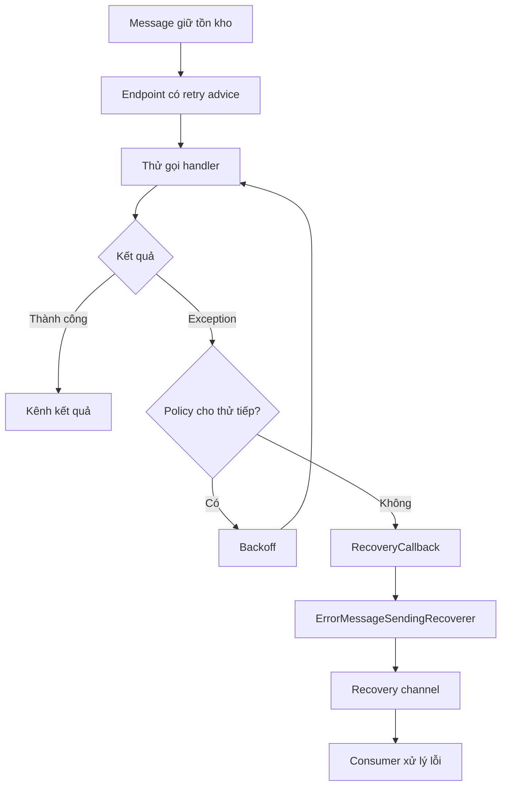

# ErrorMessageSendingRecoverer

## 1. Mục tiêu và phạm vi

Trong chương **Advice và retry** của module **SPRING_INTEGRATION_CORE**, bài học này trình bày cách dùng `ErrorMessageSendingRecoverer` để đưa lỗi cuối cùng của một endpoint vào luồng xử lý lỗi. Từ đó, người học nối được các thành phần cốt lõi: `Message`, `MessageChannel`, endpoint có retry advice, kênh recovery và consumer xử lý lỗi.

Sau bài học, bạn có thể:

- Gắn recoverer vào `RequestHandlerRetryAdvice` bằng Java DSL.
- Phân biệt lỗi nghiệp vụ, lỗi khi gửi thông điệp recovery và kết quả gửi thông điệp đầu vào.
- Lấy lại thông điệp thất bại để giữ thông tin tương quan và chuẩn bị xử lý tiếp.
- Thiết kế kiểm thử cho trường hợp retry thành công, hết lượt thử và recovery không gửi được.

**Phạm vi phiên bản:** mã chính sử dụng **Java 17 trở lên, Spring Integration 6.5.x và Spring Retry 2.0.x**. Cần các dependency `org.springframework.integration:spring-integration-core`, `org.springframework.retry:spring-retry`; phần kiểm thử dùng JUnit Jupiter. Chọn phiên bản cụ thể theo dependency management của ứng dụng.

Spring Integration 7.x chuyển retry advice sang retry support của Spring Framework, với các API như `setRetryPolicy(...)`; không áp dụng nguyên trạng cấu hình `setRetryTemplate(...)` của bài này sang dòng 7.x. Xem [Retry Advice của 6.5](https://docs.spring.io/spring-integration/reference/6.5/handler-advice/classes.html) và [API RequestHandlerRetryAdvice của 7.x](https://docs.spring.io/spring-integration/api/org/springframework/integration/handler/advice/RequestHandlerRetryAdvice.html).

## 2. Recoverer nằm ở đâu trong luồng?

Giả sử endpoint gọi dịch vụ giữ tồn kho cho một đơn hàng. Một lỗi kết nối ngắn có thể được giải quyết khi gọi lại. Nếu các lần thử đều thất bại, hệ thống cần lưu sự cố để xử lý sau.

`ErrorMessageSendingRecoverer` là một `RecoveryCallback<Object>` và kế thừa `ErrorMessagePublisher`. Với Spring Retry 2.x, phương thức recovery nhận `RetryContext`, phát thông điệp lỗi rồi trả về `null` nếu việc phát không ném exception. Xem [mã nguồn recoverer tại phiên bản 6.5.0](https://github.com/spring-projects/spring-integration/blob/v6.5.0/spring-integration-core/src/main/java/org/springframework/integration/handler/advice/ErrorMessageSendingRecoverer.java).

| Thành phần | Trách nhiệm |
| --- | --- |
| Handler nghiệp vụ | Thực hiện một lần gọi dịch vụ giữ tồn kho |
| `RequestHandlerRetryAdvice` | Bao quanh phần xử lý của handler được gắn advice |
| `RetryTemplate` | Điều phối lần thử theo retry policy và backoff |
| `ErrorMessageSendingRecoverer` | Đưa lỗi cuối cùng vào thông điệp recovery |
| Recovery channel | Tiếp nhận thông điệp lỗi theo đặc tính của loại channel |
| Consumer của nhánh lỗi | Ghi nhận sự cố, phân loại hoặc chuyển tiếp để xử lý |



Sơ đồ mô tả **stateless retry** của ví dụ. Recovery cũng có thể được chọn sau lỗi đầu tiên nếu policy không cho retry loại exception đó. Quyết định có thử tiếp và quyết định có cho recovery là hai quyết định riêng của retry policy. Xem [RetryTemplate của Spring Retry 2.0.12](https://github.com/spring-projects/spring-retry/blob/v2.0.12/src/main/java/org/springframework/retry/support/RetryTemplate.java).

Recoverer không tự thực hiện bù trừ, hoàn tiền, ghi cơ sở dữ liệu hay tạo một hàng đợi bền vững. Những hành vi đó phải được triển khai ở nhánh xử lý lỗi.

## 3. Thông điệp lỗi chứa gì và đi đâu?

### 3.1. Payload lỗi và thông điệp thất bại

`ErrorMessage` là một message có payload kiểu `Throwable`. Các đối tượng cần phân biệt là:

| Đối tượng | Ý nghĩa khi điều tra sự cố |
| --- | --- |
| `errorMessage.getPayload()` | Exception được công bố; có thể chứa một chuỗi cause |
| `MessagingException.getFailedMessage()` | Message gắn với lỗi xử lý |
| `errorMessage.getOriginalMessage()` | Message đầu vào được error-message strategy đính kèm, nếu có |
| Headers của `ErrorMessage` | Headers của thông điệp lỗi mới; không mặc định chứa toàn bộ headers của message thất bại |

Ở 6.5.0, publisher bọc throwable chưa phải `MessagingException` để có thể gắn failed message lấy từ context. Payload lỗi vì vậy không nhất thiết có đúng lớp exception mà mã nghiệp vụ đã ném. Xem [ErrorMessagePublisher](https://github.com/spring-projects/spring-integration/blob/v6.5.0/spring-integration-core/src/main/java/org/springframework/integration/core/ErrorMessagePublisher.java).

Đặc biệt, retry advice cung cấp message đang thử qua `ErrorMessageUtils.FAILED_MESSAGE_CONTEXT_KEY`. Trong khi đó, `DefaultErrorMessageStrategy` đọc `INPUT_MESSAGE_CONTEXT_KEY` để gắn `originalMessage`. Chỉ dùng retry advice với strategy mặc định không bảo đảm `originalMessage` khác `null`. Xem [RequestHandlerRetryAdvice](https://github.com/spring-projects/spring-integration/blob/v6.5.0/spring-integration-core/src/main/java/org/springframework/integration/handler/advice/RequestHandlerRetryAdvice.java) và [DefaultErrorMessageStrategy](https://github.com/spring-projects/spring-integration/blob/v6.5.0/spring-integration-core/src/main/java/org/springframework/integration/support/DefaultErrorMessageStrategy.java).

Nếu message đã qua transformer trước khi đến endpoint, failed message có thể mang payload đã biến đổi. Muốn truy vết từ gateway đến nhánh lỗi, nên đưa mã nghiệp vụ như `orderId` hoặc `correlationId` vào hợp đồng thông điệp từ sớm.

### 3.2. Chọn recovery channel tường minh

Các cách khởi tạo thường dùng:

```java
new ErrorMessageSendingRecoverer();
new ErrorMessageSendingRecoverer(recoveryChannel);
new ErrorMessageSendingRecoverer(recoveryChannel, errorMessageStrategy);
```

Cấu hình mặc định hướng đến bean `errorChannel`. Có thể dùng `setChannelName(...)` để cấu hình theo tên. Khi cần resolve tên, recoverer cần được Spring quản lý hoặc được cung cấp channel resolver phù hợp.

Trong ví dụ, truyền trực tiếp recovery channel giúp thể hiện rõ nơi nhận lỗi. Không suy ra recoverer tự chọn đích từ header `errorChannel` trên message đầu vào: đường chọn đích của publisher này dùng channel đã cấu hình hoặc tên channel mặc định. Xem [cơ chế populateChannel của publisher](https://github.com/spring-projects/spring-integration/blob/v6.5.0/spring-integration-core/src/main/java/org/springframework/integration/core/ErrorMessagePublisher.java).

Cơ chế phát lỗi của tác vụ bất đồng bộ trong Spring Integration có quy tắc dùng header `errorChannel` rồi mới đến kênh toàn cục. Đó là ngữ cảnh khác với việc gắn recoverer tường minh vào retry advice. Xem [Error Handling](https://docs.spring.io/spring-integration/reference/6.5/error-handling.html).

## 4. Ví dụ Java DSL: giữ tồn kho và thu lỗi

Ví dụ dưới đây dùng `DirectChannel` làm đầu vào và hai `QueueChannel` để quan sát kết quả. Dịch vụ giả lập có bộ đếm; mỗi application context trong phần kiểm thử chỉ gửi một yêu cầu.

Quy ước payload:

| `orderId` | Hành vi giả lập |
| --- | --- |
| `ALWAYS_FAIL` | Mỗi lần gọi đều ném lỗi tạm thời |
| `FLAKY` | Hai lần đầu lỗi, lần thứ ba thành công |
| `INVALID` | Ném lỗi dữ liệu đầu vào, không retry |
| Giá trị khác | Thành công ngay |

Đặt cấu hình minh họa trong lớp `InventoryRecoveryConfig`:

```java
package learning.integration;

import java.util.Map;
import java.util.concurrent.atomic.AtomicInteger;

import org.springframework.beans.factory.annotation.Qualifier;
import org.springframework.context.annotation.Bean;
import org.springframework.context.annotation.Configuration;
import org.springframework.integration.channel.DirectChannel;
import org.springframework.integration.channel.QueueChannel;
import org.springframework.integration.config.EnableIntegration;
import org.springframework.integration.dsl.IntegrationFlow;
import org.springframework.integration.handler.advice.ErrorMessageSendingRecoverer;
import org.springframework.integration.handler.advice.RequestHandlerRetryAdvice;
import org.springframework.messaging.MessageChannel;
import org.springframework.retry.backoff.FixedBackOffPolicy;
import org.springframework.retry.policy.SimpleRetryPolicy;
import org.springframework.retry.support.RetryTemplate;

@Configuration(proxyBeanMethods = false)
@EnableIntegration
public class InventoryRecoveryConfig {

    public record ReserveInventory(String orderId) {
    }

    public static class TransientInventoryException extends RuntimeException {
        public TransientInventoryException(String message) {
            super(message);
        }
    }

    public static class InventoryClient {
        private final AtomicInteger attempts = new AtomicInteger();

        public String reserve(ReserveInventory request) {
            int currentAttempt = this.attempts.incrementAndGet();

            if ("INVALID".equals(request.orderId())) {
                throw new IllegalArgumentException("Ma don hang khong hop le");
            }

            if ("ALWAYS_FAIL".equals(request.orderId())
                    || ("FLAKY".equals(request.orderId()) && currentAttempt < 3)) {
                throw new TransientInventoryException(
                        "Inventory service unavailable, attempt=" + currentAttempt);
            }

            return "RESERVED:" + request.orderId();
        }

        public int attempts() {
            return this.attempts.get();
        }
    }

    @Bean
    DirectChannel inventoryRequests() {
        return new DirectChannel();
    }

    @Bean
    QueueChannel inventoryResults() {
        return new QueueChannel(10);
    }

    @Bean
    QueueChannel inventoryRecoveryChannel() {
        return new QueueChannel(10);
    }

    @Bean
    InventoryClient inventoryClient() {
        return new InventoryClient();
    }

    @Bean
    ErrorMessageSendingRecoverer inventoryRecoverer(
            @Qualifier("inventoryRecoveryChannel") MessageChannel recoveryChannel) {

        ErrorMessageSendingRecoverer recoverer =
                new ErrorMessageSendingRecoverer(recoveryChannel);
        recoverer.setSendTimeout(200);
        return recoverer;
    }

    @Bean
    RequestHandlerRetryAdvice inventoryRetryAdvice(
            ErrorMessageSendingRecoverer inventoryRecoverer) {

        SimpleRetryPolicy retryPolicy = new SimpleRetryPolicy(
                3,
                Map.of(TransientInventoryException.class, true),
                true,
                false);

        FixedBackOffPolicy backOff = new FixedBackOffPolicy();
        backOff.setBackOffPeriod(100);

        RetryTemplate retryTemplate = new RetryTemplate();
        retryTemplate.setRetryPolicy(retryPolicy);
        retryTemplate.setBackOffPolicy(backOff);

        RequestHandlerRetryAdvice advice = new RequestHandlerRetryAdvice();
        advice.setRetryTemplate(retryTemplate);
        advice.setRecoveryCallback(inventoryRecoverer);
        return advice;
    }

    @Bean
    IntegrationFlow reserveInventoryFlow(
            @Qualifier("inventoryRequests") MessageChannel requests,
            @Qualifier("inventoryResults") MessageChannel results,
            InventoryClient inventoryClient,
            RequestHandlerRetryAdvice inventoryRetryAdvice) {

        return IntegrationFlow.from(requests)
                .handle(ReserveInventory.class,
                        (payload, headers) -> inventoryClient.reserve(payload),
                        endpoint -> endpoint.advice(inventoryRetryAdvice))
                .channel(results)
                .get();
    }
}
```

### 4.1. Ý nghĩa của policy

Bốn tham số của `SimpleRetryPolicy` trong ví dụ lần lượt là:

1. Tối đa **ba lần gọi**, gồm lần đầu và hai lần retry.
2. Chỉ lỗi `TransientInventoryException` thuộc nhóm được retry.
3. `traverseCauses = true`: tìm exception phù hợp trong chuỗi cause khi lỗi bị bọc.
4. `defaultValue = false`: các loại lỗi ngoài nhóm đã khai báo không được retry.

Đây là ý nghĩa của API Spring Retry 2.x; xem [SimpleRetryPolicy](https://docs.spring.io/spring-retry/docs/2.0.12/apidocs/org/springframework/retry/policy/SimpleRetryPolicy.html). Tránh hiểu tham số `3` là ba lần retry cộng thêm lần gọi đầu tiên.

Với `ALWAYS_FAIL`, diễn tiến dự kiến là:

```text
Lần gọi 1: lỗi tạm thời
Chờ 100 ms
Lần gọi 2: lỗi tạm thời
Chờ 100 ms
Lần gọi 3: lỗi tạm thời
Recovery: gửi một ErrorMessage vào inventoryRecoveryChannel
```

Với `FLAKY`, lần thứ ba trả kết quả nên recoverer không được gọi. Với `INVALID`, cấu hình này chuyển sang recovery sau một lần gọi. Không retry một lỗi không đồng nghĩa tự động bỏ qua recovery.

### 4.2. Phạm vi advice

Trong cấu hình trên, advice được gắn tại `.handle(...)`. Khi ghép thêm transformer, router hoặc handler khác, phải xác định endpoint nào chịu retry. Không giả định một advice tại handler giữ tồn kho sẽ chạy lại mọi bước trước và sau nó.

Chẳng hạn, nếu giữ tồn kho thành công nhưng bước gửi email phía sau lỗi, việc retry phải được thiết kế ở bước gửi email. Chạy lại thao tác giữ tồn kho có thể tạo tác động phụ trùng lặp.

Bộ đếm `AtomicInteger` chỉ phục vụ minh họa. Khi có nhiều message đồng thời, số lần thử của mỗi yêu cầu cần theo retry context hoặc công cụ quan sát phù hợp; một bộ đếm toàn cục không đại diện cho một đơn hàng.

## 5. Đọc và xử lý message thất bại

Consumer cần đọc lỗi và thông tin tương quan mà không giả định mọi message lỗi có cùng một dạng wrapper.

Phương thức hỗ trợ sau có thể đặt trong lớp xử lý lỗi:

```java
import org.springframework.messaging.Message;
import org.springframework.messaging.MessagingException;
import org.springframework.messaging.support.ErrorMessage;

static Message<?> findFailedMessage(ErrorMessage errorMessage) {
    Throwable current = errorMessage.getPayload();

    while (current != null) {
        if (current instanceof MessagingException messagingException
                && messagingException.getFailedMessage() != null) {
            return messagingException.getFailedMessage();
        }
        current = current.getCause();
    }

    return errorMessage.getOriginalMessage();
}
```

Với recovery channel dạng queue trong ví dụ, một cách quan sát thủ công là:

```java
Message<?> received = recoveryChannel.receive(1_000);

if (received instanceof ErrorMessage errorMessage) {
    Message<?> failed = findFailedMessage(errorMessage);

    if (failed != null) {
        Object correlationId = failed.getHeaders().get("correlationId");
        Throwable failure = errorMessage.getPayload();
        // Ghi nhan su co bang correlationId va thong tin loi can thiet.
        // Luu failed payload theo hop dong luu tru cua ung dung.
    }
}
```

Đây là thao tác nhận để minh họa. Trong ứng dụng, endpoint tiêu thụ `QueueChannel` cần poller; nếu dùng `DirectChannel` cho recovery thì cần subscriber. Cấu hình mẫu cố ý để queue chưa có consumer để kiểm thử lấy message trực tiếp.

Đừng chỉ ghi `errorMessage.getPayload().getMessage()`: thông tin đó có thể thiếu mã đơn hàng và ngữ cảnh cần để xử lý lại. Cũng không nên ghi toàn bộ payload nhạy cảm vào log. Một bản ghi sự cố thực tế có thể gồm `incidentId`, mã đơn hàng, loại lỗi, thời điểm, tên endpoint và tham chiếu đến dữ liệu gốc.

### Tùy biến originalMessage khi hợp đồng yêu cầu

Nếu muốn đính kèm message đang được handler thử xử lý làm `originalMessage`, có thể thay bean recoverer bằng biến thể sau. Dùng thêm import `ErrorMessageStrategy`, `ErrorMessageUtils`, `Message` và `ErrorMessage`:

```java
@Bean
ErrorMessageSendingRecoverer inventoryRecoverer(
        @Qualifier("inventoryRecoveryChannel") MessageChannel recoveryChannel) {

    ErrorMessageStrategy strategy = (throwable, context) -> {
        Object candidate = context == null
                ? null
                : context.getAttribute(ErrorMessageUtils.FAILED_MESSAGE_CONTEXT_KEY);

        if (candidate instanceof Message<?> message) {
            return new ErrorMessage(throwable, message);
        }
        return new ErrorMessage(throwable);
    };

    ErrorMessageSendingRecoverer recoverer =
            new ErrorMessageSendingRecoverer(recoveryChannel, strategy);
    recoverer.setSendTimeout(200);
    return recoverer;
}
```

Biến thể này chủ động định nghĩa `originalMessage` là message tại endpoint có advice. Nó không khôi phục payload trước các transformer đã chạy. Headers cần thiết vẫn phải được consumer đọc từ message đính kèm, hoặc được strategy sao chép có chọn lọc theo hợp đồng của ứng dụng.

## 6. Gửi lỗi thành công có ý nghĩa gì?

Với cấu hình chính, `inventoryRequests.send(message)` có thể trả về `true` dù thao tác giữ tồn kho đã thất bại cả ba lần. Lý do là lỗi đã được chuyển sang recovery, callback kết thúc với `null`, và handler không yêu cầu bắt buộc có reply.

Cần theo dõi riêng ba kết quả:

| Kết quả | Điều đã biết |
| --- | --- |
| Giữ tồn kho thành công | Handler có kết quả nghiệp vụ |
| Gửi recovery thành công | Kênh recovery đã chấp nhận thông điệp theo ngữ nghĩa của channel |
| Xử lý sự cố hoàn tất | Consumer đã thực hiện và xác nhận hành động xử lý lỗi |

Ba kết quả này cần metric hoặc trạng thái riêng. Với queue, message có thể mới chỉ nằm chờ; với nhánh xử lý trực tiếp, consumer có thể hoàn tất ngay trên thread gọi.

### 6.1. Gateway và reply

Nếu gateway dùng mô hình request–reply nhưng recoverer chỉ phát lỗi rồi trả `null`, phía gọi có thể không nhận được reply và phải chờ đến timeout theo cấu hình. Nếu endpoint bật `requiresReply`, kết quả `null` còn có thể dẫn đến lỗi yêu cầu reply.

Vì vậy, trước khi gắn recoverer vào luồng gateway, cần chốt hợp đồng:

- Lời gọi chỉ xác nhận tiếp nhận công việc: nhánh lỗi có thể xử lý sự cố sau.
- Lời gọi phải trả kết quả: cần reply nghiệp vụ rõ ràng, chẳng hạn kết quả từ chối hoặc đang chờ xử lý.
- Lời gọi phải nhận exception: cần để lỗi truyền đến cơ chế xử lý của gateway hoặc dùng recovery callback phù hợp.

Một recoverer gửi message lỗi không tự biến thành cơ chế trả kết quả thay thế cho gateway.

### 6.2. Transaction và broker redelivery

Khi recovery kết thúc bình thường, exception ban đầu có thể không còn truyền lên container. Tùy transaction, acknowledgment mode và trạng thái rollback-only, container có thể xem lần xử lý đã hoàn tất. Do đó, không thể suy ra broker sẽ redeliver chỉ vì handler từng ném exception.

Nếu nghiệp vụ yêu cầu rollback hoặc negative acknowledgment, hãy thiết kế cùng transaction boundary và chính sách của adapter. Kiểm tra tình huống “không lưu được sự cố thì không được xác nhận message gốc”.

Với stateful retry, trạng thái có thể được giữ qua những lần message được đưa lại vào endpoint. Cần khóa nhận diện ổn định và kiểm thử theo cơ chế redelivery thật; diễn tiến đó khác vòng lặp stateless trong ví dụ. Xem [phần Stateless Retry và Stateful Retry](https://docs.spring.io/spring-integration/reference/6.5/handler-advice/classes.html).

## 7. Lựa chọn channel và lỗi của chính recovery

| Channel cho recovery | Đặc tính cần tính đến |
| --- | --- |
| `DirectChannel` | Gọi consumer trên thread gửi; cần subscriber; lỗi consumer có thể truyền ngược |
| `QueueChannel` | Đệm để consumer nhận sau; cần poller nếu dùng endpoint tiêu thụ; queue mặc định nằm trong bộ nhớ |
| `PublishSubscribeChannel` | Phù hợp khi nhiều consumer cần nhận sự cố; cần thiết kế rõ hành vi khi subscriber lỗi |
| Kênh hoặc adapter đến broker | Độ bền, xác nhận gửi và transaction phụ thuộc cấu hình của công nghệ đích |

Xem [Message Channel Implementations](https://docs.spring.io/spring-integration/reference/6.5/channel/implementations.html).

`QueueChannel(10)` trong ví dụ giúp quan sát và giới hạn lượng đệm. Nó không tạo một dead-letter queue bền vững. Khi cần lưu qua restart, cần message store bền vững hoặc hạ tầng broker và consumer tương ứng.

`setSendTimeout(200)` giới hạn thời gian chờ gửi trong trường hợp channel hỗ trợ timeout, chẳng hạn queue đã đầy. Nó không đặt timeout 200 ms cho toàn bộ nghiệp vụ của subscriber trên `DirectChannel`.

Các lỗi có thể xảy ra ở nhánh recovery gồm: queue đầy, thiếu subscriber, lỗi kết nối khi publish hoặc consumer trực tiếp ném exception. Khi publish lỗi, recovery có thể ném lỗi trở lại phía gọi. Không mặc định sẽ có một vòng retry mới dành cho recoverer chỉ vì handler trước đó có retry advice.

Với hệ thống vận hành thật, cần quyết định rõ cách ghi nhận “recovery thất bại”: metric riêng, cơ chế lưu dự phòng, hoặc truyền exception về nguồn để nguồn thực hiện lại theo hợp đồng.

## 8. Kiểm thử hành vi bằng JUnit 5

Lớp sau sử dụng cấu hình chính ở mục 4, cùng package `learning.integration`. Mỗi test tạo context mới để bộ đếm và queue không ảnh hưởng lẫn nhau. Đây là mã kiểm thử để người học thực hành; bài viết không khẳng định mã đã được chạy trong một dự án cụ thể.

```java
package learning.integration;

import org.junit.jupiter.api.Test;
import org.springframework.context.annotation.AnnotationConfigApplicationContext;
import org.springframework.integration.channel.QueueChannel;
import org.springframework.integration.handler.advice.ErrorMessageSendingRecoverer;
import org.springframework.messaging.Message;
import org.springframework.messaging.MessageChannel;
import org.springframework.messaging.MessagingException;
import org.springframework.messaging.support.ErrorMessage;
import org.springframework.messaging.support.MessageBuilder;

import learning.integration.InventoryRecoveryConfig.InventoryClient;
import learning.integration.InventoryRecoveryConfig.ReserveInventory;

import static org.junit.jupiter.api.Assertions.*;

class InventoryRecoveryTest {

    private AnnotationConfigApplicationContext openContext() {
        return new AnnotationConfigApplicationContext(InventoryRecoveryConfig.class);
    }

    private Message<ReserveInventory> request(String orderId) {
        return MessageBuilder
                .withPayload(new ReserveInventory(orderId))
                .setHeader("correlationId", "corr-" + orderId)
                .build();
    }

    @Test
    void sendsOneErrorAfterThreeFailedAttempts() {
        try (var context = openContext()) {
            MessageChannel input = context.getBean(
                    "inventoryRequests", MessageChannel.class);
            QueueChannel recovery = context.getBean(
                    "inventoryRecoveryChannel", QueueChannel.class);
            QueueChannel results = context.getBean(
                    "inventoryResults", QueueChannel.class);
            InventoryClient client = context.getBean(InventoryClient.class);
            Message<ReserveInventory> request = request("ALWAYS_FAIL");

            assertTrue(input.send(request));

            ErrorMessage error = assertInstanceOf(
                    ErrorMessage.class, recovery.receive(1_000));
            MessagingException failure = assertInstanceOf(
                    MessagingException.class, error.getPayload());
            Message<?> failed = failure.getFailedMessage();

            assertNotNull(failed);
            assertEquals(request.getPayload(), failed.getPayload());
            assertEquals("corr-ALWAYS_FAIL",
                    failed.getHeaders().get("correlationId"));
            assertEquals(3, client.attempts());
            assertNull(recovery.receive(0));
            assertNull(results.receive(0));
        }
    }

    @Test
    void returnsBusinessResultWhenThirdAttemptSucceeds() {
        try (var context = openContext()) {
            MessageChannel input = context.getBean(
                    "inventoryRequests", MessageChannel.class);
            QueueChannel recovery = context.getBean(
                    "inventoryRecoveryChannel", QueueChannel.class);
            QueueChannel results = context.getBean(
                    "inventoryResults", QueueChannel.class);

            assertTrue(input.send(request("FLAKY")));

            Message<?> result = results.receive(1_000);
            assertNotNull(result);
            assertEquals("RESERVED:FLAKY", result.getPayload());
            assertEquals(3, context.getBean(InventoryClient.class).attempts());
            assertNull(recovery.receive(0));
        }
    }

    @Test
    void recoversWithoutRetryForInvalidInput() {
        try (var context = openContext()) {
            MessageChannel input = context.getBean(
                    "inventoryRequests", MessageChannel.class);
            QueueChannel recovery = context.getBean(
                    "inventoryRecoveryChannel", QueueChannel.class);
            QueueChannel results = context.getBean(
                    "inventoryResults", QueueChannel.class);

            assertTrue(input.send(request("INVALID")));

            assertInstanceOf(ErrorMessage.class, recovery.receive(1_000));
            assertEquals(1, context.getBean(InventoryClient.class).attempts());
            assertNull(results.receive(0));
        }
    }

    @Test
    void propagatesFailureWhenRecoveryQueueCannotAcceptMessage() {
        try (var context = openContext()) {
            MessageChannel input = context.getBean(
                    "inventoryRequests", MessageChannel.class);
            QueueChannel recovery = context.getBean(
                    "inventoryRecoveryChannel", QueueChannel.class);

            for (int index = 0; index < 10; index++) {
                assertTrue(recovery.send(
                        MessageBuilder.withPayload("occupied-" + index).build(),
                        0));
            }

            context.getBean(ErrorMessageSendingRecoverer.class)
                    .setSendTimeout(0);

            assertThrows(MessagingException.class,
                    () -> input.send(request("ALWAYS_FAIL")));
            assertEquals(3, context.getBean(InventoryClient.class).attempts());
            assertEquals(10, recovery.getQueueSize());
        }
    }
}
```

Các assertion quan trọng kiểm tra điều khác nhau: số lần thực thi handler, sự xuất hiện duy nhất của thông điệp lỗi, thông tin tương quan còn đọc được, và kết quả nghiệp vụ không xuất hiện khi recovery diễn ra.

Do đầu vào dùng `DirectChannel`, khi `send` kết thúc thì xử lý đồng bộ ở endpoint cũng đã hoàn tất. Điều này cho phép dùng `receive(0)` để kiểm tra queue đang rỗng. Với `ExecutorChannel`, poller hoặc broker, cần cơ chế chờ có thời hạn phù hợp thay cho giả định đó.

Nếu áp dụng strategy tùy biến ở mục 5, thêm assertion về `getOriginalMessage()`. Nếu bổ sung gateway hay transaction, cần thêm kiểm thử đúng hợp đồng reply và acknowledgment của luồng đó.

## 9. Đưa nhánh recovery vào vận hành

### 9.1. Giữ đủ dữ liệu để xử lý lại

Một sự cố cần liên kết đến yêu cầu gốc bằng mã nghiệp vụ ổn định. Message ID hữu ích cho một lần gửi, nhưng yêu cầu được xây dựng lại có thể có ID khác. Dữ liệu xử lý lại nên có phiên bản hợp đồng và chỉ chứa những trường được phép lưu.

Nếu đưa sự cố qua broker hoặc kho lưu trữ, nên chuyển thành một DTO có cấu trúc: mã đơn hàng, mã lỗi, thời điểm, số lần đã thử nếu được thu thập, và tham chiếu dữ liệu đầu vào. Không dựa vào khả năng serialize tùy ý toàn bộ cây `Throwable` cùng message headers.

### 9.2. Tránh thực hiện nghiệp vụ trùng lặp

Timeout không chứng minh dịch vụ bên ngoài chưa thực hiện thao tác. Dịch vụ có thể đã giữ tồn kho nhưng phản hồi bị mất. Retry hoặc xử lý lại khi đó có thể tạo lần giữ thứ hai.

Dùng khóa idempotency gắn với ý định nghiệp vụ, chẳng hạn mã thao tác giữ tồn kho của một đơn hàng. Nhánh recovery nên lưu khóa đó để công cụ xử lý lại tiếp tục cùng một ý định.

### 9.3. Phân loại và quan sát

Router của nhánh lỗi có thể chia sự cố theo nhóm tạm thời, lỗi dữ liệu, hoặc lỗi cần can thiệp. Khi phân loại exception, cần tính đến wrapper và cause; đừng chỉ so sánh lớp ngoài cùng.

Một tập metric thực dụng cho ví dụ gồm:

- Số yêu cầu giữ tồn kho thành công.
- Số lần thử và số yêu cầu phải recovery.
- Số lần gửi recovery thất bại.
- Số sự cố còn chờ và tuổi của sự cố lâu nhất.

Tránh dùng mã đơn hàng làm nhãn metric có số lượng giá trị không giới hạn. Mã đơn hàng phù hợp hơn trong log có cấu trúc hoặc bản ghi sự cố.

Backoff stateless giữ thread trong lúc chờ. Với ví dụ ba lần thử, hai lần chờ 100 ms tạo ít nhất khoảng 200 ms thời gian chờ, chưa tính thời gian gọi dịch vụ. Khi tăng backoff và lưu lượng, cần tính lại ngân sách timeout và khả năng phục vụ của luồng.

## 10. Những nhầm lẫn thường gặp

| Nhầm lẫn | Cách thiết kế đúng |
| --- | --- |
| Recoverer phát lỗi sau từng lần thử | Dùng retry listener khi cần quan sát mỗi lần lỗi; recovery xử lý khi policy dừng thử và cho recovery |
| `send()` trả `true` nghĩa là giữ tồn kho thành công | Xác định kết quả bằng message hoặc trạng thái nghiệp vụ |
| `originalMessage` luôn có trong lỗi retry | Đọc `failedMessage` và xác định rõ error-message strategy |
| Header của yêu cầu được sao chép đầy đủ sang lỗi | Đọc từ message thất bại hoặc sao chép chọn lọc theo hợp đồng |
| `errorChannel` header luôn chọn đích cho recoverer | Cấu hình recovery channel tường minh và phân biệt với cơ chế error handler khác |
| `QueueChannel` trong bộ nhớ là nơi lưu sự cố bền vững | Bổ sung lưu trữ bền vững hoặc broker theo yêu cầu |
| Đã có retry thì không cần idempotency | Kiểm soát tác động phụ khi cùng ý định nghiệp vụ được thực hiện lại |
| Gửi recovery xong thì gateway tự có reply | Thiết kế hợp đồng phản hồi của gateway và kiểm thử timeout |

Trong luồng giữ tồn kho, ranh giới cần thể hiện rõ là: handler thực hiện nghiệp vụ, retry policy điều khiển việc thử lại, recoverer chuyển lỗi sang nhánh xử lý sự cố, và consumer chịu trách nhiệm cho hành động tiếp theo. Khi các ranh giới này có hợp đồng và kiểm thử riêng, việc ghép thêm transformer, router hay gateway sẽ dễ kiểm soát hơn.
