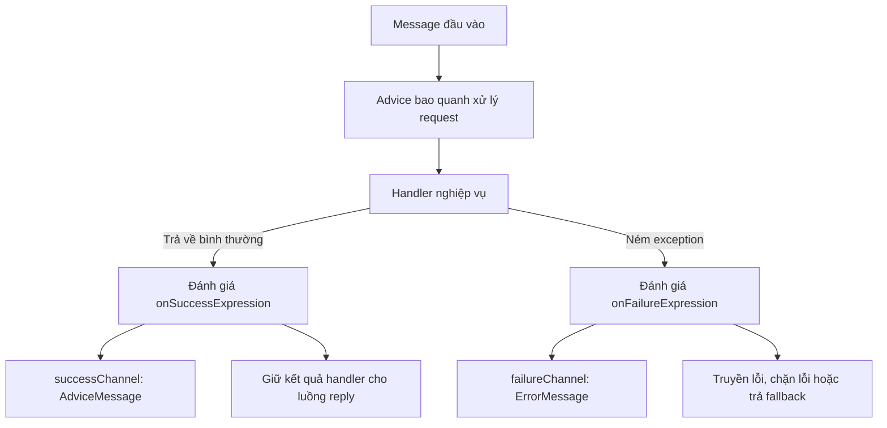

# ExpressionEvaluatingRequestHandlerAdvice

## 1. Bài toán: theo dõi kết quả tại một endpoint

Trong chương **Advice và retry** của module **SPRING_INTEGRATION_CORE**, `ExpressionEvaluatingRequestHandlerAdvice` giúp bổ sung hành vi sau một lần xử lý thông điệp mà không đưa mã theo dõi vào phương thức nghiệp vụ.

Giả sử một endpoint nhận yêu cầu lưu đơn hàng. Khi xử lý thành công, hệ thống cần phát một sự kiện theo dõi; khi xử lý lỗi, hệ thống cần gửi thông tin chẩn đoán. Đồng thời, phía gọi vẫn cần nhận reply hoặc exception theo hợp đồng đã chọn. Advice cho phép cấu hình các hành vi này bằng Spring Expression Language, gọi tắt là SpEL.

Sau bài học, bạn có thể:

- Gắn advice vào một message handler bằng Java DSL.
- Đọc đúng dữ liệu đầu vào của biểu thức và cấu trúc thông điệp kết quả.
- Chọn giữa truyền lỗi, chặn lỗi và trả về fallback.
- Dự đoán số sự kiện khi kết hợp advice với retry và thiết kế kiểm thử tương ứng.

Các ví dụ dùng API **Spring Integration 6.5**, Java 17 trở lên và JUnit Jupiter cho mã kiểm thử. Đây là mốc API của bài, không phải chỉ định phiên bản mới nhất. Phần retry ở cuối sử dụng `org.springframework.retry.support.RetryTemplate`; khi chuyển sang dòng Spring Integration khác, cần đối chiếu lại API retry của dòng đó.

## 2. Advice nằm ở đâu trong luồng thông điệp?

`ExpressionEvaluatingRequestHandlerAdvice` thuộc package `org.springframework.integration.handler.advice` và kế thừa `AbstractRequestHandlerAdvice`. Nó có hai biểu thức: một cho xử lý thành công và một cho xử lý thất bại. Thông điệp phát sang kênh phụ phụ thuộc kết quả đánh giá biểu thức. [Javadoc ExpressionEvaluatingRequestHandlerAdvice 6.5.0](https://docs.spring.io/spring-integration/docs/6.5.0/api/org/springframework/integration/handler/advice/ExpressionEvaluatingRequestHandlerAdvice.html).



Sơ đồ giả định biểu thức có kết quả khác `null` và kênh tương ứng đã được cấu hình. Kênh phụ không thay thế đường reply một cách tự động.

Với handler có reply, chuỗi request advice được áp dụng vào xử lý `handleRequestMessage`. Vì vậy, “thành công” ở đây mô tả phạm vi xử lý được advice bao quanh; nó không chứng minh endpoint phía sau đã thành công, thông điệp đã đến hệ thống bên ngoài hoặc transaction đã commit. [Javadoc AbstractReplyProducingMessageHandler](https://docs.spring.io/spring-integration/docs/6.5.0/api/org/springframework/integration/handler/AbstractReplyProducingMessageHandler.html).

Ví dụ: endpoint A trả về bình thường và advice của A phát sự kiện. Sau đó endpoint B lỗi. Nếu cần thông báo “toàn bộ đơn hàng đã hoàn tất”, hãy tạo sự kiện ở điểm hoàn tất nghiệp vụ phù hợp thay vì suy ra từ success của A.

## 3. Biểu thức đọc Message nào?

Root object của biểu thức là **Message đầu vào được đưa đến handler**. Vì vậy, `payload` và `headers` mô tả request. Ở biểu thức thất bại, exception có thể được truy cập qua biến `#exception`. Nếu chỉ cấu hình kênh mà không cấu hình biểu thức tương ứng, biểu thức mặc định là `payload`. [Javadoc các setter biểu thức](https://docs.spring.io/spring-integration/docs/6.5.0/api/org/springframework/integration/handler/advice/ExpressionEvaluatingRequestHandlerAdvice.html#setOnFailureExpressionString(java.lang.String)).

| Biểu thức minh họa | Ý nghĩa |
| --- | --- |
| `payload` | Lấy payload request |
| `headers['orderId']` | Lấy header định danh đơn hàng |
| `'ACCEPTED:' + payload` | Tạo chuỗi theo dõi từ request |
| `#exception.message` | Lấy mô tả lỗi trong biểu thức failure |
| `@auditFormatter.failure(payload, #exception)` | Gọi bean định dạng thông tin lỗi |

Không mặc định có biến `#result` chứa giá trị handler trả về. Nếu request là `order-42`, handler trả `SAVED:order-42`, thì biểu thức success `'ACCEPTED:' + payload` tạo ra `ACCEPTED:order-42`.

Nếu cần xử lý **kết quả trả về**, hãy thêm endpoint sau handler, chẳng hạn transformer hoặc luồng xuất bản sự kiện dựa trên reply. Không đưa dữ liệu tạm vào payload dùng chung chỉ để biểu thức success nhìn thấy kết quả.

Đối với một thao tác không sinh reply, việc phương thức trả về `null` vẫn có thể là hoàn tất bình thường ở phạm vi invocation. Thiết kế sự kiện phải phân biệt “đã xử lý request” với “đã có reply”. Quy tắc reply và việc kết thúc luồng khi kết quả `null` được mô tả trong [Javadoc handler có reply](https://docs.spring.io/spring-integration/docs/6.5.0/api/org/springframework/integration/handler/AbstractReplyProducingMessageHandler.html#handleRequestMessage(org.springframework.messaging.Message)).

## 4. Hai kênh phụ mang hai cấu trúc khác nhau

### 4.1. Success: AdviceMessage

Thông điệp success là `AdviceMessage<?>`:

- `getPayload()` chứa kết quả của biểu thức success.
- `getInputMessage()` cung cấp Message đầu vào.

Không nên giả định mọi header request đều nằm trên lớp thông điệp success bên ngoài. Khi cần `orderId` hoặc `correlationId`, hãy đọc từ `getInputMessage().getHeaders()` hoặc tạo rõ các trường cần thiết trong payload sự kiện. [Javadoc AdviceMessage](https://docs.spring.io/spring-integration/docs/6.5.0/api/org/springframework/integration/message/AdviceMessage.html).

Đoạn sau minh họa cách đọc một thông điệp đã lấy từ success channel:

```java
import org.springframework.integration.message.AdviceMessage;
import org.springframework.messaging.Message;

// successMessage là Message<?> nhận từ successChannel.
AdviceMessage<?> notice = (AdviceMessage<?>) successMessage;
Object event = notice.getPayload();
Message<?> request = notice.getInputMessage();
Object orderId = request.getHeaders().get("orderId");
```

### 4.2. Failure: ErrorMessage

Thông điệp failure là `ErrorMessage`. Payload của nó là exception `MessageHandlingExpressionEvaluatingAdviceException`, không phải trực tiếp chuỗi mà biểu thức failure trả về. Kết quả biểu thức nằm trong `getEvaluationResult()`; request nằm trong `getFailedMessage()`, còn nguyên nhân được giữ trong chuỗi cause. Chi tiết cấu trúc này có trong [mã nguồn advice tại tag v6.5.0](https://github.com/spring-projects/spring-integration/blob/v6.5.0/spring-integration-core/src/main/java/org/springframework/integration/handler/advice/ExpressionEvaluatingRequestHandlerAdvice.java).

```java
import org.springframework.integration.handler.advice
        .ExpressionEvaluatingRequestHandlerAdvice
        .MessageHandlingExpressionEvaluatingAdviceException;
import org.springframework.messaging.support.ErrorMessage;

// failureMessage là Message<?> nhận từ failureChannel.
ErrorMessage notice = (ErrorMessage) failureMessage;
MessageHandlingExpressionEvaluatingAdviceException failure =
        (MessageHandlingExpressionEvaluatingAdviceException) notice.getPayload();

Object event = failure.getEvaluationResult();
Object requestPayload = failure.getFailedMessage().getPayload();
Throwable cause = failure.getCause();
```

Đối với consumer chuyên xử lý failure của advice này, có thể định tuyến theo loại exception rồi trích xuất `evaluationResult`. Nếu dùng chung kênh với các nguồn lỗi khác, phải kiểm tra kiểu payload trước khi ép kiểu.

## 5. Các lựa chọn xử lý exception

Ba cờ dưới đây đều mặc định là `false`:

| Cấu hình | Mục đích |
| --- | --- |
| `setTrapException(true)` | Chặn exception thuộc phạm vi advice và trả `null` nếu không trả kết quả failure |
| `setReturnFailureExpressionResult(true)` | Dùng kết quả biểu thức failure làm kết quả xử lý request |
| `setPropagateEvaluationFailures(true)` | Cho phép lỗi đánh giá biểu thức success đi vào cơ chế truyền exception |

`propagateEvaluationFailures` không phải chính sách truyền exception nghiệp vụ nói chung. [Javadoc các cờ điều khiển lỗi](https://docs.spring.io/spring-integration/docs/6.5.0/api/org/springframework/integration/handler/advice/ExpressionEvaluatingRequestHandlerAdvice.html#setPropagateEvaluationFailures(boolean)).

Với giả định handler ném exception, biểu thức failure chạy thành công và việc gửi kênh phụ không lỗi:

| `trapException` | `returnFailureExpressionResult` | Hành vi đối với luồng chính |
| --- | --- | --- |
| `false` | `false` | Exception được truyền tiếp |
| `true` | `false` | Trả `null`, thường không có reply |
| `false` | `true` | Trả kết quả failure thay exception |
| `true` | `true` | Trả kết quả failure; nhánh trả kết quả được ưu tiên |

Việc gửi `ErrorMessage` sang failure channel tự nó không tiêu thụ exception. Ngược lại, bật trả kết quả failure không đòi hỏi phải bật `trapException`. Thứ tự quyết định này được thể hiện trong [phương thức doInvoke của mã nguồn v6.5.0](https://github.com/spring-projects/spring-integration/blob/v6.5.0/spring-integration-core/src/main/java/org/springframework/integration/handler/advice/ExpressionEvaluatingRequestHandlerAdvice.java).

Cần cấu hình biểu thức failure nếu muốn dùng kết quả của nó. Nếu không có biểu thức, không có kết quả fallback để trả; cờ `returnFailureExpressionResult` không tự sinh giá trị thay thế.

## 6. Ví dụ Java DSL: theo dõi mà vẫn giữ hợp đồng lỗi

Ví dụ này mô phỏng việc lưu đơn hàng:

- Request `order-42` tạo reply `SAVED:order-42` và sự kiện success.
- Request bắt đầu bằng `fail:` gây lỗi, tạo sự kiện failure và vẫn truyền exception về phía gọi.

Trong ứng dụng học tập đã có dependency `spring-integration-core` dòng 6.5, đặt cấu hình sau vào một lớp Java. Các channel phụ là queue để kiểm thử có thể chủ động lấy thông điệp; không cần poller chỉ để gọi `receive()` trực tiếp.

```java
import org.springframework.context.annotation.Bean;
import org.springframework.context.annotation.Configuration;
import org.springframework.integration.channel.DirectChannel;
import org.springframework.integration.channel.QueueChannel;
import org.springframework.integration.config.EnableIntegration;
import org.springframework.integration.dsl.IntegrationFlow;
import org.springframework.integration.handler.advice
        .ExpressionEvaluatingRequestHandlerAdvice;

@Configuration
@EnableIntegration
public class AdviceDemoConfig {

    @Bean
    public DirectChannel requests() {
        return new DirectChannel();
    }

    @Bean
    public QueueChannel replies() {
        return new QueueChannel(20);
    }

    @Bean
    public QueueChannel successEvents() {
        return new QueueChannel(20);
    }

    @Bean
    public QueueChannel failureEvents() {
        return new QueueChannel(20);
    }

    @Bean
    public ExpressionEvaluatingRequestHandlerAdvice auditAdvice() {
        ExpressionEvaluatingRequestHandlerAdvice advice =
                new ExpressionEvaluatingRequestHandlerAdvice();

        advice.setOnSuccessExpressionString("'ACCEPTED:' + payload");
        advice.setSuccessChannel(successEvents());
        advice.setOnFailureExpressionString("'REJECTED:' + payload");
        advice.setFailureChannel(failureEvents());

        advice.setTrapException(false);
        advice.setReturnFailureExpressionResult(false);
        advice.setPropagateEvaluationFailures(false);
        return advice;
    }

    @Bean
    public IntegrationFlow saveOrderFlow() {
        return IntegrationFlow.from(requests())
                .<String>handle((payload, headers) -> {
                    if (payload.startsWith("fail:")) {
                        throw new IllegalArgumentException("Cannot save order");
                    }
                    return "SAVED:" + payload;
                }, endpoint -> endpoint
                        .id("saveOrderEndpoint")
                        .advice(auditAdvice()))
                .channel(replies())
                .get();
    }
}
```

`endpoint.advice(...)` gắn advice vào handler tại bước `.handle(...)`. Nó không đăng ký interceptor cho mọi channel của ứng dụng. DSL cho phép cung cấp nhiều advice theo thứ tự lồng nhau. [Javadoc ConsumerEndpointSpec.advice](https://docs.spring.io/spring-integration/docs/6.5.0/api/org/springframework/integration/dsl/ConsumerEndpointSpec.html#advice(org.aopalliance.aop.Advice...)).

Cấu hình dùng `@Configuration` mặc định với proxy cho các phương thức `@Bean`. Nếu đổi sang `proxyBeanMethods = false`, hãy chuyển sang inject bean qua tham số; gọi trực tiếp các phương thức như trên khi đó có thể tạo thêm instance không mong muốn.

Các queue có dung lượng 20 phục vụ bài thực hành ngắn. Khi chạy liên tục, cần consumer lấy sự kiện ra; queue đầy có thể chặn đường gửi. Đây chưa phải một hệ thống lưu trữ audit bền vững.

## 7. Kiểm thử reply và kênh phụ độc lập

Không chỉ kiểm tra “có thông điệp trên failure channel”. Cần kiểm tra đồng thời kết quả phía gọi, loại thông điệp phụ và quan hệ với request.

Lớp sau dùng JUnit Jupiter và tạo Spring context trực tiếp, không yêu cầu Spring Boot hay annotation của Spring Test:

```java
import org.junit.jupiter.api.Test;
import org.springframework.context.annotation.AnnotationConfigApplicationContext;
import org.springframework.integration.channel.DirectChannel;
import org.springframework.integration.channel.QueueChannel;
import org.springframework.integration.handler.advice
        .ExpressionEvaluatingRequestHandlerAdvice
        .MessageHandlingExpressionEvaluatingAdviceException;
import org.springframework.integration.message.AdviceMessage;
import org.springframework.messaging.Message;
import org.springframework.messaging.MessagingException;
import org.springframework.messaging.support.ErrorMessage;
import org.springframework.messaging.support.MessageBuilder;

import static org.junit.jupiter.api.Assertions.*;

class AdviceDemoTest {

    @Test
    void successKeepsBusinessReplyAndPublishesInputBasedEvent() {
        try (var context = new AnnotationConfigApplicationContext(
                AdviceDemoConfig.class)) {
            DirectChannel requests = context.getBean(
                    "requests", DirectChannel.class);
            QueueChannel replies = context.getBean("replies", QueueChannel.class);
            QueueChannel successes = context.getBean(
                    "successEvents", QueueChannel.class);
            QueueChannel failures = context.getBean(
                    "failureEvents", QueueChannel.class);

            Message<String> request = MessageBuilder.withPayload("order-42")
                    .setHeader("orderId", "42")
                    .build();

            assertTrue(requests.send(request));

            Message<?> reply = replies.receive(1_000);
            assertNotNull(reply);
            assertEquals("SAVED:order-42", reply.getPayload());

            Message<?> notification = successes.receive(1_000);
            assertInstanceOf(AdviceMessage.class, notification);
            AdviceMessage<?> event = (AdviceMessage<?>) notification;
            assertEquals("ACCEPTED:order-42", event.getPayload());
            assertSame(request, event.getInputMessage());
            assertEquals("42", event.getInputMessage().getHeaders().get("orderId"));
            assertNull(failures.receive(0));
        }
    }

    @Test
    void failurePublishesErrorAndStillThrowsToDirectCaller() {
        try (var context = new AnnotationConfigApplicationContext(
                AdviceDemoConfig.class)) {
            DirectChannel requests = context.getBean(
                    "requests", DirectChannel.class);
            QueueChannel replies = context.getBean("replies", QueueChannel.class);
            QueueChannel successes = context.getBean(
                    "successEvents", QueueChannel.class);
            QueueChannel failures = context.getBean(
                    "failureEvents", QueueChannel.class);

            Message<String> request = MessageBuilder.withPayload("fail:order-42")
                    .setHeader("orderId", "42")
                    .build();

            assertThrows(MessagingException.class, () -> requests.send(request));

            Message<?> notification = failures.receive(1_000);
            assertInstanceOf(ErrorMessage.class, notification);
            ErrorMessage error = (ErrorMessage) notification;
            assertInstanceOf(MessageHandlingExpressionEvaluatingAdviceException.class,
                    error.getPayload());
            MessageHandlingExpressionEvaluatingAdviceException failure =
                    (MessageHandlingExpressionEvaluatingAdviceException)
                            error.getPayload();

            assertSame(request, failure.getFailedMessage());
            assertEquals("REJECTED:fail:order-42", failure.getEvaluationResult());
            assertNotNull(failure.getCause());
            assertNull(replies.receive(0));
            assertNull(successes.receive(0));
        }
    }
}
```

Hai bài kiểm thử này là mã thực hành để người học chạy trong dự án tương ứng. Chúng không gọi mạng, không cần broker và mỗi bài tạo context riêng để tránh sự kiện từ lần chạy trước.

Kiểm thử chính thức của Spring Integration cũng phân biệt `AdviceMessage` với `ErrorMessage` và đọc kết quả failure qua exception bao ngoài. [Kiểm thử advice tại tag v6.5.0](https://github.com/spring-projects/spring-integration/blob/v6.5.0/spring-integration-core/src/test/java/org/springframework/integration/handler/advice/ExpressionEvaluatingRequestHandlerAdviceTests.java).

## 8. Chặn lỗi hoặc tạo fallback có chủ đích

### 8.1. Chặn lỗi và kết thúc nhánh

Trong bean `auditAdvice()` của ví dụ, thay cờ bằng:

```java
advice.setTrapException(true);
advice.setReturnFailureExpressionResult(false);
```

Với request lỗi, failure event vẫn được tạo, nhưng invocation trả `null`. Không có chuỗi `SAVED:...` để đưa sang `replies`.

Nếu endpoint yêu cầu reply bằng `requiresReply(true)`, kết quả `null` có thể dẫn đến lỗi yêu cầu reply ở lớp handler. Với gateway chờ phản hồi, việc không sinh reply có thể dẫn đến chờ hết thời gian cấu hình. Bởi vậy, chỉ chọn cách này khi hợp đồng cho phép không có reply. [Javadoc requiresReply](https://docs.spring.io/spring-integration/docs/6.5.0/api/org/springframework/integration/handler/AbstractReplyProducingMessageHandler.html#setRequiresReply(boolean)).

`requests.send(...)` trả `true` trong một luồng đã chặn lỗi không phải bằng chứng đơn hàng đã được lưu. Trong ví dụ này, câu lệnh lưu giả lập đã thất bại; hợp đồng chỉ thay đổi cách báo thất bại.

### 8.2. Trả fallback vào đường reply

Nếu muốn bên gọi nhận một kết quả nghiệp vụ có thể diễn giải, thay phần failure bằng:

```java
advice.setOnFailureExpressionString("'PENDING_REVIEW:' + payload");
advice.setReturnFailureExpressionResult(true);
advice.setTrapException(false);
```

Giữ `failureChannel` như ví dụ trước. Khi xử lý `fail:order-42`:

| Nơi quan sát | Giá trị mong đợi |
| --- | --- |
| Payload reply | `PENDING_REVIEW:fail:order-42` |
| Payload thông điệp failure | Exception của advice |
| `evaluationResult` trong exception | `PENDING_REVIEW:fail:order-42` |
| Exception gốc truyền trực tiếp về caller | Được thay bằng kết quả fallback nếu nhánh fallback hoàn tất |

Trong hệ thống thực, nên dùng kiểu kết quả có trạng thái rõ ràng như `ACCEPTED`, `PENDING_REVIEW`, `REJECTED`. Nếu phương thức gateway khai báo trả `OrderResult`, biểu thức failure cũng phải tạo dữ liệu phù hợp với hợp đồng đó. Một chuỗi tùy ý có thể khiến lỗi chuyển sang bước chuyển đổi reply.

Có thể gọi một bean để tạo fallback:

```java
advice.setOnFailureExpressionString(
        "@fallbackFactory.pending(payload, #exception)");
```

`fallbackFactory` phải là bean được đăng ký trong context và phương thức `pending` phải trả giá trị phù hợp. Đưa logic có nhánh điều kiện, truy vấn dữ liệu hoặc ánh xạ lỗi phức tạp vào Java giúp kiểm thử rõ hơn so với viết một biểu thức dài.

## 9. Null và lỗi khi đánh giá biểu thức

Nếu biểu thức trả `null`, advice không phát thông điệp cho kênh tương ứng. Trường hợp này khác với việc handler trả `null`: một bên là kết quả biểu thức, một bên là kết quả nghiệp vụ. [Mã nguồn đánh giá biểu thức v6.5.0](https://github.com/spring-projects/spring-integration/blob/v6.5.0/spring-integration-core/src/main/java/org/springframework/integration/handler/advice/ExpressionEvaluatingRequestHandlerAdvice.java).

Có thể dùng kết quả `null` để bỏ qua một thông báo, nhưng không nên để giá trị `null` ngoài ý muốn làm mất dấu vết lỗi. Chẳng hạn biểu thức failure đọc một header không tồn tại sẽ không tạo được sự kiện như dự kiến nếu kết quả là `null`.

Nếu success expression bị lỗi, không được mặc định rằng đó là lỗi nghiệp vụ. Với cấu hình mặc định của ví dụ, lỗi đánh giá success có thể xuất hiện dưới dạng payload exception trên success channel. Consumer của kênh này cần có hợp đồng rõ ràng nếu cho phép biểu thức thực thi logic có thể thất bại. [Javadoc propagateEvaluationFailures](https://docs.spring.io/spring-integration/docs/6.5.0/api/org/springframework/integration/handler/advice/ExpressionEvaluatingRequestHandlerAdvice.html#setPropagateEvaluationFailures(boolean)).

Khi bật truyền lỗi đánh giá success, hãy kiểm thử cùng toàn bộ chuỗi advice và các cờ chặn lỗi/fallback; không suy ra rằng caller luôn nhận đúng exception đó trong mọi cấu hình. Đồng thời, tách lỗi biểu thức khỏi lỗi gửi thông điệp tới kênh phụ: một subscriber đồng bộ của kênh phụ vẫn có thể ném lỗi riêng.

Một cách giảm độ mong manh là chỉ xây dựng sự kiện nhỏ từ các trường đã biết, rồi chuyển phần xử lý audit sang một consumer riêng. Không coi failure expression là nơi đáng tin cậy để khắc phục mọi lỗi có thể xảy ra trong chính success expression.

## 10. Thứ tự khi kết hợp với retry

Expression advice không tự thực hiện retry. Trong dòng 6.5, `RequestHandlerRetryAdvice` dùng Spring Retry và nhận cấu hình qua `setRetryTemplate`. [Javadoc RequestHandlerRetryAdvice 6.5.0](https://docs.spring.io/spring-integration/docs/6.5.0/api/org/springframework/integration/handler/advice/RequestHandlerRetryAdvice.html).

Thêm bean dưới đây vào cấu hình, cùng các import tương ứng:

```java
import org.springframework.integration.handler.advice.RequestHandlerRetryAdvice;
import org.springframework.retry.support.RetryTemplate;

@Bean
public RequestHandlerRetryAdvice retryAdvice() {
    RequestHandlerRetryAdvice advice = new RequestHandlerRetryAdvice();
    advice.setRetryTemplate(RetryTemplate.builder()
            .maxAttempts(3)
            .fixedBackoff(100)
            .build());
    return advice;
}
```

Ví dụ retry cần thêm dependency `spring-retry` tương thích với dự án. `maxAttempts(3)` của Spring Retry tính cả lần gọi đầu tiên, nên tối đa là ba lần gọi handler. Không cấu hình recovery callback trong ví dụ này. [Tài liệu retry của Spring Integration 6.5](https://docs.spring.io/spring-integration/reference/6.5/handler-advice/classes.html#retry-advice).

### 10.1. Expression advice ở ngoài retry

Thay cấu hình advice ở endpoint bằng:

```java
endpoint.advice(auditAdvice(), retryAdvice())
```

Có thể hình dung phạm vi gọi là:

```text
expressionAdvice(
    retryAdvice(
        handler
    )
)
```

Nếu handler lỗi hai lần rồi thành công lần ba, expression advice thấy một kết quả bình thường sau khi retry kết thúc. Nếu cả ba lần đều lỗi, nó thấy thất bại cuối cùng.

Đây là lựa chọn hợp lý khi sự kiện muốn biểu diễn **kết quả cuối của một chu kỳ retry**. Kết luận này suy ra từ thứ tự lồng advice được DSL quy định, với giả định không có recovery chuyển lỗi thành kết quả bình thường. [Javadoc thứ tự advice](https://docs.spring.io/spring-integration/docs/6.5.0/api/org/springframework/integration/dsl/ConsumerEndpointSpec.html#advice(org.aopalliance.aop.Advice...)).

### 10.2. Expression advice ở trong retry

Đổi thứ tự thành:

```java
endpoint.advice(retryAdvice(), auditAdvice())
```

Khi đó mỗi lần retry gọi handler đều đi qua expression advice. Đối với cấu hình giữ nguyên lỗi như ví dụ chính, kết quả dự kiến là:

| Kịch bản | Expression ở ngoài retry | Expression ở trong retry |
| --- | --- | --- |
| Thành công ngay | 1 success event | 1 success event |
| Lỗi hai lần, lần ba thành công | 1 success event | 2 failure event và 1 success event |
| Cả ba lần đều lỗi | 1 failure event | 3 failure event |

Bảng là dự đoán từ cấu trúc lời gọi; giả định biểu thức luôn trả kết quả khác `null`, việc gửi sự kiện thành công và không có recovery callback.

Nếu expression advice **ở trong** retry nhưng bật `trapException(true)` hoặc trả fallback, retry phía ngoài có thể thấy một lần gọi hoàn tất bình thường ngay từ lần đầu. Khi exception không còn truyền ra, điều kiện kích hoạt retry cũng không còn.

Nếu retry có recovery callback trả về bình thường, expression advice **ở ngoài** có thể chạy nhánh success dù handler đã thất bại ở mọi lần thử. Vì vậy, cần định nghĩa rõ success là “handler thành công” hay “chuỗi xử lý đã tạo được một kết quả, kể cả recovery”. Đây là quyết định nghiệp vụ nên được thể hiện qua trạng thái của kết quả.

## 11. failureChannel và errorChannel là hai cơ chế cần phân biệt

`failureChannel` trong bài là đích mà expression advice chủ động gửi thông tin. Nó không tự thay thế header `errorChannel` hay bean `errorChannel` chung của ứng dụng.

Với `DirectChannel`, handler chạy trong thread của bên gửi nên exception chưa bị chặn có thể truyền trực tiếp về caller. Với xử lý qua executor hoặc poller, cơ chế xử lý lỗi của thành phần bất đồng bộ có thể xuất bản `ErrorMessage` theo cấu hình error channel. [Tài liệu Error Handling dòng 6.5](https://docs.spring.io/spring-integration/reference/6.5/error-handling.html).

Do đó, một sự cố có thể tạo cả thông báo ở failure channel của advice lẫn thông báo ở error channel của tầng ngoài. Không đếm chúng như hai lỗi nghiệp vụ độc lập.

Trong thiết kế vận hành, có thể quy ước một kênh phục vụ chẩn đoán và một kênh phụ trách quyết định retry, đưa vào hàng đợi xử lý thủ công hoặc báo thất bại. Dùng `orderId` hoặc khóa nghiệp vụ ổn định để liên kết các sự kiện; đừng lấy số lượng log làm số lượng đơn hàng lỗi.

## 12. Giới hạn khi dùng cho audit và tác dụng phụ

Giả sử thao tác lưu đã thành công nhưng subscriber xử lý sự kiện theo dõi bị lỗi. Nếu exception làm tầng ngoài thực hiện lại handler, dữ liệu có thể bị ghi hai lần. Trước khi cho lỗi audit ảnh hưởng vào retry nghiệp vụ, cần xác định thao tác lưu có idempotent hay không.

Tương tự, sự kiện success phát ra trong request advice có thể xuất hiện trước thời điểm commit transaction ở tầng bao ngoài. Nếu yêu cầu là chỉ công bố sự kiện sau commit hoặc lưu dữ liệu và sự kiện một cách nhất quán, hãy thiết kế cơ chế gắn với transaction, chẳng hạn lưu sự kiện bằng outbox trong transaction nghiệp vụ rồi xuất bản riêng. Không xem tên `successChannel` là cam kết về tính bền vững.

Đối với luồng học tập hoặc theo dõi kỹ thuật, expression advice phù hợp khi sự kiện nhỏ và phạm vi quan sát hẹp. Đối với xác nhận hoàn tất quy trình gồm nhiều endpoint, nên mô hình hóa trạng thái hoàn tất trong luồng nghiệp vụ, có thể dùng router cho nhánh xử lý và aggregator khi phải chờ nhiều kết quả.

Khi cần triển khai thực tế, hãy làm rõ các điểm sau trong hợp đồng sự kiện:

- Sự kiện mô tả một lần thử hay kết quả cuối cùng.
- Khóa nghiệp vụ dùng để liên kết và khử trùng lặp.
- Consumer phải làm gì nếu nhận lại cùng một sự kiện.
- Cách xử lý khi hệ thống ghi nhận sự kiện chậm hoặc không sẵn sàng.

## 13. Các tình huống nên thực hành thêm

Dùng cấu hình ở mục 6 làm điểm xuất phát và mỗi lần chỉ thay một chính sách:

| Thay đổi | Điều cần quan sát |
| --- | --- |
| Chỉ cấu hình success channel, bỏ success expression | Sự kiện dùng payload request mặc định |
| Success expression là `null` theo cú pháp SpEL | Không có success event dù handler thành công |
| Bật `trapException`, giữ cờ trả kết quả failure là `false` | Không có reply ở nhánh lỗi nếu endpoint cho phép |
| Bật trả kết quả failure | Reply chứa fallback và failure event vẫn có thể được gửi |
| Đặt expression advice ngoài retry | Chỉ thấy kết quả cuối chu kỳ theo các giả định ở mục 10 |
| Đặt expression advice trong retry | Thấy sự kiện theo từng lần thử |
| Bật trap khi expression advice nằm trong retry | Đếm số lần gọi để xác nhận retry có còn xảy ra |
| Làm biểu thức hoặc consumer của kênh phụ ném lỗi | Phân biệt lỗi theo dõi với lỗi handler |

Để đếm lần gọi, có thể dùng `AtomicInteger` trong một bean xử lý giả lập và cho hai lần đầu ném exception, lần thứ ba trả kết quả. Kiểm tra cả bộ đếm lẫn số thông điệp ở hai queue. Không dùng `Thread.sleep()` để suy đoán kết quả của ví dụ đồng bộ; lấy thông điệp với timeout và kiểm tra queue sau khi lệnh gửi đã hoàn tất.

Những hành vi quan trọng cần nắm là: success expression đọc request; hai kênh phụ mang hai cấu trúc khác nhau; phát thông tin lỗi và chặn exception là hai quyết định riêng; thứ tự advice xác định bạn đang quan sát từng lần thử hay kết quả của cả chu kỳ retry.