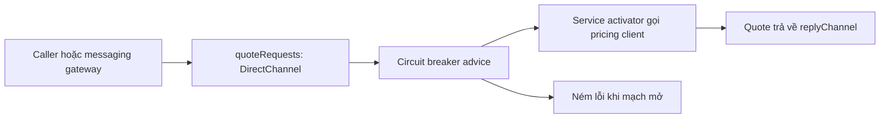
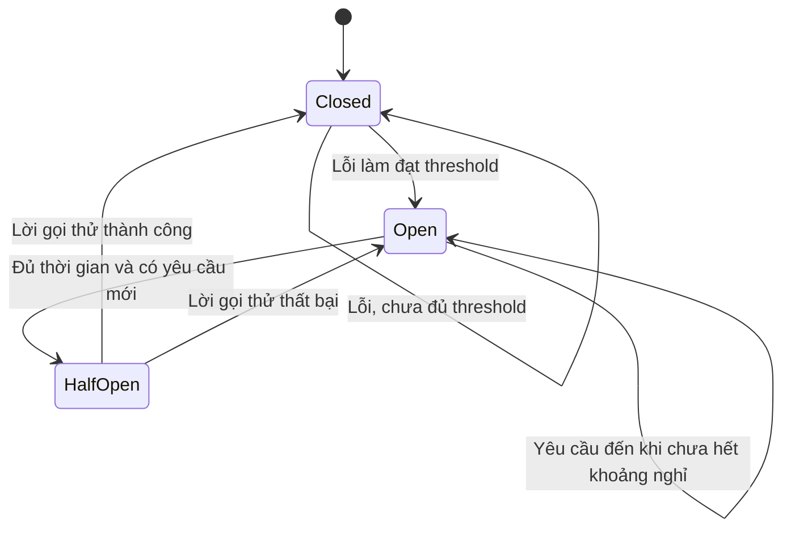

# RequestHandlerCircuitBreakerAdvice

## 1. Bài toán: ngừng gọi một dịch vụ đang liên tục thất bại

Trong một luồng Spring Integration, service activator có thể gọi dịch vụ tính giá, xác thực thanh toán hoặc tra cứu tồn kho. Khi dịch vụ phụ thuộc gặp sự cố, mỗi thông điệp mới tiếp tục tạo thêm một lời gọi phải chờ kết nối hoặc chờ đọc dữ liệu. Hàng đợi dài dần, các luồng thực thi bị giữ lại và lỗi của một hệ thống có thể lan sang những hệ thống khác.

`RequestHandlerCircuitBreakerAdvice` bổ sung cơ chế ngắt mạch quanh một message handler: sau một số lần thất bại liên tiếp, những yêu cầu đến trong khoảng nghỉ bị từ chối sớm. Khi khoảng nghỉ đã qua, một yêu cầu mới có thể gọi lại handler để kiểm tra khả năng phục hồi.

Trong chương **Advice và retry** của module **SPRING_INTEGRATION_CORE**, mục tiêu của bài là đặt đúng cơ chế này vào luồng `Message → MessageChannel → endpoint`, giải thích tác động của thứ tự advice và kiểm thử bằng số lần dịch vụ thực sự được gọi. Ví dụ dùng Java DSL với một dịch vụ tính giá giả lập, không cần kết nối mạng.

Các ví dụ chọn Java 17 trở lên và API Spring Integration 6.5.0 làm mốc cụ thể. Dự án Spring Boot nên nhận các phiên bản tương thích từ cơ chế quản lý dependency của Boot. Những nhận xét về chi tiết triển khai bên dưới được giới hạn theo mốc phiên bản đã nêu; không giả định mọi thư viện circuit breaker đều có cùng hành vi.

## 2. Advice nằm ở đâu trong luồng thông điệp?

Xét luồng tính giá:



`Message` mang yêu cầu báo giá trong payload và các header phục vụ định tuyến trả lời. `DirectChannel` chuyển thông điệp đến endpoint trong luồng thực thi của caller. Service activator chuyển payload cho pricing client. Advice quyết định có cho phần xử lý được bảo vệ chạy hay không.

Đối với handler sinh phản hồi, request handler advice bao quanh thao tác xử lý yêu cầu. Không nên diễn giải nó thành lớp bảo vệ cho mọi endpoint nằm phía sau, mọi thao tác gửi reply hoặc mọi hoạt động trong ứng dụng. Phạm vi endpoint là lý do nên gắn advice sát thao tác gọi phụ thuộc cần bảo vệ. [Tài liệu về phạm vi endpoint advice](https://docs.spring.io/spring-integration/reference/6.5/handler-advice.html), [mã nguồn AbstractRequestHandlerAdvice 6.5.0](https://github.com/spring-projects/spring-integration/blob/v6.5.0/spring-integration-core/src/main/java/org/springframework/integration/handler/advice/AbstractRequestHandlerAdvice.java).

Ví dụ, nếu luồng lần lượt tra cứu giá rồi lưu đơn hàng, circuit breaker ở bước tra cứu giá không đại diện cho tình trạng của cơ sở dữ liệu ở bước lưu đơn hàng. Hai phụ thuộc có thể cần hai chính sách riêng.

## 3. Hiểu ba trạng thái qua hành vi quan sát được

Tên trạng thái lấy theo mạch điện: mạch **đóng** cho phép lời gọi đi qua; mạch **mở** chặn lời gọi.

| Trạng thái khái niệm | Yêu cầu mới có gọi handler không? | Điều gì xảy ra tiếp theo? |
| --- | --- | --- |
| Closed | Có | Thành công xóa chuỗi thất bại; lỗi làm tăng số thất bại liên tiếp |
| Open, chưa hết khoảng nghỉ | Không | Ném lỗi từ chối sớm; phụ thuộc không nhận thêm lời gọi này |
| Half-open, đã đủ thời gian thử lại | Có thể gọi lại | Thành công phục hồi; thất bại mở lại mạch |



Đây là mô hình giải thích cho các lời gọi tuần tự. Việc qua thời gian nghỉ không tự tạo một yêu cầu đến dịch vụ. Cần có thông điệp mới đi qua endpoint. Phần đồng thời ở mục 10 giải thích vì sao sơ đồ này không mang nghĩa chỉ có một lời gọi thử trong mọi tình huống.

## 4. Hai thuộc tính cấu hình và cách đếm lỗi

| Thuộc tính | Ý nghĩa | Mặc định | Đơn vị |
| --- | --- | --- | --- |
| `threshold` | Số thất bại liên tiếp để bắt đầu ngắt mạch | `5` | Lần thất bại mà advice quan sát được |
| `halfOpenAfter` | Khoảng chờ tính từ thất bại gần nhất trước khi cho phép thử lại | `1000` | Mili giây |

API cung cấp `setThreshold(int)` và `setHalfOpenAfter(long)`. Khi bị chặn, advice ném `RequestHandlerCircuitBreakerAdvice.CircuitBreakerOpenException`, một lớp con của `MessagingException`. [Javadoc 6.5.0](https://docs.spring.io/spring-integration/docs/6.5.0/api/org/springframework/integration/handler/advice/RequestHandlerCircuitBreakerAdvice.html).

Ví dụ:

```java
RequestHandlerCircuitBreakerAdvice breaker =
        new RequestHandlerCircuitBreakerAdvice();
breaker.setThreshold(2);
breaker.setHalfOpenAfter(5_000L);
```

Nên chọn `threshold` dương và khoảng nghỉ dương có ý nghĩa đối với phụ thuộc. Giá trị `5_000L` ở đây là năm giây, không phải năm nghìn giây. Trong cấu hình thực tế, có thể dùng `Duration.ofSeconds(5).toMillis()` để làm rõ đơn vị.

### 4.1. Diễn tiến mẫu khi dịch vụ chưa phục hồi

Giả sử các lời gọi chạy tuần tự, không có retry và thời gian được ghi gần thời điểm lời gọi kết thúc:

| Thời điểm tương đối | Sự kiện | Có gọi pricing client? | Kết quả |
| --- | --- | --- | --- |
| 0 giây | Yêu cầu A thất bại | Có | Số lỗi liên tiếp bằng 1 |
| 1 giây | Yêu cầu B thất bại | Có | Số lỗi bằng 2, các yêu cầu tiếp theo bắt đầu bị chặn |
| 2 giây | Yêu cầu C đến | Không | Từ chối sớm |
| 4 giây | Yêu cầu D đến | Không | Vẫn trong khoảng nghỉ tính từ B |
| 6,1 giây | Yêu cầu E đến, dịch vụ vẫn lỗi | Có | Lần thử thất bại, bắt đầu khoảng nghỉ mới |
| 7 giây | Yêu cầu F đến | Không | Từ chối sớm sau lần thử thất bại |
| 11,2 giây | Yêu cầu G đến, dịch vụ đã tốt | Có | Thành công, xóa chuỗi thất bại |

Các yêu cầu bị từ chối sớm không phải là những lần gọi thất bại mới đến dịch vụ. Trong triển khai 6.5.0, nhánh từ chối không cập nhật thời điểm thất bại của handler. Vì thế lưu lượng đến liên tục trong lúc mạch mở không tự kéo dài khoảng nghỉ. [Mã nguồn RequestHandlerCircuitBreakerAdvice 6.5.0](https://github.com/spring-projects/spring-integration/blob/v6.5.0/spring-integration-core/src/main/java/org/springframework/integration/handler/advice/RequestHandlerCircuitBreakerAdvice.java).

### 4.2. Đây là lỗi liên tiếp, không phải tỷ lệ lỗi

Với `threshold = 3`, chuỗi `lỗi → lỗi → thành công → lỗi → lỗi` chưa làm mở mạch trong thực thi tuần tự. Lần thành công chia chuỗi thành hai đoạn, mỗi đoạn chỉ có hai thất bại.

Do đó không thể đọc cấu hình này thành “mở khi có ba lỗi trong một phút” hoặc “mở khi tỷ lệ lỗi vượt 50%”. Nếu nghiệp vụ cần cửa sổ thống kê, phân loại lỗi hoặc chính sách theo tỷ lệ, phải lựa chọn giải pháp có đúng các khả năng đó. [Mô tả cơ chế circuit breaker của Spring Integration](https://docs.spring.io/spring-integration/reference/handler-advice/classes.html#circuit-breaker-advice).

## 5. Ví dụ đầy đủ bằng Java DSL

Ví dụ sau đăng ký channel, client giả lập, advice và flow. Đặt lớp vào tệp Java cùng tên; các lớp kiểm thử ở mục 12 nằm cùng package, hoặc bổ sung import tương ứng nếu tách package.

Phần chạy chính cần `org.springframework.integration:spring-integration-core` và Spring Context. Trong ứng dụng Boot, có thể dùng `spring-boot-starter-integration`. Phần kiểm thử cần JUnit Jupiter và cấu hình build có thể chạy JUnit Platform. Riêng cấu hình circuit breaker dưới đây không sử dụng `RetryTemplate`.

```java
import java.math.BigDecimal;
import java.util.concurrent.atomic.AtomicInteger;

import org.springframework.context.annotation.Bean;
import org.springframework.context.annotation.Configuration;
import org.springframework.integration.channel.DirectChannel;
import org.springframework.integration.config.EnableIntegration;
import org.springframework.integration.dsl.IntegrationFlow;
import org.springframework.integration.handler.advice.RequestHandlerCircuitBreakerAdvice;

@Configuration(proxyBeanMethods = false)
@EnableIntegration
public class PricingFlowConfig {

    @Bean
    public DirectChannel quoteRequests() {
        return new DirectChannel();
    }

    @Bean
    public DemoPricingClient pricingClient() {
        return new DemoPricingClient();
    }

    @Bean
    public RequestHandlerCircuitBreakerAdvice pricingCircuitBreaker() {
        RequestHandlerCircuitBreakerAdvice advice =
                new RequestHandlerCircuitBreakerAdvice();
        advice.setThreshold(2);
        advice.setHalfOpenAfter(5_000L);
        return advice;
    }

    @Bean
    public IntegrationFlow pricingFlow(
            DirectChannel quoteRequests,
            DemoPricingClient pricingClient,
            RequestHandlerCircuitBreakerAdvice pricingCircuitBreaker) {

        return IntegrationFlow.from(quoteRequests)
                .handle(QuoteRequest.class,
                        (request, headers) -> pricingClient.quote(request),
                        endpoint -> endpoint
                                .id("pricingCall")
                                .advice(pricingCircuitBreaker))
                .get();
    }

    public record QuoteRequest(String sku) {
    }

    public record Quote(String sku, BigDecimal amount, String source) {
    }

    public static final class DemoPricingClient {

        private final AtomicInteger calls = new AtomicInteger();
        private volatile boolean failing = true;

        public Quote quote(QuoteRequest request) {
            this.calls.incrementAndGet();
            if (this.failing) {
                throw new PricingUnavailableException(
                        "Pricing service is unavailable");
            }
            return new Quote(request.sku(), new BigDecimal("125000"), "LIVE");
        }

        public void setFailing(boolean failing) {
            this.failing = failing;
        }

        public int calls() {
            return this.calls.get();
        }
    }

    public static final class PricingUnavailableException
            extends RuntimeException {

        public PricingUnavailableException(String message) {
            super(message);
        }
    }
}
```

Điểm gắn advice là `endpoint.advice(pricingCircuitBreaker)` của bước `.handle(...)`. Java DSL hỗ trợ truyền danh sách advice theo thứ tự lồng nhau. [Javadoc ConsumerEndpointSpec.advice](https://docs.spring.io/spring-integration/docs/6.5.0/api/org/springframework/integration/dsl/ConsumerEndpointSpec.html#advice(org.aopalliance.aop.Advice...)).

Client bắt đầu ở chế độ lỗi để có thể quan sát ngay hai thất bại rồi từ chối sớm. Chuyển `setFailing(false)` mô phỏng dịch vụ phục hồi; không tạo một bean breaker mới khi đổi trạng thái client.

### 5.1. Gửi một Message và nhận phản hồi

Đoạn gọi dưới đây dùng `MessagingTemplate` trong một application context đã khởi tạo:

```java
import org.springframework.integration.core.MessagingTemplate;
import org.springframework.messaging.Message;
import org.springframework.messaging.MessageChannel;
import org.springframework.messaging.support.MessageBuilder;

MessageChannel requests = context.getBean("quoteRequests", MessageChannel.class);

MessagingTemplate template = new MessagingTemplate();
template.setReceiveTimeout(1_000L);

Message<?> reply = template.sendAndReceive(requests,
        MessageBuilder.withPayload(
                new PricingFlowConfig.QuoteRequest("SKU-42"))
                .setHeader("orderId", "ORDER-1042")
                .build());
```

`context` ở đây là context chứa `PricingFlowConfig`. `MessagingTemplate` chuẩn bị đường nhận phản hồi; handler trả `Quote` và framework tạo reply message. Với `DirectChannel`, lỗi xử lý có thể được ném ngay trong lời gọi `sendAndReceive`, trước bước chờ phản hồi.

`receiveTimeout` chỉ giới hạn việc chờ nhận reply. Nó không hủy một pricing client đang bị chặn trong chính luồng gửi. Khi thay client giả bằng HTTP client, cần cấu hình timeout kết nối và đọc dữ liệu tại HTTP client.

Một messaging gateway có thể cung cấp API ứng dụng dạng `Quote requestQuote(QuoteRequest request)` trỏ vào cùng `quoteRequests`. Cơ chế ngắt mạch vẫn thuộc endpoint xử lý thông điệp; gateway không tự thêm khả năng đó chỉ vì nó che giấu `Message` khỏi caller.

## 6. Cấu hình bằng annotation là một phương án thay thế

Nếu đã tổ chức endpoint bằng annotation, có thể tham chiếu bean advice theo tên:

```java
import org.springframework.integration.annotation.ServiceActivator;

@ServiceActivator(
        inputChannel = "quoteRequests",
        adviceChain = "pricingCircuitBreaker")
public PricingFlowConfig.Quote quote(PricingFlowConfig.QuoteRequest request) {
    return pricingClient.quote(request);
}
```

Phương thức này thuộc một Spring bean có trường `pricingClient` được inject. Channel và bean `pricingCircuitBreaker` vẫn cần được đăng ký. `adviceChain` của endpoint annotation nhận tên bean advice. [Tài liệu cấu hình advice bằng annotation](https://docs.spring.io/spring-integration/reference/6.5/handler-advice/advising-with-annotations.html).

Đây là cách thay thế bước `.handle(...)` ở mục 5. Nếu vô tình đăng ký cả hai trên cùng `DirectChannel`, sẽ xuất hiện nhiều subscriber và việc phân phối thông điệp có thể làm sai kịch bản mong đợi.

Không đặt advice này lên một phương thức POJO bất kỳ rồi mặc định rằng Spring Integration sẽ chặn mọi lời gọi trực tiếp đến phương thức đó. Lời gọi phải đi qua message handler được cấu hình advice.

## 7. Kết hợp với retry: thứ tự quyết định đơn vị đếm lỗi

Retry giải quyết việc thử lại một thao tác. Circuit breaker quyết định có nên tiếp tục cho phép thao tác được gọi. Hai cơ chế tương tác qua thứ tự bao quanh handler.

Advice đầu tiên là lớp ngoài cùng; advice cuối cùng gần handler nhất. Vì vậy, cần đọc danh sách `.advice(a, b)` theo dạng `a(b(handler))`. [Tài liệu thứ tự advice](https://docs.spring.io/spring-integration/reference/handler-advice/order.html).

### 7.1. Breaker ở ngoài, retry ở trong

```java
// Đoạn thay thế cấu hình advice của endpoint; retry đã là một bean được tạo.
endpoint.advice(pricingCircuitBreaker, retry);
```

```text
Message
  -> circuit breaker
       -> retry
            -> gọi client lần 1
            -> gọi client lần 2 nếu còn được retry
            -> gọi client lần 3 nếu còn được retry
```

Suy ra từ thứ tự lồng nhau: nếu không có recovery che lỗi, breaker chỉ nhận một thất bại khi toàn bộ chuỗi retry bên trong kết thúc bằng exception. Nếu retry thành công ở lần cuối, breaker nhận một kết quả thành công.

Giả sử `threshold = 2`, retry cho tối đa ba lần gọi, client luôn lỗi, các yêu cầu chạy tuần tự và thời gian nghỉ chưa hết: yêu cầu thứ nhất có thể gọi client ba lần và đóng góp một thất bại cho breaker; yêu cầu thứ hai tương tự; yêu cầu thứ ba bị chặn trước khi vào retry. Tổng số lần gọi client có thể đạt sáu.

### 7.2. Retry ở ngoài, breaker ở trong

```java
endpoint.advice(retry, pricingCircuitBreaker);
```

```text
Message
  -> retry
       -> circuit breaker -> gọi client lần 1
       -> circuit breaker -> gọi client lần 2
       -> circuit breaker -> có thể đã từ chối sớm
```

Suy ra từ cách lồng này: mỗi lần retry đi vào breaker là một cơ hội kiểm tra mạch. Khi đủ hai lỗi liên tiếp, lần thử tiếp theo có thể chỉ nhận lỗi mạch mở mà không gọi client.

Nếu retry tiếp tục thử `CircuitBreakerOpenException`, nó có thể lãng phí thêm lần thử và thời gian backoff. Khi backoff đủ dài để vượt khoảng nghỉ, một lần retry sau đó lại có thể chạm dịch vụ thật. Vì thế phải xác định rõ chính sách với lỗi mạch mở, thay vì chỉ đếm số lần vào vòng retry.

### 7.3. Recovery ở phía trong có thể che mất lỗi

Xét chuỗi `breaker(retry(handler))`. Nếu retry đã hết lượt nhưng recovery trả về một `Quote` từ cache như kết quả bình thường, breaker ở ngoài nhìn thấy thành công. Chuỗi thất bại của breaker có thể bị xóa mặc dù pricing service vẫn hỏng.

Đây là hệ quả của vị trí recovery. Khi thiết kế fallback, cần xác định breaker phải đo sức khỏe của lời gọi từ xa hay kết quả cuối cùng mà ứng dụng chấp nhận. Nếu mục tiêu là theo dõi phụ thuộc, hãy giữ tín hiệu lỗi phụ thuộc đi qua breaker và xử lý fallback ở lớp bên ngoài phù hợp.

`RequestHandlerRetryAdvice` trong dòng 6.5 sử dụng Spring Retry với `RetryTemplate`; nó có cấu hình retry, backoff và recovery riêng. Trong các ví dụ “ba lần” ở trên, số đó bao gồm lần thử đầu tiên. Các phép đếm chỉ minh họa retry đồng bộ, không có recovery và không có lời gọi đồng thời. [Tài liệu retry advice 6.5](https://docs.spring.io/spring-integration/reference/6.5/handler-advice/classes.html#retry-advice).

## 8. Advice xem điều gì là thất bại?

Một ranh giới quan trọng là **exception mà lời gọi được bao quanh đưa ra** so với **ý nghĩa nghiệp vụ của dữ liệu trả về**.

Ví dụ, client có thể nhận HTTP 503 nhưng tự biến nó thành `QuoteResult(status = "UNAVAILABLE")` rồi trả về bình thường. Nếu lỗi không được chuyển thành exception trong phạm vi advice, không thể kỳ vọng circuit breaker hiểu trường `status` đó là thất bại.

Ngược lại, một lỗi dữ liệu đầu vào như mã sản phẩm không hợp lệ có thể trở thành exception và góp vào chuỗi lỗi, dù dịch vụ tính giá vẫn khỏe. Không nên để một loạt yêu cầu sai định dạng đóng vai trò như tín hiệu dịch vụ ngừng hoạt động.

Một thiết kế phù hợp cho ví dụ là:

1. Kiểm tra SKU và điều kiện đầu vào trước endpoint gọi pricing service.
2. Định nghĩa hợp đồng client: lỗi kết nối, lỗi timeout hoặc lỗi dịch vụ cần theo dõi phải được biểu diễn nhất quán.
3. Giữ kết quả nghiệp vụ hợp lệ, như “không có giá cho SKU này”, ở kiểu dữ liệu hoặc nhánh xử lý thích hợp.
4. Nếu cần chỉ tính một danh sách exception nhất định, đánh giá một giải pháp hoặc phần tùy biến hỗ trợ phân loại rõ ràng.

Lớp này không cung cấp các setter như `setFailureRateThreshold`, `setSlidingWindowSize` hay `setRecordExceptions`. Không đưa cấu hình của một thư viện circuit breaker khác vào ví dụ và coi là API của `RequestHandlerCircuitBreakerAdvice`. [Danh sách phương thức trong Javadoc](https://docs.spring.io/spring-integration/docs/6.5.0/api/org/springframework/integration/handler/advice/RequestHandlerCircuitBreakerAdvice.html).

## 9. Lỗi mạch mở đi về đâu?

### 9.1. Luồng đồng bộ với DirectChannel

Trong ví dụ chính, caller và handler chạy trong cùng luồng. Caller có thể nhận `MessagingException`, trong đó exception gốc từ client có thể nằm trong chuỗi cause. Khi mạch đang mở, cần nhận diện cả khả năng xuất hiện `CircuitBreakerOpenException` ở ngoài cùng hoặc bên trong một exception bọc.

Hãy phân biệt hai thông tin khi ghi nhận kết quả:

| Nhóm kết quả | Ý nghĩa đối với phụ thuộc |
| --- | --- |
| Client thực sự được gọi và thất bại | Có một lần thử truy cập phụ thuộc không thành công |
| Bị circuit breaker từ chối | Phụ thuộc không nhận lời gọi này |
| Client thực sự thành công | Có bằng chứng phụ thuộc đáp ứng được yêu cầu |
| Trả fallback | Ứng dụng có kết quả thay thế; cần biết có gọi phụ thuộc hay không |

Với messaging gateway, cách exception được ném hoặc chuyển sang một error flow còn phụ thuộc cấu hình xử lý lỗi của gateway. Không nên giả định mọi caller đều nhận cùng một lớp exception ở ngoài cùng.

### 9.2. Khi xử lý ở một luồng khác

Với `ExecutorChannel` hoặc consumer được poll từ `QueueChannel`, caller thường đã rời khỏi call stack trước khi handler thất bại. Cơ chế xử lý lỗi của tác vụ bất đồng bộ có thể tạo `ErrorMessage`, ưu tiên channel trong header `errorChannel` rồi dùng channel lỗi chung khi phù hợp. Chỉ thêm header lỗi vào thông điệp gửi qua `DirectChannel` không tự biến lỗi đồng bộ thành lỗi bất đồng bộ. [Tài liệu xử lý lỗi Spring Integration](https://docs.spring.io/spring-integration/reference/error-handling.html).

Advice không tự lưu thông điệp chờ mạch đóng, không tự đưa thông điệp vào dead letter queue và không tự phát lại thông điệp bị từ chối. Để trì hoãn xử lý, cần thiết kế thêm hàng đợi bền vững hoặc cơ chế giao lại có giới hạn. Tránh gửi ngay thông điệp lỗi quay về cùng endpoint trong một vòng lặp không có khoảng chờ.

Trong luồng báo giá, fallback có thể là giá cache kèm nguồn `CACHE` và thời điểm dữ liệu. Trong luồng thanh toán, trả một giá trị “thành công” giả sẽ gây sai lệch nghiệp vụ. Kết quả thay thế phải thể hiện chính xác việc thao tác thực tế đã được thực hiện hay chưa.

## 10. Phạm vi trạng thái và giới hạn khi có đồng thời

### 10.1. Trạng thái gắn với target handler

Ở mã nguồn 6.5.0, advice lưu metadata trong một map theo `target` handler. Do đó, việc nhiều endpoint cùng tham chiếu một bean advice không tự chứng minh chúng dùng chung một bộ đếm. Những thông điệp khác nhau đi qua cùng target lại có thể tác động cùng trạng thái, kể cả payload thuộc khách hàng hoặc hệ thống con khác nhau. [Mã nguồn phần lưu metadata](https://github.com/spring-projects/spring-integration/blob/v6.5.0/spring-integration-core/src/main/java/org/springframework/integration/handler/advice/RequestHandlerCircuitBreakerAdvice.java).

Hệ quả thiết kế cho một handler gọi nhiều nhà cung cấp: nếu cần cô lập lỗi nhà cung cấp A khỏi B, hãy tổ chức nhánh và handler theo ranh giới phụ thuộc mong muốn. Không mặc định rằng thay header `providerId` sẽ tạo thêm một mạch riêng.

Trạng thái này nằm trong bộ nhớ của tiến trình đang chạy. Mười instance ứng dụng có thể đưa ra mười quyết định ngắt mạch khác nhau. Một lần khởi động lại cũng không bảo tồn lịch sử lỗi trong bộ nhớ. Không dùng nó như khóa phân tán để bảo đảm chỉ một instance được gọi dịch vụ.

### 10.2. Half-open không cam kết chỉ có một lời gọi thử

Trong triển khai 6.5.0, kiểm tra bộ đếm và thời gian không được ghép với một cổng độc quyền bao quanh toàn bộ lời gọi client. Suy ra: khi khoảng nghỉ đã hết, nhiều luồng có thể cùng đi qua bước kiểm tra trước khi một lời gọi hoàn tất. Sơ đồ ba trạng thái chỉ mô tả hành vi khái niệm. [Mã nguồn doInvoke](https://github.com/spring-projects/spring-integration/blob/v6.5.0/spring-integration-core/src/main/java/org/springframework/integration/handler/advice/RequestHandlerCircuitBreakerAdvice.java).

Ví dụ có 20 worker và client cần hai giây mới báo timeout: một số lời gọi đã bắt đầu trước khi lỗi thứ hai được ghi nhận. Việc mở mạch không hủy những lời gọi đang chạy đó. Tương tự, một kết quả thành công đang chạy đồng thời có thể ảnh hưởng đến bộ đếm khi các lời gọi khác vẫn còn xử lý.

Nếu cần giới hạn số lời gọi đang chạy, bổ sung giới hạn đồng thời hoặc bulkhead. Nếu cần chính xác một lời gọi thử trong half-open, chọn cơ chế có hợp đồng hỗ trợ điều đó và kiểm thử nó ở mức đồng thời.

## 11. Chọn tham số và quan sát hoạt động

`threshold` và `halfOpenAfter` chỉ có ý nghĩa khi đặt cạnh đặc tính của dịch vụ và yêu cầu nghiệp vụ.

| Yếu tố | Câu hỏi cần trả lời | Tác động tới thiết kế |
| --- | --- | --- |
| Timeout của client | Một lần thất bại mất bao lâu? | Quyết định thời gian và tài nguyên bị giữ trước khi thấy lỗi |
| Ngưỡng lỗi liên tiếp | Một lỗi thoáng qua có nên ngắt ngay không? | Ngưỡng nhỏ phản ứng nhanh nhưng dễ chặn do lỗi ngắn hạn |
| Khoảng nghỉ | Phụ thuộc thường cần bao lâu để phục hồi? | Quá ngắn tạo nhiều lần thử; quá dài làm chậm phát hiện phục hồi |
| Lưu lượng và đồng thời | Bao nhiêu lời gọi có thể đã bắt đầu? | Cần giới hạn luồng hoặc connection pool riêng |
| Chính sách retry | Breaker đếm lần gọi hay đếm cả chuỗi retry? | Quyết định tải thật đẩy sang dịch vụ |
| Tính lặp an toàn | Gọi lại có tạo thêm tác dụng phụ không? | Cần khóa idempotency hoặc cách đối soát khi timeout |

Ví dụ, với API báo giá chỉ đọc, có thể thử cấu hình ban đầu `threshold = 3`, khoảng nghỉ năm giây, client timeout phù hợp với ngân sách độ trễ và retry hữu hạn. Đây là giả thiết khởi đầu cho bài thực hành, không phải bộ giá trị chuẩn cho mọi hệ thống. Đo lại dưới lưu lượng và lỗi mô phỏng trước khi chọn giá trị triển khai.

Khi quan sát, nên tách ít nhất số lần gọi client thật, số lỗi client, số lần từ chối do mạch mở và số lần dùng fallback. Gắn `orderId` hoặc correlation ID cho truy vết, đồng thời tránh biến từng mã đơn hàng thành nhãn metric có quá nhiều giá trị. Đo thời gian của lời gọi client riêng với thời gian toàn bộ flow để không nhầm việc từ chối nhanh là dịch vụ đã phục hồi.

Advice không cấp sẵn một mô hình sự kiện trạng thái hoặc API giám sát đầy đủ như một số giải pháp circuit breaker chuyên biệt. Hãy thiết kế instrumentation dựa trên khả năng thực tế của phiên bản và ranh giới client; không tự giả định có phương thức `isOpen()` để gọi trong mã ứng dụng.

## 12. Kiểm thử hành vi qua flow thật

Các kiểm thử sau dùng `PricingFlowConfig` ở mục 5. Mỗi test tạo context mới để không mang trạng thái mạch từ test trước sang test sau. Không cần server HTTP hoặc tài khoản dịch vụ bên ngoài.

Điều cần chứng minh là **lúc nào client được gọi** và **exception thuộc nhóm nào**. Chỉ kiểm tra rằng có exception chưa phân biệt được dịch vụ lỗi với circuit breaker đang từ chối.

```java
import org.junit.jupiter.api.AfterEach;
import org.junit.jupiter.api.BeforeEach;
import org.junit.jupiter.api.Test;

import org.springframework.context.annotation.AnnotationConfigApplicationContext;
import org.springframework.integration.core.MessagingTemplate;
import org.springframework.integration.handler.advice.RequestHandlerCircuitBreakerAdvice;
import org.springframework.integration.handler.advice.RequestHandlerCircuitBreakerAdvice.CircuitBreakerOpenException;
import org.springframework.messaging.Message;
import org.springframework.messaging.MessageChannel;
import org.springframework.messaging.MessagingException;
import org.springframework.messaging.support.MessageBuilder;

import static org.junit.jupiter.api.Assertions.*;

class PricingCircuitBreakerTest {

    private AnnotationConfigApplicationContext context;
    private PricingFlowConfig.DemoPricingClient client;
    private RequestHandlerCircuitBreakerAdvice breaker;
    private MessageChannel requests;
    private MessagingTemplate template;

    @BeforeEach
    void setUp() {
        this.context = new AnnotationConfigApplicationContext(
                PricingFlowConfig.class);
        this.client = this.context.getBean(
                PricingFlowConfig.DemoPricingClient.class);
        this.breaker = this.context.getBean(
                RequestHandlerCircuitBreakerAdvice.class);
        this.requests = this.context.getBean(
                "quoteRequests", MessageChannel.class);
        this.template = new MessagingTemplate();
        this.template.setReceiveTimeout(1_000L);

        // Đặt trước khi gửi yêu cầu đầu tiên của test.
        this.breaker.setHalfOpenAfter(60_000L);
    }

    @AfterEach
    void tearDown() {
        this.context.close();
    }

    @Test
    void rejectsWithoutCallingClientAfterTwoConsecutiveFailures() {
        assertClientFailure();
        assertClientFailure();

        MessagingException rejected = assertThrows(
                MessagingException.class, () -> requestQuote());

        assertTrue(hasCause(rejected, CircuitBreakerOpenException.class));
        assertEquals(2, this.client.calls());
    }

    @Test
    void aSuccessResetsTheConsecutiveFailureCount() {
        assertClientFailure();

        this.client.setFailing(false);
        Message<?> reply = requestQuote();
        assertNotNull(reply);
        assertInstanceOf(PricingFlowConfig.Quote.class, reply.getPayload());

        this.client.setFailing(true);
        assertClientFailure();
        // Đây mới là lỗi đầu tiên kể từ lần thành công.
        assertClientFailure();

        MessagingException rejected = assertThrows(
                MessagingException.class, () -> requestQuote());
        assertTrue(hasCause(rejected, CircuitBreakerOpenException.class));
        assertEquals(4, this.client.calls());
    }

    @Test
    void doesNotProbeByItselfWhenTheClientRecovers() {
        assertClientFailure();
        assertClientFailure();
        this.client.setFailing(false);

        // Client đã tốt, nhưng khoảng nghỉ của breaker chưa hết.
        MessagingException rejected = assertThrows(
                MessagingException.class, () -> requestQuote());

        assertTrue(hasCause(rejected, CircuitBreakerOpenException.class));
        assertEquals(2, this.client.calls());
    }

    @Test
    void aSuccessfulProbeClosesTheCircuit() throws InterruptedException {
        this.breaker.setHalfOpenAfter(100L);
        assertClientFailure();
        assertClientFailure();
        this.client.setFailing(false);

        Thread.sleep(200L);

        Message<?> reply = requestQuote();
        assertNotNull(reply);
        assertEquals(3, this.client.calls());

        // Mở rộng khoảng nghỉ để phân biệt reset bộ đếm với hết giờ.
        this.breaker.setHalfOpenAfter(60_000L);
        this.client.setFailing(true);
        assertClientFailure();
        assertEquals(4, this.client.calls());
    }

    @Test
    void aFailedProbeReopensWithoutWaitingForTwoNewFailures()
            throws InterruptedException {

        this.breaker.setHalfOpenAfter(100L);
        assertClientFailure();
        assertClientFailure();

        Thread.sleep(200L);

        // Thất bại này đến từ client, không phải nhánh từ chối sớm.
        assertClientFailure();
        assertEquals(3, this.client.calls());

        this.breaker.setHalfOpenAfter(60_000L);
        MessagingException rejected = assertThrows(
                MessagingException.class, () -> requestQuote());

        assertTrue(hasCause(rejected, CircuitBreakerOpenException.class));
        assertEquals(3, this.client.calls());
    }

    private Message<?> requestQuote() {
        return this.template.sendAndReceive(this.requests,
                MessageBuilder.withPayload(
                        new PricingFlowConfig.QuoteRequest("SKU-42"))
                        .build());
    }

    private void assertClientFailure() {
        MessagingException failure = assertThrows(
                MessagingException.class, () -> requestQuote());

        assertTrue(hasCause(failure,
                PricingFlowConfig.PricingUnavailableException.class));
        assertFalse(hasCause(failure, CircuitBreakerOpenException.class));
    }

    private static boolean hasCause(
            Throwable error, Class<? extends Throwable> expected) {

        for (Throwable current = error;
                current != null;
                current = current.getCause()) {
            if (expected.isInstance(current)) {
                return true;
            }
        }
        return false;
    }
}
```

Hai test phục hồi có chờ thời gian thực vì API công khai ở mốc này không cung cấp điểm inject đồng hồ. Khoảng chờ 200 ms lớn hơn khoảng nghỉ 100 ms; test không khẳng định một độ trễ chính xác. Với môi trường CI có biến động đồng hồ hoặc yêu cầu kiểm thử thời gian nghiêm ngặt, cần điều chỉnh chiến lược kiểm thử phù hợp. Không dùng `halfOpenAfter = 0` để chứng minh hành vi từ chối trong khoảng nghỉ, vì như vậy đã loại bỏ khoảng nghỉ cần quan sát.

Việc đổi thuộc tính advice trong test chỉ phục vụ điều khiển kịch bản trước từng nhóm thao tác tuần tự. Không suy ra từ đó rằng nên liên tục thay cấu hình một singleton advice trong lúc ứng dụng đang nhận yêu cầu đồng thời.

Tên test thứ ba nói về phản ứng khi client tự phục hồi: đổi cờ client không đóng mạch ngay. Để kiểm tra riêng việc không có tác vụ tự thăm dò sau khi hết giờ, có thể thêm một test không gửi thông điệp mới, chờ qua khoảng nghỉ và xác nhận `calls()` vẫn giữ nguyên.

## 13. Các nhầm lẫn thường gặp

| Nhầm lẫn | Hệ quả | Cách xử lý |
| --- | --- | --- |
| Coi breaker là timeout của HTTP client | Lời gọi đang chạy vẫn có thể chờ lâu | Cấu hình timeout ngay tại client |
| Đọc `threshold` thành số lỗi trong một cửa sổ thời gian | Dự đoán sai thời điểm mở mạch | Dùng chuỗi thành công/thất bại để kiểm tra cách đếm |
| Cho rằng lỗi mạch mở đồng nghĩa đã gọi dịch vụ | Số liệu tải và lỗi phụ thuộc sai | Đếm lời gọi thật tại ranh giới client |
| Giấu exception bằng kết quả fallback bên trong breaker | Breaker có thể nhìn thấy thành công liên tục | Chọn vị trí fallback theo tín hiệu cần đo |
| Retry mọi lỗi, kể cả lỗi mạch mở | Tăng độ trễ và có thể thử lại sau khoảng nghỉ | Định nghĩa rõ lỗi được retry và ngân sách thời gian |
| Chờ breaker tự phát lại thông điệp bị chặn | Yêu cầu không được xử lý lại | Thiết kế thêm hàng đợi hoặc cơ chế giao lại |
| Mặc định mỗi tenant có bộ đếm riêng | Lỗi giữa tenant có thể ảnh hưởng nhau | Tách handler theo phạm vi cô lập mong muốn |
| Mặc định half-open chỉ có một probe | Tải phục hồi có thể lớn hơn dự kiến | Kiểm thử đồng thời và giới hạn số lời gọi đang chạy |
| Tạo advice mới cho mỗi thông điệp | Không tích lũy được lịch sử lỗi mong muốn | Đăng ký và tái sử dụng advice như thành phần của endpoint |

## 14. Bài thực hành mở rộng

Bắt đầu với `PricingFlowConfig`, giữ kịch bản tuần tự và ghi lại cả kết quả nhận được lẫn `client.calls()` sau từng bước:

1. Đổi `threshold` thành 3. Gửi ba yêu cầu thất bại rồi yêu cầu thứ tư. Yêu cầu thứ tư phải bị từ chối mà không tăng số lần gọi client.
2. Chèn một lần thành công giữa hai nhóm lỗi. Giải thích tại sao bộ đếm không cộng dồn xuyên qua lần thành công đó.
3. Thêm retry hữu hạn ba lần và không có recovery. So sánh hai thứ tự advice ở mục 7 bằng số lần gọi client thực tế.
4. Thêm fallback từ cache ngoài ranh giới đo lỗi phụ thuộc. Trả kết quả có nguồn `CACHE`, giữ thông tin lỗi cho quan sát và kiểm tra rằng fallback không bị nhầm với lời gọi trực tiếp thành công.
5. Tạo hai handler cho hai nhà cung cấp giả lập. Làm một nhà cung cấp luôn lỗi và kiểm tra nhà cung cấp còn lại vẫn nhận được yêu cầu theo cách bố trí flow đã chọn.
6. Dùng nhiều luồng gửi cùng lúc sau khoảng nghỉ. Quan sát số lời gọi đã lọt qua trước khi một probe hoàn tất; không đặt tiêu chí mặc định rằng kết quả bắt buộc bằng một.

Tiêu chí hoàn thành là giải thích được ranh giới bảo vệ, đơn vị mà breaker đang đếm, đường đi của exception và cách thông điệp bị từ chối sẽ được nghiệp vụ xử lý tiếp. Một cấu hình ngắt mạch hữu ích phải đi cùng hợp đồng lỗi, timeout và kế hoạch xử lý kết quả cụ thể của luồng tích hợp.
