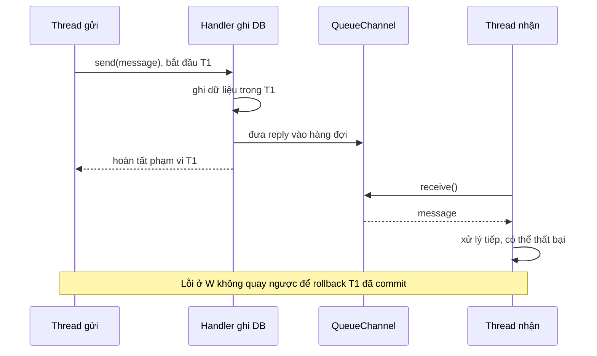

# TransactionInterceptor advice

Trong chương **Advice và retry** của module **SPRING_INTEGRATION_CORE**, `TransactionInterceptor` là advice dùng để đặt chính sách transaction quanh một lời gọi xử lý thông điệp. Nó giúp các thao tác trên tài nguyên được quản lý cùng commit hoặc cùng rollback, trong khi nghiệp vụ vẫn được diễn đạt bằng handler và Java DSL.

Bài học sử dụng một luồng nhận đơn hàng: tạo đơn, trừ tồn kho, lưu bản ghi giữ hàng. Qua ví dụ này, bạn sẽ xác định được transaction bắt đầu ở đâu, lỗi nào khiến rollback, retry lặp lại phần nào và kết quả thay đổi ra sao khi thêm channel bất đồng bộ.

Các ví dụ giả định **Java 17+, Spring Integration 6.5.x, Spring Framework 6.2.x**, xử lý JDBC đồng bộ và transaction cục bộ qua `PlatformTransactionManager`. Phần retry dùng Spring Retry 2.x. Đây là mốc API để đọc và thực hành ví dụ; khi đưa vào ứng dụng, dùng các phiên bản tương thích được quản lý bởi BOM của dự án.

## 1. Vấn đề cần giải quyết

Một handler nhận `OrderCommand` và thực hiện ba bước:

1. Thêm đơn hàng vào bảng `purchase_order`.
2. Giảm số lượng còn lại trong bảng `inventory`.
3. Thêm bản ghi vào bảng `reservation`.

Nếu bước 2 phát hiện thiếu hàng sau khi bước 1 đã ghi dữ liệu, ứng dụng phải hủy việc tạo đơn. Với các câu SQL chạy độc lập ở chế độ auto-commit, dữ liệu có thể còn một đơn hàng chưa giữ được hàng.

Khi cả ba bước dùng cùng transaction JDBC, kỳ vọng của bài toán là:

| Tình huống | Đơn hàng | Tồn kho | Bản ghi giữ hàng |
| --- | --- | --- | --- |
| Đủ hàng, không lỗi | Được lưu | Giảm đúng số lượng | Được lưu |
| Thiếu hàng | Không được lưu | Giữ nguyên | Không được lưu |
| Lỗi ở câu SQL cuối | Không được lưu | Khôi phục như trước | Không được lưu |

Advice đưa việc bắt đầu, hoàn tất và rollback transaction ra khỏi phần nghiệp vụ. Điều kiện để đạt tính nguyên tử vẫn là các thao tác phải tham gia cùng tài nguyên và cùng transaction phù hợp.

## 2. TransactionInterceptor thực hiện việc gì?

`TransactionInterceptor` thuộc Spring Framework, ở package `org.springframework.transaction.interceptor`. Spring Integration cho phép gắn interceptor này vào endpoint; `TransactionInterceptorBuilder` là tiện ích xây dựng cấu hình từ phía Spring Integration.

Có thể hình dung cơ chế thực thi như sau:

```text
Nhận lời gọi được advice
  -> Xác định TransactionAttribute
  -> TransactionManager tạo transaction hoặc tham gia transaction hiện có
  -> Gọi phần xử lý được bao
       -> Trả về bình thường: hoàn tất theo trạng thái transaction
       -> Ném lỗi: áp dụng quy tắc rollback
  -> Trả kết quả hoặc truyền lỗi cho bên gọi
```

Trả về bình thường chưa bảo đảm commit thành công: transaction có thể đã bị đánh dấu `rollback-only`, hoặc lỗi xuất hiện lúc commit. Nếu interceptor chỉ tham gia transaction bên ngoài thì quyết định commit vật lý còn thuộc ranh giới bên ngoài đó.

### 2.1. Bốn thành phần cần nhận diện

| Thành phần | Vai trò trong ví dụ |
| --- | --- |
| `Message<OrderCommand>` | Mang yêu cầu tạo đơn cùng các header |
| `MessageChannel` | Chuyển message đến endpoint, ảnh hưởng cách thực thi và luồng gọi |
| Handler của service activator | Thực hiện ba thao tác JDBC |
| Transaction advice và transaction manager | Đặt chính sách và quản lý transaction bao quanh lời gọi |

Một message có header định danh hay một gateway có phương thức tên `submit()` không tự tạo ra transaction. Cần có cấu hình transaction ở ranh giới thực thi phù hợp.

### 2.2. Chọn transaction manager theo tài nguyên

Trong ví dụ JDBC, `DataSourceTransactionManager` quản lý connection của **một `DataSource`**. `JdbcTemplate` phải dùng chính `DataSource` đó để tham gia transaction. Việc lấy connection theo cách không tích hợp với Spring có thể làm câu SQL đi ngoài transaction đang được quản lý. [API DataSourceTransactionManager](https://docs.spring.io/spring-framework/docs/6.2.0/javadoc-api/org/springframework/jdbc/datasource/DataSourceTransactionManager.html).

Với JPA, chọn manager phù hợp với `EntityManagerFactory`; với JMS, xem transaction của session và listener container. Một JDBC transaction manager không tự gom database, broker và dịch vụ HTTP vào một transaction phân tán.

## 3. Ranh giới được advice: handleRequestMessage và handleMessage

Đây là điểm cần phân biệt trước khi viết cấu hình.

Đối với handler sinh reply như `AbstractReplyProducingMessageHandler`, request advice thông thường bao phương thức nội bộ `handleRequestMessage()`. Việc phát reply ra output channel nằm ở phạm vi bên ngoài lời gọi nội bộ đó.

`TransactionHandleMessageAdvice` mở rộng `TransactionInterceptor` và thực hiện marker `HandleMessageAdvice`, để bao `MessageHandler.handleMessage()`. Nhờ vậy, phạm vi bao có thể đi qua việc gửi reply và phần downstream chạy đồng bộ. [Transaction Support cho handler](https://docs.spring.io/spring-integration/reference/6.5/handler-advice/tx-handle-message.html).

### 3.1. Trường hợp chưa có transaction từ bên ngoài

Giả sử có luồng đồng bộ:

```text
orderRequests (DirectChannel)
    -> persistOrder: ghi DB và trả OrderCommand
    -> kiểm tra tiếp: ném IllegalStateException
```

Hai cấu hình cho kết quả khác nhau:

| Advice gắn ở `persistOrder` | Phạm vi transaction mới | Khi bước downstream ném lỗi |
| --- | --- | --- |
| `TransactionInterceptor` thông thường | Phần xử lý request của handler | DB có thể đã commit trước khi reply được chuyển tiếp |
| `TransactionHandleMessageAdvice` | Toàn bộ `handleMessage()` và lời gọi downstream đồng bộ bên trong | Lỗi có thể quay lại advice và rollback DB |

Sơ đồ thời điểm với advice thông thường:

```text
handleMessage
  |-- begin transaction
  |-- handleRequestMessage: ghi DB
  |-- commit transaction
  |-- gửi reply -> downstream ném lỗi
  `-- truyền lỗi về bên gửi; transaction trước đó đã kết thúc
```

Với `TransactionHandleMessageAdvice`:

```text
begin transaction
  |-- handleMessage
  |     |-- handleRequestMessage: ghi DB
  |     `-- gửi reply -> downstream ném lỗi
  `-- lỗi đi ra advice -> rollback transaction
```

Các sơ đồ giả định không có transaction đang bao từ bên ngoài, không có handler nuốt lỗi và downstream tiếp tục trên cùng thread. Chúng không khẳng định rằng mọi handler hoặc mọi loại channel đều có cùng hành vi.

### 3.2. Ý nghĩa tham số boolean của builder

```java
// Request advice thông thường.
new TransactionInterceptorBuilder()
        .transactionManager(transactionManager)
        .build();

// Tạo TransactionHandleMessageAdvice.
new TransactionInterceptorBuilder(true)
        .transactionManager(transactionManager)
        .build();
```

Tham số `true` chọn loại advice; nó không có nghĩa là bật transaction phân tán hay bắt đầu transaction mới bất kể propagation. Khi dùng `.transactionAttribute(...)`, các thuộc tính transaction được đặt riêng trên builder sẽ bị bỏ qua; hãy cấu hình đầy đủ trên chính `TransactionAttribute`. [API TransactionInterceptorBuilder](https://docs.spring.io/spring-integration/docs/6.5.0/api/org/springframework/integration/transaction/TransactionInterceptorBuilder.html).

## 4. Ví dụ Java DSL: một handler ghi nhiều bảng

### 4.1. Điều kiện thực hành và schema

Ứng dụng cần `spring-integration-core`, `spring-jdbc`, driver database và cấu hình `DataSource`. Các kiểm thử ở phần sau cần thêm Spring Test, JUnit Jupiter và H2. Không cần bật xử lý annotation `@Transactional` chỉ để dùng transaction advice được gắn trực tiếp vào endpoint.

Schema minh họa:

```sql
create table purchase_order (
    order_id varchar(64) primary key,
    sku varchar(64) not null,
    quantity integer not null
);

create table inventory (
    sku varchar(64) primary key,
    available integer not null
);

create table reservation (
    order_id varchar(64) primary key,
    sku varchar(64) not null,
    quantity integer not null
);

insert into inventory (sku, available) values ('BOOK-01', 10);
```

### 4.2. Cấu hình hoàn chỉnh cho phần luồng

`DataSource` do ứng dụng cung cấp. Trong ví dụ nhỏ này chỉ có một transaction manager; nếu ứng dụng có nhiều manager, cần định danh tường minh manager dành cho từng advice.

```java
import javax.sql.DataSource;

import org.springframework.beans.factory.annotation.Qualifier;
import org.springframework.context.annotation.Bean;
import org.springframework.context.annotation.Configuration;
import org.springframework.integration.channel.DirectChannel;
import org.springframework.integration.config.EnableIntegration;
import org.springframework.integration.dsl.IntegrationFlow;
import org.springframework.integration.transaction.TransactionInterceptorBuilder;
import org.springframework.jdbc.core.JdbcTemplate;
import org.springframework.jdbc.datasource.DataSourceTransactionManager;
import org.springframework.transaction.PlatformTransactionManager;
import org.springframework.transaction.annotation.Isolation;
import org.springframework.transaction.annotation.Propagation;
import org.springframework.transaction.interceptor.TransactionInterceptor;

@Configuration
@EnableIntegration
public class OrderFlowConfiguration {

    public record OrderCommand(String orderId, String sku, int quantity) {
        public OrderCommand {
            if (orderId == null || orderId.isBlank()
                    || sku == null || sku.isBlank() || quantity <= 0) {
                throw new IllegalArgumentException("Đơn hàng không hợp lệ");
            }
        }
    }

    @Bean
    public PlatformTransactionManager transactionManager(DataSource dataSource) {
        return new DataSourceTransactionManager(dataSource);
    }

    @Bean
    public JdbcTemplate jdbcTemplate(DataSource dataSource) {
        return new JdbcTemplate(dataSource);
    }

    @Bean
    public DirectChannel orderRequests() {
        return new DirectChannel();
    }

    @Bean
    public TransactionInterceptor orderTx(
            @Qualifier("transactionManager") PlatformTransactionManager manager) {
        return new TransactionInterceptorBuilder()
                .transactionManager(manager)
                .propagation(Propagation.REQUIRED)
                .isolation(Isolation.READ_COMMITTED)
                .timeout(5)
                .build();
    }

    @Bean
    public OrderWriter orderWriter(JdbcTemplate jdbcTemplate) {
        return new OrderWriter(jdbcTemplate);
    }

    @Bean
    public IntegrationFlow orderFlow(
            OrderWriter writer,
            @Qualifier("orderTx") TransactionInterceptor txAdvice) {
        return IntegrationFlow.from("orderRequests")
                .handle(writer, "persist", endpoint -> endpoint
                        .id("persistOrder")
                        .advice(txAdvice))
                .channel("nullChannel")
                .get();
    }

    public static class OrderWriter {
        private final JdbcTemplate jdbc;

        public OrderWriter(JdbcTemplate jdbc) {
            this.jdbc = jdbc;
        }

        public OrderCommand persist(OrderCommand command) {
            jdbc.update("""
                    insert into purchase_order (order_id, sku, quantity)
                    values (?, ?, ?)
                    """, command.orderId(), command.sku(), command.quantity());

            int changed = jdbc.update("""
                    update inventory
                    set available = available - ?
                    where sku = ? and available >= ?
                    """, command.quantity(), command.sku(), command.quantity());

            if (changed != 1) {
                throw new IllegalStateException("Không đủ hàng để giữ chỗ");
            }

            jdbc.update("""
                    insert into reservation (order_id, sku, quantity)
                    values (?, ?, ?)
                    """, command.orderId(), command.sku(), command.quantity());

            return command;
        }
    }
}
```

Câu `update ... where available >= ?` gộp việc kiểm tra đủ hàng và giảm tồn kho trong một thao tác SQL. Transaction giữ ba thao tác thành một đơn vị; nó không thay thế thiết kế điều kiện cập nhật và ràng buộc dữ liệu khi nhiều yêu cầu chạy đồng thời.

Luồng kết thúc ở `nullChannel` vì ví dụ chưa có nghiệp vụ xử lý reply. Handler vẫn trả về `OrderCommand`, nên bài học giữ rõ sự khác nhau giữa xử lý request và phát reply.

### 4.3. Gửi message vào luồng

Đoạn gọi sau giả định `orderRequests` đã được inject từ application context:

```java
import org.springframework.messaging.MessageChannel;
import org.springframework.messaging.support.MessageBuilder;

// Trong phương thức của bean hoặc kiểm thử:
MessageChannel input = orderRequests;
boolean sent = input.send(MessageBuilder
        .withPayload(new OrderFlowConfiguration.OrderCommand(
                "ORDER-1001", "BOOK-01", 3))
        .setHeader("correlationId", "checkout-1001")
        .build());
```

Với luồng đồng bộ này, thiếu hàng khiến lời gọi `send()` ném lỗi xử lý message và transaction rollback. Header `correlationId` hỗ trợ theo dấu yêu cầu; nó không mang JDBC transaction sang thread khác.

Nếu thay lời gọi trực tiếp bằng messaging gateway, gateway cung cấp giao diện Java cho bên gọi. Ranh giới transaction vẫn phụ thuộc vào nơi advice hoặc transaction bên ngoài được đặt và vào đường thực thi của luồng.

## 5. Cách khai báo khác và cách mở rộng phạm vi

### 5.1. Gắn advice qua annotation

Khi dùng endpoint khai báo bằng annotation, có thể tham chiếu bean advice bằng tên:

```java
import org.springframework.integration.annotation.ServiceActivator;

@ServiceActivator(
        inputChannel = "orderRequests",
        outputChannel = "nullChannel",
        adviceChain = "orderTx")
public OrderCommand persist(OrderCommand command) {
    // Cùng nghiệp vụ JDBC như ví dụ trên.
    return command;
}
```

Đây là cách khai báo **thay thế** cho endpoint `.handle(writer, "persist", ...)` của Java DSL. Cần dùng bean được Spring quản lý và bật hỗ trợ Integration. Trong đoạn rút gọn này, `OrderCommand` được import từ lớp cấu hình. Chỉ giữ một consumer cho bài thực hành; đăng ký đồng thời cả hai cách trên cùng `DirectChannel` sẽ thay đổi việc phân phối message.

### 5.2. Bao cả downstream đồng bộ bằng Java DSL

Java DSL cung cấp `.transactional(manager)` và `.transactional(manager, true)`. Biến thể có `true` sử dụng `TransactionHandleMessageAdvice`; khi cần cấu hình chi tiết, có thể truyền interceptor đã tạo qua `.transactional(txAdvice)` hoặc gắn bằng `.advice(txAdvice)`. [API ConsumerEndpointSpec](https://docs.spring.io/spring-integration/docs/6.5.0/api/org/springframework/integration/dsl/ConsumerEndpointSpec.html).

Để quan sát lỗi downstream, thay bean `orderFlow` ở phần 4 bằng cấu hình sau; không đăng ký cả hai bean cùng lúc:

```java
@Bean
public IntegrationFlow orderFlow(
        OrderWriter writer,
        @Qualifier("transactionManager") PlatformTransactionManager manager) {
    return IntegrationFlow.from("orderRequests")
            .handle(writer, "persist", endpoint -> endpoint
                    .id("persistOrder")
                    .transactional(manager, true))
            .handle(OrderCommand.class, (command, headers) -> {
                throw new IllegalStateException("Lỗi ở bước downstream");
            })
            .get();
}
```

Với đơn hàng đủ tồn kho và không có transaction bên ngoài, kỳ vọng là cả ba thay đổi JDBC đều rollback khi bước cuối ném lỗi. Sau đó thay `.transactional(manager, true)` bằng `.transactional(manager)` để so sánh: lời gọi gửi vẫn thất bại nhưng các thao tác trong `persist()` có thể đã commit.

Nếu luồng ban đầu đã chạy trong một transaction bên ngoài và handler dùng `REQUIRED`, handler tham gia transaction đó. Khi ấy, commit vật lý có thể diễn ra sau toàn bộ lời gọi bên ngoài; không dùng kết quả thí nghiệm này để kết luận rằng request advice luôn commit trước downstream trong mọi cấu hình.

## 6. Propagation, isolation, timeout và rollback

### 6.1. Propagation quyết định tham gia hay tạo transaction

| Thiết lập | Khi đi vào advice | Hệ quả thiết kế |
| --- | --- | --- |
| `REQUIRED` | Tham gia transaction đang có; nếu chưa có thì tạo | Phù hợp khi các bước cần cùng kết quả commit/rollback |
| `REQUIRES_NEW` | Tạm ngưng transaction ngoài và mở transaction độc lập | Kết quả commit bên trong có thể tồn tại dù bên ngoài rollback |
| `MANDATORY` | Yêu cầu đã có transaction | Dùng để phát hiện lời gọi sai ranh giới |
| `NOT_SUPPORTED` | Chạy ngoài transaction, tạm ngưng transaction hiện có | Thao tác ghi ở đây không được bao bởi transaction ngoài |

Với `REQUIRED`, rollback-only từ một phạm vi tham gia có thể làm bên ngoài nhận `UnexpectedRollbackException` khi cố commit. `REQUIRES_NEW` dùng tài nguyên riêng, có thể cần thêm connection trong khi transaction ngoài vẫn giữ connection cũ; cần xét sức chứa connection pool. [Transaction Propagation](https://docs.spring.io/spring-framework/reference/6.2/data-access/transaction/declarative/tx-propagation.html).

### 6.2. Isolation và timeout có phạm vi áp dụng

`READ_COMMITTED` là lựa chọn minh họa, không phải đáp án cho mọi bất biến nghiệp vụ. Với bài toán tồn kho, vẫn cần câu cập nhật có điều kiện, ràng buộc khóa và cách xử lý xung đột phù hợp với database.

`timeout(5)` đặt timeout transaction tính bằng giây. Nó không phải cơ chế chắc chắn ngắt mọi công việc Java sau năm giây; mức thực thi timeout tùy manager và tài nguyên. Khi chỉ tham gia transaction đang tồn tại, không giả định timeout hoặc isolation khai báo ở advice sẽ thay được đặc tính transaction bên ngoài.

`readOnly(true)` biểu đạt ý định đọc cho hạ tầng; không dùng nó như cơ chế phân quyền ngăn mọi lệnh ghi.

### 6.3. Quy tắc rollback và lỗi bị bọc

Với transaction attribute mặc định của ví dụ, `RuntimeException` và `Error` dẫn đến rollback; checked exception không mặc nhiên có cùng quy tắc. Quan trọng là exception **thực sự đi ra khỏi lời gọi được advice**. Nếu handler bắt lỗi rồi trả một giá trị bình thường, interceptor có thể thấy lời gọi thành công. [Quy tắc rollback của Spring](https://docs.spring.io/spring-framework/reference/6.2/data-access/transaction/declarative/rolling-back.html).

Spring Integration có thể bọc lỗi nghiệp vụ trong exception messaging. Vì thế không suy luận kết quả rollback chỉ từ `throws SomeCheckedException` trên phương thức nghiệp vụ, và không giả định một rollback rule sẽ tự duyệt mọi `cause` của exception.

Khi chính sách yêu cầu rollback cho mọi `Exception` đi ra khỏi advice, có thể xây dựng attribute tường minh:

```java
import java.util.List;

import org.springframework.transaction.TransactionDefinition;
import org.springframework.transaction.interceptor.RollbackRuleAttribute;
import org.springframework.transaction.interceptor.RuleBasedTransactionAttribute;

// Trong phương thức tạo bean advice:
RuleBasedTransactionAttribute attribute = new RuleBasedTransactionAttribute();
attribute.setPropagationBehavior(TransactionDefinition.PROPAGATION_REQUIRED);
attribute.setIsolationLevel(TransactionDefinition.ISOLATION_READ_COMMITTED);
attribute.setTimeout(5);
attribute.setRollbackRules(List.of(new RollbackRuleAttribute(Exception.class)));

TransactionInterceptor txAdvice = new TransactionInterceptorBuilder()
        .transactionManager(transactionManager)
        .transactionAttribute(attribute)
        .build();
```

Đây là chính sách rộng có chủ đích; với từng loại lỗi cụ thể, cần kiểm tra exception tại đúng ranh giới. `RuleBasedTransactionAttribute` áp dụng các rollback rule và dùng hành vi mặc định khi không rule nào khớp. [API RuleBasedTransactionAttribute](https://docs.spring.io/spring-framework/docs/6.2.0/javadoc-api/org/springframework/transaction/interceptor/RuleBasedTransactionAttribute.html).

## 7. Phối hợp transaction với retry

Retry trả lời câu hỏi **có thực hiện lại lời gọi không**. Transaction trả lời câu hỏi **thay đổi dữ liệu của một phạm vi được hoàn tất ra sao**. Retry không tự hoàn tác phần dữ liệu mà lần gọi trước đã ghi.

### 7.1. Retry ở ngoài, transaction ở trong

Khi hai advice cùng bao một điểm gọi, advice đứng trước là lớp ngoài. Với retry đứng trước transaction, một lần thử đi qua transaction advice; lần thử tiếp theo lại đi qua nó. [Thứ tự advice](https://docs.spring.io/spring-integration/reference/6.5/handler-advice/order.html).

```text
retry
  |-- lần 1: begin T1 -> handler lỗi -> rollback T1
  |-- chờ backoff
  `-- lần 2: begin T2 -> handler thành công -> commit T2
```

Để cấu hình này thật sự có transaction độc lập cho mỗi lần thử:

- Dùng transaction advice thông thường, cùng cấp request với `RequestHandlerRetryAdvice`.
- Dùng `REQUIRED` khi chắc chắn không có transaction bao ngoài, hoặc chọn `REQUIRES_NEW` có chủ đích để tách mỗi lần thử.
- Phân loại lỗi có khả năng hồi phục; thiếu hàng hoặc dữ liệu đầu vào sai thường cần kết quả nghiệp vụ rõ ràng thay vì gọi lại ngay.

Ví dụ thêm hai bean vào cấu hình ở phần 4:

```java
import java.util.Map;

import org.springframework.dao.TransientDataAccessException;
import org.springframework.integration.handler.advice.RequestHandlerRetryAdvice;
import org.springframework.retry.backoff.ExponentialBackOffPolicy;
import org.springframework.retry.policy.SimpleRetryPolicy;
import org.springframework.retry.support.RetryTemplate;

@Bean
public TransactionInterceptor attemptTx(
        @Qualifier("transactionManager") PlatformTransactionManager manager) {
    return new TransactionInterceptorBuilder()
            .transactionManager(manager)
            .propagation(Propagation.REQUIRES_NEW)
            .timeout(5)
            .build();
}

@Bean
public RequestHandlerRetryAdvice databaseRetry() {
    SimpleRetryPolicy retryPolicy = new SimpleRetryPolicy(
            3,
            Map.of(TransientDataAccessException.class, true),
            true);

    ExponentialBackOffPolicy backoff = new ExponentialBackOffPolicy();
    backoff.setInitialInterval(100);
    backoff.setMultiplier(2.0);
    backoff.setMaxInterval(1000);

    RetryTemplate template = new RetryTemplate();
    template.setRetryPolicy(retryPolicy);
    template.setBackOffPolicy(backoff);

    RequestHandlerRetryAdvice advice = new RequestHandlerRetryAdvice();
    advice.setRetryTemplate(template);
    return advice;
}
```

Sau đó thay bean `orderFlow` bằng:

```java
@Bean
public IntegrationFlow orderFlow(
        OrderWriter writer,
        @Qualifier("databaseRetry") RequestHandlerRetryAdvice retry,
        @Qualifier("attemptTx") TransactionInterceptor tx) {
    return IntegrationFlow.from("orderRequests")
            .handle(writer, "persist", endpoint -> endpoint
                    .id("persistOrder")
                    .advice(retry, tx))
            .channel("nullChannel")
            .get();
}
```

`SimpleRetryPolicy` ở đây cho phép tối đa **ba lần thực hiện tổng cộng**, kể cả lần đầu. Đối số `traverseCauses = true` cho phép phân loại lỗi qua chuỗi nguyên nhân, hữu ích khi exception JDBC bị bọc trong lỗi messaging. Backoff có đơn vị mili giây. [API SimpleRetryPolicy](https://docs.spring.io/spring-retry/docs/2.0.11/apidocs/org/springframework/retry/policy/SimpleRetryPolicy.html), [API RetryTemplate](https://docs.spring.io/spring-retry/docs/2.0.11/apidocs/org/springframework/retry/support/RetryTemplate.html).

Ví dụ không đặt `RecoveryCallback`: khi hết lần thử, lỗi tiếp tục đi ra ngoài. Nếu thêm recovery trả về bình thường, cần định nghĩa rõ reply và trạng thái nghiệp vụ. Recovery của retry nằm ngoài transaction của từng lần thử trong cấu trúc này; muốn ghi kết quả phục hồi bằng transaction thì cần ranh giới riêng. [Retry Advice](https://docs.spring.io/spring-integration/reference/6.5/handler-advice/classes.html).

`REQUIRES_NEW` cũng có đánh đổi: một lần thử đã commit có thể tồn tại dù transaction ngoài sau đó rollback. Chỉ dùng khi đó là hợp đồng mong muốn.

### 7.2. Transaction ở ngoài, retry ở trong

```text
begin T
  |-- retry lần 1: ghi một phần rồi lỗi
  |-- retry lần 2: tiếp tục trong T
  `-- hoàn tất T hoặc rollback do trạng thái lỗi
```

Trong cấu trúc `.advice(tx, retry)`, các lần thử cùng nằm trong phạm vi transaction ngoài nếu không có ranh giới bổ sung. Một số lỗi database làm transaction không thể tiếp tục; lỗi khác có thể để lại các thay đổi chưa rollback giữa các lần thử. Retry bên trong không tự tạo savepoint hay khôi phục trạng thái ban đầu cho lần gọi kế tiếp.

Kết quả phụ thuộc lỗi, tài nguyên và propagation. Với thao tác ghi, hãy xác định trạng thái dữ liệu sau lần lỗi đầu thay vì chỉ kiểm tra số lần handler được gọi.

### 7.3. Không suy thứ tự chỉ từ danh sách khi trộn hai cấp advice

Cấu hình sau dễ gây hiểu nhầm:

```java
// flowTx là TransactionHandleMessageAdvice, được tạo bởi builder(true).
endpoint.advice(requestRetry, flowTx);
```

Ở handler sinh reply, advice thực hiện `HandleMessageAdvice` được đưa ra cấp `handleMessage()`, còn request retry vẫn bao phần `handleRequestMessage()`. Vì vậy, thứ tự trong danh sách không có nghĩa request retry đã trở thành lớp ngoài của transaction toàn luồng. Đổi chỗ hai phần tử cũng không làm chúng tự chuyển về cùng cấp. [Handling Message Advice](https://docs.spring.io/spring-integration/reference/6.5/handler-advice/handle-message.html).

Nếu cần retry **cả một đoạn downstream đồng bộ**, hãy thiết kế hai lớp cùng bao ranh giới đó, chẳng hạn qua `handleMessageAdvice(...)` và interceptor phù hợp được hỗ trợ bởi API. Khi ấy phải xét khả năng lặp lại mọi tác dụng phụ trong đoạn luồng. `RequestHandlerRetryAdvice` không mặc nhiên biến thành cơ chế retry toàn bộ IntegrationFlow chỉ vì được đặt trước một transaction advice.

## 8. Channel, thread và poller thay đổi ranh giới thế nào?

### 8.1. DirectChannel và điểm bàn giao bất đồng bộ

Transaction JDBC thông thường gắn với thread. `DirectChannel` gọi consumer trên thread gửi nên có thể giữ ngữ cảnh transaction trong lời gọi đồng bộ. `ExecutorChannel` với executor bất đồng bộ chuyển việc xử lý sang thread khác; `QueueChannel` thường được consumer nhận ở một lượt poll riêng. [Các cách triển khai MessageChannel](https://docs.spring.io/spring-integration/reference/6.5/channel/implementations.html).



Sơ đồ thể hiện một khả năng về thứ tự thời gian; consumer có thể nhận message trước khi transaction phía gửi commit. Việc đưa message vào hàng đợi trong bộ nhớ cũng không tự đồng bộ với JDBC commit.

`TransactionHandleMessageAdvice` vẫn có thể bao thao tác **gửi** vào channel, nhưng không nhờ đó bao luôn xử lý diễn ra sau điểm bàn giao trên thread khác. Khái niệm “toàn downstream” phải đọc trong giới hạn lời gọi đồng bộ và tài nguyên tham gia transaction. [Transaction Boundaries](https://docs.spring.io/spring-integration/reference/6.5/transactions.html#transaction-boundaries).

### 8.2. Advice ở handler và transaction của poller

| Vị trí | Phạm vi cần xem xét | Câu hỏi kiểm chứng |
| --- | --- | --- |
| Request advice ở handler | Lời gọi xử lý request sau khi message đã được nhận | Lỗi có rollback các lệnh ghi trong handler không? |
| Advice ở `handleMessage()` | Handler và lời gọi downstream đồng bộ | Lỗi sau khi phát reply có còn đi ra phạm vi bao không? |
| Transaction của poller | Hoạt động poll và xử lý đồng bộ trong phạm vi được cấu hình | Thao tác nhận message có thực sự tham gia transaction không? |

Một `QueueChannel` dùng queue trong bộ nhớ là nơi lưu message bằng cấu trúc queue Java. Rollback JDBC không tự khôi phục message đã bị lấy khỏi queue đó. [API QueueChannel](https://docs.spring.io/spring-integration/docs/6.5.0/api/org/springframework/integration/channel/QueueChannel.html).

Nếu yêu cầu message xuất hiện lại sau lỗi, phải chọn cơ chế giao nhận và lưu trữ có hành vi transaction/redelivery phù hợp, rồi kiểm chứng transaction manager thực sự quản lý những tài nguyên nào. Đừng suy từ việc database rollback rằng message đã được trả lại nguồn.

Tương tự, aggregator nhận nhiều message có thể lưu trạng thái rồi chỉ phát kết quả ở một lần nhận hoặc một tác vụ timeout khác. Không coi toàn bộ vòng đời nhóm message là một transaction kéo dài chỉ vì một endpoint có advice.

## 9. Xử lý lỗi và tác dụng phụ bên ngoài

### 9.1. Exception cần quay lại đúng ranh giới

Trong luồng đồng bộ, lỗi có thể truyền ngược về lời gọi `send()` hoặc gateway. Trong luồng bất đồng bộ, lỗi thường được xử lý tại thread consumer và chuyển qua cơ chế error handling của endpoint đó.

Có message xuất hiện ở `errorChannel` không đủ để kết luận một transaction cụ thể đã rollback. Cần xác định exception có thoát khỏi lời gọi được advice hay đã được một recovery/error handler chuyển thành kết quả bình thường.

Trong bài toán giữ hàng, nên phân biệt:

- **Từ chối nghiệp vụ trước khi ghi:** chẳng hạn filter kiểm tra cấu trúc đầu vào; không cần giả định có lỗi hệ thống.
- **Lỗi trong đơn vị ghi:** để lỗi thoát ra nhằm rollback phần dữ liệu thuộc đơn vị đó.
- **Ghi nhận thất bại:** log có thể thực hiện độc lập; bản ghi lỗi cần tồn tại sau rollback phải có chiến lược lưu thích hợp.

Nếu lưu bản ghi thất bại trong chính transaction đang rollback, bản ghi đó cũng có thể mất. Nếu tách transaction để giữ bản ghi, cần chấp nhận và mô tả sự độc lập của nó với dữ liệu nghiệp vụ.

### 9.2. Gọi HTTP, gửi email và phát sự kiện

Giả sử handler gọi API thu tiền thành công rồi câu SQL cuối thất bại. Rollback database không tự hoàn tiền, thu hồi email hoặc xóa sự kiện đã được bên ngoài nhận.

Một cách thiết kế cho sự kiện đơn hàng là ghi **đơn hàng và bản ghi outbox trong cùng transaction database**, sau đó một tiến trình khác đọc outbox để phát sự kiện. Tiến trình phát cần xử lý trường hợp gửi thành công nhưng chưa kịp đánh dấu đã gửi; bên nhận cần khóa nghiệp vụ hoặc cơ chế idempotency để chịu được message lặp.

`afterCommit` giúp chạy công việc sau khi commit đã xảy ra, nhưng lỗi trong callback không đảo ngược transaction đã commit. Vì vẫn có khoảng thời gian tiến trình có thể dừng giữa commit và việc gửi ra ngoài, callback đơn lẻ chưa đáp ứng yêu cầu giao nhận bền vững. [API TransactionSynchronization.afterCommit](https://docs.spring.io/spring-framework/docs/6.2.0/javadoc-api/org/springframework/transaction/support/TransactionSynchronization.html#afterCommit()).

Đây là hệ quả thiết kế từ việc các tài nguyên có ranh giới hoàn tất khác nhau; cần chọn outbox, bù trừ hoặc transaction phân tán theo yêu cầu thực tế của hệ thống.

## 10. Kiểm thử bằng trạng thái database

### 10.1. Hai kiểm thử nền tảng

Mock để xác nhận một phương thức được gọi ba lần không chứng minh rollback. Ví dụ sau gửi message qua **endpoint thật**, dùng H2 và kiểm tra dữ liệu sau khi lời gọi kết thúc. Lớp kiểm thử đặt cùng package với `OrderFlowConfiguration` ở phần 4 và dùng luồng gốc kết thúc ở `nullChannel`.

```java
import javax.sql.DataSource;

import org.junit.jupiter.api.BeforeEach;
import org.junit.jupiter.api.Test;
import org.springframework.beans.factory.annotation.Autowired;
import org.springframework.beans.factory.annotation.Qualifier;
import org.springframework.context.annotation.Bean;
import org.springframework.context.annotation.Configuration;
import org.springframework.jdbc.core.JdbcTemplate;
import org.springframework.jdbc.datasource.embedded.EmbeddedDatabaseBuilder;
import org.springframework.jdbc.datasource.embedded.EmbeddedDatabaseType;
import org.springframework.messaging.MessageChannel;
import org.springframework.messaging.MessagingException;
import org.springframework.messaging.support.MessageBuilder;
import org.springframework.test.context.junit.jupiter.SpringJUnitConfig;

import static org.junit.jupiter.api.Assertions.assertEquals;
import static org.junit.jupiter.api.Assertions.assertThrows;
import static org.junit.jupiter.api.Assertions.assertTrue;

@SpringJUnitConfig(classes = {
        OrderFlowConfiguration.class,
        TransactionAdviceTest.DatabaseConfiguration.class
})
class TransactionAdviceTest {

    @Configuration
    static class DatabaseConfiguration {
        @Bean(destroyMethod = "shutdown")
        public org.springframework.jdbc.datasource.embedded.EmbeddedDatabase
                dataSource() {
            return new EmbeddedDatabaseBuilder()
                    .generateUniqueName(true)
                    .setType(EmbeddedDatabaseType.H2)
                    .build();
        }
    }

    @Autowired
    JdbcTemplate jdbc;

    @Autowired
    @Qualifier("orderRequests")
    MessageChannel requests;

    @BeforeEach
    void prepareDatabase() {
        jdbc.execute("""
                create table if not exists purchase_order (
                    order_id varchar(64) primary key,
                    sku varchar(64) not null,
                    quantity integer not null)
                """);
        jdbc.execute("""
                create table if not exists inventory (
                    sku varchar(64) primary key,
                    available integer not null)
                """);
        jdbc.execute("""
                create table if not exists reservation (
                    order_id varchar(64) primary key,
                    sku varchar(64) not null,
                    quantity integer not null)
                """);
        jdbc.update("delete from reservation");
        jdbc.update("delete from purchase_order");
        jdbc.update("delete from inventory");
        jdbc.update("insert into inventory (sku, available) values (?, ?)",
                "BOOK-01", 10);
    }

    @Test
    void commitsAllChangesWhenStockIsAvailable() {
        boolean sent = requests.send(MessageBuilder.withPayload(
                new OrderFlowConfiguration.OrderCommand(
                        "ORDER-OK", "BOOK-01", 3)).build());

        assertTrue(sent);
        assertEquals(1, count("purchase_order"));
        assertEquals(1, count("reservation"));
        assertEquals(7, available());
    }

    @Test
    void rollsBackOrderInsertWhenStockIsInsufficient() {
        assertThrows(MessagingException.class, () -> requests.send(
                MessageBuilder.withPayload(
                        new OrderFlowConfiguration.OrderCommand(
                                "ORDER-FAIL", "BOOK-01", 30)).build()));

        assertEquals(0, count("purchase_order"));
        assertEquals(0, count("reservation"));
        assertEquals(10, available());
    }

    private int count(String table) {
        // table chỉ nhận hai tên hằng nội bộ ở các kiểm thử trên.
        return jdbc.queryForObject("select count(*) from " + table,
                Integer.class);
    }

    private int available() {
        return jdbc.queryForObject(
                "select available from inventory where sku = ?",
                Integer.class, "BOOK-01");
    }
}
```

Không đặt `@Transactional` trên hai phương thức kiểm thử này: một transaction do kiểm thử mở có thể khiến handler `REQUIRED` tham gia vào đó và che mất ranh giới commit thực tế cần quan sát. Các truy vấn xác nhận nên chạy sau khi lời gọi đồng bộ hoàn tất và ngoài transaction nghiệp vụ đang kiểm tra.

Gọi trực tiếp `orderWriter.persist()` trong kiểm thử sẽ bỏ qua advice gắn trên endpoint. Vì vậy, nó không thay thế được kiểm thử đi qua channel.

### 10.2. Các tình huống mở rộng cần thực hành

| Tình huống | Thiết lập | Kết quả cần quan sát |
| --- | --- | --- |
| Lỗi ở lần ghi cuối | Tạo sẵn bản ghi `reservation` có cùng `order_id`, sau đó gửi đơn | Đơn mới không còn; tồn kho không bị giảm; bản ghi cũ vẫn còn |
| Lỗi downstream, request transaction | Đổi sang biến thể phần 5, dùng `.transactional(manager)` | Bên gửi nhận lỗi, dữ liệu của handler đã commit khi không có transaction ngoài |
| Lỗi downstream, handle-message transaction | Dùng `.transactional(manager, true)` | Bên gửi nhận lỗi, dữ liệu JDBC trong phạm vi bao được rollback |
| Lỗi tạm thời, retry rồi thành công | Tiêm lỗi sau bước ghi đầu ở lần thử thứ nhất | Lần đầu không để lại dữ liệu dở; lần sau commit một kết quả |
| Hết số lần retry | Lần nào cũng ném lỗi thuộc loại được retry | Không còn dữ liệu của những lần đã rollback; lỗi thoát ra |
| Có transaction ngoài | Chạy gửi message trong transaction của service gọi | Quan sát `REQUIRED` tham gia transaction ngoài và `REQUIRES_NEW` tách riêng |
| Downstream bất đồng bộ | Thêm queue hoặc executor bất đồng bộ rồi gây lỗi consumer | Lỗi consumer không hoàn tác transaction phía gửi đã commit |

Với database thật, bổ sung tình huống tranh chấp đồng thời, timeout và lỗi lúc commit. H2 hữu ích cho ví dụ nền tảng nhưng không đại diện đầy đủ cho isolation, deadlock và cách driver của mọi database hoạt động.

## 11. Chẩn đoán cấu hình thường gặp

| Hiện tượng | Điều cần kiểm tra |
| --- | --- |
| Handler lỗi nhưng dữ liệu vẫn còn | Advice có gắn đúng endpoint không; lỗi xảy ra trong hay sau phạm vi bao; có bị bắt và chuyển thành kết quả bình thường không |
| Hai câu SQL không cùng rollback | `JdbcTemplate` và manager có dùng cùng `DataSource` không; có connection ngoài cơ chế quản lý của Spring không |
| Retry gặp lỗi ngay ở lần sau | Có dùng lại transaction hỏng hoặc đã rollback-only không; phạm vi retry có bao cả transaction không |
| Đổi thứ tự advice nhưng kết quả không đổi | Có trộn `HandleMessageAdvice` với request advice ở handler sinh reply không |
| Database rollback nhưng message không được giao lại | Queue/nguồn message có hỗ trợ nhận theo transaction hoặc redelivery không |
| Lỗi chỉ xuất hiện ở log của worker | Có điểm bàn giao thread trước chỗ phát sinh lỗi không; error handler đang chạy tại đâu |
| Kiểm thử báo đúng nhưng ứng dụng sai | Kiểm thử có vô tình mở transaction ngoài hoặc gọi thẳng đối tượng nghiệp vụ không |
| Ghi dữ liệu xong nhưng mất sự kiện | Việc ghi DB và phát sự kiện có cửa sổ lỗi giữa hai tài nguyên không |

Khi cần quan sát thêm, có thể bật log transaction trong môi trường thực hành và ghi kèm tên thread, `orderId`, số lần thử. Trong handler, `TransactionSynchronizationManager.isActualTransactionActive()` cho biết thread hiện tại đang ở trong transaction thực hay không; giá trị này không chứng minh rằng database và một hệ thống bên ngoài đang được quản lý cùng nhau.

## 12. Bài tập áp dụng

1. Chạy luồng gốc với số lượng đặt là 3 rồi 30 trên tồn kho 10, dùng mã đơn khác nhau; đối chiếu cả ba bảng.
2. Tạo lỗi ở downstream và so sánh hai biến thể `.transactional(manager)` với `.transactional(manager, true)` trong điều kiện không có transaction bên ngoài.
3. Tiêm một `TransientDataAccessException` ở lần xử lý đầu sau khi đã thêm đơn, rồi dùng `.advice(retry, tx)` với transaction độc lập cho mỗi lần thử. Chứng minh không còn bản ghi dở từ lần đầu.
4. Đổi downstream thành xử lý qua queue; xác định transaction mới phải bắt đầu ở consumer nào và cơ chế nào chịu trách nhiệm giao lại message.
5. Thiết kế thêm bảng outbox để sự kiện chỉ tồn tại khi đơn hàng commit; nêu cách bên nhận xử lý một sự kiện được giao lặp.

Sau bài học, bạn cần tự chỉ ra được ba ranh giới cho một luồng cụ thể: **lời gọi được advice**, **thread đang xử lý** và **tài nguyên được transaction manager quản lý**. Từ đó mới xác định được phần nào rollback, phần nào được retry và phần nào cần cơ chế giao nhận hoặc bù trừ riêng.
