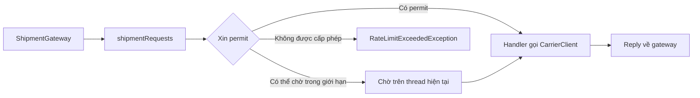

# RateLimiterRequestHandlerAdvice

## 1. Bài toán: kiểm soát tốc độ gọi một endpoint

Trong module **SPRING_INTEGRATION_CORE**, một luồng tích hợp được hình thành từ `Message`, `MessageChannel`, endpoint và gateway. Khi endpoint gọi hệ thống bên ngoài, luồng còn phải tuân thủ năng lực tiếp nhận và quota của hệ thống đó. Chương **Advice và retry** bổ sung hành vi quanh endpoint để thực hiện những yêu cầu này.

Giả sử dịch vụ vận chuyển cho phép ứng dụng tra cứu tối đa 5 vận đơn trong một chu kỳ một giây. Sau một đợt đồng bộ dữ liệu, ứng dụng nhận đồng thời nhiều yêu cầu. Mục tiêu thiết kế là đưa mỗi lần gọi dịch vụ qua một điểm kiểm soát chung, quyết định cho chạy, chờ ngắn hoặc báo quá giới hạn.

`RateLimiterRequestHandlerAdvice` là advice của Spring Integration sử dụng Resilience4j để kiểm soát quyền gọi handler. Lớp này kế thừa `AbstractRequestHandlerAdvice` và có từ Spring Integration 5.2. Có thể truyền một `RateLimiter` hoặc một `RateLimiterConfig` khi khởi tạo. [API của RateLimiterRequestHandlerAdvice](https://docs.spring.io/spring-integration/docs/6.5.0/api/org/springframework/integration/handler/advice/RateLimiterRequestHandlerAdvice.html).

Sau bài học, người học cần làm được bốn việc:

- Xác định handler nào tiêu thụ quota và gắn advice đúng vị trí.
- Chọn số permit, chu kỳ cấp permit và thời gian chờ.
- Phân loại lỗi hết permit trong luồng đồng bộ hoặc bất đồng bộ.
- Kết hợp rate limit với retry và kiểm chứng số lần gọi thực tế.

Các ví dụ sử dụng API của **Spring Integration 6.5.x**, Java 17 trở lên và Resilience4j 2.x. Đây là mốc cho ví dụ, không phải yêu cầu nâng phiên bản dự án. Khi dùng nhánh khác, cần đối chiếu dependency và API tương ứng, đặc biệt ở phần retry.

## 2. Advice nằm ở đâu trong luồng thông điệp?

Xét luồng tra cứu vận đơn:



Trong sơ đồ, bước xin permit thuộc advice bao quanh handler. `shipmentRequests` vẫn là channel truyền message; gateway vẫn chuyển lời gọi Java thành trao đổi thông điệp.

Với handler trả về reply trong ví dụ, request handler advice tác động vào phần xử lý request của endpoint. Nó không tự bao quanh toàn bộ những endpoint phía sau. Nếu bước ghi dữ liệu tiếp theo cũng gọi dịch vụ có quota, cần xác định chính sách riêng cho bước đó. [Phạm vi advice trên endpoint](https://docs.spring.io/spring-integration/reference/handler-advice.html).

Ví dụ vị trí đặt advice:

```text
Message đầu vào
  -> filter kiểm tra mã vận đơn
  -> transformer chuẩn hóa request
  -> handler gọi dịch vụ vận chuyển [gắn rate limiter tại đây]
  -> router phân loại trạng thái
  -> handler lưu kết quả
```

Đặt filter trước lời gọi ngoài giúp loại yêu cầu không hợp lệ trước khi dùng quota. Đặt limiter ở transformer trong khi lời gọi ngoài nằm ở handler khác sẽ đo sai thao tác cần kiểm soát. Tương tự, limiter đặt trước splitter chỉ đếm số message trước khi tách, trong khi một message có thể sinh ra nhiều lời gọi sau splitter.

Advice không tự tạo hàng đợi lưu message, không tự phát lại message và không quyết định kết quả nghiệp vụ khi bị từ chối. Những hành vi đó cần được thể hiện trong thiết kế luồng.

## 3. Permit, chu kỳ và thời gian chờ

### 3.1. Ba tham số cần cấu hình rõ

| Tham số | Ý nghĩa | Giá trị minh họa |
|---|---|---|
| `limitForPeriod` | Số permit cấp cho mỗi chu kỳ | `5` |
| `limitRefreshPeriod` | Độ dài một chu kỳ | `Duration.ofSeconds(1)` |
| `timeoutDuration` | Giới hạn chờ lấy permit cho một lần gọi | `Duration.ofMillis(100)` |

Các tham số này thuộc `RateLimiterConfig`. Chọn chúng tường minh giúp cấu hình phản ánh quota của đối tác thay vì phụ thuộc vào giá trị mặc định của thư viện. [Cấu hình Resilience4j RateLimiter](https://resilience4j.readme.io/docs/ratelimiter).

Một **permit** là quyền bắt đầu một lần thực thi qua limiter. Advice tiêu chuẩn xin một permit cho mỗi lần đi vào handler được bọc. Handler được chấp nhận vẫn có thể thất bại khi thực hiện nghiệp vụ hoặc gọi mạng; permit đã dùng không tự trở lại chỉ vì thao tác thất bại. [Cơ chế decorator và permit của Resilience4j](https://raw.githubusercontent.com/resilience4j/resilience4j/v2.3.0/resilience4j-ratelimiter/src/main/java/io/github/resilience4j/ratelimiter/RateLimiter.java).

Vì vậy, cần xác định đơn vị quota:

- Nếu một lần vào handler tương ứng một HTTP request, đơn vị đo phù hợp.
- Nếu handler tự lặp để gửi 20 HTTP request, một permit ở ngoài handler chưa đại diện cho 20 request đó.
- Nếu HTTP client tự retry bên trong, số lần gọi mạng có thể lớn hơn số permit mà advice nhìn thấy.

Trong hai trường hợp sau, có thể tách mỗi lần gọi thành một message đi qua endpoint hoặc đưa cơ chế xin phép tới sát thao tác gọi mạng. Đây là quyết định thiết kế dựa trên cách đối tác tính quota.

### 3.2. Giới hạn theo chu kỳ cho phép burst

Resilience4j tổ chức permit theo chu kỳ. Khi sang chu kỳ mới, ngân sách permit được làm mới; cấu hình này không phải cam kết giãn đều từng request theo thời gian. [Chu kỳ của RateLimiter](https://resilience4j.readme.io/docs/ratelimiter).

Với 5 permit mỗi giây, có thể hình dung:

```text
Chu kỳ k:       [ A B C D E ........................ ]
Chu kỳ k + 1:   [ F G H I J ........................ ]
```

Năm request có thể cùng bắt đầu rất gần nhau. Nếu dùng hết permit gần cuối một chu kỳ rồi dùng tiếp ở đầu chu kỳ sau, một khoảng thời gian ngắn quanh ranh giới có thể quan sát nhiều request.

Vì vậy, trước khi đổi quota đối tác thành `limitForPeriod / limitRefreshPeriod`, cần biết quota là chu kỳ cố định, cửa sổ trượt, có ngân sách burst hay yêu cầu khoảng cách tối thiểu giữa các lần gọi. Ví dụ, “300 request mỗi phút” chưa đủ để suy ra chắc chắn “5 request mỗi giây” phù hợp với hợp đồng của API.

### 3.3. `timeoutDuration` chỉ áp dụng cho việc xin permit

Với thời gian chờ 100 ms, limiter có thể đợi khi một permit có thể được cấp trong ngân sách đó. Nếu không đáp ứng được, lời gọi bị từ chối; không nên giả định mọi lần từ chối đều phải đợi đúng 100 ms.

Ba loại thời gian cần phân biệt trong thiết kế:

| Loại thời gian | Câu hỏi mà nó giải quyết |
|---|---|
| Chờ permit | Có được bắt đầu gọi handler trong khoảng này không? |
| Connect/read timeout của client | Kết nối và phản hồi từ dịch vụ ngoài mất tối đa bao lâu? |
| Ngân sách toàn bộ request | Caller chấp nhận tổng thời gian xử lý bao lâu? |

`timeoutDuration` không đặt deadline cho HTTP request đã bắt đầu. Nếu cần tổng thời gian phản hồi tối đa 2 giây, phải cộng cả thời gian chờ channel, chờ permit, gọi mạng, backoff và những lần thử lại vào thiết kế.

Đặt `Duration.ZERO` thích hợp khi muốn từ chối ngay nếu chưa lấy được permit. Với công việc nền có thể chờ, nên cân nhắc hàng đợi và lịch thử lại thay vì để một số lượng lớn thread cùng đứng chờ.

## 4. Ví dụ hoàn chỉnh bằng Java DSL và gateway

### 4.1. Dependency và cấu trúc ví dụ

Ví dụ cần các thư viện sau trên classpath:

| Thư viện | Vai trò |
|---|---|
| `org.springframework.integration:spring-integration-core` | Channel, gateway, endpoint, Java DSL và advice |
| `io.github.resilience4j:resilience4j-ratelimiter` | Cơ chế cấp permit |
| `org.junit.jupiter:junit-jupiter`, `org.springframework:spring-test`, `org.mockito:mockito-core` | Phần kiểm thử minh họa bên dưới |

Sử dụng dependency management của dự án để chọn phiên bản tương thích. Trong ứng dụng Spring Boot, cần kiểm tra dependency nào đã được BOM quản lý; dependency chưa được quản lý phải có version được khai báo trong build. Chỉ thêm `spring-retry` nếu thực sự dùng `RequestHandlerRetryAdvice` của nhánh Spring Integration 6.5.x.

Các lớp dưới đây cùng nằm trong package `example.integration`. Chúng tạo một luồng request/reply đồng bộ, sử dụng client giả để tập trung vào hành vi tích hợp.

### 4.2. Hợp đồng client

```java
package example.integration;

@FunctionalInterface
public interface CarrierClient {
    String lookup(String trackingId);
}
```

Trong ứng dụng thực, implementation có thể sử dụng HTTP client để gọi đối tác. Cấu hình rate limiter được giữ ở tầng endpoint để thấy rõ vị trí của chính sách trong luồng.

### 4.3. Gateway cho caller

```java
package example.integration;

import org.springframework.integration.annotation.MessagingGateway;

@MessagingGateway(defaultRequestChannel = "shipmentRequests")
public interface ShipmentGateway {
    String lookup(String trackingId);
}
```

Caller gọi `shipmentGateway.lookup("VN-001")`. Gateway tạo message có payload là mã vận đơn và thiết lập cơ chế nhận reply cho lời gọi đó.

### 4.4. Cấu hình limiter, channel và flow

```java
package example.integration;

import java.time.Duration;

import io.github.resilience4j.ratelimiter.RateLimiter;
import io.github.resilience4j.ratelimiter.RateLimiterConfig;
import org.springframework.context.annotation.Bean;
import org.springframework.context.annotation.Configuration;
import org.springframework.integration.channel.DirectChannel;
import org.springframework.integration.config.EnableIntegration;
import org.springframework.integration.config.IntegrationComponentScan;
import org.springframework.integration.dsl.IntegrationFlow;
import org.springframework.integration.handler.advice.RateLimiterRequestHandlerAdvice;

@Configuration
@EnableIntegration
@IntegrationComponentScan(basePackageClasses = ShipmentGateway.class)
public class CarrierRateLimitConfiguration {

    @Bean
    public DirectChannel shipmentRequests() {
        return new DirectChannel();
    }

    @Bean
    public RateLimiter carrierRateLimiter() {
        RateLimiterConfig config = RateLimiterConfig.custom()
                .limitForPeriod(5)
                .limitRefreshPeriod(Duration.ofSeconds(1))
                .timeoutDuration(Duration.ofMillis(100))
                .build();

        return RateLimiter.of("carrier-tracking", config);
    }

    @Bean
    public RateLimiterRequestHandlerAdvice carrierRateLimitAdvice(
            RateLimiter carrierRateLimiter) {

        return new RateLimiterRequestHandlerAdvice(carrierRateLimiter);
    }

    @Bean
    public CarrierClient carrierClient() {
        return trackingId -> "IN_TRANSIT:" + trackingId;
    }

    @Bean
    public IntegrationFlow shipmentLookupFlow(
            CarrierClient carrierClient,
            RateLimiterRequestHandlerAdvice carrierRateLimitAdvice) {

        return IntegrationFlow.from("shipmentRequests")
                .handle(String.class,
                        (trackingId, headers) -> carrierClient.lookup(trackingId),
                        endpoint -> endpoint.advice(carrierRateLimitAdvice))
                .get();
    }
}
```

Những chi tiết quyết định hành vi của ví dụ:

1. `DirectChannel` đưa xử lý vào thread gọi hiện tại. Nếu phải chờ permit, lời gọi gateway cũng bị giữ lại ở bước đó.
2. Advice được gắn bằng `endpoint.advice(...)` tại handler gọi client.
3. `RateLimiter` là một bean dùng chung. Nhiều lời gọi vào flow cùng tiêu thụ ngân sách của đối tượng đó.
4. Handler trả về chuỗi kết quả. Flow kết thúc ở handler và sử dụng reply channel do gateway cung cấp để trả lời.
5. Client giả luôn thành công khi được gọi. Lỗi hết permit xuất hiện trước khi lambda gọi `carrierClient.lookup(...)`.

Không tạo `RateLimiter.of(...)` mới bên trong lambda xử lý từng message. Làm vậy sẽ tạo ngân sách mới cho từng lần gọi, khiến các message không còn cạnh tranh cùng một quota.

Khi gọi nhanh một loạt request, số request được nhận ngay hoặc bị từ chối còn phụ thuộc vào thời điểm so với ranh giới chu kỳ và khoảng chờ 100 ms. Không nên dùng vòng lặp thủ công rồi mặc định rằng request thứ sáu luôn bị từ chối trong mọi lần chạy.

### 4.5. Cách tương đương bằng annotation

Nếu dự án dùng endpoint annotation, có thể thay bean `shipmentLookupFlow` bằng phương thức sau trong cấu hình, giữ các bean client, channel và advice:

```java
import org.springframework.integration.annotation.ServiceActivator;

@ServiceActivator(
        inputChannel = "shipmentRequests",
        adviceChain = "carrierRateLimitAdvice")
public String handleShipmentLookup(String trackingId) {
    return carrierClient().lookup(trackingId);
}
```

Phương thức này đặt trong lớp `@Configuration` ở ví dụ trên, với chế độ proxy mặc định của `@Configuration`. Tên trong `adviceChain` là tên bean advice. Chỉ đăng ký một trong hai cách cấu hình consumer cho use case này; nếu cùng gắn hai consumer lên `DirectChannel`, cách phân phối message sẽ thay đổi. [Khai báo advice bằng annotation](https://docs.spring.io/spring-integration/reference/handler-advice/advising-with-annotations.html).

## 5. Khi hết permit, lỗi đi đâu?

### 5.1. Nhận diện ngoại lệ có ngữ cảnh message

Trong Spring Integration 6.5.0, advice chuyển `RequestNotPermitted` của Resilience4j thành `RateLimiterRequestHandlerAdvice.RateLimitExceededException`. Ngoại lệ này kế thừa `MessagingException`, mang message bị lỗi và giữ nguyên nguyên nhân. Nếu bị từ chối tại limiter, callback xử lý request chưa được chạy. [Mã nguồn advice](https://raw.githubusercontent.com/spring-projects/spring-integration/v6.5.0/spring-integration-core/src/main/java/org/springframework/integration/handler/advice/RateLimiterRequestHandlerAdvice.java).

Ở biên ứng dụng, ngoại lệ có thể nằm trong một chuỗi wrapper. Có thể phân loại bằng kiểu thay vì so khớp nội dung thông báo:

```java
import org.springframework.integration.handler.advice.RateLimiterRequestHandlerAdvice;

static boolean causedByRateLimit(Throwable error) {
    for (Throwable current = error;
            current != null;
            current = current.getCause()) {

        if (current instanceof
                RateLimiterRequestHandlerAdvice.RateLimitExceededException) {
            return true;
        }
    }
    return false;
}
```

Phân loại này cho biết hệ thống đã từ chối ở limiter của ứng dụng. Phản hồi HTTP `429` do đối tác trả về là tình huống khác: request đã đi ra ngoài và đối tác mới từ chối nó. Khi xử lý `429`, cần xem cả chính sách quota thực tế, các nguồn gọi dùng chung credential và thông tin như `Retry-After` nếu API cung cấp.

### 5.2. Luồng đồng bộ

Với `DirectChannel`, exception của handler truyền về phía sender theo call stack. Gateway cũng có cơ chế trả lỗi về caller hoặc định tuyến qua error channel được cấu hình. Chỉ tạo một bean tên `errorChannel` không làm mọi lỗi của luồng đồng bộ tự động được gửi tới đó. [Xử lý lỗi đồng bộ trong Spring Integration](https://docs.spring.io/spring-integration/reference/error-handling.html).

Đối với flow minh họa, caller có thể bắt lỗi quanh lời gọi gateway, phân loại chuỗi nguyên nhân và trả một trạng thái “thử lại sau” phù hợp với hợp đồng ứng dụng. Không nên biến việc không được thực thi thành một kết quả tra cứu thành công rỗng, vì caller sẽ mất thông tin cần thiết để quyết định bước tiếp theo.

### 5.3. Luồng bất đồng bộ và công việc nền

Khi thêm `ExecutorChannel` hoặc poller đọc `QueueChannel`, handler có thể chạy sau khi sender đã gửi xong. Cần thiết kế error flow tại phần thực thi bất đồng bộ. Trong cơ chế xử lý lỗi chuẩn của Spring Integration, lỗi được đóng gói thành `ErrorMessage`; việc chọn error channel xét header `errorChannel` trước rồi tới channel toàn cục. [ErrorMessage và error channel](https://docs.spring.io/spring-integration/reference/error-handling.html).

Một thiết kế công việc nền có thể là:

```text
Nguồn message
  -> hàng đợi có giới hạn dung lượng
  -> consumer
  -> limiter
  -> gọi đối tác

Error flow
  -> phân loại nguyên nhân
  -> hết permit: lập lịch thử lại với deadline và số lần tối đa
  -> lỗi tạm thời của đối tác: áp dụng chính sách retry tương ứng
  -> dữ liệu không hợp lệ: đưa tới nơi xử lý nghiệp vụ
```

Sơ đồ thể hiện các thành phần cần xây dựng thêm. Advice không tự cung cấp hàng đợi trì hoãn. Với message từ broker, việc ack, nack, rollback hoặc redelivery phải được quyết định theo adapter và giao dịch đang dùng.

Tránh nối error flow trực tiếp trở lại input mà không có trì hoãn hoặc giới hạn số lần. Trong một đợt quá tải, cách nối đó có thể liên tục tạo thêm lần xin permit trong khi ngân sách chưa kịp phục hồi.

## 6. Thứ tự kết hợp với retry quyết định cách đếm quota

Advice chain được áp dụng lồng nhau: advice đầu tiên nằm ngoài cùng, advice cuối cùng gần handler nhất. [Thứ tự advice của Spring Integration](https://docs.spring.io/spring-integration/reference/handler-advice/order.html).

Giả sử đã có bean `retryAdvice` cấu hình chính sách retry phù hợp với lỗi tạm thời của `CarrierClient`. Hai đoạn dưới là hai lựa chọn thay thế cho phần `.handle(...)` của flow.

### 6.1. Retry ở ngoài, rate limiter ở trong

```java
.handle(String.class,
        (trackingId, headers) -> carrierClient.lookup(trackingId),
        endpoint -> endpoint.advice(retryAdvice, carrierRateLimitAdvice))
```

Có thể đọc thứ tự thực thi như sau:

```text
Retry(
    RateLimiter(
        CarrierClient.lookup(...)
    )
)
```

Nếu lần gọi đầu thất bại và retry quyết định thử tiếp, lần thử mới đi qua limiter lần nữa. Thiết kế này phù hợp khi quota tính từng lần gọi ra đối tác.

Ví dụ suy luận, giả sử có đủ permit và lỗi được phép retry:

| Lần thử | Xin permit | Gọi đối tác | Kết quả |
|---|---|---|---|
| 1 | Có | Có | Lỗi tạm thời |
| 2 | Có | Có | Lỗi tạm thời |
| 3 | Có | Có | Thành công |

Nếu lần thử thứ hai không lấy được permit, số lần gọi đối tác có thể dừng ở một. Kết quả tiếp theo tùy chính sách phân loại lỗi và recovery của retry.

### 6.2. Rate limiter ở ngoài, retry ở trong

```java
.handle(String.class,
        (trackingId, headers) -> carrierClient.lookup(trackingId),
        endpoint -> endpoint.advice(carrierRateLimitAdvice, retryAdvice))
```

Lần vào endpoint xin một permit rồi thực thi cả khối retry bên trong. Một message có thể dẫn tới nhiều lần gọi đối tác sau một lần xin phép. Nếu đối tác tính quota trên từng HTTP request, cách đặt này có thể làm số request thực tế vượt dự tính.

Hai kết quả trên là suy luận từ cơ chế lồng advice, không phải hai thuật toán rate limiter khác nhau. Cần chọn thứ tự theo đơn vị quota và xác minh bằng số lần gọi client.

### 6.3. Phân loại lỗi và giới hạn tổng thời gian

Trong nhánh 6.5.x, `RequestHandlerRetryAdvice` sử dụng Spring Retry và cho phép cung cấp `RetryTemplate`. Khi cấu hình policy, cần lưu ý lỗi có thể được bọc trong các ngoại lệ messaging. [Mã nguồn RequestHandlerRetryAdvice 6.5.0](https://raw.githubusercontent.com/spring-projects/spring-integration/v6.5.0/spring-integration-core/src/main/java/org/springframework/integration/handler/advice/RequestHandlerRetryAdvice.java).

Một chính sách có chủ đích cần xác định:

- Lỗi mạng hoặc lỗi đối tác nào thực sự được thử lại.
- `RateLimitExceededException` được trả về ngay hay chuyển sang xử lý trì hoãn.
- Số lần thử tối đa, backoff và deadline của message.
- HTTP client hoặc broker có một tầng retry khác hay không.
- Khóa idempotency hoặc cơ chế khử trùng nếu thao tác có tác dụng phụ.

Ví dụ dự toán: ba lần thử, mỗi lần được phép chờ permit 100 ms và gọi mạng tối đa 800 ms, với hai khoảng backoff 200 ms, tạo ngân sách sơ bộ:

```text
3 × (100 ms + 800 ms) + 2 × 200 ms = 3.100 ms
```

Đây là phép cộng ngân sách thiết kế, chưa phải bảo đảm deadline cứng; còn thời gian chờ executor, channel và xử lý khác. Nếu caller chỉ chấp nhận 2 giây, cần giảm số lần thử hoặc chuyển phần xử lý sang công việc nền có hợp đồng phản hồi khác.

## 7. Chia sẻ limiter và triển khai nhiều instance

### 7.1. Cùng quota cần cùng đối tượng limiter

Nếu API tra cứu và API tạo vận đơn cùng tiêu thụ quota trên một API key, có thể truyền cùng bean `RateLimiter` vào advice của hai endpoint. Nếu mỗi API có quota riêng, tách limiter giúp tránh việc một loại công việc dùng hết ngân sách của loại còn lại.

Hai lệnh tạo limiter với cùng tên không có nghĩa chúng chia sẻ trạng thái:

```java
RateLimiter first = RateLimiter.of("carrier-tracking", config);
RateLimiter second = RateLimiter.of("carrier-tracking", config);
```

Đây là hai đối tượng riêng. Tên dùng để nhận diện limiter; muốn cùng ngân sách trong ứng dụng, hãy tái sử dụng cùng instance, chẳng hạn qua Spring bean hoặc qua một `RateLimiterRegistry` chung. Constructor nhận `RateLimiter` thuận tiện khi cần kiểm soát rõ việc chia sẻ. [Các constructor của advice](https://docs.spring.io/spring-integration/docs/6.5.0/api/org/springframework/integration/handler/advice/RateLimiterRequestHandlerAdvice.html).

Nếu quota theo tenant, cần thiết kế cách chọn limiter theo tenant và quản lý vòng đời của các limiter. Advice tiêu chuẩn nhận một limiter cố định; việc thêm header tenant vào message không tự sinh chính sách quota tương ứng.

### 7.2. Quota của nhiều JVM

Limiter trong ví dụ giữ trạng thái trong tiến trình. Nếu chạy ba instance và mỗi instance có 5 permit mỗi giây, ngân sách tổng theo cấu hình có thể lên tới khoảng 15 lần mỗi giây, chưa xét burst ở ranh giới chu kỳ.

Đây là hệ quả của việc có ba ngân sách độc lập. Tên limiter giống nhau ở ba JVM không tạo ra quota toàn cụm.

Với quota dùng chung cho toàn bộ API key, có thể cân nhắc:

| Phương án | Điểm cần quyết định |
|---|---|
| Chia ngân sách cho từng instance | Điều chỉnh ra sao khi autoscale hoặc instance bị dừng? |
| Gom lời gọi qua một nhóm consumer có kiểm soát | Năng lực xử lý, độ sẵn sàng và backlog của nhóm đó |
| Dùng bộ điều phối quota chung | Tính nhất quán, độ trễ và hành vi khi bộ điều phối lỗi |

Không thể chọn phương án chỉ từ lớp advice. Cần dựa vào quota đối tác, mô hình triển khai và yêu cầu vận hành của luồng.

## 8. Rate limit, concurrency và backlog là các đại lượng khác nhau

| Cơ chế | Đại lượng kiểm soát | Ví dụ câu hỏi |
|---|---|---|
| Rate limiter | Tốc độ cấp quyền bắt đầu xử lý | Cho phép bao nhiêu lần gọi trong mỗi chu kỳ? |
| Giới hạn concurrency/bulkhead | Số tác vụ cùng đang thực thi | Có tối đa bao nhiêu kết nối gọi đối tác cùng lúc? |
| Circuit breaker | Việc tiếp tục gọi khi hệ thống có dấu hiệu lỗi | Khi nào tạm ngừng gọi hệ thống đang thất bại? |
| Retry | Thử lại sau một thất bại đủ điều kiện | Có nên gọi lại, bao nhiêu lần và sau bao lâu? |
| Queue | Nơi giữ công việc chờ xử lý | Chấp nhận giữ bao nhiêu message và trong bao lâu? |

Giả sử trung bình bắt đầu 5 lần gọi mỗi giây, mỗi lần mất 4 giây. Trong trạng thái ổn định và có đủ nguồn lực, có thể có khoảng 20 lời gọi đang xử lý cùng lúc. Đây là ước lượng `số đang xử lý ≈ thông lượng × thời gian xử lý`, cho thấy rate limit 5/giây không đồng nghĩa concurrency tối đa bằng 5.

Tương tự, nếu nguồn gửi đều 100 message mỗi giây nhưng endpoint chỉ phục vụ được 5 message mỗi giây, backlog tăng khoảng 95 message mỗi giây khi chưa có cơ chế giảm tải khác. Queue hữu hạn giúp biểu đạt giới hạn tiếp nhận, nhưng phải có hành vi rõ khi queue đầy.

Với `DirectChannel`, thời gian chờ permit kéo dài lời gọi của sender. Với executor hoặc poller, thời gian chờ chiếm thread làm việc. Tăng `timeoutDuration` cần được đánh giá cùng kích thước pool, độ sâu queue và thời gian xử lý; tăng thời gian chờ không tạo thêm năng lực của đối tác.

Nếu luồng trả về `Mono` hoặc loại kết quả bất đồng bộ khác, cần xác định lời gọi ngoài bắt đầu khi gọi handler hay khi subscribe. Không nên suy ra một advice quanh lời gọi handler tự điều tiết mọi lần subscription và resubscription bên trong kết quả đó.

## 9. Kiểm thử hành vi của flow mà không phụ thuộc vào sleep

### 9.1. Kiểm thử đường cho phép và đường từ chối

Một kiểm thử có ích cần chứng minh **client không bị gọi khi không có permit**, đồng thời message bị lỗi vẫn nhận diện được. Dùng mock limiter cho phép mô tả chính xác chuỗi “cho phép, từ chối, cho phép” mà không phụ thuộc thời điểm đổi chu kỳ.

Ví dụ dưới tạo context riêng và gửi message qua một flow thực. Nó kiểm tra wiring của advice cùng hành vi từ chối; nó không kiểm tra thuật toán thời gian của Resilience4j.

```java
package example.integration;

import java.util.concurrent.atomic.AtomicInteger;

import io.github.resilience4j.ratelimiter.RateLimiter;
import io.github.resilience4j.ratelimiter.RequestNotPermitted;
import org.junit.jupiter.api.Test;
import org.springframework.beans.factory.annotation.Autowired;
import org.springframework.context.annotation.Bean;
import org.springframework.context.annotation.Configuration;
import org.springframework.integration.channel.DirectChannel;
import org.springframework.integration.channel.QueueChannel;
import org.springframework.integration.config.EnableIntegration;
import org.springframework.integration.dsl.IntegrationFlow;
import org.springframework.integration.handler.advice.RateLimiterRequestHandlerAdvice;
import org.springframework.messaging.MessagingException;
import org.springframework.messaging.support.GenericMessage;
import org.springframework.test.context.junit.jupiter.SpringJUnitConfig;

import static org.junit.jupiter.api.Assertions.*;
import static org.mockito.Mockito.*;

@SpringJUnitConfig(RateLimiterAdviceTest.TestConfiguration.class)
class RateLimiterAdviceTest {

    @Autowired DirectChannel limitedRequests;
    @Autowired QueueChannel limitedReplies;
    @Autowired AtomicInteger clientCalls;
    @Autowired RateLimiter limiter;

    @Test
    void denialDoesNotCallClientAndLaterMessageCanSucceed() {
        limitedRequests.send(new GenericMessage<>("VN-001"));
        assertNotNull(limitedReplies.receive(0));
        assertEquals(1, clientCalls.get());

        var rejectedMessage = new GenericMessage<>("VN-002");
        MessagingException thrown = assertThrows(MessagingException.class,
                () -> limitedRequests.send(rejectedMessage));

        var rateLimitFailure = findRateLimitFailure(thrown);
        assertSame(rejectedMessage, rateLimitFailure.getFailedMessage());
        assertInstanceOf(RequestNotPermitted.class, rateLimitFailure.getCause());
        assertEquals(1, clientCalls.get());
        assertNull(limitedReplies.receive(0));

        limitedRequests.send(new GenericMessage<>("VN-003"));
        assertNotNull(limitedReplies.receive(0));
        assertEquals(2, clientCalls.get());
        verify(limiter, times(3)).acquirePermission(1);
    }

    private static RateLimiterRequestHandlerAdvice.RateLimitExceededException
            findRateLimitFailure(Throwable error) {

        for (Throwable current = error;
                current != null;
                current = current.getCause()) {

            if (current instanceof
                    RateLimiterRequestHandlerAdvice.RateLimitExceededException failure) {
                return failure;
            }
        }
        throw new AssertionError("Không tìm thấy lỗi rate limit", error);
    }

    @Configuration
    @EnableIntegration
    static class TestConfiguration {

        @Bean
        DirectChannel limitedRequests() {
            return new DirectChannel();
        }

        @Bean
        QueueChannel limitedReplies() {
            return new QueueChannel();
        }

        @Bean
        AtomicInteger clientCalls() {
            return new AtomicInteger();
        }

        @Bean
        RateLimiter limiter() {
            RateLimiter mockLimiter = mock(RateLimiter.class);
            when(mockLimiter.getName()).thenReturn("carrier-test");
            when(mockLimiter.acquirePermission(1)).thenReturn(true, false, true);
            return mockLimiter;
        }

        @Bean
        IntegrationFlow testFlow(RateLimiter limiter, AtomicInteger clientCalls) {
            var advice = new RateLimiterRequestHandlerAdvice(limiter);

            return IntegrationFlow.from("limitedRequests")
                    .handle(String.class, (trackingId, headers) -> {
                        clientCalls.incrementAndGet();
                        return "IN_TRANSIT:" + trackingId;
                    }, endpoint -> endpoint.advice(advice))
                    .channel("limitedReplies")
                    .get();
        }
    }
}
```

Mock dùng `acquirePermission(1)` theo cách decorator Resilience4j 2.x lấy permit. Khi nâng dependency và cơ chế gọi thay đổi, cần cập nhật điểm mock theo API thực tế. [Đường thực thi xin permit](https://raw.githubusercontent.com/resilience4j/resilience4j/v2.3.0/resilience4j-ratelimiter/src/main/java/io/github/resilience4j/ratelimiter/RateLimiter.java).

Lần gửi thứ ba là một message mới được test chủ động gửi. Nó không chứng minh rằng advice tự retry message thứ hai. Chi tiết này giúp phân biệt khả năng phục vụ lại với cơ chế phát lại công việc.

### 9.2. Các kiểm thử bổ sung theo yêu cầu hệ thống

| Kịch bản | Điều cần kiểm chứng |
|---|---|
| Limiter thật với `Duration.ZERO` | Hết ngân sách làm request bị từ chối và không gọi client |
| Sang chu kỳ mới | Có thể xử lý tiếp sau khi ngân sách phục hồi |
| Nhiều endpoint chia sẻ limiter | Tổng lời gọi của các endpoint cùng tiêu thụ một ngân sách |
| Retry ở ngoài limiter | Mỗi lần thử đủ điều kiện đều đi qua điểm xin permit |
| Luồng bất đồng bộ | Lỗi tới đúng error flow và có thể tìm lại message gốc |
| Có nhiều instance | Tổng số request quan sát tại đối tác phù hợp quota dùng chung |

Khi kiểm thử limiter thật, cần kiểm soát ranh giới chu kỳ và để biên thời gian đủ rộng cho môi trường CI. Dùng polling có deadline phù hợp cho điều kiện chờ phục hồi, thay vì khẳng định một thời gian sleep rất nhỏ luôn đủ. Bộ test chính thức của Spring Integration cũng kiểm tra cả đường bị từ chối và đường xử lý tiếp sau khi chờ permit phục hồi. [Kiểm thử chính thức của advice](https://raw.githubusercontent.com/spring-projects/spring-integration/v6.5.0/spring-integration-core/src/test/java/org/springframework/integration/handler/advice/RateLimiterRequestHandlerAdviceTests.java).

## 10. Quan sát và điều chỉnh khi vận hành

Advice cung cấp `getRateLimiter()`, `getMetrics()`, `setLimitForPeriod(...)` và `setTimeoutDuration(...)`. Những API này cho phép truy cập limiter và điều chỉnh một phần cấu hình đang chạy. [API quản lý advice](https://docs.spring.io/spring-integration/docs/6.5.0/api/org/springframework/integration/handler/advice/RateLimiterRequestHandlerAdvice.html).

Các chỉ số nên đặt cạnh nhau khi đánh giá luồng:

- Số lần được cấp permit và số lần bị từ chối.
- Số lời gọi thực sự tới đối tác, gồm cả retry bên trong client.
- Độ trễ của lời gọi gateway hoặc thời gian hoàn tất công việc nền.
- Số thread đang chờ, độ sâu queue và tuổi của message chờ lâu nhất.
- Tỷ lệ lỗi từ đối tác và tỷ lệ phản hồi `429`.

Ví dụ một snapshot phục vụ quan sát:

```java
RateLimiter.Metrics metrics = carrierRateLimitAdvice.getMetrics();
int available = metrics.getAvailablePermissions();
int waiting = metrics.getNumberOfWaitingThreads();
```

Snapshot chỉ mô tả một thời điểm và phụ thuộc implementation; không dùng `available > 0` rồi bỏ qua bước xin permit, vì một thread khác có thể sử dụng ngân sách ngay sau khi đọc.

Khi thay đổi cấu hình trong Resilience4j, giới hạn permit mới có hiệu lực từ chu kỳ kế tiếp; timeout mới không làm thay đổi thời gian chờ đã được xác định cho những thread đang đợi. [Thay đổi cấu hình RateLimiter lúc chạy](https://resilience4j.readme.io/docs/ratelimiter).

Ví dụ thao tác điều chỉnh:

```java
carrierRateLimitAdvice.setLimitForPeriod(3);
carrierRateLimitAdvice.setTimeoutDuration(Duration.ofMillis(50));
```

Giảm permit có thể tăng số lần bị từ chối hoặc tăng backlog. Vì vậy, sau thay đổi cần quan sát cả lưu lượng đầu ra và công việc tồn đọng. Chỉ nhìn tỷ lệ lỗi HTTP giảm có thể bỏ sót việc hàng đợi đang lớn dần.

## 11. Lỗi thiết kế thường gặp

| Biểu hiện | Nguyên nhân có thể xảy ra | Hướng kiểm tra |
|---|---|---|
| Không thấy tác dụng rate limit | Tạo limiter mới cho từng message hoặc gắn advice sai endpoint | Kiểm tra vòng đời bean và vị trí lời gọi ngoài |
| Đối tác vẫn báo vượt quota | Nhiều JVM, nhiều credential consumer hoặc retry bên trong client | Đếm request ở biên gọi mạng và tổng hợp theo API key |
| Caller bị chậm dù client phản hồi nhanh | Thread đang chờ permit trước khi vào client | Đo thời gian chờ và kiểm tra `timeoutDuration` |
| Có nhiều request cùng chạy | Rate limit chỉ kiểm soát tốc độ bắt đầu | Đánh giá riêng concurrency và thời gian xử lý |
| Có burst quanh thời điểm đổi chu kỳ | Cách cấp permit không phù hợp hợp đồng cửa sổ của đối tác | Đối chiếu quy tắc quota và yêu cầu giãn request |
| Một message gọi ra ngoài nhiều lần nhưng chỉ tốn một permit | Retry nằm trong limiter hoặc handler tự thực hiện nhiều lần gọi | Kiểm tra thứ tự advice và nội dung handler |
| Hết permit dẫn tới vòng lặp liên tục | Error flow phát lại ngay về input | Bổ sung trì hoãn, số lần tối đa và deadline |
| Error flow không nhận được lỗi đồng bộ | Sender vẫn chạy trong cùng call stack | Kiểm tra cấu hình gateway và nơi xử lý exception |
| Test lúc đậu lúc trượt | Kỳ vọng phụ thuộc ranh giới thời gian thực | Tách test wiring bằng mock và test thời gian bằng limiter thật |

## 12. Bài thực hành áp dụng

Xây dựng một flow nhận mã vận đơn qua gateway, tra cứu bằng client giả và trả trạng thái. Sử dụng ví dụ ở mục 4 làm điểm bắt đầu.

1. Cấu hình 2 permit mỗi giây và `Duration.ZERO`. Ghi nhận số lần thực sự gọi client bằng một bộ đếm.
2. Gửi nhiều yêu cầu gần nhau. Phân biệt request được xử lý với request bị từ chối trước khi gọi client; không áp đặt kết quả theo số thứ tự khi chưa kiểm soát chu kỳ.
3. Đổi sang chờ tối đa 150 ms và đo thời gian phản hồi. Giải thích sự khác biệt bằng thời gian chờ permit.
4. Tạo endpoint thứ hai sử dụng cùng limiter. Xác minh hai endpoint cạnh tranh cùng ngân sách.
5. Cho client giả thất bại tạm thời ở lần đầu, rồi thêm retry có giới hạn. Đổi thứ tự hai advice và so sánh số lần xin permit với số lần gọi client.
6. Thiết kế xử lý công việc nền khi hết permit: xác định nơi giữ message, thời gian thử lại, deadline và nơi nhận message không thể hoàn tất.

Tiêu chí hoàn thành là giải thích được **một permit đại diện cho thao tác nào**, **quota được chia sẻ trong phạm vi nào**, **thread nào có thể bị chặn**, và **message sẽ đi đâu khi không thể được xử lý**. Những quyết định đó giúp `RateLimiterRequestHandlerAdvice` trở thành một phần rõ ràng của luồng tích hợp, cùng với channel, gateway, endpoint và chính sách lỗi.
