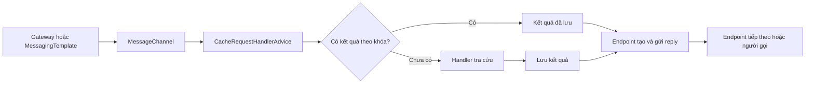

# CacheRequestHandlerAdvice

## 1. Mục tiêu và tình huống sử dụng

Trong chương **Advice và retry** của module **SPRING_INTEGRATION_CORE**, bài học này trình bày cách bổ sung cache cho một endpoint xử lý thông điệp. Sau bài học, bạn có thể gắn advice vào Java DSL, thiết kế khóa từ payload và header, phối hợp luồng đọc với luồng cập nhật, và kiểm chứng số lần handler thực sự được gọi.

Giả sử một luồng nhận yêu cầu tra cứu sản phẩm rồi gọi hệ thống danh mục. Trong một khoảng thời gian ngắn, nhiều yêu cầu cùng hỏi một sản phẩm của cùng cửa hàng. Nếu dữ liệu có thể được tái sử dụng, ta muốn tránh gọi hệ thống danh mục cho từng thông điệp.

`CacheRequestHandlerAdvice` đưa quyết định đó vào ranh giới xử lý của endpoint: tìm kết quả theo khóa; có dữ liệu thì dùng lại; chưa có thì gọi handler và lưu kết quả. Lớp này có từ Spring Integration 5.2 và hỗ trợ các thao tác cacheable, put, evict. [API CacheRequestHandlerAdvice](https://docs.spring.io/spring-integration/docs/current/api/org/springframework/integration/handler/advice/CacheRequestHandlerAdvice.html)

**Quy ước ví dụ:** mã Java dùng Java 17 và API Spring Integration 6.5.x. Các đoạn cấu hình bổ sung được ghi rõ là phần thay thế hoặc mở rộng; không ghép tất cả thành nhiều bean trùng tên. Nếu dự án dùng Spring Boot, lấy bộ phiên bản Spring tương thích từ dependency management của dự án.

## 2. Advice nằm ở đâu trong luồng thông điệp?



Đối với handler sinh reply, điểm được advice bao quanh là phần `handleRequestMessage(...)` bên trong handler. Các thao tác gửi reply xuống endpoint tiếp theo nằm ngoài phạm vi này. Gắn advice vào một service activator vì vậy không biến toàn bộ `IntegrationFlow` thành một kết quả được cache. [Phạm vi advice ở endpoint](https://docs.spring.io/spring-integration/reference/handler-advice.html)

Ví dụ:

```text
request -> validate -> lookup có cache -> enrich trace -> reply
```

Khi lookup trúng cache, bước `validate` trước đó vẫn chạy, phần gọi hệ thống danh mục trong lookup được bỏ qua, và bước `enrich trace` sau đó vẫn nhận kết quả. Đây là vị trí phù hợp để tách dữ liệu nghiệp vụ có thể tái sử dụng khỏi thông tin của từng yêu cầu.

Một gateway chỉ cung cấp giao diện gọi vào luồng. Cache trong bài này thuộc endpoint lookup; gọi service trực tiếp bên ngoài endpoint đó không đi qua advice.

### Cache lưu kết quả nào?

Giá trị được lưu là đối tượng trả về của phần xử lý được advice bao quanh. Nếu handler trả về một DTO, cache lưu DTO đó. Nếu handler trả về một `Message<?>`, đối tượng kết quả có thể bao gồm cả header của message ấy. Trong mã nguồn 6.5.0, kết quả dạng message builder còn được chuyển thành message trước khi giao cho cơ chế cache. [Mã nguồn advice, phiên bản 6.5.0](https://raw.githubusercontent.com/spring-projects/spring-integration/v6.5.0/spring-integration-core/src/main/java/org/springframework/integration/handler/advice/CacheRequestHandlerAdvice.java)

Từ đó, một cách thiết kế hợp lý là để lookup trả về DTO bất biến. Gắn trace ID, thời điểm xử lý hoặc dữ liệu riêng của người gọi ở bước phù hợp sau lookup. Nếu cache nguyên reply message, cần kiểm tra nguy cơ tái sử dụng header của yêu cầu cũ.

## 3. Phân biệt ba thao tác cache

| Thao tác | Handler có được gọi? | Tác động chính | Ví dụ trong bài |
| --- | --- | --- | --- |
| `CacheableOperation` | Bỏ qua handler khi có hit hợp lệ | Tìm và lưu kết quả khi cần | Đọc thông tin sản phẩm |
| `CachePutOperation` | Vẫn gọi handler khi operation được áp dụng | Ghi kết quả vừa tính vào cache | Cập nhật và trả về snapshot mới |
| `CacheEvictOperation` | Không dùng cache hit để bỏ qua handler | Xóa một entry hoặc cả vùng cache | Đổi tên rồi vô hiệu hóa entry cũ |

Các thao tác này tương ứng về ý nghĩa với `@Cacheable`, `@CachePut`, `@CacheEvict` của Spring Framework. Gộp cacheable và put trên cùng một lời gọi thường làm ý định khó hiểu: một bên muốn dùng lại kết quả, bên kia muốn thực thi để cập nhật. Trong bài, luồng đọc và luồng ghi được tách riêng. [Ngữ nghĩa các thao tác cache](https://docs.spring.io/spring-framework/reference/integration/cache/annotations.html)

Tạo `new CacheRequestHandlerAdvice("productViews")` là cách chọn thao tác cacheable mặc định. Khi cần operation khác, tạo các builder của Spring Cache và truyền chúng qua `setCacheOperations(...)`.

## 4. Khóa cache là một phần của hợp đồng nghiệp vụ

### 4.1. Khóa mặc định

Advice mặc định dùng **payload của request** làm khóa. Đây là một đối tượng được so sánh theo quy tắc của cache provider, không phải tự động lấy JSON hay chuỗi hiển thị của payload. Với cache dạng map, một DTO có `equals()` và `hashCode()` theo dữ liệu giúp hai instance biểu diễn cùng yêu cầu tìm được cùng entry. [Cấu hình khóa của caching advice](https://docs.spring.io/spring-integration/reference/handler-advice/classes.html#caching-advice)

Nếu payload chứa cả thời điểm yêu cầu hoặc mã trace ngẫu nhiên, khóa mặc định có thể tạo quá nhiều entry. Nếu payload chỉ chứa SKU nhưng kết quả còn phụ thuộc tenant trong header, khóa mặc định lại thiếu dữ liệu để phân biệt các cửa hàng.

### 4.2. Thiết kế khóa theo đầu vào thực sự quyết định kết quả

Trong ví dụ, kết quả phụ thuộc hai giá trị:

```text
ProductKey = (tenantId, sku)
```

| Thông tin đầu vào | Có đưa vào khóa của ví dụ? | Lý do |
| --- | --- | --- |
| `tenantId` | Có | Mỗi cửa hàng có dữ liệu danh mục riêng |
| `sku` | Có | Xác định sản phẩm trong cửa hàng |
| `traceId` | Không | Chỉ phục vụ theo dõi yêu cầu |
| `replyChannel` | Không | Là đường trả lời của từng lần gọi |
| Thời điểm nhận message | Không | Không làm đổi snapshot trong hợp đồng ví dụ |

Nếu một hệ thống khác còn thay đổi kết quả theo ngôn ngữ, tiền tệ, phiên bản danh mục hoặc quyền của người dùng, hãy đưa các chiều đó vào khóa, hoặc tách bước phụ thuộc chúng ra sau phần lookup dùng chung. Đây là quyết định theo nghiệp vụ của hệ thống, không phải danh sách trường áp dụng máy móc.

Dùng record cho khóa trong cache cục bộ giúp biểu diễn cấu trúc rõ ràng. Nếu chuyển sang cache bên ngoài JVM, cần chọn cách serialize khóa và giá trị phù hợp với provider, đồng thời quản lý thay đổi schema.

### 4.3. SpEL và Function

`setKeyExpressionString(...)` đánh giá biểu thức với **request Message làm root**. Ví dụ dưới đây phù hợp khi payload có thuộc tính `sku`:

```java
advice.setKeyExpressionString("{headers['tenantId'], payload.sku}");
```

Đây là một khóa dạng danh sách gồm hai thành phần; không cần tự nối chuỗi có dấu phân cách. Với Java record, dùng `setKeyFunction(...)` giúp ép kiểu và kiểm tra dữ liệu rõ hơn:

```java
advice.setKeyFunction(message -> {
    ProductQuery query = (ProductQuery) message.getPayload();
    String tenantId = message.getHeaders().get("tenantId", String.class);
    if (tenantId == null || tenantId.isBlank()) {
        throw new IllegalArgumentException("Thiếu tenantId");
    }
    return new ProductKey(tenantId, query.sku());
});
```

Hai cách trên là lựa chọn thay thế. Hãy dùng cùng một hợp đồng khóa ở luồng đọc, cập nhật và vô hiệu hóa cache; nếu một luồng dùng record còn luồng khác dùng chuỗi hay danh sách, chúng không tự trở thành cùng khóa.

## 5. Ví dụ Java DSL: đọc có cache, cập nhật có eviction

### 5.1. Thành phần cần có

Ví dụ sử dụng `spring-integration-core` và các thư viện Spring Context được giải quyết cùng bộ phiên bản tương thích. Phần kiểm thử ở mục 6 cần JUnit Jupiter. Không cần cache server bên ngoài vì ví dụ dùng `ConcurrentMapCacheManager`.

`ConcurrentMapCacheManager("productViews")` khai báo trước một vùng cache. Đây là lựa chọn gọn cho bài thực hành; manager này không cung cấp cấu hình TTL hay giới hạn kích thước như các provider chuyên dụng. [API ConcurrentMapCacheManager](https://docs.spring.io/spring-framework/docs/6.2.7/javadoc-api/org/springframework/cache/concurrent/ConcurrentMapCacheManager.html)

### 5.2. Cấu hình đầy đủ

Đặt lớp sau trong `ProductCacheConfig.java`. Hai loại request là Java record; `ProductKey` được dùng chung giữa cache và kho dữ liệu giả lập. Bộ đếm chỉ tăng khi phương thức đọc thật sự chạy.

```java
import java.util.concurrent.ConcurrentHashMap;
import java.util.concurrent.ConcurrentMap;
import java.util.concurrent.atomic.AtomicInteger;

import org.springframework.beans.factory.annotation.Qualifier;
import org.springframework.cache.CacheManager;
import org.springframework.cache.concurrent.ConcurrentMapCacheManager;
import org.springframework.cache.interceptor.CacheEvictOperation;
import org.springframework.context.annotation.Bean;
import org.springframework.context.annotation.Configuration;
import org.springframework.integration.channel.DirectChannel;
import org.springframework.integration.config.EnableIntegration;
import org.springframework.integration.dsl.IntegrationFlow;
import org.springframework.integration.handler.advice.CacheRequestHandlerAdvice;
import org.springframework.messaging.Message;
import org.springframework.messaging.MessageChannel;

@Configuration(proxyBeanMethods = false)
@EnableIntegration
public class ProductCacheConfig {

    public static final String CACHE = "productViews";

    public record ProductQuery(String sku) {}
    public record RenameProduct(String sku, String name) {}
    public record ProductKey(String tenantId, String sku) {
        public ProductKey {
            if (tenantId == null || tenantId.isBlank()
                    || sku == null || sku.isBlank()) {
                throw new IllegalArgumentException("Thiếu tenantId hoặc sku");
            }
        }
    }
    public record ProductView(String tenantId, String sku, String name) {}

    public static final class ProductService {
        private final ConcurrentMap<ProductKey, String> names =
                new ConcurrentHashMap<>();
        private final AtomicInteger loads = new AtomicInteger();

        public ProductView find(String tenantId, String sku) {
            loads.incrementAndGet();
            ProductKey key = new ProductKey(tenantId, sku);
            String name = names.getOrDefault(key, "Tên ban đầu");
            return new ProductView(tenantId, sku, name);
        }

        public ProductView rename(String tenantId, RenameProduct command) {
            if (command.name() == null || command.name().isBlank()) {
                throw new IllegalArgumentException("Tên không được rỗng");
            }
            ProductKey key = new ProductKey(tenantId, command.sku());
            names.put(key, command.name());
            return new ProductView(tenantId, command.sku(), command.name());
        }

        public int loadCount() {
            return loads.get();
        }
    }

    @Bean
    CacheManager cacheManager() {
        return new ConcurrentMapCacheManager(CACHE);
    }

    @Bean
    ProductService productService() {
        return new ProductService();
    }

    @Bean
    MessageChannel productQueries() {
        return new DirectChannel();
    }

    @Bean
    MessageChannel productUpdates() {
        return new DirectChannel();
    }

    @Bean
    CacheRequestHandlerAdvice productCache(CacheManager manager) {
        CacheRequestHandlerAdvice advice =
                new CacheRequestHandlerAdvice(CACHE);
        advice.setCacheManager(manager);
        advice.setKeyFunction(ProductCacheConfig::cacheKey);
        return advice;
    }

    @Bean
    CacheRequestHandlerAdvice productEviction(CacheManager manager) {
        CacheEvictOperation.Builder operation = new CacheEvictOperation.Builder();
        operation.setCacheName(CACHE);
        operation.setBeforeInvocation(false);
        operation.setCacheWide(false);

        CacheRequestHandlerAdvice advice = new CacheRequestHandlerAdvice();
        advice.setCacheManager(manager);
        advice.setKeyFunction(ProductCacheConfig::cacheKey);
        advice.setCacheOperations(operation.build());
        return advice;
    }

    @Bean
    IntegrationFlow productLookupFlow(
            @Qualifier("productQueries") MessageChannel input,
            ProductService service,
            @Qualifier("productCache") CacheRequestHandlerAdvice cache) {

        return IntegrationFlow.from(input)
                .handle(ProductQuery.class,
                        (query, headers) -> service.find(
                                (String) headers.get("tenantId"),
                                query.sku()),
                        endpoint -> endpoint.advice(cache))
                .get();
    }

    @Bean
    IntegrationFlow productUpdateFlow(
            @Qualifier("productUpdates") MessageChannel input,
            ProductService service,
            @Qualifier("productEviction") CacheRequestHandlerAdvice eviction) {

        return IntegrationFlow.from(input)
                .handle(RenameProduct.class,
                        (command, headers) -> service.rename(
                                (String) headers.get("tenantId"),
                                command),
                        endpoint -> endpoint.advice(eviction))
                .get();
    }

    private static ProductKey cacheKey(Message<?> message) {
        String tenantId = message.getHeaders().get("tenantId", String.class);
        String sku;
        if (message.getPayload() instanceof ProductQuery query) {
            sku = query.sku();
        } else if (message.getPayload() instanceof RenameProduct command) {
            sku = command.sku();
        } else {
            throw new IllegalArgumentException("Payload không được hỗ trợ");
        }
        if (tenantId == null || tenantId.isBlank()
                || sku == null || sku.isBlank()) {
            throw new IllegalArgumentException("Thiếu tenantId hoặc sku");
        }
        return new ProductKey(tenantId, sku);
    }
}
```

Điểm quan trọng của DSL là `endpoint -> endpoint.advice(cache)`: advice gắn vào chính endpoint `.handle(...)` đó. Lambda xử lý chỉ làm công việc nghiệp vụ. [API Java DSL cho handler](https://docs.spring.io/spring-integration/docs/6.5.0/api/org/springframework/integration/dsl/BaseIntegrationFlowDefinition.html)

Các advice được khai báo thành bean để Spring thực hiện vòng đời khởi tạo và cung cấp ngữ cảnh cần thiết. Trong cấu hình này, cơ chế cache do advice thực hiện trực tiếp; không cần thêm `@EnableCaching` để kích hoạt advice. Nếu dự án còn sử dụng annotation cache trên các service khác, hãy cấu hình cơ chế annotation cho những service đó riêng.

Hai flow không đặt output channel cố định. Khi dùng request-reply ở mục tiếp theo, endpoint trả kết quả qua reply channel do `MessagingTemplate` cung cấp cho từng yêu cầu.

### 5.3. Dòng thời gian mong đợi

```text
Đọc   (shop-a, P-100) -> chưa có cache -> find() chạy -> loads = 1
Đọc   (shop-a, P-100) -> có cache     -> dùng lại     -> loads = 1
Đọc   (shop-b, P-100) -> khóa khác    -> find() chạy -> loads = 2
Đổi tên (shop-a, P-100) -> rename() thành công -> xóa entry của shop-a
Đọc   (shop-a, P-100) -> chưa có cache -> find() chạy -> loads = 3
```

Eviction sau xử lý thành công có nghĩa là handler phải trả về bình thường trước khi xóa entry. `setBeforeInvocation(true)` đổi thời điểm xóa sang trước lời gọi; `setCacheWide(true)` chuyển từ xóa entry theo khóa sang xóa toàn vùng cache. [API CacheEvictOperation.Builder](https://docs.spring.io/spring-framework/docs/6.2.7/javadoc-api/org/springframework/cache/interceptor/CacheEvictOperation.Builder.html)

Trong ví dụ chỉ có một khóa cho mỗi sản phẩm của một tenant. Nếu thực tế có nhiều biến thể theo ngôn ngữ hoặc tiền tệ, cập nhật một sản phẩm có thể phải làm mất hiệu lực nhiều entry. Không nên xóa toàn cache của mọi tenant chỉ để xử lý một thay đổi nhỏ khi còn lựa chọn hẹp hơn.

## 6. Kiểm thử qua endpoint thực tế

Chỉ so sánh hai reply bằng nhau chưa chứng minh cache đang hoạt động: service cũng có thể tự trả cùng dữ liệu mỗi lần. Ta cần quan sát số lần `find()` thực sự chạy và kiểm tra entry theo đúng khóa.

Lớp kiểm thử sau đặt cùng package với `ProductCacheConfig`. Mỗi test khởi tạo một context riêng nên kho dữ liệu, cache và bộ đếm không bị dùng chung giữa các test. Việc gửi thông điệp bằng `MessagingTemplate` bảo đảm lời gọi đi qua channel và advice; gọi thẳng `service.find(...)` sẽ bỏ qua chúng.

```java
import org.junit.jupiter.api.Test;
import org.springframework.cache.Cache;
import org.springframework.cache.CacheManager;
import org.springframework.context.annotation.AnnotationConfigApplicationContext;
import org.springframework.integration.core.MessagingTemplate;
import org.springframework.messaging.Message;
import org.springframework.messaging.MessageChannel;
import org.springframework.messaging.MessagingException;
import org.springframework.messaging.support.MessageBuilder;

import static org.junit.jupiter.api.Assertions.*;

class ProductCacheConfigTest {

    @Test
    void repeatedRequestUsesCachedValueAndSeparatesTenants() {
        try (var context = new AnnotationConfigApplicationContext(
                ProductCacheConfig.class)) {
            var service = context.getBean(ProductCacheConfig.ProductService.class);

            var first = exchange(context, "productQueries", "shop-a",
                    new ProductCacheConfig.ProductQuery("P-100"));
            var second = exchange(context, "productQueries", "shop-a",
                    new ProductCacheConfig.ProductQuery("P-100"));

            assertEquals(first, second);
            assertEquals(1, service.loadCount());

            var anotherTenant = exchange(context, "productQueries", "shop-b",
                    new ProductCacheConfig.ProductQuery("P-100"));
            assertEquals("shop-b", anotherTenant.tenantId());
            assertEquals(2, service.loadCount());

            Cache cache = context.getBean(CacheManager.class)
                    .getCache(ProductCacheConfig.CACHE);
            assertNotNull(cache);
            assertNotNull(cache.get(new ProductCacheConfig.ProductKey(
                    "shop-a", "P-100")));
            assertNotNull(cache.get(new ProductCacheConfig.ProductKey(
                    "shop-b", "P-100")));
        }
    }

    @Test
    void successfulUpdateEvictsOnlyTheAffectedProduct() {
        try (var context = new AnnotationConfigApplicationContext(
                ProductCacheConfig.class)) {
            var service = context.getBean(ProductCacheConfig.ProductService.class);
            var query = new ProductCacheConfig.ProductQuery("P-100");

            exchange(context, "productQueries", "shop-a", query);
            exchange(context, "productQueries", "shop-b", query);
            assertEquals(2, service.loadCount());

            exchange(context, "productUpdates", "shop-a",
                    new ProductCacheConfig.RenameProduct("P-100", "Tên mới"));

            var updated = exchange(context, "productQueries", "shop-a", query);
            assertEquals("Tên mới", updated.name());
            assertEquals(3, service.loadCount());

            var unchanged = exchange(context, "productQueries", "shop-b", query);
            assertEquals("Tên ban đầu", unchanged.name());
            assertEquals(3, service.loadCount());
        }
    }

    @Test
    void failedUpdateKeepsExistingCacheEntry() {
        try (var context = new AnnotationConfigApplicationContext(
                ProductCacheConfig.class)) {
            var service = context.getBean(ProductCacheConfig.ProductService.class);
            var query = new ProductCacheConfig.ProductQuery("P-100");
            exchange(context, "productQueries", "shop-a", query);

            assertThrows(MessagingException.class, () ->
                    exchange(context, "productUpdates", "shop-a",
                            new ProductCacheConfig.RenameProduct("P-100", " ")));

            var result = exchange(context, "productQueries", "shop-a", query);
            assertEquals("Tên ban đầu", result.name());
            assertEquals(1, service.loadCount());
        }
    }

    private static ProductCacheConfig.ProductView exchange(
            AnnotationConfigApplicationContext context,
            String channelName, String tenantId, Object payload) {
        MessageChannel channel = context.getBean(channelName, MessageChannel.class);
        MessagingTemplate template = new MessagingTemplate(channel);
        template.setReceiveTimeout(1000);

        Message<?> reply = template.sendAndReceive(
                MessageBuilder.withPayload(payload)
                        .setHeader("tenantId", tenantId)
                        .build());
        assertNotNull(reply, "Phải nhận được reply");
        return (ProductCacheConfig.ProductView) reply.getPayload();
    }
}
```

`MessagingTemplate` hỗ trợ constructor nhận channel mặc định và thao tác request-reply. Trong ví dụ đồng bộ này, receive timeout giới hạn thời gian chờ reply; nó không thay thế timeout mạng của một HTTP client nếu handler thật sự gọi ra ngoài. [API MessagingTemplate](https://docs.spring.io/spring-integration/docs/6.5.0/api/org/springframework/integration/core/MessagingTemplate.html)

Các test trên là mã thực hành dành cho người học. Những trường hợp mở rộng cần bổ sung khi thay đổi hệ thống gồm: SKU khác nhau, tenant thiếu hoặc rỗng, provider lỗi, nhiều request đồng thời, và các chiều đầu vào bổ sung làm thay đổi kết quả.

## 7. Cập nhật cache bằng CachePutOperation

Nếu handler cập nhật đã trả về đúng `ProductView` mới, có thể ghi trực tiếp snapshot đó vào cache thay vì xóa rồi chờ lần đọc tiếp theo nạp lại.

**Thay thế** bean `productEviction(...)` trong ví dụ bằng bean sau; tên bean được giữ nguyên để flow cập nhật không cần đổi wiring. Trong mã dự án thực tế, nên đổi tên tương ứng với ý nghĩa put khi hoàn tất chuyển đổi.

```java
@Bean
CacheRequestHandlerAdvice productEviction(CacheManager manager) {
    var operation =
            new org.springframework.cache.interceptor.CachePutOperation.Builder();
    operation.setCacheName(CACHE);

    CacheRequestHandlerAdvice advice = new CacheRequestHandlerAdvice();
    advice.setCacheManager(manager);
    advice.setKeyFunction(ProductCacheConfig::cacheKey);
    advice.setCacheOperations(operation.build());
    return advice;
}
```

Với biến thể này, đọc lần đầu làm `loads = 1`; cập nhật trả về `ProductView` mới và ghi vào cache; lần đọc tiếp theo có thể nhận tên mới trong khi `loads` vẫn bằng 1. Vì vậy, kiểm thử dành cho eviction ở mục 6 phải được thay bằng kỳ vọng tương ứng với put.

Điều kiện thiết kế của lựa chọn này là giá trị handler trả về phải đúng schema của cache đọc. Nếu handler chỉ trả về `true`, mã đơn hàng hoặc một acknowledgement message, đưa kết quả ấy vào `productViews` sẽ phá hợp đồng của luồng đọc. Khi chưa có snapshot chuẩn, eviction thường dễ kiểm soát hơn.

## 8. condition, unless và hai ngữ cảnh SpEL

Một endpoint đôi khi chỉ nên cache yêu cầu bình thường, còn yêu cầu có header `forceRefresh` phải gọi nguồn dữ liệu. `condition` quyết định operation có được áp dụng; `unless` có thể ngăn lưu kết quả sau khi xử lý. Khác biệt này quan trọng khi muốn làm mới dữ liệu.

Với **operation builder**, biểu thức chạy trong ngữ cảnh Spring Cache. Đối số đầu tiên của phương thức được advice bao quanh là request message, nên có thể truy cập nó bằng `#root.args[0]`. Đây là ngữ cảnh khác với `setKeyExpressionString(...)`, nơi root trực tiếp là message.

| Vị trí cấu hình | Cách tham chiếu request |
| --- | --- |
| `advice.setKeyExpressionString(...)` | `payload`, `headers['tenantId']` |
| `CacheOperation.Builder.setCondition(...)` | `#root.args[0].payload`, `#root.args[0].headers[...]` |
| `CacheOperation.Builder.setKey(...)` nếu tự khai báo key theo operation | `#root.args[0]` hoặc biến đối số của Spring Cache |
| `CacheableOperation.Builder.setUnless(...)` | Có thể dùng `#result` sau khi tính kết quả |

Đặc điểm này xuất phát từ việc advice gọi `CacheAspectSupport` với request message là phần tử duy nhất trong mảng đối số. [Cách advice chuyển lời gọi sang Spring Cache](https://raw.githubusercontent.com/spring-projects/spring-integration/v6.5.0/spring-integration-core/src/main/java/org/springframework/integration/handler/advice/CacheRequestHandlerAdvice.java)

Ví dụ **thay thế nội dung** bean `productCache(...)`, không tạo thêm bean cùng tên:

```java
@Bean
CacheRequestHandlerAdvice productCache(CacheManager manager) {
    var operation =
            new org.springframework.cache.interceptor.CacheableOperation.Builder();
    operation.setCacheName(CACHE);
    operation.setCondition(
            "#root.args[0].headers['forceRefresh'] != true");
    operation.setUnless("#result == null");

    CacheRequestHandlerAdvice advice = new CacheRequestHandlerAdvice();
    advice.setCacheManager(manager);
    advice.setKeyFunction(ProductCacheConfig::cacheKey);
    advice.setCacheOperations(operation.build());
    return advice;
}
```

Trong cấu hình này, khi `forceRefresh` là Boolean `true`, cacheable operation bị bỏ qua hoàn toàn: handler được gọi nhưng kết quả mới cũng không được operation này ghi lại. Entry cũ, nếu có, vẫn tồn tại. Do đó đây là **bỏ qua cache cho một yêu cầu**, chưa phải cơ chế refresh cache hoàn chỉnh.

Nếu cần refresh, hãy thiết kế nhánh có put, hoặc điều phối eviction và lần đọc lại theo yêu cầu nhất quán của ứng dụng. Đồng thời thống nhất kiểu của header: chuỗi `"true"` gửi từ một hệ thống bên ngoài cần được chuyển đổi phù hợp trước khi so sánh với Boolean.

Đối với `null`, việc provider chấp nhận lưu null không khiến endpoint tự tạo được reply nghiệp vụ. Handler không sinh kết quả có thể dẫn đến không có reply hoặc lỗi nếu endpoint yêu cầu reply. Với kết quả “không tìm thấy”, một DTO biểu diễn trạng thái rõ ràng thường dễ thiết kế và kiểm thử hơn việc để người gọi chờ hết timeout.

## 9. Phối hợp cache với retry

Advice trong chain bao quanh nhau theo thứ tự khai báo: phần tử đầu ở ngoài cùng, phần tử cuối gần handler nhất. [Thứ tự advice trong Spring Integration](https://docs.spring.io/spring-integration/reference/handler-advice/order.html)

Hai đoạn sau minh họa cách gắn các bean advice **đã được cấu hình** vào endpoint; đây không phải cấu hình đầy đủ cho retry:

```java
endpoint -> endpoint.advice(cacheAdvice, retryAdvice)
```

Cấu trúc tương ứng:

```text
cache(retry(handler))
```

Theo cấu trúc này, cache hit trả kết quả mà không vào retry ở bên trong. Khi miss, retry thực hiện các lần thử handler; nếu nhận được kết quả cuối cùng bình thường, lớp cache bên ngoài có thể lưu kết quả đó.

```java
endpoint -> endpoint.advice(retryAdvice, cacheAdvice)
```

Cấu trúc tương ứng:

```text
retry(cache(handler))
```

Ở đây, mỗi lần thử lại đều đi qua lớp cache. Hệ quả cần phân tích là phạm vi lỗi: retry bên ngoài có thể thấy cả lỗi đọc hoặc ghi cache. Ví dụ handler đã ghi dữ liệu thành công, sau đó cache put bị lỗi; nếu retry xử lý cả lỗi đó, lần thử kế tiếp có thể gọi lại handler đã tạo side effect.

Các diễn giải trên là suy luận từ thứ tự bao quanh của advice. Cách retry phân loại exception, số lần thử, thời gian chờ và hành vi recovery vẫn phụ thuộc cấu hình retry cụ thể của dự án.

### Recovery có thể trở thành dữ liệu cache

Giả sử retry trả một snapshot dự phòng sau khi các lần thử đều thất bại. Nếu cache ở ngoài và recovery trả về bình thường, snapshot dự phòng có thể được xem như kết quả để cache. Người gọi tiếp theo có thể tiếp tục nhận dữ liệu dự phòng dù nguồn thật đã hồi phục.

Một hướng thiết kế là thêm thuộc tính chất lượng dữ liệu vào DTO, rồi dùng `unless` để không lưu kết quả fallback. Hướng khác là tách cache của snapshot chuẩn với chính sách dành cho dữ liệu dự phòng. Quyết định phụ thuộc việc người dùng chấp nhận loại dữ liệu nào và trong bao lâu.

### Cache không bảo đảm xử lý một lần

Một cache kết quả có thể mất entry do hết hạn, bị xóa hoặc khởi động lại. Hai request đồng thời cũng có thể cùng miss. Vì vậy, không dùng cacheable advice làm cơ chế duy nhất để bảo đảm một giao dịch thanh toán, một lần trừ tồn kho hoặc một lần gửi email.

Với các thao tác ấy, cần thiết kế idempotency theo mã nghiệp vụ và nơi lưu trạng thái phù hợp. Cache có thể hỗ trợ đường đọc; sự tồn tại của một entry tạm thời không chứng minh nghiệp vụ đã được thực hiện đúng một lần.

## 10. Phân biệt lỗi nguồn dữ liệu và lỗi cache

Có ít nhất ba điểm thất bại trong một request miss:

```text
đọc cache -> gọi handler -> ghi cache
```

Nếu handler ném exception, cacheable operation thông thường không có một kết quả trả về thành công để lưu. Nếu handler bắt lỗi rồi trả một DTO có trường báo lỗi, đối tượng đó lại là kết quả bình thường xét theo lời gọi Java; muốn tránh lưu nó, cần một chính sách rõ ràng như `unless`.

Lỗi của provider được xử lý qua `CacheErrorHandler`. `SimpleCacheErrorHandler` mặc định ném lại lỗi thay vì bỏ qua. Có thể cấu hình handler qua `advice.setErrorHandler(...)`; đây là nơi quyết định phản ứng với lỗi đọc, ghi, xóa entry và xóa toàn cache. [API SimpleCacheErrorHandler](https://docs.spring.io/spring-framework/docs/6.2.7/javadoc-api/org/springframework/cache/interceptor/SimpleCacheErrorHandler.html)

Ví dụ lựa chọn chính sách cho hệ thống danh mục:

| Điểm lỗi | Một lựa chọn có thể chấp nhận | Điều cần kiểm tra |
| --- | --- | --- |
| Không đọc được cache | Cho phép gọi nguồn dữ liệu và ghi nhận sự cố | Nguồn có chịu được lượng request tăng đột ngột? |
| Không ghi được cache đọc | Trả snapshot vừa đọc, ghi nhận cache write failure | Yêu cầu sau có thể tiếp tục gọi nguồn |
| Không evict được sau cập nhật | Báo lỗi hoặc phát sự kiện sửa chữa theo chính sách nhất quán | Entry cũ có còn phục vụ người dùng? |
| Handler cập nhật thành công nhưng cache lỗi | Đối chiếu trạng thái nghiệp vụ trước khi retry | Tránh lặp lại side effect không an toàn |

Đây là các phương án thiết kế, không phải hành vi đã được cài trong ví dụ. Việc nuốt mọi lỗi cache có thể giữ hệ thống tiếp tục trả lời nhưng cũng che mất sự cố về dữ liệu cũ. Chính sách lỗi phải đi cùng metric, log và một cách phát hiện sai lệch.

Với `DirectChannel`, xử lý diễn ra trên luồng của người gửi; exception từ lời gọi đồng bộ có thể truyền về người gọi. Đổi sang luồng bất đồng bộ cần xem lại cơ chế chuyển lỗi thành `ErrorMessage`, `errorChannel` và cấu hình của thành phần thực thi. Một header `errorChannel` không tự biến mọi exception đồng bộ thành message gửi lỗi. [Xử lý lỗi trong Spring Integration](https://docs.spring.io/spring-integration/reference/error-handling.html)

## 11. Đồng thời, transaction và dữ liệu cũ

### 11.1. Nhiều request có thể cùng miss

Một cacheable lookup thông thường có thể xảy ra lịch thực thi sau:

```text
Request A: đọc cache -> miss -> bắt đầu gọi nguồn
Request B: đọc cache -> miss -> bắt đầu gọi nguồn
Request A: nhận kết quả -> put
Request B: nhận kết quả -> put
```

Hai request cùng gọi nguồn dù chúng dùng cùng khóa. Spring Cache giao nhiều đặc tính đồng thời và phối hợp giữa các tiến trình cho provider. [Mô hình đồng thời của cache abstraction](https://docs.spring.io/spring-framework/reference/integration/cache/strategies.html)

Nếu cần hạn chế nạp trùng, có thể nghiên cứu `CacheableOperation.Builder.setSync(true)` cùng khả năng của provider. Chế độ synchronized caching có các ràng buộc như một cache, không kết hợp `unless`, và không phối hợp tùy ý với các operation khác; cần kiểm tra đúng phiên bản sử dụng. Nó không mặc nhiên tạo một khóa phân tán trên toàn cụm. [Ràng buộc sync của Spring Cache](https://docs.spring.io/spring-framework/docs/6.2.7/javadoc-api/org/springframework/cache/annotation/Cacheable.html)

Khi kiểm thử nhiều luồng, dùng latch hoặc barrier để tạo lịch thực thi có chủ đích. Tránh dùng `sleep` rồi kết luận rằng mỗi khóa luôn được nạp đúng một lần.

### 11.2. Eviction không loại bỏ mọi race condition

Xét ví dụ suy luận với một kho dữ liệu thật:

1. Request đọc A đã bắt đầu tải snapshot cũ nhưng chưa ghi cache.
2. Request cập nhật B ghi dữ liệu mới rồi evict entry.
3. A hoàn tất và đưa snapshot cũ trở lại cache.

Eviction của B đã diễn ra nhưng cache vẫn có thể lại chứa dữ liệu cũ. Nếu nghiệp vụ không chấp nhận khoảng sai lệch này, cần cơ chế mạnh hơn: chẳng hạn khóa có version, kiểm tra phiên bản khi ghi, hoặc phối hợp cập nhật bằng khả năng của hệ thống lưu trữ. TTL có thể hạn chế thời gian giữ một entry, nhưng không tự ngăn lịch thực thi trên.

### 11.3. Handler trả về chưa chắc transaction đã commit

`setBeforeInvocation(false)` xác định thời điểm tương đối so với lời gọi handler. Nếu handler tham gia một transaction bao ngoài, việc trả về bình thường chưa chứng minh transaction đó đã commit. Cần kiểm tra thứ tự transaction advice, thời điểm commit và đặc tính transaction của cache provider.

Spring có `TransactionAwareCacheDecorator` để trì hoãn một số thao tác cache tới sau commit. Các thao tác cần hiệu lực ngay có giới hạn riêng, nên không thể xem việc thêm decorator là lời giải chung cho mọi lịch đồng thời. [API TransactionAwareCacheDecorator](https://docs.spring.io/spring-framework/docs/6.2.7/javadoc-api/org/springframework/cache/transaction/TransactionAwareCacheDecorator.html)

Ví dụ trong bài dùng map cục bộ và không khai báo transaction. Khi thay `ProductService` bằng thao tác database, phần phối hợp này cần được thiết kế và kiểm thử theo transaction thật.

## 12. TTL, kích thước cache và phạm vi triển khai

TTL, thời gian hết hạn theo truy cập và chính sách loại bỏ entry thuộc cấu hình **cache provider**. `CacheRequestHandlerAdvice` không có một thuộc tính TTL chung để cấu hình mọi loại cache. [Cấu hình chính sách hết hạn](https://docs.spring.io/spring-framework/reference/integration/cache/specific-config.html)

Nếu muốn thay cache map trong bài bằng Caffeine cục bộ, thêm các dependency tương thích cho `spring-context-support` và Caffeine, rồi **thay thế** bean `cacheManager()`:

```java
@Bean
CacheManager cacheManager() {
    var manager =
            new org.springframework.cache.caffeine.CaffeineCacheManager(CACHE);
    manager.setCacheSpecification(
            "maximumSize=10000,expireAfterWrite=60s,recordStats");
    return manager;
}
```

`setCacheSpecification(...)` là cách cấu hình các tùy chọn theo định dạng của Caffeine. Các giá trị 10.000 entry và 60 giây ở đây là số liệu minh họa để thực hành. [API CaffeineCacheManager](https://docs.spring.io/spring-framework/docs/6.2.7/javadoc-api/org/springframework/cache/caffeine/CaffeineCacheManager.html)

Khi lựa chọn cấu hình cho một hệ thống cụ thể, cần đo kích thước snapshot, số khóa hoạt động, độ trễ nguồn và mức chấp nhận dữ liệu cũ. TTL ngắn giúp giảm thời gian tái sử dụng một entry nhưng làm tăng tần suất gọi nguồn; TTL dài làm tăng yêu cầu đối với cơ chế invalidation.

Một ví dụ ước lượng: nếu snapshot trung bình khoảng 2 KB và có 10.000 khóa đang giữ, phần dữ liệu snapshot đã khoảng 20 MB theo phép tính gần đúng. Khóa, đối tượng Java và cấu trúc quản lý cache còn cần bộ nhớ bổ sung. Không nên suy từ `maximumSize` ra một giới hạn bộ nhớ chính xác.

Cache cục bộ thuộc từng instance. Nếu cùng hệ thống danh mục chạy trên nhiều instance, một lần eviction cục bộ không đủ để kết luận mọi instance đều đã thấy thay đổi. Cần chọn cache chia sẻ, cơ chế phát sự kiện invalidation hoặc một mức chấp nhận dữ liệu cũ phù hợp với kiến trúc thực tế.

## 13. Chẩn đoán theo triệu chứng

| Triệu chứng | Giả thuyết cần kiểm tra | Cách quan sát |
| --- | --- | --- |
| Cùng một yêu cầu nhưng handler luôn chạy | Payload không có equality theo dữ liệu; khóa chứa trace; TTL quá ngắn; advice gắn sai endpoint | Ghi nhận tên cache và dạng khóa đã chuẩn hóa; theo dõi bộ đếm handler |
| Tenant B nhận dữ liệu của tenant A | Khóa thiếu tenant hoặc dữ liệu biến đổi theo một chiều chưa có trong khóa | Gửi hai request cùng SKU, khác tenant và đối chiếu payload |
| Đọc vẫn thấy tên cũ sau cập nhật | Khóa eviction khác khóa đọc; update đi ngoài flow; eviction thất bại; race với request đang tải | Kiểm tra entry theo đúng kiểu khóa và thứ tự sự kiện |
| Sau khi dùng put, luồng đọc bị sai kiểu | Handler cập nhật trả acknowledgement thay vì snapshot | Kiểm tra kiểu giá trị thật sự được lưu |
| Gateway chờ rồi hết timeout | Handler trả null hoặc reply bị định tuyến không đúng | Kiểm tra hợp đồng reply và channel trước khi quy lỗi cho cache |
| Có request lặp khi provider lỗi | Retry bao cả phần ghi cache sau side effect | Ghi nhận từng lần thử, exception và trạng thái nghiệp vụ |
| Test cache thành công nhưng số lần gọi nguồn không giảm | Test chỉ so sánh giá trị hoặc đang gọi thẳng service | Gửi qua channel và kiểm tra số lần handler chạy |

Theo dõi ít nhất số hit, miss, lần gọi nguồn, lỗi provider, lỗi invalidation và độ trễ của đường hit so với miss. Khi log khóa, chỉ ghi dữ liệu cần thiết đã được xử lý phù hợp; không cần đưa nguyên request hoặc thông tin nhạy cảm vào log để chẩn đoán cache.

## 14. Thực hành mở rộng

1. **Bổ sung ngôn ngữ danh mục.** Thêm `locale` vào request và cho service trả tên khác nhau theo locale. Cập nhật khóa và kiểm thử sao cho hai locale không dùng nhầm snapshot. Sau đó xác định cập nhật tên cần vô hiệu hóa những biến thể nào.
2. **So sánh eviction với put.** Chạy cùng một chuỗi đọc, cập nhật, đọc lại. Ghi số lần service đọc nguồn trong hai cấu hình và giải thích chênh lệch dựa trên luồng thực thi.
3. **Tạo provider lỗi có kiểm soát.** Dùng một cache giả lập ném lỗi ở thao tác put. Quan sát khác biệt giữa retry bên ngoài cache và cache bên ngoài retry khi handler có bộ đếm side effect.
4. **Kiểm tra dữ liệu riêng của request.** Thêm một bước sau lookup để gắn trace ID của yêu cầu hiện tại. Gửi hai yêu cầu cùng khóa với trace khác nhau, xác nhận dữ liệu nghiệp vụ được dùng lại còn trace vẫn phản ánh từng yêu cầu.

Kết quả thực hành cần thể hiện cả dữ liệu trả về và số lần xử lý thực tế. Hai quan sát đó giúp phân biệt một cấu hình cache đúng vị trí với một luồng chỉ tình cờ trả ra cùng giá trị.
