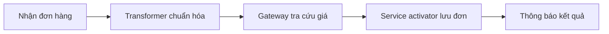

# Advice chain trên endpoint

Trong Spring Integration, **advice chain** bổ sung hành vi quanh việc xử lý thông điệp của một endpoint: đo thời gian, ghi nhận lần thử, retry hoặc quản lý transaction. Handler vẫn thực hiện nghiệp vụ; advice quyết định cách bao quanh lời gọi đó.

Bài học thuộc chương **Advice và retry** của module `SPRING_INTEGRATION_CORE`. Mục tiêu là gắn advice đúng endpoint, đọc đúng thứ tự thực thi và thiết kế giới hạn retry trong luồng dùng `Message`, `MessageChannel` và Java DSL. Người học cần biết cách tạo `IntegrationFlow`, dùng service activator và phân biệt `DirectChannel` với `QueueChannel`.

**Mốc API của ví dụ:** Java 17+, Spring Integration **6.5.x**, Spring Retry **2.x**; kiểm thử dùng JUnit Jupiter. Các dependency cần có là `spring-integration-core`, `spring-retry` và `junit-jupiter` ở phạm vi test, với phiên bản được quản lý đồng bộ trong dự án. Ví dụ sử dụng `org.springframework.retry.support.RetryTemplate` và `setRetryTemplate(...)` của nhánh 6.5. Tài liệu nhánh 7.1 dùng retry của Spring Framework với cấu hình khác; cần đối chiếu đúng phiên bản trước khi chuyển mã. [API retry 6.5](https://docs.spring.io/spring-integration/reference/6.5/handler-advice/classes.html#retry-advice), [API retry 7.1](https://docs.spring.io/spring-integration/reference/7.1/handler-advice/classes.html#retry-advice).

## 1. Vì sao cần gắn advice vào một endpoint?

Xét luồng xử lý đơn hàng:



Giả sử dịch vụ tra cứu giá thỉnh thoảng mất kết nối. Yêu cầu thiết kế là thử lại lời gọi tra cứu giá, với số lần hữu hạn. Nếu đặt retry quanh một đoạn quá lớn, thao tác lưu đơn hoặc thông báo có thể bị thực hiện lại khi một bước khác thất bại.

Request handler advice cho phép giới hạn hành vi ở endpoint được chọn. Tài liệu Spring Integration phân biệt phạm vi này với advice của poller, vốn có thể bao quanh cả đoạn xử lý đồng bộ bắt đầu từ lần polling. [Adding Behavior to Endpoints](https://docs.spring.io/spring-integration/reference/6.5/handler-advice.html).

Trước khi cấu hình, hãy viết rõ ba điều:

1. **Đối tượng được bao quanh:** lời gọi dịch vụ giá, phép biến đổi hay thao tác ghi dữ liệu nào?
2. **Kết quả mong muốn:** trả reply, ném lỗi hay chuyển sang recovery khi thất bại?
3. **Tác dụng phụ có thể lặp:** ghi dữ liệu, gửi email, trừ tiền hoặc cập nhật trạng thái nào nằm trong phạm vi đó?

Advice chain không tạo thêm một tuyến nghiệp vụ. Ví dụ, muốn rẽ luồng theo loại đơn hàng thì dùng router; muốn loại thông điệp không hợp lệ thì dùng filter; muốn đổi payload thì dùng transformer. Advice phù hợp với hành vi bao quanh các bước đó.

## 2. Endpoint, handler và phạm vi của lời gọi

Một consumer endpoint kết nối input channel với handler và quản lý cách handler được gọi. Trong Java DSL, callback cấu hình endpoint là nơi khai báo `.advice(...)`:

```java
.handle(priceClient, "quote",
        endpoint -> endpoint.advice(logicalTrace, retryAdvice, attemptTrace))
```

Các đối số là những đối tượng `Advice` áp dụng lên handler của endpoint. Java DSL mô tả danh sách này theo thứ tự lồng. [ConsumerEndpointSpec.advice](https://docs.spring.io/spring-integration/docs/6.5.0/api/org/springframework/integration/dsl/ConsumerEndpointSpec.html#advice(org.aopalliance.aop.Advice...)).

Với handler sinh reply kế thừa `AbstractReplyProducingMessageHandler`, request handler advice thông thường bao quanh phương thức nội bộ `handleRequestMessage()`. Việc gửi reply ra output channel xảy ra sau phạm vi đó. Với handler không sinh reply, advice có thể được áp dụng lên `handleMessage()`. Vì vậy, phải xem loại handler và vị trí gửi thông điệp, thay vì suy luận phạm vi chỉ từ tên endpoint. [Handling Message Advice](https://docs.spring.io/spring-integration/reference/6.5/handler-advice/handle-message.html).

Với service activator sinh reply thông thường, có thể hình dung:

```text
input channel
  -> handleMessage(request)
       -> advice A
            -> advice B
                 -> handleRequestMessage(request)
       -> tạo reply và gửi sang output channel
            -> endpoint tiếp theo
```

Nếu endpoint tiếp theo ném exception trong cùng thread, exception vẫn có thể truyền về người gửi. Điều đó không có nghĩa advice quanh `handleRequestMessage()` ở endpoint trước sẽ bắt được lỗi ấy: callback của advice trước đã kết thúc.

| Cơ chế | Điểm tác động cần quan sát | Ví dụ sử dụng |
|---|---|---|
| Request handler advice | Phần xử lý của handler được gắn advice | Retry lời gọi lấy giá tại một service activator |
| Poller advice | Vòng polling và phần gọi đồng bộ nằm bên trong | Transaction hoặc điều khiển hoạt động polling |
| `ChannelInterceptor` | Các thao tác gửi/nhận trên channel | Quan sát thông điệp đi qua một channel |
| `HandleMessageAdvice` | Lời gọi `handleMessage()` | Bao cả bước gửi reply và đoạn downstream còn cùng call stack |

Hai câu cần trả lời riêng là “exception truyền tới đâu?” và “callback của advice đang bao quanh đoạn nào?”. Hai phạm vi này có thể khác nhau.

## 3. Thứ tự khai báo là thứ tự lồng

Với các advice thông thường áp dụng tại cùng một điểm, phần tử đầu tiên nằm ngoài cùng, phần tử cuối cùng nằm gần handler nhất. Đây là quy tắc around advice của Spring Integration. [Ordering Advices within Advice Chain](https://docs.spring.io/spring-integration/reference/6.5/handler-advice/order.html).

Khai báo:

```java
endpoint.advice(logicalTrace, retryAdvice, attemptTrace);
```

Tương ứng với:

```text
logicalTrace(
    retryAdvice(
        attemptTrace(
            handler(request)
        )
    )
)
```

Nếu handler lỗi hai lần rồi thành công ở lần thứ ba, `logicalTrace` được gọi một lần, còn `attemptTrace` được gọi ba lần. Đây là hệ quả trực tiếp của vị trí đặt hai advice trong ví dụ, không phải hai chế độ đặc biệt của Spring.

| Vị trí của một advice đo đạc | Điều nó quan sát trong ví dụ |
|---|---|
| Ngoài retry | Kết quả chung của một lần vào endpoint, gồm cả thời gian backoff nếu có |
| Trong retry | Kết quả của từng attempt và thời gian xử lý attempt đó |

Một bộ đếm ở ngoài retry có thể ghi nhận một yêu cầu thành công, trong khi bộ đếm ở trong ghi nhận hai attempt lỗi và một attempt thành công. Hai số liệu trả lời hai câu hỏi khác nhau.

Tương tự, vị trí của advice bắt lỗi ảnh hưởng khả năng retry: nếu advice bên trong bắt exception rồi trả giá trị bình thường, retry ở ngoài không còn thấy exception đó. Nếu advice ở ngoài retry xử lý lỗi, nó nhận lỗi sau khi retry đã kết thúc theo chính sách.

## 4. Ví dụ Java DSL quan sát được toàn bộ thứ tự

Ví dụ sau dùng một client giả lập tra cứu giá. Client lỗi tạm thời hai lần, rồi trả chuỗi kết quả. `EventLog` lưu dấu vết để kiểm thử; đây là công cụ minh họa trong bộ nhớ, không phải giải pháp lưu log cho hệ thống vận hành.

Luồng có một input `DirectChannel` và một output `QueueChannel`. Không cần poller ở output vì bài kiểm thử sẽ chủ động gọi `receive(...)`.

```java
package demo.integration;

import java.util.List;
import java.util.Map;
import java.util.concurrent.CopyOnWriteArrayList;
import java.util.concurrent.atomic.AtomicInteger;

import org.springframework.context.annotation.Bean;
import org.springframework.context.annotation.Configuration;
import org.springframework.integration.channel.DirectChannel;
import org.springframework.integration.channel.QueueChannel;
import org.springframework.integration.config.EnableIntegration;
import org.springframework.integration.dsl.IntegrationFlow;
import org.springframework.integration.handler.advice.AbstractRequestHandlerAdvice;
import org.springframework.integration.handler.advice.RequestHandlerRetryAdvice;
import org.springframework.messaging.Message;
import org.springframework.messaging.MessageChannel;
import org.springframework.retry.backoff.NoBackOffPolicy;
import org.springframework.retry.policy.SimpleRetryPolicy;
import org.springframework.retry.support.RetryTemplate;

@Configuration
@EnableIntegration
public class AdviceChainConfig {

    @Bean
    public MessageChannel quoteRequests() {
        return new DirectChannel();
    }

    @Bean
    public QueueChannel quoteReplies() {
        return new QueueChannel();
    }

    @Bean
    public EventLog eventLog() {
        return new EventLog();
    }

    @Bean
    public QuoteClient quoteClient() {
        return new QuoteClient();
    }

    @Bean
    public TraceAdvice logicalTrace() {
        return new TraceAdvice("logical", eventLog());
    }

    @Bean
    public TraceAdvice attemptTrace() {
        return new TraceAdvice("attempt", eventLog());
    }

    @Bean
    public RequestHandlerRetryAdvice retryAdvice() {
        Map<Class<? extends Throwable>, Boolean> retryable = Map.of(
                TransientQuoteException.class, true);

        RetryTemplate template = new RetryTemplate();
        template.setRetryPolicy(new SimpleRetryPolicy(
                3, retryable, true, false));
        template.setBackOffPolicy(new NoBackOffPolicy());

        RequestHandlerRetryAdvice advice = new RequestHandlerRetryAdvice();
        advice.setRetryTemplate(template);
        return advice;
    }

    @Bean
    public IntegrationFlow quoteFlow() {
        return IntegrationFlow.from(quoteRequests())
                .handle(quoteClient(), "quote", endpoint -> endpoint
                        .id("quoteEndpoint")
                        .advice(logicalTrace(), retryAdvice(), attemptTrace()))
                .channel(quoteReplies())
                .get();
    }

    public static final class EventLog {
        private final List<String> events = new CopyOnWriteArrayList<>();

        public void add(String event) {
            events.add(event);
        }

        public List<String> snapshot() {
            return List.copyOf(events);
        }
    }

    public static final class TraceAdvice extends AbstractRequestHandlerAdvice {
        private final String name;
        private final EventLog events;

        public TraceAdvice(String name, EventLog events) {
            this.name = name;
            this.events = events;
        }

        @Override
        protected Object doInvoke(ExecutionCallback callback,
                                  Object target,
                                  Message<?> message) throws Exception {
            events.add(name + ".enter");
            try {
                Object result = callback.execute();
                events.add(name + ".success");
                return result;
            }
            catch (Exception ex) {
                events.add(name + ".failure");
                throw ex;
            }
            finally {
                events.add(name + ".leave");
            }
        }
    }

    public static final class QuoteClient {
        private final AtomicInteger calls = new AtomicInteger();
        private volatile int failuresBeforeSuccess = 2;

        public String quote(String sku) {
            int attempt = calls.incrementAndGet();
            if (sku.isBlank()) {
                throw new IllegalArgumentException("SKU không được rỗng");
            }
            if (attempt <= failuresBeforeSuccess) {
                throw new TransientQuoteException("Dịch vụ giá tạm lỗi");
            }
            return "quote:" + sku;
        }

        public int calls() {
            return calls.get();
        }

        // Chỉ dùng để chọn kịch bản trước khi gửi request trong test.
        public void failFirst(int count) {
            this.failuresBeforeSuccess = count;
        }
    }

    public static final class TransientQuoteException extends RuntimeException {
        public TransientQuoteException(String message) {
            super(message);
        }
    }
}
```

Trong `SimpleRetryPolicy(3, retryable, true, false)`:

- `3` là **tổng số attempt**, đã bao gồm lần gọi ban đầu.
- Map cho phép retry `TransientQuoteException` và các kiểu con của nó.
- `true` bật duyệt chuỗi nguyên nhân, hữu ích khi exception nghiệp vụ bị bọc.
- `false` ở đối số cuối quy định exception không khớp được xem là không retryable.

Hợp đồng về số attempt và các constructor này được mô tả trong [SimpleRetryPolicy API](https://docs.spring.io/spring-retry/docs/2.0.12/apidocs/org/springframework/retry/policy/SimpleRetryPolicy.html).

`NoBackOffPolicy` giúp ví dụ kiểm thử không phải chờ giữa các lần gọi. Trong một cấu hình gọi dịch vụ thật, có thể thay dòng thiết lập backoff bằng đoạn sau, với import `org.springframework.retry.backoff.ExponentialBackOffPolicy`:

```java
ExponentialBackOffPolicy backoff = new ExponentialBackOffPolicy();
backoff.setInitialInterval(100);
backoff.setMultiplier(2.0);
backoff.setMaxInterval(1_000);
template.setBackOffPolicy(backoff);
```

Với ba attempt và chính sách trên, hai khoảng chờ danh nghĩa là 100 ms và 200 ms. Backoff đồng bộ giữ thread chờ; cần tính cùng timeout của client, lượng request đồng thời và giới hạn thread. Spring Integration nêu rõ đặc điểm chờ này của stateless retry. [Retry Advice](https://docs.spring.io/spring-integration/reference/6.5/handler-advice/classes.html#retry-advice).

### Hợp đồng của custom advice

`AbstractRequestHandlerAdvice` cung cấp `doInvoke(...)` và `ExecutionCallback`. Với advice chỉ quan sát một lần gọi, gọi `callback.execute()` rồi trả lại kết quả. Nếu tự viết logic gọi lại callback nhiều lần trong cùng một `doInvoke()`, phải dùng `cloneAndExecute()` cho các invocation lặp để không làm sai trạng thái chuỗi AOP; nên dùng `RequestHandlerRetryAdvice` khi chỉ cần retry thông thường. [Custom Advice Classes](https://docs.spring.io/spring-integration/reference/6.5/handler-advice/custom.html).

Trong `TraceAdvice`, `finally` ghi nhận việc rời phạm vi dù có thành công hay thất bại. Exception được ném tiếp để advice retry ở ngoài có thể quyết định thử lại. Trả `null` từ nhánh `catch` sẽ làm thay đổi kết quả xử lý và có thể khiến lỗi bị hiểu là đã xử lý xong.

Các biến liên quan một invocation nên là biến cục bộ. Advice thường là singleton, nên một field như `currentMessage` hoặc `startedAt` có thể bị nhiều thread ghi đè. Ví dụ dùng collection an toàn khi ghi đồng thời, nhưng dấu vết của nhiều request vẫn có thể xen kẽ; trong ứng dụng cần thêm mã tương quan để đọc đúng từng request.

## 5. Kiểm thử số lần gọi, thứ tự và kết quả

Mỗi test dưới đây tạo một application context mới để tách trạng thái client và nhật ký. Các test dùng đúng cấu hình ở phần trước và không gọi dịch vụ ngoài.

```java
package demo.integration;

import java.util.List;

import org.junit.jupiter.api.Test;
import org.springframework.context.annotation.AnnotationConfigApplicationContext;
import org.springframework.integration.channel.QueueChannel;
import org.springframework.messaging.Message;
import org.springframework.messaging.MessageChannel;
import org.springframework.messaging.MessagingException;
import org.springframework.messaging.support.MessageBuilder;

import demo.integration.AdviceChainConfig.EventLog;
import demo.integration.AdviceChainConfig.QuoteClient;

import static org.junit.jupiter.api.Assertions.*;

class AdviceChainTest {

    @Test
    void retriesTwiceThenReturnsOneReply() {
        try (var context = new AnnotationConfigApplicationContext(
                AdviceChainConfig.class)) {
            MessageChannel input = context.getBean(
                    "quoteRequests", MessageChannel.class);
            QueueChannel output = context.getBean(
                    "quoteReplies", QueueChannel.class);

            assertTrue(input.send(MessageBuilder.withPayload("SKU-01")
                    .setHeader("correlationId", "lookup-01")
                    .build()));

            Message<?> reply = output.receive(1_000);
            assertNotNull(reply);
            assertEquals("quote:SKU-01", reply.getPayload());
            assertEquals(3, context.getBean(QuoteClient.class).calls());
            assertNull(output.receive(0));

            assertEquals(List.of(
                    "logical.enter",
                    "attempt.enter", "attempt.failure", "attempt.leave",
                    "attempt.enter", "attempt.failure", "attempt.leave",
                    "attempt.enter", "attempt.success", "attempt.leave",
                    "logical.success", "logical.leave"
            ), context.getBean(EventLog.class).snapshot());
        }
    }

    @Test
    void propagatesFailureAfterThreeAttempts() {
        try (var context = new AnnotationConfigApplicationContext(
                AdviceChainConfig.class)) {
            QuoteClient client = context.getBean(QuoteClient.class);
            client.failFirst(100);
            MessageChannel input = context.getBean(
                    "quoteRequests", MessageChannel.class);
            QueueChannel output = context.getBean(
                    "quoteReplies", QueueChannel.class);

            assertThrows(MessagingException.class, () -> input.send(
                    MessageBuilder.withPayload("SKU-02").build()));

            assertEquals(3, client.calls());
            assertNull(output.receive(0));
            List<String> events = context.getBean(EventLog.class).snapshot();
            assertEquals(3L, events.stream()
                    .filter("attempt.failure"::equals).count());
            assertTrue(events.contains("logical.failure"));
            assertFalse(events.contains("logical.success"));
        }
    }

    @Test
    void doesNotRetryInvalidInput() {
        try (var context = new AnnotationConfigApplicationContext(
                AdviceChainConfig.class)) {
            MessageChannel input = context.getBean(
                    "quoteRequests", MessageChannel.class);

            assertThrows(MessagingException.class, () -> input.send(
                    MessageBuilder.withPayload(" ").build()));

            assertEquals(1, context.getBean(QuoteClient.class).calls());
        }
    }
}
```

Test đầu xác nhận ba thuộc tính độc lập: client được gọi ba lần, chỉ có một reply và hai advice quan sát đúng phạm vi. Hai test sau phân biệt hết số lần thử với lỗi không được phép retry. Chỉ kiểm tra “không ném exception” sẽ bỏ sót các khác biệt này.

`QuoteClient` dùng bộ đếm toàn cục để tạo kịch bản dễ đọc. Nó chỉ phù hợp với fixture gửi một request trong mỗi context; client thật phải có trạng thái và hợp đồng phù hợp khi nhiều request cùng chạy.

Một kiểm thử phạm vi hữu ích khi mở rộng ví dụ là chèn endpoint luôn ném lỗi **sau** service activator tra cứu giá. Cho client giá thành công ngay bằng `failFirst(0)`, gửi một request, rồi kiểm tra client giá chỉ được gọi một lần dù lỗi downstream truyền về người gửi. Kịch bản đó kiểm tra ranh giới của advice thay vì chỉ đếm retry.

## 6. Cấu hình bằng annotation hoặc XML

Java DSL không phải cách duy nhất khai báo cùng ý tưởng. Annotation hỗ trợ `adviceChain` qua tên bean trên các endpoint như service activator, transformer, splitter và filter. [Advising Endpoints Using Annotations](https://docs.spring.io/spring-integration/reference/6.5/handler-advice/advising-with-annotations.html).

Với ba bean `logicalTrace`, `retryAdvice`, `attemptTrace` trong ví dụ, có thể cấu hình một component thay cho flow DSL:

```java
import org.springframework.integration.annotation.MessageEndpoint;
import org.springframework.integration.annotation.ServiceActivator;

@MessageEndpoint
public class AnnotatedQuoteEndpoint {
    private final AdviceChainConfig.QuoteClient client;

    public AnnotatedQuoteEndpoint(AdviceChainConfig.QuoteClient client) {
        this.client = client;
    }

    @ServiceActivator(
            inputChannel = "quoteRequests",
            outputChannel = "quoteReplies",
            adviceChain = {"logicalTrace", "retryAdvice", "attemptTrace"})
    public String quote(String sku) {
        return client.quote(sku);
    }
}
```

Để dùng phương án này, bỏ bean `quoteFlow()` và đăng ký `AnnotatedQuoteEndpoint` qua component scan hoặc `@Bean`. Nếu giữ cả hai cấu hình, input `DirectChannel` có hai subscriber; request có thể được phân phối giữa chúng, khiến kết quả quan sát khác mục tiêu bài học.

XML tương đương về phần advice, giả sử đã khai báo các channel, client, advice bean và namespace Spring Integration:

```xml
<int:service-activator id="quoteEndpoint"
                       input-channel="quoteRequests"
                       output-channel="quoteReplies"
                       ref="quoteClient"
                       method="quote">
    <int:request-handler-advice-chain>
        <ref bean="logicalTrace"/>
        <ref bean="retryAdvice"/>
        <ref bean="attemptTrace"/>
    </int:request-handler-advice-chain>
</int:service-activator>
```

Ba cách khai báo là các phương án thay thế cho cùng một endpoint. Tên bean giúp nhận diện advice trong cấu hình; thứ tự trong danh sách thể hiện cách lồng.

## 7. Retry kết thúc: ném lỗi hay recovery?

Ví dụ chính không đặt recovery callback. Khi hết số attempt, lỗi tiếp tục truyền ra người gửi trên `DirectChannel`. Với luồng chạy qua executor hoặc poller, cơ chế xử lý lỗi của thành phần thực thi có thể công bố `ErrorMessage` tới error channel. Không nên suy ra rằng chỉ cần thêm header `errorChannel` vào một lần `send()` đồng bộ thì mọi exception tự đổi thành thông điệp lỗi. [Error Handling](https://docs.spring.io/spring-integration/reference/6.5/error-handling.html).

Nếu muốn chuyển lỗi cuối sang một channel recovery cụ thể, có thể bổ sung vào cấu hình:

```java
@Bean
public QueueChannel quoteRecovery() {
    return new QueueChannel(100);
}
```

Và thêm đoạn này trước `return advice;` trong `retryAdvice()`, với import `org.springframework.integration.handler.advice.ErrorMessageSendingRecoverer`:

```java
ErrorMessageSendingRecoverer recoverer =
        new ErrorMessageSendingRecoverer(quoteRecovery());
recoverer.setSendTimeout(1_000);
advice.setRecoveryCallback(recoverer);
```

`ErrorMessageSendingRecoverer` công bố throwable cuối dưới dạng `ErrorMessage`. Nếu gửi recovery thành công, callback này trả `null`; cấu hình đó không tự tạo reply nghiệp vụ thay thế. [ErrorMessageSendingRecoverer API](https://docs.spring.io/spring-integration/docs/6.5.0/api/org/springframework/integration/handler/advice/ErrorMessageSendingRecoverer.html).

Hệ quả đối với ví dụ:

- Với thiết lập reply thông thường, output có thể không nhận reply sau recovery.
- `logicalTrace` ở ngoài retry có thể ghi `.success` khi callback recovery kết thúc bình thường; tên này lúc đó chỉ phản ánh việc không có exception thoát ra.
- Nếu endpoint yêu cầu reply mà kết quả là `null`, cần xử lý hợp đồng reply tương ứng, nếu không có thể phát sinh lỗi thiếu reply.
- Nếu caller dùng gateway chờ reply, việc gửi lỗi sang recovery channel riêng không tự hoàn tất yêu cầu của gateway; phải thiết kế reply hoặc timeout rõ ràng.

Khi thêm recovery, cần kiểm thử lại hợp đồng kết quả thay vì giữ nguyên test kỳ vọng exception của cấu hình cũ. Các trạng thái quan sát nên tách “nghiệp vụ thành công”, “đã recovery” và “thất bại chưa xử lý”.

Trong ví dụ, `quoteRecovery` là queue trong bộ nhớ có dung lượng hữu hạn. Khi áp dụng thực tế phải có consumer phù hợp; muốn lưu bền lỗi thì cần cơ chế lưu trữ tương ứng. Tên recovery channel không tự đem lại tính bền vững.

## 8. Kết hợp retry với transaction

Hai cách sắp xếp thường gặp có ý nghĩa khác nhau:

```text
retry -> transaction -> handler
transaction -> retry -> handler
```

Ở cách đầu, mỗi attempt đi qua transaction advice. Ở cách sau, transaction advice bao quanh cả chu kỳ retry và recovery. Tài liệu Spring Integration dùng chính sự khác biệt này để giải thích tầm quan trọng của thứ tự. [Ordering Advices within Advice Chain](https://docs.spring.io/spring-integration/reference/6.5/handler-advice/order.html).

Tuy nhiên, “đi qua transaction advice mỗi attempt” chưa đảm bảo transaction vật lý luôn mới. Nếu thread đã có transaction và propagation là `REQUIRED`, các attempt có thể tham gia transaction hiện hữu. Muốn mỗi attempt dùng transaction riêng, phải chọn propagation và điểm bắt đầu transaction phù hợp, chẳng hạn `REQUIRES_NEW` khi yêu cầu nghiệp vụ cho phép.

Ví dụ suy luận: một attempt ghi cơ sở dữ liệu rồi lỗi, khiến transaction chung bị đánh dấu rollback-only. Attempt tiếp theo trả thành công vẫn không xóa được trạng thái rollback-only đó. Đặt retry bên ngoài lời gọi transaction và xác định rõ propagation giúp tránh hiểu sai kết quả này.

Phạm vi transaction cũng phụ thuộc loại advice. `TransactionInterceptor` thông thường trên handler sinh reply giới hạn ở phần xử lý request; `TransactionHandleMessageAdvice` mở rộng ra `handleMessage()`, có thể bao đoạn downstream đồng bộ. Transaction gắn với thread không tự đi qua queue hoặc executor sang thread khác. [Transaction Support](https://docs.spring.io/spring-integration/reference/6.5/handler-advice/tx-handle-message.html).

Một transaction cơ sở dữ liệu cục bộ cũng không tự hoàn tác lời gọi HTTP đã thành công. Nếu endpoint trừ tiền qua API rồi mất phản hồi, retry có thể gọi API lần nữa. Cần hợp đồng idempotency với bên nhận, ví dụ dùng cùng mã thao tác cho các attempt của một yêu cầu trừ tiền.

## 9. Hai ngoại lệ cần biết khi đọc advice chain

### 9.1. Trộn `HandleMessageAdvice` với request handler advice

Các advice thuộc `HandleMessageAdvice` áp dụng ở `handleMessage()`, còn advice thông thường của handler sinh reply có thể ở `handleRequestMessage()`. Chúng được đặt vào hai lớp khác nhau, nên không thể diễn giải toàn bộ danh sách bằng một quy tắc lồng duy nhất. [Handling Message Advice](https://docs.spring.io/spring-integration/reference/6.5/handler-advice/handle-message.html).

Chẳng hạn, danh sách khai báo transaction advice thông thường trước một `HandleMessageAdvice` không đảm bảo transaction advice chạy trước: advice ở `handleMessage()` có thể bao lớp xử lý bên ngoài. Khi cần kiểm soát việc này, phải xác định join point, cấu hình proxy phù hợp và kiểm thử thứ tự thực tế. `HandleMessageAdviceAdapter` hỗ trợ áp dụng interceptor ở phạm vi `handleMessage()`, nhưng mở rộng retry ra đoạn downstream cũng làm tăng số thao tác có thể bị lặp.

### 9.2. Nhánh discard của filter

Filter có hành vi đặc biệt: mặc định, thao tác discard khi predicate trả `false` nằm trong phạm vi advice. Nếu nhánh discard đồng bộ ném lỗi, retry trên filter có thể thực hiện lại quá trình đó. Có thể đặt `discardWithinAdvice(false)` trong DSL, `discardWithinAdvice = "false"` trên annotation hoặc `discard-within-advice="false"` trong XML để đưa hành vi discard ra ngoài. [Advising Filters](https://docs.spring.io/spring-integration/reference/6.5/handler-advice/advising-filters.html).

Ví dụ tình huống: filter loại đơn không hợp lệ rồi gửi sang nơi lưu bản ghi bị loại. Nếu nơi lưu lỗi, retry không làm dữ liệu đầu vào hợp lệ hơn; nó chỉ lặp lại việc kiểm tra và gửi discard. Cần quyết định có muốn retry thao tác lưu này trong phạm vi filter hay dành cho một endpoint riêng ở nhánh discard.

Với splitter, router hoặc aggregator, cũng cần xác định tác dụng phụ cụ thể của handler: một lần gọi có thể phát nhiều message hoặc cập nhật trạng thái nhóm. Không nên sao chép cấu hình retry của thao tác tra cứu đơn giản mà chưa xem điều gì có thể đã xảy ra trước exception.

## 10. Đọc dấu hiệu sai phạm vi trong vận hành

| Dấu hiệu | Khả năng cần kiểm tra | Cách xác minh |
|---|---|---|
| Nghiệp vụ bị thực hiện nhiều lần hơn dự kiến | Retry ở nhiều lớp hoặc phạm vi bao quá rộng | Đếm lời gọi tại từng endpoint và tại client ngoài |
| Có lỗi tạm thời nhưng không retry | Sai phân loại exception hoặc lỗi đã bị bắt bên trong | Xem chuỗi `cause` và kết quả trả của advice bên trong |
| Bộ đếm báo thành công nhưng kết quả đi recovery | Recovery trả bình thường vào advice quan sát ở ngoài | Ghi nhận recovery như một trạng thái riêng |
| Lỗi downstream không làm gọi lại endpoint trước | Lỗi xảy ra sau callback request handler advice | Chèn điểm lỗi sau output và đếm lại lời gọi |
| Sau retry vẫn rollback | Các attempt dùng chung transaction đã rollback-only | Quan sát transaction hiện hữu và propagation |
| Log của nhiều request trộn lẫn | Xử lý đồng thời và thiếu thông tin tương quan | Gắn mã yêu cầu ổn định trong log của từng attempt |

Nếu một lớp cho tối đa ba attempt và lớp bao ngoài cũng cho tối đa ba attempt, số lời gọi vào hệ thống đích có thể lên đến chín trong kịch bản mọi lần đều lỗi và cả hai chính sách đều cho phép thử lại. Vì vậy, cần thống kê cả retry trong HTTP client, SDK, endpoint và cơ chế redelivery của broker.

Với cấu hình minh họa có ba attempt, nếu mỗi lời gọi chờ timeout tối đa hai giây và backoff là 100 ms rồi 200 ms, thời gian dành cho ba lời gọi cùng backoff xấp xỉ tối đa 6,3 giây, chưa gồm thời gian chờ thread, gửi reply hoặc xử lý khác. Đây là phép tính ngân sách cho ví dụ, không phải cam kết timeout tổng của framework.

## 11. Bài thực hành củng cố

1. Đổi thành `.advice(retryAdvice(), logicalTrace(), attemptTrace())`. Dự đoán số lần `logical.enter`, rồi đối chiếu dấu vết. Với kịch bản lỗi hai lần, `logicalTrace` nay được gọi ba lần vì nằm trong retry.
2. Cho client thành công ngay bằng `failFirst(0)`, sau đó thêm một endpoint ném lỗi ở downstream. Xác nhận client giá vẫn chỉ được gọi một lần với request handler advice hiện tại.
3. Bổ sung recovery channel. Kiểm tra số attempt, nội dung `ErrorMessage`, sự vắng mặt của reply và hành vi của advice quan sát ở ngoài retry.
4. Đổi lỗi tạm thời thành lỗi dữ liệu đầu vào. Xác nhận chính sách không retry và không tạo reply thành công giả.
5. Thay client tra cứu bằng một thao tác có tác dụng phụ giả lập. Ghi lại tác dụng phụ theo mã yêu cầu ổn định, rồi kiểm tra nhiều attempt không tạo nhiều bản ghi nghiệp vụ.

Khi hoàn thành, người học cần giải thích được từng advice bao quanh phương thức nào, thao tác nào có thể bị lặp và caller nhận kết quả gì khi hết số lần thử. Đó là cơ sở để ghép advice chain vào những luồng tích hợp có gateway, transformer, filter và các endpoint lưu trạng thái.
