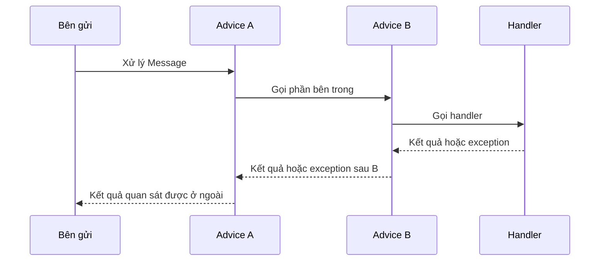

# Thứ tự các advice

## 1. Mục tiêu và phạm vi

Trong chương **Advice và retry** của module **SPRING_INTEGRATION_CORE**, thứ tự advice quyết định phạm vi của từng chính sách quanh một lần xử lý thông điệp. Cùng một tập advice, đổi vị trí có thể làm thay đổi số transaction, số bản ghi lỗi, thời điểm chạy recovery và số lần gọi hệ thống ngoài.

Sau bài này, bạn có thể:

- Đọc một danh sách advice thành các lớp gọi lồng nhau và dự đoán đường đi của kết quả hoặc exception.
- Chọn thứ tự retry, transaction, quan sát và circuit breaker theo yêu cầu nghiệp vụ.
- Nhận diện trường hợp advice không cùng áp dụng lên một phương thức.
- Dùng Java DSL và kiểm thử sự kiện để chứng minh thứ tự thực thi.

Ví dụ mã sử dụng **Java 17+, Spring Integration 6.5.x và Spring Retry 2.x**. Đây là mốc API để đọc và thực hành các đoạn mã, không phải khẳng định phiên bản của dự án đang dùng. Các import `org.springframework.retry.*` bên dưới thuộc Spring Retry 2.x; khi dùng dòng Spring Integration khác, cần đối chiếu API tương ứng.

Giả sử bạn đã biết `Message`, `MessageChannel`, service activator và cách khai báo `IntegrationFlow`. Bài tập trung vào endpoint xử lý đồng bộ; retry có trạng thái, broker redelivery và xử lý reactive cần xét thêm vòng đời riêng.

## 2. Quy tắc nền tảng: phần tử đầu bao ngoài

Với các advice cùng áp dụng lên một điểm gọi, cấu hình:

```java
endpoint.advice(adviceA, adviceB, adviceC);
```

tương ứng với cấu trúc:

```text
A(
    B(
        C(handler)
    )
)
```

Advice đầu tiên ở ngoài cùng; advice cuối gần handler nhất. Đây là quy tắc được mô tả trong [Ordering Advices within Advice Chain](https://docs.spring.io/spring-integration/reference/6.5/handler-advice/order.html).

Nếu mỗi advice gọi phần bên trong đúng một lần và handler thành công:

```text
A.before
  B.before
    C.before
      handler
    C.success
    C.finally
  B.success
  B.finally
A.success
A.finally
```

Nếu handler ném exception, các khối `catch` hoặc `finally` được đi qua theo chiều từ trong ra ngoài. Advice có thể ném tiếp lỗi, chuyển lỗi thành kết quả, hoặc gọi lại phần bên trong. Vì vậy, thứ tự không đơn thuần là thứ tự các dòng log.



### 2.1. Mỗi lớp chỉ nhìn thấy kết quả thoát ra từ lớp bên trong

Ví dụ cấu trúc `A(Retry(H))`:

- Handler có thể thất bại hai lần rồi thành công lần ba.
- Retry xử lý hai lỗi trung gian và trả kết quả lần ba.
- A chỉ nhận một lần trả về thành công, nếu không có lỗi nào khác thoát ra từ retry.

Với cấu trúc `Retry(A(H))`, A được gọi lại trên từng attempt, nên có thể nhìn thấy hai lần thất bại và một lần thành công.

Quy tắc suy luận hữu ích là: **advice bên ngoài quan sát kết quả của toàn bộ khối bên trong; retry chỉ lặp lại những lớp nằm bên trong nó**. Các ví dụ đếm lần gọi dưới đây giả định stateless retry chạy trong một lần gọi đồng bộ.

### 2.2. Ghi rõ danh sách advice tại nơi gắn vào endpoint

Java DSL cung cấp `advice(Advice... advice)` để khai báo danh sách theo thứ tự lồng nhau. Xem [ConsumerEndpointSpec.advice](https://docs.spring.io/spring-integration/docs/6.5.0/api/org/springframework/integration/dsl/ConsumerEndpointSpec.html#advice(org.aopalliance.aop.Advice...)).

```java
.handle(orderService, "submit", endpoint -> endpoint
    .id("submitOrderEndpoint")
    .advice(outcomeAdvice, retryAdvice, transactionAdvice, attemptAdvice))
```

Hãy đọc cấu hình này thành:

```text
Outcome(
    Retry(
        Transaction(
            Attempt(handler)
        )
    )
)
```

Không dùng thứ tự khai báo các phương thức `@Bean` để suy ra chuỗi thực thi. Với danh sách đã truyền tường minh, hãy đọc chính danh sách đó; `@Order` trên bean không phải cách thay thế việc sắp xếp các đối số. Thuộc tính `order` của một endpoint còn phục vụ thứ tự consumer trong ngữ cảnh phù hợp, không biểu diễn vị trí của từng advice trong danh sách.

## 3. Phải xác định phạm vi trước khi xét thứ tự

Xét luồng:

```text
ordersIn -> kiểm tra đơn -> giữ tồn kho -> gửi email -> ordersOut
```

Nếu retry chỉ gắn vào endpoint giữ tồn kho, lỗi từ handler giữ tồn kho có thể làm handler đó chạy lại. Không được suy ra rằng endpoint gửi email cũng thuộc retry chỉ vì nó nằm phía sau trong cùng một `IntegrationFlow`.

Với handler tạo reply kế thừa `AbstractReplyProducingMessageHandler`, request handler advice thông thường áp dụng lên lời gọi nội bộ `handleRequestMessage()`. Việc gửi reply và phần downstream không tự động nằm trong phạm vi advice đó. Poller advice hoặc advice quanh `handleMessage()` có thể bao vùng khác. Tài liệu [Adding Behavior to Endpoints](https://docs.spring.io/spring-integration/reference/6.5/handler-advice.html) minh họa sự khác nhau giữa retry một endpoint và retry từ poller.

Trước khi vẽ chuỗi lồng nhau, cần biết:

| Điều cần xác định | Tác động tới cách đọc cấu hình |
| --- | --- |
| Advice gắn vào handler, poller hay proxy của service? | Xác định đơn vị công việc có thể được gọi lại |
| Advice bao `handleRequestMessage()` hay `handleMessage()`? | Xác định việc gửi reply có nằm trong phạm vi hay không |
| Có chuyển sang thread khác qua channel không? | Xác định lỗi có còn quay lại cùng call stack hay không |
| Service đã có proxy `@Transactional` hoặc `@Retryable` chưa? | Phát hiện thêm lớp transaction hoặc retry ngoài danh sách endpoint |

Ví dụ, retry ở endpoint và retry ở service có thể tạo số lần gọi lồng nhau: ba attempt của endpoint, mỗi attempt lại cho phép ba lần gọi ở service, tạo tối đa chín lần thực thi trong tình huống cả hai lớp đều tiếp tục retry. Cần tính ngân sách retry trên toàn đường đi của message.

## 4. Retry và quan sát: đếm yêu cầu hay đếm attempt?

Giả sử một message giữ tồn kho thất bại hai lần vì lỗi tạm thời rồi thành công ở lần ba. Có hai cách đặt advice quan sát:

| Chuỗi | Số lần vào advice quan sát | Ý nghĩa dữ liệu quan sát |
| --- | ---: | --- |
| `Observe -> Retry -> Handler` | 1 | Kết quả cuối của một lần xử lý qua retry |
| `Retry -> Observe -> Handler` | 3 | Kết quả của từng attempt |
| `Outcome -> Retry -> Attempt -> Handler` | Outcome: 1; Attempt: 3 | Theo dõi cả kết quả tổng thể và từng lần thử |

Với đồng hồ đo thời gian, lớp ngoài retry thường bao gồm cả thời gian backoff. Lớp trong retry đo mỗi attempt riêng, nên khoảng chờ do retry thực hiện giữa các attempt không nằm trong lần đo đó.

Tên metric phải diễn đạt đúng đơn vị: `message.processing.duration` và `handler.attempt.duration` phục vụ hai câu hỏi khác nhau. Một message thành công sau retry vẫn có các attempt thất bại; nếu chỉ giữ một loại số liệu, bạn có thể bỏ sót tình trạng hệ thống ngoài đang suy giảm.

### 4.1. Advice ghi dấu để nhìn được thứ tự

Sau đây là lớp dùng trong bài thực hành. Đối tượng `sink` nhận sự kiện thay cho việc phụ thuộc vào định dạng log:

```java
import java.util.function.Consumer;

import org.springframework.integration.handler.advice.AbstractRequestHandlerAdvice;
import org.springframework.messaging.Message;

public final class TraceAdvice extends AbstractRequestHandlerAdvice {

    private final String name;
    private final Consumer<String> sink;

    public TraceAdvice(String name, Consumer<String> sink) {
        this.name = name;
        this.sink = sink;
    }

    @Override
    protected Object doInvoke(ExecutionCallback callback,
                              Object target,
                              Message<?> message) throws Exception {
        sink.accept(name + ".before");
        try {
            Object result = callback.execute();
            sink.accept(name + ".success");
            return result;
        }
        catch (Exception ex) {
            sink.accept(name + ".failure");
            throw ex;
        }
        finally {
            sink.accept(name + ".after");
        }
    }
}
```

`callback.execute()` tiếp tục lời gọi qua các lớp còn lại tới handler. Đây là API dành cho custom request handler advice được mô tả trong [Custom Advice Classes](https://docs.spring.io/spring-integration/reference/6.5/handler-advice/custom.html).

Trong ví dụ, `sink` được giả định không ném lỗi. Nếu một bộ ghi audit thực tế ném exception sau khi handler đã tạo tác dụng phụ, retry bên ngoài có thể gọi lại handler. Vì thế, độ tin cậy và cách xử lý lỗi của chính advice cũng ảnh hưởng đến tính đúng đắn của luồng.

## 5. Retry và transaction: hai thứ tự, hai ranh giới

### 5.1. Retry ở ngoài transaction

```text
Retry(
    Transaction(handler)
)
```

Khi mỗi lần vào transaction advice thực sự tạo một transaction mới, diễn biến có thể là:

```text
Attempt 1: begin TX1 -> handler lỗi -> rollback TX1
Backoff
Attempt 2: begin TX2 -> handler lỗi -> rollback TX2
Backoff
Attempt 3: begin TX3 -> handler thành công -> commit TX3
Retry trả kết quả
```

Đây là cách bố trí phù hợp khi một lần thử ghi cơ sở dữ liệu phải được kết thúc trước khi thử lại. Khoảng backoff nằm ngoài transaction được tạo cho attempt đó.

Tuy nhiên, **thứ tự retry trước transaction chưa đủ để bảo đảm transaction vật lý mới**. Nếu propagation là `REQUIRED` và thread đã có transaction, transaction advice có thể tham gia transaction hiện hữu. `REQUIRES_NEW` tạo transaction độc lập và tạm ngưng transaction ngoài nếu có. Cơ chế này được giải thích trong [Transaction Propagation](https://docs.spring.io/spring-framework/reference/data-access/transaction/declarative/tx-propagation.html).

Khi cố ý dùng `REQUIRES_NEW`, cần chấp nhận rằng một attempt thành công có thể đã commit độc lập dù công việc phía ngoài về sau rollback. Nếu đang tạm ngưng transaction ngoài, hệ thống cũng có thể cần thêm connection cho transaction trong. Đây là quyết định về tính nhất quán nghiệp vụ và tài nguyên, không chỉ là tối ưu retry.

### 5.2. Transaction ở ngoài retry

```text
Transaction(
    Retry(handler)
)
```

Với một transaction mới bao toàn bộ khối:

```text
begin TX
  Attempt 1: handler lỗi
  Backoff
  Attempt 2: handler lỗi
  Backoff
  Attempt 3: handler trả kết quả
commit hoặc rollback TX
```

Tình huống này có thể giữ connection và lock trong cả thời gian chờ. Nếu một thao tác đã làm transaction bị đánh dấu `rollback-only`, việc một attempt sau trả về bình thường không xóa trạng thái đó. Tùy tài nguyên và cách các lớp transaction tham gia, thời điểm hoàn tất có thể dẫn tới rollback hoặc `UnexpectedRollbackException`.

Không phải mọi exception bị retry bắt đều tự động đánh dấu transaction ngoài là rollback-only. Cần xét lớp nào thấy exception và tài nguyên đã làm gì. Theo mặc định thông thường, transaction advice dùng exception thoát qua ranh giới của nó để áp dụng quy tắc rollback; cấu hình rollback có thể thay đổi. Xem [Rolling Back a Declarative Transaction](https://docs.spring.io/spring-framework/reference/data-access/transaction/declarative/rolling-back.html).

### 5.3. So sánh theo lỗi quan sát được

| Tình huống | `Retry -> Transaction -> Handler` | `Transaction -> Retry -> Handler` |
| --- | --- | --- |
| Handler ném lỗi thuộc chính sách retry | Transaction của attempt có cơ hội kết thúc trước lần thử tiếp | Retry xử lý lỗi khi vẫn còn ở trong phạm vi transaction ngoài |
| Transaction advice ném lỗi lúc commit | Retry bên ngoài có thể nhìn thấy; có retry hay không còn tùy phân loại lỗi | Commit xảy ra sau khi retry đã trả về, nên retry bên trong không xử lý lỗi commit này |
| Backoff | Ngoài transaction được tạo bên trong mỗi attempt | Bên trong transaction bao retry |
| Recovery do retry gọi | Ngoài transaction advice nằm bên trong retry | Trong phạm vi transaction advice bao retry |

Nếu transaction được tham gia từ bên ngoài thay vì tạo tại đây, thời điểm commit vật lý có thể còn nằm ngoài cả hai lớp đang xét. Không suy luận việc commit chỉ từ thứ tự các tên bean.

## 6. Ví dụ Java DSL: mỗi attempt giữ tồn kho trong transaction riêng

Yêu cầu: xử lý một lệnh giữ tồn kho; chỉ retry lỗi dữ liệu tạm thời, tổng cộng tối đa ba attempt. Mỗi attempt dùng transaction độc lập. Sau thành công, kết quả được gửi vào một `QueueChannel`.

Các dependency liên quan là `spring-integration-core`, `spring-tx`, `spring-retry`; kiểm thử dùng JUnit Jupiter. Lớp cấu hình dưới đây yêu cầu ứng dụng cung cấp implementation `InventoryService` và một `PlatformTransactionManager` cho tài nguyên mà service sử dụng.

```java
import java.util.Map;

import org.springframework.beans.factory.annotation.Qualifier;
import org.springframework.context.annotation.Bean;
import org.springframework.context.annotation.Configuration;
import org.springframework.dao.TransientDataAccessException;
import org.springframework.integration.channel.QueueChannel;
import org.springframework.integration.config.EnableIntegration;
import org.springframework.integration.dsl.IntegrationFlow;
import org.springframework.integration.handler.advice.RequestHandlerRetryAdvice;
import org.springframework.integration.transaction.TransactionInterceptorBuilder;
import org.springframework.retry.backoff.ExponentialBackOffPolicy;
import org.springframework.retry.policy.SimpleRetryPolicy;
import org.springframework.retry.support.RetryTemplate;
import org.springframework.transaction.PlatformTransactionManager;
import org.springframework.transaction.annotation.Propagation;
import org.springframework.transaction.interceptor.TransactionInterceptor;

@Configuration
@EnableIntegration
public class ReservationFlowConfiguration {

    public record ReserveCommand(String reservationId,
                                 String sku,
                                 int quantity) {
    }

    public record ReserveResult(String reservationId, String status) {
    }

    public interface InventoryService {
        ReserveResult reserve(ReserveCommand command);
    }

    @Bean
    public RequestHandlerRetryAdvice reserveRetry() {
        SimpleRetryPolicy policy = new SimpleRetryPolicy(
            3,
            Map.of(TransientDataAccessException.class, true),
            true);

        ExponentialBackOffPolicy backoff = new ExponentialBackOffPolicy();
        backoff.setInitialInterval(100);
        backoff.setMultiplier(2.0);
        backoff.setMaxInterval(1000);

        RetryTemplate template = new RetryTemplate();
        template.setRetryPolicy(policy);
        template.setBackOffPolicy(backoff);

        RequestHandlerRetryAdvice advice = new RequestHandlerRetryAdvice();
        advice.setRetryTemplate(template);
        return advice;
    }

    @Bean
    public TransactionInterceptor reserveTx(
            PlatformTransactionManager transactionManager) {
        return new TransactionInterceptorBuilder(false)
            .transactionManager(transactionManager)
            .propagation(Propagation.REQUIRES_NEW)
            .build();
    }

    @Bean
    public QueueChannel reserveReplies() {
        return new QueueChannel();
    }

    @Bean
    public IntegrationFlow reserveFlow(
            InventoryService inventoryService,
            @Qualifier("reserveRetry") RequestHandlerRetryAdvice retry,
            @Qualifier("reserveTx") TransactionInterceptor transaction) {
        return IntegrationFlow.from("reserveRequests")
            .handle(ReserveCommand.class,
                (command, headers) -> inventoryService.reserve(command),
                endpoint -> endpoint
                    .id("reserveEndpoint")
                    .advice(retry, transaction))
            .channel("reserveReplies")
            .get();
    }
}
```

Những chi tiết cần đọc cùng thứ tự advice:

- `SimpleRetryPolicy(3, ...)` cho phép tối đa **ba lần thực thi tính cả lần đầu**, không phải một lần đầu cộng ba lần thử lại. Xem [SimpleRetryPolicy](https://docs.spring.io/spring-retry/docs/2.0.12/apidocs/org/springframework/retry/policy/SimpleRetryPolicy.html).
- Tham số `traverseCauses = true` cho phép tìm lỗi được phép retry trong chuỗi nguyên nhân, hữu ích khi lỗi nghiệp vụ bị bọc bởi lỗi messaging. Các lỗi không khớp chính sách không được tự động retry.
- Với ba attempt liên tiếp thất bại theo chính sách trên, backoff dự kiến là 100 ms rồi 200 ms. Không có recovery callback, nên lỗi cuối thoát ra ngoài.
- `TransactionInterceptorBuilder(false)` tạo transaction advice thông thường; `true` chọn kiểu `TransactionHandleMessageAdvice`, có phạm vi khác. Xem [TransactionInterceptorBuilder](https://docs.spring.io/spring-integration/docs/6.5.0/api/org/springframework/integration/transaction/TransactionInterceptorBuilder.html).
- Service phải truy cập tài nguyên tham gia đúng transaction manager. Một transaction cơ sở dữ liệu không tự động hoàn tác HTTP request hay email đã gửi.

`reserveReplies` là kênh nhận kết quả sau handler, không phải bằng chứng rằng một lỗi khi gửi reply sẽ được request handler retry xử lý. Phạm vi transaction và retry ở đây là lời gọi xử lý request của endpoint.

Ứng dụng nên dùng `reservationId` làm khóa nghiệp vụ để tránh giữ tồn kho lặp khi một yêu cầu đã được xử lý nhưng bên gọi không nhận được phản hồi, rồi gửi lại. Thứ tự advice giúp xác định nơi thử lại; tính idempotent giúp kiểm soát tác dụng phụ của việc thử lại hoặc nhận lại message.

## 7. Recovery và advice xử lý lỗi có thể thay đổi điều lớp ngoài nhìn thấy

### 7.1. Recovery nằm trong vòng điều phối của retry

Xét hai chuỗi khi handler thất bại hết các attempt:

```text
Retry(Transaction(handler))
  -> transaction của attempt cuối kết thúc
  -> retry gọi recovery
```

```text
Transaction(Retry(handler))
  -> retry gọi recovery
  -> transaction ngoài mới đi tới bước hoàn tất
```

Nếu recovery cần ghi một bản ghi bền vững sau khi các attempt rollback, không nên mặc định rằng nó đã có transaction phù hợp. Có thể gọi một service recovery qua proxy với `REQUIRES_NEW`, dùng transaction tường minh, hoặc gửi tới một luồng có cơ chế lưu bền được thiết kế rõ ràng.

Nếu recovery trả về bình thường, advice nằm ngoài retry có thể thấy một kết quả bình thường dù handler chưa từng thành công. Metric hoặc audit khi đó cần phân biệt `SUCCESS`, `RECOVERED` và `FAILED` theo quy ước nghiệp vụ. Không dùng việc “không có exception” làm bằng chứng duy nhất cho thành công nghiệp vụ.

Ví dụ `ErrorMessageSendingRecoverer` được cung cấp để gửi lỗi tới một channel sau khi retry kết thúc; đây là hành vi recovery được cấu hình tường minh, được trình bày trong [Provided Advice Classes](https://docs.spring.io/spring-integration/reference/6.5/handler-advice/classes.html).

### 7.2. Advice bắt và nuốt lỗi bên trong có thể làm retry dừng ngay

Giả sử `Fallback` bắt lỗi của handler và trả một giá trị thay thế:

```text
Retry(Fallback(handler))
```

Nếu fallback trả bình thường ngay sau lỗi đầu tiên, retry không nhận được lỗi để mở attempt tiếp theo. Với cấu trúc ngược:

```text
Fallback(Retry(handler))
```

fallback có thể xử lý lỗi cuối sau khi retry đã dùng hết những attempt được phép.

`ExpressionEvaluatingRequestHandlerAdvice` có tùy chọn `trapException`. Khi bật tùy chọn này, lỗi từ phần được bao có thể bị chặn thay vì ném tiếp. Khi cần retry nhìn thấy lỗi, hãy giữ hành vi ném tiếp ở lớp nằm bên trong retry. Cũng cần xét kết quả `null` và yêu cầu `requiresReply`: chặn lỗi không tự tạo ra một reply hợp lệ.

Vị trí advice đánh giá biểu thức còn quyết định tần suất chạy biểu thức:

| Vị trí tương đối | Khi handler thất bại hai lần rồi thành công |
| --- | --- |
| `ExpressionAdvice -> Retry -> Handler` | Có thể chỉ ghi nhận kết quả cuối thành công |
| `Retry -> ExpressionAdvice -> Handler`, lỗi được ném tiếp | Có thể chạy biểu thức lỗi hai lần và biểu thức thành công một lần |

Hãy tránh gửi mỗi lỗi attempt tới cùng nơi nhận “lỗi cuối cần can thiệp” nếu không muốn tạo nhiều thông báo cho một message. Nếu advice nằm bên trong transaction và gửi audit thành công trước khi transaction commit, bản ghi đó chỉ chứng minh handler đã trả về tại thời điểm ấy.

### 7.3. `errorChannel` không phải một lớp bắt lỗi tự động quanh mọi lời gọi

Với `DirectChannel`, lỗi chưa được xử lý thường truyền về cùng thread cho bên gửi. Việc chỉ đặt header `errorChannel` không tự động chặn mọi exception ở lời gọi `send()` đồng bộ. Gateway, poller, executor và recoverer có các cơ chế đưa lỗi tới channel theo ngữ cảnh của chúng. Xem [Error Handling](https://docs.spring.io/spring-integration/reference/6.5/error-handling.html).

Khi một endpoint downstream chạy trên thread khác, lỗi của nó không quay ngược bằng exception Java vào request handler advice đã kết thúc ở thread trước. Phải thiết kế đường lỗi và đơn vị retry ở phía thực sự xử lý công việc đó.

## 8. Retry và circuit breaker: breaker đang đếm đơn vị nào?

Hai chuỗi dưới đây có hành vi khác nhau:

```text
CircuitBreaker(Retry(handler))
```

```text
Retry(CircuitBreaker(handler))
```

Trong ví dụ suy luận sau, breaker khởi đầu ở trạng thái đóng, ngưỡng là hai lần thất bại liên tiếp, retry cho phép ba attempt, handler luôn lỗi và không có recovery. Giả sử khoảng thời gian chưa đủ để breaker cho phép thăm dò lại.

| Chuỗi | Diễn biến trong lần xử lý message đầu tiên |
| --- | --- |
| `CircuitBreaker -> Retry -> Handler` | Handler có thể chạy ba lần; nếu retry ném lỗi cuối thì breaker bên ngoài ghi nhận một lần thất bại |
| `Retry -> CircuitBreaker -> Handler` | Hai attempt đầu gọi handler và làm breaker mở; attempt tiếp theo có thể bị từ chối ngay mà không gọi handler |

Các con số này là suy luận từ cấu trúc lồng nhau với các giả định đã nêu. Cơ chế đếm thất bại liên tiếp, mở mạch và thử lại sau khoảng chờ của `RequestHandlerCircuitBreakerAdvice` được mô tả trong phần [Circuit Breaker Advice](https://docs.spring.io/spring-integration/reference/6.5/handler-advice/classes.html#circuit-breaker-advice).

Nếu breaker nằm trong retry, không nên để chính sách retry tiếp tục lặp vô ích với lỗi báo mạch đang mở. Nếu breaker nằm ngoài retry và recovery đã chuyển lỗi thành kết quả bình thường, breaker có thể không nhận được tín hiệu thất bại. Cần quyết định breaker bảo vệ theo từng lần gọi hệ thống ngoài hay theo kết quả của cả một lần xử lý qua retry.

## 9. Ngoại lệ quan trọng: `HandleMessageAdvice` có thể ở lớp gọi khác

Quy tắc “phần tử đầu bao ngoài” cần được áp dụng trên các advice thực sự cùng bao một điểm gọi.

Với reply-producing handler, Spring Integration tách các đối tượng triển khai `HandleMessageAdvice` để áp dụng lên `handleMessage()`. Advice thông thường còn lại áp dụng lên `handleRequestMessage()`. Khi trộn hai nhóm, thứ tự chung trong danh sách khai báo có thể không được giữ như cách đọc một chuỗi duy nhất. Đây là ngoại lệ được nêu rõ trong [Handling Message Advice](https://docs.spring.io/spring-integration/reference/6.5/handler-advice/handle-message.html).

Ví dụ khái niệm:

```java
endpoint.advice(ordinaryTransactionAdvice, handleMessageAdvice);
```

Với một reply-producing handler thuộc trường hợp này, cấu trúc thực tế có thể là:

```text
handleMessageAdvice
  -> handleMessage()
       -> ordinaryTransactionAdvice
            -> handleRequestMessage()
       -> gửi reply
```

Không được kết luận transaction advice đứng ngoài chỉ vì nó được ghi trước. Với handler không tạo reply, tài liệu nêu rằng thứ tự advice chain được giữ trong trường hợp tương ứng.

`TransactionHandleMessageAdvice` được thiết kế để mở rộng transaction quanh việc xử lý message và phần downstream đồng bộ; transaction advice thông thường quanh request chỉ bao vùng xử lý nội bộ. Xem [Transaction Support](https://docs.spring.io/spring-integration/reference/6.5/handler-advice/tx-handle-message.html).

Khi cần điều khiển thứ tự ở mức toàn bộ `handleMessage()`, có thể phải sử dụng cấu hình AOP tường minh trên handler bean hoặc các cơ chế `handleMessageAdvice` phù hợp với phiên bản. Tên handler có thể được suy từ endpoint id với hậu tố `.handler` theo tài liệu. Cần xác nhận proxy và phạm vi thực tế thay vì chỉ đổi vị trí các bean trong danh sách.

Dù phạm vi bao rộng hơn, một transaction gắn với thread cũng không tự đi qua ranh giới bất đồng bộ. Đưa thêm `ExecutorChannel` hoặc consumer của `QueueChannel` vào luồng phải được xem là thay đổi thiết kế transaction và xử lý lỗi.

## 10. Bài thực hành: chứng minh chuỗi bằng sự kiện

Mục tiêu là kiểm chứng `OUTCOME -> RETRY -> ATTEMPT -> HANDLER` khi handler thành công ở attempt thứ ba. Đặt lớp `TraceAdvice` ở phần 4 cùng package với lớp kiểm thử sau. Ví dụ dùng JUnit Jupiter và không cần cơ sở dữ liệu.

```java
import java.util.ArrayList;
import java.util.List;
import java.util.Locale;
import java.util.concurrent.atomic.AtomicInteger;

import org.junit.jupiter.api.Test;
import org.springframework.context.annotation.AnnotationConfigApplicationContext;
import org.springframework.context.annotation.Bean;
import org.springframework.context.annotation.Configuration;
import org.springframework.integration.channel.QueueChannel;
import org.springframework.integration.config.EnableIntegration;
import org.springframework.integration.dsl.IntegrationFlow;
import org.springframework.integration.handler.advice.RequestHandlerRetryAdvice;
import org.springframework.messaging.Message;
import org.springframework.messaging.MessageChannel;
import org.springframework.messaging.support.GenericMessage;
import org.springframework.retry.backoff.NoBackOffPolicy;
import org.springframework.retry.policy.SimpleRetryPolicy;
import org.springframework.retry.support.RetryTemplate;

import static org.junit.jupiter.api.Assertions.assertEquals;
import static org.junit.jupiter.api.Assertions.assertNotNull;
import static org.junit.jupiter.api.Assertions.assertTrue;

class AdviceOrderTest {

    @Test
    void outcomeRunsOnceAndAttemptRunsThreeTimes() {
        try (var context = new AnnotationConfigApplicationContext(TestConfig.class)) {
            TestConfig config = context.getBean(TestConfig.class);
            MessageChannel input = context.getBean("traceInput", MessageChannel.class);
            QueueChannel output = context.getBean("traceOutput", QueueChannel.class);

            assertTrue(input.send(new GenericMessage<>("order-42")));

            Message<?> reply = output.receive(0);
            assertNotNull(reply);
            assertEquals("ORDER-42", reply.getPayload());
            assertEquals(3, config.calls.get());
            assertEquals(List.of(
                "OUTCOME.before",
                "ATTEMPT.before", "HANDLER.1", "ATTEMPT.failure", "ATTEMPT.after",
                "ATTEMPT.before", "HANDLER.2", "ATTEMPT.failure", "ATTEMPT.after",
                "ATTEMPT.before", "HANDLER.3", "ATTEMPT.success", "ATTEMPT.after",
                "OUTCOME.success", "OUTCOME.after"
            ), config.events);
        }
    }

    @Configuration
    @EnableIntegration
    static class TestConfig {

        final List<String> events = new ArrayList<>();
        final AtomicInteger calls = new AtomicInteger();

        @Bean
        public TraceAdvice outcomeTrace() {
            return new TraceAdvice("OUTCOME", events::add);
        }

        @Bean
        public TraceAdvice attemptTrace() {
            return new TraceAdvice("ATTEMPT", events::add);
        }

        @Bean
        public RequestHandlerRetryAdvice traceRetry() {
            RetryTemplate template = new RetryTemplate();
            template.setRetryPolicy(new SimpleRetryPolicy(3));
            template.setBackOffPolicy(new NoBackOffPolicy());

            RequestHandlerRetryAdvice advice = new RequestHandlerRetryAdvice();
            advice.setRetryTemplate(template);
            return advice;
        }

        @Bean
        public QueueChannel traceOutput() {
            return new QueueChannel();
        }

        @Bean
        public IntegrationFlow tracedFlow() {
            return IntegrationFlow.from("traceInput")
                .handle(String.class, (payload, headers) -> {
                    int attempt = calls.incrementAndGet();
                    events.add("HANDLER." + attempt);
                    if (attempt < 3) {
                        throw new IllegalStateException("temporary failure");
                    }
                    return payload.toUpperCase(Locale.ROOT);
                }, endpoint -> endpoint.advice(
                    outcomeTrace(), traceRetry(), attemptTrace()))
                .channel("traceOutput")
                .get();
        }
    }
}
```

Trong kiểm thử này, input mặc định được tạo thành `DirectChannel`; `send()` xử lý handler trên cùng thread trước khi trả về. `traceOutput` chỉ giữ reply để kiểm tra sau đó. Vì vậy, dùng `ArrayList` là đủ cho mô hình thử nghiệm này, và không cần `Thread.sleep()` để chờ handler.

`SimpleRetryPolicy(3)` trong kiểm thử cố ý retry mọi exception phù hợp với chính sách mặc định nhằm làm rõ thứ tự. Trong mã nghiệp vụ, cần phân loại lỗi như ví dụ giữ tồn kho, thay vì sao chép nguyên chính sách rộng này.

### 10.1. Các biến thể nên đối chiếu khi thực hành

| Thay đổi | Điều cần quan sát hoặc xác nhận |
| --- | --- |
| Đưa `outcomeTrace()` vào sau `traceRetry()` | Advice đó được gọi trên mỗi attempt |
| Cho handler luôn lỗi, không cấu hình recovery | Có ba lần gọi handler và lỗi cuối thoát về bên gửi đồng bộ |
| Thêm recovery trả một kết quả thay thế | Advice ngoài retry có thể ghi `.success`; cần thêm dấu hiệu nghiệp vụ để nhận ra recovery |
| Thay policy để không retry `IllegalStateException` | Handler chỉ chạy một lần, chứng minh phân loại lỗi có ảnh hưởng độc lập với thứ tự |
| Thêm transaction thật và lỗi dữ liệu tạm thời | Đo số lần begin, rollback, commit và dữ liệu thực sự được lưu |
| Chuyển một đoạn downstream sang executor | Xác nhận lỗi phía executor không được retry ở vùng đồng bộ đã hoàn tất |

Khi kiểm chứng transaction, cần dùng transaction manager và tài nguyên có hành vi rollback thực tế. Một danh sách log `TX.begin` tự tạo không chứng minh transaction vật lý mới đã tồn tại hay dữ liệu đã rollback.

## 11. Cách chọn thứ tự từ yêu cầu nghiệp vụ

Một cách làm có thể áp dụng cho nhiều flow:

1. **Chọn đơn vị có thể thử lại.** Xác định handler hoặc nhóm thao tác được phép thực thi nhiều lần và các tác dụng phụ liên quan.
2. **Vẽ ranh giới lời gọi.** Ghi rõ request handler, `handleMessage()`, proxy service, poller và nơi chuyển thread.
3. **Xác định trạng thái cần cấp lại.** Ví dụ, mỗi attempt cần transaction mới hay cần tham gia transaction của bên gọi.
4. **Đặt nơi quan sát.** Theo dõi kết quả toàn vòng retry ở ngoài; theo dõi từng attempt ở trong. Quy ước riêng trạng thái recovery.
5. **Theo đường đi của exception.** Tìm lớp có thể nuốt lỗi, đổi kiểu lỗi, ném lỗi mới hoặc chạy recovery; đối chiếu chính sách phân loại lỗi.
6. **Kiểm chứng bằng hành vi.** Đếm số lần handler chạy, thứ tự sự kiện, kết quả kênh lỗi và trạng thái dữ liệu sau commit hoặc rollback.

Ví dụ, yêu cầu “mỗi message có một bản ghi kết quả cuối, mỗi lần thử cơ sở dữ liệu dùng transaction độc lập” gợi ý cấu trúc:

```text
Quan sát kết quả cuối
  -> Retry
       -> Transaction cho attempt
            -> Quan sát attempt
                 -> Handler
```

Cấu trúc này còn cần chính sách retry đúng loại lỗi, propagation phù hợp và cơ chế phân biệt recovery. Nếu đổi sang yêu cầu “giới hạn số lần gọi thực tới hệ thống ngoài”, vị trí circuit breaker và các lớp giới hạn tài nguyên phải được xét theo từng attempt.

## 12. Những nhầm lẫn thường gặp

| Nhầm lẫn | Cách đọc hoặc thiết kế đúng |
| --- | --- |
| Advice đầu tiên gần handler nhất | Advice đầu tiên bao ngoài cùng khi các advice cùng áp dụng một điểm gọi |
| Retry gọi lại toàn bộ flow | Retry gọi lại vùng nằm trong phạm vi mà nó thực sự bao |
| Đặt retry trước transaction luôn tạo transaction mới | Phải xét transaction hiện hữu, propagation và transaction manager |
| Handler trả về là đã commit | Commit có thể xảy ra sau khi handler trả về hoặc ở một ranh giới ngoài khác |
| Recovery chạy nghĩa là giao dịch ban đầu thành công | Recovery là kết quả xử lý thay thế sau thất bại, có quy ước nghiệp vụ riêng |
| Gắn `errorChannel` là lỗi đồng bộ tự được chặn | Cần cơ chế đưa lỗi vào channel ở gateway, task, poller hoặc recoverer tương ứng |
| Mọi advice trong danh sách đều có cùng phạm vi | `HandleMessageAdvice` có thể được tách sang `handleMessage()` ở reply-producing handler |
| Đổi thứ tự chỉ làm đổi log | Có thể đổi transaction, tần suất callback, số lần gọi thật và kết quả lớp ngoài quan sát |

Khi đọc một advice chain, hãy luôn diễn giải được ba điều: **lớp nào bao lớp nào, phần việc nào có thể chạy lại, và exception nào còn đi ra ngoài**. Từ đó, thứ tự advice trở thành một quyết định thiết kế có thể giải thích và kiểm chứng bằng hành vi của message flow.
