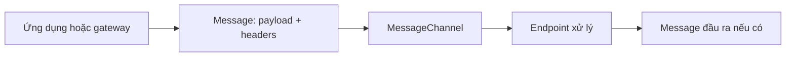

# Message và GenericMessage

Trong chương **Message** của module **SPRING_INTEGRATION_CORE**, bài này giải thích đơn vị dữ liệu đi qua một luồng Spring Integration: `Message<T>`. Hiểu cấu trúc này là nền tảng để nối `MessageChannel`, endpoint, gateway và Java DSL; đồng thời giúp thiết kế transformer, router, filter, aggregator, xử lý lỗi và kiểm thử luồng tích hợp.

Trọng tâm là cách biểu diễn dữ liệu bằng `Message` và tạo thông điệp bằng `GenericMessage`. Các thành phần khác được nhắc đến để làm rõ cách chúng sử dụng thông điệp.

## 1. Vì sao luồng tích hợp cần Message?

Giả sử hệ thống bán hàng tiếp nhận một đơn hàng. Bộ phận tính giá cần dữ liệu đơn hàng; bước định tuyến cần biết nguồn tiếp nhận; bước theo dõi cần một mã để liên kết các lần xử lý. Nếu truyền tất cả bằng tham số riêng, mỗi bước dễ phụ thuộc vào một chữ ký phương thức khác nhau.

Một thông điệp gom dữ liệu thành một phong bì chung:

```text
Message<OrderPlaced>
├── payload: OrderPlaced
│   ├── orderId: "ORD-2048"
│   └── total: 250000
└── headers
    ├── id: UUID do framework tạo
    ├── timestamp: thời điểm tạo phong bì
    ├── sourceSystem: "checkout"
    └── businessEventId: "EVT-9001"
```

Payload mang nội dung cần xử lý. Headers mang ngữ cảnh đi kèm. Một bước có thể chỉ quan tâm payload; bước khác có thể đọc headers mà không cần hiểu toàn bộ cấu trúc nghiệp vụ.

Ví dụ, router chọn nhánh dựa trên `sourceSystem`, trong khi transformer chuyển `OrderPlaced` thành yêu cầu gửi sang kho. Cả hai vẫn làm việc với cùng một hình thức trao đổi dữ liệu.



Trong sơ đồ, thông điệp là dữ liệu được trao đổi; channel chuyển dữ liệu; endpoint thực hiện xử lý. Tạo một `GenericMessage` mới chỉ tạo một đối tượng Java. Muốn có luồng thực thi, ứng dụng còn phải kết nối các thành phần tiếp nhận và xử lý.

## 2. Hợp đồng Message<T>

`Message<T>` thuộc package `org.springframework.messaging` của Spring Framework và được Spring Integration sử dụng làm hợp đồng thông điệp. Dạng rút gọn của interface là:

```java
public interface Message<T> {
    T getPayload();
    MessageHeaders getHeaders();
}
```

`T` biểu diễn kiểu payload. `getHeaders()` trả về `MessageHeaders`. Interface cung cấp phương thức đọc, không có `setPayload()` hay `setHeaders()`. Xem [Javadoc Message](https://docs.spring.io/spring-framework/docs/current/javadoc-api/org/springframework/messaging/Message.html).

Khi biết kiểu payload, mã ứng dụng đọc dữ liệu trực tiếp:

```java
import org.springframework.messaging.Message;
import org.springframework.messaging.support.GenericMessage;

Message<String> request = new GenericMessage<>("ORD-2048");
String orderId = request.getPayload();
```

Nên khai báo biến, tham số và kiểu trả về bằng `Message<T>` khi logic chỉ cần hợp đồng đọc. `GenericMessage<T>` phù hợp ở vị trí khởi tạo. Cách này cho phép handler xử lý các triển khai `Message` khác mà không phụ thuộc vào lớp cụ thể.

### 2.1. Ý nghĩa của Message<?> tại ranh giới tiếp nhận

Một handler tổng quát thường nhận `Message<?>`, vì kiểu payload chưa được biết tại thời điểm biên dịch. Khi đó cần kiểm tra dữ liệu trước khi dùng:

```java
static void consume(Message<?> message) {
    Object payload = message.getPayload();

    if (!(payload instanceof String orderId)) {
        throw new IllegalArgumentException("Payload phải là mã đơn hàng");
    }

    System.out.println("Đang xử lý " + orderId);
}
```

Cú pháp pattern matching trong ví dụ cần Java 17 trở lên. Khi chọn phiên bản Spring, vẫn phải đáp ứng yêu cầu JDK của chính phiên bản đó.

Không nên ép kiểu `(Message<String>) message` để coi như đã xác minh payload. Generic không thay thế kiểm tra dữ liệu tại ranh giới đầu vào; một lần ép kiểu không an toàn có thể khiến lỗi chỉ xuất hiện ở bước đọc payload.

## 3. Chọn dữ liệu cho payload và headers

Một tiêu chí thiết kế hữu ích là: dữ liệu mô tả sự kiện hoặc yêu cầu nghiệp vụ thuộc payload; thông tin hỗ trợ vận chuyển, theo dõi và điều phối thuộc headers.

| Dữ liệu | Vị trí đề xuất | Lý do |
| --- | --- | --- |
| Mã đơn hàng, tổng tiền, danh sách sản phẩm | Payload | Là nội dung của sự kiện đặt hàng |
| Nguồn tiếp nhận như `checkout` | Header `sourceSystem` | Có thể giúp chọn nhánh xử lý |
| Mã sự kiện do ứng dụng cấp | Header `businessEventId` theo hợp đồng ứng dụng | Liên kết các phong bì của cùng một sự kiện |
| Thời điểm khách thực sự đặt hàng | Trường `occurredAt` trong payload | Là thời gian nghiệp vụ, có thể khác thời điểm tạo message |
| Đích nhận phản hồi | Header chuẩn `replyChannel` khi luồng có dùng | Là thông tin trao đổi request/reply |

Đây là lựa chọn thiết kế cho ví dụ bán hàng, không phải quy tắc ép mọi hệ thống dùng cùng một schema. Nếu một mã sự kiện là thành phần bắt buộc của hợp đồng tích hợp bên ngoài, cần đưa nó vào vị trí mà hợp đồng đó quy định, thay vì mặc định chỉ lưu trong header nội bộ.

Tránh biến payload thành chuỗi JSON quá sớm khi các bước trong cùng JVM còn cần thao tác có kiểu. Có thể giữ DTO trong luồng nội bộ rồi chuyển sang định dạng truyền tải ở bước giao tiếp với hệ thống ngoài.

Việc đặt một giá trị vào header cũng cần có thỏa thuận về tên, kiểu, ý nghĩa và hành vi khi thiếu. Header `businessEventId` trong bài do ứng dụng tự định nghĩa; đặt tên đó không tự kích hoạt chống xử lý trùng.

## 4. Khởi tạo bằng GenericMessage

`GenericMessage<T>` là triển khai thông dụng trong `org.springframework.messaging.support`. Payload truyền vào phải khác `null`. Ba constructor có ý nghĩa khác nhau về headers. Xem [Javadoc GenericMessage](https://docs.spring.io/spring-framework/docs/current/javadoc-api/org/springframework/messaging/support/GenericMessage.html).

### 4.1. Chỉ truyền payload

```java
import org.springframework.messaging.Message;
import org.springframework.messaging.support.GenericMessage;

Message<String> message = new GenericMessage<>("Order accepted");

String payload = message.getPayload();
System.out.println(payload);
```

Cách này phù hợp khi đầu vào chưa cần metadata tùy biến.

### 4.2. Truyền payload và Map headers

```java
import java.util.HashMap;
import java.util.Map;

import org.springframework.messaging.Message;
import org.springframework.messaging.support.GenericMessage;

Map<String, Object> suppliedHeaders = new HashMap<>();
suppliedHeaders.put("sourceSystem", "checkout");
suppliedHeaders.put("schemaVersion", 1);

Message<String> message =
        new GenericMessage<>("ORD-2048", suppliedHeaders);

suppliedHeaders.put("sourceSystem", "admin");

System.out.println(message.getHeaders().get("sourceSystem"));
// checkout
```

Constructor nhận `Map<String, Object>` sao chép các entry vào headers của message. Thay một entry trong map đầu vào sau khi tạo không thay entry tương ứng của message.

Đây là sao chép nông: nếu giá trị header là một object mutable, object đó vẫn có thể được chia sẻ. Ví dụ ở phần tính bất biến sẽ làm rõ khác biệt này.

### 4.3. Truyền payload và MessageHeaders

```java
import java.util.Map;

import org.springframework.messaging.Message;
import org.springframework.messaging.MessageHeaders;
import org.springframework.messaging.support.GenericMessage;

MessageHeaders sharedHeaders =
        new MessageHeaders(Map.<String, Object>of("sourceSystem", "checkout"));

Message<String> first = new GenericMessage<>("before", sharedHeaders);
Message<String> second = new GenericMessage<>("after", sharedHeaders);

System.out.println(first.getHeaders() == second.getHeaders());
// true
```

Overload nhận `MessageHeaders` dùng trực tiếp instance đã cung cấp. Trong ví dụ này, hai phong bì chia sẻ cả headers và message ID. Vì vậy, không nên chọn overload đó với giả định mỗi lần gọi sẽ tạo một bộ metadata mới.

| Constructor | Hành vi chính |
| --- | --- |
| `GenericMessage(payload)` | Tạo message với headers mặc định |
| `GenericMessage(payload, Map<String, Object>)` | Sao chép entry của map và tạo `MessageHeaders` |
| `GenericMessage(payload, MessageHeaders)` | Dùng trực tiếp instance headers đã có |

Sự khác nhau còn phụ thuộc kiểu tĩnh của đối số. Nếu truyền cùng một object headers qua biến kiểu `Map<String, Object>`, Java chọn overload nhận `Map`. Nên viết rõ ý định thay vì dựa vào việc đổi kiểu biến để điều khiển định danh thông điệp.

### 4.4. Payload null là lỗi đầu vào

```java
new GenericMessage<String>(null);
// Ném IllegalArgumentException khi khởi tạo.
```

Nếu nghiệp vụ có kết quả “không tìm thấy”, hãy xác định cách biểu diễn rõ ràng, chẳng hạn DTO kết quả có trạng thái. Việc một endpoint không sinh message đầu ra là một quyết định điều phối khác với việc tạo message có payload `null`.

## 5. Đọc headers và phân biệt các loại định danh

Với đường khởi tạo mặc định bằng payload hoặc `Map`, Spring tạo header `id` và `timestamp`. Constructor công khai `MessageHeaders(Map)` sinh các giá trị này, ghi đè giá trị cùng tên có trong map đầu vào. Không dùng `id` làm trường do nghiệp vụ tự quản lý. Xem [Javadoc MessageHeaders](https://docs.spring.io/spring-framework/docs/current/javadoc-api/org/springframework/messaging/MessageHeaders.html).

| Header | Kiểu hoặc dạng giá trị | Ý nghĩa cần phân biệt |
| --- | --- | --- |
| `id` | `UUID` | Định danh phong bì message |
| `timestamp` | `Long` theo epoch milliseconds | Thời điểm tạo headers mặc định |
| `replyChannel` | Tham chiếu channel hoặc tên channel trong cấu hình phù hợp | Gợi ý nơi gửi phản hồi |
| `errorChannel` | Tham chiếu channel hoặc tên channel trong cấu hình phù hợp | Thông tin đích xử lý lỗi |
| `businessEventId` | `String` trong ví dụ này | Định danh sự kiện do ứng dụng cấp |

Đọc header bằng kiểu mong đợi:

```java
import java.util.UUID;

UUID envelopeId = message.getHeaders().getId();
Long createdAt = message.getHeaders().getTimestamp();

String source =
        message.getHeaders().get("sourceSystem", String.class);
Integer schemaVersion =
        message.getHeaders().get("schemaVersion", Integer.class);
```

Getter có kiểu giúp phát hiện giá trị sai kiểu; nó không phải bộ chuyển đổi chuỗi `"1"` sang số nguyên `1`. Header có thể thiếu, nên logic sử dụng phải xử lý giá trị `null` theo hợp đồng của luồng.

Trong hệ thống bán hàng có thể tồn tại đồng thời:

- `orderId`: đơn hàng nào đang được nói đến.
- `businessEventId`: lần phát sinh sự kiện nào của đơn hàng.
- `id`: phong bì message nào đang mang dữ liệu ở một bước.

Một đơn hàng có thể phát sinh nhiều sự kiện. Một sự kiện có thể được biểu diễn bằng nhiều phong bì sau chuyển đổi hoặc nhận lại từ hệ thống ngoài. Khi thiết kế idempotency, hãy chọn khóa theo ý nghĩa nghiệp vụ và cơ chế lưu trạng thái; chỉ có một UUID trên message chưa đủ bảo đảm hiệu ứng chỉ xảy ra một lần.

## 6. Tính bất biến của phong bì không phải bất biến sâu

Với `GenericMessage` thông thường, ứng dụng không thay payload reference bằng setter. `MessageHeaders` cũng chặn thao tác sửa trực tiếp như `put()`, `remove()` hoặc `clear()`. Tuy nhiên, payload và giá trị từng header có thể vẫn là object mutable. Tài liệu [Message của Spring Integration](https://docs.spring.io/spring-integration/reference/message.html) phân biệt rõ giới hạn này.

### 6.1. Payload mutable vẫn có thể thay đổi

```java
import java.util.ArrayList;
import java.util.List;

import org.springframework.messaging.Message;
import org.springframework.messaging.support.GenericMessage;

List<String> skuCodes = new ArrayList<>(List.of("SKU-1"));
Message<List<String>> message = new GenericMessage<>(skuCodes);

skuCodes.add("SKU-2");

System.out.println(message.getPayload());
// [SKU-1, SKU-2]
```

Message giữ reference tới danh sách đã truyền vào. Khi producer thay đổi danh sách, consumer đọc cùng object có thể quan sát dữ liệu mới. Nếu các nhánh xử lý chạy song song, còn có thể xuất hiện vấn đề đồng bộ hoặc kết quả phụ thuộc thứ tự thực thi.

Một cách bảo vệ danh sách gồm các chuỗi là tạo bản sao không cho sửa trước khi bọc:

```java
Message<List<String>> snapshot =
        new GenericMessage<>(List.copyOf(skuCodes));
```

Ở đây `String` là bất biến. Nếu phần tử là DTO mutable, chỉ sao chép danh sách chưa bảo vệ nội dung từng DTO.

Tương tự, một Java `record` chỉ cố định các reference của component. Record chứa `List`, array hoặc object mutable vẫn cần chính sách sao chép riêng. Ví dụ hoàn chỉnh ở phần sau dùng compact constructor để sao chép danh sách mã sản phẩm.

### 6.2. Map headers được sao chép nhưng giá trị có thể dùng chung

```java
import java.util.ArrayList;
import java.util.List;
import java.util.Map;

import org.springframework.messaging.Message;
import org.springframework.messaging.support.GenericMessage;

List<String> tags = new ArrayList<>(List.of("web"));

Message<String> tagged = new GenericMessage<>(
        "ORD-2048",
        Map.<String, Object>of("tags", tags)
);

tags.add("priority");

System.out.println(tagged.getHeaders().get("tags"));
// [web, priority]
```

Entry `tags` đã được sao chép vào headers, nhưng giá trị của entry vẫn trỏ đến cùng danh sách. Thiết kế an toàn hơn cho trường hợp này là truyền `List.copyOf(tags)` làm giá trị header.

Sau khi gửi message, producer nên coi dữ liệu đã bàn giao. Với dữ liệu mutable bắt buộc phải dùng, cần xác định rõ ai sở hữu object, thời điểm sao chép và khả năng có nhiều consumer cùng truy cập.

### 6.3. Sửa headers trực tiếp sẽ thất bại

```java
message.getHeaders().put("sourceSystem", "mobile");
// UnsupportedOperationException
```

Muốn thêm hoặc đổi metadata, hãy xây dựng thông điệp mang trạng thái mới. Việc biết header có dạng `Map` không có nghĩa map đó cho phép sửa.

## 7. Tạo thông điệp mới với MessageBuilder

Constructor phù hợp khi tạo message đơn giản. Khi bổ sung metadata hoặc chuyển đổi payload, builder giúp trình bày ý định rõ hơn.

Các ví dụ dưới dùng **`org.springframework.messaging.support.MessageBuilder`** của Spring Framework. Spring Integration cũng có builder trong package riêng; khi sao chép code cần kiểm tra import. Những hành vi được mô tả ở đây theo [Javadoc MessageBuilder của Spring Framework](https://docs.spring.io/spring-framework/docs/current/javadoc-api/org/springframework/messaging/support/MessageBuilder.html).

### 7.1. Giữ payload, bổ sung header

```java
import org.springframework.messaging.Message;
import org.springframework.messaging.support.MessageBuilder;

Message<String> original = MessageBuilder.withPayload("ORD-2048")
        .setHeader("sourceSystem", "checkout")
        .build();

Message<String> enriched = MessageBuilder.fromMessage(original)
        .setHeader("validationStage", "accepted")
        .build();
```

Ở đây `enriched` có header mới, còn `original` giữ trạng thái cũ. Hai message vẫn sử dụng cùng payload reference; builder không tự clone dữ liệu nghiệp vụ.

Nếu không có thay đổi, không nên dựa vào `fromMessage(original).build()` để yêu cầu một object mới. Khi cần một phong bì mới có payload xác định, dùng `withPayload(...)` và chọn rõ headers cần mang theo.

### 7.2. Đổi kiểu payload và mang theo metadata

```java
Message<Integer> lengthMessage =
        MessageBuilder.withPayload(original.getPayload().length())
                .copyHeaders(original.getHeaders())
                .setHeader("processingStep", "measure")
                .build();
```

`withPayload(...)` xác lập kiểu mới là `Integer`. `copyHeaders(...)` mang theo metadata, nhưng không ghi đè `id` và `timestamp`. Không dùng cách này để giữ nguyên định danh phong bì cũ.

Trong đoạn mã ứng dụng tự xây message như trên, phải chủ động chọn metadata. Nếu chỉ gọi `new GenericMessage<>(newPayload)`, các header tùy biến của đầu vào không được mang sang tự động.

Không nên suy rộng rằng mọi endpoint đều có cùng quy tắc sao chép. Khi dùng transformer hoặc DSL của framework, cần xét hợp đồng đầu ra và cơ chế truyền headers của chính endpoint.

### 7.3. Chọn thứ tự đặt và sao chép headers

```java
Message<String> routed = MessageBuilder.withPayload("ORD-2048")
        .copyHeaders(original.getHeaders())
        .setHeader("targetSystem", "warehouse")
        .build();
```

Trong ví dụ, quyết định chọn kho được áp dụng sau bước sao chép. Ngược lại, `copyHeadersIfAbsent(...)` giữ các giá trị đã được builder đặt trước đó. `setHeader(name, null)` xóa header tương ứng.

Khi ra khỏi một ranh giới tích hợp, có thể chỉ mang theo các header được cho phép thay vì sao chép toàn bộ. Ví dụ, một callback nội bộ hoặc reference tới channel không phải dữ liệu phù hợp để đưa nguyên dạng sang một hệ thống bên ngoài.

## 8. Ví dụ hoàn chỉnh: nhận đơn hàng và tạo thông điệp xác nhận

Ví dụ sau minh họa một luồng nội bộ trong JVM:

1. Tạo payload đơn hàng và bọc bằng `GenericMessage`.
2. Gửi qua `DirectChannel`.
3. Handler kiểm tra kiểu payload rồi tạo message chứa chuỗi xác nhận.
4. Đưa kết quả vào `QueueChannel` để ứng dụng đọc.

`DirectChannel` gọi subscriber trên thread của người gửi. `QueueChannel` dùng hàng đợi để giữ message chờ nhận. Hai cơ chế này được mô tả tại [DirectChannel](https://docs.spring.io/spring-integration/api/org/springframework/integration/channel/DirectChannel.html) và [QueueChannel](https://docs.spring.io/spring-integration/api/org/springframework/integration/channel/QueueChannel.html).

### 8.1. Điều kiện sử dụng

Classpath cần có `org.springframework.integration:spring-integration-core` và các dependency bắc cầu tương thích, trong đó có `spring-messaging`. Với dự án Spring Boot có dependency management, dùng các phiên bản do BOM tương thích quản lý.

Mã sử dụng cú pháp Java 17 trở lên; JDK thực tế phải thỏa yêu cầu của phiên bản Spring đang dùng. Ví dụ khởi tạo các channel và đăng ký handler bằng Java thuần để quan sát phong bì, không cần dựng một ứng dụng Boot.

### 8.2. Mã nguồn

```java
import java.math.BigDecimal;
import java.util.List;
import java.util.Map;
import java.util.Objects;

import org.springframework.integration.channel.DirectChannel;
import org.springframework.integration.channel.QueueChannel;
import org.springframework.messaging.Message;
import org.springframework.messaging.support.GenericMessage;
import org.springframework.messaging.support.MessageBuilder;

public class MessageEnvelopeDemo {

    public record OrderPlaced(
            String orderId,
            BigDecimal total,
            List<String> skuCodes) {

        public OrderPlaced {
            Objects.requireNonNull(orderId, "orderId");
            Objects.requireNonNull(total, "total");
            skuCodes = List.copyOf(skuCodes);
        }
    }

    public static void main(String[] args) {
        DirectChannel input = new DirectChannel();
        QueueChannel output = new QueueChannel(10);

        input.subscribe(message -> {
            if (!(message.getPayload() instanceof OrderPlaced order)) {
                throw new IllegalArgumentException(
                        "Payload phải có kiểu OrderPlaced");
            }

            String businessEventId = message.getHeaders()
                    .get("businessEventId", String.class);

            if (businessEventId == null) {
                throw new IllegalArgumentException(
                        "Thiếu businessEventId");
            }

            Message<String> confirmation = MessageBuilder
                    .withPayload("Đã nhận đơn " + order.orderId())
                    .copyHeaders(message.getHeaders())
                    .setHeader("processingStage", "accepted")
                    .build();

            if (!output.send(confirmation, 0)) {
                throw new IllegalStateException(
                        "Hàng đợi kết quả đã đầy");
            }
        });

        OrderPlaced order = new OrderPlaced(
                "ORD-2048",
                new BigDecimal("250000"),
                List.of("SKU-1", "SKU-2")
        );

        Message<OrderPlaced> request = new GenericMessage<>(
                order,
                Map.<String, Object>of(
                        "sourceSystem", "checkout",
                        "businessEventId", "EVT-9001")
        );

        if (!input.send(request)) {
            throw new IllegalStateException(
                    "Không gửi được thông điệp đầu vào");
        }

        Message<?> result = output.receive(0);

        if (result == null) {
            throw new IllegalStateException(
                    "Không có thông điệp kết quả");
        }

        System.out.println(result.getPayload());
        System.out.println(result.getHeaders()
                .get("businessEventId", String.class));
        System.out.println(result.getHeaders()
                .get("processingStage", String.class));
    }
}
```

Kết quả dự kiến:

```text
Đã nhận đơn ORD-2048
EVT-9001
accepted
```

### 8.3. Đọc hành vi của ví dụ

Handler là một `MessageHandler` được cung cấp bằng lambda. Nó nhận phong bì đầu vào, lấy `OrderPlaced` để tạo nội dung xác nhận và xây một phong bì có payload kiểu `String`.

Header `businessEventId` được giữ qua bước tạo kết quả để ứng dụng liên kết hai lần biểu diễn của cùng sự kiện. `processingStage` chỉ được thêm vào kết quả; message đầu vào không được sửa tại chỗ.

`receive(0)` đọc ngay và trả về `null` nếu chưa có dữ liệu. Trong luồng này, handler chạy đồng bộ trong lệnh `input.send(request)`; kết quả được đưa vào queue trước khi ứng dụng gọi `receive(0)`, miễn là các bước trước đó thành công.

Queue có sức chứa 10 và bước gửi dùng timeout 0, nên ví dụ chủ động báo lỗi khi queue đầy. Một channel có queue cũng không tự tạo consumer hay tự làm cho mọi bước chạy trên thread khác; ví dụ này đọc kết quả ngay trên thread `main`.

Mã handler không chủ động sửa payload hoặc headers của message đã nhận. Danh sách sản phẩm cũng được sao chép khi tạo record, nên việc thay đổi một danh sách đầu vào ở bên ngoài không làm thay đổi danh sách nằm trong `OrderPlaced`.

## 9. Message liên hệ với endpoint, gateway và Java DSL như thế nào?

Cùng một phong bì có thể được sử dụng theo nhiều cách trong luồng:

| Thành phần | Quan hệ với Message |
| --- | --- |
| MessageChannel | Nhận message để chuyển đến nơi xử lý hoặc giữ chờ nhận |
| Transformer | Tạo biểu diễn dữ liệu đầu ra, có thể đổi kiểu payload |
| Router | Chọn đích dựa trên payload hoặc headers |
| Filter | Quyết định message có được đi tiếp theo điều kiện hay không |
| Aggregator | Gom nhiều message theo quy tắc tương quan và hoàn tất nhóm |
| Gateway | Cung cấp giao diện gọi phương thức để kết nối ứng dụng với luồng |
| Java DSL | Mô tả cách nối các bước của luồng bằng cấu hình Java |

Bảng này là bản đồ vai trò để đọc các bài tiếp theo. Ở bài hiện tại, điều cần theo dõi tại mỗi ranh giới là: payload có kiểu gì, headers nào phải tồn tại và bước nào tạo ra phong bì mới.

Ví dụ, khi chuyển từ `OrderPlaced` sang yêu cầu gửi kho, mã đơn hàng vẫn cần tồn tại trong dữ liệu nghiệp vụ. Mã sự kiện dùng theo dõi cũng cần được giữ theo thỏa thuận. Nếu chỉ quan sát chuỗi đầu ra mà bỏ qua metadata, luồng có thể trả nội dung đúng nhưng mất khả năng liên kết các bước xử lý.

## 10. Message dữ liệu và ErrorMessage

`ErrorMessage` là lớp chuyên biệt kế thừa `GenericMessage<Throwable>`, dùng để biểu diễn thông tin lỗi. Đối tượng lỗi nằm trong payload, khác với việc payload nghiệp vụ chứa một trường trạng thái thất bại. Xem [Javadoc ErrorMessage](https://docs.spring.io/spring-framework/docs/current/javadoc-api/org/springframework/messaging/support/ErrorMessage.html).

```java
import org.springframework.messaging.support.ErrorMessage;

ErrorMessage errorMessage = new ErrorMessage(
        new IllegalArgumentException("Đơn hàng không hợp lệ")
);

Throwable failure = errorMessage.getPayload();
System.out.println(failure.getMessage());
```

Khởi tạo `ErrorMessage` mới chỉ biểu diễn lỗi bằng dữ liệu. Việc gửi nó đi đâu cần có xử lý tương ứng. Cũng không nên suy ra rằng thêm header `errorChannel` sẽ tự bắt mọi exception: cơ chế phát hiện, bắt và chuyển lỗi phụ thuộc thành phần thực thi của luồng.

Ví dụ `DirectChannel` ở trên không cài một cơ chế chuyển lỗi riêng. Nếu handler ném exception, lệnh gửi đồng bộ có thể thất bại bằng exception; ứng dụng không nên tiếp tục coi như đã có một xác nhận thành công.

## 11. Những nhầm lẫn thường gặp

| Nhầm lẫn | Hệ quả | Cách xử lý |
| --- | --- | --- |
| Truyền `null` cho payload của `GenericMessage` | Lỗi ngay khi tạo | Xác định kiểu kết quả hoặc chính sách không phát đầu ra |
| Gọi `getHeaders().put(...)` | `UnsupportedOperationException` | Dùng builder để biểu diễn trạng thái mới |
| Cho rằng bọc DTO mutable là đã an toàn khi chia sẻ | Consumer có thể thấy dữ liệu bị thay đổi | Dùng dữ liệu bất biến hoặc bản sao theo quyền sở hữu |
| Dùng message ID như mã sự kiện xuyên mọi bước | Mất liên kết khi tạo phong bì mới | Cấp định danh nghiệp vụ riêng theo hợp đồng |
| Dùng overload `MessageHeaders` để mong sinh ID mới | Có thể giữ lại bộ headers cũ | Chọn constructor hoặc builder đúng mục đích |
| Chỉ tạo message mới từ payload sau chuyển đổi | Bỏ mất headers tùy biến | Chọn rõ metadata cần truyền tiếp |
| Ép kiểu `Message<?>` mà không kiểm tra payload | Lỗi kiểu ở bước sử dụng | Kiểm tra dữ liệu ở ranh giới tiếp nhận |
| Cho rằng có message nghĩa là đã có broker và lưu bền | Đánh giá sai đặc tính hệ thống | Kiểm tra cấu hình channel, adapter và nơi lưu thực tế |

Không ghi toàn bộ phong bì vào log theo mặc định nếu payload hoặc headers chứa dữ liệu nhạy cảm. Với ví dụ đơn hàng, có thể ghi `orderId`, `businessEventId` và tên bước xử lý theo chính sách log của ứng dụng, thay vì đưa toàn bộ đối tượng nghiệp vụ vào một chuỗi.

## 12. Quan sát và kiểm thử hợp đồng thông điệp

Một kiểm thử hữu ích cần xác nhận nội dung có ý nghĩa với luồng. Với ví dụ nhận đơn hàng, các điểm quan sát là:

- Payload đầu ra là chuỗi xác nhận đúng mã đơn hàng.
- `businessEventId` vẫn là `EVT-9001` sau bước chuyển đổi.
- `processingStage` xuất hiện ở đầu ra và không bị thêm vào đầu vào.
- Payload sai kiểu hoặc thiếu mã sự kiện bị xử lý theo hợp đồng đã chọn.
- Tình huống không có đầu ra được phân biệt với đầu ra hợp lệ.

Không nên viết kỳ vọng rằng mọi message mới đều có cùng ID, hoặc hai message nghiệp vụ tương đương phải bằng nhau hoàn toàn. Định danh phong bì và thời điểm tạo là metadata kỹ thuật; khi kiểm thử yêu cầu nghiệp vụ, hãy so sánh các trường cần thiết.

Nếu cần kiểm tra bất biến của một payload chứa collection, có thể giữ lại danh sách dùng để khởi tạo, thay đổi danh sách đó rồi quan sát payload. Kỳ vọng phải phản ánh chính sách của DTO: dùng chung dữ liệu hay giữ một bản chụp. Với `OrderPlaced` trong ví dụ, danh sách được sao chép khi xây dựng.

Các điểm quan sát này giúp nối kiến thức về phong bì với kiểm thử luồng sau này, khi có transformer, router hoặc aggregator tham gia.

## 13. Ranh giới JVM và hệ thống bên ngoài

Một `GenericMessage` nội bộ không tự trở thành bản tin Kafka, AMQP hay HTTP. Tại ranh giới giao tiếp, adapter và cấu hình chuyển đổi quyết định cách biểu diễn payload, headers nào được ánh xạ và những bảo đảm truyền nhận nào tồn tại.

Vì vậy, DTO trong payload không bắt buộc phải là JSON chỉ để đi qua một channel nội bộ. Ngược lại, việc một object dùng được trong JVM không bảo đảm nó có thể được truyền nguyên dạng sang hệ thống khác.

Khi thiết kế ranh giới gửi yêu cầu kho, cần xác định riêng schema dữ liệu, kiểu nội dung, mã sự kiện, thời gian nghiệp vụ và các header được phép chuyển. Đây là hợp đồng tích hợp của ứng dụng; tạo `GenericMessage` là một bước biểu diễn dữ liệu trong hợp đồng đó.
