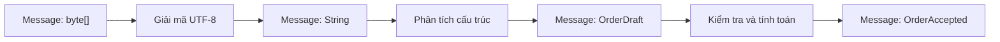

# Payload trong Message

Trong chương **Message** của module **SPRING_INTEGRATION_CORE**, payload là dữ liệu mà các thành phần của luồng thông điệp cần xử lý. Hiểu payload giúp bạn nối Message, MessageChannel, endpoint và gateway thành một luồng có hợp đồng dữ liệu rõ ràng, đồng thời biết vị trí cần chuyển đổi, kiểm tra hoặc từ chối dữ liệu.

Bài học tập trung vào nội dung của thông điệp: payload có thể là gì, cách tạo và đọc, những giới hạn của generic, cách tránh thay đổi dữ liệu dùng chung, và cách theo dõi kiểu payload qua Java DSL. Ví dụ thực hành sử dụng đơn hàng để minh họa transformer, filter và kiểm thử.

## 1. Payload nằm ở đâu trong Message?

Có thể hình dung một thông điệp gồm hai phần:

```text
Message<T>
├── payload: T         dữ liệu cần xử lý
└── headers            metadata phục vụ trao đổi và xử lý thông điệp
```

Giao diện `org.springframework.messaging.Message<T>` cung cấp hai phương thức truy xuất chính:

```java
T getPayload();
MessageHeaders getHeaders();
```

`T` là kiểu của payload, không phải kiểu của toàn bộ message. Chẳng hạn, `Message<String>` là một thông điệp có payload kiểu `String`. [Tham chiếu: Message API](https://docs.spring.io/spring-framework/docs/current/javadoc-api/org/springframework/messaging/Message.html).

Trong ví dụ đơn hàng:

| Thông tin | Vị trí được chọn trong bài | Lý do |
| --- | --- | --- |
| Mã đơn hàng, số lượng, đơn giá | Payload | Là dữ liệu nghiệp vụ cần tính toán |
| Mã theo dõi một lần xử lý | Header `traceId` | Phục vụ quan sát luồng |
| Nguồn tiếp nhận thông điệp | Header `sourceSystem` | Cung cấp ngữ cảnh tích hợp |
| Tổng tiền sau xử lý | Payload kết quả | Là kết quả nghiệp vụ mà bên nhận cần dùng |

Đây là lựa chọn thiết kế cho tình huống minh họa. Một mã đơn hàng có thể đồng thời được đưa lên header để định tuyến hoặc tìm kiếm, nhưng dữ liệu nghiệp vụ cần được xác định nguồn có thẩm quyền để tránh hai bản sao mâu thuẫn.

Một payload cũng có thể chứa nhiều trường. “Một message có một payload” không có nghĩa payload chỉ được chứa một giá trị đơn giản.

## 2. Những kiểu payload thường gặp

Spring Integration không buộc các luồng phải sử dụng một định dạng nghiệp vụ duy nhất. Bạn chọn biểu diễn phù hợp ở từng đoạn và dùng transformer khi cần đổi biểu diễn. [Tham chiếu: Transformer](https://docs.spring.io/spring-integration/reference/6.5/transformer.html).

| Kiểu payload | Tình huống minh họa | Điều cần thống nhất với bên nhận |
| --- | --- | --- |
| `String` | Một dòng dữ liệu đơn hàng | Cú pháp, dấu phân cách, ý nghĩa từng trường |
| `byte[]` | Dữ liệu nhận từ ranh giới truyền tải | Định dạng nhị phân hoặc charset nếu đó là văn bản |
| DTO, POJO hoặc record | Đơn hàng đã được phân tích | Trường bắt buộc, đơn vị, quy tắc nghiệp vụ |
| `Map<String, Object>` | Dữ liệu linh hoạt từ hệ thống ngoài | Tên khóa và kiểu thực tế của từng giá trị |
| `List<OrderLine>` | Một nhóm dòng hàng | Một message chứa cả danh sách hay cần tách thành nhiều message |
| `File` hoặc `Resource` | Tham chiếu đến tài liệu | Quyền truy cập, thời gian tồn tại, bên chịu trách nhiệm đọc |
| `InputStream` | Nội dung đọc theo luồng | Ai đọc, ai đóng và có được đọc lại hay không |

Bảng trên là các khả năng thiết kế; một adapter cụ thể vẫn có giới hạn đầu vào riêng. Có một đối tượng Java hợp lệ chưa đủ để kết luận mọi outbound adapter đều gửi được đối tượng đó.

Ví dụ, `File` chứa thông tin tham chiếu đến tệp, không phải bản chụp toàn bộ nội dung tệp. Nếu tệp bị sửa trước khi consumer đọc, dữ liệu consumer nhận được có thể khác thời điểm tạo message. Với một giao dịch cần lưu chính xác tài liệu tại thời điểm tiếp nhận, nhóm phát triển phải chọn cơ chế chụp nội dung hoặc quản lý phiên bản thích hợp.

## 3. Tạo và truy xuất payload

### 3.1. Tạo bằng GenericMessage

Ví dụ độc lập sau sử dụng kiểu đơn giản để làm rõ cấu trúc:

```java
import org.springframework.messaging.Message;
import org.springframework.messaging.support.GenericMessage;

public class PayloadBasics {

    public static void main(String[] args) {
        Message<String> message =
                new GenericMessage<>("ORD-42,2,125000");

        String payload = message.getPayload();

        System.out.println(payload);
        System.out.println(payload.getClass().getSimpleName());
    }
}
```

Kết quả:

```text
ORD-42,2,125000
String
```

`GenericMessage` nhận payload khi khởi tạo; các constructor của lớp này yêu cầu payload khác `null`. [Tham chiếu: GenericMessage API](https://docs.spring.io/spring-framework/docs/current/javadoc-api/org/springframework/messaging/support/GenericMessage.html).

### 3.2. Tạo bằng MessageBuilder

Khi cần thêm metadata, builder giúp biểu đạt rõ nội dung và header:

```java
import org.springframework.messaging.Message;
import org.springframework.messaging.support.MessageBuilder;

Message<String> message = MessageBuilder
        .withPayload("ORD-42,2,125000")
        .setHeader("traceId", "trace-001")
        .setHeader("sourceSystem", "partner-a")
        .build();

String rawOrder = message.getPayload();
Object traceId = message.getHeaders().get("traceId");
```

Bài sử dụng `org.springframework.messaging.support.MessageBuilder`; cần chú ý import khi IDE đề xuất nhiều lớp cùng tên.

`withPayload(...)` bắt đầu một builder với payload cho trước. `fromMessage(...)` khởi tạo builder dựa trên message sẵn có. Hai thao tác phục vụ việc xây dựng thông điệp; chúng không phải bộ phân tích dữ liệu nghiệp vụ. [Tham chiếu: MessageBuilder API](https://docs.spring.io/spring-framework/docs/current/javadoc-api/org/springframework/messaging/support/MessageBuilder.html).

### 3.3. Đọc từ Message<?>

Ở ranh giới chưa biết kiểu dữ liệu, kiểm tra kiểu thực tế trước khi sử dụng:

```java
static String requireText(Message<?> message) {
    Object payload = message.getPayload();

    if (payload instanceof String text) {
        return text;
    }

    throw new IllegalArgumentException(
            "Can payload String, nhan duoc: "
                    + payload.getClass().getName());
}
```

Hàm này chủ động từ chối dữ liệu ngoài hợp đồng. Việc từ chối sớm giúp xác định lỗi ở bước tiếp nhận, thay vì để lỗi xuất hiện muộn ở một phép tính hoặc thao tác truy cập trường.

## 4. Generic mô tả hợp đồng, không thay thế xác thực

Khai báo `Message<OrderDraft>` giúp trình biên dịch kiểm tra việc sử dụng payload trong mã Java đã định kiểu. Tuy nhiên, một lời ép kiểu không biến chuỗi thành DTO.

Ví dụ sai về ý tưởng:

```java
Message<?> incoming = new GenericMessage<>("ORD-42,2,125000");

// Khong phan tich chuoi, khong tao doi tuong OrderDraft:
OrderDraft draft = (OrderDraft) incoming.getPayload();
```

Nếu `OrderDraft` là record trong ví dụ thực hành bên dưới, phép ép kiểu này gây `ClassCastException` vì đối tượng thực vẫn là `String`.

Với collection, kiểm tra `payload instanceof List<?>` chỉ cho biết đó là danh sách. Kiểm tra này chưa chứng minh từng phần tử là `OrderDraft`. Tránh dùng một unchecked cast để coi `List<Map<String, Object>>` là `List<OrderDraft>`.

Hợp đồng dữ liệu cần ít nhất ba lớp:

1. **Kiểu biểu diễn:** chuỗi, mảng byte, DTO hoặc danh sách.
2. **Cấu trúc:** các trường bắt buộc và kiểu của từng trường.
3. **Ý nghĩa:** số lượng lớn hơn không, đơn giá tính theo đơn vị nào, thời gian sử dụng múi giờ nào.

Một payload đúng kiểu Java vẫn có thể sai nghiệp vụ. Chẳng hạn, `OrderDraft("ORD-42", -2, new BigDecimal("125000"))` có đủ trường nhưng không phải đơn hàng hợp lệ theo quy tắc của bài.

## 5. Không có dữ liệu khác với payload null

Cần phân biệt các trường hợp sau:

| Trường hợp | Ý nghĩa cần xác định |
| --- | --- |
| `new GenericMessage<>(null)` | Không hợp lệ với constructor của `GenericMessage` |
| Payload là chuỗi rỗng | Có đối tượng payload, nhưng có thể sai hợp đồng nghiệp vụ |
| Payload là danh sách rỗng | Có một danh sách; nghiệp vụ quyết định có chấp nhận không |
| Handler không tạo reply | Không có thông điệp trả lời từ bước đó |
| Không tìm thấy đơn hàng | Một kết quả nghiệp vụ cần được mô hình hóa |

Ví dụ, có thể biểu diễn kết quả tìm kiếm bằng một DTO:

```java
public record OrderLookupResult(String orderId, boolean found) {
}
```

Kết quả `new OrderLookupResult("ORD-404", false)` truyền đạt rõ điều đã xảy ra mà không cần một payload `null`.

Đối với transformer, trả về `null` là lỗi vì bước chuyển đổi phải tạo kết quả. Một service activator có thể không tạo reply khi cấu hình cho phép; đó là hành vi của endpoint, không phải một message hợp lệ có payload `null`. [Tham chiếu: quy tắc trả về của Transformer](https://docs.spring.io/spring-integration/reference/6.5/transformer.html).

Nếu muốn loại bỏ dữ liệu không hợp lệ, dùng filter với chính sách từ chối rõ ràng. Không sử dụng `return null` trong transformer để ngầm đóng vai trò filter.

## 6. Message bất biến không làm toàn bộ payload bất biến

Với cách dùng `GenericMessage` thông thường, bạn không thay tham chiếu payload bằng setter. Tuy nhiên, đối tượng mà payload trỏ đến vẫn có thể thay đổi. Nhiều consumer có thể truy cập cùng một instance payload. [Tham chiếu: tính bất biến của Message](https://docs.spring.io/spring-integration/reference/message.html).

### 6.1. Ví dụ dữ liệu bị thay đổi sau khi gửi

```java
import java.util.ArrayList;
import java.util.List;

import org.springframework.messaging.Message;
import org.springframework.messaging.support.MessageBuilder;

List<String> orderIds = new ArrayList<>();
orderIds.add("ORD-42");

Message<List<String>> message =
        MessageBuilder.withPayload(orderIds).build();

orderIds.add("ORD-99");

System.out.println(message.getPayload());
// [ORD-42, ORD-99]
```

Message vẫn giữ cùng payload, nhưng nội dung danh sách đã đổi. Builder không tạo bản sao sâu của toàn bộ đồ thị đối tượng nghiệp vụ.

Trong một nhánh ghi audit, danh sách có thể được đọc trước thay đổi; trong một nhánh xử lý chậm hơn, cùng message có thể được đọc sau thay đổi. Khi đó hai nhánh quan sát hai trạng thái khác nhau của cùng dữ liệu đầu vào.

### 6.2. Tạo snapshot theo nhu cầu

Với danh sách chứa `String`, có thể tạo bản sao không cho sửa cấu trúc:

```java
List<String> source = new ArrayList<>();
source.add("ORD-42");

Message<List<String>> snapshot =
        MessageBuilder.withPayload(List.copyOf(source)).build();

source.add("ORD-99");

System.out.println(snapshot.getPayload());
// [ORD-42]
```

`List.copyOf(...)` tạo danh sách không cho thêm, xóa hoặc thay phần tử qua API của danh sách. Nó không sao chép sâu các đối tượng phần tử. Nếu phần tử là POJO có setter, trạng thái bên trong POJO vẫn có thể đổi. [Tham chiếu: List và các danh sách không sửa được](https://docs.oracle.com/en/java/javase/17/docs/api/java.base/java/util/List.html).

Một lựa chọn cho mô hình đơn hàng:

```java
import java.math.BigDecimal;
import java.util.List;

public record OrderLine(String sku, int quantity, BigDecimal unitPrice) {
}

public record OrderBatch(String batchId, List<OrderLine> lines) {

    public OrderBatch {
        lines = List.copyOf(lines);
    }
}
```

Hai record trên đặt ở các tệp Java riêng nếu khai báo `public`. Trong thiết kế này, các thành phần của `OrderLine` không cung cấp thao tác thay đổi trạng thái; `OrderBatch` sao chép danh sách đầu vào. Nếu sau này thêm trường kiểu mảng hoặc đối tượng mutable, phải xem lại ranh giới snapshot.

Với `byte[]`, cân nhắc sao chép mảng khi quyền sở hữu chưa rõ. Với `InputStream`, cần quy ước vòng đời tài nguyên; sao chép tham chiếu stream không tạo thêm một nguồn dữ liệu đọc độc lập.

## 7. Chuyển biểu diễn cần một bước xử lý thực sự

### 7.1. Một nội dung có thể đi qua nhiều kiểu

Ví dụ chuỗi biến đổi ở ranh giới tích hợp:



Mỗi mũi tên đổi biểu diễn cần logic hoặc một converter phù hợp. Việc đổi tên channel, gắn header hoặc ép kiểu Java không thực hiện việc phân tích dữ liệu.

Chẳng hạn, đoạn DSL sau giải mã byte thành văn bản:

```java
import java.nio.charset.StandardCharsets;

// Doan chen vao mot IntegrationFlow:
.transform(byte[].class,
        bytes -> new String(bytes, StandardCharsets.UTF_8))
```

Sau bước này payload là `String`, chưa phải DTO. Nếu đầu vào là JSON thì vẫn cần bước phân tích JSON; nếu đầu vào là CSV thì cần bộ phân tích theo hợp đồng CSV.

### 7.2. contentType cung cấp metadata

Một message có thể chứa chuỗi JSON:

```java
import org.springframework.messaging.Message;
import org.springframework.messaging.MessageHeaders;
import org.springframework.messaging.support.MessageBuilder;
import org.springframework.util.MimeTypeUtils;

Message<String> jsonMessage = MessageBuilder
        .withPayload("{\"orderId\":\"ORD-42\",\"quantity\":2}")
        .setHeader(MessageHeaders.CONTENT_TYPE,
                MimeTypeUtils.APPLICATION_JSON)
        .build();

System.out.println(jsonMessage.getPayload().getClass().getSimpleName());
// String
```

Header `contentType` có thể hỗ trợ converter lựa chọn cách xử lý. Để nhận DTO, vẫn cần thành phần thực hiện chuyển đổi và cấu hình kiểu đích phù hợp. Không mặc định rằng mọi endpoint sẽ tự phân tích JSON chỉ vì có header này. [Tham chiếu: MessageConverter API](https://docs.spring.io/spring-framework/docs/6.2.x/javadoc-api/org/springframework/messaging/converter/MessageConverter.html).

Trong một ứng dụng cụ thể, framework có thể hỗ trợ chuyển đổi tại các điểm đã được cấu hình. Khi thiết kế luồng, hãy xác định chính xác điểm đó thay vì dựa vào giả định chuyển đổi ngầm ở mọi channel.

### 7.3. Phân biệt bốn thao tác

| Thao tác | Ví dụ | Kết quả |
| --- | --- | --- |
| Ép kiểu | `(OrderDraft) value` | Không tạo dữ liệu nghiệp vụ mới; chỉ hợp lệ nếu đối tượng tương thích |
| Giải mã văn bản | `new String(bytes, UTF_8)` | Chuyển byte sang ký tự |
| Phân tích cấu trúc | Đọc chuỗi thành DTO | Tạo mô hình dữ liệu theo cú pháp đầu vào |
| Tuần tự hóa | Ghi DTO thành JSON hoặc byte | Tạo biểu diễn để lưu hoặc truyền |

Quy tắc thực hành: ghi kiểu đầu vào và kiểu đầu ra bên cạnh mỗi bước. Nếu không thể mô tả cách tạo kiểu đầu ra từ kiểu đầu vào, luồng đang thiếu một phép chuyển đổi hoặc có hợp đồng chưa rõ.

## 8. Payload đi qua các thành phần của Spring Integration

### 8.1. Channel vận chuyển message

Channel đưa message đến thành phần tiếp theo theo cơ chế của loại channel được chọn. Ví dụ, `DirectChannel` thực hiện dispatch trong luồng gọi, `QueueChannel` giữ message để bên nhận lấy ra, còn `PublishSubscribeChannel` phát cho các subscriber. Không coi sự đổi channel là bằng chứng payload đã được đổi kiểu hoặc sao chép sâu. [Tham chiếu: Message Channel Implementations](https://docs.spring.io/spring-integration/reference/6.5/channel/implementations.html).

Trong bài thực hành, channel đầu vào tiếp nhận `Message<String>`; sau transformer đầu tiên, đoạn luồng kế tiếp nhận payload `OrderDraft`. Chính transformer thực hiện thay đổi này.

### 8.2. Endpoint nhìn payload theo vai trò của nó

Các phép toán DSL diễn đạt các mẫu tích hợp như `transform`, `filter`, `route`, `split`, `aggregate` và `handle`. Với lambda xử lý payload, nên chỉ rõ kiểu khi cần giúp framework xác định đầu vào. [Tham chiếu: DSL Basics](https://docs.spring.io/spring-integration/reference/6.5/dsl/java-basics.html).

Có thể lập bảng thiết kế cho một luồng đơn hàng:

| Bước | Payload đầu vào dự kiến | Quyết định hoặc dữ liệu đầu ra |
| --- | --- | --- |
| Transformer phân tích | `String` | Tạo `OrderDraft` |
| Filter số lượng | `OrderDraft` | Chấp nhận hoặc từ chối cùng dữ liệu |
| Router khu vực | DTO có trường khu vực | Chọn channel đích |
| Aggregator theo lô | Các message thuộc cùng lô | Kết quả tổng hợp do processor quy định |
| Service activator | DTO đã chuẩn hóa | Thực hiện nghiệp vụ hoặc tạo reply |

Hai dòng router và aggregator là ví dụ thiết kế mở rộng, không phải thành phần được cấu hình trong mã thực hành bên dưới. Đặc biệt, không suy luận payload đầu ra của mọi aggregator đều có cùng một kiểu; cần đọc hợp đồng processor đang dùng.

### 8.3. Gateway có thể che API message khỏi mã nghiệp vụ

Gateway cho phép bên gọi làm việc với một interface nghiệp vụ, còn hạ tầng đảm nhận trao đổi message. Vì vậy, nơi gọi có thể chỉ truyền một DTO dù bên trong luồng vẫn xử lý message có payload và headers. [Tham chiếu: Messaging Gateways](https://docs.spring.io/spring-integration/reference/6.5/gateway.html).

Khi thiết kế gateway cho một ca sử dụng, hãy thống nhất payload ở điểm vào và kiểu kết quả mà bên gọi cần. Nếu gateway nhận DTO trực tiếp, luồng có thể không cần bước phân tích chuỗi như ví dụ của bài này.

## 9. Thực hành: từ chuỗi đơn hàng đến payload kết quả

### 9.1. Hợp đồng của ví dụ

Ví dụ hướng tới **Java 17+ và API Spring Integration 6.5**. Dự án cần dependency `org.springframework.integration:spring-integration-core` cùng các dependency Spring tương thích. Dùng BOM hoặc cơ chế quản lý dependency của dự án để giữ đồng bộ phiên bản. Kiểm thử minh họa dùng JUnit Jupiter.

Đầu vào có dạng đơn giản:

```text
orderId,quantity,unitPrice
ORD-42,2,125000
```

Hợp đồng được chọn:

- Dữ liệu đầu vào thực tế chỉ chứa một dòng giá trị, không có dòng tiêu đề.
- Có đúng ba trường; mã đơn hàng không được chứa dấu phẩy.
- Mã đơn hàng sau khi bỏ khoảng trắng đầu cuối không được rỗng.
- Số lượng phải là số nguyên và lớn hơn không.
- Đơn giá là số thập phân không âm, dùng dấu chấm nếu có phần lẻ.
- Đơn giá và tổng tiền trong ví dụ đều tính theo VND.

Đây là giao thức chuỗi tối giản cho mục đích học. `split(",")` không phải bộ phân tích CSV đầy đủ có hỗ trợ dấu ngoặc kép và dấu phẩy trong trường.

Luồng cần đạt:

```text
rawOrderInput
  Message<String>
        |
        v
  parseOrder: String -> OrderDraft
        |
        v
  filter: quantity > 0
        |
        v
  OrderDraft -> OrderAccepted
        |
        v
acceptedOrders
  Message<OrderAccepted>
```

### 9.2. Cấu hình đầy đủ

Lưu ví dụ sau thành `PayloadFlowConfig.java` trong dự án thực hành của bạn. Mã bài học chỉ minh họa; không yêu cầu thêm tệp Java vào kho nội dung này.

```java
import java.math.BigDecimal;

import org.springframework.context.annotation.Bean;
import org.springframework.context.annotation.Configuration;
import org.springframework.integration.channel.DirectChannel;
import org.springframework.integration.channel.QueueChannel;
import org.springframework.integration.config.EnableIntegration;
import org.springframework.integration.dsl.IntegrationFlow;

@Configuration
@EnableIntegration
public class PayloadFlowConfig {

    public record OrderDraft(
            String orderId,
            int quantity,
            BigDecimal unitPrice) {
    }

    public record OrderAccepted(
            String orderId,
            int quantity,
            BigDecimal totalAmount) {
    }

    @Bean
    public DirectChannel rawOrderInput() {
        return new DirectChannel();
    }

    @Bean
    public QueueChannel acceptedOrders() {
        return new QueueChannel(20);
    }

    @Bean
    public IntegrationFlow orderPayloadFlow() {
        return IntegrationFlow.from("rawOrderInput")
                .transform(String.class, PayloadFlowConfig::parseOrder)
                .filter(OrderDraft.class,
                        draft -> draft.quantity() > 0,
                        spec -> spec.throwExceptionOnRejection(true))
                .transform(OrderDraft.class, draft ->
                        new OrderAccepted(
                                draft.orderId(),
                                draft.quantity(),
                                draft.unitPrice().multiply(
                                        BigDecimal.valueOf(draft.quantity()))))
                .channel("acceptedOrders")
                .get();
    }

    static OrderDraft parseOrder(String raw) {
        String[] fields = raw.split(",", -1);

        if (fields.length != 3) {
            throw new IllegalArgumentException(
                    "Don hang phai co dung 3 truong");
        }

        String orderId = fields[0].strip();
        if (orderId.isEmpty()) {
            throw new IllegalArgumentException(
                    "orderId khong duoc rong");
        }

        int quantity = Integer.parseInt(fields[1].strip());
        BigDecimal unitPrice = new BigDecimal(fields[2].strip());

        if (unitPrice.signum() < 0) {
            throw new IllegalArgumentException(
                    "unitPrice khong duoc am");
        }

        return new OrderDraft(orderId, quantity, unitPrice);
    }
}
```

Các overload nhận `Class` giúp khai báo kiểu payload ở từng bước. Chữ ký của các phép DSL được mô tả trong [BaseIntegrationFlowDefinition API](https://docs.spring.io/spring-integration/docs/6.5.0/api/org/springframework/integration/dsl/BaseIntegrationFlowDefinition.html).

### 9.3. Đọc cấu hình theo hợp đồng dữ liệu

Transformer đầu tiên biến một chuỗi thành `OrderDraft`. Đây là bước tạo đối tượng nghiệp vụ thực sự, không phải ép kiểu. Parser chịu trách nhiệm kiểm tra số trường, mã đơn hàng và cú pháp số.

Filter kiểm tra điều kiện `quantity > 0`. Ví dụ cố ý đặt quy tắc này ở filter để thấy rằng một DTO đã được tạo thành công vẫn có thể bị từ chối. Với `throwExceptionOnRejection(true)`, từ chối là lỗi xử lý; một phương án khác là cấu hình discard channel cho thông điệp bị loại. [Tham chiếu: chính sách từ chối của Filter](https://docs.spring.io/spring-integration/reference/6.5/filter.html).

Transformer cuối tính tổng tiền và tạo `OrderAccepted`. Với đầu vào `ORD-42,2,125000`, kết quả nghiệp vụ là:

```text
OrderAccepted[
    orderId=ORD-42,
    quantity=2,
    totalAmount=250000
]
```

Đây là biểu diễn dễ đọc của các trường kết quả. Bên nhận cần sử dụng đối tượng và các accessor; không dùng chuỗi `toString()` của DTO làm hợp đồng trao đổi bên ngoài.

Các transformer trong ví dụ trả về payload, để framework xây dựng message đầu ra và truyền tiếp metadata thích hợp. Khi tự trả về một `Message` hoàn chỉnh từ transformer, bạn cần chủ động cung cấp những header mà bước sau cần. [Tham chiếu: truyền header qua Message](https://docs.spring.io/spring-integration/reference/message.html).

Trong ví dụ này, không có cấu hình loại header tùy biến, nên kiểm thử bên dưới kỳ vọng `traceId` đi cùng kết quả. Không dùng giả định “mọi header luôn được giữ nguyên” cho tất cả luồng và mọi cấu hình.

### 9.4. Những điểm lỗi được dự kiến

| Đầu vào | Bước phát hiện | Kết quả mong muốn trong ví dụ |
| --- | --- | --- |
| `ORD-42,2,125000` | Đi qua cả luồng | Có `OrderAccepted` tổng tiền `250000` |
| `ORD-42,0,125000` | Filter | Bị từ chối, không có kết quả thành công |
| `ORD-42,abc,125000` | Parser | Lỗi phân tích số lượng |
| `ORD-42,2,-1` | Parser | Lỗi đơn giá âm |
| `ORD-42,2` | Parser | Lỗi số trường |
| Payload khác giao thức chuỗi | Ranh giới tiếp nhận/chuyển đổi | Cần từ chối hoặc chuyển đổi có chủ đích |

Do đầu vào trong cấu hình là `DirectChannel`, lỗi xảy ra trong các endpoint đồng bộ có thể truyền về lời gọi `send(...)` dưới dạng ngoại lệ messaging. Nếu đổi sang ranh giới bất đồng bộ, cần thiết kế và kiểm thử lại đường nhận lỗi; không tiếp tục mặc định bên gửi sẽ bắt được cùng lỗi tại cùng vị trí.

Không retry vô hạn một message sai cú pháp với cùng parser. Với hệ thống thực tế, có thể lưu thông tin chẩn đoán hoặc chuyển sang luồng sửa dữ liệu; cần phân biệt lỗi dữ liệu với lỗi tạm thời của hạ tầng.

## 10. Kiểm thử hợp đồng payload

Kiểm thử dưới đây tạo application context mới cho mỗi tình huống, gửi message vào channel và nhận kết quả từ queue. Không cần broker hoặc dịch vụ bên ngoài.

Đặt lớp kiểm thử trong cùng package với `PayloadFlowConfig`:

```java
import java.math.BigDecimal;

import org.junit.jupiter.api.Test;
import org.springframework.context.annotation.AnnotationConfigApplicationContext;
import org.springframework.integration.channel.QueueChannel;
import org.springframework.messaging.Message;
import org.springframework.messaging.MessageChannel;
import org.springframework.messaging.MessagingException;
import org.springframework.messaging.support.MessageBuilder;

import static org.junit.jupiter.api.Assertions.*;

class PayloadFlowTest {

    @Test
    void convertsPayloadAndPreservesTraceId() {
        try (var context =
                     new AnnotationConfigApplicationContext(
                             PayloadFlowConfig.class)) {

            MessageChannel input =
                    context.getBean("rawOrderInput", MessageChannel.class);
            QueueChannel output =
                    context.getBean("acceptedOrders", QueueChannel.class);

            Message<String> request = MessageBuilder
                    .withPayload("ORD-42,2,125000")
                    .setHeader("traceId", "trace-001")
                    .build();

            assertTrue(input.send(request, 1000));

            Message<?> reply = output.receive(1000);
            assertNotNull(reply);

            var payload = assertInstanceOf(
                    PayloadFlowConfig.OrderAccepted.class,
                    reply.getPayload());

            assertEquals("ORD-42", payload.orderId());
            assertEquals(2, payload.quantity());
            assertEquals(0,
                    new BigDecimal("250000")
                            .compareTo(payload.totalAmount()));

            assertEquals("trace-001",
                    reply.getHeaders().get("traceId"));

            assertEquals("ORD-42,2,125000",
                    request.getPayload());
        }
    }

    @Test
    void rejectsZeroQuantityWithoutSuccessfulOutput() {
        try (var context =
                     new AnnotationConfigApplicationContext(
                             PayloadFlowConfig.class)) {

            MessageChannel input =
                    context.getBean("rawOrderInput", MessageChannel.class);
            QueueChannel output =
                    context.getBean("acceptedOrders", QueueChannel.class);

            Message<String> request = MessageBuilder
                    .withPayload("ORD-42,0,125000")
                    .build();

            assertThrows(MessagingException.class,
                    () -> input.send(request, 1000));

            assertNull(output.receive(0));
        }
    }

    @Test
    void rejectsMalformedQuantityWithoutSuccessfulOutput() {
        try (var context =
                     new AnnotationConfigApplicationContext(
                             PayloadFlowConfig.class)) {

            MessageChannel input =
                    context.getBean("rawOrderInput", MessageChannel.class);
            QueueChannel output =
                    context.getBean("acceptedOrders", QueueChannel.class);

            Message<String> request = MessageBuilder
                    .withPayload("ORD-42,abc,125000")
                    .build();

            assertThrows(MessagingException.class,
                    () -> input.send(request, 1000));

            assertNull(output.receive(0));
        }
    }
}
```

Ba tình huống kiểm tra các cam kết khác nhau:

- Luồng hợp lệ trả đúng kiểu payload, đúng giá trị và giữ metadata được yêu cầu.
- DTO có số lượng bằng không bị chặn trước khi tạo kết quả thành công.
- Dữ liệu sai cú pháp không lọt xuống đầu ra nghiệp vụ.

So sánh tổng tiền bằng `compareTo(...)` trong kiểm thử nhằm kiểm tra giá trị số, tránh để khác biệt scale của `BigDecimal` làm sai mục tiêu kiểm thử này.

`receive(0)` dùng được ở hai ca lỗi vì các endpoint phía trước chạy đồng bộ và mỗi ca có queue mới. Nếu chuyển sang xử lý bất đồng bộ, cần kiểm thử theo tín hiệu hoàn tất hoặc cơ chế chờ có giới hạn thích hợp; không kết luận từ việc queue tạm thời đang rỗng.

Các đoạn kiểm thử là mã minh họa để người học chạy trong dự án thực hành. Việc có mã trong tài liệu không đồng nghĩa các kiểm thử đã được thực thi tại bước biên soạn này.

## 11. Thiết kế payload cho các ranh giới tích hợp

Trong tình huống đơn hàng, một DTO chuẩn hóa giúp mã tính tiền không phụ thuộc cú pháp chuỗi của từng đối tác. Nếu đối tác B đổi vị trí trường, có thể sửa bước chuyển đổi của đối tác B trong khi vẫn giữ hợp đồng `OrderDraft` cho phần xử lý bên trong.

Khi đưa dữ liệu qua ranh giới tiến trình, cần một hợp đồng trao đổi rõ ràng. Ví dụ minh họa:

```json
{
  "schemaVersion": 1,
  "orderId": "ORD-42",
  "quantity": 2,
  "unitPrice": 125000,
  "currency": "VND"
}
```

Từ ví dụ này, nhóm tích hợp cần quyết định:

| Vấn đề | Câu hỏi phải có câu trả lời |
| --- | --- |
| Đơn vị tiền | Giá trị đã gồm thuế chưa, có cho phép phần lẻ không? |
| Tương thích phiên bản | Consumer cũ xử lý trường mới và phiên bản mới thế nào? |
| Dữ liệu thiếu | Thiếu `currency` thì mặc định hay từ chối? |
| Thông tin nhạy cảm | Có cần đưa toàn bộ dữ liệu cá nhân vào mọi nhánh không? |
| Kích thước payload | Có nên truyền nội dung lớn hay truyền một tham chiếu có quản lý? |
| Tái xử lý | Dữ liệu có đủ để xử lý lại mà không phụ thuộc trạng thái mutable đã mất không? |

Đây là gợi ý thiết kế cho tình huống minh họa, không phải các trường mà Spring Integration tự thêm vào payload.

Với tài liệu lớn, tham chiếu ngoài có thể giảm dữ liệu phải giữ trong bộ nhớ, nhưng phải quản lý thời hạn tồn tại và quyền truy cập. Với stream, phải chỉ rõ consumer sở hữu tài nguyên. Với nhánh xử lý song song, ưu tiên dữ liệu ổn định hoặc bản sao theo quyền sở hữu đã thống nhất.

Khi ghi log lỗi payload, thường chỉ cần kiểu dữ liệu, mã nghiệp vụ và mã theo dõi để định vị ca lỗi. Chọn dữ liệu chẩn đoán phù hợp giúp tránh đẩy toàn bộ thông tin khách hàng vào log.

## 12. Các nhầm lẫn cần nhận ra

| Nhầm lẫn | Cách hiểu và xử lý đúng |
| --- | --- |
| Payload luôn là JSON | Payload là đối tượng Java theo hợp đồng của đoạn luồng; JSON là một biểu diễn có thể dùng |
| `Message<T>` làm sạch dữ liệu đầu vào | Generic hỗ trợ định kiểu; vẫn cần phân tích và xác thực |
| Gắn `contentType` là đã có DTO | Cần converter hoặc transformer thực hiện chuyển đổi |
| Message bất biến nên sửa list payload là an toàn | List và các phần tử mutable vẫn có thể bị dùng chung |
| Tạo message khác là đã có bản sao sâu | Cần xác định rõ phần nào được sao chép |
| Một list payload tương đương nhiều message | Một list vẫn là một payload; nếu cần nhiều message, thiết kế bước splitter |
| Transformer trả `null` để loại message | Dùng filter và xác định cách xử lý thông điệp bị từ chối |
| Đổi channel làm đổi kiểu dữ liệu | Kiểu chỉ thay khi có bước xử lý/chuyển đổi thực sự |
| DTO trong bộ nhớ gửi được qua mọi hệ thống | Cần hợp đồng truyền tải và hỗ trợ của adapter tương ứng |

Sau bài này, bạn cần đọc được kiểu payload tại từng đoạn của một luồng, xác định bước nào tạo dữ liệu mới và giải thích được điều gì xảy ra với dữ liệu sai hợp đồng. Với ví dụ đã xây dựng, đường đi cốt lõi là `String -> OrderDraft -> OrderAccepted`; filter quyết định chấp nhận dữ liệu, còn channel kết nối các bước xử lý.
