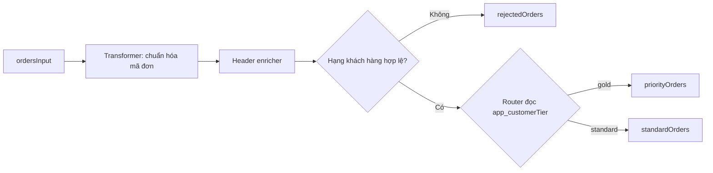

# MessageHeaders trong Spring Integration

## 1. Mục tiêu và ngữ cảnh

Trong chương **Message** của module **SPRING_INTEGRATION_CORE**, `MessageHeaders` là nơi chứa metadata đi cùng payload. Khi một luồng nhận đơn hàng, metadata có thể cho biết yêu cầu đến từ đâu, thuộc nhóm xử lý nào và cần phản hồi về channel nào. Các endpoint đọc những thông tin này để phối hợp mà không phải đưa toàn bộ chi tiết tích hợp vào đối tượng nghiệp vụ.

Sau bài học, bạn có thể:

- Đọc header có kiểm tra kiểu và phân biệt header bắt buộc với header tùy chọn.
- Tạo message có header mới bằng builder, giữ nguyên message đầu vào.
- Phân biệt ID của message, khóa nghiệp vụ và khóa tương quan.
- Dùng header enricher, transformer, filter và router trong Java DSL.
- Nhận biết tác động của header đến gateway, aggregator, xử lý lỗi và truyền dữ liệu ra hệ thống ngoài.
- Viết kiểm thử cho giá trị, kiểu và sự tồn tại của header tại các điểm trong luồng.

Các ví dụ sử dụng `spring-messaging`, `spring-integration-core` và JUnit Jupiter cho phần kiểm thử. Phiên bản thư viện cần được quản lý thống nhất trong dự án. Không cần broker, HTTP server hoặc cơ sở dữ liệu để thực hành luồng trong bài.

## 2. Payload mang dữ liệu, header cung cấp ngữ cảnh xử lý

Một message đơn giản có thể được nhìn như sau:

```text
Message<String>
├── payload: "ORD-1001"
└── headers
    ├── id: UUID do framework quản lý
    ├── timestamp: thời điểm tạo message, khi được cung cấp
    ├── app_requestId: "req-42"
    ├── app_customerTier: "gold"
    └── app_source: "checkout"
```

Trong ứng dụng thực tế, payload có thể là `Order` chứa mã đơn, các mặt hàng và tổng tiền. `app_requestId` giúp tìm các bước thuộc cùng một yêu cầu; `app_customerTier` giúp router chọn nhánh xử lý.

Việc đặt dữ liệu vào header là một lựa chọn thiết kế. Chẳng hạn, hạng khách hàng có thể đã thuộc đối tượng nghiệp vụ; khi router cần dùng, hệ thống có thể đưa một giá trị đã chuẩn hóa lên header. Cần xác định nguồn dữ liệu chính và tránh để payload nói `gold` trong khi header nói `standard`.

Một quy tắc hữu ích: dữ liệu cần để hiểu nội dung nghiệp vụ thuộc payload; metadata phục vụ vận chuyển, phối hợp hoặc quan sát luồng thường phù hợp với header. Khóa nghiệp vụ có thể xuất hiện ở cả hai nơi nếu có quy tắc đồng bộ rõ ràng.

## 3. Đọc `MessageHeaders` đúng kiểu

`org.springframework.messaging.MessageHeaders` cung cấp giao diện `Map<String, Object>`. Khóa là chuỗi; giá trị có thể có nhiều kiểu Java. Đây là abstraction của Spring Messaging, được Spring Integration sử dụng. Việc triển khai `Map` không có nghĩa ứng dụng được phép sửa map qua `put`, `remove` hoặc `clear`. [Javadoc MessageHeaders](https://docs.spring.io/spring-framework/docs/current/javadoc-api/org/springframework/messaging/MessageHeaders.html)

### 3.1. Ba cách đọc thường gặp

```java
import java.util.UUID;

import org.springframework.messaging.Message;
import org.springframework.messaging.MessageHeaders;

public class HeaderReader {

    public String describe(Message<?> message) {
        MessageHeaders headers = message.getHeaders();

        Object rawTier = headers.get("app_customerTier");
        String requestId = headers.get("app_requestId", String.class);
        UUID messageId = headers.getId();
        Long createdAt = headers.getTimestamp();

        return "messageId=" + messageId
                + ", requestId=" + requestId
                + ", tier=" + rawTier
                + ", createdAt=" + createdAt;
    }
}
```

- `get(name)` trả về `Object`, phù hợp khi bạn cần tự kiểm tra kiểu.
- `get(name, type)` kiểm tra giá trị hiện có có phù hợp với kiểu yêu cầu hay không.
- Getter như `getId()` hoặc `getTimestamp()` diễn đạt rõ ý nghĩa của header chuẩn.

Header không tồn tại trả về `null`. Khi giá trị có kiểu không phù hợp, getter có tham số kiểu ném `IllegalArgumentException`; nó không tự chuyển chuỗi `"3"` thành số `3`. Hợp đồng kiểu cần được thống nhất ở đầu vào. [API đọc header theo kiểu](https://docs.spring.io/spring-framework/docs/current/javadoc-api/org/springframework/messaging/MessageHeaders.html#get(java.lang.Object,java.lang.Class))

### 3.2. Kiểm tra header bắt buộc tại ranh giới

```java
import org.springframework.messaging.Message;

public class RequiredHeaders {

    public static String requireRequestId(Message<?> message) {
        String value = message.getHeaders()
                .get("app_requestId", String.class);

        if (value == null || value.isBlank()) {
            throw new IllegalArgumentException("Missing app_requestId");
        }
        return value;
    }
}
```

Nếu dữ liệu đến từ một transport có thể trả về `List<String>` hoặc kiểu số khác với hợp đồng nội bộ, hãy chuẩn hóa ở adapter hoặc một endpoint đầu luồng. Đẩy việc đoán kiểu xuống từng service làm lỗi xuất hiện muộn và khó xác định nguồn.

## 4. Bất biến của map không phải bất biến sâu

Đoạn mã sau không hợp lệ với `MessageHeaders` thông thường:

```java
message.getHeaders().put("app_source", "billing");
// UnsupportedOperationException
```

Khi muốn thay header, ứng dụng tạo một message kết quả. Tuy nhiên, việc không được thay cấu trúc map không ngăn một đối tượng mutable đang nằm trong header bị sửa:

```java
import java.util.ArrayList;
import java.util.List;

import org.springframework.messaging.Message;
import org.springframework.messaging.support.MessageBuilder;

List<String> labels = new ArrayList<>();
labels.add("created");

Message<String> message = MessageBuilder.withPayload("ORD-1001")
        .setHeader("app_labels", labels)
        .build();

labels.add("changed-after-build");

// Đối tượng List được tham chiếu trong header cũng đã thay đổi.
Object observed = message.getHeaders().get("app_labels");
```

Builder không cung cấp cơ chế deep copy tự động cho mọi đối tượng. Khi message được phát cho nhiều consumer, dùng chung một `ArrayList` rồi sửa tại một nhánh có thể làm nhánh khác quan sát trạng thái thay đổi. Đặc điểm này cũng áp dụng cho payload mutable. [Mô hình bất biến của Message](https://docs.spring.io/spring-integration/reference/message.html#message-headers)

Có thể tạo snapshot bất biến trước khi đưa giá trị vào header:

```java
Message<String> safeMessage = MessageBuilder.withPayload("ORD-1001")
        .setHeader("app_labels", List.copyOf(labels))
        .build();
```

`List.copyOf` bảo vệ cấu trúc danh sách. Nếu phần tử là một đối tượng mutable, chính phần tử ấy vẫn cần quy tắc quản lý riêng. Với metadata, các giá trị nhỏ và dễ kiểm soát như `String`, `Integer`, `Long`, `Boolean`, `UUID` thường thuận tiện hơn một đồ thị đối tượng phức tạp.

## 5. Các nhóm header cần nhận diện

### 5.1. Header chung của Spring Messaging

| Hằng số trong `MessageHeaders` | Khóa | Kiểu thường gặp | Ý nghĩa |
| --- | --- | --- | --- |
| `ID` | `id` | `UUID` | Định danh một message, do framework quản lý |
| `TIMESTAMP` | `timestamp` | `Long` | Thời điểm tạo message theo epoch milliseconds, khi có |
| `REPLY_CHANNEL` | `replyChannel` | `MessageChannel` hoặc `String` | Địa chỉ nhận phản hồi trong luồng hỗ trợ request/reply |
| `ERROR_CHANNEL` | `errorChannel` | `MessageChannel` hoặc `String` | Đích xử lý lỗi khi cơ chế phát error message sử dụng header này |
| `CONTENT_TYPE` | `contentType` | Thường là `MimeType` hoặc chuỗi MIME theo hợp đồng converter | Mô tả biểu diễn của nội dung |

Dùng hằng số thay cho chuỗi literal khi truy cập header chuẩn. Với `contentType`, giá trị header mô tả nội dung; nó không tự biến một POJO thành JSON nếu thiếu transformer hoặc converter phù hợp. [Các hằng số MessageHeaders](https://docs.spring.io/spring-framework/docs/current/javadoc-api/org/springframework/messaging/MessageHeaders.html)

### 5.2. Header thuộc Spring Integration

Các hằng số sau thuộc `org.springframework.integration.IntegrationMessageHeaderAccessor`:

| Hằng số | Khóa | Kiểu | Vai trò |
| --- | --- | --- | --- |
| `CORRELATION_ID` | `correlationId` | `Object` | Liên kết các message thuộc cùng một nhóm |
| `SEQUENCE_NUMBER` | `sequenceNumber` | `Integer` | Vị trí trong chuỗi, thường bắt đầu từ 1 |
| `SEQUENCE_SIZE` | `sequenceSize` | `Integer` | Kích thước chuỗi khi đã biết |
| `PRIORITY` | `priority` | `Integer` | Metadata ưu tiên cho thành phần có hỗ trợ |
| `EXPIRATION_DATE` | `expirationDate` | `Long` | Mốc hết hạn theo epoch milliseconds |
| `DUPLICATE_MESSAGE` | `duplicateMessage` | `Boolean` | Đánh dấu trùng theo cấu hình idempotent receiver |

Có thể đọc bằng hằng số:

```java
import org.springframework.integration.IntegrationMessageHeaderAccessor;

Object correlationId = message.getHeaders().get(
        IntegrationMessageHeaderAccessor.CORRELATION_ID);

Integer sequenceNumber = message.getHeaders().get(
        IntegrationMessageHeaderAccessor.SEQUENCE_NUMBER, Integer.class);
```

Sự tồn tại của header không tự kích hoạt hành vi. `priority` cần thành phần như `PriorityChannel`; `expirationDate` cần chính sách kiểm tra hết hạn; `duplicateMessage` cần cơ chế phát hiện và xử lý trùng. Một `DirectChannel` không tự sắp xếp message chỉ vì có header ưu tiên. [Header của Spring Integration](https://docs.spring.io/spring-integration/api/org/springframework/integration/IntegrationMessageHeaderAccessor.html), [Ý nghĩa expirationDate và priority](https://docs.spring.io/spring-integration/reference/message.html)

### 5.3. Header của ứng dụng và hợp đồng sử dụng

Tiền tố `app_` trong bài là quy ước minh họa của ứng dụng, không phải quy định của Spring.

| Header | Kiểu | Nguồn tạo | Chính sách trong ví dụ |
| --- | --- | --- | --- |
| `app_requestId` | `String` | Điểm nhận yêu cầu | Giữ xuyên suốt để tra cứu log |
| `app_customerTier` | `String` | Dữ liệu khách hàng đã được xác thực | Chỉ chấp nhận `gold` hoặc `standard` |
| `app_source` | `String` | Hệ thống gọi hoặc endpoint đầu luồng | Chỉ bổ sung nếu chưa có |
| `app_orderId` | `String` | Payload đã chuẩn hóa | Tính lại và ghi đè giá trị cũ |
| `app_internalToken` | `String` | Thành phần nội bộ, nếu thực sự cần | Loại bỏ trước ranh giới không được phép nhận |

Với mỗi header phục vụ quyết định nghiệp vụ, nên ghi rõ tên, kiểu, tính bắt buộc, nguồn đáng tin cậy và thành phần được phép ghi đè. Đừng coi một giá trị bên ngoài gửi lên là thông tin đã được xác thực chỉ vì nó có tên giống header nội bộ.

## 6. Tạo và thay header bằng `MessageBuilder`

Các đoạn mã dùng nhất quán builder của Spring Messaging:

```java
import org.springframework.messaging.support.MessageBuilder;
```

Spring Integration cũng có lớp `org.springframework.integration.support.MessageBuilder`. Hai lớp có nhiều phương thức tương tự nhưng không phải một lớp; kiểm tra import khi ví dụ hoặc dự án sử dụng API đặc thù.

### 6.1. Tạo message ban đầu

```java
import org.springframework.messaging.Message;
import org.springframework.messaging.support.MessageBuilder;

Message<String> original = MessageBuilder.withPayload("ORD-1001")
        .setHeader("app_requestId", "req-42")
        .setHeader("app_customerTier", "gold")
        .build();
```

### 6.2. Tạo kết quả có header thay đổi

```java
Message<String> enriched = MessageBuilder.fromMessage(original)
        .setHeader("app_source", "checkout")
        .setHeaderIfAbsent("app_customerTier", "standard")
        .build();
```

`enriched` có `app_source=checkout`, còn `app_customerTier` vẫn là `gold`. `original` không được bổ sung `app_source`. Việc sao chép header không tạo bản sao sâu của từng giá trị.

| Thao tác builder | Cách sử dụng |
| --- | --- |
| `setHeader(name, value)` | Gán hoặc ghi đè một header được phép sửa; giá trị `null` được dùng để bỏ header đó |
| `setHeaderIfAbsent(name, value)` | Bổ sung giá trị khi chưa có |
| `copyHeaders(map)` | Sao chép và có thể ghi đè các header cùng tên được phép sao chép |
| `copyHeadersIfAbsent(map)` | Sao chép khi builder chưa có giá trị tương ứng |
| `removeHeader(name)` | Bỏ một header được phép bỏ |
| `removeHeaders(patterns)` | Bỏ các header phù hợp tên hoặc pattern được hỗ trợ |

`id` và `timestamp` là các header đặc biệt do framework quản lý, không phải metadata nghiệp vụ để ứng dụng tùy ý gán lại. [API MessageBuilder](https://docs.spring.io/spring-framework/docs/current/javadoc-api/org/springframework/messaging/support/MessageBuilder.html), [Header chỉ đọc của Spring Integration](https://docs.spring.io/spring-integration/reference/message.html#read-only-headers)

Nếu thay payload, có thể mang theo header bằng builder mới:

```java
import java.util.Locale;

Message<String> normalized = MessageBuilder
        .withPayload(original.getPayload().toLowerCase(Locale.ROOT))
        .copyHeaders(original.getHeaders())
        .build();
```

Việc quyết định header nào còn đúng sau biến đổi thuộc trách nhiệm của luồng. Ví dụ, `contentType` mô tả XML không còn phù hợp khi payload đã chuyển sang một biểu diễn khác.

### 6.3. Phân biệt ba loại định danh

| Định danh | Ví dụ | Phạm vi |
| --- | --- | --- |
| Message ID | `MessageHeaders.ID` | Một message cụ thể |
| Khóa nghiệp vụ | `app_orderId=ORD-1001` | Đơn hàng qua nhiều sự kiện, nhiều lần xử lý |
| Khóa tương quan | `correlationId` hoặc khóa tương quan tùy chỉnh | Các message cần phối hợp thành một nhóm |

Với builder thông thường, khi tạo message kết quả có thay đổi, không nên kỳ vọng ID cũ được giữ lại; timestamp cũng phản ánh việc tạo message kết quả khi được sinh. Builder có thể trả lại message gốc nếu không có thay đổi, nên không khẳng định mọi lần gọi `build()` đều tạo ID mới. Getter timestamp cần được xử lý theo khả năng có `null` khi cơ chế tạo message không cung cấp nó.

Để nối log giữa nhiều bước, giữ một `app_requestId` theo hợp đồng ứng dụng. Để chống xử lý trùng nghiệp vụ, chọn khóa phản ánh thao tác nghiệp vụ, chẳng hạn `orderId + eventType + eventVersion`; không lấy message ID mới được tạo ở mỗi lần retry làm khóa chống trùng.

## 7. Bổ sung header trong Java DSL

Header enricher dành cho bước bổ sung hoặc tính metadata. Các đoạn dưới đây là phần nối bên trong một `IntegrationFlow`.

### 7.1. Giá trị cố định và chính sách ghi đè

```java
.enrichHeaders(headers -> headers
        .header("app_source", "checkout", false)
        .header("app_processingMode", "validated", true))
```

Ở đây `false` giữ `app_source` nếu đã có; `true` thay `app_processingMode` bằng giá trị của endpoint. Header enricher mặc định không ghi đè header đã tồn tại. Ghi rõ đối số giúp người đọc hiểu chính sách của từng header. [HeaderEnricher](https://docs.spring.io/spring-integration/api/org/springframework/integration/transformer/HeaderEnricher.html)

### 7.2. Giá trị tính từ message

Với payload là mã đơn đã chuẩn hóa:

```java
.enrichHeaders(headers -> headers
        .headerExpression("app_orderId", "payload", true))
```

`header` nhận một giá trị literal; `headerExpression` đánh giá biểu thức SpEL tại thời điểm xử lý. Viết `.header("app_orderId", "payload")` sẽ đưa chuỗi `"payload"` vào header. Trong biểu thức của header enricher, có thể truy cập `payload` và `headers`. [HeaderEnricherSpec](https://docs.spring.io/spring-integration/api/org/springframework/integration/dsl/HeaderEnricherSpec.html)

Nên dùng SpEL cho phép tính ngắn và rõ. Với logic cần gọi nhiều dịch vụ, kiểm tra quyền hoặc xử lý nhiều trường hợp lỗi, dùng một bean để giữ phần cấu hình luồng dễ đọc. [Cấu hình header enricher](https://docs.spring.io/spring-integration/reference/content-enrichment.html#header-enricher)

### 7.3. Loại bỏ header tạm thời

```java
.headerFilter("app_internalToken", "app_debugContext")
```

Header filter bỏ metadata khỏi message kết quả; nó không loại bỏ toàn bộ message. Ngược lại, message filter quyết định message có được đi tiếp hay không. Với pattern, cần kiểm tra đúng API và cấu hình của phiên bản sử dụng; không áp dụng một wildcard rộng khi vẫn cần giữ các header phục vụ request/reply. [Header Filter](https://docs.spring.io/spring-integration/reference/transformer.html#header-filter)

## 8. Header đi qua endpoint như thế nào?

Trong các endpoint chuẩn, kiểu kết quả của phương thức ảnh hưởng đến quy tắc truyền header:

| Endpoint và kết quả | Hành vi cần nhớ |
| --- | --- |
| Transformer trả payload | Framework tạo message kết quả và truyền các header đầu vào theo quy tắc của transformer |
| Transformer trả `Message<?>` | Phương thức chịu trách nhiệm chuẩn bị đầy đủ header cần giữ |
| Service activator trả payload | Framework đóng gói payload và truyền header từ request |
| Service activator trả `Message<?>` | Framework thường bổ sung header của request còn thiếu trong kết quả; header đã có ở kết quả được ưu tiên |

Vì vậy, chỉ bỏ một header khỏi message do service activator trả về chưa chắc khiến header đó biến mất khỏi luồng. Dùng header filter khi mục đích là loại bỏ metadata. [Quy tắc header của Service Activator](https://docs.spring.io/spring-integration/reference/service-activator.html#service-activator-and-method-return-type)

Ví dụ một transformer tự tạo `Message` cần giữ ngữ cảnh:

```java
import java.util.Locale;

import org.springframework.integration.annotation.Transformer;
import org.springframework.messaging.Message;
import org.springframework.messaging.support.MessageBuilder;

public class OrderIdTransformer {

    @Transformer
    public Message<String> normalize(Message<String> input) {
        String output = input.getPayload().trim()
                .toUpperCase(Locale.ROOT);

        return MessageBuilder.withPayload(output)
                .copyHeaders(input.getHeaders())
                .setHeader("app_normalized", true)
                .build();
    }
}
```

Đây là phương thức xử lý có thể được đăng ký trong flow. Annotation riêng lẻ không tạo thành một ứng dụng đang chạy nếu lớp chưa được đăng ký và kết nối với các channel. Khi transformer trả message mới mà quên sao chép `replyChannel` hoặc `errorChannel`, ngữ cảnh cần cho các bước sau có thể bị mất. [Transformer và header của message kết quả](https://docs.spring.io/spring-integration/reference/transformer.html)

### Đọc header qua tham số phương thức

Một phương thức được endpoint gọi còn có thể khai báo:

```java
import org.springframework.messaging.handler.annotation.Header;

public class ReceiptService {

    public String createReceipt(
            String orderId,
            @Header("app_requestId") String requestId,
            @Header(value = "app_source", required = false) String source) {

        return orderId + ":" + requestId + ":"
                + (source == null ? "unknown" : source);
    }
}
```

`@Header` mặc định yêu cầu header tồn tại. Header tùy chọn dùng `required=false` và tham số cần chấp nhận `null`; tránh dùng primitive nếu muốn biểu diễn trạng thái không có giá trị. Đây là cơ chế binding của endpoint, khác với việc gọi trực tiếp getter trên `MessageHeaders`. [Javadoc @Header](https://docs.spring.io/spring-framework/docs/current/javadoc-api/org/springframework/messaging/handler/annotation/Header.html)

## 9. Thực hành: định tuyến đơn hàng bằng header

### 9.1. Yêu cầu của luồng

Đầu vào là mã đơn dạng chuỗi. Luồng chuẩn hóa mã, tạo metadata rồi chọn một trong ba đích:

- `gold`: chuyển vào `priorityOrders`.
- `standard`: chuyển vào `standardOrders`.
- Thiếu hoặc sai `app_customerTier`: chuyển vào `rejectedOrders` qua discard channel của filter.

Tên `priorityOrders` chỉ mô tả nhánh nghiệp vụ; channel này là `QueueChannel` thường, không thực hiện sắp xếp theo header `priority`.



### 9.2. Cấu hình đầy đủ

```java
import java.util.Locale;

import org.springframework.context.annotation.Bean;
import org.springframework.context.annotation.Configuration;
import org.springframework.integration.channel.DirectChannel;
import org.springframework.integration.channel.QueueChannel;
import org.springframework.integration.config.EnableIntegration;
import org.springframework.integration.dsl.IntegrationFlow;

@Configuration
@EnableIntegration
public class OrderHeadersConfig {

    @Bean
    public DirectChannel ordersInput() {
        return new DirectChannel();
    }

    @Bean
    public QueueChannel priorityOrders() {
        return new QueueChannel();
    }

    @Bean
    public QueueChannel standardOrders() {
        return new QueueChannel();
    }

    @Bean
    public QueueChannel rejectedOrders() {
        return new QueueChannel();
    }

    @Bean
    public IntegrationFlow orderHeadersFlow() {
        return IntegrationFlow.from("ordersInput")
                .transform(String.class,
                        value -> value.trim().toUpperCase(Locale.ROOT))
                .enrichHeaders(headers -> headers
                        .header("app_source", "checkout", false)
                        .headerExpression("app_orderId", "payload", true))
                .filter(
                        "headers['app_customerTier'] == 'gold' "
                                + "or headers['app_customerTier'] == 'standard'",
                        spec -> spec.discardChannel("rejectedOrders"))
                .route("headers['app_customerTier']", spec -> spec
                        .channelMapping("gold", "priorityOrders")
                        .channelMapping("standard", "standardOrders"))
                .get();
    }
}
```

Ở cấu hình này, `DirectChannel` gọi các endpoint trên thread gửi. Ba `QueueChannel` là nơi lưu kết quả để nhận trong kiểm thử; không có endpoint đang poll các queue này nên không cần cấu hình poller.

Header `app_orderId` được tính sau bước chuẩn hóa, vì vậy nó khớp payload kết quả. `app_source` có chính sách giữ giá trị đã có, giúp bảo toàn nguồn gọi đã được hệ thống tin cậy thiết lập.

Bước filter kiểm tra trước router để giá trị không được hỗ trợ đi vào một đích rõ ràng. Với ứng dụng thật, việc kiểm tra mã đơn rỗng, quyền khách hàng và giới hạn dữ liệu cần được bổ sung theo hợp đồng nghiệp vụ.

### 9.3. Kiểm thử giá trị và sự bảo toàn header

Đặt lớp cấu hình và lớp kiểm thử dưới đây trong cùng package, hoặc import lớp cấu hình theo package của dự án. Kiểm thử dùng JUnit Jupiter và khởi tạo Spring context trực tiếp.

```java
import org.junit.jupiter.api.Test;
import org.springframework.context.annotation.AnnotationConfigApplicationContext;
import org.springframework.integration.channel.QueueChannel;
import org.springframework.messaging.Message;
import org.springframework.messaging.MessageChannel;
import org.springframework.messaging.support.MessageBuilder;

import static org.junit.jupiter.api.Assertions.*;

public class OrderHeadersTest {

    @Test
    void routesGoldAndKeepsRequestContext() {
        try (AnnotationConfigApplicationContext context =
                     new AnnotationConfigApplicationContext(
                             OrderHeadersConfig.class)) {

            MessageChannel input = context.getBean(
                    "ordersInput", MessageChannel.class);
            QueueChannel priority = context.getBean(
                    "priorityOrders", QueueChannel.class);
            QueueChannel standard = context.getBean(
                    "standardOrders", QueueChannel.class);
            QueueChannel rejected = context.getBean(
                    "rejectedOrders", QueueChannel.class);

            Message<String> request = MessageBuilder
                    .withPayload(" ord-1001 ")
                    .setHeader("app_requestId", "req-42")
                    .setHeader("app_customerTier", "gold")
                    .setHeader("app_orderId", "legacy-value")
                    .build();

            assertTrue(input.send(request));
            Message<?> result = priority.receive(1000);

            assertNotNull(result);
            assertEquals("ORD-1001", result.getPayload());
            assertEquals("ORD-1001", result.getHeaders()
                    .get("app_orderId", String.class));
            assertEquals("req-42", result.getHeaders()
                    .get("app_requestId", String.class));
            assertEquals("checkout", result.getHeaders()
                    .get("app_source", String.class));
            assertEquals("gold", result.getHeaders()
                    .get("app_customerTier", String.class));

            assertEquals(" ord-1001 ", request.getPayload());
            assertEquals("legacy-value", request.getHeaders()
                    .get("app_orderId", String.class));
            assertFalse(request.getHeaders().containsKey("app_source"));

            assertNull(standard.receive(0));
            assertNull(rejected.receive(0));
        }
    }
}
```

Kiểm thử nhắm vào hợp đồng quan sát được: đúng nhánh, đúng metadata, ghi đè đúng header và giữ nguyên đầu vào. Không cần cố định UUID hoặc so timestamp phải tăng, vì hai message có thể được tạo trong cùng một millisecond.

Mở rộng thực hành với các trường hợp sau:

| Đầu vào | Kết quả mong đợi |
| --- | --- |
| `app_customerTier=standard` | Chỉ nhận ở `standardOrders` |
| Thiếu `app_customerTier` | Nhận ở `rejectedOrders` |
| `app_customerTier=bronze` | Nhận ở `rejectedOrders` |
| Có sẵn `app_source=mobile` | Kết quả vẫn có `mobile` |
| Có sẵn `app_orderId` sai | Kết quả dùng mã đã chuẩn hóa từ payload |
| Đọc một header số dưới dạng `String` bằng typed getter | Phát hiện sai kiểu thay vì âm thầm đổi kiểu |

## 10. `replyChannel` và gateway

Trong request/reply, `replyChannel` cho endpoint biết gửi kết quả về đâu khi không có output channel tường minh và không còn đích routing slip cần dùng. Gateway có thể tạo một reply channel tạm thời để nối kết quả về lời gọi phương thức. Giá trị header này không phải lúc nào cũng là tên bean; nó có thể là đối tượng channel. [Quy tắc replyChannel](https://docs.spring.io/spring-integration/reference/message.html)

Có thể quan sát cơ chế ấy mà chưa cần khai báo interface gateway. Trong một cấu hình có `@EnableIntegration`, thêm flow:

```java
@Bean
public DirectChannel receiptInput() {
    return new DirectChannel();
}

@Bean
public IntegrationFlow receiptFlow() {
    return IntegrationFlow.from("receiptInput")
            .handle(String.class,
                    (orderId, headers) -> "ACCEPTED:" + orderId)
            .get();
}
```

Và gửi request có địa chỉ trả lời:

```java
QueueChannel replies = new QueueChannel();

Message<String> request = MessageBuilder.withPayload("ORD-1001")
        .setReplyChannel(replies)
        .build();

// receiptInput là bean DirectChannel ở cấu hình trên.
receiptInput.send(request);
Message<?> reply = replies.receive(1000);
// Payload mong đợi: "ACCEPTED:ORD-1001"
```

Ở đây không có output channel sau service activator, nên reply đi về channel trong header. Khi flow đã có một đích output tường minh, không giả định reply cũng được tự động gửi thêm về header.

Nếu một transformer ở giữa dựng message mới và làm mất `replyChannel`, gateway có thể không nhận được kết quả như mong đợi hoặc xuất hiện lỗi không xác định được đích trả lời. Khi gỡ lỗi request/reply, kiểm tra header ngay trước endpoint tạo phản hồi.

## 11. Correlation và sequence trong splitter–aggregator

Giả sử một đơn có ba dòng hàng. Splitter chuẩn thường tạo các message con với cùng correlation ID và metadata sequence để aggregator mặc định xác định nhóm và thời điểm đủ phần tử.

| Payload message con | `correlationId` minh họa | `sequenceNumber` | `sequenceSize` |
| --- | --- | --- | --- |
| Dòng hàng A | C | 1 | 3 |
| Dòng hàng B | C | 2 | 3 |
| Dòng hàng C | C | 3 | 3 |

`C` là ký hiệu cho khóa nhóm, không phải khuyến nghị dùng chuỗi cố định. Trong luồng tách tiêu chuẩn, khóa tương quan thường gắn với ID của message được tách; không tự giả định nó là mã đơn nghiệp vụ.

Aggregator mặc định dựa vào correlation header và sequence để gom, đồng thời chờ đủ nhóm theo release strategy của nó. Nếu thêm một filter loại dòng hàng B trước aggregator, nhóm vẫn có thể kỳ vọng ba phần tử nhưng chỉ nhận hai. Luồng cần một thiết kế tương ứng: lọc trước khi tách khi phù hợp, dùng release strategy khác, gửi thông tin bù hoặc cấu hình timeout và chính sách kết quả thiếu. [Aggregator và filter trước bước gom nhóm](https://docs.spring.io/spring-integration/reference/aggregator.html)

Khi tự tính khóa nhóm từ nghiệp vụ, bảo đảm khóa phân biệt đúng phạm vi. Hai khách hàng khác nhau cùng có mã đơn `1001` không nên bị gom chung nếu chúng thuộc hai tenant. Một khóa kết hợp như `tenantId + orderId + batchId` có thể thích hợp hơn, tùy mô hình dữ liệu.

Đừng ghi đè `correlationId`, `sequenceNumber` hoặc `sequenceSize` chỉ để tiện ghi log trong một đoạn đang sử dụng splitter–aggregator. Dùng header ứng dụng riêng cho nhu cầu quan sát.

## 12. `errorChannel` và ngữ cảnh lỗi

`errorChannel` chỉ có tác dụng khi thành phần xử lý lỗi đang dùng cơ chế phát error message. Với flow đồng bộ qua `DirectChannel`, lỗi xử lý thường ném ngược về thread gọi `send`; việc gán header `errorChannel` không tự biến mọi exception thành thông điệp lỗi. Với xử lý bất đồng bộ hoặc poller có cơ chế phát lỗi tương ứng, framework có thể gửi `ErrorMessage` đến đích trong header, hoặc đích lỗi mặc định nếu phù hợp cấu hình. [Error Handling](https://docs.spring.io/spring-integration/reference/error-handling.html)

Ví dụ khai báo đích lỗi bằng tên channel:

```java
Message<String> request = MessageBuilder.withPayload("ORD-1001")
        .setHeader("app_requestId", "req-42")
        .setErrorChannelName("orderErrors")
        .build();
```

`orderErrors` phải phân giải được trong ngữ cảnh sử dụng. Luồng vẫn cần cơ chế bắt và phát lỗi thích hợp; đoạn builder chỉ bổ sung metadata.

Payload của `ErrorMessage` là một `Throwable`. Khi lỗi là `MessagingException` và có failed message, có thể lấy ngữ cảnh nghiệp vụ từ message bị lỗi:

```java
import org.springframework.messaging.Message;
import org.springframework.messaging.MessagingException;
import org.springframework.messaging.support.ErrorMessage;

public class FailureContextReader {

    public String requestIdOf(ErrorMessage error) {
        Throwable cause = error.getPayload();

        if (cause instanceof MessagingException) {
            Message<?> failed = ((MessagingException) cause)
                    .getFailedMessage();
            if (failed != null) {
                return failed.getHeaders()
                        .get("app_requestId", String.class);
            }
        }
        return null;
    }
}
```

Đây là một trường hợp đọc ngữ cảnh thường gặp, không bao phủ mọi cách đóng gói lỗi. Nếu exception được bọc nhiều lớp, cần kiểm tra chuỗi nguyên nhân phù hợp. Không mặc định rằng mọi header của message gốc sẽ được sao chép thành header trực tiếp của `ErrorMessage`.

## 13. Khi header đi qua transport hoặc message store

Header trong bộ nhớ chấp nhận đối tượng Java không đồng nghĩa đối tượng ấy có thể truyền qua mọi giao thức. Ranh giới HTTP, JMS, AMQP hoặc Kafka có quy tắc ánh xạ và tập kiểu hỗ trợ riêng.

Chẳng hạn, một HTTP header có thể đi vào Spring Messaging dưới dạng danh sách giá trị, trong khi logic nội bộ mong `String`. Cần xác định header mapper, tập header được truyền và bước chuyển kiểu. Đừng giả định mọi custom header sẽ tự xuất hiện nguyên tên, nguyên kiểu ở hệ thống bên kia. [HTTP Header Mappings](https://docs.spring.io/spring-integration/reference/http/header-mapping.html)

Với message store, cách lưu phụ thuộc serializer và implementation. Một số store có thể bỏ header không serialize được; object channel trong `replyChannel` cũng không phải địa chỉ có thể phục hồi tùy ý ở một process khác. [Message Store và khả năng serialize header](https://docs.spring.io/spring-integration/reference/message-store.html)

Spring Integration cung cấp `HeaderChannelRegistry` và hỗ trợ chuyển channel header thành chuỗi tham chiếu. Cơ chế này dùng một registry với vòng đời đăng ký; chuỗi đó không tự trở thành địa chỉ phản hồi bền vững trên mọi node hoặc sau khi khởi động lại. Với luồng cần phục hồi qua restart, hãy thiết kế đích phản hồi và correlation ở cấp hệ thống. [Header enricher và channel registry](https://docs.spring.io/spring-integration/reference/content-enrichment.html#header-enricher)

Ở ranh giới hệ thống, một hợp đồng header nên quy định:

- Những tên được phép gửi hoặc nhận.
- Kiểu nội bộ, kiểu trên transport và quy tắc chuyển đổi.
- Header chỉ có ý nghĩa trong process và không nên gửi ra ngoài.
- Trường dữ liệu cần che khi log hoặc bỏ khỏi message trước bước tiếp theo.

Ghi log có chọn lọc như `messageId`, `app_requestId` và mã đơn cần thiết giúp tra cứu dễ hơn việc in toàn bộ map, đồng thời tránh đưa token hoặc dữ liệu khách hàng vào log.

## 14. Các lỗi thường gặp và hướng kiểm tra

| Hiện tượng | Nguyên nhân cần kiểm tra | Cách xử lý |
| --- | --- | --- |
| `UnsupportedOperationException` khi gán header | Sửa trực tiếp `MessageHeaders` | Dùng builder hoặc header enricher |
| Typed getter ném `IllegalArgumentException` | Giá trị thực tế khác kiểu mong đợi | Kiểm tra và chuẩn hóa tại đầu luồng |
| Header vẫn giữ giá trị cũ sau enricher | Chính sách không ghi đè đang được dùng | Đặt `overwrite=true` cho header cần tính lại |
| Header biến mất sau transformer | Transformer trả message mới không giữ metadata cần thiết | Sao chép có chủ đích hoặc để transformer trả payload |
| Header đã bỏ lại xuất hiện sau service activator | Header request được bổ sung vào reply | Dùng header filter sau endpoint |
| Gateway không nhận phản hồi | Mất hoặc thay sai `replyChannel`; sai đích output | Quan sát header và đích gửi ở endpoint trả kết quả |
| Aggregator chờ mãi | Sai khóa nhóm, sai sequence hoặc có phần tử bị loại | Kiểm tra correlation và release strategy cùng chính sách timeout |
| Gán ưu tiên nhưng thứ tự không đổi | Channel hiện tại không xử lý priority | Chọn channel hỗ trợ và kiểm tra mô hình gửi/nhận |
| Header có trong JVM nhưng mất sau lưu hoặc truyền | Mapper hoặc serializer không hỗ trợ | Kiểm tra hợp đồng transport và store |
| Các nhánh thấy metadata thay đổi ngoài dự kiến | Dùng chung giá trị header mutable | Tạo snapshot và hạn chế thay đổi đối tượng được chia sẻ |

Khi kiểm tra một flow, theo dõi cùng `app_requestId` qua các endpoint và quan sát riêng những header mà mỗi bước sở hữu. Với mỗi biến đổi, cần biết giá trị nào được thêm, giữ, ghi đè hoặc bỏ. Cách này giúp phát hiện sai lệch ngay tại điểm xuất hiện thay vì chỉ thấy hậu quả ở router, gateway hoặc aggregator cuối luồng.
