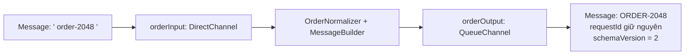

# MessageBuilder

## 1. Mục tiêu và vai trò trong Spring Integration Core

Trong một luồng tích hợp, dữ liệu nghiệp vụ thường cần đi cùng thông tin như mã yêu cầu, nguồn tiếp nhận, phiên bản dữ liệu hoặc kênh nhận phản hồi. `MessageBuilder` giúp đóng gói những dữ liệu đó thành `Message<T>` và tạo message kế tiếp khi một bước xử lý cần thay đổi payload hoặc header.

Sau bài học, bạn có thể:

- Chọn đúng `MessageBuilder` của Spring Integration và phân biệt với lớp cùng tên của Spring Framework.
- Tạo message từ payload hoặc từ message có sẵn; xác định quy tắc ghi đè header.
- Giải thích vì sao sao chép message không đồng nghĩa sao chép sâu payload.
- Giữ đúng metadata khi viết transformer, kết nối Java DSL và chuẩn bị message cho aggregator.
- Kiểm thử payload, header và tính độc lập của cấu trúc message.

Ví dụ sử dụng Java 17 trở lên và các API thuộc Spring Integration 6.4.x. Đây là mốc minh họa cho bài học, không phải thông tin phiên bản của dự án hiện tại. Ví dụ chạy luồng cần `spring-integration-core` cùng các phụ thuộc Spring được quản lý phiên bản tương thích; phần kiểm thử dùng JUnit Jupiter.

## 2. MessageBuilder tạo cái gì?

Có thể hình dung một message gồm hai phần:

```text
Message<T>
├── payload: T                 dữ liệu cần xử lý
└── headers: MessageHeaders    metadata dưới dạng tên → giá trị
```

`Message<T>` cung cấp `getPayload()` và `getHeaders()`. Với message thông thường được tạo bởi builder, muốn đổi dữ liệu bao ngoài, ta xây dựng một kết quả khác thay vì sửa message đã gửi. Điều này giúp các endpoint không vô tình thay cấu trúc message mà endpoint khác đang dùng.

`MessageBuilder<T>` là công cụ chuẩn bị message. Nó không gửi message, không tạo endpoint và không đăng ký luồng. Sau `build()`, việc chuyển message cho bước tiếp theo thuộc về `MessageChannel`, gateway hoặc endpoint đang xử lý.

### Hai lớp có cùng tên

| Lớp | Phạm vi sử dụng | Điểm cần nhớ |
| --- | --- | --- |
| `org.springframework.messaging.support.MessageBuilder` | Abstraction messaging của Spring Framework | Tạo message và thao tác header chung. |
| `org.springframework.integration.support.MessageBuilder` | Spring Integration | Có thêm các phương thức thuận tiện như `setCorrelationId`, `setSequenceNumber`, `setSequenceSize`, `setPriority`. |

Bài này thống nhất dùng import:

```java
import org.springframework.integration.support.MessageBuilder;
import org.springframework.messaging.Message;
```

IDE có thể tự chọn import của Spring Framework. Khi `setCorrelationId()` không được nhận diện, hãy kiểm tra package trước khi đổi thiết kế. Cả hai lớp đều làm việc với `org.springframework.messaging.Message`; sự khác biệt nằm ở API của builder. Xem [Javadoc MessageBuilder của Spring Integration](https://docs.spring.io/spring-integration/docs/6.4.9/api/org/springframework/integration/support/MessageBuilder.html) và [Javadoc của Spring Framework](https://docs.spring.io/spring-framework/docs/6.2.12/javadoc-api/org/springframework/messaging/support/MessageBuilder.html).

## 3. Hai điểm bắt đầu: withPayload và fromMessage

### 3.1. Tạo message đầu tiên bằng withPayload

```java
import org.springframework.integration.support.MessageBuilder;
import org.springframework.messaging.Message;

Message<String> request = MessageBuilder
        .withPayload("order-2048")
        .setHeader("sourceSystem", "web-store")
        .setHeader("requestId", "req-8701")
        .setHeader("schemaVersion", 1)
        .build();

String orderId = request.getPayload();
String source = request.getHeaders().get("sourceSystem", String.class);
Integer version = request.getHeaders().get("schemaVersion", Integer.class);
```

`withPayload("order-2048")` xác định kiểu payload là `String`, nên kết quả là `Message<String>`. Giá trị header có thể thuộc các kiểu khác nhau; truy xuất bằng `get(name, Class)` giúp thể hiện kiểu mà mã xử lý mong đợi.

Payload phải khác `null`. Nếu không có kết quả nghiệp vụ, hãy diễn đạt tình huống đó ở hợp đồng của endpoint hoặc bằng một kiểu dữ liệu phù hợp. Không dùng `withPayload(null)` để thay cho quyết định có phát message hay không.

### 3.2. Giữ payload, thay header bằng fromMessage

```java
Message<String> audited = MessageBuilder
        .fromMessage(request)
        .setHeader("audited", true)
        .build();

// request không tự có header "audited".
// audited có cùng payload và bổ sung metadata của bước kiểm tra.
```

`fromMessage(request)` lấy payload và header hiện có làm điểm xuất phát. Thao tác tiếp theo trên builder không sửa map header của `request`.

Nếu bạn cần một kết quả có payload thuộc kiểu khác, hãy bắt đầu lại bằng `withPayload(newPayload)` rồi chọn header cần chuyển tiếp. Builder được tạo từ `Message<String>` không phải công cụ đổi payload thành một kiểu bất kỳ.

### 3.3. Đổi payload, giữ metadata cần thiết

```java
Message<Integer> lengthMessage = MessageBuilder
        .withPayload(request.getPayload().length())
        .copyHeaders(request.getHeaders())
        .setHeader("operation", "measure-order-id")
        .build();
```

Kết quả có payload kiểu `Integer`. Các header thông thường như `requestId` và `sourceSystem` được chuyển tiếp. Trong một bài toán khác, payload đổi từ JSON sang một đối tượng nghiệp vụ có thể khiến `contentType` hoặc metadata định dạng cũ không còn đúng; chính sách header phải đi cùng phép biến đổi dữ liệu.

## 4. Đặt, sao chép và xóa header

### 4.1. Các thao tác thường dùng

| Phương thức | Tác dụng với header thông thường | Khi nên dùng |
| --- | --- | --- |
| `setHeader(name, value)` | Đặt hoặc ghi đè giá trị; `null` có nghĩa xóa header. | Endpoint có trách nhiệm xác định giá trị cuối. |
| `setHeaderIfAbsent(name, value)` | Chỉ đặt khi chưa có giá trị. | Bổ sung mặc định, giữ lựa chọn đã có. |
| `copyHeaders(map)` | Sao chép và ghi đè giá trị trùng tên. | Nguồn sao chép có quyền ưu tiên. |
| `copyHeadersIfAbsent(map)` | Chỉ sao chép tên còn thiếu. | Nguồn sao chép cung cấp giá trị dự phòng. |
| `removeHeader(name)` | Xóa một header thông thường theo tên. | Bỏ metadata không còn phù hợp. |
| `removeHeaders(patterns...)` | Xóa theo các mẫu tên đơn giản, ví dụ `tmp_*`. | Dọn một nhóm header có cùng quy ước đặt tên. |

Những quy tắc này không cho phép ghi đè các header hệ thống chỉ đọc như `id` và `timestamp`. Mẫu của `removeHeaders` là mẫu tên đơn giản có `*`, không phải biểu thức chính quy. Chi tiết thao tác nằm trong [mã nguồn BaseMessageBuilder 6.4.9](https://raw.githubusercontent.com/spring-projects/spring-integration/v6.4.9/spring-integration-core/src/main/java/org/springframework/integration/support/BaseMessageBuilder.java).

### 4.2. Thứ tự thao tác quyết định giá trị cuối

```java
import java.util.Map;
import org.springframework.integration.support.MessageBuilder;
import org.springframework.messaging.Message;

Map<String, Object> defaults = Map.of(
        "region", "VN",
        "schemaVersion", 1);

Message<String> first = MessageBuilder.withPayload("order-2048")
        .setHeader("region", "SG")
        .copyHeaders(defaults)
        .build();
// region = "VN": copyHeaders ghi đè giá trị trước đó.

Message<String> second = MessageBuilder.withPayload("order-2048")
        .setHeader("region", "SG")
        .copyHeadersIfAbsent(defaults)
        .build();
// region = "SG", schemaVersion = 1.

Message<String> third = MessageBuilder.withPayload("order-2048")
        .copyHeaders(defaults)
        .setHeader("region", "SG")
        .build();
// region = "SG": lệnh setHeader sau cùng quyết định.
```

Một quy ước thực hành dễ đọc là sao chép ngữ cảnh đầu vào trước, sau đó đặt rõ những header mà endpoint sở hữu. Nếu một giá trị chỉ là mặc định, dùng phương thức có hậu tố `IfAbsent` để thể hiện ý định.

### 4.3. Xóa header theo chủ đích

```java
Message<String> cleaned = MessageBuilder.fromMessage(request)
        .removeHeader("debugToken")
        .removeHeaders("tmp_*", "debug_*")
        .setHeader("obsoleteFlag", null)
        .build();
```

Danh sách loại bỏ cần phù hợp với hợp đồng của luồng. Xóa toàn bộ header có thể làm mất `replyChannel`, thông tin correlation hoặc metadata mà adapter phía sau cần. Ở ranh giới gửi dữ liệu ra hệ thống ngoài, có thể xây dựng một message mới và chỉ đặt các header nằm trong hợp đồng trao đổi.

## 5. Bất biến của message và giới hạn của sao chép

Đối với message thông thường trong bài, cấu trúc headers được bảo vệ sau khi xây dựng:

```java
// Không dùng để cập nhật metadata:
request.getHeaders().put("audited", true);
// Ném UnsupportedOperationException.
```

Tuy nhiên, đối tượng mà payload hoặc giá trị header trỏ tới có thể vẫn sửa được. Builder không tự sao chép sâu các đối tượng nghiệp vụ. Tài liệu [Message và MessageHeaders](https://docs.spring.io/spring-integration/reference/6.4/message.html) phân biệt rõ tính bất biến của lớp bao với tính thay đổi được của dữ liệu bên trong.

```java
import java.util.ArrayList;
import java.util.List;
import org.springframework.integration.support.MessageBuilder;
import org.springframework.messaging.Message;

List<String> items = new ArrayList<>(List.of("SKU-10"));

Message<List<String>> original = MessageBuilder
        .withPayload(items)
        .build();

Message<List<String>> branch = MessageBuilder.fromMessage(original)
        .setHeader("branch", "inventory")
        .build();

items.add("SKU-20");

// Cả original và branch đều nhìn thấy hai phần tử.
// original.getPayload() == branch.getPayload() là true.
```

Nếu hai nhánh cùng xử lý `items`, một nhánh sửa danh sách có thể ảnh hưởng nhánh còn lại. Trong tình huống này, có thể dùng `List.copyOf(items)` khi xây dựng message; cần nhớ các phần tử bên trong danh sách vẫn cần có chính sách bất biến riêng.

Với DTO, ưu tiên giá trị không thay đổi sau khi phát message. Một `record` có trường là `List` cũng chưa tự làm danh sách đó bất biến. Với header chứa một `Map`, yêu cầu tương tự áp dụng cho map và các giá trị lồng bên trong.

Builder có trạng thái trong quá trình chuẩn bị dữ liệu. Hãy tạo builder cục bộ cho từng thao tác, tránh giữ một builder dùng chung trong singleton hoặc chia sẻ nó giữa các luồng.

## 6. Message ID, timestamp và định danh nghiệp vụ

`MessageHeaders.ID` và `MessageHeaders.TIMESTAMP` là metadata kỹ thuật được framework quản lý. Với cấu hình mặc định, một message mới thực sự được tạo sẽ nhận ID và thời điểm tạo tương ứng; `copyHeaders` không phải cách ép nó dùng lại ID cũ.

Cần tách ba loại định danh trong thiết kế:

| Định danh | Ví dụ | Mục đích |
| --- | --- | --- |
| Message ID | Giá trị `MessageHeaders.ID` | Nhận diện một message kỹ thuật. |
| Mã nghiệp vụ | `orderId = order-2048` | Nhận diện đơn hàng xuyên suốt vòng đời nghiệp vụ. |
| Mã yêu cầu hoặc mã nhóm | `requestId`, `correlationId` | Theo dõi một yêu cầu hoặc liên hệ các message theo quy ước của luồng. |

Không dùng Message ID thay cho khóa nghiệp vụ cần ổn định qua nhiều phép biến đổi. Tương tự, `correlationId` dùng cho nhóm aggregator không tự thay thế hệ thống tracing.

Cũng không nên khẳng định mọi lần gọi `build()` đều cấp phát một message khác. Trong triển khai mặc định, `fromMessage(existing).build()` có thể trả lại message gốc nếu không có thay đổi và không cần xử lý các header chỉ đọc tùy chỉnh. Vì vậy, chỉ dùng `fromMessage(...).build()` để ép tạo bản sao là một giả định sai; xem [triển khai build trong BaseMessageBuilder](https://docs.spring.io/spring-integration/api/org/springframework/integration/support/BaseMessageBuilder.html).

Trong kiểm thử, khi đổi một header thành giá trị thực sự mới, có thể kiểm tra message gốc vẫn giữ giá trị cũ. Không yêu cầu timestamp đầu ra phải lớn hơn timestamp đầu vào: hai message có thể được tạo trong cùng một mili giây.

## 7. Header điều khiển luồng

### 7.1. replyChannel và errorChannel

```java
import org.springframework.integration.channel.QueueChannel;
import org.springframework.integration.support.MessageBuilder;
import org.springframework.messaging.Message;

QueueChannel replies = new QueueChannel();
QueueChannel failures = new QueueChannel();

Message<String> command = MessageBuilder.withPayload("order-2048")
        .setReplyChannel(replies)
        .setErrorChannel(failures)
        .setHeader("requestId", "req-8701")
        .build();
```

Đoạn mã mới chuẩn bị message và metadata điều khiển. Nó chưa gửi message và chưa tạo consumer cho hai queue.

`replyChannel` có thể được endpoint tạo phản hồi sử dụng khi không có cấu hình đầu ra tường minh phù hợp. `errorChannel` cung cấp đích cho cơ chế xuất bản lỗi của framework. Chỉ đặt header này không tự biến mọi exception thành message lỗi.

Ví dụ, handler chạy đồng bộ qua `DirectChannel` thường ném lỗi về bên gọi. Với xử lý bất đồng bộ hoặc poller có cơ chế xuất bản lỗi, framework có thể gửi `ErrorMessage` tới kênh lỗi. Hành vi cụ thể phụ thuộc endpoint và cấu hình xử lý lỗi; xem [Error Handling](https://docs.spring.io/spring-integration/reference/6.4/error-handling.html).

Trong một JVM, header có thể chứa tham chiếu `MessageChannel`. Khi đi qua broker hoặc ranh giới tiến trình, không giả định tham chiếu này có thể được tuần tự hóa và dùng trực tiếp ở nơi nhận. Việc ánh xạ header và cơ chế phản hồi phải được thiết kế cho giao thức tương ứng.

### 7.2. Correlation và sequence cho aggregator

```java
import java.util.UUID;
import org.springframework.integration.support.MessageBuilder;
import org.springframework.messaging.Message;

String groupId = "order-2048:" + UUID.randomUUID();

Message<String> itemOne = MessageBuilder.withPayload("SKU-10")
        .setCorrelationId(groupId)
        .setSequenceNumber(1)
        .setSequenceSize(2)
        .build();

Message<String> itemTwo = MessageBuilder.withPayload("SKU-20")
        .setCorrelationId(groupId)
        .setSequenceNumber(2)
        .setSequenceSize(2)
        .build();
```

Hai message thuộc cùng một lần xử lý nhóm; số thứ tự bắt đầu từ 1 và kích thước nhóm dự kiến là 2. Hậu tố ngẫu nhiên trong ví dụ giúp phân biệt các lần xử lý cùng một đơn hàng.

Với aggregator mặc định, `correlationId` được dùng để gom nhóm và thông tin kích thước sequence hỗ trợ quyết định giải phóng nhóm. Đoạn mã trên chỉ chuẩn bị đầu vào; vẫn phải có aggregator endpoint và cấu hình phù hợp. Một splitter thường có thể tạo metadata sequence giúp bạn, nên không cần tự gán lại nếu luồng đã làm đúng việc này. Xem [Aggregator: correlation và release](https://docs.spring.io/spring-integration/reference/6.4/aggregator.html).

Nếu filter loại một phần tử sau khi sequence được tạo mà điều kiện release vẫn đợi đủ nhóm ban đầu, nhóm có thể không hoàn thành. Khi thiết kế, cần làm rõ cách xử lý phần tử bị loại, timeout và điều kiện release.

## 8. Ví dụ hoàn chỉnh: chuẩn hóa mã đơn hàng bằng transformer

Yêu cầu của ví dụ là nhận mã đơn hàng dạng chuỗi, bỏ khoảng trắng ở hai đầu, chuyển thành chữ hoa và đánh dấu phiên bản dữ liệu sau xử lý. Header `requestId` phải được giữ để liên hệ đầu vào với đầu ra; nhóm header `tmp_*` chỉ phục vụ bước tiếp nhận nên được loại bỏ.



### 8.1. Transformer chịu trách nhiệm cho message đầu ra

Đặt lớp dưới đây trong tệp Java `OrderNormalizer.java` của bài thực hành:

```java
import java.util.Locale;

import org.springframework.integration.support.MessageBuilder;
import org.springframework.integration.transformer.MessageTransformationException;
import org.springframework.integration.transformer.Transformer;
import org.springframework.messaging.Message;

public final class OrderNormalizer implements Transformer {

    @Override
    public Message<?> transform(Message<?> input) {
        if (!(input.getPayload() instanceof String rawOrderId)) {
            throw new MessageTransformationException(
                    input, "OrderNormalizer requires a String payload");
        }

        String normalizedOrderId = rawOrderId.strip()
                .toUpperCase(Locale.ROOT);

        return MessageBuilder.withPayload(normalizedOrderId)
                .copyHeaders(input.getHeaders())
                .removeHeaders("tmp_*")
                .setHeader("processedBy", "order-normalizer")
                .setHeader("schemaVersion", 2)
                .setHeaderIfAbsent("sourceSystem", "unknown")
                .build();
    }
}
```

Thứ tự builder ở đây thể hiện quyền sở hữu dữ liệu:

1. Tạo payload đã chuẩn hóa.
2. Chuyển tiếp metadata đầu vào.
3. Loại bỏ metadata tạm.
4. Ghi giá trị do endpoint này quyết định: `processedBy`, `schemaVersion`.
5. Bổ sung `sourceSystem` nếu bên gửi chưa có giá trị.

Payload vẫn là chuỗi biểu diễn mã đơn hàng, nên ví dụ không có bước đổi định dạng vận chuyển. Quy tắc kiểm tra mã hợp lệ hoặc loại chuỗi rỗng có thể thuộc filter riêng, tùy hợp đồng nghiệp vụ.

Với transformer trả về toàn bộ `Message`, mã ứng dụng chịu trách nhiệm xây dựng đầy đủ message đầu ra. Nếu chỉ tạo `MessageBuilder.withPayload(normalizedOrderId).build()` ở đây, các header như `requestId` và `replyChannel` không được giữ theo ý định của ví dụ. Khi transformer chỉ trả payload, framework có cơ chế chuyển tiếp header đầu vào. Đây là khác biệt cần nhớ khi đổi một phương thức từ trả payload sang trả `Message`; xem [quy tắc header propagation của transformer](https://docs.spring.io/spring-integration/reference/6.4/transformer.html).

### 8.2. Kết nối bằng Java DSL

Đặt cấu hình dưới đây trong `OrderFlowConfiguration.java`, cùng package với `OrderNormalizer`:

```java
import org.springframework.context.annotation.Bean;
import org.springframework.context.annotation.Configuration;
import org.springframework.integration.channel.DirectChannel;
import org.springframework.integration.channel.QueueChannel;
import org.springframework.integration.config.EnableIntegration;
import org.springframework.integration.dsl.IntegrationFlow;

@Configuration
@EnableIntegration
public class OrderFlowConfiguration {

    @Bean
    public DirectChannel orderInput() {
        return new DirectChannel();
    }

    @Bean
    public QueueChannel orderOutput() {
        return new QueueChannel();
    }

    @Bean
    public OrderNormalizer orderNormalizer() {
        return new OrderNormalizer();
    }

    @Bean
    public IntegrationFlow orderFlow() {
        return IntegrationFlow.from(orderInput())
                .transform(orderNormalizer())
                .channel(orderOutput())
                .get();
    }
}
```

`DirectChannel` chuyển message tới transformer trên luồng gọi trong cấu hình này. `QueueChannel` đầu ra giữ kết quả để mã kiểm thử gọi `receive()`. Không cần poller để trực tiếp lấy kết quả bằng `receive()`; nếu gắn một endpoint tiêu thụ queue theo cơ chế polling, endpoint đó mới cần cấu hình polling.

`.transform(orderNormalizer())` khai báo endpoint biến đổi; `MessageBuilder` chỉ xuất hiện bên trong logic tạo kết quả. Cách tách này giúp kiểm tra phép biến đổi riêng mà không phải khởi động toàn bộ luồng. Xem [Transformer trong Java DSL](https://docs.spring.io/spring-integration/reference/6.4/dsl/java-transformers.html).

Nếu một bước chỉ thêm header mà không có logic biến đổi khác, `enrichHeaders` của DSL có thể diễn đạt mục đích trực tiếp hơn. Khi viết transformer tùy chỉnh như ví dụ, builder cho phép kiểm soát rõ payload và các header ở cùng một chỗ.

## 9. Kiểm thử hợp đồng của message

Kiểm thử nên tập trung vào điều mà endpoint cam kết: payload sau xử lý, header được giữ, header được thay và header bị loại. Không so sánh toàn bộ `MessageHeaders` nếu mục đích không liên quan đến ID và timestamp tự sinh.

Lớp dưới đây sử dụng hai lớp Java ở phần trước. Đây là mã kiểm thử để người học chạy trong dự án có JUnit Jupiter:

```java
import java.util.Map;

import org.junit.jupiter.api.Test;
import org.springframework.context.annotation.AnnotationConfigApplicationContext;
import org.springframework.integration.channel.DirectChannel;
import org.springframework.integration.channel.QueueChannel;
import org.springframework.integration.support.MessageBuilder;
import org.springframework.messaging.Message;

import static org.junit.jupiter.api.Assertions.*;

class MessageBuilderLessonTest {

    @Test
    void shouldNormalizePayloadAndPreserveRequiredHeaders() {
        QueueChannel replies = new QueueChannel();
        Message<String> input = MessageBuilder
                .withPayload("  order-2048  ")
                .setHeader("requestId", "req-8701")
                .setHeader("sourceSystem", "web-store")
                .setHeader("schemaVersion", 1)
                .setHeader("tmp_probe", "local-debug")
                .setReplyChannel(replies)
                .build();

        Message<?> output = new OrderNormalizer().transform(input);

        assertEquals("ORDER-2048", output.getPayload());
        assertEquals("req-8701", output.getHeaders().get("requestId"));
        assertEquals("web-store", output.getHeaders().get("sourceSystem"));
        assertEquals(2, output.getHeaders().get("schemaVersion"));
        assertEquals("order-normalizer",
                output.getHeaders().get("processedBy"));
        assertFalse(output.getHeaders().containsKey("tmp_probe"));
        assertSame(replies, output.getHeaders().getReplyChannel());

        assertEquals("  order-2048  ", input.getPayload());
        assertEquals(1, input.getHeaders().get("schemaVersion"));
        assertEquals("local-debug", input.getHeaders().get("tmp_probe"));
        assertNotSame(input, output);
    }

    @Test
    void shouldKeepExplicitValueWhenCopyingDefaults() {
        Message<String> message = MessageBuilder.withPayload("order-2048")
                .setHeader("region", "SG")
                .copyHeadersIfAbsent(Map.of(
                        "region", "VN",
                        "schemaVersion", 1))
                .build();

        assertEquals("SG", message.getHeaders().get("region"));
        assertEquals(1, message.getHeaders().get("schemaVersion"));
    }

    @Test
    void shouldCarryMessageThroughConfiguredFlow() {
        try (var context = new AnnotationConfigApplicationContext(
                OrderFlowConfiguration.class)) {
            DirectChannel input = context.getBean(
                    "orderInput", DirectChannel.class);
            QueueChannel output = context.getBean(
                    "orderOutput", QueueChannel.class);

            boolean accepted = input.send(MessageBuilder
                    .withPayload("  order-2048  ")
                    .setHeader("requestId", "req-8701")
                    .build());

            assertTrue(accepted);
            Message<?> result = output.receive(1_000);
            assertNotNull(result);
            assertEquals("ORDER-2048", result.getPayload());
            assertEquals("req-8701", result.getHeaders().get("requestId"));
            assertEquals("unknown", result.getHeaders().get("sourceSystem"));
        }
    }
}
```

Kiểm thử thứ nhất cũng chứng minh cấu trúc message đầu vào không bị sửa. `assertSame` dành riêng cho header `replyChannel` thể hiện rằng một tham chiếu kênh trong cùng JVM được giữ; nó không chứng minh payload hay mọi header đã được sao chép sâu.

Kiểm thử luồng dùng timeout hữu hạn để tránh chờ vô hạn nếu cấu hình đầu ra có lỗi. Vì luồng hiện tại xử lý đồng bộ rồi đưa kết quả vào queue, không cần thêm thời gian ngủ trước khi nhận.

## 10. Header nâng cao: readOnlyHeaders và chính sách tạo message

`id` và `timestamp` luôn thuộc nhóm header hệ thống chỉ đọc trong builder mặc định. Spring Integration còn có API `readOnlyHeaders(...)` để ngăn một số header tùy chỉnh được đưa vào message khi sao chép. Ví dụ, bắt đầu từ payload mới rồi bỏ qua `debugToken` của nguồn:

```java
Message<String> outgoing = MessageBuilder
        .withPayload(request.getPayload())
        .readOnlyHeaders("debugToken")
        .copyHeaders(request.getHeaders())
        .build();
```

Trong ví dụ này, chính sách được đặt trước thao tác sao chép. Không coi việc thêm `readOnlyHeaders` sau `fromMessage` là thao tác xóa chắc chắn một header đã được nạp; nếu mục tiêu là loại một header có sẵn, hãy diễn đạt rõ bằng thao tác loại bỏ thích hợp trong quá trình xây dựng.

Ứng dụng cũng có thể có chính sách tạo message thông qua `MessageBuilderFactory`. Cấu hình áp dụng cho factory của framework không đồng nghĩa mọi lệnh gọi static `MessageBuilder.withPayload(...)` trong mã ứng dụng sẽ tự nhận chính sách đó. Khi cần đồng nhất chính sách ở nhiều endpoint, cần thống nhất cả cách lấy builder. Tham khảo [abstraction MessageBuilderFactory của Spring Integration](https://docs.spring.io/spring-integration/reference/message.html#message-builder-factory).

Ở phạm vi bài này, `removeHeader`, `removeHeaders` hoặc tạo message mới với các header được chọn thường đã đủ để diễn đạt yêu cầu chuyển tiếp metadata.

## 11. Các lỗi dễ gặp và cách xác định nguyên nhân

| Hiện tượng | Nguyên nhân thường gặp | Hướng xử lý |
| --- | --- | --- |
| Không gọi được `setCorrelationId` hoặc `setPriority` | Import nhầm builder của Spring Framework. | Kiểm tra package `org.springframework.integration.support`. |
| `UnsupportedOperationException` khi cập nhật header | Sửa trực tiếp `message.getHeaders()`. | Dùng builder và nhận message kết quả. |
| Giá trị vừa đặt bị thay bằng giá trị cũ | Gọi `copyHeaders` sau `setHeader`. | Đổi thứ tự hoặc dùng `copyHeadersIfAbsent`. |
| Mất `requestId` sau transformer | Trả về message mới nhưng không chuyển tiếp header cần giữ. | Xác định chính sách header khi tạo kết quả. |
| Một nhánh thay payload làm nhánh khác đổi theo | Hai message cùng tham chiếu đối tượng có thể sửa. | Dùng dữ liệu bất biến hoặc sao chép theo nhu cầu nghiệp vụ. |
| Gateway không nhận được phản hồi | Header phản hồi bị mất hoặc cấu hình đích phản hồi không đúng. | Kiểm tra đường đi của `replyChannel` và output channel. |
| Aggregator chờ nhóm mãi | Thiếu hoặc sai correlation, sequence size, hoặc có phần tử bị loại. | Đối chiếu metadata của cả nhóm với release strategy. |
| Có `errorChannel` nhưng bên gọi vẫn nhận exception | Handler đang chạy đồng bộ và lỗi được ném về bên gọi. | Kiểm tra mô hình thực thi và cấu hình xử lý lỗi của endpoint hoặc gateway. |
| Khóa chống trùng thay đổi qua từng bước | Dùng Message ID làm khóa nghiệp vụ. | Chọn một mã nghiệp vụ hoặc mã yêu cầu có vòng đời phù hợp. |

## 12. Chọn thao tác theo yêu cầu

| Nhu cầu | Cách bắt đầu | Chính sách header cần xác định |
| --- | --- | --- |
| Phát sự kiện hoặc lệnh đầu tiên | `withPayload(payload)` | Chỉ thêm metadata cần cho hợp đồng luồng. |
| Giữ payload, bổ sung dấu vết xử lý | `fromMessage(input)` | Ghi rõ header mà endpoint được quyền thay. |
| Đổi payload, tiếp tục cùng một luồng | `withPayload(newPayload)` | Sao chép rồi cập nhật hoặc loại header đã lỗi thời. |
| Điền giá trị mặc định | Builder phù hợp với payload | Dùng `setHeaderIfAbsent` hoặc `copyHeadersIfAbsent`. |
| Chuyển sang một hợp đồng trao đổi khác | `withPayload(outboundPayload)` | Chọn các header cần thiết cho nơi nhận. |
| Chuẩn bị các phần tử cho aggregator | Builder cho từng phần tử | Cùng nhóm correlation; sequence nhất quán với cách release. |

Khi viết một bước xử lý mới, hãy mô tả được ba điều trước khi gọi `build()`: payload đầu ra đại diện cho dữ liệu nào, header nào được chuyển tiếp và header nào do bước đó quyết định. Ba quyết định này giúp message giữ đúng ý nghĩa khi đi qua channel, endpoint, gateway và các mẫu tích hợp doanh nghiệp.

