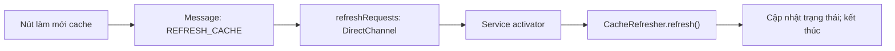

# Message không có payload

Trong chương **Message** của module **SPRING_INTEGRATION_CORE**, “message không có payload” cần được hiểu theo nhu cầu nghiệp vụ: bên gửi chỉ muốn kích hoạt một hành động, chẳng hạn làm mới cache hoặc yêu cầu đồng bộ lại dữ liệu. Khi dùng các lớp Message chuẩn của Spring, thông điệp vẫn phải có một payload khác `null`.

Bài học tập trung vào cách biểu diễn tín hiệu đó, đưa nó qua MessageChannel đến endpoint bằng Java DSL, và phân biệt **không có dữ liệu nghiệp vụ**, **payload rỗng** với **không có thông điệp phản hồi**. Đây là nền tảng để thiết kế gateway, transformer, filter và các luồng tích hợp có hợp đồng rõ ràng.

## 1. Payload khác null là điều kiện của Message chuẩn

Một `Message<T>` đóng gói hai phần: payload và headers. Payload biểu diễn nội dung; headers cung cấp ngữ cảnh cho việc xử lý và truyền thông điệp. Xem [mô hình Message của Spring Integration](https://docs.spring.io/spring-integration/reference/message.html).

Với `GenericMessage<T>`, payload truyền vào constructor phải khác `null`. Thêm headers không làm thay đổi điều kiện này. Xem [hợp đồng của GenericMessage](https://docs.spring.io/spring-framework/docs/current/javadoc-api/org/springframework/messaging/support/GenericMessage.html).

Các cách sau không tạo được một Message hợp lệ:

```java
import java.util.Map;

import org.springframework.messaging.support.GenericMessage;
import org.springframework.messaging.support.MessageBuilder;

// Các dòng độc lập minh họa đầu vào không hợp lệ.
// Khi thực thi, chúng bị từ chối bằng IllegalArgumentException.
new GenericMessage<String>(null);

new GenericMessage<String>(
        null,
        Map.of("operation", "REFRESH_CACHE"));

MessageBuilder.<String>withPayload(null).build();
```

`MessageBuilder` cung cấp `withPayload(...)` để khởi tạo Message từ một payload và `fromMessage(...)` để xây dựng từ Message có sẵn. Nó không cung cấp cách bỏ payload bằng việc chỉ thiết lập headers. Xem [API MessageBuilder](https://docs.spring.io/spring-framework/docs/current/javadoc-api/org/springframework/messaging/support/MessageBuilder.html).

Khai báo `Message<Void>` cũng không giải quyết được vấn đề: `new GenericMessage<Void>(null)` vẫn vi phạm điều kiện của constructor. Kiểu trả về `void` của một phương thức xử lý là một khái niệm khác với kiểu payload của Message.

## 2. Phân biệt những tình huống thường bị gọi chung là “rỗng”

| Tình huống | Có một Message hợp lệ không? | Ý nghĩa cần diễn đạt |
| --- | --- | --- |
| `new GenericMessage<String>(null)` | Không | Payload đầu vào không hợp lệ |
| `MessageBuilder.withPayload("").build()` | Có | Payload là chuỗi có độ dài bằng 0 |
| `MessageBuilder.withPayload(new byte[0]).build()` | Có | Payload là mảng byte có độ dài bằng 0 |
| Payload là một danh sách rỗng | Có | Có kết quả dạng danh sách, số phần tử bằng 0 |
| Payload là tín hiệu `"REFRESH_CACHE"` | Có | Một yêu cầu thực hiện hành động, không kèm bản ghi nghiệp vụ |
| `QueueChannel.receive(0)` trả về `null` | Không nhận được Message trong lần gọi đó | Không có thông điệp sẵn để lấy |
| Service activator kết thúc bằng `void` | Message đầu vào vẫn có | Không tạo Message phản hồi |
| Service activator trả về `null`, cho phép thiếu reply | Message đầu vào vẫn có | Nhánh xử lý kết thúc mà không có reply |

Các hàng về constructor tuân theo [GenericMessage](https://docs.spring.io/spring-framework/docs/current/javadoc-api/org/springframework/messaging/support/GenericMessage.html); hành vi nhận và phản hồi được trình bày lần lượt trong [Message Channel Implementations](https://docs.spring.io/spring-integration/reference/channel/implementations.html) và [Service Activator](https://docs.spring.io/spring-integration/reference/service-activator.html).

Điểm phân biệt cần giữ trong thiết kế:

- **Payload rỗng**: có đối tượng Message, payload tồn tại và có một giá trị rỗng hợp lệ.
- **Không có Message**: thao tác nhận hoặc nhánh xử lý không cung cấp đối tượng Message.
- **Tín hiệu nghiệp vụ**: Message có một giá trị mô tả yêu cầu, dù không chứa dữ liệu như đơn hàng hay khách hàng.

Ví dụ, “đã truy vấn và tìm thấy 0 đơn hàng” có thể được biểu diễn bằng một danh sách rỗng. “Chưa nhận được kết quả truy vấn” cần được mô hình hóa bằng trạng thái của giao thức hoặc luồng xử lý. Hai tình huống này dẫn đến quyết định nghiệp vụ khác nhau.

## 3. Chọn payload cho thông điệp chỉ mang tín hiệu

Giả sử quản trị viên bấm nút **Làm mới cache**. Người dùng không cần nhập dữ liệu; hệ thống đã biết cache cần làm mới thông qua luồng xử lý chuyên biệt.

Một hợp đồng đơn giản có thể là:

```java
import org.springframework.messaging.Message;
import org.springframework.messaging.support.MessageBuilder;

Message<String> request = MessageBuilder
        .withPayload("REFRESH_CACHE")
        .setHeader("triggerSource", "admin-ui")
        .setHeader("requestId", "refresh-001")
        .build();
```

Trong thiết kế này:

- `"REFRESH_CACHE"` mô tả hành động.
- `triggerSource` phục vụ quan sát nguồn kích hoạt.
- `requestId` là mã tương quan do ứng dụng quy ước; tự đặt header này chưa tạo ra cơ chế chống xử lý trùng.

Tên `triggerSource` và `requestId` là headers tùy chỉnh của ví dụ, không phải tên chuẩn bắt buộc của Spring Integration. Chỉ đặt những thông tin mà các thành phần đã thỏa thuận cách hiểu.

### 3.1. Chuỗi, enum và command object

| Lựa chọn | Phù hợp với nhu cầu | Điều cần cân nhắc |
| --- | --- | --- |
| Chuỗi cố định như `"REFRESH_CACHE"` | Luồng minh họa hoặc giao thức đơn giản | Tập giá trị và cách viết cần được thống nhất |
| Enum như `RefreshSignal.INSTANCE` | Các thành phần Java dùng chung hợp đồng kiểu | Cần quy ước biểu diễn khi ra ngoài JVM |
| Command object có trường rõ ràng | Hành động có tham số, phạm vi hoặc phiên bản | Cần định nghĩa tính hợp lệ của từng trường |
| `""` hoặc `new byte[0]` | Hợp đồng bên nhận định nghĩa rõ nội dung rỗng | Ý nghĩa hành động thường phải đến từ channel hoặc metadata |
| `new Object()` | Thử nghiệm nội bộ rất nhỏ | Không thể hiện ý định và khó xây dựng hợp đồng trao đổi |

Ví dụ enum không mang thêm dữ liệu:

```java
public enum RefreshSignal {
    INSTANCE
}
```

Payload `RefreshSignal.INSTANCE` vẫn tồn tại; giá trị của nó đóng vai trò tín hiệu. Đây là lựa chọn thiết kế của ứng dụng, không phải một kiểu “null payload” của framework.

Khi yêu cầu xuất hiện tham số nghiệp vụ, có thể dùng command object:

```java
public record RefreshCacheCommand(String cacheName, boolean force) {
}
```

Nếu bên nhận cần `cacheName` để quyết định cache nào phải làm mới, đặt trường đó vào command giúp hợp đồng dễ đọc và kiểm tra. Những dữ liệu chính của hành động không nên bị đẩy sang headers chỉ để giữ hình thức “message không có payload”.

## 4. Luồng Java DSL gọi một phương thức không tham số

Spring Integration hỗ trợ service activator gọi phương thức không có đối số. Endpoint vẫn nhận một Message; phương thức nghiệp vụ chỉ không cần đọc nội dung của nó. Trong Java DSL, `.handle(bean, "methodName")` biểu diễn service activator. Xem [cấu hình Service Activator](https://docs.spring.io/spring-integration/reference/service-activator.html).

Luồng ví dụ:



Mẫu dưới đây dùng Java 17 trở lên và API `IntegrationFlow.from(...)`. Dự án cần dependency `spring-integration-core` cùng bộ dependency Spring tương thích. Ví dụ khởi tạo Spring Context trực tiếp, không yêu cầu Spring Boot.

```java
package example;

import java.util.concurrent.atomic.AtomicInteger;

import org.springframework.context.annotation.AnnotationConfigApplicationContext;
import org.springframework.context.annotation.Bean;
import org.springframework.context.annotation.Configuration;
import org.springframework.integration.channel.DirectChannel;
import org.springframework.integration.config.EnableIntegration;
import org.springframework.integration.dsl.IntegrationFlow;
import org.springframework.messaging.Message;
import org.springframework.messaging.MessageChannel;
import org.springframework.messaging.support.MessageBuilder;

public class RefreshFlowExample {

    public static class CacheRefresher {

        private final AtomicInteger refreshCount = new AtomicInteger();

        public void refresh() {
            // Thay bằng thao tác làm mới cache của ứng dụng.
            refreshCount.incrementAndGet();
        }

        public int refreshCount() {
            return refreshCount.get();
        }
    }

    @Configuration(proxyBeanMethods = false)
    @EnableIntegration
    public static class FlowConfiguration {

        @Bean
        public DirectChannel refreshRequests() {
            return new DirectChannel();
        }

        @Bean
        public CacheRefresher cacheRefresher() {
            return new CacheRefresher();
        }

        @Bean
        public IntegrationFlow refreshFlow(
                DirectChannel refreshRequests,
                CacheRefresher cacheRefresher) {

            return IntegrationFlow
                    .from(refreshRequests)
                    .handle(cacheRefresher, "refresh")
                    .get();
        }
    }

    public static void main(String[] args) {
        try (AnnotationConfigApplicationContext context =
                     new AnnotationConfigApplicationContext(
                             FlowConfiguration.class)) {

            Message<String> request = MessageBuilder
                    .withPayload("REFRESH_CACHE")
                    .setHeader("triggerSource", "admin-ui")
                    .setHeader("requestId", "refresh-001")
                    .build();

            MessageChannel input = context.getBean(
                    "refreshRequests", MessageChannel.class);

            boolean sent = input.send(request);

            CacheRefresher refresher =
                    context.getBean(CacheRefresher.class);

            System.out.println("sent=" + sent);
            System.out.println("refreshCount="
                    + refresher.refreshCount());
        }
    }
}
```

API dựng flow được mô tả trong [IntegrationFlow](https://docs.spring.io/spring-integration/docs/current/api/org/springframework/integration/dsl/IntegrationFlow.html). Kết quả mong đợi của phần xuất dữ liệu trong ví dụ:

```text
sent=true
refreshCount=1
```

`DirectChannel` gọi handler trong luồng thực thi của bên gửi. Vì vậy, ở ví dụ này, thao tác tăng bộ đếm hoàn tất trước khi `send(...)` trả về. Xem [DirectChannel](https://docs.spring.io/spring-integration/reference/channel/implementations.html#channel-implementations-directchannel).

Có ba hợp đồng riêng cần nhận diện:

1. Channel `refreshRequests` tiếp nhận yêu cầu làm mới cache.
2. Phương thức `refresh()` không lấy tham số từ Message.
3. `refresh()` trả về `void`, nên endpoint kết thúc mà không tạo reply.

Bộ đếm chỉ là trạng thái quan sát được để minh họa và kiểm thử. Trong ứng dụng, tác động có thể là tải lại dữ liệu tham chiếu hoặc gọi một dịch vụ khác.

Do `refresh()` không kiểm tra payload, flow hiện coi mọi Message được gửi vào channel này là yêu cầu kích hoạt. Nếu channel có nhiều producer hoặc cần xác thực loại tín hiệu, hãy thêm kiểm tra ở ranh giới vào; phần filter bên dưới minh họa một cách.

## 5. Gateway không tham số vẫn phải tạo payload

Gateway không tham số mặc định có ngữ nghĩa nhận Message từ `PollableChannel`. Muốn dùng nó để gửi tín hiệu, cần cung cấp `payloadExpression`. Phương thức `void` có biểu thức payload là thao tác chỉ gửi. Xem [Invoking No-Argument Methods](https://docs.spring.io/spring-integration/reference/gateway.html#gateway-no-args).

```java
package example;

import org.springframework.integration.annotation.Gateway;
import org.springframework.integration.annotation.MessagingGateway;

@MessagingGateway
public interface CacheRefreshGateway {

    @Gateway(
            requestChannel = "refreshRequests",
            payloadExpression = "'REFRESH_CACHE'")
    void refresh();
}
```

Để tạo proxy, thêm `@IntegrationComponentScan(basePackageClasses = CacheRefreshGateway.class)` vào cấu hình được đăng ký trong context, với import `org.springframework.integration.annotation.IntegrationComponentScan`. Dùng cùng flow ở phần 4.

Lệnh `gateway.refresh()` không nhận dữ liệu từ người gọi nhưng vẫn gửi Message có payload chuỗi `"REFRESH_CACHE"`. Dấu nháy đơn bên trong biểu thức SpEL xác định chuỗi literal; bỏ chúng làm thay đổi cách phân tích biểu thức.

`void` mô tả hợp đồng không chờ reply nghiệp vụ. Với `DirectChannel`, handler vẫn chạy trong thread gọi gateway; muốn chuyển sang xử lý bất đồng bộ cần thiết kế channel và cơ chế thực thi tương ứng.

## 6. Không có phản hồi là một trạng thái của luồng

Một service activator có thể tiêu thụ Message đầu vào rồi kết thúc. Nếu phương thức trả về `null` và endpoint cho phép thiếu reply, không có Message đầu ra được tạo. Trường hợp này khác với việc xây dựng Message chứa payload `null`. Hành vi `void` cũng kết thúc mà không sinh reply. Xem [Service Activator](https://docs.spring.io/spring-integration/reference/service-activator.html).

### 6.1. Chọn endpoint theo mục đích

| Mục đích | Thành phần phù hợp | Kết quả cần mong đợi |
| --- | --- | --- |
| Thực hiện tác động và kết thúc | Service activator với phương thức `void` | Không có reply |
| Chuyển một tín hiệu thành command khác | Transformer | Có kết quả chuyển đổi hợp lệ |
| Giữ hoặc loại yêu cầu theo điều kiện | Filter | Message được đi tiếp hoặc bị loại |
| Bắt buộc một handler sinh reply | Handler hỗ trợ `requiresReply=true` | Thiếu reply trở thành lỗi |
| Bỏ một kết quả đã được tạo | `nullChannel` | Message được gửi đến đích bỏ kết quả |

Transformer trả về `null` gây lỗi `MessageTransformationException`; cần dùng filter cho quyết định loại thông điệp. Xem [quy tắc trả về của Transformer](https://docs.spring.io/spring-integration/reference/transformer.html).

Ví dụ bổ sung filter vào flow ở phần 4:

```java
return IntegrationFlow
        .from(refreshRequests)
        .<String>filter(signal -> "REFRESH_CACHE".equals(signal))
        .handle(cacheRefresher, "refresh")
        .get();
```

Trong mẫu này, payload chuỗi không khớp bị filter loại và phương thức `refresh()` không được gọi. Có thể cấu hình discard channel để quan sát các yêu cầu bị loại hoặc bật hành vi ném lỗi theo hợp đồng của luồng. Xem [Filter](https://docs.spring.io/spring-integration/reference/filter.html).

Ví dụ chỉ kiểm tra chuỗi tín hiệu trong một channel đã thống nhất kiểu payload. Nó không thay thế việc xác thực quyền gọi thao tác quản trị.

### 6.2. Khi bắt buộc có reply

Với handler có khả năng tạo phản hồi, `requiresReply=true` biến việc không tạo reply thành `ReplyRequiredException`. Cờ này kiểm tra kết quả xử lý; nó không tạo payload thay thế. Xem [AbstractReplyProducingMessageHandler](https://docs.spring.io/spring-integration/docs/current/api/org/springframework/integration/handler/AbstractReplyProducingMessageHandler.html) và [ReplyRequiredException](https://docs.spring.io/spring-integration/docs/current/api/org/springframework/integration/handler/ReplyRequiredException.html).

Ví dụ cấu hình dành cho một service có phương thức trả về kết quả:

```java
// lookupService và phương thức findStatus do ứng dụng cung cấp.
// findStatus trả về một đối tượng trạng thái hoặc null.
return IntegrationFlow
        .from("statusRequests")
        .handle(lookupService, "findStatus",
                endpoint -> endpoint.requiresReply(true))
        .channel("statusReplies")
        .get();
```

Nếu nghiệp vụ cần báo “không tìm thấy”, hãy biểu diễn kết quả đó bằng một đối tượng trạng thái rõ ràng. Nếu nghiệp vụ xem thiếu kết quả là vi phạm hợp đồng, giữ hành vi báo lỗi.

### 6.3. nullChannel là nơi nhận Message hợp lệ

`nullChannel` là channel đặc biệt dành cho việc bỏ thông điệp hoặc kết quả không cần dùng. Nó không phải công cụ xây dựng Message có payload `null`. Xem [Special Channels](https://docs.spring.io/spring-integration/reference/channel/special-channels.html).

Ví dụ, nếu một phương thức đã trả về kết quả nhưng flow chủ động bỏ nó, có thể kết thúc flow bằng:

```java
// resultProducingService.execute phải tạo ra một kết quả hợp lệ.
return IntegrationFlow
        .from("maintenanceRequests")
        .handle(resultProducingService, "execute")
        .channel("nullChannel")
        .get();
```

Đặt `nullChannel` sau một bước không tạo đầu ra không làm xuất hiện Message mới để gửi đến channel này.

### 6.4. Hợp đồng request-reply cần được giữ nhất quán

Nếu gateway khai báo kiểu trả về có giá trị nhưng đường xử lý lại kết thúc mà không có reply, bên gọi có thể chờ đến timeout. Thiết lập timeout hữu hạn theo nhu cầu và cấu hình phiên bản đang dùng; không dùng thời gian chờ như một kết quả nghiệp vụ. Với channel đồng bộ, reply timeout cũng không phải giới hạn thời gian chạy của một handler đang chiếm thread gọi. Xem [GatewayProxyFactoryBean](https://docs.spring.io/spring-integration/docs/current/api/org/springframework/integration/gateway/GatewayProxyFactoryBean.html).

Trong bài toán làm mới cache, có thể lựa chọn:

- API chỉ gửi yêu cầu: gateway trả về `void`, theo dõi việc xử lý qua trạng thái hoặc sự kiện.
- API cần kết quả: handler trả về đối tượng như `RefreshResult`, gateway nhận đúng kiểu kết quả đó.
- Tác vụ kéo dài: trả về mã công việc theo một hợp đồng rõ ràng và cung cấp cơ chế lấy trạng thái.

Khi thiết kế nhánh kết hợp với aggregator, cũng cần xác định nhánh nào thực sự phát Message kết quả. Một nhánh kết thúc im lặng không cung cấp thêm phần tử cho nhóm; không nên giả định nó đã gửi một “phần tử null”.

## 7. Kiểm thử hợp đồng của thông điệp tín hiệu

Các kiểm thử nên xác nhận cả tính hợp lệ của Message và tác động của flow. Chỉ kiểm tra `send(...)` trả về `true` chưa đủ để diễn đạt yêu cầu làm mới cache.

Mẫu sau dùng JUnit Jupiter và lớp `RefreshFlowExample` ở phần 4. Đây là mã kiểm thử để người học bổ sung vào dự án; các lệnh build và chạy test không thuộc nội dung thiết lập của ví dụ.

```java
package example;

import org.junit.jupiter.api.Test;

import org.springframework.context.annotation.AnnotationConfigApplicationContext;
import org.springframework.integration.channel.QueueChannel;
import org.springframework.messaging.Message;
import org.springframework.messaging.MessageChannel;
import org.springframework.messaging.support.GenericMessage;
import org.springframework.messaging.support.MessageBuilder;

import static org.junit.jupiter.api.Assertions.assertEquals;
import static org.junit.jupiter.api.Assertions.assertNotNull;
import static org.junit.jupiter.api.Assertions.assertNull;
import static org.junit.jupiter.api.Assertions.assertThrows;
import static org.junit.jupiter.api.Assertions.assertTrue;

class PayloadlessMessageTest {

    @Test
    void nullPayloadIsRejected() {
        assertThrows(IllegalArgumentException.class,
                () -> new GenericMessage<String>(null));

        assertThrows(IllegalArgumentException.class,
                () -> MessageBuilder.<String>withPayload(null).build());
    }

    @Test
    void emptyValuesAreStillPayloads() {
        Message<String> text =
                MessageBuilder.withPayload("").build();

        Message<byte[]> bytes =
                MessageBuilder.withPayload(new byte[0]).build();

        assertNotNull(text.getPayload());
        assertEquals("", text.getPayload());

        assertNotNull(bytes.getPayload());
        assertEquals(0, bytes.getPayload().length);
    }

    @Test
    void signalInvokesServiceWithoutProducingReply() {
        try (AnnotationConfigApplicationContext context =
                     new AnnotationConfigApplicationContext(
                             RefreshFlowExample.FlowConfiguration.class)) {

            QueueChannel replies = new QueueChannel();

            Message<String> request = MessageBuilder
                    .withPayload("REFRESH_CACHE")
                    .setHeader("requestId", "test-refresh-001")
                    .setReplyChannel(replies)
                    .build();

            MessageChannel input = context.getBean(
                    "refreshRequests", MessageChannel.class);

            assertTrue(input.send(request));

            RefreshFlowExample.CacheRefresher refresher =
                    context.getBean(
                            RefreshFlowExample.CacheRefresher.class);

            assertEquals(1, refresher.refreshCount());
            assertNull(replies.receive(0));
        }
    }

    @Test
    void emptyQueueReturnsNoMessage() {
        QueueChannel channel = new QueueChannel();

        Message<?> received = channel.receive(0);

        assertNull(received);
    }
}
```

Ở kiểm thử flow, `DirectChannel` đã gọi xong handler trước khi kiểm tra bộ đếm và reply queue. Vì vậy, `receive(0)` phù hợp để xác nhận không có reply tại thời điểm luồng đồng bộ đã hoàn tất; không cần thêm thời gian ngủ.

`receive(0)` kiểm tra ngay trạng thái queue. Giá trị `null` trả về nghĩa là không nhận được Message, nên không được tiếp tục gọi `received.getPayload()`. Xem [hành vi QueueChannel](https://docs.spring.io/spring-integration/reference/channel/implementations.html).

Nếu thay bằng channel bất đồng bộ, cần chờ một điều kiện hoàn tất có giới hạn thời gian trước khi khẳng định tác động nghiệp vụ đã xảy ra. Một lần quan sát queue đang rỗng chưa chứng minh tác vụ bất đồng bộ đã kết thúc.

## 8. Những lỗi thiết kế thường gặp

| Cách làm | Vấn đề | Cách điều chỉnh |
| --- | --- | --- |
| Dùng `withPayload(null)` rồi chỉ thêm headers | Message bị từ chối trước khi vào flow | Chọn một payload tín hiệu khác null |
| Dùng `Message<Void>` để biểu diễn tín hiệu | Tham số kiểu không làm constructor chấp nhận null | Dùng một kiểu tín hiệu có giá trị cụ thể |
| Gửi `""` trong khi receiver cần command rõ nghĩa | Không đủ thông tin để xác định hành động | Thống nhất command hoặc một channel chuyên biệt |
| Dùng transformer trả null để bỏ Message | Vi phạm hợp đồng transformer | Dùng filter |
| Gateway không tham số nhưng thiếu biểu thức payload cho thao tác gửi | Không diễn đạt đúng ý định kích hoạt flow | Cấu hình `payloadExpression` |
| Gateway cần kết quả nhưng endpoint cuối trả void | Hợp đồng phản hồi không được đáp ứng | Trả kết quả rõ ràng hoặc chọn API chỉ gửi |
| Tưởng `nullChannel` có nghĩa payload null | Nhầm giữa đích bỏ kết quả và nội dung Message | Chỉ gửi Message hợp lệ đến channel |
| Dùng `receive(0) == null` để kết luận tác vụ bất đồng bộ thành công | Chỉ chứng minh queue chưa có dữ liệu | Theo dõi trạng thái hoàn tất và lỗi |
| Cho rằng payload nhỏ tự đảm bảo chống xử lý trùng | Kích thước payload không quyết định tính idempotent | Thiết kế khóa và cách xử lý yêu cầu lặp |

Các quy tắc về API trong bảng đã được dẫn nguồn ở từng phần. Các điều chỉnh về hợp đồng command, quan sát trạng thái và xử lý trùng là hướng thiết kế áp dụng cho ví dụ.

## 9. Bài tập thực hành

1. Chạy ví dụ làm mới cache và gửi hai tín hiệu liên tiếp. Xác nhận `refreshCount` tăng hai lần dù không có dữ liệu bản ghi trong yêu cầu.
2. Thêm filter chỉ chấp nhận `"REFRESH_CACHE"`. Gửi `"UNKNOWN"` và xác nhận handler không chạy.
3. Thay payload chuỗi bằng enum. Cập nhật producer và filter theo cùng hợp đồng kiểu.
4. Tạo phiên bản handler trả về `RefreshResult`. Thiết kế gateway có kiểu trả về tương ứng và cấu hình giới hạn chờ phù hợp.
5. Đổi channel đầu vào sang một cơ chế bất đồng bộ. Bổ sung cách chờ hoàn tất trong kiểm thử và nơi quan sát lỗi.
6. Bổ sung `cacheName` vào command. Xác định trường nào là dữ liệu hành động, trường nào phục vụ tương quan và quan sát.

Kết quả cần đạt là một luồng có thể giải thích rõ: **Message nào được gửi, payload mang ý nghĩa gì, endpoint thực hiện hành động nào và có cần một Message phản hồi hay không**.
