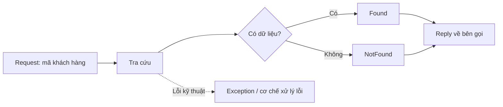

# Payload null và NullPayload

## 1. Mục tiêu và phạm vi

Trong chương **Message** của module **SPRING_INTEGRATION_CORE**, bài này giải thích cách biểu diễn dữ liệu vắng mặt mà vẫn giữ hợp đồng thông điệp rõ ràng. Nội dung gắn với việc thiết kế luồng bằng `Message`, `MessageChannel`, endpoint, gateway và Java DSL; đồng thời chỉ ra ảnh hưởng tới transformer, filter, router, aggregator, xử lý lỗi và kiểm thử.

Sau bài học, bạn có thể:

- Phân biệt payload `null`, không có message, không có reply và một payload hợp lệ đại diện cho kết quả rỗng.
- Tự định nghĩa sentinel khi cần, hiểu giới hạn của tên gọi `NullPayload`.
- Thiết kế luồng request–reply trả lời rõ trường hợp không tìm thấy dữ liệu.
- Chọn đúng hành vi kết thúc luồng, loại bỏ message hoặc báo lỗi.

Các ví dụ dùng Java 17 và API Spring Integration 6.4, không cần Spring Boot. Mã minh họa cần `spring-integration-core`; phần kiểm thử cần JUnit Jupiter. Các thư viện Spring phải thuộc một bộ phiên bản tương thích do dự án quản lý.

> **Làm rõ tên gọi:** Spring Integration không cung cấp một lớp chuẩn tên `NullPayload` để tự động thay mọi payload `null`. Sentinel mang tên này trong bài là kiểu **do ứng dụng tự định nghĩa**. Việc tra cứu [danh mục API Spring Integration](https://docs.spring.io/spring-integration/api/allclasses-index.html) cũng không cho thấy kiểu chuẩn mang tên đó; không nên suy ra một câu lệnh import chỉ từ tiêu đề bài.

## 2. Hợp đồng payload: đối tượng phải tồn tại

Message được nhìn như một phong bì:

```text
Message<T>
├── payload: T
└── headers: MessageHeaders
```

Với cách tạo message chuẩn bằng `GenericMessage` hoặc `MessageBuilder`, payload phải khác `null`. Javadoc ghi rõ điều kiện này; constructor của `GenericMessage` kiểm tra nó bằng assertion. Vì vậy lỗi xảy ra khi tạo message, trước khi message được gửi vào channel. Xem [hợp đồng GenericMessage](https://docs.spring.io/spring-framework/docs/6.1.x/javadoc-api/org/springframework/messaging/support/GenericMessage.html) và [mã nguồn constructor](https://raw.githubusercontent.com/spring-projects/spring-framework/v6.2.0/spring-messaging/src/main/java/org/springframework/messaging/support/GenericMessage.java).

```java
import org.springframework.messaging.Message;
import org.springframework.messaging.support.GenericMessage;
import org.springframework.messaging.support.MessageBuilder;

// Hai cách sau đều không hợp lệ: ném IllegalArgumentException.
Message<String> invalid1 = new GenericMessage<String>(null);
Message<String> invalid2 = MessageBuilder.<String>withPayload(null).build();
```

Hai dòng trên là **hai tình huống lỗi độc lập**. Nếu chạy nguyên khối, dòng đầu ném exception nên dòng sau chưa được thực hiện.

Đối tượng không chứa phần tử vẫn có thể là payload:

```java
import java.util.List;
import org.springframework.messaging.Message;
import org.springframework.messaging.support.MessageBuilder;

Message<String> emptyText = MessageBuilder.withPayload("").build();
Message<byte[]> emptyBytes = MessageBuilder.withPayload(new byte[0]).build();
Message<List<String>> emptyList =
        MessageBuilder.withPayload(List.<String>of()).build();
```

Ở đây có ba giá trị cụ thể: một chuỗi độ dài 0, một mảng độ dài 0 và một danh sách không có phần tử. Ý nghĩa nghiệp vụ phụ thuộc hợp đồng của bên gửi và bên nhận. Ví dụ, danh sách rỗng có thể là kết quả hợp lệ của một truy vấn; nó không tự có nghĩa truy vấn bị lỗi.

Điều kiện khác `null` áp dụng cho **đối tượng payload bên ngoài**. Nó không tự kiểm tra toàn bộ các thuộc tính bên trong DTO. Nếu một trường bắt buộc bị thiếu, ứng dụng vẫn cần validation riêng.

## 3. Những trạng thái dễ bị gộp nhầm

| Tình huống | Có message hợp lệ đi tiếp? | Cách hiểu |
|---|---|---|
| Tạo `GenericMessage<>(null)` | Không | Vi phạm điều kiện tạo message |
| `QueueChannel.receive(0)` trả `null` | Không nhận được message tại lần gọi đó | Không có phong bì để đọc payload |
| Service activator trả `null`, cho phép thiếu reply | Không tạo reply ở endpoint đó | Nhánh xử lý kết thúc |
| Service activator trả `null`, bắt buộc reply | Không tạo reply; phát sinh lỗi | Vi phạm hợp đồng của endpoint |
| Message chứa sentinel do ứng dụng tạo | Có | Đối tượng đặc biệt vẫn là payload |
| Message chứa `List.of()` | Có | Danh sách tồn tại nhưng không có phần tử |
| Gửi message hợp lệ tới `nullChannel` | Message được đưa tới nơi loại bỏ | Không phải cơ chế tạo payload `null` |
| DTO có `status = NOT_FOUND` | Có | Kết quả nghiệp vụ đã được biểu diễn rõ |

Ví dụ đọc một hàng đợi đang rỗng:

```java
import org.springframework.integration.channel.QueueChannel;
import org.springframework.messaging.Message;

QueueChannel inbox = new QueueChannel();
Message<?> received = inbox.receive(0);

if (received == null) {
    // Không nhận được message; không gọi received.getPayload().
}
```

Đối tượng trả về của `receive(timeout)` có thể là `null` khi hết thời gian chờ hoặc bị ngắt. Đây là hợp đồng của thao tác nhận, không phải một payload đã được nhận. Xem [PollableChannel.receive](https://docs.spring.io/spring-framework/docs/current/javadoc-api/org/springframework/messaging/PollableChannel.html).

Sự phân biệt này giúp đặt đúng câu hỏi khi chẩn đoán: “Không tạo được phong bì”, “không nhận được phong bì”, hay “đã nhận được phong bì với một kết quả rỗng có chủ đích”?

## 4. NullPayload như một sentinel do ứng dụng định nghĩa

Sentinel là một giá trị cụ thể được các bên thống nhất dùng để biểu diễn trạng thái đặc biệt. Nếu một giao thức nội bộ cần phân biệt “có thông điệp báo vắng dữ liệu” với “không phát thông điệp”, có thể tự tạo enum:

```java
package example.integration;

public enum NullPayload {
    INSTANCE
}
```

Tạo và nhận message với kiểu đó:

```java
import org.springframework.messaging.Message;
import org.springframework.messaging.support.MessageBuilder;
import example.integration.NullPayload;

Message<NullPayload> absent =
        MessageBuilder.withPayload(NullPayload.INSTANCE)
                .setHeader("reason", "NO_VALUE")
                .build();

boolean isAbsenceMarker =
        absent.getPayload() == NullPayload.INSTANCE; // true
```

`NullPayload.INSTANCE` là một đối tượng enum tồn tại. `getPayload()` trả về chính đối tượng đó, không trả `null`. Spring không tự bỏ message, tự chuyển nó thành lỗi hoặc tự mở gói nó thành một giá trị vắng mặt.

Khi dùng sentinel này, hợp đồng cần trả lời rõ:

1. Sentinel biểu thị không tìm thấy, chưa có dữ liệu hay kết quả không áp dụng?
2. Consumer nào nhận và xử lý kiểu sentinel?
3. Nó được truyền ra ngoài tiến trình bằng schema nào?
4. Các bước thống kê và gom nhóm có tính nó như một kết quả hay không?

Một handler chỉ nhận `Customer` không có nghĩa đã biết xử lý sentinel kiểu `NullPayload`. Cần xử lý nhánh vắng dữ liệu trước bước đó hoặc dùng một kiểu kết quả chung. Tránh dựa vào chuyển đổi kiểu ngầm để che việc hợp đồng đầu vào chưa đầy đủ.

Tên như `NoCustomerFound` hay `NoSnapshotAvailable` thường diễn đạt ý nghĩa tốt hơn `NullPayload` nếu đây là trạng thái nghiệp vụ. Sentinel tổng quát phù hợp nhất khi ý nghĩa đã được giới hạn rõ trong giao thức nội bộ.

## 5. Endpoint trả null khác với message có payload null

Khi một service activator trả `null` hoặc `void`, framework không tạo reply nếu endpoint cho phép điều đó. Với `requiresReply = true`, việc thiếu kết quả dẫn tới `ReplyRequiredException`. Xem [Service Activator](https://docs.spring.io/spring-integration/reference/6.4/service-activator.html).

Ba luồng sau cô lập sự khác biệt. Chúng dùng enum `example.integration.NullPayload` ở phần trước; các channel đầu vào có tên được Java DSL tạo khi đăng ký flow.

```java
package example.integration;

import org.springframework.context.annotation.Bean;
import org.springframework.context.annotation.Configuration;
import org.springframework.integration.config.EnableIntegration;
import org.springframework.integration.dsl.IntegrationFlow;

@Configuration
@EnableIntegration
public class NullBehaviorConfiguration {

    @Bean
    public IntegrationFlow optionalReplyFlow() {
        return IntegrationFlow.from("optionalInput")
                .handle(String.class,
                        (payload, headers) -> null,
                        endpoint -> endpoint.requiresReply(false))
                .get();
    }

    @Bean
    public IntegrationFlow requiredReplyFlow() {
        return IntegrationFlow.from("requiredInput")
                .handle(String.class,
                        (payload, headers) -> null,
                        endpoint -> endpoint.requiresReply(true))
                .get();
    }

    @Bean
    public IntegrationFlow sentinelReplyFlow() {
        return IntegrationFlow.from("sentinelInput")
                .handle(String.class,
                        (payload, headers) -> NullPayload.INSTANCE,
                        endpoint -> endpoint.requiresReply(true))
                .get();
    }
}
```

Khi thử các flow, hãy đặt một `replyChannel` cho request để quan sát kết quả:

| Đầu vào | Kết quả mong đợi |
|---|---|
| `optionalInput` | Handler được gọi, không có reply |
| `requiredInput` | Ném `ReplyRequiredException` |
| `sentinelInput` | Reply có payload là `NullPayload.INSTANCE` |

`requiresReply(true)` kiểm soát việc handler có tạo kết quả hay không; nó không xác minh kết quả có chứa dữ liệu nghiệp vụ hay không. Sentinel khác `null` nên có thể thỏa điều kiện tạo reply. Cơ chế này thể hiện trong [AbstractReplyProducingMessageHandler](https://raw.githubusercontent.com/spring-projects/spring-integration/v6.4.0/spring-integration-core/src/main/java/org/springframework/integration/handler/AbstractReplyProducingMessageHandler.java).

Ở flow cuối không có output channel cố định. Khi request có header `replyChannel`, reply có thể đi về channel đó. Nếu gọi một luồng tạo kết quả mà không cung cấp nơi nhận kết quả, lỗi định tuyến reply là vấn đề riêng với việc payload có vắng dữ liệu hay không.

### Transformer và filter

Transformer được dùng để tạo đầu ra từ đầu vào, không dùng `return null` như cách lọc bỏ message. Tài liệu quy định transformer trả `null` gây `MessageTransformationException`; không thể cấu hình nó cho phép thiếu reply như service activator. Xem [Transformer](https://docs.spring.io/spring-integration/reference/6.4/transformer.html).

Ví dụ sau là **đoạn thiết kế sai**, không phải flow nên đưa vào ứng dụng:

```java
IntegrationFlow.from("namesInput")
        .transform(String.class,
                name -> name.isBlank() ? null : name.trim())
        .channel("namesOutput")
        .get();
```

Nếu yêu cầu là chỉ xử lý tên có nội dung, hãy dùng filter rồi transformer:

```java
IntegrationFlow.from("namesInput")
        .filter(String.class,
                name -> !name.isBlank(),
                filter -> filter.discardChannel("rejectedNames"))
        .transform(String.class, String::trim)
        .channel("namesOutput")
        .get();
```

Đoạn này cần được đăng ký thành bean và cần cấu hình nơi tiêu thụ `namesOutput`, `rejectedNames`. Filter quyết định đi tiếp hay loại bỏ; discard channel cho phép quan sát nhánh bị loại. Trong một lời gọi request–reply, nhánh discard cũng cần được thiết kế nếu bên gọi đang chờ câu trả lời. Xem [Filter và discard channel](https://docs.spring.io/spring-integration/reference/6.4/filter.html).

## 6. Thiết kế một kết quả tra cứu rõ nghĩa

Giả sử hệ thống tra cứu khách hàng theo mã. Có hai kết quả nghiệp vụ bình thường:

- Tìm thấy: trả mã và tên khách hàng.
- Không tìm thấy: vẫn trả mã đã tra cứu cùng trạng thái tương ứng.

Lỗi kết nối cơ sở dữ liệu là tình huống khác. Chuyển mọi lỗi thành “không tìm thấy” sẽ làm bên gọi đưa ra quyết định sai, chẳng hạn tạo bản ghi trùng vì tưởng dữ liệu chưa tồn tại.

Dưới đây là cấu hình độc lập dùng dữ liệu trong bộ nhớ. Hai record tạo thành một tập kết quả hữu hạn, tránh dùng `Object` cho cả khách hàng lẫn một marker tổng quát.

```java
package example.integration;

import java.util.Map;
import java.util.Objects;

import org.springframework.context.annotation.Bean;
import org.springframework.context.annotation.Configuration;
import org.springframework.integration.config.EnableIntegration;
import org.springframework.integration.dsl.IntegrationFlow;

@Configuration
@EnableIntegration
public class LookupConfiguration {

    public sealed interface LookupResult permits Found, NotFound {
        String customerId();
    }

    public record Found(String customerId, String displayName)
            implements LookupResult {
        public Found {
            Objects.requireNonNull(customerId, "customerId");
            Objects.requireNonNull(displayName, "displayName");
        }
    }

    public record NotFound(String customerId) implements LookupResult {
        public NotFound {
            Objects.requireNonNull(customerId, "customerId");
        }
    }

    @Bean
    public IntegrationFlow customerLookupFlow() {
        Map<String, String> customers = Map.of("C-001", "Lan");

        return IntegrationFlow.from("customerLookupInput")
                .handle(String.class, (customerId, headers) -> {
                    String name = customers.get(customerId);
                    if (name == null) {
                        return new NotFound(customerId);
                    }
                    return new Found(customerId, name);
                }, endpoint -> endpoint.requiresReply(true))
                .get();
    }
}
```

Trong ví dụ, `Map.get()` có thể trả `null` ở bên trong logic Java. Giá trị này được chuyển thành `NotFound` trước khi làm kết quả của handler. Quy tắc payload không buộc mọi biến cục bộ trong ứng dụng đều khác `null`.



Một router ở bước tiếp theo có thể phân nhánh theo kiểu `Found` và `NotFound`. Ví dụ nghiệp vụ sau khi nhận reply:

```java
static void showResult(LookupConfiguration.LookupResult result) {
    if (result instanceof LookupConfiguration.Found found) {
        System.out.println("Khách hàng: " + found.displayName());
    } else if (result instanceof LookupConfiguration.NotFound missing) {
        System.out.println("Không có khách hàng " + missing.customerId());
    }
}
```

Đặt phương thức minh họa này trong lớp tiêu thụ kết quả của ứng dụng; truyền vào kết quả thực đã nhận từ flow.

Khi truyền kết quả qua JSON hoặc một broker, hãy công bố schema tương ứng, chẳng hạn:

```json
{
  "status": "NOT_FOUND",
  "customerId": "C-404"
}
```

Schema bên ngoài không cần lộ tên lớp Java nội bộ. Phần chuyển đổi giữa record và JSON phải được cấu hình theo hợp đồng đã chọn; sealed interface không tự tạo cấu hình đa hình cho mọi serializer.

## 7. Ảnh hưởng tới gateway và bên gọi

Một gateway có phương thức trả kết quả thể hiện kỳ vọng request–reply. Nếu flow dừng ở service activator trả `null`, gateway không nhận được một “message có payload rỗng”; nó đang thiếu reply.

Có thể dùng giao diện sau cho flow tra cứu:

```java
package example.integration;

import org.springframework.integration.annotation.MessagingGateway;

@MessagingGateway(
        defaultRequestChannel = "customerLookupInput",
        defaultReplyTimeout = "1000")
public interface CustomerGateway {
    LookupConfiguration.LookupResult find(String customerId);
}
```

Để dùng giao diện này như bean, bật quét gateway bằng `@IntegrationComponentScan` trong cấu hình, với package chứa `CustomerGateway`, và đăng ký `LookupConfiguration`. Phần kiểm thử bên dưới dùng channel trực tiếp nên không phụ thuộc bước quét gateway.

Với giá trị trả về dạng đối tượng đồng bộ, hết thời gian chờ có thể làm gateway trả `null`, tùy cấu hình xử lý timeout. Không dùng giá trị đó như bằng chứng chắc chắn “khách hàng không tồn tại”. Ngoài ra, `replyTimeout` không cưỡng bức dừng một handler đồng bộ đang chạy trên chính thread gọi qua `DirectChannel`. Xem [Gateway khi không có phản hồi](https://docs.spring.io/spring-integration/reference/6.4/gateway.html).

Trong thiết kế này, `NotFound` là một câu trả lời nghiệp vụ có chủ đích. Thiếu reply cần được ghi nhận như sự cố của quá trình trao đổi. Nếu thao tác chỉ gửi lệnh mà không yêu cầu trả kết quả, hợp đồng gateway có thể dùng `void`, cùng cách theo dõi thành công hoặc lỗi phù hợp với yêu cầu nghiệp vụ.

## 8. NullChannel và các cơ chế null theo giao thức

### NullChannel là nơi loại bỏ message

`nullChannel` nhận message rồi loại bỏ nó. Nó không thay payload bằng `null` và không đại diện cho kết quả “không tìm thấy”. Với payload thông thường, có thể dùng nó làm đích kết thúc nhánh mà ứng dụng chủ đích không giữ kết quả. Xem [Special Channels](https://docs.spring.io/spring-integration/reference/6.4/channel/special-channels.html).

Ví dụ một cấu hình bean cho nhánh kết thúc:

```java
@Bean
public IntegrationFlow discardCompletedFlow() {
    return IntegrationFlow.from("completedInput")
            .channel("nullChannel")
            .get();
}
```

Nếu đưa một nhánh request–reply vào đây mà không có cơ chế trả lời khác, bên gọi vẫn thiếu reply. Việc chủ động loại bỏ message và việc trả lời “không có dữ liệu” cần được quyết định riêng trong thiết kế.

### KafkaNull có ngữ nghĩa riêng

Spring for Apache Kafka có kiểu `KafkaNull` dành cho các đường xử lý giá trị `null` của Kafka; ví dụ tombstone phục vụ log compaction. Với API `KafkaTemplate.send(Message<?>)`, marker này giúp biểu diễn giá trị Kafka `null` trong một Spring Message có payload khác `null`. Đây là quy ước do thành phần Kafka hỗ trợ, không phải sentinel tổng quát cho mọi flow. Xem [Kafka tombstone và KafkaNull](https://docs.spring.io/spring-kafka/reference/kafka/tombstones.html).

Không thay một kết quả tra cứu thất bại bằng `KafkaNull` chỉ vì tên có chữ “Null”. Tại ranh giới giao thức, phải ánh xạ trạng thái ứng dụng sang đúng ngữ nghĩa bên ngoài: “không có dữ liệu”, “xóa bản ghi” và “không có phản hồi” có thể dẫn tới ba hành động khác nhau.

Tương tự, `@Payload(required = false)` ở một cơ chế phân giải tham số không vô hiệu hóa điều kiện của constructor `GenericMessage`. Khi thấy một phương thức nhận được tham số `null`, cần xét adapter và cách bind tham số cụ thể, thay vì suy ra message ban đầu có payload Java `null`.

## 9. Chọn biểu diễn theo yêu cầu nghiệp vụ

| Yêu cầu | Biểu diễn phù hợp | Điều cần thống nhất |
|---|---|---|
| Truy vấn nhiều bản ghi, không có kết quả | Danh sách rỗng | Đây có phải kết quả thành công không |
| Tra cứu một bản ghi | `Found` / `NotFound` hoặc DTO có trạng thái | Bên gọi xử lý cả hai kết quả |
| Báo một sự kiện không mang dữ liệu bổ sung | Kiểu sự kiện hoặc kiểu lệnh có nghĩa rõ | Thông điệp này yêu cầu bên nhận làm gì |
| Giao thức nội bộ cần marker vắng giá trị | Sentinel do ứng dụng định nghĩa | Consumer, schema và quy tắc xử lý marker |
| Loại bỏ đầu vào không đạt điều kiện | Filter và nhánh discard thích hợp | Có cần trả lời, thống kê hay lưu vết không |
| Tác vụ một chiều đã hoàn thành | Endpoint kết thúc không tạo reply | Bên gọi không có kỳ vọng request–reply |
| Đầu ra bắt buộc nhưng handler không tạo được | Báo lỗi; có thể dùng `requiresReply(true)` | Chính sách retry và phục hồi |

Không nên dùng chuỗi rỗng làm giá trị thay thế cho mọi kết quả không có dữ liệu. Ví dụ, tên khách hàng rỗng có thể là một lỗi chất lượng dữ liệu, trong khi `NotFound` có nghĩa hoàn toàn khác.

`Optional.empty()` là một đối tượng Java khác `null`, nhưng chỉ như vậy chưa đủ để chọn nó làm hợp đồng truyền thông. Cần xác định consumer, serializer và endpoint xử lý `Optional` thế nào. Một kiểu kết quả có trạng thái rõ thường dễ công bố với các hệ thống không viết bằng Java hơn.

### Khi có router hoặc aggregator

Giả sử một yêu cầu cần tra cứu ba nguồn A, B và C. Thiết kế dự kiến nhận một kết quả từ mỗi nguồn rồi mới tổng hợp:

```text
A -> Found
B -> NotFound
C -> Found
```

Nếu B không phát message vì handler trả `null`, nhóm tổng hợp có thể không đạt điều kiện release “đủ ba kết quả”. Nếu B gửi một sentinel mà điều kiện release đếm mọi message, nhóm có thể đủ số lượng nhưng bước tính toán lại phải biết loại hoặc diễn giải sentinel.

Đây là hệ quả của **điều kiện tổng hợp do ứng dụng chọn**, không phải quy tắc rằng mọi aggregator luôn đợi đủ ba message. Với bài toán này, mỗi nguồn nên trả một kiểu kết quả có `sourceId`, trạng thái và dữ liệu tương ứng. Thiết kế cũng cần chính sách cho nguồn không phản hồi, vì một `NotFound` hợp lệ không thể thay thế cho timeout của nguồn đó.

## 10. Mẫu kiểm thử các hợp đồng chính

Lớp kiểm thử dưới đây dùng ba tệp Java đã trình bày: `NullPayload.java`, `NullBehaviorConfiguration.java` và `LookupConfiguration.java`, cùng package `example.integration`. Hai cấu hình được nạp vào Spring context; không cần gateway proxy cho các kiểm tra này.

Các flow minh họa sử dụng các channel đầu vào trực tiếp do DSL tạo. Vì xử lý đồng bộ hoàn tất trước khi `send()` trả về, `receive(0)` đủ để quan sát reply mà không cần chờ bằng `Thread.sleep()`. Với flow bất đồng bộ, phải dùng thời gian chờ hữu hạn và cách đồng bộ kiểm thử phù hợp.

```java
package example.integration;

import org.junit.jupiter.api.AfterEach;
import org.junit.jupiter.api.BeforeEach;
import org.junit.jupiter.api.Test;

import org.springframework.context.annotation.AnnotationConfigApplicationContext;
import org.springframework.integration.channel.QueueChannel;
import org.springframework.integration.handler.ReplyRequiredException;
import org.springframework.messaging.Message;
import org.springframework.messaging.MessageChannel;
import org.springframework.messaging.support.GenericMessage;
import org.springframework.messaging.support.MessageBuilder;

import static org.junit.jupiter.api.Assertions.*;

class NullPayloadSemanticsTest {

    private AnnotationConfigApplicationContext context;

    @BeforeEach
    void openContext() {
        context = new AnnotationConfigApplicationContext(
                NullBehaviorConfiguration.class,
                LookupConfiguration.class);
    }

    @AfterEach
    void closeContext() {
        context.close();
    }

    @Test
    void cannotCreateMessageWithNullPayload() {
        assertThrows(IllegalArgumentException.class,
                () -> new GenericMessage<String>(null));

        assertThrows(IllegalArgumentException.class,
                () -> MessageBuilder.<String>withPayload(null).build());
    }

    @Test
    void optionalNullResultProducesNoReply() {
        QueueChannel replies = new QueueChannel();

        assertTrue(input("optionalInput")
                .send(request("C-404", replies)));

        assertNull(replies.receive(0));
    }

    @Test
    void requiredNullResultRaisesAnError() {
        QueueChannel replies = new QueueChannel();

        assertThrows(ReplyRequiredException.class,
                () -> input("requiredInput")
                        .send(request("C-404", replies)));

        assertNull(replies.receive(0));
    }

    @Test
    void sentinelIsARealReplyPayload() {
        QueueChannel replies = new QueueChannel();

        assertTrue(input("sentinelInput")
                .send(request("C-404", replies)));

        Message<?> reply = replies.receive(0);
        assertNotNull(reply);
        assertSame(NullPayload.INSTANCE, reply.getPayload());
    }

    @Test
    void unknownCustomerGetsAnExplicitNotFoundReply() {
        QueueChannel replies = new QueueChannel();

        assertTrue(input("customerLookupInput")
                .send(request("C-404", replies)));

        Message<?> reply = replies.receive(0);
        assertNotNull(reply);
        assertEquals(new LookupConfiguration.NotFound("C-404"),
                reply.getPayload());
    }

    @Test
    void knownCustomerGetsAFoundReply() {
        QueueChannel replies = new QueueChannel();

        assertTrue(input("customerLookupInput")
                .send(request("C-001", replies)));

        Message<?> reply = replies.receive(0);
        assertNotNull(reply);
        assertEquals(new LookupConfiguration.Found("C-001", "Lan"),
                reply.getPayload());
    }

    private MessageChannel input(String name) {
        return context.getBean(name, MessageChannel.class);
    }

    private Message<String> request(String id, QueueChannel replies) {
        return MessageBuilder.withPayload(id)
                .setReplyChannel(replies)
                .build();
    }
}
```

Điểm quyết định của kiểm thử sentinel là kiểm tra **cả phong bì lẫn payload**: reply tồn tại và payload đúng là marker. Chỉ kiểm tra `send()` trả `true` không chứng minh có kết quả nghiệp vụ hay có reply.

Các kiểm thử này là mã thực hành của bài học. Chúng không phải báo cáo rằng bộ kiểm thử đã được chạy trong một dự án cụ thể.

## 11. Chẩn đoán khi dữ liệu dường như biến mất

| Biểu hiện | Vị trí nên kiểm tra | Hướng xử lý |
|---|---|---|
| `IllegalArgumentException` lúc tạo message | Giá trị truyền vào builder hoặc constructor | Chọn payload có ý nghĩa hoặc không phát message theo hợp đồng |
| Handler chạy xong nhưng không có reply | Giá trị trả về và `requiresReply` | Tách kết quả vắng dữ liệu khỏi hành vi kết thúc luồng |
| `ReplyRequiredException` | Endpoint bắt buộc trả lời nhưng trả `null` | Sửa hợp đồng hoặc logic tạo kết quả |
| Transformer gặp `MessageTransformationException` | Nhánh chuyển đổi trả `null` | Tạo kết quả hợp lệ; chuyển việc loại bỏ sang filter |
| Nhận được marker nhưng consumer xử lý sai | Kiểu đầu vào và logic phân nhánh | Xử lý marker trước bước chỉ nhận dữ liệu nghiệp vụ |
| Gateway chờ rồi không có kết quả | Nhánh trả `null`, discard, timeout hoặc đường reply | Theo dõi đường đi của request và reply |
| Nhóm tổng hợp không release | Các kết quả bị thiếu và điều kiện release | Thiết kế kết quả từng nguồn cùng chính sách hết hạn |

Bắt đầu từ ranh giới nơi trạng thái thay đổi: dữ liệu trả từ repository, kết quả handler, output channel rồi tới nơi nhận reply. Với ví dụ tra cứu, mã khách hàng và mã yêu cầu đủ giúp nối các điểm đó mà không phải ghi toàn bộ payload vào log.

Đường truyền lỗi cũng phụ thuộc ranh giới thực thi. Với `DirectChannel`, exception có thể truyền về thread gửi; không nên mặc định mọi exception đều tự xuất hiện trên `errorChannel`. Với poller hoặc luồng bất đồng bộ, cần xem cấu hình cơ chế xử lý lỗi tương ứng. Xem [Error Handling của Spring Integration](https://docs.spring.io/spring-integration/reference/6.4/error-handling.html).

## 12. Những quy tắc cần giữ khi thiết kế

- Payload chuẩn phải là một đối tượng tồn tại; đối tượng đó vẫn có thể biểu diễn một kết quả rỗng.
- `null` từ thao tác nhận và `null` từ handler nằm ở hai hợp đồng khác nhau.
- Sentinel do ứng dụng tạo chỉ có ngữ nghĩa khi producer và consumer cùng hiểu nó.
- Một kết quả `NotFound` rõ nghĩa cho phép giữ hợp đồng request–reply mà không giả lập payload Java `null`.
- Chọn cách kết thúc, loại bỏ, trả lời hay báo lỗi theo yêu cầu nghiệp vụ; kiểm tra cả các nhánh không có dữ liệu.
